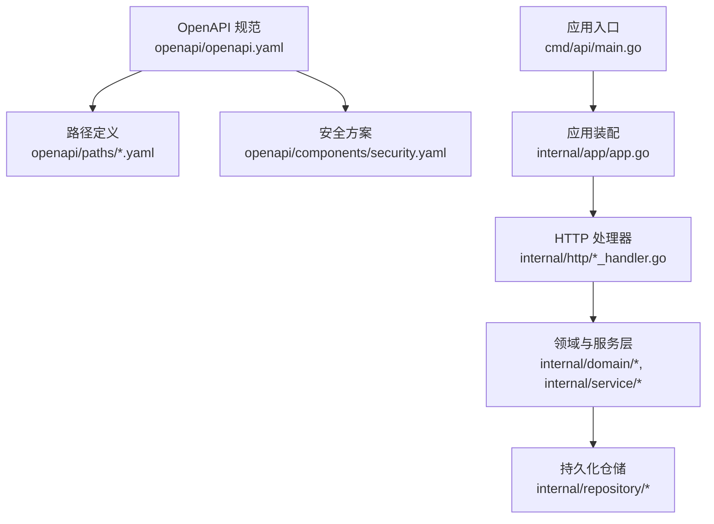
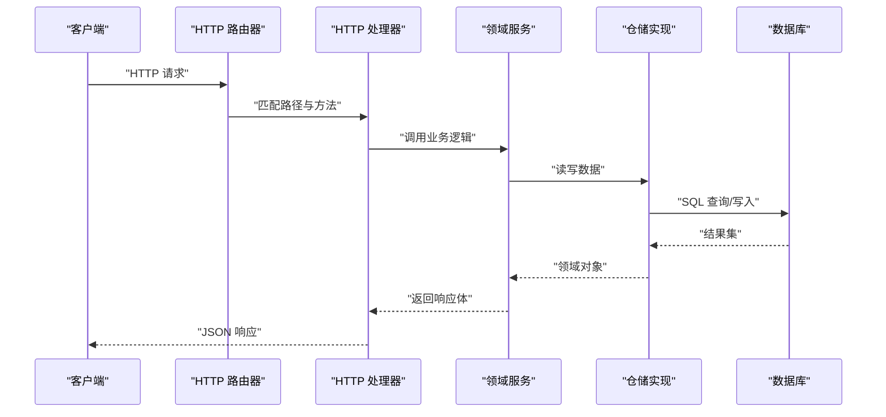
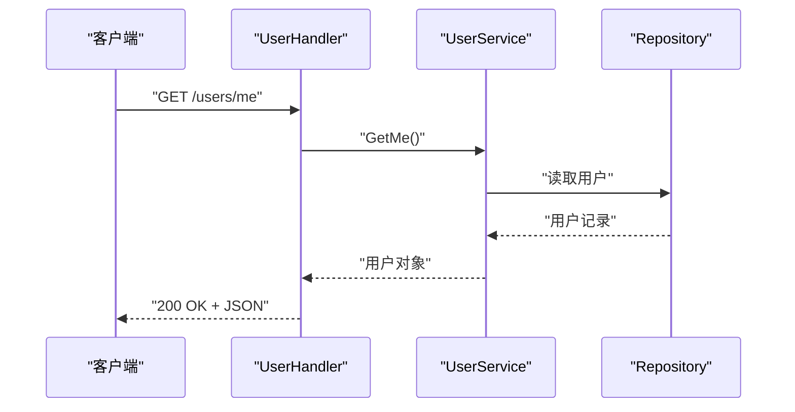
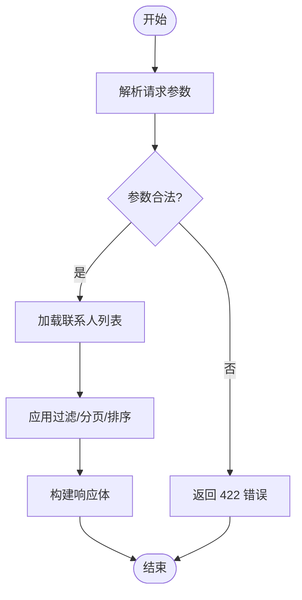
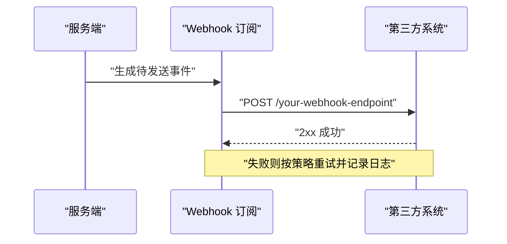
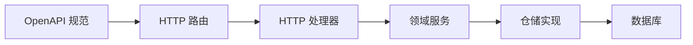

# API参考文档

<cite>
**本文引用的文件**   
- [openapi.yaml](file://notifuse/openapi/openapi.yaml)
- [openapi.json](file://notifuse/openapi.json)
- [user.yaml](file://notifuse/openapi/paths/user.yaml)
- [contacts.yaml](file://notifuse/openapi/paths/contacts.yaml)
- [contact-lists.yaml](file://notifuse/openapi/paths/contact-lists.yaml)
- [templates.yaml](file://notifuse/openapi/paths/templates.yaml)
- [broadcasts.yaml](file://notifuse/openapi/paths/broadcasts.yaml)
- [transactional.yaml](file://notifuse/openapi/paths/transactional.yaml)
- [webhook-subscriptions.yaml](file://notifuse/openapi/paths/webhook-subscriptions.yaml)
- [custom-events.yaml](file://notifuse/openapi/paths/custom-events.yaml)
- [subscribe.yaml](file://notifuse/openapi/paths/subscribe.yaml)
- [security.yaml](file://notifuse/openapi/components/security.yaml)
- [main.go](file://notifuse/cmd/api/main.go)
- [app.go](file://notifuse/internal/app/app.go)
- [user_handler.go](file://notifuse/internal/http/user_handler.go)
- [contact_handler.go](file://notifuse/internal/http/contact_handler.go)
- [contact_list_handler.go](file://notifuse/internal/http/contact_list_handler.go)
- [template_handler.go](file://notifuse/internal/http/template_handler.go)
- [broadcast_handler.go](file://notifuse/internal/http/broadcast_handler.go)
- [transactional_handler.go](file://notifuse/internal/http/transactional_handler.go)
- [webhook_subscription_handler.go](file://notifuse/internal/http/webhook_subscription_handler.go)
- [custom_event_handler.go](file://notifuse/internal/http/custom_event_handler.go)
- [automation_handler.go](file://notifuse/internal/http/automation_handler.go)
- [inbound_webhook_event_handler.go](file://notifuse/internal/http/inbound_webhook_event_handler.go)
</cite>

## 目录
1. [简介](#简介)
2. [项目结构](#项目结构)
3. [核心组件](#核心组件)
4. [架构总览](#架构总览)
5. [详细组件分析](#详细组件分析)
6. [依赖关系分析](#依赖关系分析)
7. [性能与可用性](#性能与可用性)
8. [故障排查指南](#故障排查指南)
9. [结论](#结论)
10. [附录](#附录)

## 简介
本文件为 Notifuse 平台的 RESTful API 参考文档，基于仓库中的 OpenAPI 规范进行整理。内容覆盖用户管理、联系人操作、模板管理、广播发送、事务性邮件、Webhook 订阅、自定义事件以及自动化工作流等核心能力。文档提供：
- HTTP 方法与 URL 模式
- 请求与响应 Schema 说明
- 认证与安全机制
- Webhook 事件格式与处理建议
- SDK 使用示例与客户端集成指南
- 调试工具推荐
- API 版本管理与兼容性说明

## 项目结构
Notifuse 的 API 定义位于 openapi 目录中，采用“路径拆分 + 公共组件”的组织方式；HTTP 路由与处理器位于 internal/http 下；应用启动与路由注册在 cmd/api 与 internal/app 中完成。

图表来源
- [openapi.yaml](file://notifuse/openapi/openapi.yaml)
- [user.yaml](file://notifuse/openapi/paths/user.yaml)
- [security.yaml](file://notifuse/openapi/components/security.yaml)
- [main.go](file://notifuse/cmd/api/main.go)
- [app.go](file://notifuse/internal/app/app.go)

章节来源
- [openapi.yaml](file://notifuse/openapi/openapi.yaml)
- [main.go](file://notifuse/cmd/api/main.go)
- [app.go](file://notifuse/internal/app/app.go)

## 核心组件
- 用户与工作区管理：创建、更新、查询用户与工作区成员关系
- 联系人管理：增删改查、列表分组、时间线
- 模板管理：模板块与模板资源的生命周期
- 广播发送：批量触达任务创建与状态跟踪
- 事务性邮件：单条即时发送接口
- Webhook 订阅：对外事件推送配置与管理
- 自定义事件：业务侧触发的事件上报
- 自动化工作流：触发器、节点编排与执行

章节来源
- [user.yaml](file://notifuse/openapi/paths/user.yaml)
- [contacts.yaml](file://notifuse/openapi/paths/contacts.yaml)
- [contact-lists.yaml](file://notifuse/openapi/paths/contact-lists.yaml)
- [templates.yaml](file://notifuse/openapi/paths/templates.yaml)
- [broadcasts.yaml](file://notifuse/openapi/paths/broadcasts.yaml)
- [transactional.yaml](file://notifuse/openapi/paths/transactional.yaml)
- [webhook-subscriptions.yaml](file://notifuse/openapi/paths/webhook-subscriptions.yaml)
- [custom-events.yaml](file://notifuse/openapi/paths/custom-events.yaml)
- [automation_handler.go](file://notifuse/internal/http/automation_handler.go)

## 架构总览
下图展示了从客户端到后端处理器、服务层与数据层的调用链路，以及 OpenAPI 规范如何驱动路由与校验。

图表来源
- [main.go](file://notifuse/cmd/api/main.go)
- [app.go](file://notifuse/internal/app/app.go)
- [user_handler.go](file://notifuse/internal/http/user_handler.go)
- [contact_handler.go](file://notifuse/internal/http/contact_handler.go)
- [template_handler.go](file://notifuse/internal/http/template_handler.go)
- [broadcast_handler.go](file://notifuse/internal/http/broadcast_handler.go)
- [transactional_handler.go](file://notifuse/internal/http/transactional_handler.go)
- [webhook_subscription_handler.go](file://notifuse/internal/http/webhook_subscription_handler.go)
- [custom_event_handler.go](file://notifuse/internal/http/custom_event_handler.go)

## 详细组件分析

### 认证与安全
- 安全方案定义于 components/security.yaml，包含 API Key、Bearer Token 等方案（具体名称以规范为准）
- 各端点通过 securitySchemes 引用所需认证方式
- 建议在网关或反向代理层统一鉴权与限流

章节来源
- [security.yaml](file://notifuse/openapi/components/security.yaml)
- [openapi.yaml](file://notifuse/openapi/openapi.yaml)

### 用户管理 API
- 典型端点：获取当前用户信息、更新用户资料、列出工作区成员等
- 请求参数：路径参数、查询参数、请求体字段
- 响应体：用户对象、分页元数据
- 错误码：401/403/404/422/500 等

图表来源
- [user.yaml](file://notifuse/openapi/paths/user.yaml)
- [user_handler.go](file://notifuse/internal/http/user_handler.go)

章节来源
- [user.yaml](file://notifuse/openapi/paths/user.yaml)
- [user_handler.go](file://notifuse/internal/http/user_handler.go)

### 联系人管理 API
- 功能范围：联系人增删改查、按列表筛选、时间线查看
- 批量导入：支持 CSV/JSON 批量导入（参见 samples 目录下的示例）
- 分页与排序：支持 page/page_size、sort/order 等通用查询参数

图表来源
- [contacts.yaml](file://notifuse/openapi/paths/contacts.yaml)
- [contact_handler.go](file://notifuse/internal/http/contact_handler.go)

章节来源
- [contacts.yaml](file://notifuse/openapi/paths/contacts.yaml)
- [contact_handler.go](file://notifuse/internal/http/contact_handler.go)

### 联系人列表 API
- 功能范围：列表的创建、更新、删除、成员管理
- 常用操作：添加/移除联系人、导出成员

章节来源
- [contact-lists.yaml](file://notifuse/openapi/paths/contact-lists.yaml)
- [contact_list_handler.go](file://notifuse/internal/http/contact_list_handler.go)

### 模板管理 API
- 功能范围：模板块与模板资源的 CRUD
- 渲染变量：模板中使用 Liquid 语法（详见 pkg/notifuse_mjml 相关实现）
- 预览与验证：支持模板编译与预览

章节来源
- [templates.yaml](file://notifuse/openapi/paths/templates.yaml)
- [template_handler.go](file://notifuse/internal/http/template_handler.go)

### 广播发送 API
- 功能范围：创建广播任务、选择目标受众、设置发送策略
- 状态跟踪：任务状态、进度、失败重试
- 速率控制：受全局与租户级速率限制

章节来源
- [broadcasts.yaml](file://notifuse/openapi/paths/broadcasts.yaml)
- [broadcast_handler.go](file://notifuse/internal/http/broadcast_handler.go)

### 事务性邮件 API
- 功能范围：单条即时发送，适合交易通知、验证码等场景
- 模板引用：可复用模板变量与附件
- 幂等性：建议客户端携带 idempotency-key 避免重复发送

章节来源
- [transactional.yaml](file://notifuse/openapi/paths/transactional.yaml)
- [transactional_handler.go](file://notifuse/internal/http/transactional_handler.go)

### Webhook 订阅 API
- 功能范围：订阅事件类型、配置回调地址、签名校验
- 事件类型：消息投递、退信、打开、点击等（以实际事件定义为准）
- 重试策略：指数退避与最大重试次数

图表来源
- [webhook-subscriptions.yaml](file://notifuse/openapi/paths/webhook-subscriptions.yaml)
- [webhook_subscription_handler.go](file://notifuse/internal/http/webhook_subscription_handler.go)

章节来源
- [webhook-subscriptions.yaml](file://notifuse/openapi/paths/webhook-subscriptions.yaml)
- [webhook_subscription_handler.go](file://notifuse/internal/http/webhook_subscription_handler.go)

### 自定义事件 API
- 功能范围：业务侧上报自定义事件，用于分析与自动化触发
- 事件模型：事件名、属性键值对、时间戳等

章节来源
- [custom-events.yaml](file://notifuse/openapi/paths/custom-events.yaml)
- [custom_event_handler.go](file://notifuse/internal/http/custom_event_handler.go)

### 订阅链接 API
- 功能范围：公开订阅/退订页面与 API
- 用途：面向最终用户的订阅偏好管理

章节来源
- [subscribe.yaml](file://notifuse/openapi/paths/subscribe.yaml)

### 自动化工作流 API
- 功能范围：工作流定义、触发器配置、节点编排与执行历史
- 处理器：由 automation_handler 暴露 REST 接口

章节来源
- [automation_handler.go](file://notifuse/internal/http/automation_handler.go)

### 入站 Webhook 事件处理
- 功能范围：接收外部平台事件（如退信、打开、点击），标准化后入库
- 处理器：inbound_webhook_event_handler

章节来源
- [inbound_webhook_event_handler.go](file://notifuse/internal/http/inbound_webhook_event_handler.go)

## 依赖关系分析
- OpenAPI 规范作为契约，驱动路由与校验
- HTTP 处理器仅负责协议层转换，业务逻辑下沉至 service 层
- repository 层屏蔽存储细节，便于替换与测试

图表来源
- [openapi.yaml](file://notifuse/openapi/openapi.yaml)
- [main.go](file://notifuse/cmd/api/main.go)
- [app.go](file://notifuse/internal/app/app.go)

章节来源
- [openapi.yaml](file://notifuse/openapi/openapi.yaml)
- [main.go](file://notifuse/cmd/api/main.go)
- [app.go](file://notifuse/internal/app/app.go)

## 性能与可用性
- 连接池与并发：合理配置数据库连接池与 goroutine 并发度
- 缓存策略：热点数据（如模板、配置）引入缓存层
- 队列与异步：广播与 Webhook 发送采用队列与重试机制
- 限流与熔断：网关层实施速率限制，关键路径增加熔断保护
- 监控与追踪：指标采集与分布式追踪贯穿全链路

[本节为通用指导，不直接分析具体文件]

## 故障排查指南
- 常见状态码
  - 2xx：成功
  - 400：请求格式错误
  - 401：未认证
  - 403：无权限
  - 404：资源不存在
  - 422：参数校验失败
  - 429：速率限制
  - 5xx：服务端错误
- 定位步骤
  - 检查请求头与签名是否正确
  - 核对路径参数与必填字段
  - 查看服务端日志与链路追踪
  - 复现最小用例并逐步缩小范围
- 调试工具
  - curl、Postman、Insomnia
  - 浏览器开发者工具（网络面板）
  - 日志聚合与 APM 工具

[本节为通用指导，不直接分析具体文件]

## 结论
本参考文档基于仓库内 OpenAPI 规范与 HTTP 处理器实现，系统化梳理了 Notifuse 的核心 API 能力与调用流程。建议在实际集成时：
- 以 OpenAPI 规范为准进行契约测试
- 在网关层统一鉴权、限流与审计
- 结合监控与告警保障稳定性
- 遵循幂等与重试最佳实践

[本节为总结性内容，不直接分析具体文件]

## 附录

### 请求与响应示例
- 请参考以下路径文件中的请求/响应示例片段：
  - [user.yaml](file://notifuse/openapi/paths/user.yaml)
  - [contacts.yaml](file://notifuse/openapi/paths/contacts.yaml)
  - [contact-lists.yaml](file://notifuse/openapi/paths/contact-lists.yaml)
  - [templates.yaml](file://notifuse/openapi/paths/templates.yaml)
  - [broadcasts.yaml](file://notifuse/openapi/paths/broadcasts.yaml)
  - [transactional.yaml](file://notifuse/openapi/paths/transactional.yaml)
  - [webhook-subscriptions.yaml](file://notifuse/openapi/paths/webhook-subscriptions.yaml)
  - [custom-events.yaml](file://notifuse/openapi/paths/custom-events.yaml)
  - [subscribe.yaml](file://notifuse/openapi/paths/subscribe.yaml)

### Webhook 事件格式
- 事件头部：包含签名、时间戳、事件类型等
- 事件体：标准事件结构，含事件元数据与业务负载
- 签名校验：建议使用 HMAC-SHA256 并在服务端验证
- 重试与去重：服务端会重试失败请求，客户端需实现幂等

章节来源
- [webhook-subscriptions.yaml](file://notifuse/openapi/paths/webhook-subscriptions.yaml)
- [inbound_webhook_event_handler.go](file://notifuse/internal/http/inbound_webhook_event_handler.go)

### 实时通信与 WebSocket
- 当前仓库未提供 WebSocket 端点定义
- 如需实时能力，可在网关层接入 WebSocket 代理并通过内部事件总线分发

[本节为概念性说明，不直接分析具体文件]

### SDK 使用示例与客户端集成指南
- 语言与框架：Go、Node.js、Python、Java 等均可
- 生成方式：基于 OpenAPI 规范自动生成客户端代码
- 集成要点：
  - 统一注入认证头
  - 实现重试与退避
  - 记录结构化日志与指标
  - 使用环境变量管理密钥

[本节为通用指导，不直接分析具体文件]

### API 版本管理与迁移指南
- 版本策略：URL 前缀或请求头声明版本
- 向后兼容：新增字段优先，废弃字段保留过渡期
- 变更公告：通过变更日志与通知渠道发布
- 迁移步骤：
  - 评估影响面
  - 灰度发布
  - 回滚预案
  - 监控与告警

[本节为通用指导，不直接分析具体文件]