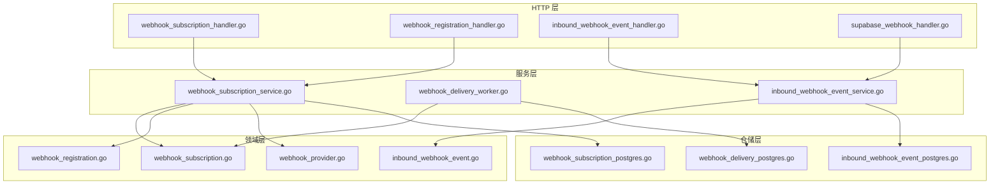
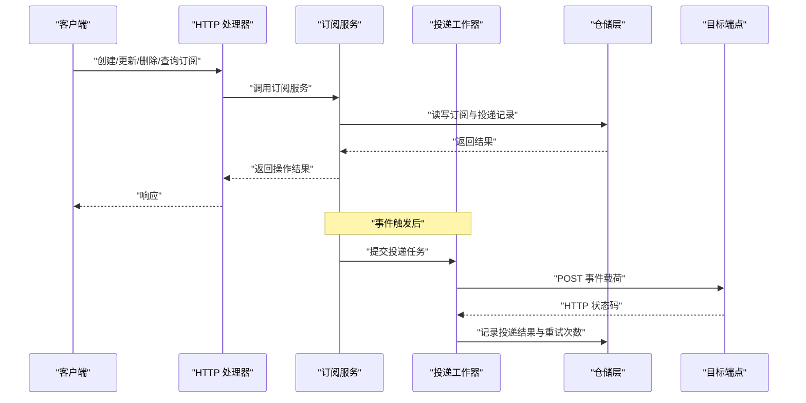
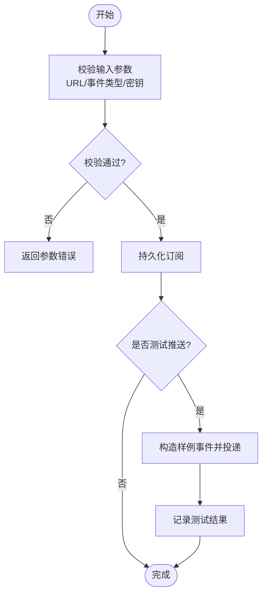
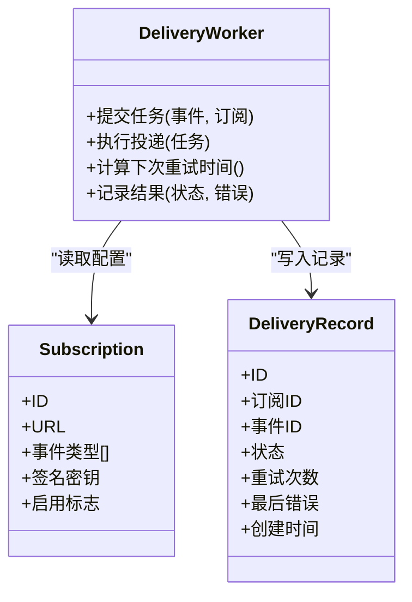
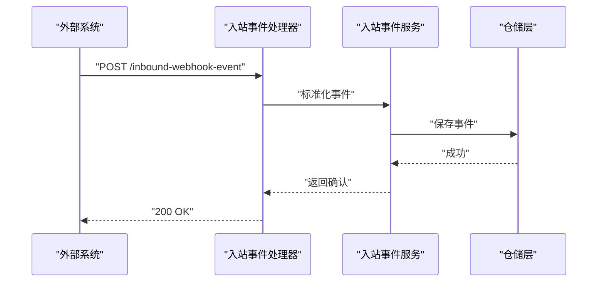
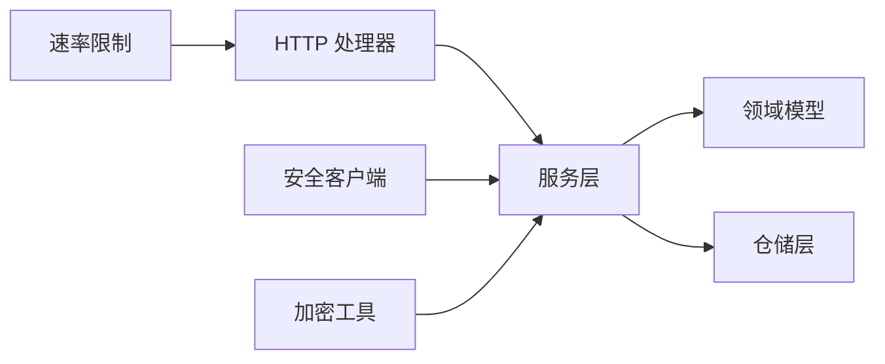

# Webhook集成API

<cite>
**本文引用的文件**   
- [openapi.yaml](file://notifuse/openapi/openapi.yaml)
- [webhook-subscriptions.yaml](file://notifuse/openapi/paths/webhook-subscriptions.yaml)
- [subscribe.yaml](file://notifuse/openapi/paths/subscribe.yaml)
- [contact-lists.yaml](file://notifuse/openapi/paths/contact-lists.yaml)
- [contacts.yaml](file://notifuse/openapi/paths/contacts.yaml)
- [templates.yaml](file://notifuse/openapi/paths/templates.yaml)
- [custom-events.yaml](file://notifuse/openapi/paths/custom-events.yaml)
- [transactional.yaml](file://notifuse/openapi/paths/transactional.yaml)
- [broadcasts.yaml](file://notifuse/openapi/paths/broadcasts.yaml)
- [user.yaml](file://notifuse/openapi/paths/user.yaml)
- [security.yaml](file://notifuse/openapi/components/security.yaml)
- [webhook_subscription_handler.go](file://notifuse/internal/http/webhook_subscription_handler.go)
- [webhook_registration_handler.go](file://notifuse/internal/http/webhook_registration_handler.go)
- [webhook_subscription_service.go](file://notifuse/internal/service/webhook_subscription_service.go)
- [webhook_delivery_worker.go](file://notifuse/internal/service/webhook_delivery_worker.go)
- [webhook_provider.go](file://notifuse/internal/domain/webhook_provider.go)
- [webhook_registration.go](file://notifuse/internal/domain/webhook_registration.go)
- [webhook_subscription.go](file://notifuse/internal/domain/webhook_subscription.go)
- [webhook_delivery_postgres.go](file://notifuse/internal/repository/webhook_delivery_postgres.go)
- [webhook_subscription_postgres.go](file://notifuse/internal/repository/webhook_subscription_postgres.go)
- [inbound_webhook_event_handler.go](file://notifuse/internal/http/inbound_webhook_event_handler.go)
- [inbound_webhook_event_service.go](file://notifuse/internal/service/inbound_webhook_event_service.go)
- [inbound_webhook_event.go](file://notifuse/internal/domain/inbound_webhook_event.go)
- [inbound_webhook_event_postgres.go](file://notifuse/internal/repository/inbound_webhook_event_postgres.go)
- [supabase_webhook_handler.go](file://notifuse/internal/http/supabase_webhook_handler.go)
- [ratelimiter.go](file://notifuse/pkg/ratelimiter/ratelimiter.go)
- [safehttpclient.go](file://notifuse/pkg/safehttpclient/safehttpclient.go)
- [crypto.go](file://notifuse/pkg/crypto/crypto.go)
</cite>

## 目录
1. [简介](#简介)
2. [项目结构](#项目结构)
3. [核心组件](#核心组件)
4. [架构总览](#架构总览)
5. [详细组件分析](#详细组件分析)
6. [依赖关系分析](#依赖关系分析)
7. [性能与速率限制](#性能与速率限制)
8. [安全与签名验证](#安全与签名验证)
9. [事件类型与消息格式](#事件类型与消息格式)
10. [Webhook订阅管理接口](#webhook订阅管理接口)
11. [测试与调试指南](#测试与调试指南)
12. [故障排查](#故障排查)
13. [结论](#结论)
14. [附录：多语言接收端点示例](#附录多语言接收端点示例)

## 简介
本文件为 Notifuse 平台的 Webhook 集成 API 提供完整文档，覆盖以下主题：
- Webhook 订阅的创建、配置、测试与管理
- 事件类型定义与消息格式规范
- 签名验证机制与重试策略
- 常见事件（联系人变更、邮件状态更新、模板修改等）的数据结构与处理示例
- 安全防护措施、速率限制配置与故障排查指南
- 多种编程语言的 Webhook 接收端点实现示例与调试技巧

## 项目结构
Notifuse 后端采用分层架构：HTTP 层暴露 REST API，服务层编排业务逻辑，领域模型定义数据结构与约束，仓储层负责持久化。Webhook 相关能力横跨这些层次，并通过 OpenAPI 规范对外描述。

图表来源
- [webhook_subscription_handler.go](file://notifuse/internal/http/webhook_subscription_handler.go)
- [webhook_registration_handler.go](file://notifuse/internal/http/webhook_registration_handler.go)
- [inbound_webhook_event_handler.go](file://notifuse/internal/http/inbound_webhook_event_handler.go)
- [supabase_webhook_handler.go](file://notifuse/internal/http/supabase_webhook_handler.go)
- [webhook_subscription_service.go](file://notifuse/internal/service/webhook_subscription_service.go)
- [webhook_delivery_worker.go](file://notifuse/internal/service/webhook_delivery_worker.go)
- [inbound_webhook_event_service.go](file://notifuse/internal/service/inbound_webhook_event_service.go)
- [webhook_subscription.go](file://notifuse/internal/domain/webhook_subscription.go)
- [webhook_registration.go](file://notifuse/internal/domain/webhook_registration.go)
- [webhook_provider.go](file://notifuse/internal/domain/webhook_provider.go)
- [inbound_webhook_event.go](file://notifuse/internal/domain/inbound_webhook_event.go)
- [webhook_subscription_postgres.go](file://notifuse/internal/repository/webhook_subscription_postgres.go)
- [webhook_delivery_postgres.go](file://notifuse/internal/repository/webhook_delivery_postgres.go)
- [inbound_webhook_event_postgres.go](file://notifuse/internal/repository/inbound_webhook_event_postgres.go)

章节来源
- [webhook_subscription_handler.go](file://notifuse/internal/http/webhook_subscription_handler.go)
- [webhook_subscription_service.go](file://notifuse/internal/service/webhook_subscription_service.go)
- [webhook_delivery_worker.go](file://notifuse/internal/service/webhook_delivery_worker.go)
- [webhook_subscription.go](file://notifuse/internal/domain/webhook_subscription.go)
- [webhook_subscription_postgres.go](file://notifuse/internal/repository/webhook_subscription_postgres.go)

## 核心组件
- HTTP 处理器
  - Webhook 订阅管理：创建、更新、删除、查询、启用/禁用、测试推送
  - Webhook 注册管理：工作区级注册信息维护
  - 入站事件处理：接收外部系统回调并落库
  - Supabase 集成回调：处理第三方平台回推事件
- 服务层
  - 订阅服务：校验、持久化、触发投递任务
  - 投递工作器：异步发送 Webhook 请求，执行重试与退避
  - 入站事件服务：标准化入站事件数据，记录审计日志
- 领域模型
  - 订阅、注册、提供者、入站事件等实体定义与约束
- 仓储层
  - PostgreSQL 持久化：订阅、投递记录、入站事件存储

章节来源
- [webhook_subscription_handler.go](file://notifuse/internal/http/webhook_subscription_handler.go)
- [webhook_subscription_service.go](file://notifuse/internal/service/webhook_subscription_service.go)
- [webhook_delivery_worker.go](file://notifuse/internal/service/webhook_delivery_worker.go)
- [webhook_subscription.go](file://notifuse/internal/domain/webhook_subscription.go)
- [webhook_delivery_postgres.go](file://notifuse/internal/repository/webhook_delivery_postgres.go)

## 架构总览
Webhook 集成由“订阅驱动”的事件分发体系构成。当平台内资源发生变化时，系统根据已启用的订阅生成事件并投递到目标 URL；同时支持接收外部系统的入站事件，统一建模后进入内部流程。

图表来源
- [webhook_subscription_handler.go](file://notifuse/internal/http/webhook_subscription_handler.go)
- [webhook_subscription_service.go](file://notifuse/internal/service/webhook_subscription_service.go)
- [webhook_delivery_worker.go](file://notifuse/internal/service/webhook_delivery_worker.go)
- [webhook_subscription_postgres.go](file://notifuse/internal/repository/webhook_subscription_postgres.go)
- [webhook_delivery_postgres.go](file://notifuse/internal/repository/webhook_delivery_postgres.go)

## 详细组件分析

### Webhook 订阅管理
- 职责
  - 提供订阅的 CRUD 与生命周期管理
  - 支持按工作区隔离与权限控制
  - 提供测试推送能力，便于快速验证
- 关键流程
  - 创建订阅：校验目标 URL、事件类型、过滤条件、签名密钥等
  - 更新订阅：增量更新字段，保留未变更项
  - 删除订阅：软删除或硬删除，清理关联投递记录
  - 启用/禁用：控制是否参与事件分发
  - 测试推送：构造样例事件并投递，记录结果
- 错误处理
  - 参数校验失败返回明确错误码
  - 重复订阅冲突提示
  - 网络不可达或超时记录失败原因

图表来源
- [webhook_subscription_handler.go](file://notifuse/internal/http/webhook_subscription_handler.go)
- [webhook_subscription_service.go](file://notifuse/internal/service/webhook_subscription_service.go)
- [webhook_subscription.go](file://notifuse/internal/domain/webhook_subscription.go)
- [webhook_subscription_postgres.go](file://notifuse/internal/repository/webhook_subscription_postgres.go)

章节来源
- [webhook_subscription_handler.go](file://notifuse/internal/http/webhook_subscription_handler.go)
- [webhook_subscription_service.go](file://notifuse/internal/service/webhook_subscription_service.go)
- [webhook_subscription.go](file://notifuse/internal/domain/webhook_subscription.go)
- [webhook_subscription_postgres.go](file://notifuse/internal/repository/webhook_subscription_postgres.go)

### Webhook 投递与重试
- 职责
  - 异步发送 Webhook 请求
  - 实现指数退避与最大重试次数
  - 记录每次投递的状态、耗时、响应头与错误信息
- 重试策略
  - 初始延迟与最大重试次数可配置
  - 对 5xx 与网络错误进行重试，2xx/3xx 视为成功
  - 幂等性建议：在事件载荷中包含唯一 ID，接收端据此去重
- 失败处理
  - 超过最大重试次数标记为最终失败
  - 提供人工重试入口与批量重放能力

图表来源
- [webhook_delivery_worker.go](file://notifuse/internal/service/webhook_delivery_worker.go)
- [webhook_subscription.go](file://notifuse/internal/domain/webhook_subscription.go)
- [webhook_delivery_postgres.go](file://notifuse/internal/repository/webhook_delivery_postgres.go)

章节来源
- [webhook_delivery_worker.go](file://notifuse/internal/service/webhook_delivery_worker.go)
- [webhook_delivery_postgres.go](file://notifuse/internal/repository/webhook_delivery_postgres.go)

### 入站事件处理
- 职责
  - 接收外部系统回调（如 Supabase、第三方平台）
  - 标准化事件结构并落库
  - 触发后续自动化流程（可选）
- 典型流程
  - 校验来源与签名（若需要）
  - 解析事件体，映射为内部模型
  - 持久化并返回确认响应

图表来源
- [inbound_webhook_event_handler.go](file://notifuse/internal/http/inbound_webhook_event_handler.go)
- [inbound_webhook_event_service.go](file://notifuse/internal/service/inbound_webhook_event_service.go)
- [inbound_webhook_event_postgres.go](file://notifuse/internal/repository/inbound_webhook_event_postgres.go)

章节来源
- [inbound_webhook_event_handler.go](file://notifuse/internal/http/inbound_webhook_event_handler.go)
- [inbound_webhook_event_service.go](file://notifuse/internal/service/inbound_webhook_event_service.go)
- [inbound_webhook_event.go](file://notifuse/internal/domain/inbound_webhook_event.go)
- [inbound_webhook_event_postgres.go](file://notifuse/internal/repository/inbound_webhook_event_postgres.go)

### Supabase 集成回调
- 职责
  - 处理来自 Supabase 的 Webhook 回调
  - 将外部状态同步至平台内部模型
- 关键点
  - 严格校验来源 IP 与签名
  - 幂等处理，避免重复同步

章节来源
- [supabase_webhook_handler.go](file://notifuse/internal/http/supabase_webhook_handler.go)

## 依赖关系分析
- 组件耦合
  - HTTP 处理器仅依赖服务层接口，保持松耦合
  - 服务层组合领域模型与仓储接口，便于替换实现
  - 仓储层直接访问数据库，屏蔽 SQL 细节
- 外部依赖
  - 速率限制中间件用于保护 API 与投递通道
  - 安全客户端用于出站请求的安全控制
  - 加密工具用于签名与密钥管理

图表来源
- [webhook_subscription_handler.go](file://notifuse/internal/http/webhook_subscription_handler.go)
- [webhook_subscription_service.go](file://notifuse/internal/service/webhook_subscription_service.go)
- [webhook_subscription.go](file://notifuse/internal/domain/webhook_subscription.go)
- [webhook_subscription_postgres.go](file://notifuse/internal/repository/webhook_subscription_postgres.go)
- [ratelimiter.go](file://notifuse/pkg/ratelimiter/ratelimiter.go)
- [safehttpclient.go](file://notifuse/pkg/safehttpclient/safehttpclient.go)
- [crypto.go](file://notifuse/pkg/crypto/crypto.go)

章节来源
- [webhook_subscription_handler.go](file://notifuse/internal/http/webhook_subscription_handler.go)
- [webhook_subscription_service.go](file://notifuse/internal/service/webhook_subscription_service.go)
- [webhook_subscription.go](file://notifuse/internal/domain/webhook_subscription.go)
- [webhook_subscription_postgres.go](file://notifuse/internal/repository/webhook_subscription_postgres.go)
- [ratelimiter.go](file://notifuse/pkg/ratelimiter/ratelimiter.go)
- [safehttpclient.go](file://notifuse/pkg/safehttpclient/safehttpclient.go)
- [crypto.go](file://notifuse/pkg/crypto/crypto.go)

## 性能与速率限制
- 速率限制
  - 针对订阅管理与投递通道设置全局与工作区级限流
  - 推荐值：管理接口每秒若干次，投递通道按订阅粒度限制
- 并发与背压
  - 投递任务使用队列与并发池，避免瞬时风暴
  - 结合指数退避降低下游压力
- 监控与指标
  - 记录投递成功率、平均耗时、重试次数分布
  - 告警阈值：连续失败率、延迟 P95/P99

[本节为通用指导，不直接分析具体文件]

## 安全与签名验证
- 传输安全
  - 强制 HTTPS，证书校验开启
  - 出站请求使用安全客户端，限制协议与主机白名单
- 请求签名
  - 使用 HMAC-SHA256 对请求体与时间戳进行签名
  - 服务端验签失败拒绝处理，防止伪造与重放
- 密钥管理
  - 密钥在工作区内隔离存储，支持轮换
  - 最小权限原则，仅允许订阅所有者访问
- 防重放
  - 携带时间戳与随机数，服务端校验时间窗口与唯一性

章节来源
- [webhook_subscription.go](file://notifuse/internal/domain/webhook_subscription.go)
- [webhook_provider.go](file://notifuse/internal/domain/webhook_provider.go)
- [crypto.go](file://notifuse/pkg/crypto/crypto.go)
- [safehttpclient.go](file://notifuse/pkg/safehttpclient/safehttpclient.go)

## 事件类型与消息格式
- 事件类型
  - 联系人相关：创建、更新、删除、标签变更
  - 列表相关：成员增删、列表属性变更
  - 模板相关：创建、更新、删除、版本发布
  - 自定义事件：用户自定义事件名与载荷
  - 事务型事件：交易类通知（如订单状态）
  - 广播事件：群发活动状态变更
  - 用户事件：用户资料与权限变更
- 消息格式
  - 标准字段：事件 ID、事件类型、时间戳、工作区 ID、数据载荷
  - 扩展字段：来源、版本、追踪 ID
  - 载荷结构：按事件类型定义 JSON Schema
- 示例路径
  - 联系人事件载荷结构参考：[contacts.yaml](file://notifuse/openapi/paths/contacts.yaml)
  - 列表事件载荷结构参考：[contact-lists.yaml](file://notifuse/openapi/paths/contact-lists.yaml)
  - 模板事件载荷结构参考：[templates.yaml](file://notifuse/openapi/paths/templates.yaml)
  - 自定义事件载荷结构参考：[custom-events.yaml](file://notifuse/openapi/paths/custom-events.yaml)
  - 事务型事件载荷结构参考：[transactional.yaml](file://notifuse/openapi/paths/transactional.yaml)
  - 广播事件载荷结构参考：[broadcasts.yaml](file://notifuse/openapi/paths/broadcasts.yaml)
  - 用户事件载荷结构参考：[user.yaml](file://notifuse/openapi/paths/user.yaml)

章节来源
- [contacts.yaml](file://notifuse/openapi/paths/contacts.yaml)
- [contact-lists.yaml](file://notifuse/openapi/paths/contact-lists.yaml)
- [templates.yaml](file://notifuse/openapi/paths/templates.yaml)
- [custom-events.yaml](file://notifuse/openapi/paths/custom-events.yaml)
- [transactional.yaml](file://notifuse/openapi/paths/transactional.yaml)
- [broadcasts.yaml](file://notifuse/openapi/paths/broadcasts.yaml)
- [user.yaml](file://notifuse/openapi/paths/user.yaml)

## Webhook订阅管理接口
- 基础信息
  - 认证方案：参考 [security.yaml](file://notifuse/openapi/components/security.yaml)
  - 路径前缀：/api/v1/webhook-subscriptions
- 主要操作
  - 创建订阅：POST /subscriptions
  - 更新订阅：PUT /subscriptions/{id}
  - 删除订阅：DELETE /subscriptions/{id}
  - 查询订阅：GET /subscriptions
  - 启用/禁用：PATCH /subscriptions/{id}/status
  - 测试推送：POST /subscriptions/{id}/test
- 请求与响应
  - 请求体包含：目标 URL、事件类型数组、过滤条件、签名密钥、备注
  - 响应体包含：订阅 ID、状态、创建/更新时间
- 错误码
  - 400：参数校验失败
  - 401：未认证
  - 403：无权限
  - 404：资源不存在
  - 409：重复订阅冲突
  - 429：速率限制
  - 500：服务器内部错误

章节来源
- [webhook-subscriptions.yaml](file://notifuse/openapi/paths/webhook-subscriptions.yaml)
- [subscribe.yaml](file://notifuse/openapi/paths/subscribe.yaml)
- [security.yaml](file://notifuse/openapi/components/security.yaml)
- [webhook_subscription_handler.go](file://notifuse/internal/http/webhook_subscription_handler.go)

## 测试与调试指南
- 本地测试
  - 使用测试推送接口快速验证订阅配置
  - 借助本地代理（如 ngrok）暴露公网地址供平台回调
- 日志与追踪
  - 查看投递记录表，定位失败原因与重试次数
  - 开启链路追踪，关联事件 ID 与请求 ID
- 常见问题
  - 签名校验失败：检查时间戳窗口与密钥一致性
  - 超时或连接失败：检查防火墙与 DNS 解析
  - 重复处理：确保接收端基于事件 ID 去重

章节来源
- [webhook_delivery_worker.go](file://notifuse/internal/service/webhook_delivery_worker.go)
- [webhook_delivery_postgres.go](file://notifuse/internal/repository/webhook_delivery_postgres.go)

## 故障排查
- 步骤
  - 确认订阅状态为启用
  - 检查目标 URL 可达性与证书有效性
  - 核对签名密钥与时间戳
  - 查看投递记录中的错误信息与堆栈
- 恢复
  - 修正配置后手动重试
  - 批量重放失败事件
  - 调整速率限制与重试策略

章节来源
- [webhook_delivery_worker.go](file://notifuse/internal/service/webhook_delivery_worker.go)
- [webhook_delivery_postgres.go](file://notifuse/internal/repository/webhook_delivery_postgres.go)

## 结论
Notifuse 的 Webhook 集成以订阅为中心，提供高可靠的事件分发与入站事件处理能力。通过严格的签名验证、指数退避重试与完善的观测手段，确保事件在复杂网络环境下的稳定交付。建议在生产环境中结合速率限制与监控告警，持续优化投递质量与安全性。

[本节为总结性内容，不直接分析具体文件]

## 附录：多语言接收端点示例
以下为不同语言的接收端点实现要点与调试技巧（不包含代码片段，仅提供思路与参考路径）：

- Node.js
  - 使用 Express/Koa 接收 POST 请求
  - 校验签名：HMAC-SHA256，比较请求头签名与计算值
  - 幂等处理：基于事件 ID 去重
  - 参考路径：[webhook-subscriptions.yaml](file://notifuse/openapi/paths/webhook-subscriptions.yaml)
- Python
  - 使用 Flask/FastAPI 构建轻量服务
  - 验签与时间戳校验
  - 异步处理事件，避免阻塞
  - 参考路径：[webhook-subscriptions.yaml](file://notifuse/openapi/paths/webhook-subscriptions.yaml)
- Go
  - 使用 net/http 或 Gin 框架
  - 标准库 crypto/hmac 验签
  - 并发处理与队列缓冲
  - 参考路径：[webhook-subscriptions.yaml](file://notifuse/openapi/paths/webhook-subscriptions.yaml)
- Java
  - Spring Boot 控制器处理请求
  - 使用 javax.crypto.Mac 验签
  - 使用消息队列解耦处理
  - 参考路径：[webhook-subscriptions.yaml](file://notifuse/openapi/paths/webhook-subscriptions.yaml)
- PHP
  - Laravel/Symfony 路由处理
  - hash_hmac 验签
  - 队列任务处理事件
  - 参考路径：[webhook-subscriptions.yaml](file://notifuse/openapi/paths/webhook-subscriptions.yaml)

调试技巧
- 打印请求头与载荷摘要（脱敏）
- 记录验签失败的具体差异（时间戳、密钥、载荷）
- 使用 Postman/curl 模拟平台请求，验证签名与格式

[本节为通用指导，不直接分析具体文件]