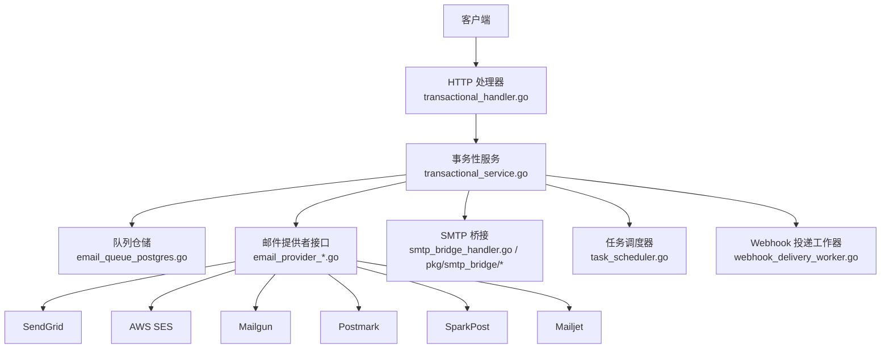
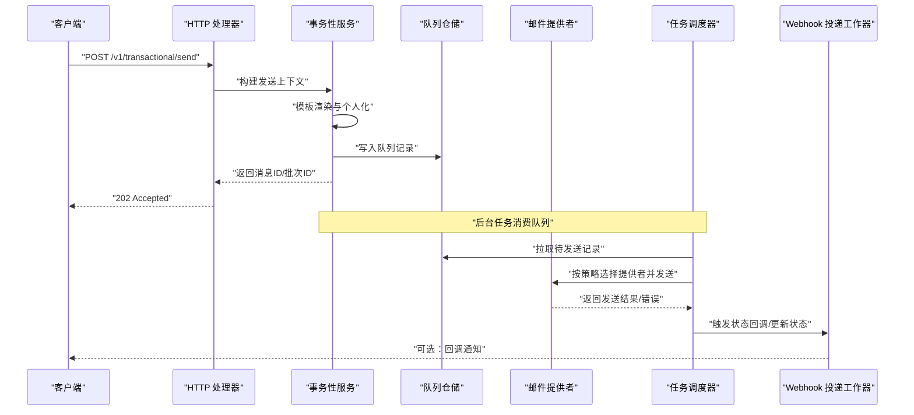
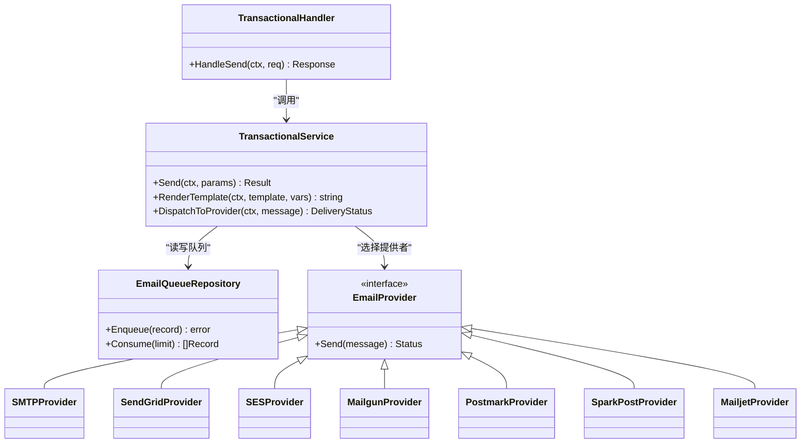

# 事务性邮件API

<cite>
**本文引用的文件**   
- [cmd/api/main.go](file://notifuse/cmd/api/main.go)
- [internal/http/transactional_handler.go](file://notifuse/internal/http/transactional_handler.go)
- [internal/service/transactional_service.go](file://notifuse/internal/service/transactional_service.go)
- [internal/domain/email_queue.go](file://notifuse/internal/domain/email_queue.go)
- [internal/repository/email_queue_postgres.go](file://notifuse/internal/repository/email_queue_postgres.go)
- [internal/service/smtp_bridge_handler.go](file://notifuse/internal/service/smtp_bridge_handler.go)
- [pkg/smtp_bridge/server.go](file://notifuse/pkg/smtp_bridge/server.go)
- [pkg/smtp_bridge/backend.go](file://notifuse/pkg/smtp_bridge/backend.go)
- [internal/service/email_service.go](file://notifuse/internal/service/email_service.go)
- [internal/domain/email_provider_smtp.go](file://notifuse/internal/domain/email_provider_smtp.go)
- [internal/domain/email_provider_sendgrid.go](file://notifuse/internal/domain/email_provider_sendgrid.go)
- [internal/domain/email_provider_ses.go](file://notifuse/internal/domain/email_provider_ses.go)
- [internal/domain/email_provider_mailgun.go](file://notifuse/internal/domain/email_provider_mailgun.go)
- [internal/domain/email_provider_postmark.go](file://notifuse/internal/domain/email_provider_postmark.go)
- [internal/domain/email_provider_sparkpost.go](file://notifuse/internal/domain/email_provider_mailjet.go)
- [internal/domain/email_provider_test.go](file://notifuse/internal/domain/email_provider_test.go)
- [internal/domain/errors.go](file://notifuse/internal/domain/errors.go)
- [pkg/emailerror/classifier.go](file://notifuse/pkg/emailerror/classifier.go)
- [pkg/emailerror/error.go](file://notifuse/pkg/emailerror/error.go)
- [internal/service/task_scheduler.go](file://notifuse/internal/service/task_scheduler.go)
- [internal/service/webhook_delivery_worker.go](file://notifuse/internal/service/webhook_delivery_worker.go)
- [openapi/paths/transactional.yaml](file://notifuse/openapi/paths/transactional.yaml)
- [config/config.go](file://notifuse/config/config.go)
</cite>

## 目录
1. [简介](#简介)
2. [项目结构](#项目结构)
3. [核心组件](#核心组件)
4. [架构总览](#架构总览)
5. [详细组件分析](#详细组件分析)
6. [依赖关系分析](#依赖关系分析)
7. [性能与高并发优化](#性能与高并发优化)
8. [故障排查指南](#故障排查指南)
9. [结论](#结论)
10. [附录：典型场景与最佳实践](#附录典型场景与最佳实践)

## 简介
本文件为 Notifuse 平台“事务性邮件API”的完整技术文档，覆盖以下关键能力：
- 实时发送接口、模板渲染与个人化内容注入
- SMTP 桥接与第三方服务集成（SendGrid、SES、Mailgun、Postmark、SparkPost、Mailjet）
- 状态追踪、重试机制与错误分类
- 高并发下的性能优化、负载均衡与故障转移策略
- 即时通讯、验证码发送、通知推送等典型应用场景的实现示例与最佳实践

## 项目结构
Notifuse 采用分层架构：HTTP 层暴露 API，服务层编排业务逻辑，领域层定义数据模型与提供者抽象，仓储层对接数据库，外部投递通过统一邮件提供者接口实现。

图表来源
- [internal/http/transactional_handler.go](file://notifuse/internal/http/transactional_handler.go)
- [internal/service/transactional_service.go](file://notifuse/internal/service/transactional_service.go)
- [internal/repository/email_queue_postgres.go](file://notifuse/internal/repository/email_queue_postgres.go)
- [internal/domain/email_provider_smtp.go](file://notifuse/internal/domain/email_provider_smtp.go)
- [internal/domain/email_provider_sendgrid.go](file://notifuse/internal/domain/email_provider_sendgrid.go)
- [internal/domain/email_provider_ses.go](file://notifuse/internal/domain/email_provider_ses.go)
- [internal/domain/email_provider_mailgun.go](file://notifuse/internal/domain/email_provider_mailgun.go)
- [internal/domain/email_provider_postmark.go](file://notifuse/internal/domain/email_provider_postmark.go)
- [internal/domain/email_provider_sparkpost.go](file://notifuse/internal/domain/email_provider_mailjet.go)
- [internal/service/smtp_bridge_handler.go](file://notifuse/internal/service/smtp_bridge_handler.go)
- [pkg/smtp_bridge/server.go](file://notifuse/pkg/smtp_bridge/server.go)
- [pkg/smtp_bridge/backend.go](file://notifuse/pkg/smtp_bridge/backend.go)
- [internal/service/task_scheduler.go](file://notifuse/internal/service/task_scheduler.go)
- [internal/service/webhook_delivery_worker.go](file://notifuse/internal/service/webhook_delivery_worker.go)

章节来源
- [cmd/api/main.go](file://notifuse/cmd/api/main.go)
- [internal/http/transactional_handler.go](file://notifuse/internal/http/transactional_handler.go)
- [internal/service/transactional_service.go](file://notifuse/internal/service/transactional_service.go)
- [openapi/paths/transactional.yaml](file://notifuse/openapi/paths/transactional.yaml)

## 核心组件
- HTTP 处理器：负责解析请求、鉴权、参数校验、调用服务层并返回响应。
- 事务性服务：编排模板渲染、收件人列表展开、队列持久化、选择投递通道、触发回调与监控埋点。
- 邮件队列仓储：将待发送邮件持久化到数据库，供后台任务消费。
- 邮件提供者：统一的发送抽象，支持 SMTP 及多家第三方服务。
- SMTP 桥接：提供标准 SMTP 服务器能力，将传统应用接入 Notifuse。
- 任务调度与 Webhook 投递：异步处理失败重试、状态回写与事件回调。

章节来源
- [internal/http/transactional_handler.go](file://notifuse/internal/http/transactional_handler.go)
- [internal/service/transactional_service.go](file://notifuse/internal/service/transactional_service.go)
- [internal/repository/email_queue_postgres.go](file://notifuse/internal/repository/email_queue_postgres.go)
- [internal/domain/email_provider_smtp.go](file://notifuse/internal/domain/email_provider_smtp.go)
- [internal/service/smtp_bridge_handler.go](file://notifuse/internal/service/smtp_bridge_handler.go)
- [pkg/smtp_bridge/server.go](file://notifuse/pkg/smtp_bridge/server.go)
- [pkg/smtp_bridge/backend.go](file://notifuse/pkg/smtp_bridge/backend.go)
- [internal/service/task_scheduler.go](file://notifuse/internal/service/task_scheduler.go)
- [internal/service/webhook_delivery_worker.go](file://notifuse/internal/service/webhook_delivery_worker.go)

## 架构总览
下图展示了从 HTTP 请求到最终投递与状态回写的端到端流程，包括模板渲染、队列落库、提供者选择、重试与回调。

图表来源
- [internal/http/transactional_handler.go](file://notifuse/internal/http/transactional_handler.go)
- [internal/service/transactional_service.go](file://notifuse/internal/service/transactional_service.go)
- [internal/repository/email_queue_postgres.go](file://notifuse/internal/repository/email_queue_postgres.go)
- [internal/service/task_scheduler.go](file://notifuse/internal/service/task_scheduler.go)
- [internal/service/webhook_delivery_worker.go](file://notifuse/internal/service/webhook_delivery_worker.go)
- [internal/domain/email_provider_smtp.go](file://notifuse/internal/domain/email_provider_smtp.go)
- [internal/domain/email_provider_sendgrid.go](file://notifuse/internal/domain/email_provider_sendgrid.go)
- [internal/domain/email_provider_ses.go](file://notifuse/internal/domain/email_provider_ses.go)
- [internal/domain/email_provider_mailgun.go](file://notifuse/internal/domain/email_provider_mailgun.go)
- [internal/domain/email_provider_postmark.go](file://notifuse/internal/domain/email_provider_postmark.go)
- [internal/domain/email_provider_sparkpost.go](file://notifuse/internal/domain/email_provider_mailjet.go)

## 详细组件分析

### HTTP 处理器：事务性邮件发送入口
- 职责
  - 解析请求体、校验必填字段、鉴权与限流
  - 组装发送上下文（主题、正文、附件、标签、回调URL等）
  - 调用事务性服务执行发送
  - 返回标准化响应（包含消息ID或批次ID）
- 关键点
  - 对大附件与超大收件人数进行前置限制
  - 使用 OpenAPI 定义的请求/响应结构保证一致性
- 参考路径
  - [internal/http/transactional_handler.go](file://notifuse/internal/http/transactional_handler.go)
  - [openapi/paths/transactional.yaml](file://notifuse/openapi/paths/transactional.yaml)

章节来源
- [internal/http/transactional_handler.go](file://notifuse/internal/http/transactional_handler.go)
- [openapi/paths/transactional.yaml](file://notifuse/openapi/paths/transactional.yaml)

### 事务性服务：编排与策略
- 职责
  - 模板渲染与变量注入（个人化内容）
  - 收件人去重与批量拆分
  - 选择投递通道（优先级/健康度/配额）
  - 写入队列、触发回调、埋点统计
- 关键点
  - 失败快速返回与异步重试分离
  - 可插拔的提供者选择策略
- 参考路径
  - [internal/service/transactional_service.go](file://notifuse/internal/service/transactional_service.go)

章节来源
- [internal/service/transactional_service.go](file://notifuse/internal/service/transactional_service.go)

### 邮件队列仓储：持久化与消费
- 职责
  - 持久化待发送记录（含元数据、重试次数、下次尝试时间）
  - 提供分页/条件查询供任务调度器消费
- 关键点
  - 幂等写入（基于唯一键避免重复）
  - 索引优化（按状态、优先级、创建时间）
- 参考路径
  - [internal/repository/email_queue_postgres.go](file://notifuse/internal/repository/email_queue_postgres.go)
  - [internal/domain/email_queue.go](file://notifuse/internal/domain/email_queue.go)

章节来源
- [internal/repository/email_queue_postgres.go](file://notifuse/internal/repository/email_queue_postgres.go)
- [internal/domain/email_queue.go](file://notifuse/internal/domain/email_queue.go)

### 邮件提供者：统一抽象与多后端
- 抽象设计
  - 统一接口封装不同供应商差异
  - 错误归一化与分类，便于重试与告警
- 已实现提供者
  - SMTP、SendGrid、SES、Mailgun、Postmark、SparkPost、Mailjet
- 参考路径
  - [internal/domain/email_provider_smtp.go](file://notifuse/internal/domain/email_provider_smtp.go)
  - [internal/domain/email_provider_sendgrid.go](file://notifuse/internal/domain/email_provider_sendgrid.go)
  - [internal/domain/email_provider_ses.go](file://notifuse/internal/domain/email_provider_ses.go)
  - [internal/domain/email_provider_mailgun.go](file://notifuse/internal/domain/email_provider_mailgun.go)
  - [internal/domain/email_provider_postmark.go](file://notifuse/internal/domain/email_provider_postmark.go)
  - [internal/domain/email_provider_sparkpost.go](file://notifuse/internal/domain/email_provider_mailjet.go)
  - [internal/domain/email_provider_test.go](file://notifuse/internal/domain/email_provider_test.go)

章节来源
- [internal/domain/email_provider_smtp.go](file://notifuse/internal/domain/email_provider_smtp.go)
- [internal/domain/email_provider_sendgrid.go](file://notifuse/internal/domain/email_provider_sendgrid.go)
- [internal/domain/email_provider_ses.go](file://notifuse/internal/domain/email_provider_ses.go)
- [internal/domain/email_provider_mailgun.go](file://notifuse/internal/domain/email_provider_mailgun.go)
- [internal/domain/email_provider_postmark.go](file://notifuse/internal/domain/email_provider_postmark.go)
- [internal/domain/email_provider_sparkpost.go](file://notifuse/internal/domain/email_provider_mailjet.go)
- [internal/domain/email_provider_test.go](file://notifuse/internal/domain/email_provider_test.go)

### SMTP 桥接：兼容传统应用
- 职责
  - 提供标准 SMTP 服务器，接收来自任意 SMTP 客户端的邮件
  - 将入站邮件转换为内部格式并进入发送管道
- 关键点
  - TLS 模式与认证策略可配置
  - 与内部服务解耦，便于横向扩展
- 参考路径
  - [internal/service/smtp_bridge_handler.go](file://notifuse/internal/service/smtp_bridge_handler.go)
  - [pkg/smtp_bridge/server.go](file://notifuse/pkg/smtp_bridge/server.go)
  - [pkg/smtp_bridge/backend.go](file://notifuse/pkg/smtp_bridge/backend.go)

章节来源
- [internal/service/smtp_bridge_handler.go](file://notifuse/internal/service/smtp_bridge_handler.go)
- [pkg/smtp_bridge/server.go](file://notifuse/pkg/smtp_bridge/server.go)
- [pkg/smtp_bridge/backend.go](file://notifuse/pkg/smtp_bridge/backend.go)

### 任务调度与 Webhook 投递：异步与可靠
- 任务调度器
  - 周期性扫描队列，按优先级与退避策略重试
  - 失败分类后决定重试/丢弃/转人工
- Webhook 投递工作器
  - 将发送结果、打开/点击等事件回调给上游系统
- 参考路径
  - [internal/service/task_scheduler.go](file://notifuse/internal/service/task_scheduler.go)
  - [internal/service/webhook_delivery_worker.go](file://notifuse/internal/service/webhook_delivery_worker.go)

章节来源
- [internal/service/task_scheduler.go](file://notifuse/internal/service/task_scheduler.go)
- [internal/service/webhook_delivery_worker.go](file://notifuse/internal/service/webhook_delivery_worker.go)

### 错误处理与分类
- 错误类型
  - 网络/超时、认证失败、配额超限、软/硬退信等
- 分类器
  - 根据供应商返回码与消息进行分类，驱动重试与告警
- 参考路径
  - [internal/domain/errors.go](file://notifuse/internal/domain/errors.go)
  - [pkg/emailerror/classifier.go](file://notifuse/pkg/emailerror/classifier.go)
  - [pkg/emailerror/error.go](file://notifuse/pkg/emailerror/error.go)

章节来源
- [internal/domain/errors.go](file://notifuse/internal/domain/errors.go)
- [pkg/emailerror/classifier.go](file://notifuse/pkg/emailerror/classifier.go)
- [pkg/emailerror/error.go](file://notifuse/pkg/emailerror/error.go)

## 依赖关系分析
- 低耦合
  - HTTP 层仅依赖服务层；服务层通过接口依赖提供者与仓储
- 可扩展
  - 新增提供者只需实现统一接口并在注册处启用
- 潜在环依赖
  - 服务层不应直接依赖 HTTP 层；当前结构满足单向依赖

图表来源
- [internal/http/transactional_handler.go](file://notifuse/internal/http/transactional_handler.go)
- [internal/service/transactional_service.go](file://notifuse/internal/service/transactional_service.go)
- [internal/repository/email_queue_postgres.go](file://notifuse/internal/repository/email_queue_postgres.go)
- [internal/domain/email_provider_smtp.go](file://notifuse/internal/domain/email_provider_smtp.go)
- [internal/domain/email_provider_sendgrid.go](file://notifuse/internal/domain/email_provider_sendgrid.go)
- [internal/domain/email_provider_ses.go](file://notifuse/internal/domain/email_provider_ses.go)
- [internal/domain/email_provider_mailgun.go](file://notifuse/internal/domain/email_provider_mailgun.go)
- [internal/domain/email_provider_postmark.go](file://notifuse/internal/domain/email_provider_postmark.go)
- [internal/domain/email_provider_sparkpost.go](file://notifuse/internal/domain/email_provider_mailjet.go)

章节来源
- [internal/http/transactional_handler.go](file://notifuse/internal/http/transactional_handler.go)
- [internal/service/transactional_service.go](file://notifuse/internal/service/transactional_service.go)
- [internal/repository/email_queue_postgres.go](file://notifuse/internal/repository/email_queue_postgres.go)
- [internal/domain/email_provider_smtp.go](file://notifuse/internal/domain/email_provider_smtp.go)
- [internal/domain/email_provider_sendgrid.go](file://notifuse/internal/domain/email_provider_sendgrid.go)
- [internal/domain/email_provider_ses.go](file://notifuse/internal/domain/email_provider_ses.go)
- [internal/domain/email_provider_mailgun.go](file://notifuse/internal/domain/email_provider_mailgun.go)
- [internal/domain/email_provider_postmark.go](file://notifuse/internal/domain/email_provider_postmark.go)
- [internal/domain/email_provider_sparkpost.go](file://notifuse/internal/domain/email_provider_mailjet.go)

## 性能与高并发优化
- 水平扩展
  - 无状态 HTTP 与服务实例可多副本部署，配合负载均衡分发请求
  - SMTP 桥接服务独立部署，避免阻塞主线程
- 队列与批处理
  - 批量写入队列减少 DB 压力；消费者侧批量拉取与合并发送
- 连接池与超时
  - 各提供者客户端复用连接；合理设置读写超时与重试间隔
- 限流与背压
  - 全局与租户级速率限制；队列积压时自动降速
- 缓存与预渲染
  - 模板编译结果缓存；静态资源 CDN 加速
- 故障转移
  - 多提供者并行探测与健康检查；失败自动切换备用通道
- 监控与可观测性
  - 指标采集（吞吐、延迟、错误率）、链路追踪与日志聚合

[本节为通用指导，不直接分析具体文件]

## 故障排查指南
- 常见问题定位
  - 认证失败：检查密钥/域名验证/DKIM/SPF 配置
  - 配额超限：查看供应商控制台配额与速率限制
  - 软/硬退信：依据分类器结果决定是否重试或标记无效地址
- 重试策略
  - 指数退避+抖动；最大重试次数与死信队列
- 诊断工具
  - 查看队列消费进度、最近失败记录与回调状态
- 参考路径
  - [internal/domain/errors.go](file://notifuse/internal/domain/errors.go)
  - [pkg/emailerror/classifier.go](file://notifuse/pkg/emailerror/classifier.go)
  - [pkg/emailerror/error.go](file://notifuse/pkg/emailerror/error.go)
  - [internal/service/task_scheduler.go](file://notifuse/internal/service/task_scheduler.go)
  - [internal/service/webhook_delivery_worker.go](file://notifuse/internal/service/webhook_delivery_worker.go)

章节来源
- [internal/domain/errors.go](file://notifuse/internal/domain/errors.go)
- [pkg/emailerror/classifier.go](file://notifuse/pkg/emailerror/classifier.go)
- [pkg/emailerror/error.go](file://notifuse/pkg/emailerror/error.go)
- [internal/service/task_scheduler.go](file://notifuse/internal/service/task_scheduler.go)
- [internal/service/webhook_delivery_worker.go](file://notifuse/internal/service/webhook_delivery_worker.go)

## 结论
Notifuse 的事务性邮件API以统一抽象整合多供应商与 SMTP 桥接，结合队列与任务调度实现高可靠、可扩展的发送能力。通过错误分类、重试与回调机制，可在复杂生产环境中稳定运行，并支持多种典型业务场景的快速落地。

[本节为总结，不直接分析具体文件]

## 附录：典型场景与最佳实践

### 场景一：即时通讯中的富文本通知
- 要点
  - 使用模板渲染 HTML 与纯文本双版本
  - 附件控制大小与数量，必要时走对象存储直链
  - 优先选择低延迟提供者（如 SendGrid/SES），失败自动切换
- 参考路径
  - [internal/service/transactional_service.go](file://notifuse/internal/service/transactional_service.go)
  - [internal/domain/email_provider_sendgrid.go](file://notifuse/internal/domain/email_provider_sendgrid.go)
  - [internal/domain/email_provider_ses.go](file://notifuse/internal/domain/email_provider_ses.go)

章节来源
- [internal/service/transactional_service.go](file://notifuse/internal/service/transactional_service.go)
- [internal/domain/email_provider_sendgrid.go](file://notifuse/internal/domain/email_provider_sendgrid.go)
- [internal/domain/email_provider_ses.go](file://notifuse/internal/domain/email_provider_ses.go)

### 场景二：验证码/安全提醒
- 要点
  - 严格限流与防刷；短生命周期令牌
  - 失败立即重试一次，随后降级短信或二次验证
  - 审计日志与风控上报
- 参考路径
  - [internal/http/transactional_handler.go](file://notifuse/internal/http/transactional_handler.go)
  - [internal/service/task_scheduler.go](file://notifuse/internal/service/task_scheduler.go)

章节来源
- [internal/http/transactional_handler.go](file://notifuse/internal/http/transactional_handler.go)
- [internal/service/task_scheduler.go](file://notifuse/internal/service/task_scheduler.go)

### 场景三：系统通知与运维告警
- 要点
  - 多通道冗余（邮件+Webhook+IM）
  - 分级路由：严重级别走更快通道
  - 回执确认与未读升级策略
- 参考路径
  - [internal/service/webhook_delivery_worker.go](file://notifuse/internal/service/webhook_delivery_worker.go)
  - [internal/service/transactional_service.go](file://notifuse/internal/service/transactional_service.go)

章节来源
- [internal/service/webhook_delivery_worker.go](file://notifuse/internal/service/webhook_delivery_worker.go)
- [internal/service/transactional_service.go](file://notifuse/internal/service/transactional_service.go)

### 场景四：SMTP 桥接迁移
- 要点
  - 在目标环境启动 SMTP 桥接服务
  - 修改旧应用 SMTP 服务器指向桥接端口
  - 观察投递成功率与错误分类，逐步切流
- 参考路径
  - [pkg/smtp_bridge/server.go](file://notifuse/pkg/smtp_bridge/server.go)
  - [pkg/smtp_bridge/backend.go](file://notifuse/pkg/smtp_bridge/backend.go)
  - [internal/service/smtp_bridge_handler.go](file://notifuse/internal/service/smtp_bridge_handler.go)

章节来源
- [pkg/smtp_bridge/server.go](file://notifuse/pkg/smtp_bridge/server.go)
- [pkg/smtp_bridge/backend.go](file://notifuse/pkg/smtp_bridge/backend.go)
- [internal/service/smtp_bridge_handler.go](file://notifuse/internal/service/smtp_bridge_handler.go)

### 场景五：批量交易凭证与发票
- 要点
  - 分片发送与分批提交，避免单请求过大
  - 签名与完整性校验，防止篡改
  - 归档与审计留存
- 参考路径
  - [internal/repository/email_queue_postgres.go](file://notifuse/internal/repository/email_queue_postgres.go)
  - [internal/service/transactional_service.go](file://notifuse/internal/service/transactional_service.go)

章节来源
- [internal/repository/email_queue_postgres.go](file://notifuse/internal/repository/email_queue_postgres.go)
- [internal/service/transactional_service.go](file://notifuse/internal/service/transactional_service.go)

### 配置与环境
- 关键配置项
  - 各提供者凭据与区域
  - SMTP 桥接监听端口与 TLS 模式
  - 队列消费并发与重试策略
- 参考路径
  - [config/config.go](file://notifuse/config/config.go)

章节来源
- [config/config.go](file://notifuse/config/config.go)