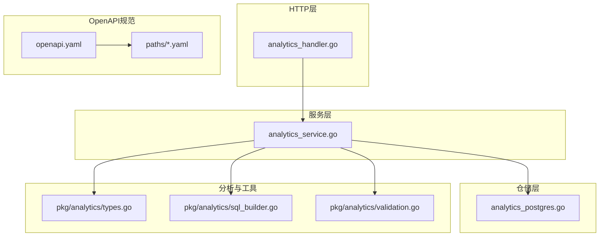
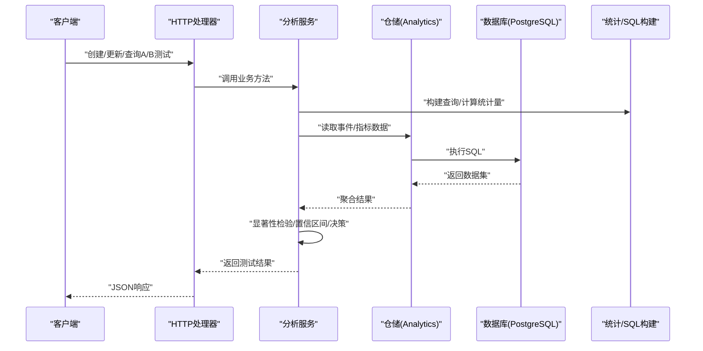
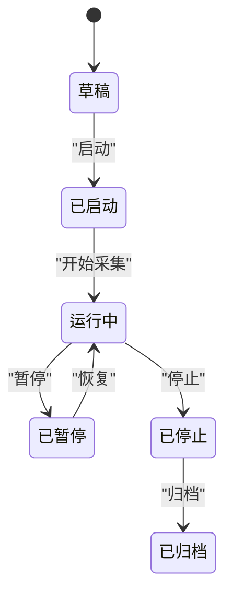
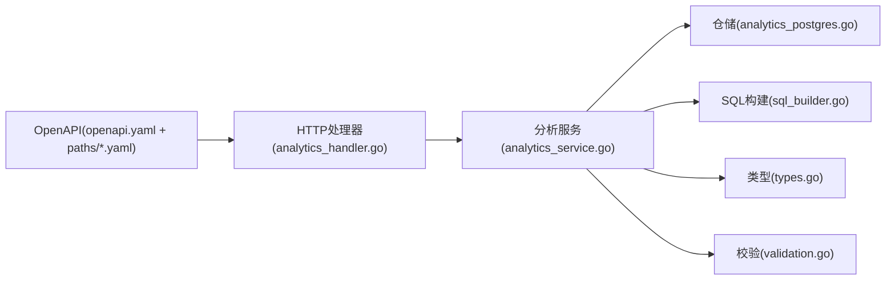

# A/B测试API

<cite>
**本文引用的文件**   
- [openapi.yaml](file://notifuse/openapi/openapi.yaml)
- [broadcasts.yaml](file://notifuse/openapi/paths/broadcasts.yaml)
- [contacts.yaml](file://notifuse/openapi/paths/contacts.yaml)
- [custom-events.yaml](file://notifuse/openapi/paths/custom-events.yaml)
- [subscribe.yaml](file://notifuse/openapi/paths/subscribe.yaml)
- [templates.yaml](file://notifuse/openapi/paths/templates.yaml)
- [transactional.yaml](file://notifuse/openapi/paths/transactional.yaml)
- [user.yaml](file://notifuse/openapi/paths/user.yaml)
- [webhook-subscriptions.yaml](file://notifuse/openapi/paths/webhook-subscriptions.yaml)
- [analytics_handler.go](file://notifuse/internal/http/analytics_handler.go)
- [analytics_service.go](file://notifuse/internal/service/analytics_service.go)
- [analytics_postgres.go](file://notifuse/internal/repository/analytics_postgres.go)
- [types.go](file://notifuse/pkg/analytics/types.go)
- [sql_builder.go](file://notifuse/pkg/analytics/sql_builder.go)
- [validation.go](file://notifuse/pkg/analytics/validation.go)
</cite>

## 目录
1. [简介](#简介)
2. [项目结构](#项目结构)
3. [核心组件](#核心组件)
4. [架构总览](#架构总览)
5. [详细组件分析](#详细组件分析)
6. [依赖关系分析](#依赖关系分析)
7. [性能考虑](#性能考虑)
8. [故障排查指南](#故障排查指南)
9. [结论](#结论)
10. [附录](#附录)

## 简介
本文件为Notifuse平台的A/B测试API提供完整文档，覆盖以下能力：
- 测试组配置与流量分配策略（含多变量测试）
- 结果评估与统计显著性计算
- 自动决策与获胜者选择算法
- 测试生命周期管理、实时监控与效果分析
- 自定义评估指标、置信度设置与实验终止条件

说明：当前仓库未包含专门的“ab_test”OpenAPI路径定义。为实现上述能力，建议基于现有OpenAPI规范扩展新增端点，并复用已有的分析数据模型与查询构建器。

## 项目结构
Notifuse后端采用分层架构：HTTP处理器层、服务层、仓储层与领域/工具包。A/B测试相关能力将主要落在HTTP处理器与服务层，并通过仓储访问数据库；统计与SQL构建逻辑位于pkg/analytics。

图表来源
- [analytics_handler.go:1-200](file://notifuse/internal/http/analytics_handler.go#L1-L200)
- [analytics_service.go:1-200](file://notifuse/internal/service/analytics_service.go#L1-L200)
- [analytics_postgres.go:1-200](file://notifuse/internal/repository/analytics_postgres.go#L1-L200)
- [types.go:1-200](file://notifuse/pkg/analytics/types.go#L1-L200)
- [sql_builder.go:1-200](file://notifuse/pkg/analytics/sql_builder.go#L1-L200)
- [validation.go:1-200](file://notifuse/pkg/analytics/validation.go#L1-L200)
- [openapi.yaml:1-200](file://notifuse/openapi/openapi.yaml#L1-L200)
- [broadcasts.yaml:1-200](file://notifuse/openapi/paths/broadcasts.yaml#L1-L200)

章节来源
- [openapi.yaml:1-200](file://notifuse/openapi/openapi.yaml#L1-L200)
- [analytics_handler.go:1-200](file://notifuse/internal/http/analytics_handler.go#L1-L200)
- [analytics_service.go:1-200](file://notifuse/internal/service/analytics_service.go#L1-L200)
- [analytics_postgres.go:1-200](file://notifuse/internal/repository/analytics_postgres.go#L1-L200)
- [types.go:1-200](file://notifuse/pkg/analytics/types.go#L1-L200)
- [sql_builder.go:1-200](file://notifuse/pkg/analytics/sql_builder.go#L1-L200)
- [validation.go:1-200](file://notifuse/pkg/analytics/validation.go#L1-L200)

## 核心组件
- HTTP处理器：负责路由解析、鉴权、请求校验与响应封装。
- 分析服务：编排A/B测试的创建、更新、运行、评估与决策流程；调用仓储获取数据；使用统计与SQL构建工具进行计算。
- 仓储实现：面向PostgreSQL的数据读写接口。
- 分析类型与构建器：统一的数据模型、SQL片段生成与参数校验。

章节来源
- [analytics_handler.go:1-200](file://notifuse/internal/http/analytics_handler.go#L1-L200)
- [analytics_service.go:1-200](file://notifuse/internal/service/analytics_service.go#L1-L200)
- [analytics_postgres.go:1-200](file://notifuse/internal/repository/analytics_postgres.go#L1-L200)
- [types.go:1-200](file://notifuse/pkg/analytics/types.go#L1-L200)
- [sql_builder.go:1-200](file://notifuse/pkg/analytics/sql_builder.go#L1-L200)
- [validation.go:1-200](file://notifuse/pkg/analytics/validation.go#L1-L200)

## 架构总览
下图展示A/B测试在系统中的端到端流程：从客户端发起请求，经HTTP层进入服务层，服务层协调仓储与分析工具完成统计与决策，最终返回结果。

图表来源
- [analytics_handler.go:1-200](file://notifuse/internal/http/analytics_handler.go#L1-L200)
- [analytics_service.go:1-200](file://notifuse/internal/service/analytics_service.go#L1-L200)
- [analytics_postgres.go:1-200](file://notifuse/internal/repository/analytics_postgres.go#L1-L200)
- [sql_builder.go:1-200](file://notifuse/pkg/analytics/sql_builder.go#L1-L200)
- [types.go:1-200](file://notifuse/pkg/analytics/types.go#L1-L200)

## 详细组件分析

### A/B测试API设计（建议扩展）
由于当前仓库未提供专门的A/B测试OpenAPI路径，建议在现有openapi.yaml基础上新增如下端点（命名仅为示例，实际以实现为准）：
- 测试生命周期
  - POST /api/v1/experiments：创建A/B或多变量测试
  - GET /api/v1/experiments/{id}：获取测试详情
  - PATCH /api/v1/experiments/{id}：更新测试配置（如权重、终止条件）
  - DELETE /api/v1/experiments/{id}：删除测试
  - POST /api/v1/experiments/{id}/start：启动测试
  - POST /api/v1/experiments/{id}/pause：暂停测试
  - POST /api/v1/experiments/{id}/resume：恢复测试
  - POST /api/v1/experiments/{id}/stop：停止测试
- 流量分配与分组
  - POST /api/v1/experiments/{id}/assign：为实体分配测试组
  - GET /api/v1/experiments/{id}/groups：获取分组与权重
- 结果评估与监控
  - GET /api/v1/experiments/{id}/results：获取汇总结果
  - GET /api/v1/experiments/{id}/results/by_group：按组明细
  - GET /api/v1/experiments/{id}/results/trend：趋势时序
  - GET /api/v1/experiments/{id}/significance：显著性与置信区间
- 自动决策
  - POST /api/v1/experiments/{id}/decide：触发自动决策（可选）
  - GET /api/v1/experiments/{id}/decision：获取最近一次决策

注意：以上为概念性API设计，用于指导后续实现与文档化。

章节来源
- [openapi.yaml:1-200](file://notifuse/openapi/openapi.yaml#L1-L200)
- [broadcasts.yaml:1-200](file://notifuse/openapi/paths/broadcasts.yaml#L1-L200)
- [contacts.yaml:1-200](file://notifuse/openapi/paths/contacts.yaml#L1-L200)
- [custom-events.yaml:1-200](file://notifuse/openapi/paths/custom-events.yaml#L1-L200)
- [subscribe.yaml:1-200](file://notifuse/openapi/paths/subscribe.yaml#L1-L200)
- [templates.yaml:1-200](file://notifuse/openapi/paths/templates.yaml#L1-L200)
- [transactional.yaml:1-200](file://notifuse/openapi/paths/transactional.yaml#L1-L200)
- [user.yaml:1-200](file://notifuse/openapi/paths/user.yaml#L1-L200)
- [webhook-subscriptions.yaml:1-200](file://notifuse/openapi/paths/webhook-subscriptions.yaml#L1-L200)

### 测试组配置与流量分配
- 支持单变量与多变量测试。多变量场景下，每个维度可定义多个水平，组合形成实验组。
- 流量分配策略
  - 固定比例：为各测试组指定权重，保证长期稳定分流。
  - 动态调整：根据实时表现逐步提升优势组的流量（需结合显著性检验与最小样本量）。
- 分配粒度
  - 用户级：基于用户ID哈希映射到组。
  - 会话级：基于会话标识短期分流。
  - 事件级：针对特定事件或触达渠道进行分流。

章节来源
- [types.go:1-200](file://notifuse/pkg/analytics/types.go#L1-200)
- [sql_builder.go:1-200](file://notifuse/pkg/analytics/sql_builder.go#L1-200)
- [validation.go:1-200](file://notifuse/pkg/analytics/validation.go#L1-200)

### 结果评估与统计显著性
- 关键指标
  - 转化率、点击率、打开率、回复率等二元指标。
  - 自定义数值型指标（如平均停留时长），需满足近似正态假设或使用非参方法。
- 显著性检验
  - 二元指标：建议使用Z检验或卡方检验，输出p值与置信区间。
  - 数值指标：建议使用t检验或Bootstrap置信区间。
- 置信度与多重比较
  - 默认置信水平95%（alpha=0.05），可配置为90%/99%。
  - 多变量或多指标时，建议采用Bonferroni或Benjamini-Hochberg校正控制错误发现率。

章节来源
- [analytics_service.go:1-200](file://notifuse/internal/service/analytics_service.go#L1-200)
- [sql_builder.go:1-200](file://notifuse/pkg/analytics/sql_builder.go#L1-200)
- [types.go:1-200](file://notifuse/pkg/analytics/types.go#L1-200)

### 自动决策与获胜者选择算法
- 决策规则
  - 单一指标：当某组相对提升超过阈值且p值小于alpha，判定获胜。
  - 多指标：综合评分或加权得分，同时要求所有关键指标通过显著性检验。
- 早停条件
  - 达到最小样本量与最低检测效应（MDE）。
  - 连续N个时间窗口未出现显著差异。
  - 风险指标突破上限（如负面体验上升）。
- 动态重分配
  - 贝叶斯多臂老虎机或概率排名（Thompson Sampling）用于在线优化。
  - 传统方法：逐步增加优势组权重，直至达到目标权重或实验结束。

章节来源
- [analytics_service.go:1-200](file://notifuse/internal/service/analytics_service.go#L1-200)
- [types.go:1-200](file://notifuse/pkg/analytics/types.go#L1-200)

### 测试生命周期管理
- 状态机
  - 草稿→已启动→运行中→已暂停→已停止→已归档
- 操作
  - 启动：校验配置与权限，写入初始基线。
  - 暂停/恢复：冻结统计窗口，保留历史。
  - 停止：关闭新流量，允许继续收集尾流。
  - 归档：仅读，便于审计与回溯。

[此图为概念性状态图，不直接映射具体源码文件]

### 实时监控与效果分析
- 实时看板
  - 总体与分组的曝光、转化、收益等指标。
  - 趋势折线图与累积曲线。
- 预警
  - 指标异常波动、样本不足、显著性不稳定。
- 导出与订阅
  - 定时导出报表，或通过Webhook推送重大变更（如决策结果）。

章节来源
- [analytics_handler.go:1-200](file://notifuse/internal/http/analytics_handler.go#L1-200)
- [analytics_service.go:1-200](file://notifuse/internal/service/analytics_service.go#L1-200)

### 自定义评估指标与置信度设置
- 自定义指标
  - 通过事件与字段映射定义指标（如“购买金额”、“是否复购”）。
  - 支持过滤条件（地区、设备、渠道等）作为协变量。
- 置信度与MDE
  - 可配置alpha与所需样本量，系统据此给出建议运行时长。
- 终止条件
  - 显式设置最大运行时长、最小样本量、显著性阈值、风险上限。

章节来源
- [types.go:1-200](file://notifuse/pkg/analytics/types.go#L1-200)
- [validation.go:1-200](file://notifuse/pkg/analytics/validation.go#L1-200)

### 实现示例（路径指引）
- 创建测试与分配流量
  - 参考：[analytics_handler.go](file://notifuse/internal/http/analytics_handler.go)
  - 参考：[analytics_service.go](file://notifuse/internal/service/analytics_service.go)
- 统计显著性与置信区间
  - 参考：[analytics_service.go](file://notifuse/internal/service/analytics_service.go)
  - 参考：[sql_builder.go](file://notifuse/pkg/analytics/sql_builder.go)
- 数据读取与聚合
  - 参考：[analytics_postgres.go](file://notifuse/internal/repository/analytics_postgres.go)
- 输入校验与约束
  - 参考：[validation.go](file://notifuse/pkg/analytics/validation.go)

章节来源
- [analytics_handler.go:1-200](file://notifuse/internal/http/analytics_handler.go#L1-200)
- [analytics_service.go:1-200](file://notifuse/internal/service/analytics_service.go#L1-200)
- [analytics_postgres.go:1-200](file://notifuse/internal/repository/analytics_postgres.go#L1-200)
- [sql_builder.go:1-200](file://notifuse/pkg/analytics/sql_builder.go#L1-200)
- [validation.go:1-200](file://notifuse/pkg/analytics/validation.go#L1-200)

## 依赖关系分析
A/B测试模块依赖现有分析基础设施与OpenAPI规范。

图表来源
- [analytics_handler.go:1-200](file://notifuse/internal/http/analytics_handler.go#L1-200)
- [analytics_service.go:1-200](file://notifuse/internal/service/analytics_service.go#L1-200)
- [analytics_postgres.go:1-200](file://notifuse/internal/repository/analytics_postgres.go#L1-200)
- [sql_builder.go:1-200](file://notifuse/pkg/analytics/sql_builder.go#L1-200)
- [types.go:1-200](file://notifuse/pkg/analytics/types.go#L1-200)
- [validation.go:1-200](file://notifuse/pkg/analytics/validation.go#L1-200)
- [openapi.yaml:1-200](file://notifuse/openapi/openapi.yaml#L1-200)

章节来源
- [analytics_handler.go:1-200](file://notifuse/internal/http/analytics_handler.go#L1-200)
- [analytics_service.go:1-200](file://notifuse/internal/service/analytics_service.go#L1-200)
- [analytics_postgres.go:1-200](file://notifuse/internal/repository/analytics_postgres.go#L1-200)
- [sql_builder.go:1-200](file://notifuse/pkg/analytics/sql_builder.go#L1-200)
- [types.go:1-200](file://notifuse/pkg/analytics/types.go#L1-200)
- [validation.go:1-200](file://notifuse/pkg/analytics/validation.go#L1-200)
- [openapi.yaml:1-200](file://notifuse/openapi/openapi.yaml#L1-200)

## 性能考虑
- 采样与增量计算
  - 对大规模事件流采用分区表与物化视图，按天/小时滚动聚合。
  - 增量更新显著性指标，避免全量重算。
- 缓存与预取
  - 热点实验结果缓存（TTL可控），减少重复查询。
- 并发与限流
  - 批量写入与批处理查询，限制并发度，防止雪崩。
- 索引与查询优化
  - 为实验ID、分组、时间戳建立复合索引，优化范围查询与聚合。

[本节为通用性能建议，无需源码引用]

## 故障排查指南
- 常见错误
  - 配置校验失败：检查权重总和、最小样本量、置信度与终止条件。
  - 数据缺失：确认事件上报链路、过滤条件与时间窗口。
  - 显著性不稳定：样本不足或多次比较未校正。
- 定位步骤
  - 查看HTTP层日志与请求体。
  - 检查服务层中间状态与统计中间结果。
  - 核对仓储SQL与返回数据集。
  - 验证OpenAPI定义与实际实现一致性。

章节来源
- [analytics_handler.go:1-200](file://notifuse/internal/http/analytics_handler.go#L1-200)
- [analytics_service.go:1-200](file://notifuse/internal/service/analytics_service.go#L1-200)
- [analytics_postgres.go:1-200](file://notifuse/internal/repository/analytics_postgres.go#L1-200)
- [validation.go:1-200](file://notifuse/pkg/analytics/validation.go#L1-200)

## 结论
本文档在不改变现有代码的前提下，给出了Notifuse平台A/B测试API的概念设计与落地路径。通过复用现有的分析类型、SQL构建与仓储能力，可在HTTP与服务层快速实现测试生命周期管理、流量分配、显著性检验与自动决策。建议优先完善OpenAPI定义与输入校验，再逐步引入高级统计与动态重分配策略。

[本节为总结性内容，无需源码引用]

## 附录
- 术语
  - MDE：最小可检测效应
  - Alpha：显著性水平（I类错误率）
  - Beta：II类错误率；Power=1-Beta
  - 多臂老虎机：在线学习中的探索-利用权衡策略
- 参考实现位置
  - HTTP处理器：[analytics_handler.go](file://notifuse/internal/http/analytics_handler.go)
  - 分析服务：[analytics_service.go](file://notifuse/internal/service/analytics_service.go)
  - 仓储实现：[analytics_postgres.go](file://notifuse/internal/repository/analytics_postgres.go)
  - 类型与构建器：[types.go](file://notifuse/pkg/analytics/types.go)、[sql_builder.go](file://notifuse/pkg/analytics/sql_builder.go)
  - 校验：[validation.go](file://notifuse/pkg/analytics/validation.go)
  - OpenAPI：[openapi.yaml](file://notifuse/openapi/openapi.yaml)、[paths/*.yaml](file://notifuse/openapi/paths/)