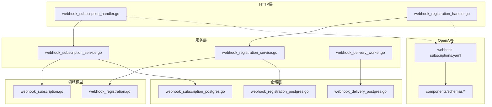
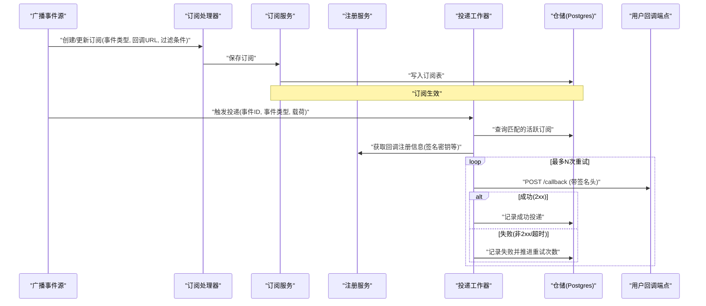
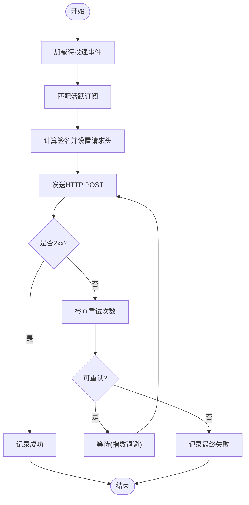
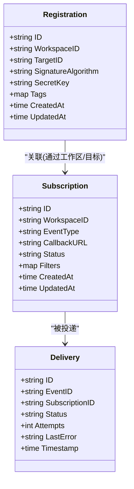
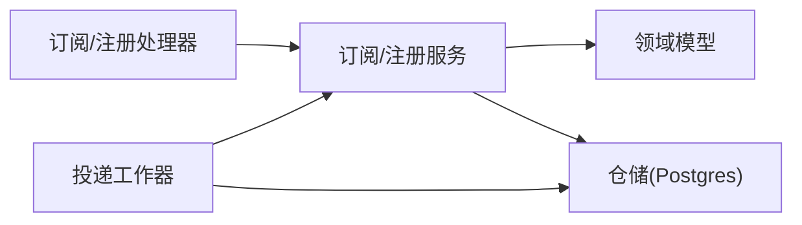

# Webhook回调API

<cite>
**本文引用的文件**   
- [cmd/api/main.go](file://notifuse/cmd/api/main.go)
- [internal/http/webhook_subscription_handler.go](file://notifuse/internal/http/webhook_subscription_handler.go)
- [internal/http/webhook_registration_handler.go](file://notifuse/internal/http/webhook_registration_handler.go)
- [internal/service/webhook_delivery_worker.go](file://notifuse/internal/service/webhook_delivery_worker.go)
- [internal/service/webhook_subscription_service.go](file://notifuse/internal/service/webhook_subscription_service.go)
- [internal/service/webhook_registration_service.go](file://notifuse/internal/service/webhook_registration_service.go)
- [internal/domain/webhook_subscription.go](file://notifuse/internal/domain/webhook_subscription.go)
- [internal/domain/webhook_registration.go](file://notifuse/internal/domain/webhook_registration.go)
- [internal/repository/webhook_subscription_postgres.go](file://notifuse/internal/repository/webhook_subscription_postgres.go)
- [internal/repository/webhook_registration_postgres.go](file://notifuse/internal/repository/webhook_registration_postgres.go)
- [internal/repository/webhook_delivery_postgres.go](file://notifuse/internal/repository/webhook_delivery_postgres.go)
- [openapi/paths/webhook-subscriptions.yaml](file://notifuse/openapi/paths/webhook-subscriptions.yaml)
- [openapi/components/schemas](file://notifuse/openapi/components/schemas)
</cite>

## 目录
1. [简介](#简介)
2. [项目结构](#项目结构)
3. [核心组件](#核心组件)
4. [架构总览](#架构总览)
5. [详细组件分析](#详细组件分析)
6. [依赖分析](#依赖分析)
7. [性能考虑](#性能考虑)
8. [故障排查指南](#故障排查指南)
9. [结论](#结论)
10. [附录](#附录)

## 简介
本文件面向Notifuse平台的广播Webhook回调API，提供事件订阅、回调配置与消息推送的接口规范。文档涵盖：
- 事件类型定义与载荷格式
- 签名验证机制
- 重试策略、错误处理与超时控制配置
- 常见事件的回调实现示例（发送完成、退信处理、用户交互）

该能力允许用户在平台中为“广播”相关事件注册回调目标，并在事件发生时由系统异步投递到用户配置的HTTP端点。

## 项目结构
与Webhook回调相关的代码主要分布在以下模块：
- HTTP层：路由与处理器，负责接收管理请求并调用服务层
- 服务层：订阅与注册的领域逻辑、投递工作器编排
- 领域模型：订阅、注册、投递记录等数据结构
- 仓储层：PostgreSQL持久化
- OpenAPI：对外接口契约与数据模型

图表来源
- [internal/http/webhook_subscription_handler.go](file://notifuse/internal/http/webhook_subscription_handler.go)
- [internal/http/webhook_registration_handler.go](file://notifuse/internal/http/webhook_registration_handler.go)
- [internal/service/webhook_subscription_service.go](file://notifuse/internal/service/webhook_subscription_service.go)
- [internal/service/webhook_registration_service.go](file://notifuse/internal/service/webhook_registration_service.go)
- [internal/service/webhook_delivery_worker.go](file://notifuse/internal/service/webhook_delivery_worker.go)
- [internal/domain/webhook_subscription.go](file://notifuse/internal/domain/webhook_subscription.go)
- [internal/domain/webhook_registration.go](file://notifuse/internal/domain/webhook_registration.go)
- [internal/repository/webhook_subscription_postgres.go](file://notifuse/internal/repository/webhook_subscription_postgres.go)
- [internal/repository/webhook_registration_postgres.go](file://notifuse/internal/repository/webhook_registration_postgres.go)
- [internal/repository/webhook_delivery_postgres.go](file://notifuse/internal/repository/webhook_delivery_postgres.go)
- [openapi/paths/webhook-subscriptions.yaml](file://notifuse/openapi/paths/webhook-subscriptions.yaml)
- [openapi/components/schemas](file://notifuse/openapi/components/schemas)

章节来源
- [cmd/api/main.go](file://notifuse/cmd/api/main.go)
- [openapi/paths/webhook-subscriptions.yaml](file://notifuse/openapi/paths/webhook-subscriptions.yaml)

## 核心组件
- 订阅处理器：提供创建、查询、更新、删除订阅的REST接口，用于绑定广播事件到回调URL
- 注册处理器：管理回调目标的认证与元信息（如签名密钥、标签等）
- 订阅服务：校验订阅参数、维护订阅状态、触发投递任务
- 注册服务：管理回调注册信息，支持多租户与工作区隔离
- 投递工作器：从队列读取待投递事件，执行HTTP POST，记录结果并驱动重试
- 领域模型：订阅、注册、投递记录的数据结构与约束
- 仓储实现：基于PostgreSQL的CRUD与分页查询
- OpenAPI契约：定义路径、方法、请求/响应体、错误码与鉴权方式

章节来源
- [internal/http/webhook_subscription_handler.go](file://notifuse/internal/http/webhook_subscription_handler.go)
- [internal/http/webhook_registration_handler.go](file://notifuse/internal/http/webhook_registration_handler.go)
- [internal/service/webhook_subscription_service.go](file://notifuse/internal/service/webhook_subscription_service.go)
- [internal/service/webhook_registration_service.go](file://notifuse/internal/service/webhook_registration_service.go)
- [internal/service/webhook_delivery_worker.go](file://notifuse/internal/service/webhook_delivery_worker.go)
- [internal/domain/webhook_subscription.go](file://notifuse/internal/domain/webhook_subscription.go)
- [internal/domain/webhook_registration.go](file://notifuse/internal/domain/webhook_registration.go)
- [internal/repository/webhook_subscription_postgres.go](file://notifuse/internal/repository/webhook_subscription_postgres.go)
- [internal/repository/webhook_registration_postgres.go](file://notifuse/internal/repository/webhook_registration_postgres.go)
- [internal/repository/webhook_delivery_postgres.go](file://notifuse/internal/repository/webhook_delivery_postgres.go)
- [openapi/paths/webhook-subscriptions.yaml](file://notifuse/openapi/paths/webhook-subscriptions.yaml)

## 架构总览
下图展示了从“广播事件产生”到“回调投递”的整体流程，包括订阅匹配、异步投递、重试与结果落库。

图表来源
- [internal/http/webhook_subscription_handler.go](file://notifuse/internal/http/webhook_subscription_handler.go)
- [internal/service/webhook_subscription_service.go](file://notifuse/internal/service/webhook_subscription_service.go)
- [internal/service/webhook_registration_service.go](file://notifuse/internal/service/webhook_registration_service.go)
- [internal/service/webhook_delivery_worker.go](file://notifuse/internal/service/webhook_delivery_worker.go)
- [internal/repository/webhook_subscription_postgres.go](file://notifuse/internal/repository/webhook_subscription_postgres.go)
- [internal/repository/webhook_registration_postgres.go](file://notifuse/internal/repository/webhook_registration_postgres.go)
- [internal/repository/webhook_delivery_postgres.go](file://notifuse/internal/repository/webhook_delivery_postgres.go)

## 详细组件分析

### 订阅管理接口（REST）
- 功能范围
  - 创建订阅：指定事件类型、回调URL、可选过滤条件与工作区上下文
  - 查询订阅：按工作区、状态、事件类型分页检索
  - 更新订阅：修改回调URL、状态、过滤条件
  - 删除订阅：软删除或硬删除（取决于实现）
- 鉴权与权限
  - 需要有效的访问令牌与工作区上下文
  - 仅允许操作所属工作区的订阅
- 典型响应
  - 成功返回订阅对象（含ID、状态、时间戳等）
  - 失败返回标准错误体（错误码、消息）

章节来源
- [internal/http/webhook_subscription_handler.go](file://notifuse/internal/http/webhook_subscription_handler.go)
- [openapi/paths/webhook-subscriptions.yaml](file://notifuse/openapi/paths/webhook-subscriptions.yaml)

### 回调注册与签名
- 功能范围
  - 为回调目标配置签名密钥与元信息
  - 在投递时根据事件载荷生成签名，附加到HTTP头
- 安全建议
  - 使用HMAC-SHA256对请求体进行签名
  - 将签名值放入自定义头部（例如 X-Webhook-Signature）
  - 服务端需严格校验时间戳与重放保护（可选）

章节来源
- [internal/http/webhook_registration_handler.go](file://notifuse/internal/http/webhook_registration_handler.go)
- [internal/service/webhook_registration_service.go](file://notifuse/internal/service/webhook_registration_service.go)
- [internal/domain/webhook_registration.go](file://notifuse/internal/domain/webhook_registration.go)

### 投递工作器与重试策略
- 投递流程
  - 从队列取出待投递事件
  - 查找匹配的活跃订阅
  - 组装HTTP请求（含签名头）
  - 发送请求并记录结果
- 重试策略
  - 指数退避：初始间隔、最大间隔、最大重试次数
  - 幂等性：通过事件ID去重，避免重复处理
  - 失败分类：网络错误、超时、服务端错误分别处理
- 超时控制
  - 连接超时、读超时、写超时可配置
  - 整体请求超时上限防止长时间挂起

图表来源
- [internal/service/webhook_delivery_worker.go](file://notifuse/internal/service/webhook_delivery_worker.go)
- [internal/repository/webhook_delivery_postgres.go](file://notifuse/internal/repository/webhook_delivery_postgres.go)

章节来源
- [internal/service/webhook_delivery_worker.go](file://notifuse/internal/service/webhook_delivery_worker.go)
- [internal/repository/webhook_delivery_postgres.go](file://notifuse/internal/repository/webhook_delivery_postgres.go)

### 领域模型与关系
- 订阅（Subscription）
  - 字段：ID、工作区ID、事件类型、回调URL、状态、过滤条件、创建/更新时间
- 注册（Registration）
  - 字段：ID、工作区ID、回调目标标识、签名算法、密钥、标签、创建/更新时间
- 投递记录（Delivery）
  - 字段：ID、事件ID、订阅ID、状态、尝试次数、最后错误、时间戳

图表来源
- [internal/domain/webhook_subscription.go](file://notifuse/internal/domain/webhook_subscription.go)
- [internal/domain/webhook_registration.go](file://notifuse/internal/domain/webhook_registration.go)

章节来源
- [internal/domain/webhook_subscription.go](file://notifuse/internal/domain/webhook_subscription.go)
- [internal/domain/webhook_registration.go](file://notifuse/internal/domain/webhook_registration.go)

### 仓储层与数据库
- 订阅仓储：CRUD、分页查询、按工作区与状态筛选
- 注册仓储：CRUD、按工作区与目标标识检索
- 投递仓储：写入投递记录、更新重试计数与错误信息、统计成功率

章节来源
- [internal/repository/webhook_subscription_postgres.go](file://notifuse/internal/repository/webhook_subscription_postgres.go)
- [internal/repository/webhook_registration_postgres.go](file://notifuse/internal/repository/webhook_registration_postgres.go)
- [internal/repository/webhook_delivery_postgres.go](file://notifuse/internal/repository/webhook_delivery_postgres.go)

### OpenAPI契约与数据模型
- 路径与操作
  - 订阅管理：创建、查询、更新、删除
- 数据模型
  - 订阅对象、注册对象、投递记录对象
  - 错误响应体统一结构
- 鉴权
  - 使用Bearer Token与工作区上下文

章节来源
- [openapi/paths/webhook-subscriptions.yaml](file://notifuse/openapi/paths/webhook-subscriptions.yaml)
- [openapi/components/schemas](file://notifuse/openapi/components/schemas)

## 依赖分析
- 组件耦合
  - HTTP处理器依赖服务层，服务层依赖领域模型与仓储
  - 投递工作器独立于HTTP层，通过仓储与服务协作
- 外部依赖
  - PostgreSQL作为持久化存储
  - HTTP客户端用于回调投递
- 潜在循环依赖
  - 当前分层清晰，未见循环导入

图表来源
- [internal/http/webhook_subscription_handler.go](file://notifuse/internal/http/webhook_subscription_handler.go)
- [internal/http/webhook_registration_handler.go](file://notifuse/internal/http/webhook_registration_handler.go)
- [internal/service/webhook_subscription_service.go](file://notifuse/internal/service/webhook_subscription_service.go)
- [internal/service/webhook_registration_service.go](file://notifuse/internal/service/webhook_registration_service.go)
- [internal/service/webhook_delivery_worker.go](file://notifuse/internal/service/webhook_delivery_worker.go)
- [internal/repository/webhook_subscription_postgres.go](file://notifuse/internal/repository/webhook_subscription_postgres.go)
- [internal/repository/webhook_registration_postgres.go](file://notifuse/internal/repository/webhook_registration_postgres.go)
- [internal/repository/webhook_delivery_postgres.go](file://notifuse/internal/repository/webhook_delivery_postgres.go)

## 性能考虑
- 异步投递：事件生产与回调投递解耦，避免阻塞主流程
- 批量与分页：订阅查询与投递记录统计采用分页，降低内存占用
- 重试优化：指数退避与最大重试次数限制，避免雪崩
- 超时控制：合理设置HTTP超时，防止资源泄漏
- 索引设计：在工作区ID、事件类型、状态等常用查询字段建立索引

[本节为通用指导，不直接分析具体文件]

## 故障排查指南
- 常见问题
  - 回调端点不可达：检查网络连通性与防火墙规则
  - 签名校验失败：确认签名算法、密钥与请求体一致
  - 重复投递：检查事件ID幂等性与重试策略
  - 超时错误：调整HTTP超时与后端处理耗时
- 日志与追踪
  - 投递记录包含状态、尝试次数与最后错误，便于定位问题
  - 建议在回调端点记录请求头与负载摘要（脱敏）

章节来源
- [internal/service/webhook_delivery_worker.go](file://notifuse/internal/service/webhook_delivery_worker.go)
- [internal/repository/webhook_delivery_postgres.go](file://notifuse/internal/repository/webhook_delivery_postgres.go)

## 结论
Notifuse的广播Webhook回调API通过清晰的订阅管理与异步投递机制，实现了可靠的事件通知能力。结合签名验证与重试策略，可在保证安全性的同时提升投递成功率。建议在生产环境完善监控与告警，并对回调端点进行健壮性测试。

[本节为总结，不直接分析具体文件]

## 附录

### 事件类型与载荷格式
- 事件类型
  - 发送完成：表示一次广播发送已完成
  - 退信处理：表示发生退信事件
  - 用户交互：表示用户点击链接、打开邮件等交互行为
- 载荷结构
  - 基础字段：事件ID、事件类型、时间戳、工作区ID
  - 业务字段：随事件类型变化，包含发送批次、收件人、状态码等
- 签名头
  - 名称：X-Webhook-Signature（示例）
  - 算法：HMAC-SHA256
  - 内容：对请求体进行签名后的十六进制字符串

章节来源
- [openapi/paths/webhook-subscriptions.yaml](file://notifuse/openapi/paths/webhook-subscriptions.yaml)
- [openapi/components/schemas](file://notifuse/openapi/components/schemas)

### 重试策略与超时配置
- 重试策略
  - 最大重试次数：建议3~5次
  - 初始间隔：1秒
  - 最大间隔：60秒
  - 退避系数：2
- 超时控制
  - 连接超时：3秒
  - 读超时：10秒
  - 写超时：10秒
  - 总请求超时：30秒

章节来源
- [internal/service/webhook_delivery_worker.go](file://notifuse/internal/service/webhook_delivery_worker.go)

### 常见事件回调实现示例
- 发送完成
  - 动作：更新本地发送状态、触发后续流程
  - 幂等：依据事件ID去重
- 退信处理
  - 动作：标记邮箱无效、减少触达率指标
  - 幂等：依据事件ID去重
- 用户交互
  - 动作：记录点击/打开行为、更新用户画像
  - 幂等：依据事件ID去重

章节来源
- [internal/service/webhook_delivery_worker.go](file://notifuse/internal/service/webhook_delivery_worker.go)
- [internal/repository/webhook_delivery_postgres.go](file://notifuse/internal/repository/webhook_delivery_postgres.go)