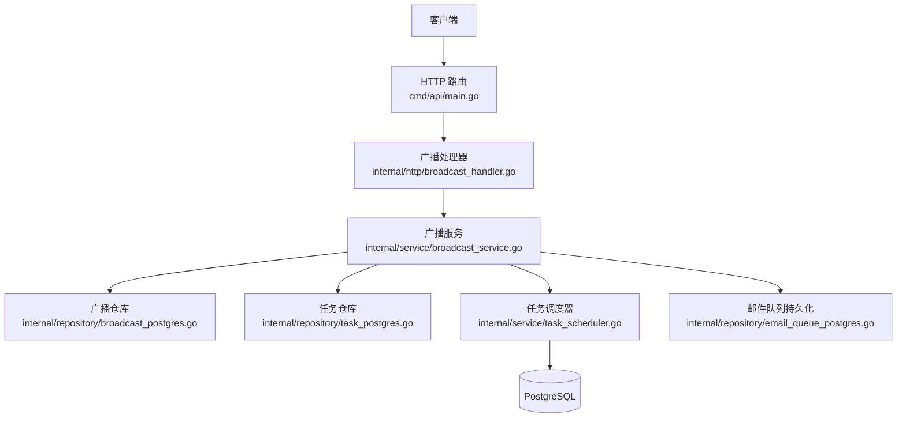
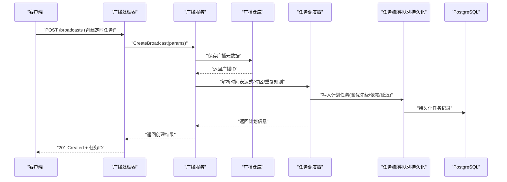
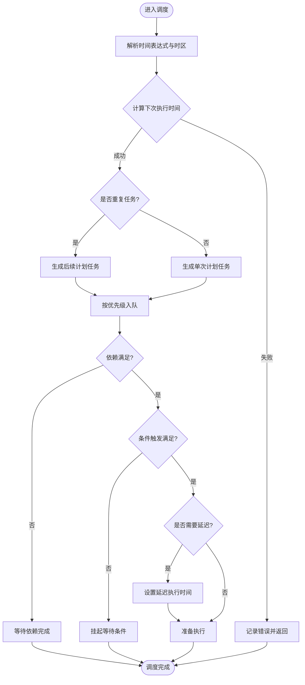
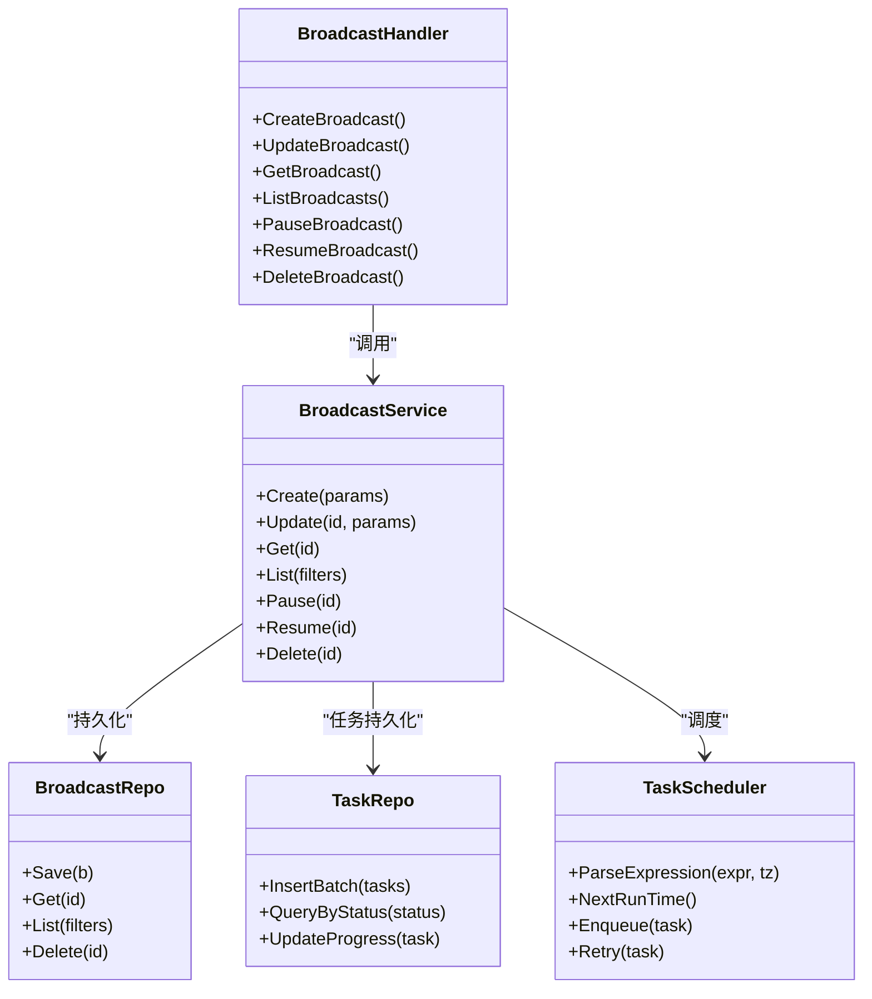

# 定时调度API

<cite>
**本文引用的文件**   
- [cmd/api/main.go](file://notifuse/cmd/api/main.go)
- [internal/http/broadcast_handler.go](file://notifuse/internal/http/broadcast_handler.go)
- [internal/service/broadcast_service.go](file://notifuse/internal/service/broadcast_service.go)
- [internal/domain/broadcast.go](file://notifuse/internal/domain/broadcast.go)
- [internal/repository/broadcast_postgres.go](file://notifuse/internal/repository/broadcast_postgres.go)
- [internal/service/task_scheduler.go](file://notifuse/internal/service/task_scheduler.go)
- [internal/domain/task.go](file://notifuse/internal/domain/task.go)
- [internal/repository/task_postgres.go](file://notifuse/internal/repository/task_postgres.go)
- [internal/service/email_queue_postgres.go](file://notifuse/internal/repository/email_queue_postgres.go)
- [openapi/paths/broadcasts.yaml](file://notifuse/openapi/paths/broadcasts.yaml)
- [openapi/components/schemas/broadcast.yaml](file://notifuse/openapi/components/schemas/broadcast.yaml)
- [plans/task-scheduler-recurring-tasks.md](file://notifuse/plans/task-scheduler-recurring-tasks.md)
</cite>

## 目录
1. [简介](#简介)
2. [项目结构](#项目结构)
3. [核心组件](#核心组件)
4. [架构总览](#架构总览)
5. [详细组件分析](#详细组件分析)
6. [依赖关系分析](#依赖关系分析)
7. [性能考虑](#性能考虑)
8. [故障排查指南](#故障排查指南)
9. [结论](#结论)
10. [附录](#附录)

## 简介
本文件为 Notifuse 平台的“广播定时调度API”提供完整文档，覆盖以下能力：
- 定时发送任务的创建、配置与管理接口（时间表达式解析、时区处理、重复任务）
- 任务队列管理机制、优先级调度与资源分配策略
- 延迟执行、条件触发与依赖关系配置
- 任务状态监控、进度跟踪与失败重试的实现示例

该文档面向开发者与运维人员，既提供高层架构说明，也给出代码级实现要点与可视化图示。

## 项目结构
围绕“广播定时调度”的关键路径涉及 HTTP 层、服务层、领域模型、持久化与调度器：
- HTTP 层：接收并校验请求，调用服务层
- 服务层：编排业务逻辑，协调调度器与仓库
- 领域模型：定义广播与任务的数据结构与约束
- 仓库层：读写数据库（PostgreSQL）
- 调度器：基于时间表达式与优先级进行任务排程与执行

图表来源
- [cmd/api/main.go](file://notifuse/cmd/api/main.go)
- [internal/http/broadcast_handler.go](file://notifuse/internal/http/broadcast_handler.go)
- [internal/service/broadcast_service.go](file://notifuse/internal/service/broadcast_service.go)
- [internal/repository/broadcast_postgres.go](file://notifuse/internal/repository/broadcast_postgres.go)
- [internal/repository/task_postgres.go](file://notifuse/internal/repository/task_postgres.go)
- [internal/service/task_scheduler.go](file://notifuse/internal/service/task_scheduler.go)
- [internal/repository/email_queue_postgres.go](file://notifuse/internal/repository/email_queue_postgres.go)

章节来源
- [cmd/api/main.go](file://notifuse/cmd/api/main.go)
- [internal/http/broadcast_handler.go](file://notifuse/internal/http/broadcast_handler.go)
- [internal/service/broadcast_service.go](file://notifuse/internal/service/broadcast_service.go)
- [internal/repository/broadcast_postgres.go](file://notifuse/internal/repository/broadcast_postgres.go)
- [internal/repository/task_postgres.go](file://notifuse/internal/repository/task_postgres.go)
- [internal/service/task_scheduler.go](file://notifuse/internal/service/task_scheduler.go)
- [internal/repository/email_queue_postgres.go](file://notifuse/internal/repository/email_queue_postgres.go)

## 核心组件
- 广播处理器：负责路由到具体方法，参数校验与错误包装
- 广播服务：封装创建、更新、查询、删除、暂停/恢复等调度相关操作；协调调度器与仓库
- 领域模型：定义广播实体、任务实体及其字段约束（如时间表达式、时区、重复规则、优先级、依赖ID等）
- 仓库实现：将广播与任务持久化至 PostgreSQL，并提供查询与分页能力
- 任务调度器：解析时间表达式、计算下次执行时间、按优先级入队、管理延迟与重试

章节来源
- [internal/http/broadcast_handler.go](file://notifuse/internal/http/broadcast_handler.go)
- [internal/service/broadcast_service.go](file://notifuse/internal/service/broadcast_service.go)
- [internal/domain/broadcast.go](file://notifuse/internal/domain/broadcast.go)
- [internal/domain/task.go](file://notifuse/internal/domain/task.go)
- [internal/repository/broadcast_postgres.go](file://notifuse/internal/repository/broadcast_postgres.go)
- [internal/repository/task_postgres.go](file://notifuse/internal/repository/task_postgres.go)
- [internal/service/task_scheduler.go](file://notifuse/internal/service/task_scheduler.go)

## 架构总览
下图展示从 API 到调度器的端到端流程，包括时间表达式解析、时区转换、重复任务生成与入队。

图表来源
- [internal/http/broadcast_handler.go](file://notifuse/internal/http/broadcast_handler.go)
- [internal/service/broadcast_service.go](file://notifuse/internal/service/broadcast_service.go)
- [internal/repository/broadcast_postgres.go](file://notifuse/internal/repository/broadcast_postgres.go)
- [internal/service/task_scheduler.go](file://notifuse/internal/service/task_scheduler.go)
- [internal/repository/task_postgres.go](file://notifuse/internal/repository/task_postgres.go)

## 详细组件分析

### 广播处理器（HTTP 层）
职责
- 注册路由与方法映射
- 解析请求体、校验必填字段与时区格式
- 调用服务层并统一错误响应

关键接口（概念性）
- 创建广播：POST /broadcasts
- 更新广播：PATCH /broadcasts/{id}
- 查询广播：GET /broadcasts/{id}
- 列表查询：GET /broadcasts?workspace_id=&status=&page=
- 暂停/恢复：PUT /broadcasts/{id}/pause | PUT /broadcasts/{id}/resume
- 删除广播：DELETE /broadcasts/{id}

章节来源
- [internal/http/broadcast_handler.go](file://notifuse/internal/http/broadcast_handler.go)
- [openapi/paths/broadcasts.yaml](file://notifuse/openapi/paths/broadcasts.yaml)

### 广播服务（Service 层）
职责
- 编排创建流程：校验输入、持久化广播、生成计划任务
- 支持延迟执行、条件触发、依赖关系配置
- 管理重复任务：根据时间表达式与重复规则生成多条任务记录
- 协调调度器与仓库，保证事务一致性

关键流程
- 创建：校验时间表达式与时区 -> 生成首次执行时间 -> 若重复则生成后续计划 -> 写入任务表 -> 返回结果
- 更新：仅允许修改可编辑字段（如优先级、依赖ID、时区、重复规则）
- 暂停/恢复：切换任务状态，影响调度器是否拉取执行
- 删除：软删除或物理删除，同时清理未执行的任务

章节来源
- [internal/service/broadcast_service.go](file://notifuse/internal/service/broadcast_service.go)
- [internal/domain/broadcast.go](file://notifuse/internal/domain/broadcast.go)
- [internal/domain/task.go](file://notifuse/internal/domain/task.go)

### 领域模型（Domain）
广播实体（关键字段）
- ID、工作空间ID、名称、描述
- 时间表达式（cron 风格）、时区（IANA 命名）
- 重复规则（次数/间隔/结束时间）
- 优先级（数值越小越优先）
- 依赖关系（前置任务ID集合）
- 状态（待执行/运行中/已完成/已取消/失败）
- 创建/更新时间戳

任务实体（关键字段）
- ID、关联广播ID、计划执行时间、实际开始/完成时间
- 状态、重试次数、最大重试次数
- 错误信息、优先级、依赖ID
- 扩展字段（JSON）用于条件触发与动态参数

章节来源
- [internal/domain/broadcast.go](file://notifuse/internal/domain/broadcast.go)
- [internal/domain/task.go](file://notifuse/internal/domain/task.go)

### 仓库实现（Repository）
- 广播仓库：CRUD、分页查询、按状态与工作空间过滤
- 任务仓库：批量插入计划任务、按状态与时间窗口查询、更新执行进度与重试计数
- 邮件队列持久化：将最终投递任务落库，便于追踪与重放

章节来源
- [internal/repository/broadcast_postgres.go](file://notifuse/internal/repository/broadcast_postgres.go)
- [internal/repository/task_postgres.go](file://notifuse/internal/repository/task_postgres.go)
- [internal/repository/email_queue_postgres.go](file://notifuse/internal/repository/email_queue_postgres.go)

### 任务调度器（Scheduler）
职责
- 解析时间表达式（支持 cron 风格），结合时区计算下次执行时间
- 依据优先级排序，维护任务队列
- 支持延迟执行（相对当前时间的偏移）
- 条件触发：在任务入队前评估条件（如外部事件、阈值）
- 依赖关系：等待前置任务完成后才入队
- 失败重试：指数退避或固定间隔，达到上限后标记失败

图表来源
- [internal/service/task_scheduler.go](file://notifuse/internal/service/task_scheduler.go)
- [internal/domain/task.go](file://notifuse/internal/domain/task.go)

章节来源
- [internal/service/task_scheduler.go](file://notifuse/internal/service/task_scheduler.go)
- [internal/domain/task.go](file://notifuse/internal/domain/task.go)

### OpenAPI 规范（API 契约）
- 路径与请求/响应结构定义见 broadcasts.yaml
- 广播对象模式定义见 broadcast.yaml（包含时间表达式、时区、重复规则、优先级、依赖ID等字段）

章节来源
- [openapi/paths/broadcasts.yaml](file://notifuse/openapi/paths/broadcasts.yaml)
- [openapi/components/schemas/broadcast.yaml](file://notifuse/openapi/components/schemas/broadcast.yaml)

## 依赖关系分析
- HTTP 处理器依赖服务层，不直接访问仓库
- 服务层组合仓库与调度器，承担事务边界与错误传播
- 调度器依赖任务仓库与邮件队列持久化，避免阻塞主流程
- 领域模型在各层之间作为数据传输载体，确保一致性

图表来源
- [internal/http/broadcast_handler.go](file://notifuse/internal/http/broadcast_handler.go)
- [internal/service/broadcast_service.go](file://notifuse/internal/service/broadcast_service.go)
- [internal/repository/broadcast_postgres.go](file://notifuse/internal/repository/broadcast_postgres.go)
- [internal/repository/task_postgres.go](file://notifuse/internal/repository/task_postgres.go)
- [internal/service/task_scheduler.go](file://notifuse/internal/service/task_scheduler.go)

章节来源
- [internal/http/broadcast_handler.go](file://notifuse/internal/http/broadcast_handler.go)
- [internal/service/broadcast_service.go](file://notifuse/internal/service/broadcast_service.go)
- [internal/repository/broadcast_postgres.go](file://notifuse/internal/repository/broadcast_postgres.go)
- [internal/repository/task_postgres.go](file://notifuse/internal/repository/task_postgres.go)
- [internal/service/task_scheduler.go](file://notifuse/internal/service/task_scheduler.go)

## 性能考虑
- 批量入队：重复任务一次性生成并批量写入，减少数据库往返
- 索引优化：对任务表的计划执行时间、状态、优先级建立复合索引，提升扫描效率
- 分片与分区：按时间范围对任务表进行分区，降低大表查询成本
- 并发控制：限制调度器并发度，避免下游系统过载
- 幂等设计：任务执行采用幂等键，防止重复投递
- 缓存热点：广播元数据与模板内容可短期缓存，减少IO

[本节为通用指导，无需特定文件引用]

## 故障排查指南
常见问题与定位步骤
- 时间表达式无效：检查表达式语法与时区合法性，查看调度器解析日志
- 任务未执行：确认任务状态是否为“待执行”，检查依赖是否满足、条件是否触发、是否存在延迟
- 重复任务过多：核对重复规则（次数/间隔/结束时间），必要时调整或终止任务
- 失败重试风暴：观察重试次数与间隔，必要时增加退避策略或熔断
- 资源争用：监控调度器并发度与队列积压，适当扩容或限流

章节来源
- [internal/service/task_scheduler.go](file://notifuse/internal/service/task_scheduler.go)
- [internal/repository/task_postgres.go](file://notifuse/internal/repository/task_postgres.go)

## 结论
Notifuse 的广播定时调度API通过清晰的层次划分与可扩展的调度器，实现了强大的定时与重复任务管理能力。借助时间表达式解析、时区处理、优先级调度、延迟执行、条件触发与依赖关系配置，平台能够稳定支撑大规模广播场景。配合完善的监控与重试机制，可有效保障交付质量与系统韧性。

[本节为总结，无需特定文件引用]

## 附录

### API 参考（摘要）
- 创建广播：POST /broadcasts
  - 请求体关键字段：名称、描述、时间表达式、时区、重复规则、优先级、依赖ID、延迟执行、条件触发
  - 响应：广播ID、计划任务ID列表
- 更新广播：PATCH /broadcasts/{id}
  - 可编辑字段：优先级、依赖ID、时区、重复规则、延迟执行、条件触发
- 查询广播：GET /broadcasts/{id}
- 列表查询：GET /broadcasts?workspace_id=&status=&page=
- 暂停/恢复：PUT /broadcasts/{id}/pause | PUT /broadcasts/{id}/resume
- 删除广播：DELETE /broadcasts/{id}

章节来源
- [openapi/paths/broadcasts.yaml](file://notifuse/openapi/paths/broadcasts.yaml)
- [openapi/components/schemas/broadcast.yaml](file://notifuse/openapi/components/schemas/broadcast.yaml)

### 时间表达式与时区
- 时间表达式：支持 cron 风格，字段含义与常见用法遵循标准约定
- 时区：使用 IANA 时区名称（如 Asia/Shanghai），确保跨地域一致性与夏令时兼容

章节来源
- [internal/service/task_scheduler.go](file://notifuse/internal/service/task_scheduler.go)
- [internal/domain/task.go](file://notifuse/internal/domain/task.go)

### 重复任务与依赖关系
- 重复任务：支持固定间隔、次数限制与结束时间，自动生成多条计划任务
- 依赖关系：支持单个或多个前置任务ID，只有依赖全部完成后才入队

章节来源
- [internal/service/broadcast_service.go](file://notifuse/internal/service/broadcast_service.go)
- [internal/domain/task.go](file://notifuse/internal/domain/task.go)

### 任务状态与重试
- 状态机：待执行 -> 运行中 -> 已完成/失败；失败可重试直至达到上限
- 重试策略：固定间隔或指数退避，记录错误信息与重试次数

章节来源
- [internal/domain/task.go](file://notifuse/internal/domain/task.go)
- [internal/repository/task_postgres.go](file://notifuse/internal/repository/task_postgres.go)

### 设计规划参考
- 关于周期性任务与调度器设计的规划文档可作为进一步理解与扩展的依据

章节来源
- [plans/task-scheduler-recurring-tasks.md](file://notifuse/plans/task-scheduler-recurring-tasks.md)