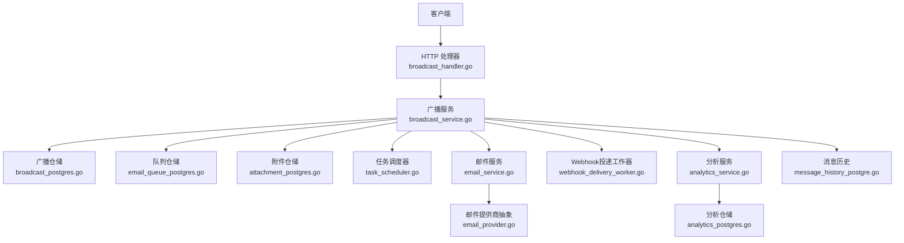
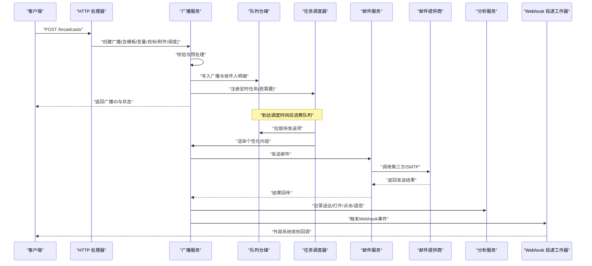
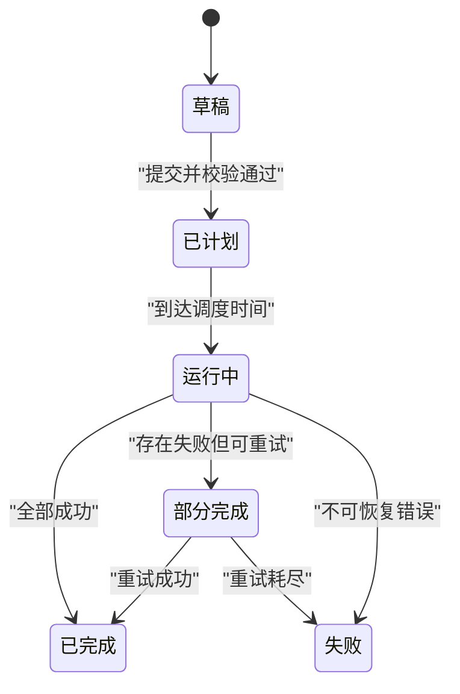
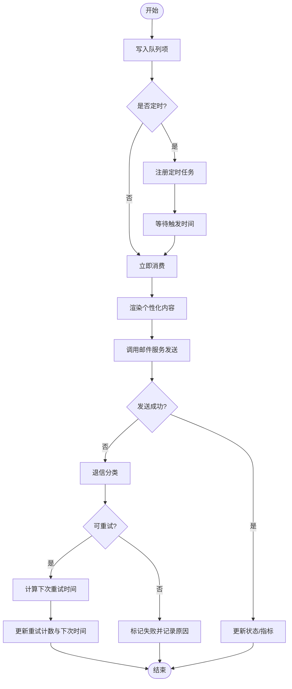
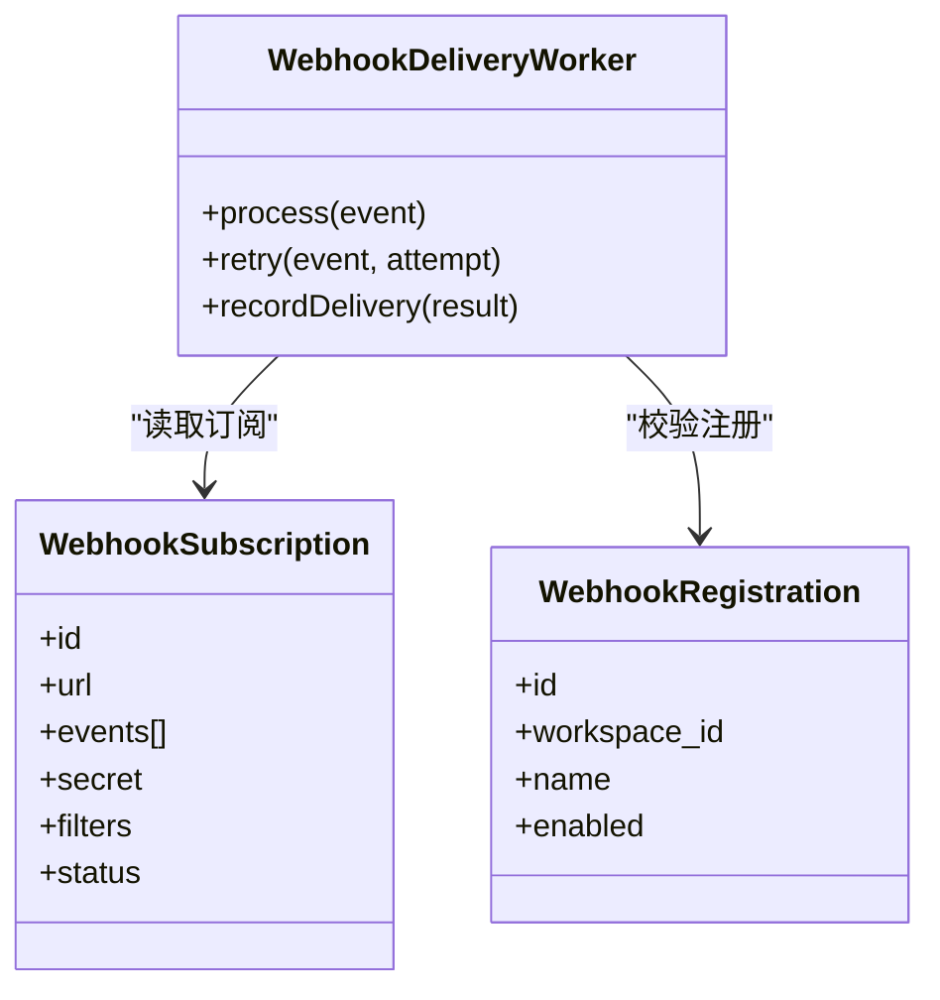
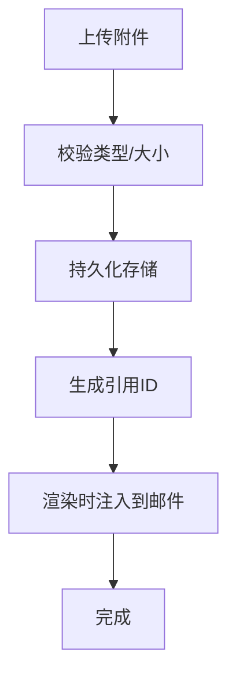
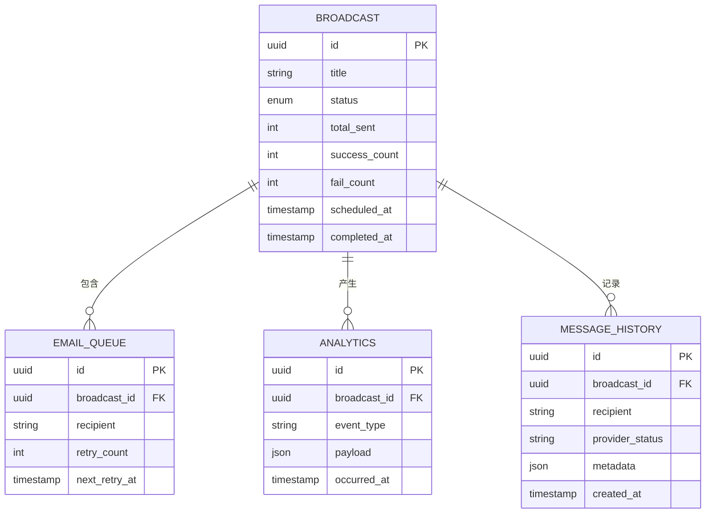
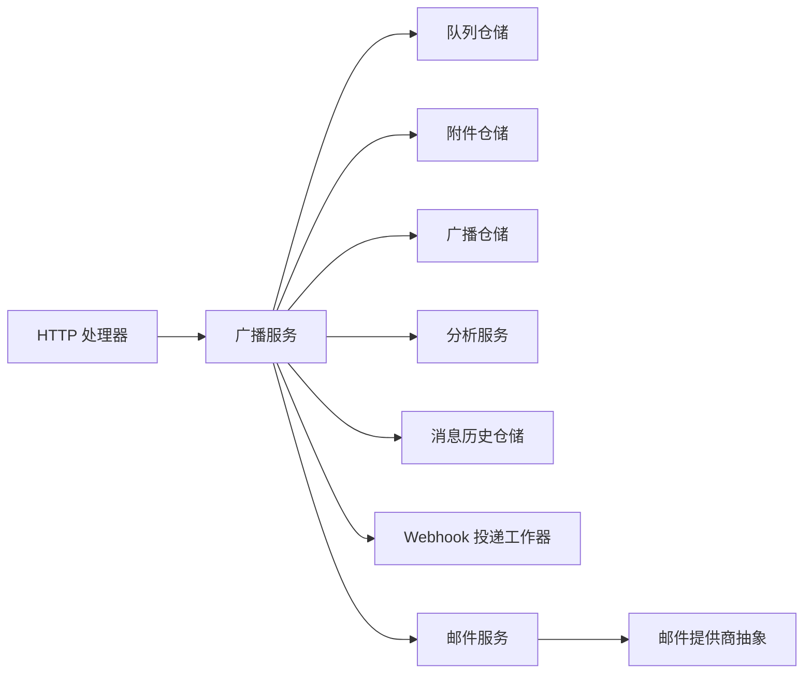

# 广播发送API

<cite>
**本文引用的文件**   
- [cmd/api/main.go](file://notifuse/cmd/api/main.go)
- [internal/http/broadcast_handler.go](file://notifuse/internal/http/broadcast_handler.go)
- [internal/service/broadcast_service.go](file://notifuse/internal/service/broadcast_service.go)
- [internal/domain/broadcast.go](file://notifuse/internal/domain/broadcast.go)
- [internal/repository/broadcast_postgres.go](file://notifuse/internal/repository/broadcast_postgres.go)
- [internal/domain/email_queue.go](file://notifuse/internal/domain/email_queue.go)
- [internal/repository/email_queue_postgres.go](file://notifuse/internal/repository/email_queue_postgres.go)
- [internal/service/task_scheduler.go](file://notifuse/internal/service/task_scheduler.go)
- [internal/service/webhook_delivery_worker.go](file://notifuse/internal/service/webhook_delivery_worker.go)
- [internal/domain/webhook_subscription.go](file://notifuse/internal/domain/webhook_subscription.go)
- [internal/domain/webhook_registration.go](file://notifuse/internal/domain/webhook_registration.go)
- [internal/domain/attachment.go](file://notifuse/internal/domain/attachment.go)
- [internal/repository/attachment_postgres.go](file://notifuse/internal/repository/attachment_postgres.go)
- [openapi/paths/broadcasts.yaml](file://notifuse/openapi/paths/broadcasts.yaml)
- [openapi/components/schemas](file://notifuse/openapi/components/schemas)
- [internal/service/analytics_service.go](file://notifuse/internal/service/analytics_service.go)
- [internal/repository/analytics_postgres.go](file://notifuse/internal/repository/analytics_postgres.go)
- [internal/domain/message_history.go](file://notifuse/internal/domain/message_history.go)
- [internal/repository/message_history_postgre.go](file://notifuse/internal/repository/message_history_postgre.go)
- [internal/service/email_service.go](file://notifuse/internal/service/email_service.go)
- [internal/domain/email_provider.go](file://notifuse/internal/domain/email_provider.go)
</cite>

## 目录
1. [简介](#简介)
2. [项目结构](#项目结构)
3. [核心组件](#核心组件)
4. [架构总览](#架构总览)
5. [详细组件分析](#详细组件分析)
6. [依赖关系分析](#依赖关系分析)
7. [性能考虑](#性能考虑)
8. [故障排查指南](#故障排查指南)
9. [结论](#结论)
10. [附录](#附录)

## 简介
本文件为 Notifuse 平台的“广播发送API”提供完整文档，覆盖批量邮件发送、定时调度、队列管理、重试机制、发送进度监控、送达率统计、退信处理、未读追踪、A/B测试配置、个性化内容生成、附件处理与大小限制、异步任务处理、错误恢复策略、性能调优，以及 Webhook 回调通知与实时监控集成示例。读者可据此快速对接广播能力并构建高可靠、可观测的邮件分发系统。

## 项目结构
广播发送相关代码主要分布在以下层次：
- HTTP 层：路由与请求校验（HTTP Handler）
- 服务层：编排业务逻辑（Service）
- 领域模型：广播、队列、附件、Webhook、消息历史等（Domain）
- 数据访问层：PostgreSQL 持久化（Repository）
- OpenAPI 规范：对外接口契约（OpenAPI Paths/Schemas）
- 启动入口：应用初始化与依赖注入（cmd）

图表来源
- [internal/http/broadcast_handler.go](file://notifuse/internal/http/broadcast_handler.go)
- [internal/service/broadcast_service.go](file://notifuse/internal/service/broadcast_service.go)
- [internal/repository/broadcast_postgres.go](file://notifuse/internal/repository/broadcast_postgres.go)
- [internal/repository/email_queue_postgres.go](file://notifuse/internal/repository/email_queue_postgres.go)
- [internal/repository/attachment_postgres.go](file://notifuse/internal/repository/attachment_postgres.go)
- [internal/service/task_scheduler.go](file://notifuse/internal/service/task_scheduler.go)
- [internal/service/email_service.go](file://notifuse/internal/service/email_service.go)
- [internal/domain/email_provider.go](file://notifuse/internal/domain/email_provider.go)
- [internal/service/webhook_delivery_worker.go](file://notifuse/internal/service/webhook_delivery_worker.go)
- [internal/service/analytics_service.go](file://notifuse/internal/service/analytics_service.go)
- [internal/repository/analytics_postgres.go](file://notifuse/internal/repository/analytics_postgres.go)
- [internal/repository/message_history_postgre.go](file://notifuse/internal/repository/message_history_postgre.go)

章节来源
- [cmd/api/main.go](file://notifuse/cmd/api/main.go)
- [internal/http/broadcast_handler.go](file://notifuse/internal/http/broadcast_handler.go)
- [internal/service/broadcast_service.go](file://notifuse/internal/service/broadcast_service.go)
- [openapi/paths/broadcasts.yaml](file://notifuse/openapi/paths/broadcasts.yaml)

## 核心组件
- HTTP 处理器：负责接收广播创建、查询、取消、重试等请求，进行鉴权与参数校验，调用服务层。
- 广播服务：编排广播生命周期，包括创建、拆分收件人、入队、调度、状态更新、指标上报、Webhook 触发。
- 队列与任务：将待发送邮件写入持久化队列，由调度器按策略消费执行，支持失败重试与退信分类。
- 附件服务：上传、存储、校验附件大小与类型，并在渲染时按需注入。
- Webhook 订阅与投递：基于事件驱动，向外部系统推送发送结果、退信、打开、点击等事件。
- 分析与历史：记录送达、打开、点击、退信等指标，并提供查询接口用于仪表盘与报表。

章节来源
- [internal/http/broadcast_handler.go](file://notifuse/internal/http/broadcast_handler.go)
- [internal/service/broadcast_service.go](file://notifuse/internal/service/broadcast_service.go)
- [internal/domain/broadcast.go](file://notifuse/internal/domain/broadcast.go)
- [internal/domain/email_queue.go](file://notifuse/internal/domain/email_queue.go)
- [internal/domain/attachment.go](file://notifuse/internal/domain/attachment.go)
- [internal/domain/webhook_subscription.go](file://notifuse/internal/domain/webhook_subscription.go)
- [internal/domain/webhook_registration.go](file://notifuse/internal/domain/webhook_registration.go)
- [internal/domain/message_history.go](file://notifuse/internal/domain/message_history.go)

## 架构总览
广播发送端到端流程如下：
- 客户端通过 REST API 提交广播任务（主题、正文、模板变量、目标列表或分段、附件、调度时间、A/B 配置等）。
- 服务层解析并校验，生成广播元数据与收件人明细，落库并写入队列。
- 调度器按策略拉取队列项，逐个渲染个性化内容，调用邮件提供商发送。
- 发送结果回写至消息历史与分析表；根据规则触发 Webhook 回调。
- 失败项进入重试队列，遵循退信分类与指数退避策略。

图表来源
- [internal/http/broadcast_handler.go](file://notifuse/internal/http/broadcast_handler.go)
- [internal/service/broadcast_service.go](file://notifuse/internal/service/broadcast_service.go)
- [internal/repository/email_queue_postgres.go](file://notifuse/internal/repository/email_queue_postgres.go)
- [internal/service/task_scheduler.go](file://notifuse/internal/service/task_scheduler.go)
- [internal/service/email_service.go](file://notifuse/internal/service/email_service.go)
- [internal/domain/email_provider.go](file://notifuse/internal/domain/email_provider.go)
- [internal/service/analytics_service.go](file://notifuse/internal/service/analytics_service.go)
- [internal/service/webhook_delivery_worker.go](file://notifuse/internal/service/webhook_delivery_worker.go)

## 详细组件分析

### 广播实体与状态机
广播实体包含基础信息、模板与变量、目标范围、附件、调度与A/B配置、状态与统计等字段。典型状态流转：草稿→已计划→运行中→已完成/失败。

图表来源
- [internal/domain/broadcast.go](file://notifuse/internal/domain/broadcast.go)

章节来源
- [internal/domain/broadcast.go](file://notifuse/internal/domain/broadcast.go)

### 队列与任务调度
- 队列模型：每条记录代表一次待发送的邮件实例，包含广播ID、收件人标识、渲染上下文、优先级、重试次数、下次尝试时间等。
- 调度器：周期性扫描队列，按并发度与速率限制拉取任务，交由邮件服务发送。
- 重试策略：对临时性错误采用指数退避与最大重试上限；对永久性错误直接标记失败并分类退信。

图表来源
- [internal/domain/email_queue.go](file://notifuse/internal/domain/email_queue.go)
- [internal/repository/email_queue_postgres.go](file://notifuse/internal/repository/email_queue_postgres.go)
- [internal/service/task_scheduler.go](file://notifuse/internal/service/task_scheduler.go)
- [internal/service/email_service.go](file://notifuse/internal/service/email_service.go)

章节来源
- [internal/domain/email_queue.go](file://notifuse/internal/domain/email_queue.go)
- [internal/repository/email_queue_postgres.go](file://notifuse/internal/repository/email_queue_postgres.go)
- [internal/service/task_scheduler.go](file://notifuse/internal/service/task_scheduler.go)

### Webhook 回调与订阅
- 订阅管理：定义回调URL、事件类型、签名密钥、过滤条件等。
- 投递工作器：从事件源获取待投递事件，按策略重试，记录投递结果。
- 事件类型：广播创建、发送开始、单条发送成功/失败、退信、打开、点击等。

图表来源
- [internal/domain/webhook_subscription.go](file://notifuse/internal/domain/webhook_subscription.go)
- [internal/domain/webhook_registration.go](file://notifuse/internal/domain/webhook_registration.go)
- [internal/service/webhook_delivery_worker.go](file://notifuse/internal/service/webhook_delivery_worker.go)

章节来源
- [internal/domain/webhook_subscription.go](file://notifuse/internal/domain/webhook_subscription.go)
- [internal/domain/webhook_registration.go](file://notifuse/internal/domain/webhook_registration.go)
- [internal/service/webhook_delivery_worker.go](file://notifuse/internal/service/webhook_delivery_worker.go)

### 附件处理与大小限制
- 上传与存储：支持多附件上传，校验类型与大小，生成唯一标识并持久化。
- 渲染注入：在模板渲染阶段按引用注入附件链接或内嵌资源（取决于提供商能力）。
- 清理策略：过期附件自动清理，释放存储空间。

图表来源
- [internal/domain/attachment.go](file://notifuse/internal/domain/attachment.go)
- [internal/repository/attachment_postgres.go](file://notifuse/internal/repository/attachment_postgres.go)

章节来源
- [internal/domain/attachment.go](file://notifuse/internal/domain/attachment.go)
- [internal/repository/attachment_postgres.go](file://notifuse/internal/repository/attachment_postgres.go)

### 发送进度监控与送达率统计
- 进度监控：按广播维度聚合发送总数、成功数、失败数、重试次数、进行中比例。
- 送达率统计：结合打开、点击、退信等事件计算有效送达率与互动率。
- 历史回溯：基于消息历史与分析表进行多维查询与导出。

图表来源
- [internal/domain/broadcast.go](file://notifuse/internal/domain/broadcast.go)
- [internal/domain/email_queue.go](file://notifuse/internal/domain/email_queue.go)
- [internal/service/analytics_service.go](file://notifuse/internal/service/analytics_service.go)
- [internal/repository/analytics_postgres.go](file://notifuse/internal/repository/analytics_postgres.go)
- [internal/domain/message_history.go](file://notifuse/internal/domain/message_history.go)
- [internal/repository/message_history_postgre.go](file://notifuse/internal/repository/message_history_postgre.go)

章节来源
- [internal/service/analytics_service.go](file://notifuse/internal/service/analytics_service.go)
- [internal/repository/analytics_postgres.go](file://notifuse/internal/repository/analytics_postgres.go)
- [internal/domain/message_history.go](file://notifuse/internal/domain/message_history.go)
- [internal/repository/message_history_postgre.go](file://notifuse/internal/repository/message_history_postgre.go)

### A/B 测试配置与个性化内容
- A/B 配置：支持同一广播的多版本模板或变量集，按比例或随机分流，分别统计效果。
- 个性化内容：基于收件人属性与上下文动态渲染模板，确保内容与受众匹配。
- 实验分析：对比不同版本的打开率、点击率与转化率，辅助优化策略。

章节来源
- [internal/domain/broadcast.go](file://notifuse/internal/domain/broadcast.go)
- [internal/service/broadcast_service.go](file://notifuse/internal/service/broadcast_service.go)

### 异步任务处理与错误恢复
- 异步化：所有耗时操作（渲染、发送、指标记录、Webhook 投递）均走队列与任务调度。
- 幂等性：关键操作具备幂等设计，避免重复投递导致的数据不一致。
- 错误恢复：对网络抖动、限流等临时错误采用重试；对格式错误、权限不足等永久错误快速失败并告警。

章节来源
- [internal/service/task_scheduler.go](file://notifuse/internal/service/task_scheduler.go)
- [internal/service/webhook_delivery_worker.go](file://notifuse/internal/service/webhook_delivery_worker.go)

### Webhook 回调与实时监控集成示例
- 回调事件：建议订阅“发送开始/结束”、“单条发送结果”、“退信”、“打开”、“点击”等事件。
- 安全校验：使用签名密钥验证回调来源与完整性。
- 实时看板：将事件接入监控系统（如 Prometheus/Grafana），实现延迟、吞吐、错误率的可视化。

章节来源
- [internal/domain/webhook_subscription.go](file://notifuse/internal/domain/webhook_subscription.go)
- [internal/service/webhook_delivery_worker.go](file://notifuse/internal/service/webhook_delivery_worker.go)

## 依赖关系分析
- HTTP 处理器依赖广播服务，广播服务依赖多个仓储与服务（队列、附件、分析、消息历史、Webhook、邮件服务）。
- 邮件服务依赖邮件提供商抽象，便于扩展多种后端（SendGrid、Mailgun、SES、SMTP 等）。
- 任务调度器与队列仓储解耦，支持横向扩展消费者数量以提升吞吐。

图表来源
- [internal/http/broadcast_handler.go](file://notifuse/internal/http/broadcast_handler.go)
- [internal/service/broadcast_service.go](file://notifuse/internal/service/broadcast_service.go)
- [internal/repository/email_queue_postgres.go](file://notifuse/internal/repository/email_queue_postgres.go)
- [internal/repository/attachment_postgres.go](file://notifuse/internal/repository/attachment_postgres.go)
- [internal/repository/broadcast_postgres.go](file://notifuse/internal/repository/broadcast_postgres.go)
- [internal/service/analytics_service.go](file://notifuse/internal/service/analytics_service.go)
- [internal/repository/message_history_postgre.go](file://notifuse/internal/repository/message_history_postgre.go)
- [internal/service/webhook_delivery_worker.go](file://notifuse/internal/service/webhook_delivery_worker.go)
- [internal/service/email_service.go](file://notifuse/internal/service/email_service.go)
- [internal/domain/email_provider.go](file://notifuse/internal/domain/email_provider.go)

章节来源
- [internal/http/broadcast_handler.go](file://notifuse/internal/http/broadcast_handler.go)
- [internal/service/broadcast_service.go](file://notifuse/internal/service/broadcast_service.go)
- [internal/domain/email_provider.go](file://notifuse/internal/domain/email_provider.go)

## 性能考虑
- 并发与限速：合理设置队列消费者并发度与全局速率限制，避免压垮下游邮件提供商。
- 批量化：批量写入队列与分析指标，减少数据库往返。
- 索引优化：针对广播ID、收件人、事件类型、时间戳建立合适索引，提升查询效率。
- 缓存热点：对模板编译结果、收件人片段缓存，降低渲染开销。
- 背压与降级：当队列积压严重时，优先保障核心路径，非关键指标可延迟落盘。

[本节为通用指导，不直接分析具体文件]

## 故障排查指南
- 发送失败：检查队列重试次数与下次重试时间，确认退信分类是否为永久错误。
- Webhook 未达：核对订阅URL可达性与签名校验，查看投递工作器的重试日志。
- 附件问题：确认大小与类型限制，检查存储可用空间与引用有效性。
- 指标缺失：验证分析服务与消息历史写入链路，检查事件类型是否正确上报。

章节来源
- [internal/domain/email_queue.go](file://notifuse/internal/domain/email_queue.go)
- [internal/service/webhook_delivery_worker.go](file://notifuse/internal/service/webhook_delivery_worker.go)
- [internal/domain/attachment.go](file://notifuse/internal/domain/attachment.go)
- [internal/service/analytics_service.go](file://notifuse/internal/service/analytics_service.go)

## 结论
Notifuse 的广播发送API以清晰的层次结构与可扩展的组件设计，实现了高可靠的批量邮件分发能力。通过队列与任务调度、完善的重试与退信分类、丰富的分析与Webhook事件，平台能够满足复杂场景下的发送需求。配合合理的性能调优与监控集成，可在大规模收发下保持稳定与高效。

[本节为总结，不直接分析具体文件]

## 附录

### API 概览（参考 OpenAPI）
- 广播管理：创建、查询、取消、重试、删除
- 收件人与分段：选择目标列表或动态分段
- 模板与变量：模板ID与变量映射
- 附件：上传、关联、删除
- 调度：立即发送或指定时间
- A/B 测试：多版本配置与分流策略
- 事件与回调：订阅与回调URL管理

章节来源
- [openapi/paths/broadcasts.yaml](file://notifuse/openapi/paths/broadcasts.yaml)
- [openapi/components/schemas](file://notifuse/openapi/components/schemas)

### 关键数据结构（概念说明）
- 广播：包含标题、状态、统计、调度时间等
- 队列项：包含广播ID、收件人、重试计数、下次重试时间等
- 附件：包含名称、类型、大小、引用ID等
- Webhook 订阅：包含URL、事件类型、签名密钥、过滤条件等
- 消息历史：包含收件人、提供商状态、元数据、时间戳等

章节来源
- [internal/domain/broadcast.go](file://notifuse/internal/domain/broadcast.go)
- [internal/domain/email_queue.go](file://notifuse/internal/domain/email_queue.go)
- [internal/domain/attachment.go](file://notifuse/internal/domain/attachment.go)
- [internal/domain/webhook_subscription.go](file://notifuse/internal/domain/webhook_subscription.go)
- [internal/domain/message_history.go](file://notifuse/internal/domain/message_history.go)