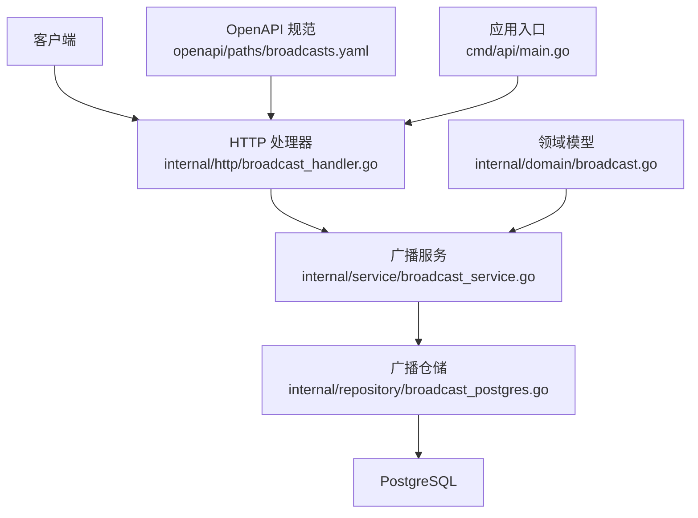
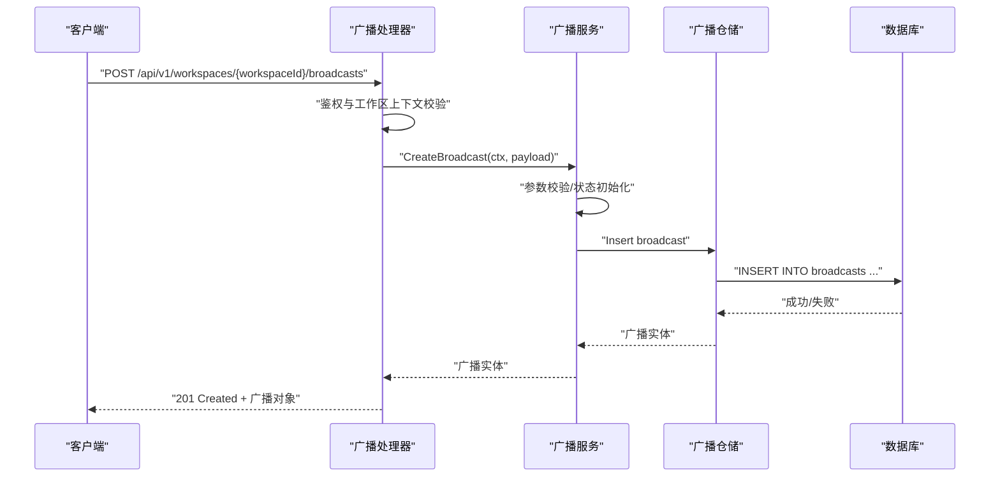
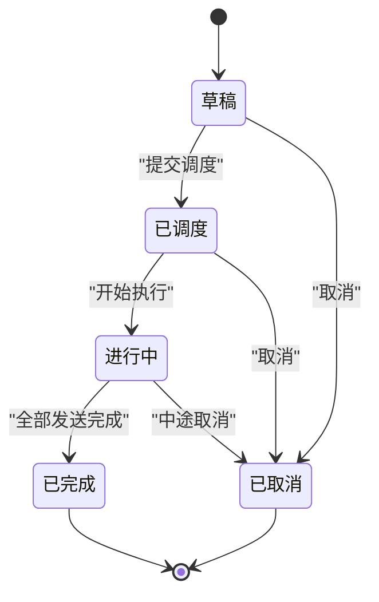
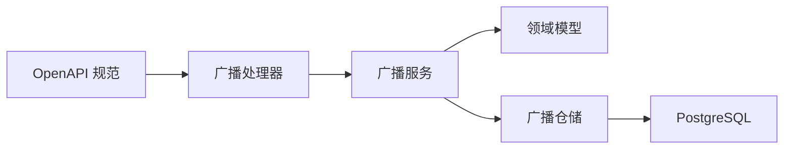

# 广播核心API

<cite>
**本文引用的文件**   
- [broadcast_handler.go](file://notifuse/internal/http/broadcast_handler.go)
- [broadcast_service.go](file://notifuse/internal/service/broadcast_service.go)
- [broadcast_postgres.go](file://notifuse/internal/repository/broadcast_postgres.go)
- [broadcast.go](file://notifuse/internal/domain/broadcast.go)
- [openapi.yaml](file://notifuse/openapi/openapi.yaml)
- [broadcasts.yaml](file://notifuse/openapi/paths/broadcasts.yaml)
- [main.go](file://notifuse/cmd/api/main.go)
</cite>

## 目录
1. [简介](#简介)
2. [项目结构](#项目结构)
3. [核心组件](#核心组件)
4. [架构总览](#架构总览)
5. [详细组件分析](#详细组件分析)
6. [依赖分析](#依赖分析)
7. [性能考虑](#性能考虑)
8. [故障排查指南](#故障排查指南)
9. [结论](#结论)
10. [附录：RESTful API 端点规范](#附录restful-api-端点规范)

## 简介
本文件为 Notifuse 平台的“广播”核心 API 提供权威文档，覆盖广播的创建、更新、删除与查询接口。内容包含请求参数校验规则、响应格式规范、错误处理机制、状态管理、权限控制与数据隔离逻辑，并提供完整的 RESTful 端点规范（HTTP 方法、URL 路径、请求头要求、响应体结构）以及调用示例路径指引。

## 项目结构
广播功能在后端采用分层架构：HTTP 层负责路由与鉴权、服务层封装业务逻辑、仓储层对接数据库持久化；领域模型定义广播实体与状态；OpenAPI 描述对外契约。

图表来源
- [broadcast_handler.go](file://notifuse/internal/http/broadcast_handler.go)
- [broadcast_service.go](file://notifuse/internal/service/broadcast_service.go)
- [broadcast_postgres.go](file://notifuse/internal/repository/broadcast_postgres.go)
- [broadcast.go](file://notifuse/internal/domain/broadcast.go)
- [broadcasts.yaml](file://notifuse/openapi/paths/broadcasts.yaml)
- [main.go](file://notifuse/cmd/api/main.go)

章节来源
- [broadcast_handler.go](file://notifuse/internal/http/broadcast_handler.go)
- [broadcast_service.go](file://notifuse/internal/service/broadcast_service.go)
- [broadcast_postgres.go](file://notifuse/internal/repository/broadcast_postgres.go)
- [broadcast.go](file://notifuse/internal/domain/broadcast.go)
- [broadcasts.yaml](file://notifuse/openapi/paths/broadcasts.yaml)
- [main.go](file://notifuse/cmd/api/main.go)

## 核心组件
- HTTP 处理器：实现广播相关路由，解析请求、执行鉴权与权限检查、调用服务层并返回统一响应。
- 广播服务：编排业务逻辑，包括参数校验、状态机转换、工作区隔离、事务边界等。
- 广播仓储：基于 PostgreSQL 的 CRUD 操作，确保工作区隔离与一致性。
- 领域模型：定义广播实体字段、枚举状态及约束。
- OpenAPI 契约：声明式定义所有广播接口的路径、参数、响应与错误码。

章节来源
- [broadcast_handler.go](file://notifuse/internal/http/broadcast_handler.go)
- [broadcast_service.go](file://notifuse/internal/service/broadcast_service.go)
- [broadcast_postgres.go](file://notifuse/internal/repository/broadcast_postgres.go)
- [broadcast.go](file://notifuse/internal/domain/broadcast.go)
- [broadcasts.yaml](file://notifuse/openapi/paths/broadcasts.yaml)

## 架构总览
广播 API 的请求从 HTTP 层进入，经中间件完成认证与工作区上下文注入后，由处理器路由到具体方法，再委托给服务层进行业务处理，最终通过仓储层访问数据库。

图表来源
- [broadcast_handler.go](file://notifuse/internal/http/broadcast_handler.go)
- [broadcast_service.go](file://notifuse/internal/service/broadcast_service.go)
- [broadcast_postgres.go](file://notifuse/internal/repository/broadcast_postgres.go)

## 详细组件分析

### 领域模型与状态管理
- 广播实体包含标识、标题、主题、正文、发送目标、计划时间、状态、工作区归属等关键字段。
- 状态机涵盖草稿、已调度、进行中、已完成、已取消等典型生命周期状态。
- 状态转换在服务层受控，仅允许合法迁移，并在变更时记录审计信息。

图表来源
- [broadcast.go](file://notifuse/internal/domain/broadcast.go)

章节来源
- [broadcast.go](file://notifuse/internal/domain/broadcast.go)

### HTTP 处理器（路由与鉴权）
- 路由注册：在应用启动时将广播相关路径挂载至工作区命名空间下。
- 鉴权与授权：使用中间件验证令牌与工作区成员身份，确保当前用户具备所需角色或权限。
- 请求解析与响应：统一解析 JSON 请求体，构造标准响应结构，并映射领域错误为合适的 HTTP 状态码。

章节来源
- [broadcast_handler.go](file://notifuse/internal/http/broadcast_handler.go)
- [main.go](file://notifuse/cmd/api/main.go)

### 广播服务（业务编排）
- 参数校验：对必填字段、长度限制、格式约束等进行校验，返回明确的参数错误。
- 状态转换：根据当前状态与动作判断是否允许转换，拒绝非法状态迁移。
- 数据隔离：强制按工作区 ID 过滤与写入，防止跨工作区访问。
- 事务与并发：在关键写路径使用事务保证一致性，避免竞态条件。

章节来源
- [broadcast_service.go](file://notifuse/internal/service/broadcast_service.go)

### 广播仓储（持久化）
- 读写隔离：所有查询与写入均携带工作区 ID，确保多租户数据隔离。
- 索引优化：针对常用查询列建立索引以提升列表与筛选性能。
- 错误映射：将数据库异常转换为领域错误，便于上层统一处理。

章节来源
- [broadcast_postgres.go](file://notifuse/internal/repository/broadcast_postgres.go)

## 依赖分析
- 处理器依赖服务层，不直接访问数据库。
- 服务层依赖领域模型与仓储接口，屏蔽存储细节。
- 仓储实现依赖 PostgreSQL 驱动与连接池。
- OpenAPI 作为契约反向驱动处理器与服务层的输入输出设计。

图表来源
- [broadcast_handler.go](file://notifuse/internal/http/broadcast_handler.go)
- [broadcast_service.go](file://notifuse/internal/service/broadcast_service.go)
- [broadcast_postgres.go](file://notifuse/internal/repository/broadcast_postgres.go)
- [broadcast.go](file://notifuse/internal/domain/broadcast.go)
- [broadcasts.yaml](file://notifuse/openapi/paths/broadcasts.yaml)

章节来源
- [broadcast_handler.go](file://notifuse/internal/http/broadcast_handler.go)
- [broadcast_service.go](file://notifuse/internal/service/broadcast_service.go)
- [broadcast_postgres.go](file://notifuse/internal/repository/broadcast_postgres.go)
- [broadcast.go](file://notifuse/internal/domain/broadcast.go)
- [broadcasts.yaml](file://notifuse/openapi/paths/broadcasts.yaml)

## 性能考虑
- 列表查询分页：服务端默认分页，建议客户端按需设置页大小以减少传输量。
- 索引策略：对高频过滤字段（如工作区 ID、状态、创建时间）建立索引。
- 批量操作：避免在循环中多次往返数据库，必要时使用批量插入/更新。
- 缓存热点：对于只读且变化不频繁的广播元数据，可引入短期缓存降低数据库压力。

[本节为通用指导，无需代码引用]

## 故障排查指南
- 常见错误码
  - 400 参数错误：字段缺失、类型不符、格式校验失败。
  - 401 未认证：缺少或无效令牌。
  - 403 无权限：当前用户不具备该工作区相应权限。
  - 404 资源不存在：广播 ID 不存在或不属于当前工作区。
  - 409 冲突：重复提交或状态不允许转换。
  - 500 服务器错误：内部异常或数据库不可用。
- 定位步骤
  - 核对请求路径与方法是否与 OpenAPI 一致。
  - 检查鉴权令牌与工作区上下文是否正确注入。
  - 查看服务层日志中的参数校验与状态转换断言。
  - 确认仓储层 SQL 执行与索引命中情况。

章节来源
- [broadcast_handler.go](file://notifuse/internal/http/broadcast_handler.go)
- [broadcast_service.go](file://notifuse/internal/service/broadcast_service.go)
- [broadcast_postgres.go](file://notifuse/internal/repository/broadcast_postgres.go)

## 结论
广播核心 API 以清晰的层次划分与严格的权限/隔离策略保障多租户安全与稳定性。通过 OpenAPI 契约与领域状态机，系统具备良好的可维护性与可扩展性。建议在集成时严格遵循参数校验与错误码约定，并结合分页与索引优化提升整体性能。

[本节为总结，无需代码引用]

## 附录：RESTful API 端点规范
以下端点均以工作区为隔离维度，路径中包含 workspaceId。所有需要认证的请求需携带有效的鉴权令牌（例如 Authorization: Bearer <token>）。

- 创建广播
  - 方法：POST
  - 路径：/api/v1/workspaces/{workspaceId}/broadcasts
  - 请求头：Content-Type: application/json；Authorization: Bearer <token>
  - 请求体：包含标题、主题、正文、发送目标、计划时间等字段（详见 OpenAPI）
  - 响应：201 Created，返回新建广播对象
  - 错误：400 参数错误；401 未认证；403 无权限；409 冲突

- 获取广播详情
  - 方法：GET
  - 路径：/api/v1/workspaces/{workspaceId}/broadcasts/{broadcastId}
  - 请求头：Authorization: Bearer <token>
  - 响应：200 OK，返回广播对象
  - 错误：401 未认证；403 无权限；404 不存在

- 更新广播
  - 方法：PUT
  - 路径：/api/v1/workspaces/{workspaceId}/broadcasts/{broadcastId}
  - 请求头：Content-Type: application/json；Authorization: Bearer <token>
  - 请求体：可更新的字段集合（如标题、主题、正文、计划时间等）
  - 响应：200 OK，返回更新后的广播对象
  - 错误：400 参数错误；401 未认证；403 无权限；404 不存在；409 状态不允许

- 删除广播
  - 方法：DELETE
  - 路径：/api/v1/workspaces/{workspaceId}/broadcasts/{broadcastId}
  - 请求头：Authorization: Bearer <token>
  - 响应：204 No Content
  - 错误：401 未认证；403 无权限；404 不存在

- 查询广播列表
  - 方法：GET
  - 路径：/api/v1/workspaces/{workspaceId}/broadcasts
  - 查询参数：page、pageSize、status、createdAtFrom、createdAtTo 等（可选）
  - 请求头：Authorization: Bearer <token>
  - 响应：200 OK，返回分页结果（items 数组与分页元信息）
  - 错误：401 未认证；403 无权限

- 触发发送（若支持）
  - 方法：POST
  - 路径：/api/v1/workspaces/{workspaceId}/broadcasts/{broadcastId}/send
  - 请求头：Authorization: Bearer <token>
  - 响应：202 Accepted，返回任务受理信息
  - 错误：401 未认证；403 无权限；404 不存在；409 状态不允许

章节来源
- [broadcasts.yaml](file://notifuse/openapi/paths/broadcasts.yaml)
- [openapi.yaml](file://notifuse/openapi/openapi.yaml)

## 附录：调用示例（路径指引）
- 创建广播示例：参考 OpenAPI 路径定义与请求体结构
  - [创建广播示例路径](file://notifuse/openapi/paths/broadcasts.yaml)
- 更新广播示例：参考 OpenAPI 路径定义与请求体结构
  - [更新广播示例路径](file://notifuse/openapi/paths/broadcasts.yaml)
- 删除广播示例：参考 OpenAPI 路径定义
  - [删除广播示例路径](file://notifuse/openapi/paths/broadcasts.yaml)
- 查询广播列表示例：参考 OpenAPI 查询参数与响应结构
  - [查询广播列表示例路径](file://notifuse/openapi/paths/broadcasts.yaml)

[以上示例路径指向 OpenAPI 定义，便于生成客户端代码或 Postman 集合]