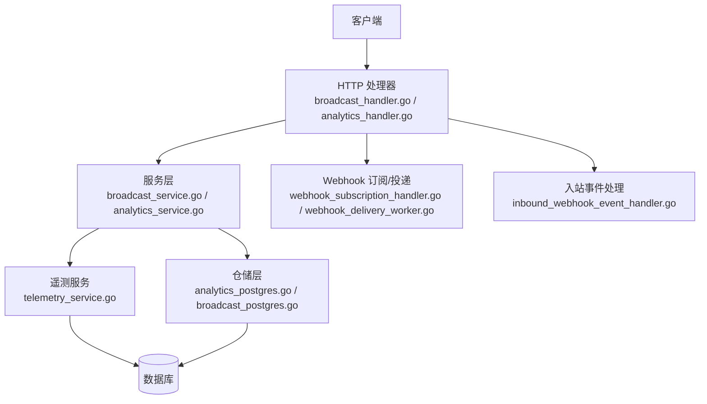
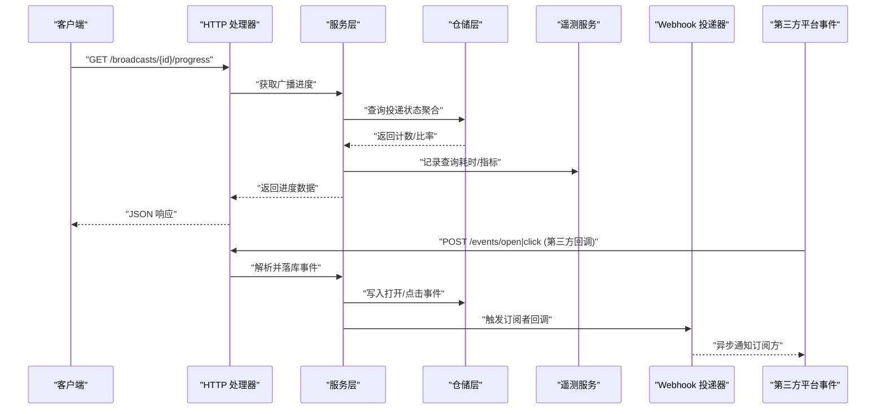
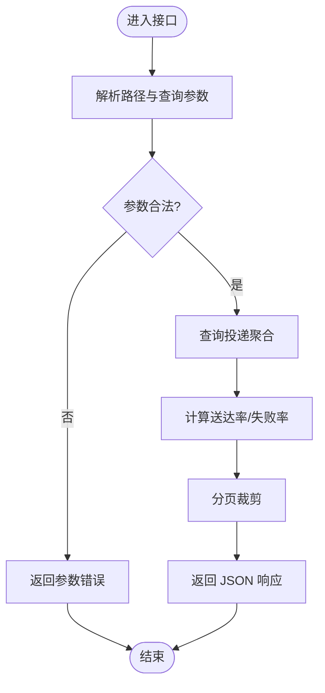
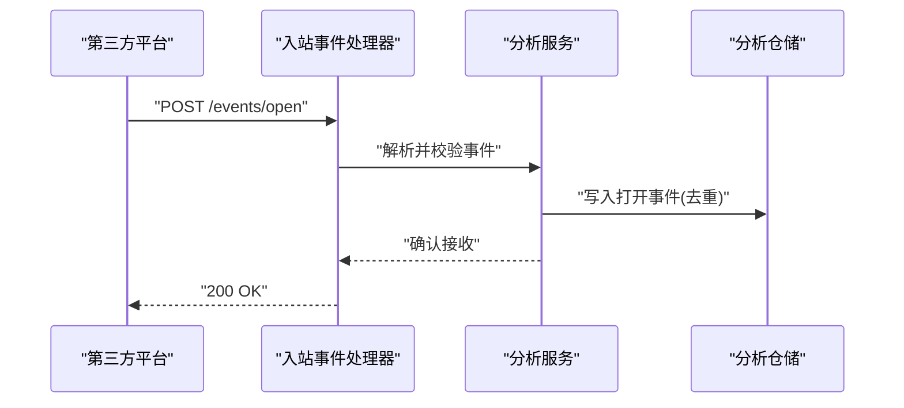
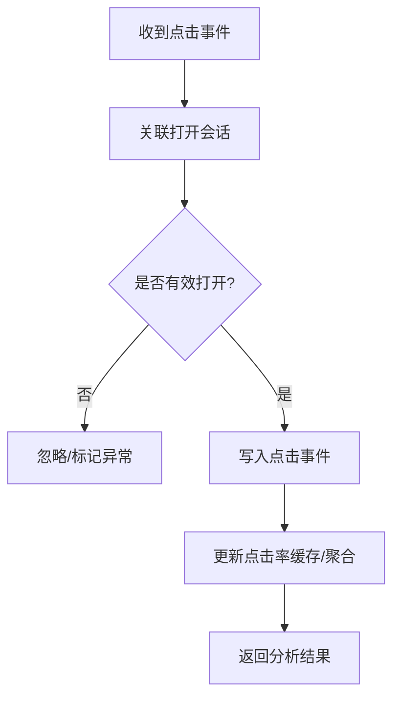
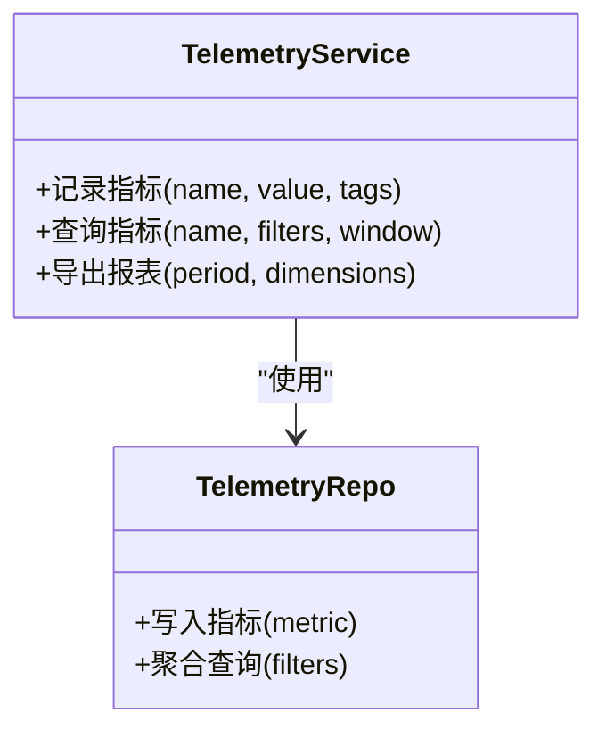
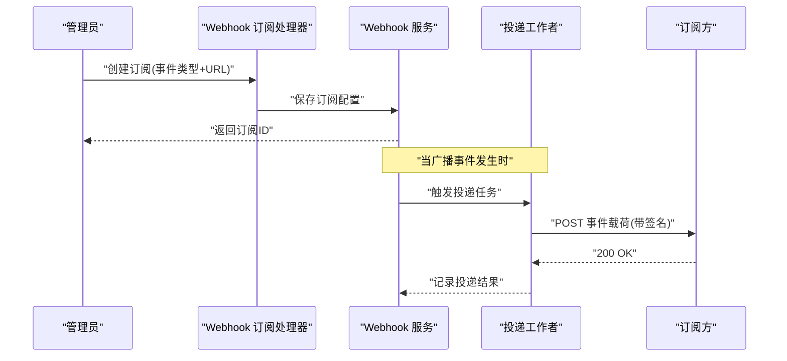
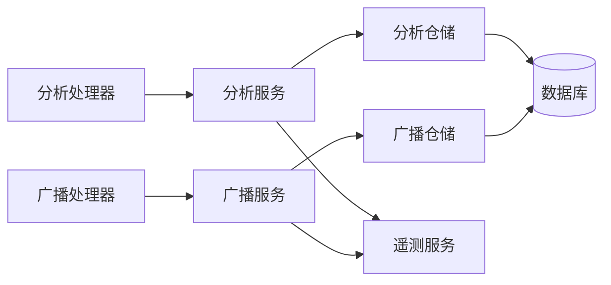

# 监控统计API

<cite>
**本文引用的文件**   
- [broadcast_handler.go](file://notifuse/internal/http/broadcast_handler.go)
- [broadcast_service.go](file://notifuse/internal/service/broadcast_service.go)
- [analytics_handler.go](file://notifuse/internal/http/analytics_handler.go)
- [analytics_service.go](file://notifuse/internal/service/analytics_service.go)
- [analytics_postgres.go](file://notifuse/internal/repository/analytics_postgres.go)
- [broadcast_postgres.go](file://notifuse/internal/repository/broadcast_postgres.go)
- [webhook_subscription_handler.go](file://notifuse/internal/http/webhook_subscription_handler.go)
- [webhook_delivery_worker.go](file://notifuse/internal/service/webhook_delivery_worker.go)
- [inbound_webhook_event_handler.go](file://notifuse/internal/http/inbound_webhook_event_handler.go)
- [telemetry_service.go](file://notifuse/internal/service/telemetry_service.go)
- [telemetry_postgres.go](file://notifuse/internal/repository/telemetry_postgres.go)
- [openapi.yaml](file://notifuse/openapi/openapi.yaml)
- [broadcasts.yaml](file://notifuse/openapi/paths/broadcasts.yaml)
</cite>

## 目录
1. [简介](#简介)
2. [项目结构](#项目结构)
3. [核心组件](#核心组件)
4. [架构总览](#架构总览)
5. [详细组件分析](#详细组件分析)
6. [依赖关系分析](#依赖关系分析)
7. [性能考虑](#性能考虑)
8. [故障排查指南](#故障排查指南)
9. [结论](#结论)
10. [附录](#附录)

## 简介
本文件为 Notifuse 平台的“广播监控统计API”提供权威、可操作的接口与实现说明，覆盖以下能力：
- 发送进度查询：按批次（广播）维度查看已投递、成功、失败等状态分布与实时进度。
- 送达率统计：基于投递结果计算送达率、退信率等指标。
- 打开率追踪：通过跟踪像素或链接重定向记录打开事件并聚合统计。
- 点击率分析：对打开后的链接点击进行归因与汇总。
- 实时状态监控：提供近实时进度与关键指标查询。
- 性能指标收集与报表生成：结合遥测数据输出常用报表视图。
- 批量数据处理与分页过滤：支持大批量数据的分页拉取与条件筛选。
- Webhook回调通知：订阅广播相关事件，接收推送式通知。
- 异常告警与日志查询：对接错误分类与日志检索能力，辅助定位问题。

## 项目结构
与监控统计相关的代码主要分布在 HTTP 层、服务层、仓储层以及 OpenAPI 规范中：
- HTTP 层：暴露 REST API，负责参数校验、鉴权、响应封装。
- 服务层：编排业务逻辑，组合仓储与外部系统（如邮件服务商）。
- 仓储层：PostgreSQL 读写，包含 SQL 构建与聚合查询。
- OpenAPI：对外契约定义，便于前后端联调与自动生成客户端。

图表来源
- [broadcast_handler.go](file://notifuse/internal/http/broadcast_handler.go)
- [analytics_handler.go](file://notifuse/internal/http/analytics_handler.go)
- [broadcast_service.go](file://notifuse/internal/service/broadcast_service.go)
- [analytics_service.go](file://notifuse/internal/service/analytics_service.go)
- [analytics_postgres.go](file://notifuse/internal/repository/analytics_postgres.go)
- [broadcast_postgres.go](file://notifuse/internal/repository/broadcast_postgres.go)
- [webhook_subscription_handler.go](file://notifuse/internal/http/webhook_subscription_handler.go)
- [webhook_delivery_worker.go](file://notifuse/internal/service/webhook_delivery_worker.go)
- [inbound_webhook_event_handler.go](file://notifuse/internal/http/inbound_webhook_event_handler.go)
- [telemetry_service.go](file://notifuse/internal/service/telemetry_service.go)
- [telemetry_postgres.go](file://notifuse/internal/repository/telemetry_postgres.go)

章节来源
- [broadcast_handler.go](file://notifuse/internal/http/broadcast_handler.go)
- [analytics_handler.go](file://notifuse/internal/http/analytics_handler.go)
- [broadcast_service.go](file://notifuse/internal/service/broadcast_service.go)
- [analytics_service.go](file://notifuse/internal/service/analytics_service.go)
- [analytics_postgres.go](file://notifuse/internal/repository/analytics_postgres.go)
- [broadcast_postgres.go](file://notifuse/internal/repository/broadcast_postgres.go)
- [webhook_subscription_handler.go](file://notifuse/internal/http/webhook_subscription_handler.go)
- [webhook_delivery_worker.go](file://notifuse/internal/service/webhook_delivery_worker.go)
- [inbound_webhook_event_handler.go](file://notifuse/internal/http/inbound_webhook_event_handler.go)
- [telemetry_service.go](file://notifuse/internal/service/telemetry_service.go)
- [telemetry_postgres.go](file://notifuse/internal/repository/telemetry_postgres.go)

## 核心组件
- 广播处理器（HTTP）：提供广播列表、详情、进度、统计等接口。
- 分析处理器（HTTP）：提供打开、点击、送达等分析指标查询接口。
- 广播服务（Service）：编排广播生命周期与统计口径。
- 分析服务（Service）：聚合打开/点击/送达等指标，支撑报表。
- 分析仓储（Repository）：执行复杂 SQL 聚合，优化大数据量查询。
- 遥测服务（Telemetry）：采集与导出性能指标，用于报表与监控。
- Webhook 订阅与投递：订阅广播事件，异步投递回调。
- 入站事件处理：接收第三方平台事件（如打开/点击），写入内部事件表。

章节来源
- [broadcast_handler.go](file://notifuse/internal/http/broadcast_handler.go)
- [analytics_handler.go](file://notifuse/internal/http/analytics_handler.go)
- [broadcast_service.go](file://notifuse/internal/service/broadcast_service.go)
- [analytics_service.go](file://notifuse/internal/service/analytics_service.go)
- [analytics_postgres.go](file://notifuse/internal/repository/analytics_postgres.go)
- [telemetry_service.go](file://notifuse/internal/service/telemetry_service.go)
- [webhook_subscription_handler.go](file://notifuse/internal/http/webhook_subscription_handler.go)
- [webhook_delivery_worker.go](file://notifuse/internal/service/webhook_delivery_worker.go)
- [inbound_webhook_event_handler.go](file://notifuse/internal/http/inbound_webhook_event_handler.go)

## 架构总览
下图展示从客户端请求到数据存储与回调的端到端流程，重点体现“广播进度/送达/打开/点击”的数据链路。

图表来源
- [broadcast_handler.go](file://notifuse/internal/http/broadcast_handler.go)
- [analytics_handler.go](file://notifuse/internal/http/analytics_handler.go)
- [analytics_service.go](file://notifuse/internal/service/analytics_service.go)
- [analytics_postgres.go](file://notifuse/internal/repository/analytics_postgres.go)
- [telemetry_service.go](file://notifuse/internal/service/telemetry_service.go)
- [webhook_delivery_worker.go](file://notifuse/internal/service/webhook_delivery_worker.go)
- [inbound_webhook_event_handler.go](file://notifuse/internal/http/inbound_webhook_event_handler.go)

## 详细组件分析

### 广播进度与送达率接口
- 功能要点
  - 按广播 ID 查询投递总数、成功数、失败数、待投递数、重试次数等。
  - 计算送达率 = 成功数 / 投递总数（排除无效地址等口径需与服务层对齐）。
  - 支持时间范围、工作区过滤与分页。
- 典型调用序列
  - 客户端请求 -> 广播处理器 -> 广播服务 -> 广播仓储 -> 数据库 -> 返回聚合结果。
- 分页与过滤
  - 支持 page/page_size、start_time/end_time、status 过滤等。
- 错误码与重试
  - 常见 4xx/5xx 语义；对上游投递平台失败采用指数退避重试策略。

图表来源
- [broadcast_handler.go](file://notifuse/internal/http/broadcast_handler.go)
- [broadcast_service.go](file://notifuse/internal/service/broadcast_service.go)
- [broadcast_postgres.go](file://notifuse/internal/repository/broadcast_postgres.go)

章节来源
- [broadcast_handler.go](file://notifuse/internal/http/broadcast_handler.go)
- [broadcast_service.go](file://notifuse/internal/service/broadcast_service.go)
- [broadcast_postgres.go](file://notifuse/internal/repository/broadcast_postgres.go)

### 打开率追踪接口
- 功能要点
  - 基于打开事件（由第三方平台回调或 SDK 埋点）统计打开数、打开率。
  - 打开率 = 打开数 / 送达数（或投递总数，取决于配置口径）。
  - 支持按联系人、模板、渠道等多维聚合。
- 事件接入
  - 入站事件处理器接收第三方回调，标准化后写入事件表。
  - 分析服务根据事件表聚合出打开率指标。
- 防刷与去重
  - 同一联系人同一次广播的重复打开应去重（按窗口期或唯一键）。

图表来源
- [inbound_webhook_event_handler.go](file://notifuse/internal/http/inbound_webhook_event_handler.go)
- [analytics_service.go](file://notifuse/internal/service/analytics_service.go)
- [analytics_postgres.go](file://notifuse/internal/repository/analytics_postgres.go)

章节来源
- [inbound_webhook_event_handler.go](file://notifuse/internal/http/inbound_webhook_event_handler.go)
- [analytics_service.go](file://notifuse/internal/service/analytics_service.go)
- [analytics_postgres.go](file://notifuse/internal/repository/analytics_postgres.go)

### 点击率分析接口
- 功能要点
  - 基于点击事件统计点击数、点击率（点击数/打开数）。
  - 支持按链接、页面、设备类型等维度下钻。
  - 与打开事件关联，确保分母一致。
- 数据一致性
  - 点击事件必须携带打开会话标识，避免跨会话误计。

图表来源
- [analytics_handler.go](file://notifuse/internal/http/analytics_handler.go)
- [analytics_service.go](file://notifuse/internal/service/analytics_service.go)
- [analytics_postgres.go](file://notifuse/internal/repository/analytics_postgres.go)

章节来源
- [analytics_handler.go](file://notifuse/internal/http/analytics_handler.go)
- [analytics_service.go](file://notifuse/internal/service/analytics_service.go)
- [analytics_postgres.go](file://notifuse/internal/repository/analytics_postgres.go)

### 实时状态监控与性能指标
- 实时状态
  - 提供“最近 N 分钟”的投递速率、成功率、延迟分位等指标。
  - 通过遥测服务采集并持久化，供前端轮询或 SSE 推送。
- 性能指标
  - 接口耗时、队列积压、重试次数、错误分类占比等。
- 报表生成
  - 基于遥测与分析聚合结果，生成日报/周报视图。

图表来源
- [telemetry_service.go](file://notifuse/internal/service/telemetry_service.go)
- [telemetry_postgres.go](file://notifuse/internal/repository/telemetry_postgres.go)

章节来源
- [telemetry_service.go](file://notifuse/internal/service/telemetry_service.go)
- [telemetry_postgres.go](file://notifuse/internal/repository/telemetry_postgres.go)

### Webhook 回调通知
- 订阅管理
  - 创建/更新/删除订阅，指定事件类型（如 broadcast.sent、broadcast.delivered、broadcast.opened、broadcast.clicked）。
- 投递机制
  - 异步投递，支持重试、幂等键、签名校验。
- 失败处理
  - 失败记录投递历史，支持人工重试与告警。

图表来源
- [webhook_subscription_handler.go](file://notifuse/internal/http/webhook_subscription_handler.go)
- [webhook_delivery_worker.go](file://notifuse/internal/service/webhook_delivery_worker.go)

章节来源
- [webhook_subscription_handler.go](file://notifuse/internal/http/webhook_subscription_handler.go)
- [webhook_delivery_worker.go](file://notifuse/internal/service/webhook_delivery_worker.go)

### 批量数据处理与分页查询
- 批量导入联系人/标签
  - 支持 CSV/JSON 批量上传，后台异步处理，返回任务 ID 与进度。
- 分页与过滤
  - 所有列表接口统一支持 page/page_size、排序字段、时间范围、状态过滤。
- 大数据优化
  - 仓储层采用流式读取、分批聚合、索引优化，避免全表扫描。

章节来源
- [broadcast_handler.go](file://notifuse/internal/http/broadcast_handler.go)
- [analytics_handler.go](file://notifuse/internal/http/analytics_handler.go)
- [analytics_postgres.go](file://notifuse/internal/repository/analytics_postgres.go)
- [broadcast_postgres.go](file://notifuse/internal/repository/broadcast_postgres.go)

### 异常告警与日志查询
- 异常分类
  - 针对各邮件服务商的错误码进行分类，区分临时/永久错误。
- 告警规则
  - 送达率低于阈值、失败率突增、重试次数过多时触发告警。
- 日志查询
  - 基于请求 ID/广播 ID/联系人 ID 检索日志，支持时间范围与关键字过滤。

章节来源
- [analytics_handler.go](file://notifuse/internal/http/analytics_handler.go)
- [analytics_service.go](file://notifuse/internal/service/analytics_service.go)
- [telemetry_service.go](file://notifuse/internal/service/telemetry_service.go)

## 依赖关系分析
- HTTP 处理器依赖服务层，服务层依赖仓储层与遥测服务。
- 仓储层直接访问数据库，承担复杂聚合与批处理。
- Webhook 子系统独立于主分析链路，但共享事件源与订阅配置。

图表来源
- [broadcast_handler.go](file://notifuse/internal/http/broadcast_handler.go)
- [analytics_handler.go](file://notifuse/internal/http/analytics_handler.go)
- [broadcast_service.go](file://notifuse/internal/service/broadcast_service.go)
- [analytics_service.go](file://notifuse/internal/service/analytics_service.go)
- [broadcast_postgres.go](file://notifuse/internal/repository/broadcast_postgres.go)
- [analytics_postgres.go](file://notifuse/internal/repository/analytics_postgres.go)
- [telemetry_service.go](file://notifuse/internal/service/telemetry_service.go)

章节来源
- [broadcast_handler.go](file://notifuse/internal/http/broadcast_handler.go)
- [analytics_handler.go](file://notifuse/internal/http/analytics_handler.go)
- [broadcast_service.go](file://notifuse/internal/service/broadcast_service.go)
- [analytics_service.go](file://notifuse/internal/service/analytics_service.go)
- [broadcast_postgres.go](file://notifuse/internal/repository/broadcast_postgres.go)
- [analytics_postgres.go](file://notifuse/internal/repository/analytics_postgres.go)
- [telemetry_service.go](file://notifuse/internal/service/telemetry_service.go)

## 性能考虑
- 聚合查询优化
  - 使用物化视图或定时预聚合降低在线查询压力。
  - 合理设计索引（时间戳、广播ID、事件类型、联系人ID）。
- 分页与游标
  - 大数据集建议使用基于时间或主键的游标分页，减少深翻页成本。
- 异步与批处理
  - 批量导入与报表生成走异步任务队列，避免阻塞主链路。
- 缓存与热点
  - 对高频指标（如最近1小时送达率）做短时缓存。
- 限流与背压
  - 对第三方回调入口实施限流，防止突发流量打爆后端。

[本节为通用指导，不直接分析具体文件]

## 故障排查指南
- 常见问题
  - 送达率为零：检查第三方平台回调是否到达、事件去重策略是否正确。
  - 打开/点击不一致：核对会话关联键与窗口期配置。
  - 进度停滞：检查队列积压、重试次数与上游平台限流。
- 诊断步骤
  - 通过请求 ID/广播 ID 检索日志，定位失败节点。
  - 查看遥测指标，对比历史基线判断异常幅度。
  - 复现最小用例，隔离网络/证书/签名问题。
- 恢复建议
  - 清理死信队列，重新投递失败事件。
  - 调整重试策略与超时参数，必要时扩容消费者。

章节来源
- [inbound_webhook_event_handler.go](file://notifuse/internal/http/inbound_webhook_event_handler.go)
- [analytics_service.go](file://notifuse/internal/service/analytics_service.go)
- [telemetry_service.go](file://notifuse/internal/service/telemetry_service.go)

## 结论
本监控统计API围绕“广播进度、送达率、打开率、点击率”四大核心指标，构建了从事件采集、聚合分析到报表输出的完整链路。通过分层架构与异步化设计，系统在大规模场景下仍能提供稳定、实时的观测能力。配合 Webhook 订阅与告警机制，用户可实现闭环监控与自动化运维。

[本节为总结性内容，不直接分析具体文件]

## 附录
- OpenAPI 契约
  - 根规范：[openapi.yaml](file://notifuse/openapi/openapi.yaml)
  - 广播相关路径：[broadcasts.yaml](file://notifuse/openapi/paths/broadcasts.yaml)
- 示例用法
  - 查询某广播的进度与送达率：参考广播处理器与仓储实现。
  - 订阅打开/点击事件并接收回调：参考 Webhook 订阅与投递实现。
  - 生成日报/周报：参考遥测服务导出报表方法。

章节来源
- [openapi.yaml](file://notifuse/openapi/openapi.yaml)
- [broadcasts.yaml](file://notifuse/openapi/paths/broadcasts.yaml)
- [broadcast_handler.go](file://notifuse/internal/http/broadcast_handler.go)
- [analytics_handler.go](file://notifuse/internal/http/analytics_handler.go)
- [webhook_subscription_handler.go](file://notifuse/internal/http/webhook_subscription_handler.go)
- [webhook_delivery_worker.go](file://notifuse/internal/service/webhook_delivery_worker.go)
- [telemetry_service.go](file://notifuse/internal/service/telemetry_service.go)