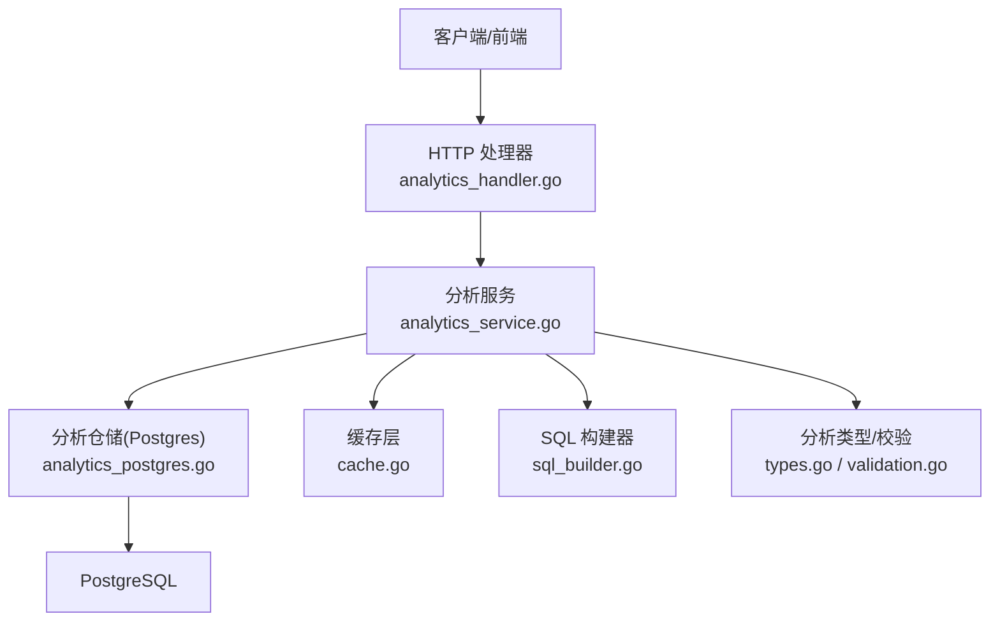
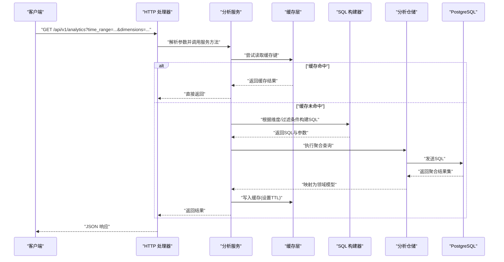
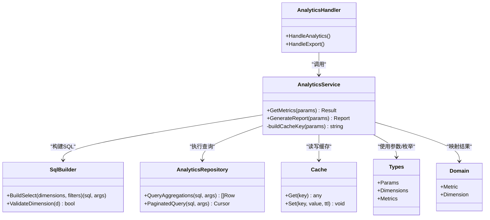

# 数据分析API

<cite>
**本文引用的文件**   
- [analytics_handler.go](file://notifuse/internal/http/analytics_handler.go)
- [analytics_service.go](file://notifuse/internal/service/analytics_service.go)
- [analytics_postgres.go](file://notifuse/internal/repository/analytics_postgres.go)
- [sql_builder.go](file://notifuse/pkg/analytics/sql_builder.go)
- [types.go](file://notifuse/pkg/analytics/types.go)
- [validation.go](file://notifuse/pkg/analytics/validation.go)
- [cache.go](file://notifuse/pkg/cache/cache.go)
- [analytics.go](file://notifuse/internal/domain/analytics.go)
</cite>

## 目录
1. [简介](#简介)
2. [项目结构](#项目结构)
3. [核心组件](#核心组件)
4. [架构总览](#架构总览)
5. [详细组件分析](#详细组件分析)
6. [依赖关系分析](#依赖关系分析)
7. [性能与缓存策略](#性能与缓存策略)
8. [故障排查指南](#故障排查指南)
9. [结论](#结论)
10. [附录：指标定义与计算逻辑](#附录指标定义与计算逻辑)

## 简介
本文件为 Notifuse 平台“数据分析API”的权威技术文档，聚焦邮件性能指标、用户行为追踪、转化率统计等分析能力的查询接口。内容覆盖时间范围筛选、维度聚合、数据导出与报表生成、关键指标定义与计算逻辑、数据精度与缓存策略、实时数据更新、历史数据归档以及大数据量查询优化，并提供可视化集成示例与自定义报表开发指南，帮助开发者快速构建高质量的数据分析与报表应用。

## 项目结构
数据分析能力在后端采用分层架构：HTTP 层暴露 REST 接口，服务层封装业务规则与聚合逻辑，仓储层负责数据库访问，分析包提供 SQL 构建与类型/校验工具，缓存层提供通用缓存能力。

图表来源
- [analytics_handler.go](file://notifuse/internal/http/analytics_handler.go)
- [analytics_service.go](file://notifuse/internal/service/analytics_service.go)
- [analytics_postgres.go](file://notifuse/internal/repository/analytics_postgres.go)
- [sql_builder.go](file://notifuse/pkg/analytics/sql_builder.go)
- [types.go](file://notifuse/pkg/analytics/types.go)
- [validation.go](file://notifuse/pkg/analytics/validation.go)
- [cache.go](file://notifuse/pkg/cache/cache.go)

章节来源
- [analytics_handler.go](file://notifuse/internal/http/analytics_handler.go)
- [analytics_service.go](file://notifuse/internal/service/analytics_service.go)
- [analytics_postgres.go](file://notifuse/internal/repository/analytics_postgres.go)
- [sql_builder.go](file://notifuse/pkg/analytics/sql_builder.go)
- [types.go](file://notifuse/pkg/analytics/types.go)
- [validation.go](file://notifuse/pkg/analytics/validation.go)
- [cache.go](file://notifuse/pkg/cache/cache.go)

## 核心组件
- HTTP 处理器：解析请求参数（时间范围、维度、分页、排序、导出格式），调用服务层并返回统一响应体。
- 分析服务：实现指标聚合、过滤条件组装、缓存命中/失效、导出与报表生成编排。
- 分析仓储：基于 Postgres 执行聚合查询，支持按工作区隔离、索引优化与分批读取。
- SQL 构建器：根据维度与过滤条件动态拼装 SQL，避免注入风险并提升可读性。
- 类型与校验：统一定义查询参数、指标枚举、维度枚举及校验规则。
- 缓存层：提供键值缓存能力，用于热点指标结果缓存与过期控制。

章节来源
- [analytics_handler.go](file://notifuse/internal/http/analytics_handler.go)
- [analytics_service.go](file://notifuse/internal/service/analytics_service.go)
- [analytics_postgres.go](file://notifuse/internal/repository/analytics_postgres.go)
- [sql_builder.go](file://notifuse/pkg/analytics/sql_builder.go)
- [types.go](file://notifuse/pkg/analytics/types.go)
- [validation.go](file://notifuse/pkg/analytics/validation.go)
- [cache.go](file://notifuse/pkg/cache/cache.go)

## 架构总览
下图展示一次典型分析查询的请求链路：从 HTTP 入口到服务层聚合、缓存判断、SQL 构建与数据库查询，最终返回结构化结果。

图表来源
- [analytics_handler.go](file://notifuse/internal/http/analytics_handler.go)
- [analytics_service.go](file://notifuse/internal/service/analytics_service.go)
- [analytics_postgres.go](file://notifuse/internal/repository/analytics_postgres.go)
- [sql_builder.go](file://notifuse/pkg/analytics/sql_builder.go)
- [cache.go](file://notifuse/pkg/cache/cache.go)

## 详细组件分析

### HTTP 处理器（分析接口）
职责
- 接收并校验查询参数：时间范围、维度列表、过滤条件、分页与排序、导出格式。
- 调用分析服务获取结果或触发异步导出任务。
- 统一错误码与响应结构。

关键流程
- 参数校验失败时返回明确的错误信息。
- 对导出请求进行限流与队列化（如需要）。
- 将服务层返回的结构化数据序列化为 JSON。

章节来源
- [analytics_handler.go](file://notifuse/internal/http/analytics_handler.go)

### 分析服务（业务编排）
职责
- 组合维度与过滤条件，决定是否需要缓存。
- 协调 SQL 构建与仓储查询。
- 处理导出与报表生成的编排逻辑。
- 维护指标计算的边界条件与精度控制。

关键流程
- 构建缓存键：包含时间范围、维度、过滤条件、分页与排序等影响结果的要素。
- 若缓存命中则直接返回；否则走查询路径。
- 查询完成后回填缓存并设置合理 TTL。
- 导出模式：将聚合结果转换为 CSV/Excel 或触发后台任务。

章节来源
- [analytics_service.go](file://notifuse/internal/service/analytics_service.go)

### 分析仓储（Postgres 访问）
职责
- 执行聚合查询，按工作区隔离数据。
- 使用索引字段加速时间范围与维度过滤。
- 支持分页游标与批量读取，降低内存占用。

关键流程
- 接收 SQL 与参数，执行查询并映射为领域对象。
- 处理大结果集的分页与流式读取。
- 记录慢查询日志与错误上下文。

章节来源
- [analytics_postgres.go](file://notifuse/internal/repository/analytics_postgres.go)

### SQL 构建器（动态 SQL）
职责
- 根据维度与过滤条件生成安全、可执行的 SQL。
- 防止 SQL 注入，保证列名与表名的白名单校验。
- 提供统一的分组、聚合函数拼接。

关键流程
- 校验维度与过滤键合法性。
- 拼装 WHERE、GROUP BY、ORDER BY 子句。
- 输出标准化 SQL 与参数数组。

章节来源
- [sql_builder.go](file://notifuse/pkg/analytics/sql_builder.go)

### 类型与校验（参数与枚举）
职责
- 统一定义查询参数结构、指标与维度枚举。
- 提供输入校验与默认值填充。
- 约束时间范围、维度数量、分页大小等。

章节来源
- [types.go](file://notifuse/pkg/analytics/types.go)
- [validation.go](file://notifuse/pkg/analytics/validation.go)

### 缓存层（通用缓存）
职责
- 提供键值存取、过期时间与并发安全的缓存操作。
- 支持不同粒度的缓存键（全局/工作区/租户级）。
- 提供缓存命中率统计与监控埋点。

章节来源
- [cache.go](file://notifuse/pkg/cache/cache.go)

### 领域模型（分析实体）
职责
- 定义分析相关领域对象与转换方法。
- 承载指标、维度、时间粒度等语义信息。

章节来源
- [analytics.go](file://notifuse/internal/domain/analytics.go)

## 依赖关系分析
- HTTP 处理器依赖分析服务与类型校验。
- 分析服务依赖 SQL 构建器、仓储与缓存层。
- 仓储依赖数据库连接与索引设计。
- 类型与校验被 HTTP 与服务层共同复用。

图表来源
- [analytics_handler.go](file://notifuse/internal/http/analytics_handler.go)
- [analytics_service.go](file://notifuse/internal/service/analytics_service.go)
- [analytics_postgres.go](file://notifuse/internal/repository/analytics_postgres.go)
- [sql_builder.go](file://notifuse/pkg/analytics/sql_builder.go)
- [types.go](file://notifuse/pkg/analytics/types.go)
- [analytics.go](file://notifuse/internal/domain/analytics.go)
- [cache.go](file://notifuse/pkg/cache/cache.go)

章节来源
- [analytics_handler.go](file://notifuse/internal/http/analytics_handler.go)
- [analytics_service.go](file://notifuse/internal/service/analytics_service.go)
- [analytics_postgres.go](file://notifuse/internal/repository/analytics_postgres.go)
- [sql_builder.go](file://notifuse/pkg/analytics/sql_builder.go)
- [types.go](file://notifuse/pkg/analytics/types.go)
- [analytics.go](file://notifuse/internal/domain/analytics.go)
- [cache.go](file://notifuse/pkg/cache/cache.go)

## 性能与缓存策略
- 时间范围与维度选择
  - 优先使用带索引的时间字段与维度列进行过滤与分组。
  - 限制最大时间跨度与维度数量，避免全表扫描与过度分组。
- 分页与游标
  - 对大结果集使用分页或游标，减少单次响应体积与内存峰值。
- 缓存策略
  - 缓存键包含所有影响结果的因素（时间范围、维度、过滤、分页、排序）。
  - 针对高频指标设置较短 TTL，低频报表设置较长 TTL。
  - 在数据写入后主动失效相关缓存键，确保一致性。
- 查询优化
  - 使用物化视图或预聚合表应对超大数据量场景。
  - 对常用维度建立复合索引，减少排序与分组开销。
- 导出优化
  - 大导出采用流式写入与分片下载，避免一次性加载全部数据。
  - 对导出任务进行限流与排队，保护后端资源。

[本节为通用性能建议，不直接分析具体文件]

## 故障排查指南
常见问题与定位步骤
- 参数校验失败
  - 检查时间范围是否合法、维度是否在白名单内、分页大小是否超限。
  - 参考类型与校验模块的定义与规则。
- 缓存未命中或脏读
  - 核对缓存键构成是否完整，确认写入与失效时机是否正确。
- 查询缓慢或超时
  - 检查是否存在缺失索引、时间范围过大、维度过多导致分组爆炸。
  - 查看仓储层日志与慢查询报告。
- 导出失败或中断
  - 检查导出格式与编码、磁盘空间、网络带宽与限流策略。

章节来源
- [validation.go](file://notifuse/pkg/analytics/validation.go)
- [types.go](file://notifuse/pkg/analytics/types.go)
- [cache.go](file://notifuse/pkg/cache/cache.go)
- [analytics_postgres.go](file://notifuse/internal/repository/analytics_postgres.go)

## 结论
Notifuse 数据分析 API 通过清晰的分层设计与完善的校验、缓存与 SQL 构建机制，提供了稳定高效的邮件性能指标、用户行为追踪与转化率统计查询能力。结合合理的索引与分页策略，可在大数据量场景下保持良好性能；配合缓存与导出优化，可满足实时与离线报表的多重需求。

[本节为总结性内容，不直接分析具体文件]

## 附录：指标定义与计算逻辑

### 关键指标定义
- 送达率
  - 定义：成功投递的邮件数占已发送总量的比例。
  - 计算：送达数 / 发送总数。
- 打开率
  - 定义：被打开的邮件数占送达数的比例。
  - 计算：打开数 / 送达数。
- 点击率
  - 定义：产生点击事件的邮件数占送达数的比例。
  - 计算：点击数 / 送达数。
- 退信率
  - 定义：发生硬/软退信的邮件数占发送总数的比例。
  - 计算：退信数 / 发送总数。
- 转化率
  - 定义：完成目标事件（如注册、购买）的用户数占点击用户的比例。
  - 计算：转化数 / 点击数。

章节来源
- [analytics.go](file://notifuse/internal/domain/analytics.go)
- [types.go](file://notifuse/pkg/analytics/types.go)

### 计算逻辑与数据精度
- 去重策略
  - 打开与点击事件需按用户与邮件 ID 去重，避免重复计数。
- 时间窗口
  - 支持按小时、日、周、月粒度聚合，时间边界采用左闭右开区间。
- 精度控制
  - 比率类指标保留两位小数，百分比形式返回。
  - 计数类指标使用整数，避免浮点误差。
- 空值处理
  - 缺失事件不计入分母，必要时返回零值而非 NaN。

章节来源
- [sql_builder.go](file://notifuse/pkg/analytics/sql_builder.go)
- [analytics_service.go](file://notifuse/internal/service/analytics_service.go)

### 时间范围筛选与维度聚合
- 时间范围
  - 支持起止时间、相对时间（最近7天、30天）、固定周期。
- 维度
  - 常见维度：渠道、模板、主题、地区、设备、浏览器、来源。
- 聚合
  - 支持 SUM、COUNT、AVG、DISTINCT COUNT 等聚合函数。
  - 多维度分组时限制最大分组数，防止结果爆炸。

章节来源
- [types.go](file://notifuse/pkg/analytics/types.go)
- [validation.go](file://notifuse/pkg/analytics/validation.go)
- [sql_builder.go](file://notifuse/pkg/analytics/sql_builder.go)

### 数据导出与报表生成
- 导出格式
  - 支持 CSV、Excel、JSON。
- 导出方式
  - 同步导出：小数据集直接返回文件流。
  - 异步导出：大数据集创建任务，完成后通知下载。
- 报表模板
  - 内置常用报表模板（日报、周报、月度汇总），支持自定义扩展。

章节来源
- [analytics_service.go](file://notifuse/internal/service/analytics_service.go)
- [analytics_handler.go](file://notifuse/internal/http/analytics_handler.go)

### 实时数据更新与历史归档
- 实时更新
  - 近实时指标通过短 TTL 缓存与增量聚合保障新鲜度。
- 历史归档
  - 历史数据按月归档至冷存储，查询时自动路由至归档库。
- 一致性
  - 写入成功后触发缓存失效与索引重建，确保查询一致。

章节来源
- [cache.go](file://notifuse/pkg/cache/cache.go)
- [analytics_postgres.go](file://notifuse/internal/repository/analytics_postgres.go)

### 大数据量查询优化
- 预聚合
  - 对高频维度与时间粒度建立预聚合表或物化视图。
- 分区与索引
  - 按时间分区，建立复合索引以加速过滤与分组。
- 分页与游标
  - 使用游标分页避免深分页性能问题。
- 限流与降级
  - 对复杂查询进行限流，必要时返回近似结果或提示稍后重试。

章节来源
- [analytics_postgres.go](file://notifuse/internal/repository/analytics_postgres.go)
- [sql_builder.go](file://notifuse/pkg/analytics/sql_builder.go)

### 数据可视化集成示例
- 折线图（趋势）
  - X 轴：时间（小时/日/周/月）
  - Y 轴：送达数、打开数、点击数
  - 数据来源：按时间维度聚合的指标序列
- 柱状图（对比）
  - X 轴：渠道/模板
  - Y 轴：转化率/点击率
  - 数据来源：按渠道或模板维度聚合的比率指标
- 漏斗图（转化）
  - 阶段：曝光→打开→点击→转化
  - 数据来源：各阶段去重计数
- 地图（地域）
  - 维度：地区/城市
  - 指标：打开率/点击率
  - 数据来源：按地区维度聚合

[本节为概念性说明，不直接分析具体文件]

### 自定义报表开发指南
- 步骤
  - 定义报表维度与指标集合。
  - 配置时间粒度与过滤条件。
  - 选择聚合函数与排序规则。
  - 指定导出格式与刷新频率。
- 最佳实践
  - 控制维度数量与分组上限。
  - 为常用维度建立索引。
  - 使用缓存键区分不同报表实例。
  - 对大报表启用异步导出与分页。

章节来源
- [types.go](file://notifuse/pkg/analytics/types.go)
- [validation.go](file://notifuse/pkg/analytics/validation.go)
- [analytics_service.go](file://notifuse/internal/service/analytics_service.go)
- [cache.go](file://notifuse/pkg/cache/cache.go)