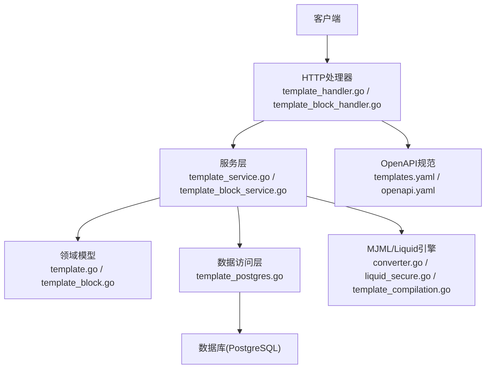
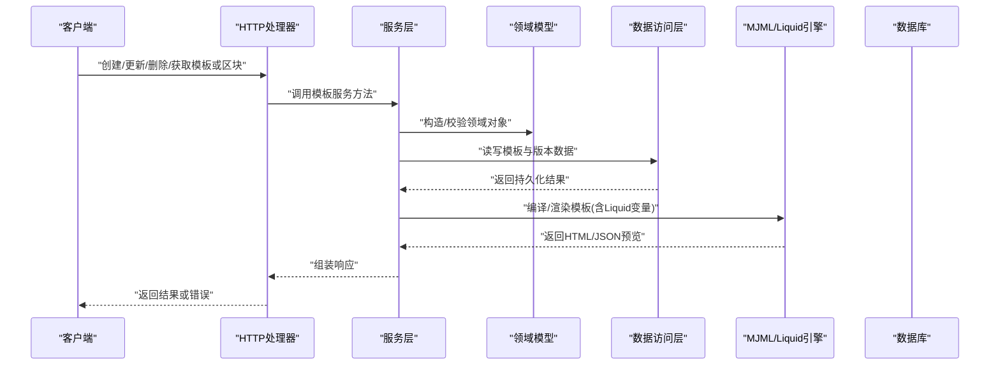
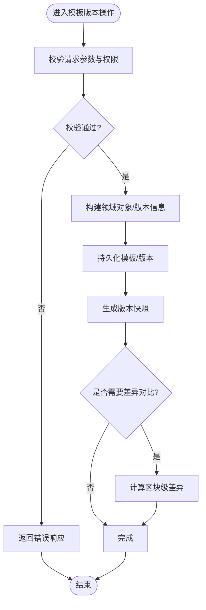
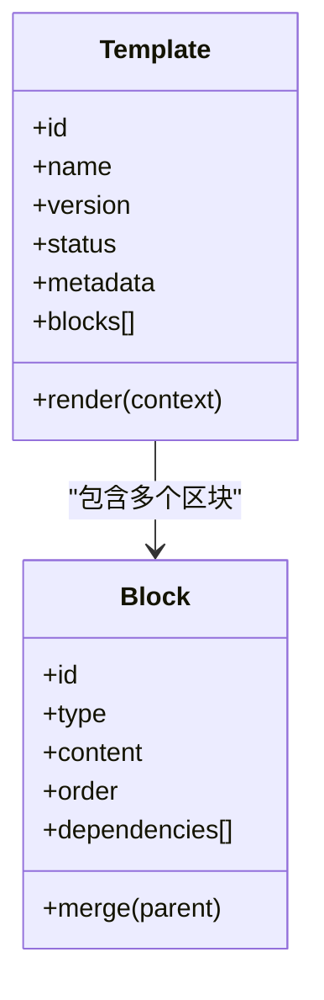
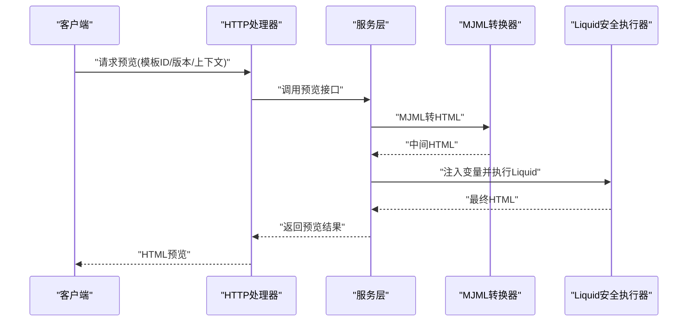
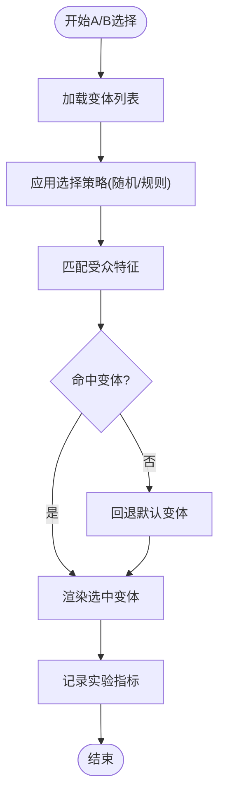
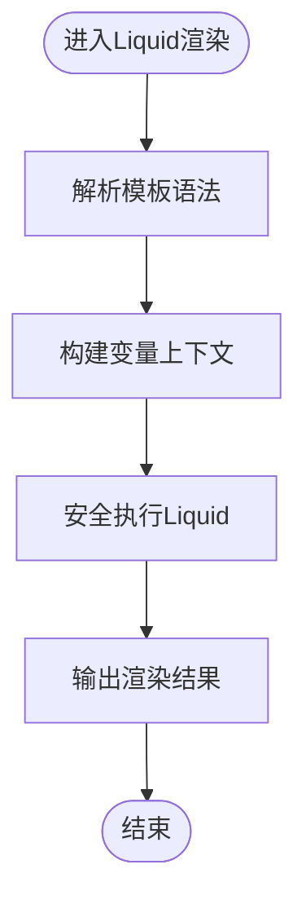
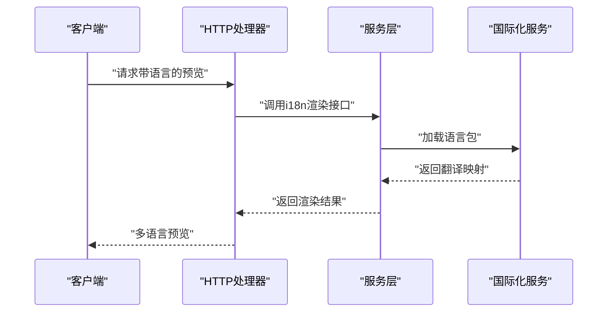
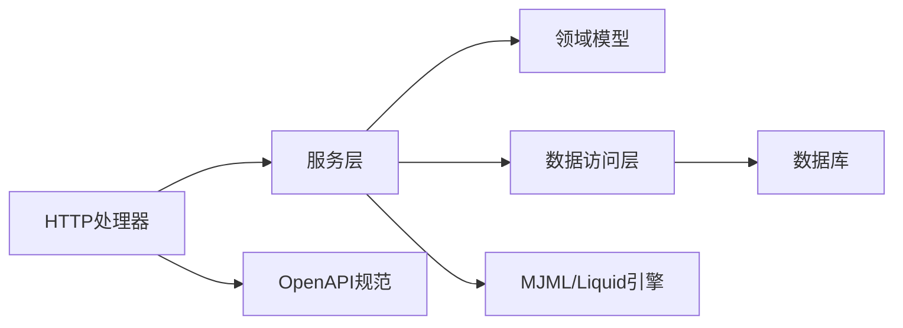

# 模板管理API

<cite>
**本文引用的文件**   
- [template_handler.go](file://notifuse/internal/http/template_handler.go)
- [template_block_handler.go](file://notifuse/internal/http/template_block_handler.go)
- [template_service.go](file://notifuse/internal/service/template_service.go)
- [template_block_service.go](file://notifuse/internal/service/template_block_service.go)
- [template_postgres.go](file://notifuse/internal/repository/template_postgres.go)
- [template.go](file://notifuse/internal/domain/template.go)
- [template_block.go](file://notifuse/internal/domain/template_block.go)
- [templates.yaml](file://notifuse/openapi/paths/templates.yaml)
- [openapi.yaml](file://notifuse/openapi/openapi.yaml)
- [converter.go](file://notifuse/pkg/notifuse_mjml/converter.go)
- [liquid_secure.go](file://notifuse/pkg/notifuse_mjml/liquid_secure.go)
- [template_compilation.go](file://notifuse/pkg/notifuse_mjml/template_compilation.go)
- [supabase_templates.go](file://notifuse/internal/service/supabase_templates.go)
</cite>

## 目录
1. [简介](#简介)
2. [项目结构](#项目结构)
3. [核心组件](#核心组件)
4. [架构总览](#架构总览)
5. [详细组件分析](#详细组件分析)
6. [依赖分析](#依赖分析)
7. [性能考虑](#性能考虑)
8. [故障排查指南](#故障排查指南)
9. [结论](#结论)
10. [附录](#附录)

## 简介
本文件为 Notifuse 平台的“模板管理API”提供系统化、可操作的技术文档。内容覆盖邮件模板的CRUD、版本管理、预览渲染、A/B测试支持、Liquid模板语法与变量替换机制、国际化多语言模板、响应式设计特性、导入导出格式、主题切换机制、自定义组件扩展、MJML转换、实时预览与调试工具使用指南，以及性能优化建议。

## 项目结构
围绕模板管理的后端实现主要分布在以下层次：
- HTTP层：路由处理器，负责请求解析、鉴权、参数校验与响应封装
- 服务层：业务编排、模板编译与渲染、版本控制、预览与A/B策略
- 领域模型：模板、区块、版本等核心实体定义
- 数据访问层：PostgreSQL持久化实现
- OpenAPI规范：对外接口契约
- MJML/Liquid引擎：模板编译、安全沙箱、转换与渲染

图表来源
- [template_handler.go](file://notifuse/internal/http/template_handler.go)
- [template_block_handler.go](file://notifuse/internal/http/template_block_handler.go)
- [template_service.go](file://notifuse/internal/service/template_service.go)
- [template_block_service.go](file://notifuse/internal/service/template_block_service.go)
- [template_postgres.go](file://notifuse/internal/repository/template_postgres.go)
- [template.go](file://notifuse/internal/domain/template.go)
- [template_block.go](file://notifuse/internal/domain/template_block.go)
- [templates.yaml](file://notifuse/openapi/paths/templates.yaml)
- [openapi.yaml](file://notifuse/openapi/openapi.yaml)
- [converter.go](file://notifuse/pkg/notifuse_mjml/converter.go)
- [liquid_secure.go](file://notifuse/pkg/notifuse_mjml/liquid_secure.go)
- [template_compilation.go](file://notifuse/pkg/notifuse_mjml/template_compilation.go)

章节来源
- [template_handler.go](file://notifuse/internal/http/template_handler.go)
- [template_block_handler.go](file://notifuse/internal/http/template_block_handler.go)
- [template_service.go](file://notifuse/internal/service/template_service.go)
- [template_block_service.go](file://notifuse/internal/service/template_block_service.go)
- [template_postgres.go](file://notifuse/internal/repository/template_postgres.go)
- [template.go](file://notifuse/internal/domain/template.go)
- [template_block.go](file://notifuse/internal/domain/template_block.go)
- [templates.yaml](file://notifuse/openapi/paths/templates.yaml)
- [openapi.yaml](file://notifuse/openapi/openapi.yaml)
- [converter.go](file://notifuse/pkg/notifuse_mjml/converter.go)
- [liquid_secure.go](file://notifuse/pkg/notifuse_mjml/liquid_secure.go)
- [template_compilation.go](file://notifuse/pkg/notifuse_mjml/template_compilation.go)

## 核心组件
- HTTP处理器
  - 模板CRUD与版本操作入口，统一错误处理与响应包装
  - 区块（Block）管理入口，支撑模块化模板编辑
- 服务层
  - 模板生命周期管理、版本分支与合并、预览渲染、A/B策略执行
  - 区块组合与排序、依赖解析
- 领域模型
  - 模板、区块、版本、元数据、国际化键值等核心结构
- 数据访问层
  - 模板与区块的增删改查、版本快照、查询过滤
- MJML/Liquid引擎
  - MJML到HTML转换、Liquid模板编译与安全执行、变量注入与上下文构建
- OpenAPI规范
  - 对外接口契约，包含路径、参数、请求体与响应体定义

章节来源
- [template_handler.go](file://notifuse/internal/http/template_handler.go)
- [template_block_handler.go](file://notifuse/internal/http/template_block_handler.go)
- [template_service.go](file://notifuse/internal/service/template_service.go)
- [template_block_service.go](file://notifuse/internal/service/template_block_service.go)
- [template.go](file://notifuse/internal/domain/template.go)
- [template_block.go](file://notifuse/internal/domain/template_block.go)
- [template_postgres.go](file://notifuse/internal/repository/template_postgres.go)
- [converter.go](file://notifuse/pkg/notifuse_mjml/converter.go)
- [liquid_secure.go](file://notifuse/pkg/notifuse_mjml/liquid_secure.go)
- [template_compilation.go](file://notifuse/pkg/notifuse_mjml/template_compilation.go)
- [templates.yaml](file://notifuse/openapi/paths/templates.yaml)
- [openapi.yaml](file://notifuse/openapi/openapi.yaml)

## 架构总览
模板管理API采用分层架构，职责清晰、耦合度低，便于扩展与维护。

图表来源
- [template_handler.go](file://notifuse/internal/http/template_handler.go)
- [template_service.go](file://notifuse/internal/service/template_service.go)
- [template_postgres.go](file://notifuse/internal/repository/template_postgres.go)
- [template.go](file://notifuse/internal/domain/template.go)
- [converter.go](file://notifuse/pkg/notifuse_mjml/converter.go)
- [liquid_secure.go](file://notifuse/pkg/notifuse_mjml/liquid_secure.go)
- [template_compilation.go](file://notifuse/pkg/notifuse_mjml/template_compilation.go)

## 详细组件分析

### 模板CRUD与版本管理
- 能力范围
  - 创建、读取、更新、删除模板
  - 版本创建、回滚、列表与差异对比
  - 模板状态管理与发布标记
- 关键流程
  - 创建/更新：校验输入→构建领域对象→持久化→生成新版本快照
  - 版本回滚：基于目标版本重建当前工作副本并落库
  - 差异对比：按区块粒度比较内容与元数据变更

图表来源
- [template_handler.go](file://notifuse/internal/http/template_handler.go)
- [template_service.go](file://notifuse/internal/service/template_service.go)
- [template_postgres.go](file://notifuse/internal/repository/template_postgres.go)
- [template.go](file://notifuse/internal/domain/template.go)

章节来源
- [template_handler.go](file://notifuse/internal/http/template_handler.go)
- [template_service.go](file://notifuse/internal/service/template_service.go)
- [template_postgres.go](file://notifuse/internal/repository/template_postgres.go)
- [template.go](file://notifuse/internal/domain/template.go)

### 区块管理与组合
- 能力范围
  - 区块的增删改查、排序、分组与引用
  - 区块组合成完整模板，支持嵌套与复用
- 关键流程
  - 组合：按顺序加载区块→解析依赖→拼接内容→输出最终模板树

图表来源
- [template.go](file://notifuse/internal/domain/template.go)
- [template_block.go](file://notifuse/internal/domain/template_block.go)
- [template_block_handler.go](file://notifuse/internal/http/template_block_handler.go)
- [template_block_service.go](file://notifuse/internal/service/template_block_service.go)

章节来源
- [template_block_handler.go](file://notifuse/internal/http/template_block_handler.go)
- [template_block_service.go](file://notifuse/internal/service/template_block_service.go)
- [template_block.go](file://notifuse/internal/domain/template_block.go)
- [template.go](file://notifuse/internal/domain/template.go)

### 预览渲染与MJML转换
- 能力范围
  - 将MJML转换为HTML进行预览
  - 在渲染过程中注入Liquid变量与上下文
  - 支持响应式布局与主题变量
- 关键流程
  - 接收模板源→MJML编译→注入Liquid上下文→安全执行→输出HTML

图表来源
- [template_handler.go](file://notifuse/internal/http/template_handler.go)
- [template_service.go](file://notifuse/internal/service/template_service.go)
- [converter.go](file://notifuse/pkg/notifuse_mjml/converter.go)
- [liquid_secure.go](file://notifuse/pkg/notifuse_mjml/liquid_secure.go)
- [template_compilation.go](file://notifuse/pkg/notifuse_mjml/template_compilation.go)

章节来源
- [template_handler.go](file://notifuse/internal/http/template_handler.go)
- [template_service.go](file://notifuse/internal/service/template_service.go)
- [converter.go](file://notifuse/pkg/notifuse_mjml/converter.go)
- [liquid_secure.go](file://notifuse/pkg/notifuse_mjml/liquid_secure.go)
- [template_compilation.go](file://notifuse/pkg/notifuse_mjml/template_compilation.go)

### A/B测试支持
- 能力范围
  - 为同一逻辑模板维护多个变体版本
  - 根据受众特征或随机策略选择变体
  - 记录实验指标与归因
- 关键流程
  - 选择策略→匹配受众→确定变体→渲染对应版本→埋点上报

图表来源
- [template_service.go](file://notifuse/internal/service/template_service.go)
- [template.go](file://notifuse/internal/domain/template.go)

章节来源
- [template_service.go](file://notifuse/internal/service/template_service.go)
- [template.go](file://notifuse/internal/domain/template.go)

### Liquid模板语法与变量替换
- 能力范围
  - 支持标准Liquid语法与平台扩展过滤器
  - 安全的变量注入与上下文隔离
  - 支持条件、循环、片段复用
- 关键流程
  - 解析模板→构建上下文→执行过滤器→输出文本/HTML片段

图表来源
- [liquid_secure.go](file://notifuse/pkg/notifuse_mjml/liquid_secure.go)
- [template_compilation.go](file://notifuse/pkg/notifuse_mjml/template_compilation.go)

章节来源
- [liquid_secure.go](file://notifuse/pkg/notifuse_mjml/liquid_secure.go)
- [template_compilation.go](file://notifuse/pkg/notifuse_mjml/template_compilation.go)

### 国际化多语言模板
- 能力范围
  - 基于键值的多语言资源管理
  - 模板中按语言选择文案与布局
  - 动态切换语言环境
- 关键流程
  - 加载语言包→选择语言→替换键值为对应文案→渲染

图表来源
- [template_service.go](file://notifuse/internal/service/template_service.go)
- [supabase_templates.go](file://notifuse/internal/service/supabase_templates.go)

章节来源
- [template_service.go](file://notifuse/internal/service/template_service.go)
- [supabase_templates.go](file://notifuse/internal/service/supabase_templates.go)

### 响应式设计特性
- 能力范围
  - 基于MJML的响应式布局与媒体查询
  - 主题变量驱动样式切换
  - 移动端适配与断点控制
- 关键流程
  - 主题变量注入→样式编译→生成响应式HTML

章节来源
- [converter.go](file://notifuse/pkg/notifuse_mjml/converter.go)
- [template_compilation.go](file://notifuse/pkg/notifuse_mjml/template_compilation.go)

### 导入导出格式
- 能力范围
  - 模板与区块的批量导入/导出
  - 支持JSON/YAML格式的迁移与备份
  - 版本快照归档与恢复
- 关键流程
  - 解析导入文件→校验结构→批量写入→生成版本快照

章节来源
- [template_handler.go](file://notifuse/internal/http/template_handler.go)
- [template_service.go](file://notifuse/internal/service/template_service.go)
- [template_postgres.go](file://notifuse/internal/repository/template_postgres.go)

### 主题切换机制
- 能力范围
  - 主题配置集中管理
  - 运行时切换主题变量
  - 主题与模板解耦
- 关键流程
  - 加载主题→注入变量→重新渲染

章节来源
- [template_service.go](file://notifuse/internal/service/template_service.go)
- [template_compilation.go](file://notifuse/pkg/notifuse_mjml/template_compilation.go)

### 自定义组件扩展
- 能力范围
  - 注册自定义区块类型与渲染器
  - 组件间通信与数据传递
  - 组件版本兼容策略
- 关键流程
  - 注册组件→解析引用→按需加载→渲染

章节来源
- [template_block_service.go](file://notifuse/internal/service/template_block_service.go)
- [template_block.go](file://notifuse/internal/domain/template_block.go)

### 实时预览与调试工具
- 能力范围
  - 在线编辑器实时预览
  - 调试日志与错误定位
  - 变量上下文查看与模拟
- 关键流程
  - 捕获编辑事件→增量编译→渲染预览→输出调试信息

章节来源
- [template_handler.go](file://notifuse/internal/http/template_handler.go)
- [template_service.go](file://notifuse/internal/service/template_service.go)
- [liquid_secure.go](file://notifuse/pkg/notifuse_mjml/liquid_secure.go)

## 依赖分析
- 组件耦合
  - HTTP处理器仅依赖服务层接口，保持低耦合
  - 服务层聚合领域模型、数据访问与引擎能力
  - 数据访问层对数据库实现细节透明
- 外部依赖
  - MJML/Liquid引擎用于模板转换与渲染
  - PostgreSQL用于持久化存储
  - OpenAPI规范用于接口契约

图表来源
- [template_handler.go](file://notifuse/internal/http/template_handler.go)
- [template_service.go](file://notifuse/internal/service/template_service.go)
- [template_postgres.go](file://notifuse/internal/repository/template_postgres.go)
- [template.go](file://notifuse/internal/domain/template.go)
- [converter.go](file://notifuse/pkg/notifuse_mjml/converter.go)
- [liquid_secure.go](file://notifuse/pkg/notifuse_mjml/liquid_secure.go)
- [template_compilation.go](file://notifuse/pkg/notifuse_mjml/template_compilation.go)
- [templates.yaml](file://notifuse/openapi/paths/templates.yaml)
- [openapi.yaml](file://notifuse/openapi/openapi.yaml)

章节来源
- [template_handler.go](file://notifuse/internal/http/template_handler.go)
- [template_service.go](file://notifuse/internal/service/template_service.go)
- [template_postgres.go](file://notifuse/internal/repository/template_postgres.go)
- [template.go](file://notifuse/internal/domain/template.go)
- [converter.go](file://notifuse/pkg/notifuse_mjml/converter.go)
- [liquid_secure.go](file://notifuse/pkg/notifuse_mjml/liquid_secure.go)
- [template_compilation.go](file://notifuse/pkg/notifuse_mjml/template_compilation.go)
- [templates.yaml](file://notifuse/openapi/paths/templates.yaml)
- [openapi.yaml](file://notifuse/openapi/openapi.yaml)

## 性能考虑
- 缓存策略
  - 对常用模板与区块进行内存缓存，减少重复编译
  - 版本快照与静态资源缓存
- 渲染优化
  - 增量编译与懒加载区块
  - 限制Liquid复杂度与递归深度
- 并发与限流
  - 预览接口限流与超时控制
  - 批量导入导出分片处理
- 数据库优化
  - 索引设计（模板ID、版本号、标签）
  - 分页与过滤查询优化

[本节为通用指导，不直接分析具体文件]

## 故障排查指南
- 常见问题
  - 模板编译失败：检查Liquid语法与过滤器可用性
  - 变量未生效：确认上下文注入与键名一致性
  - MJML转换异常：验证结构与主题变量
- 诊断步骤
  - 启用调试日志，查看编译与渲染链路
  - 使用预览工具的变量上下文查看功能
  - 对比版本差异定位变更影响
- 恢复措施
  - 回滚至稳定版本
  - 清理缓存并重试
  - 降级到默认主题与区块

章节来源
- [template_handler.go](file://notifuse/internal/http/template_handler.go)
- [template_service.go](file://notifuse/internal/service/template_service.go)
- [liquid_secure.go](file://notifuse/pkg/notifuse_mjml/liquid_secure.go)
- [converter.go](file://notifuse/pkg/notifuse_mjml/converter.go)

## 结论
Notifuse模板管理API以清晰的层次化架构与完善的引擎能力，提供了从模板编辑、版本控制到预览渲染的一体化解决方案。通过Liquid安全执行、MJML转换、国际化与响应式设计，满足复杂邮件场景需求。结合导入导出、主题切换与自定义组件扩展，平台具备良好的可扩展性与可维护性。建议在大规模部署时引入缓存与限流策略，确保高可用与高性能。

[本节为总结性内容，不直接分析具体文件]

## 附录
- OpenAPI参考
  - 模板相关路径与Schema定义详见OpenAPI规范文件
- 示例与最佳实践
  - 推荐在区块层面拆分复杂模板，提升复用率
  - 使用主题变量统一管理样式与品牌元素
  - 在A/B实验中明确指标与归因口径

章节来源
- [templates.yaml](file://notifuse/openapi/paths/templates.yaml)
- [openapi.yaml](file://notifuse/openapi/openapi.yaml)