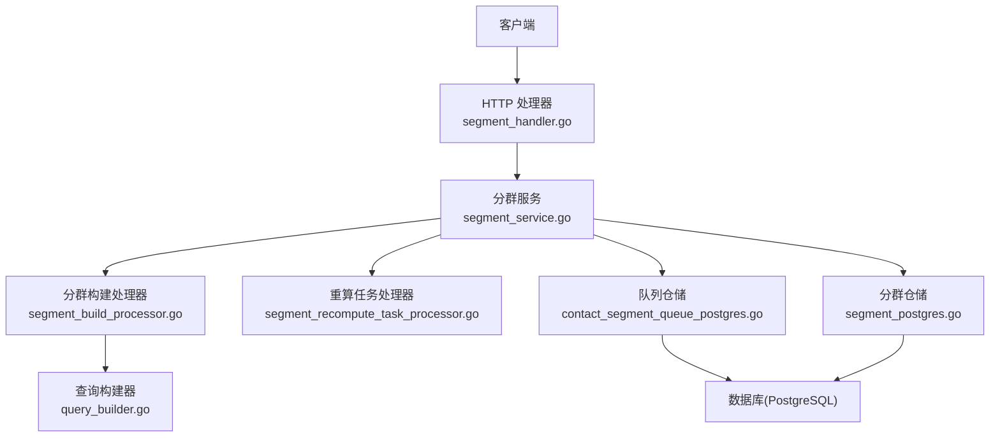
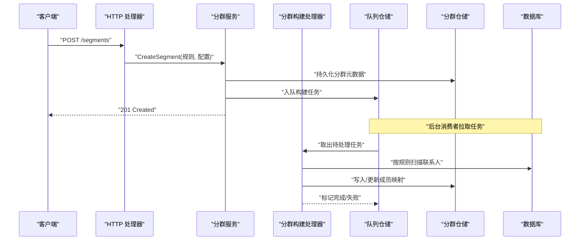
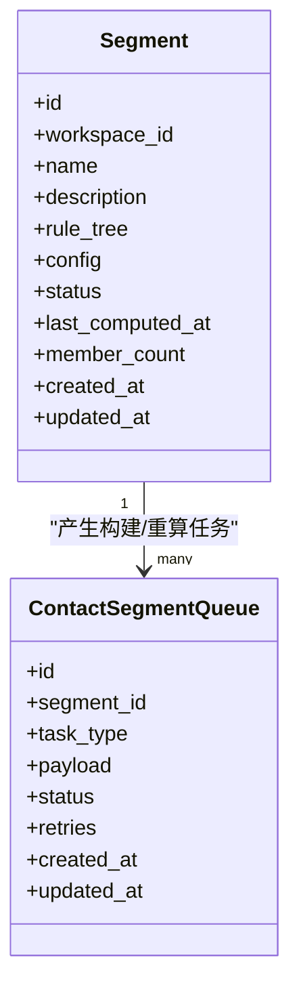
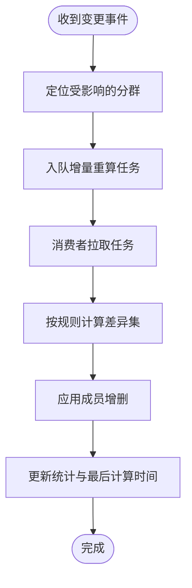
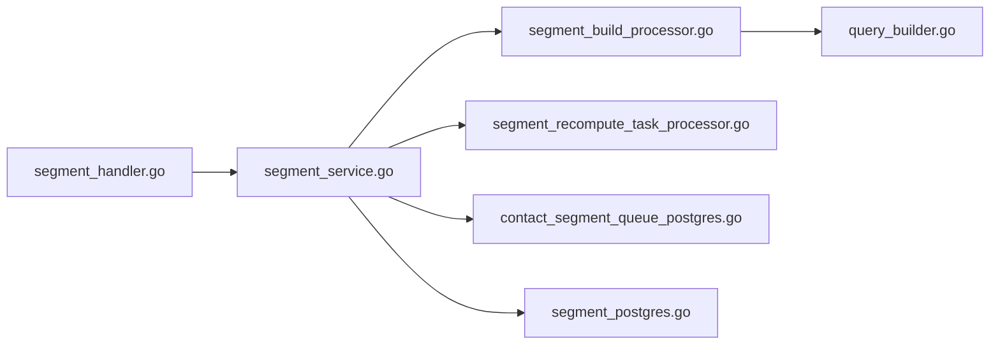

# 联系人动态分群API

<cite>
**本文引用的文件**   
- [segment.go](file://notifuse/internal/domain/segment.go)
- [segment_handler.go](file://notifuse/internal/http/segment_handler.go)
- [segment_service.go](file://notifuse/internal/service/segment_service.go)
- [segment_build_processor.go](file://notifuse/internal/service/segment_build_processor.go)
- [segment_recompute_task_processor.go](file://notifuse/internal/service/segment_recompute_task_processor.go)
- [contact_segment_queue.go](file://notifuse/internal/domain/contact_segment_queue.go)
- [contact_segment_queue_postgres.go](file://notifuse/internal/repository/contact_segment_queue_postgres.go)
- [segment_postgres.go](file://notifuse/internal/repository/segment_postgres.go)
- [query_builder.go](file://notifuse/internal/service/query_builder.go)
- [openapi.yaml](file://notifuse/openapi/openapi.yaml)
- [contacts.yaml](file://notifuse/openapi/paths/contacts.yaml)
</cite>

## 目录
1. [简介](#简介)
2. [项目结构](#项目结构)
3. [核心组件](#核心组件)
4. [架构总览](#架构总览)
5. [详细组件分析](#详细组件分析)
6. [依赖分析](#依赖分析)
7. [性能考虑](#性能考虑)
8. [故障排查指南](#故障排查指南)
9. [结论](#结论)
10. [附录](#附录)

## 简介
本文件为 Notifuse 平台的“联系人动态分群”能力提供完整的 API 文档与实现说明。内容覆盖：
- 分群的创建、配置、查询与管理接口
- 分群规则语法、条件表达式与逻辑运算符
- 实时分群计算与增量更新机制
- 性能优化策略与监控指标（成员数量、更新频率等）
- 复杂分群场景示例（行为标签、地理位置、订阅状态等多维度筛选）

## 项目结构
与联系人动态分群相关的代码主要分布在以下模块：
- HTTP 层：路由与请求处理
- 服务层：业务编排、任务调度与增量更新
- 领域模型：分群实体、队列任务等
- 仓储层：PostgreSQL 持久化
- OpenAPI：对外 API 契约

图表来源
- [segment_handler.go](file://notifuse/internal/http/segment_handler.go)
- [segment_service.go](file://notifuse/internal/service/segment_service.go)
- [segment_build_processor.go](file://notifuse/internal/service/segment_build_processor.go)
- [segment_recompute_task_processor.go](file://notifuse/internal/service/segment_recompute_task_processor.go)
- [contact_segment_queue_postgres.go](file://notifuse/internal/repository/contact_segment_queue_postgres.go)
- [segment_postgres.go](file://notifuse/internal/repository/segment_postgres.go)
- [query_builder.go](file://notifuse/internal/service/query_builder.go)

章节来源
- [segment_handler.go](file://notifuse/internal/http/segment_handler.go)
- [segment_service.go](file://notifuse/internal/service/segment_service.go)
- [segment_build_processor.go](file://notifuse/internal/service/segment_build_processor.go)
- [segment_recompute_task_processor.go](file://notifuse/internal/service/segment_recompute_task_processor.go)
- [contact_segment_queue.go](file://notifuse/internal/domain/contact_segment_queue.go)
- [contact_segment_queue_postgres.go](file://notifuse/internal/repository/contact_segment_queue_postgres.go)
- [segment_postgres.go](file://notifuse/internal/repository/segment_postgres.go)
- [query_builder.go](file://notifuse/internal/service/query_builder.go)
- [openapi.yaml](file://notifuse/openapi/openapi.yaml)
- [contacts.yaml](file://notifuse/openapi/paths/contacts.yaml)

## 核心组件
- HTTP 处理器：暴露 RESTful 接口，负责鉴权、参数校验、调用服务层并返回响应
- 分群服务：编排分群生命周期（创建、更新、删除、查询）、触发构建与重算任务
- 分群构建处理器：将分群规则转换为可执行的查询计划，执行并维护成员集合
- 重算任务处理器：基于事件或定时触发增量/全量重算
- 队列仓储：管理分群构建任务的入队、出队与重试
- 分群仓储：分群元数据与成员映射的持久化
- 查询构建器：将规则树转换为 SQL/索引友好的查询片段

章节来源
- [segment_handler.go](file://notifuse/internal/http/segment_handler.go)
- [segment_service.go](file://notifuse/internal/service/segment_service.go)
- [segment_build_processor.go](file://notifuse/internal/service/segment_build_processor.go)
- [segment_recompute_task_processor.go](file://notifuse/internal/service/segment_recompute_task_processor.go)
- [contact_segment_queue.go](file://notifuse/internal/domain/contact_segment_queue.go)
- [contact_segment_queue_postgres.go](file://notifuse/internal/repository/contact_segment_queue_postgres.go)
- [segment_postgres.go](file://notifuse/internal/repository/segment_postgres.go)
- [query_builder.go](file://notifuse/internal/service/query_builder.go)

## 架构总览
下图展示了从 API 到存储的关键路径，以及实时与增量更新的协作方式。

图表来源
- [segment_handler.go](file://notifuse/internal/http/segment_handler.go)
- [segment_service.go](file://notifuse/internal/service/segment_service.go)
- [segment_build_processor.go](file://notifuse/internal/service/segment_build_processor.go)
- [contact_segment_queue_postgres.go](file://notifuse/internal/repository/contact_segment_queue_postgres.go)
- [segment_postgres.go](file://notifuse/internal/repository/segment_postgres.go)

## 详细组件分析

### 分群实体与关系
分群由规则树与运行配置组成，包含成员集合的动态维护。

图表来源
- [segment.go](file://notifuse/internal/domain/segment.go)
- [contact_segment_queue.go](file://notifuse/internal/domain/contact_segment_queue.go)

章节来源
- [segment.go](file://notifuse/internal/domain/segment.go)
- [contact_segment_queue.go](file://notifuse/internal/domain/contact_segment_queue.go)

### API 定义与契约
- 统一入口与认证在 OpenAPI 中声明
- 分群相关路径在 paths 下定义，并与 handlers 一一对应

章节来源
- [openapi.yaml](file://notifuse/openapi/openapi.yaml)
- [segment_handler.go](file://notifuse/internal/http/segment_handler.go)

### 分群规则语法与表达式
- 规则以树形结构表达，支持 AND/OR/NOT 组合
- 条件操作符包括等于、不等于、包含、不包含、大于、小于、时间范围、空值判断等
- 字段类型涵盖基础属性、自定义标签、事件计数、最近行为、订阅状态、地理位置等
- 建议遵循“先粗后细”的过滤顺序，优先使用有索引的字段以减少扫描范围

章节来源
- [segment.go](file://notifuse/internal/domain/segment.go)
- [query_builder.go](file://notifuse/internal/service/query_builder.go)

### 实时分群计算与增量更新
- 实时：当联系人属性或事件变更时，系统向队列投递“增量重算”任务，仅对受影响的分群进行最小集更新
- 增量：通过记录变更键（如 contact_id、event_time），避免全表扫描
- 全量：首次构建或配置变更时执行全量扫描，随后进入增量模式

图表来源
- [segment_recompute_task_processor.go](file://notifuse/internal/service/segment_recompute_task_processor.go)
- [contact_segment_queue.go](file://notifuse/internal/domain/contact_segment_queue.go)
- [segment_build_processor.go](file://notifuse/internal/service/segment_build_processor.go)

章节来源
- [segment_recompute_task_processor.go](file://notifuse/internal/service/segment_recompute_task_processor.go)
- [contact_segment_queue.go](file://notifuse/internal/domain/contact_segment_queue.go)
- [segment_build_processor.go](file://notifuse/internal/service/segment_build_processor.go)

### 复杂分群场景示例
- 行为标签：最近 7 天打开过邮件且点击次数≥3，同时未退订
- 地理位置：国家=中国 且 城市包含“上海”，排除黑名单地区
- 订阅状态：订阅了“产品更新”列表，且未取消订阅
- 多条件组合：(打开率>20% OR 点击率>10%) AND (注册天数<30) AND (语言=中文)

章节来源
- [segment.go](file://notifuse/internal/domain/segment.go)
- [query_builder.go](file://notifuse/internal/service/query_builder.go)

### 监控指标与统计信息
- 成员数量：当前分群命中人数
- 最后计算时间：最近一次成功计算的时间戳
- 更新频率：单位时间内重算任务数与平均耗时
- 错误率：构建/重算失败比例与重试次数
- 延迟：从事件发生到成员集合生效的端到端延迟

章节来源
- [segment.go](file://notifuse/internal/domain/segment.go)
- [segment_build_processor.go](file://notifuse/internal/service/segment_build_processor.go)
- [segment_recompute_task_processor.go](file://notifuse/internal/service/segment_recompute_task_processor.go)

## 依赖分析
- HTTP 处理器依赖服务层，不直接访问仓储
- 服务层协调构建处理器与任务处理器，并通过仓储访问数据库
- 构建处理器依赖查询构建器生成高效查询
- 队列仓储与分群仓储解耦，便于扩展不同消息中间件

图表来源
- [segment_handler.go](file://notifuse/internal/http/segment_handler.go)
- [segment_service.go](file://notifuse/internal/service/segment_service.go)
- [segment_build_processor.go](file://notifuse/internal/service/segment_build_processor.go)
- [segment_recompute_task_processor.go](file://notifuse/internal/service/segment_recompute_task_processor.go)
- [contact_segment_queue_postgres.go](file://notifuse/internal/repository/contact_segment_queue_postgres.go)
- [segment_postgres.go](file://notifuse/internal/repository/segment_postgres.go)
- [query_builder.go](file://notifuse/internal/service/query_builder.go)

章节来源
- [segment_handler.go](file://notifuse/internal/http/segment_handler.go)
- [segment_service.go](file://notifuse/internal/service/segment_service.go)
- [segment_build_processor.go](file://notifuse/internal/service/segment_build_processor.go)
- [segment_recompute_task_processor.go](file://notifuse/internal/service/segment_recompute_task_processor.go)
- [contact_segment_queue_postgres.go](file://notifuse/internal/repository/contact_segment_queue_postgres.go)
- [segment_postgres.go](file://notifuse/internal/repository/segment_postgres.go)
- [query_builder.go](file://notifuse/internal/service/query_builder.go)

## 性能考虑
- 索引策略：对常用过滤字段建立复合索引（如 workspace_id、status、updated_at、tags、location）
- 查询裁剪：优先使用选择性高的条件，减少候选集；利用时间窗口限制扫描范围
- 增量优先：尽量通过事件驱动触发增量重算，避免频繁全量
- 批处理与分页：大集合更新采用分批提交，降低锁竞争与内存占用
- 缓存热点：对只读统计结果短期缓存，减轻数据库压力
- 限流与背压：队列消费者设置并发上限，防止雪崩

[本节为通用指导，无需源码引用]

## 故障排查指南
- 任务堆积：检查队列消费者健康度与重试策略，关注失败日志与死信队列
- 计算超时：拆分复杂规则，增加索引，调整批次大小
- 成员不一致：核对增量事件是否遗漏，必要时触发全量重建
- 权限问题：确认工作空间隔离与访问控制是否正确传递
- 监控告警：围绕成员数量突变、最后计算时间停滞、错误率上升设置阈值

章节来源
- [segment_build_processor.go](file://notifuse/internal/service/segment_build_processor.go)
- [segment_recompute_task_processor.go](file://notifuse/internal/service/segment_recompute_task_processor.go)
- [contact_segment_queue_postgres.go](file://notifuse/internal/repository/contact_segment_queue_postgres.go)

## 结论
Notifuse 的分群系统通过“规则树 + 增量事件 + 任务队列”的组合，实现了高性能、可扩展的联系人动态分群能力。配合完善的监控指标与性能优化策略，可满足复杂业务场景下的实时圈人需求。

[本节为总结性内容，无需源码引用]

## 附录

### 典型 API 清单（概念性）
- 创建分群：POST /segments
- 更新分群：PUT /segments/{id}
- 删除分群：DELETE /segments/{id}
- 获取分群详情：GET /segments/{id}
- 列出分群：GET /segments
- 触发全量重算：POST /segments/{id}/recompute
- 获取分群成员：GET /segments/{id}/members
- 获取分群统计：GET /segments/{id}/stats

章节来源
- [segment_handler.go](file://notifuse/internal/http/segment_handler.go)
- [openapi.yaml](file://notifuse/openapi/openapi.yaml)
- [contacts.yaml](file://notifuse/openapi/paths/contacts.yaml)