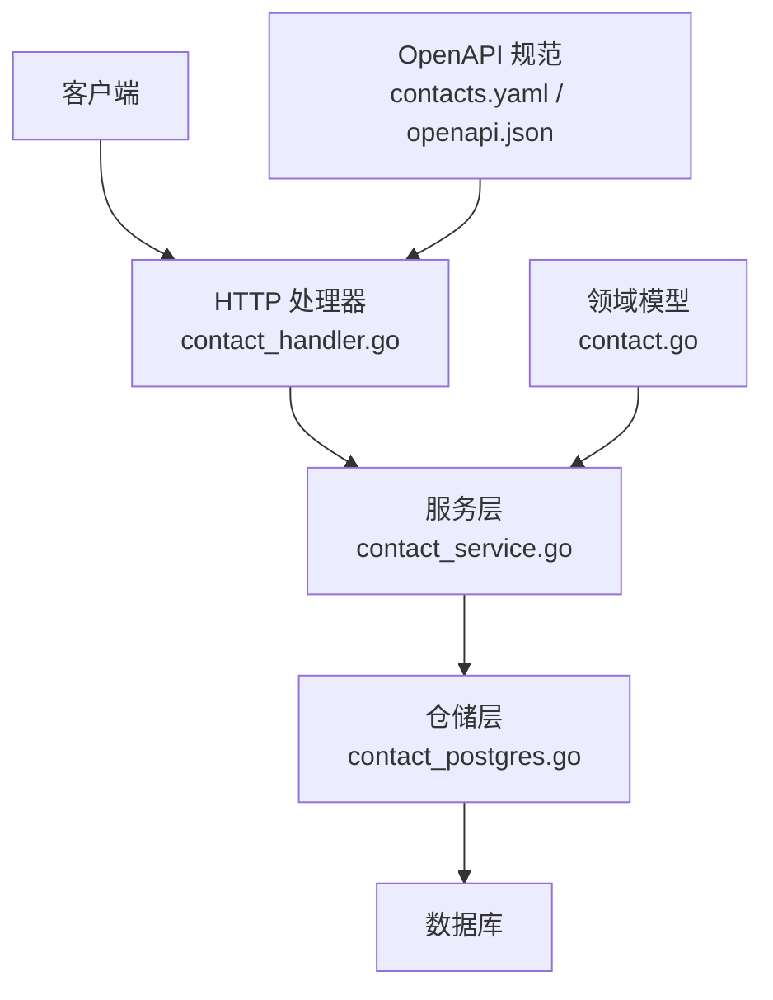
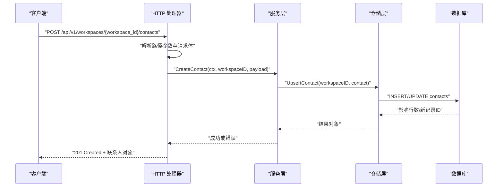
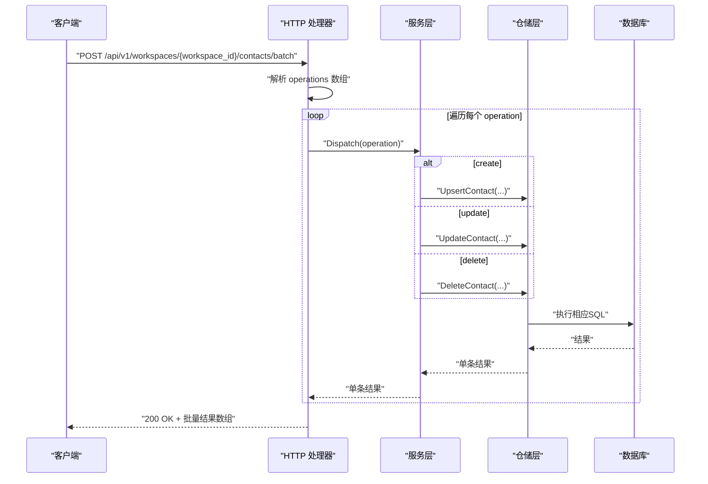
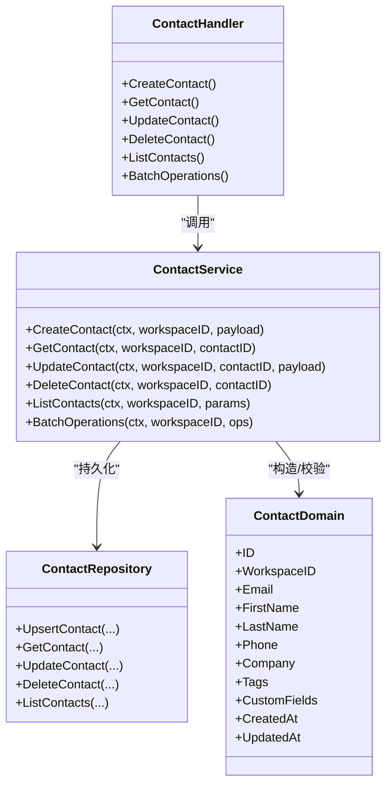

# 联系人基础操作API

<cite>
**本文引用的文件**   
- [contact_handler.go](file://notifuse/internal/http/contact_handler.go)
- [contact_service.go](file://notifuse/internal/service/contact_service.go)
- [contact_postgres.go](file://notifuse/internal/repository/contact_postgres.go)
- [contact.go](file://notifuse/internal/domain/contact.go)
- [contacts.yaml](file://notifuse/openapi/paths/contacts.yaml)
- [openapi.json](file://notifuse/openapi.json)
</cite>

## 目录
1. [简介](#简介)
2. [项目结构](#项目结构)
3. [核心组件](#核心组件)
4. [架构总览](#架构总览)
5. [详细组件分析](#详细组件分析)
6. [依赖分析](#依赖分析)
7. [性能考虑](#性能考虑)
8. [故障排查指南](#故障排查指南)
9. [结论](#结论)
10. [附录](#附录) 

## 简介
本文件为 Notifuse 平台的“联系人”模块提供面向开发者的 API 文档，覆盖联系人的创建、读取、更新、删除（CRUD）接口，以及分页查询、排序与过滤参数说明。同时给出数据模型字段定义、验证规则与必填项说明，并提供完整的请求与响应示例（含成功与错误场景）。此外，文档还包含批量操作接口的能力说明与使用方式。

## 项目结构
Notifuse 后端采用分层架构：HTTP 层处理路由与请求解析，服务层封装业务逻辑，仓储层负责数据持久化，领域层定义数据模型与校验规则。OpenAPI 规范位于 openapi 目录，用于统一描述接口契约。

图表来源
- [contact_handler.go](file://notifuse/internal/http/contact_handler.go)
- [contact_service.go](file://notifuse/internal/service/contact_service.go)
- [contact_postgres.go](file://notifuse/internal/repository/contact_postgres.go)
- [contact.go](file://notifuse/internal/domain/contact.go)
- [contacts.yaml](file://notifuse/openapi/paths/contacts.yaml)
- [openapi.json](file://notifuse/openapi.json)

章节来源
- [contact_handler.go](file://notifuse/internal/http/contact_handler.go)
- [contact_service.go](file://notifuse/internal/service/contact_service.go)
- [contact_postgres.go](file://notifuse/internal/repository/contact_postgres.go)
- [contact.go](file://notifuse/internal/domain/contact.go)
- [contacts.yaml](file://notifuse/openapi/paths/contacts.yaml)
- [openapi.json](file://notifuse/openapi.json)

## 核心组件
- HTTP 处理器：负责路由注册、请求体解析、参数校验、调用服务层并返回标准响应。
- 服务层：实现联系人业务逻辑，包括唯一性检查、关联列表管理、事务控制等。
- 仓储层：封装 SQL 查询与写入，支持分页、排序、过滤与批量操作。
- 领域模型：定义联系人实体结构与校验规则。
- OpenAPI 规范：对外暴露的接口契约，包含路径、方法、参数、请求体与响应体定义。

章节来源
- [contact_handler.go](file://notifuse/internal/http/contact_handler.go)
- [contact_service.go](file://notifuse/internal/service/contact_service.go)
- [contact_postgres.go](file://notifuse/internal/repository/contact_postgres.go)
- [contact.go](file://notifuse/internal/domain/contact.go)
- [contacts.yaml](file://notifuse/openapi/paths/contacts.yaml)
- [openapi.json](file://notifuse/openapi.json)

## 架构总览
下图展示一次典型的联系人创建流程，从客户端发起请求到最终落库的全过程。

图表来源
- [contact_handler.go](file://notifuse/internal/http/contact_handler.go)
- [contact_service.go](file://notifuse/internal/service/contact_service.go)
- [contact_postgres.go](file://notifuse/internal/repository/contact_postgres.go)

## 详细组件分析

### 数据模型与字段定义
联系人数据模型由领域层定义，包含标识、工作空间归属、邮箱、姓名、标签、自定义属性、时间戳等字段。常见字段如下：
- id：字符串标识，系统生成，只读
- workspace_id：工作空间标识，必填
- email：邮箱地址，必填且唯一（同工作空间内）
- first_name：名，可选
- last_name：姓，可选
- phone：电话，可选
- company：公司，可选
- tags：标签数组，可选
- custom_fields：自定义字段键值对，可选
- created_at：创建时间，只读
- updated_at：更新时间，只读

注意：
- 邮箱需符合标准格式，且在相同工作空间内唯一。
- 自定义字段为 JSON 对象，键名建议遵循小写字母、数字与下划线命名约定。
- 其他字段长度限制以数据库约束为准。

章节来源
- [contact.go](file://notifuse/internal/domain/contact.go)

### 通用响应结构
所有接口均返回统一的 JSON 响应结构，包含状态码、消息与数据体。成功时返回 2xx，失败时返回 4xx/5xx 并附带错误信息。

- 成功响应示例（创建）
  - 状态码：201 Created
  - 响应体：{ "id": "...", "workspace_id": "...", "email": "...", ... }
- 成功响应示例（列表）
  - 状态码：200 OK
  - 响应体：{ "items": [...], "total": 123, "page": 1, "page_size": 20 }
- 错误响应示例
  - 状态码：400 Bad Request
  - 响应体：{ "error": { "code": "VALIDATION_ERROR", "message": "邮箱已存在" } }
- 未授权示例
  - 状态码：401 Unauthorized
  - 响应体：{ "error": { "code": "UNAUTHORIZED", "message": "缺少认证令牌" } }

章节来源
- [contacts.yaml](file://notifuse/openapi/paths/contacts.yaml)
- [openapi.json](file://notifuse/openapi.json)

### 创建联系人
- 方法：POST
- URL：/api/v1/workspaces/{workspace_id}/contacts
- 路径参数：
  - workspace_id：工作空间标识，必填
- 请求体字段：
  - email：必填，唯一
  - first_name：可选
  - last_name：可选
  - phone：可选
  - company：可选
  - tags：可选，字符串数组
  - custom_fields：可选，JSON 对象
- 成功响应：201 Created，返回新建联系人对象
- 错误场景：
  - 400：参数校验失败（如邮箱格式不正确）
  - 409：邮箱在工作空间内重复
  - 401：未认证
  - 403：无权限访问该工作空间
  - 500：服务器内部错误

章节来源
- [contact_handler.go](file://notifuse/internal/http/contact_handler.go)
- [contact_service.go](file://notifuse/internal/service/contact_service.go)
- [contact_postgres.go](file://notifuse/internal/repository/contact_postgres.go)
- [contacts.yaml](file://notifuse/openapi/paths/contacts.yaml)
- [openapi.json](file://notifuse/openapi.json)

### 获取单个联系人
- 方法：GET
- URL：/api/v1/workspaces/{workspace_id}/contacts/{contact_id}
- 路径参数：
  - workspace_id：必填
  - contact_id：必填
- 成功响应：200 OK，返回联系人对象
- 错误场景：
  - 404：联系人不存在
  - 401/403：认证/权限问题
  - 500：服务器内部错误

章节来源
- [contact_handler.go](file://notifuse/internal/http/contact_handler.go)
- [contact_service.go](file://notifuse/internal/service/contact_service.go)
- [contact_postgres.go](file://notifuse/internal/repository/contact_postgres.go)
- [contacts.yaml](file://notifuse/openapi/paths/contacts.yaml)
- [openapi.json](file://notifuse/openapi.json)

### 更新联系人
- 方法：PUT 或 PATCH
- URL：/api/v1/workspaces/{workspace_id}/contacts/{contact_id}
- 路径参数：
  - workspace_id：必填
  - contact_id：必填
- 请求体字段：
  - 可更新的字段与创建时一致，仅提交需要变更的字段（PATCH）或完整对象（PUT）
- 成功响应：200 OK，返回更新后的联系人对象
- 错误场景：
  - 400：参数校验失败
  - 404：联系人不存在
  - 409：邮箱冲突（若更新邮箱）
  - 401/403：认证/权限问题
  - 500：服务器内部错误

章节来源
- [contact_handler.go](file://notifuse/internal/http/contact_handler.go)
- [contact_service.go](file://notifuse/internal/service/contact_service.go)
- [contact_postgres.go](file://notifuse/internal/repository/contact_postgres.go)
- [contacts.yaml](file://notifuse/openapi/paths/contacts.yaml)
- [openapi.json](file://notifuse/openapi.json)

### 删除联系人
- 方法：DELETE
- URL：/api/v1/workspaces/{workspace_id}/contacts/{contact_id}
- 路径参数：
  - workspace_id：必填
  - contact_id：必填
- 成功响应：204 No Content
- 错误场景：
  - 404：联系人不存在
  - 401/403：认证/权限问题
  - 500：服务器内部错误

章节来源
- [contact_handler.go](file://notifuse/internal/http/contact_handler.go)
- [contact_service.go](file://notifuse/internal/service/contact_service.go)
- [contact_postgres.go](file://notifuse/internal/repository/contact_postgres.go)
- [contacts.yaml](file://notifuse/openapi/paths/contacts.yaml)
- [openapi.json](file://notifuse/openapi.json)

### 分页查询与筛选
- 方法：GET
- URL：/api/v1/workspaces/{workspace_id}/contacts
- 查询参数：
  - page：页码，默认 1，最小 1
  - page_size：每页数量，默认 20，最大受服务端限制
  - sort_by：排序字段，支持 email、created_at、updated_at 等
  - sort_order：排序方向，asc 或 desc，默认 asc
  - filter_email：按邮箱精确匹配
  - filter_tags：按标签过滤，支持逗号分隔或多值参数
  - filter_custom_field_<key>=<value>：按自定义字段过滤
- 成功响应：200 OK，返回分页结果对象，包含 items、total、page、page_size
- 错误场景：
  - 400：参数非法（如 page_size 超出范围）
  - 401/403：认证/权限问题
  - 500：服务器内部错误

章节来源
- [contact_handler.go](file://notifuse/internal/http/contact_handler.go)
- [contact_service.go](file://notifuse/internal/service/contact_service.go)
- [contact_postgres.go](file://notifuse/internal/repository/contact_postgres.go)
- [contacts.yaml](file://notifuse/openapi/paths/contacts.yaml)
- [openapi.json](file://notifuse/openapi.json)

### 批量操作
- 方法：POST
- URL：/api/v1/workspaces/{workspace_id}/contacts/batch
- 请求体：
  - operations：操作数组，每项包含 type（create/update/delete）、id（update/delete 时必填）、payload（create/update 时必填）
- 成功响应：200 OK，返回每个操作的执行结果数组
- 错误场景：
  - 400：请求体结构错误或参数校验失败
  - 401/403：认证/权限问题
  - 500：服务器内部错误

章节来源
- [contact_handler.go](file://notifuse/internal/http/contact_handler.go)
- [contact_service.go](file://notifuse/internal/service/contact_service.go)
- [contact_postgres.go](file://notifuse/internal/repository/contact_postgres.go)
- [contacts.yaml](file://notifuse/openapi/paths/contacts.yaml)
- [openapi.json](file://notifuse/openapi.json)

### 典型调用序列图（批量操作）

图表来源
- [contact_handler.go](file://notifuse/internal/http/contact_handler.go)
- [contact_service.go](file://notifuse/internal/service/contact_service.go)
- [contact_postgres.go](file://notifuse/internal/repository/contact_postgres.go)

## 依赖分析
- HTTP 处理器依赖服务层进行业务编排；服务层依赖仓储层进行数据访问；仓储层直接操作数据库。
- 领域模型在服务层被构造与校验，确保业务一致性。
- OpenAPI 规范作为契约驱动，保证前后端接口一致性。

图表来源
- [contact_handler.go](file://notifuse/internal/http/contact_handler.go)
- [contact_service.go](file://notifuse/internal/service/contact_service.go)
- [contact_postgres.go](file://notifuse/internal/repository/contact_postgres.go)
- [contact.go](file://notifuse/internal/domain/contact.go)

章节来源
- [contact_handler.go](file://notifuse/internal/http/contact_handler.go)
- [contact_service.go](file://notifuse/internal/service/contact_service.go)
- [contact_postgres.go](file://notifuse/internal/repository/contact_postgres.go)
- [contact.go](file://notifuse/internal/domain/contact.go)

## 性能考虑
- 分页查询应合理设置 page_size，避免过大导致数据库压力。
- 批量操作适合一次性处理大量数据，但需注意单次请求大小限制与事务开销。
- 索引优化：建议在 email、workspace_id、created_at、updated_at 上建立合适索引以提升查询与排序性能。
- 缓存策略：对于高频读取的联系人详情，可在服务层引入缓存以减少数据库压力。

[本节为通用指导，不直接分析具体文件]

## 故障排查指南
- 400 参数校验失败：检查请求体字段类型与必填项，确认邮箱格式正确。
- 404 资源不存在：确认 workspace_id 与 contact_id 是否正确。
- 409 冲突：当更新或创建邮箱时，检查是否与其他联系人重复。
- 401/403 认证/权限：确认携带有效的认证令牌，且具备目标工作空间的访问权限。
- 500 服务器错误：查看服务端日志，定位异常堆栈与数据库错误。

章节来源
- [contact_handler.go](file://notifuse/internal/http/contact_handler.go)
- [contact_service.go](file://notifuse/internal/service/contact_service.go)
- [contact_postgres.go](file://notifuse/internal/repository/contact_postgres.go)

## 结论
本文档系统化梳理了 Notifuse 平台联系人模块的 CRUD 接口、数据模型、分页与过滤、排序与批量操作能力，并结合架构图与序列图帮助开发者快速理解调用流程与依赖关系。建议在实际集成中严格遵循 OpenAPI 契约，结合错误码与响应结构进行健壮的错误处理。

[本节为总结性内容，不直接分析具体文件]

## 附录
- 参考 OpenAPI 规范文件以获取最准确的接口定义与示例：
  - [contacts.yaml](file://notifuse/openapi/paths/contacts.yaml)
  - [openapi.json](file://notifuse/openapi.json)

章节来源
- [contacts.yaml](file://notifuse/openapi/paths/contacts.yaml)
- [openapi.json](file://notifuse/openapi.json)