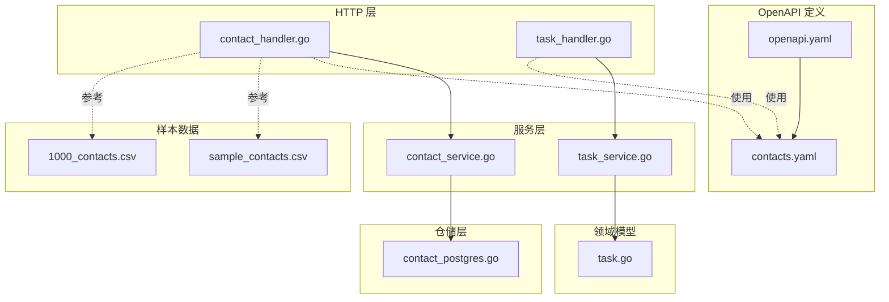
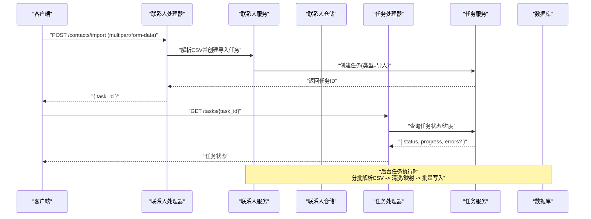
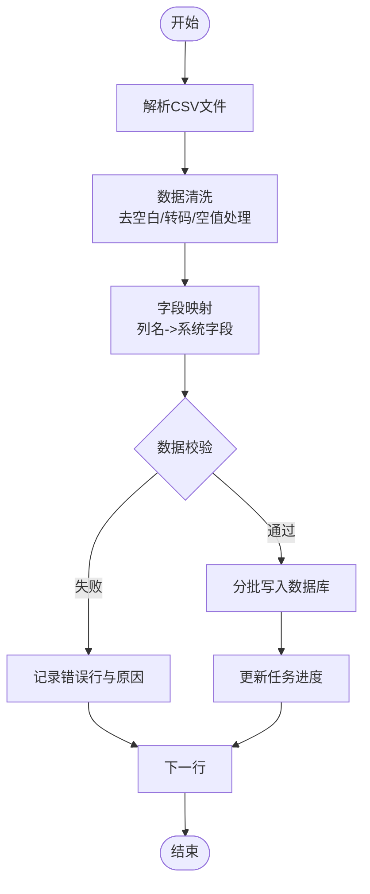
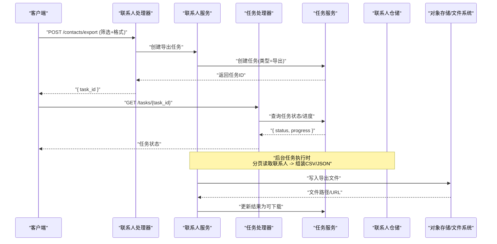
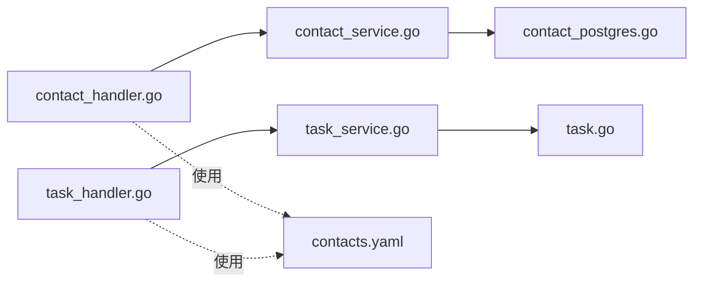

# 联系人批量导入导出API

<cite>
**本文引用的文件**   
- [contact_handler.go](file://notifuse/internal/http/contact_handler.go)
- [contact_service.go](file://notifuse/internal/service/contact_service.go)
- [contact_postgres.go](file://notifuse/internal/repository/contact_postgres.go)
- [task_handler.go](file://notifuse/internal/http/task_handler.go)
- [task_service.go](file://notifuse/internal/service/task_service.go)
- [task.go](file://notifuse/internal/domain/task.go)
- [openapi.yaml](file://notifuse/openapi/openapi.yaml)
- [contacts.yaml](file://notifuse/openapi/paths/contacts.yaml)
- [sample_contacts.csv](file://notifuse/samples/sample_contacts.csv)
- [1000_contacts.csv](file://notifuse/samples/1000_contacts.csv)
</cite>

## 目录
1. [简介](#简介)
2. [项目结构](#项目结构)
3. [核心组件](#核心组件)
4. [架构总览](#架构总览)
5. [详细组件分析](#详细组件分析)
6. [依赖分析](#依赖分析)
7. [性能考虑](#性能考虑)
8. [故障排查指南](#故障排查指南)
9. [结论](#结论)
10. [附录](#附录)

## 简介
本文件为 Notifuse 平台“联系人批量导入/导出”功能的完整 API 文档，覆盖以下要点：
- CSV 上传接口规范、字段映射规则与数据校验机制
- 批量导入的进度跟踪、错误处理与重试策略
- 导出功能的数据格式选择、筛选条件与异步任务处理
- CSV 模板下载、字段映射配置与数据清洗规则
- 性能优化建议（分块上传、并发处理、内存管理等）

## 项目结构
与联系人批量导入/导出相关的后端实现主要位于 internal 层，包含 HTTP 处理器、服务层、仓储层以及领域模型；OpenAPI 定义位于 openapi 目录；示例 CSV 模板位于 samples 目录。

图表来源
- [contact_handler.go](file://notifuse/internal/http/contact_handler.go)
- [contact_service.go](file://notifuse/internal/service/contact_service.go)
- [contact_postgres.go](file://notifuse/internal/repository/contact_postgres.go)
- [task_handler.go](file://notifuse/internal/http/task_handler.go)
- [task_service.go](file://notifuse/internal/service/task_service.go)
- [task.go](file://notifuse/internal/domain/task.go)
- [openapi.yaml](file://notifuse/openapi/openapi.yaml)
- [contacts.yaml](file://notifuse/openapi/paths/contacts.yaml)
- [sample_contacts.csv](file://notifuse/samples/sample_contacts.csv)
- [1000_contacts.csv](file://notifuse/samples/1000_contacts.csv)

章节来源
- [contact_handler.go](file://notifuse/internal/http/contact_handler.go)
- [contact_service.go](file://notifuse/internal/service/contact_service.go)
- [contact_postgres.go](file://notifuse/internal/repository/contact_postgres.go)
- [task_handler.go](file://notifuse/internal/http/task_handler.go)
- [task_service.go](file://notifuse/internal/service/task_service.go)
- [task.go](file://notifuse/internal/domain/task.go)
- [openapi.yaml](file://notifuse/openapi/openapi.yaml)
- [contacts.yaml](file://notifuse/openapi/paths/contacts.yaml)
- [sample_contacts.csv](file://notifuse/samples/sample_contacts.csv)
- [1000_contacts.csv](file://notifuse/samples/1000_contacts.csv)

## 核心组件
- HTTP 处理器
  - 联系人处理器：负责接收 CSV 上传、触发导入任务、查询导入结果与错误详情、发起导出任务、获取导出结果等。
  - 任务处理器：负责通用任务的创建、状态查询与结果下载。
- 服务层
  - 联系人服务：解析 CSV、执行字段映射与清洗、调用仓储进行批量写入、生成导入报告。
  - 任务服务：管理异步任务生命周期、进度更新、失败重试与结果持久化。
- 仓储层
  - 联系人仓储：提供联系人的批量插入/更新、去重、分页读取等能力。
- 领域模型
  - 任务模型：描述任务类型、状态、进度、错误信息、结果位置等。
- OpenAPI 定义
  - 统一描述导入/导出相关端点、请求/响应结构与错误码。
- 样本数据
  - 提供标准 CSV 模板与大规模样例，便于客户端联调与压力测试。

章节来源
- [contact_handler.go](file://notifuse/internal/http/contact_handler.go)
- [contact_service.go](file://notifuse/internal/service/contact_service.go)
- [contact_postgres.go](file://notifuse/internal/repository/contact_postgres.go)
- [task_handler.go](file://notifuse/internal/http/task_handler.go)
- [task_service.go](file://notifuse/internal/service/task_service.go)
- [task.go](file://notifuse/internal/domain/task.go)
- [openapi.yaml](file://notifuse/openapi/openapi.yaml)
- [contacts.yaml](file://notifuse/openapi/paths/contacts.yaml)

## 架构总览
导入/导出采用“同步提交 + 异步处理”的模式：客户端通过 HTTP 提交任务或上传文件，服务端返回任务 ID；随后通过任务查询接口轮询进度与结果。

图表来源
- [contact_handler.go](file://notifuse/internal/http/contact_handler.go)
- [contact_service.go](file://notifuse/internal/service/contact_service.go)
- [task_handler.go](file://notifuse/internal/http/task_handler.go)
- [task_service.go](file://notifuse/internal/service/task_service.go)
- [contact_postgres.go](file://notifuse/internal/repository/contact_postgres.go)

## 详细组件分析

### 联系人导入流程
- 输入
  - 表单字段：文件（CSV）、可选的字段映射配置、是否启用去重策略、目标列表/标签过滤等。
- 处理步骤
  - 解析 CSV：按行读取，支持大文件流式解析，避免一次性加载到内存。
  - 数据清洗：去除首尾空白、规范化邮箱大小写、空值处理、编码转换。
  - 字段映射：将 CSV 列名映射至系统字段（如 email、name、phone、custom_*）。
  - 数据校验：必填字段检查、邮箱格式、唯一性约束、枚举值合法性。
  - 批量写入：按批次（例如每批 N 条）插入或更新，记录成功/失败明细。
  - 进度上报：周期性更新任务进度（已处理/总数/失败数）。
  - 结果输出：生成导入报告（含错误行号与原因），供下载。
- 输出
  - 任务 ID；后续通过任务接口查询进度与结果。

图表来源
- [contact_service.go](file://notifuse/internal/service/contact_service.go)
- [contact_postgres.go](file://notifuse/internal/repository/contact_postgres.go)
- [task_service.go](file://notifuse/internal/service/task_service.go)

章节来源
- [contact_handler.go](file://notifuse/internal/http/contact_handler.go)
- [contact_service.go](file://notifuse/internal/service/contact_service.go)
- [contact_postgres.go](file://notifuse/internal/repository/contact_postgres.go)
- [task_handler.go](file://notifuse/internal/http/task_handler.go)
- [task_service.go](file://notifuse/internal/service/task_service.go)

### 联系人导出流程
- 输入
  - 筛选条件：列表/标签、自定义字段范围、时间区间、订阅状态等。
  - 格式选择：CSV（默认）、JSON（可选）。
- 处理步骤
  - 构建查询：根据筛选条件生成高效查询，必要时分页游标。
  - 异步任务：创建导出任务，后台逐步拉取数据并组装文件。
  - 进度上报：统计已导出行数与总行数估算。
  - 结果输出：生成可下载的文件链接或字节流。
- 输出
  - 任务 ID；通过任务接口查询进度与下载结果。

图表来源
- [contact_handler.go](file://notifuse/internal/http/contact_handler.go)
- [contact_service.go](file://notifuse/internal/service/contact_service.go)
- [task_handler.go](file://notifuse/internal/http/task_handler.go)
- [task_service.go](file://notifuse/internal/service/task_service.go)
- [contact_postgres.go](file://notifuse/internal/repository/contact_postgres.go)

章节来源
- [contact_handler.go](file://notifuse/internal/http/contact_handler.go)
- [contact_service.go](file://notifuse/internal/service/contact_service.go)
- [task_handler.go](file://notifuse/internal/http/task_handler.go)
- [task_service.go](file://notifuse/internal/service/task_service.go)
- [contact_postgres.go](file://notifuse/internal/repository/contact_postgres.go)

### CSV 模板与字段映射
- 模板下载
  - 提供标准 CSV 模板，包含常用字段列头，便于客户端直接填充。
- 字段映射规则
  - 支持将 CSV 列名映射至系统字段，包括基础字段与自定义字段（custom_*）。
  - 当列名不匹配时，可通过映射配置指定对应关系。
- 数据清洗规则
  - 去除首尾空白字符、统一日期/时间格式、空字符串视为 null、邮箱小写化、重复行合并策略等。

章节来源
- [contact_handler.go](file://notifuse/internal/http/contact_handler.go)
- [contact_service.go](file://notifuse/internal/service/contact_service.go)
- [sample_contacts.csv](file://notifuse/samples/sample_contacts.csv)
- [1000_contacts.csv](file://notifuse/samples/1000_contacts.csv)

### 数据验证机制
- 必填字段校验：如邮箱为必填。
- 格式校验：邮箱格式、电话号码格式、枚举值合法性。
- 唯一性校验：同一工作空间内邮箱唯一（可配置冲突策略：跳过/覆盖）。
- 业务规则：订阅状态、退订标记、黑名单等。

章节来源
- [contact_service.go](file://notifuse/internal/service/contact_service.go)
- [contact_postgres.go](file://notifuse/internal/repository/contact_postgres.go)

### 进度跟踪、错误处理与重试
- 进度跟踪
  - 任务状态：待处理、进行中、已完成、失败。
  - 进度指标：已处理行数、总行数、失败行数、错误摘要。
- 错误处理
  - 逐行错误记录：行号、字段、错误原因。
  - 批量错误汇总：失败率阈值、断点续传（基于任务 ID 恢复）。
- 重试机制
  - 网络/IO 异常自动重试（指数退避）。
  - 幂等写入：基于唯一键避免重复导入。

章节来源
- [task_handler.go](file://notifuse/internal/http/task_handler.go)
- [task_service.go](file://notifuse/internal/service/task_service.go)
- [task.go](file://notifuse/internal/domain/task.go)

### OpenAPI 端点概览
- 导入相关
  - POST /contacts/import：上传 CSV 并创建导入任务。
  - GET /contacts/import/{task_id}：查询导入任务状态与结果。
- 导出相关
  - POST /contacts/export：创建导出任务（支持筛选与格式选择）。
  - GET /contacts/export/{task_id}：查询导出任务状态与结果。
- 通用任务
  - GET /tasks/{task_id}：通用任务查询接口。

章节来源
- [openapi.yaml](file://notifuse/openapi/openapi.yaml)
- [contacts.yaml](file://notifuse/openapi/paths/contacts.yaml)

## 依赖分析
- 耦合关系
  - HTTP 层仅依赖服务层接口，保持松耦合。
  - 服务层组合仓储与任务服务，完成业务编排。
  - 仓储层直接访问数据库，封装 SQL 与事务边界。
- 外部依赖
  - 数据库：PostgreSQL（批量写入、索引优化）。
  - 对象存储/文件系统：用于保存导入/导出结果文件。
- 潜在循环依赖
  - 当前分层清晰，未见循环依赖迹象。

图表来源
- [contact_handler.go](file://notifuse/internal/http/contact_handler.go)
- [contact_service.go](file://notifuse/internal/service/contact_service.go)
- [contact_postgres.go](file://notifuse/internal/repository/contact_postgres.go)
- [task_handler.go](file://notifuse/internal/http/task_handler.go)
- [task_service.go](file://notifuse/internal/service/task_service.go)
- [task.go](file://notifuse/internal/domain/task.go)
- [contacts.yaml](file://notifuse/openapi/paths/contacts.yaml)

章节来源
- [contact_handler.go](file://notifuse/internal/http/contact_handler.go)
- [contact_service.go](file://notifuse/internal/service/contact_service.go)
- [contact_postgres.go](file://notifuse/internal/repository/contact_postgres.go)
- [task_handler.go](file://notifuse/internal/http/task_handler.go)
- [task_service.go](file://notifuse/internal/service/task_service.go)
- [task.go](file://notifuse/internal/domain/task.go)
- [contacts.yaml](file://notifuse/openapi/paths/contacts.yaml)

## 性能考虑
- 分块上传
  - 对超大 CSV 建议使用分块上传（multipart/chunked），服务端合并后流式解析，降低峰值内存占用。
- 并发处理
  - 后台任务内部按批次并行处理（控制并发度以避免数据库连接池耗尽）。
- 内存管理
  - 流式解析 CSV，避免整文件加载；导出时使用游标分页读取。
- 数据库优化
  - 批量插入/更新（UPSERT），减少往返次数；合理索引（邮箱、工作空间 ID）。
- 限流与背压
  - 针对高并发导入/导出设置速率限制与队列长度上限，防止雪崩。
- 缓存与去重
  - 在内存中维护短期去重集合（受限于内存上限），结合数据库唯一约束保证一致性。

[本节为通用性能指导，无需具体文件引用]

## 故障排查指南
- 常见问题
  - CSV 编码问题：确保 UTF-8 编码，避免 BOM 导致列名识别失败。
  - 列名不匹配：检查字段映射配置，确认列名与系统字段一致。
  - 唯一性冲突：根据策略选择跳过或覆盖，避免大量失败。
  - 任务超时：增大任务超时时间或拆分更小的导入批次。
- 定位方法
  - 查看任务错误摘要与逐行错误详情。
  - 核对导入前样本数据是否符合模板规范。
  - 检查数据库日志与慢查询，评估索引与批量大小。

章节来源
- [task_handler.go](file://notifuse/internal/http/task_handler.go)
- [task_service.go](file://notifuse/internal/service/task_service.go)
- [task.go](file://notifuse/internal/domain/task.go)

## 结论
Notifuse 的联系人批量导入/导出采用异步任务驱动的分层架构，具备完善的进度跟踪、错误处理与重试机制。通过标准化 CSV 模板、灵活的字段映射与严格的数据校验，能够支撑大规模数据的稳定导入与导出。配合分块上传、并发处理与内存管理等最佳实践，可在高负载场景下保持良好性能与稳定性。

[本节为总结性内容，无需具体文件引用]

## 附录
- 样本数据
  - 标准模板：sample_contacts.csv
  - 大规模样例：1000_contacts.csv
- 相关端点
  - 导入：POST /contacts/import、GET /contacts/import/{task_id}
  - 导出：POST /contacts/export、GET /contacts/export/{task_id}
  - 任务：GET /tasks/{task_id}

章节来源
- [sample_contacts.csv](file://notifuse/samples/sample_contacts.csv)
- [1000_contacts.csv](file://notifuse/samples/1000_contacts.csv)
- [openapi.yaml](file://notifuse/openapi/openapi.yaml)
- [contacts.yaml](file://notifuse/openapi/paths/contacts.yaml)