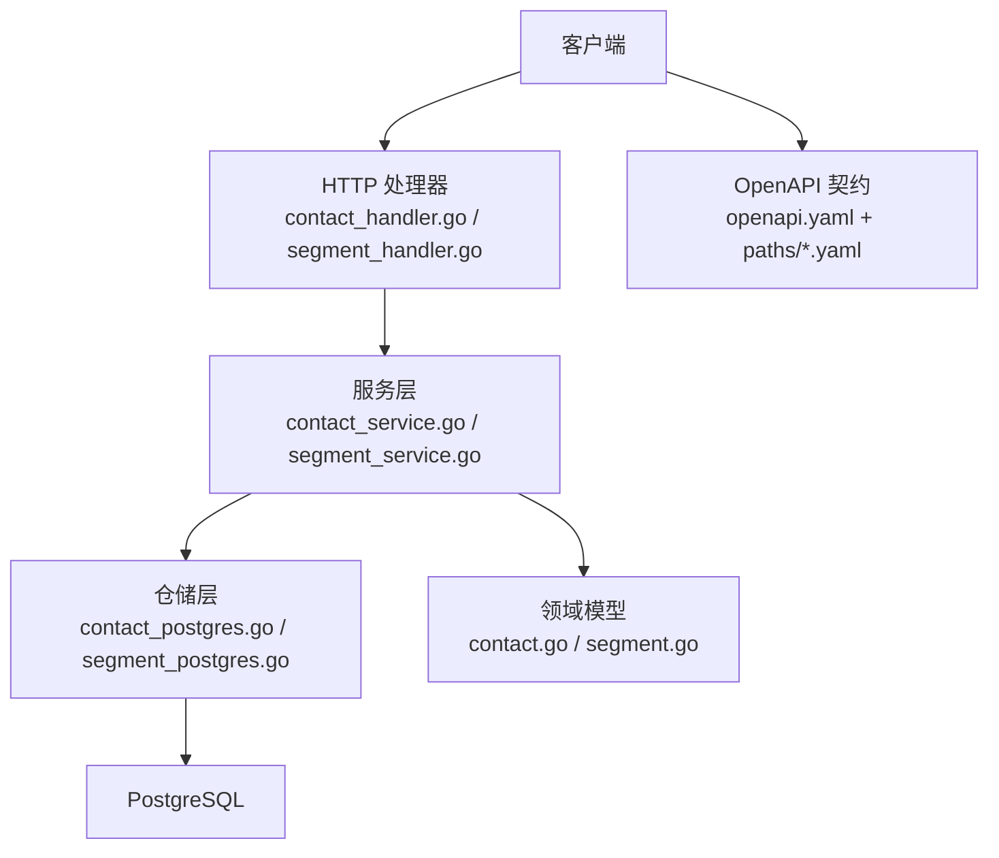
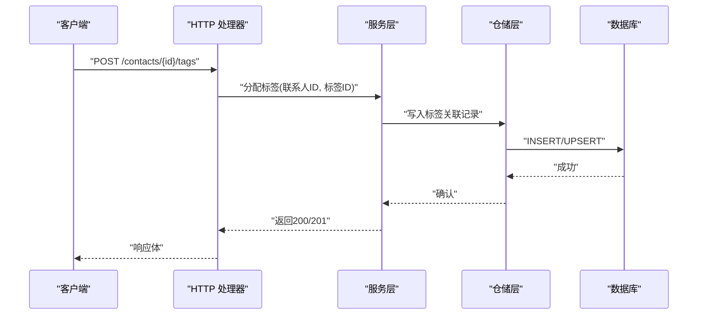
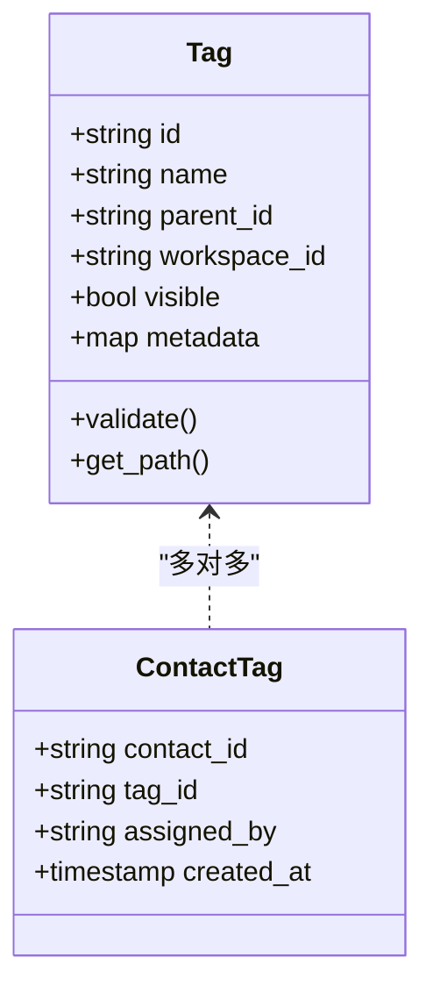
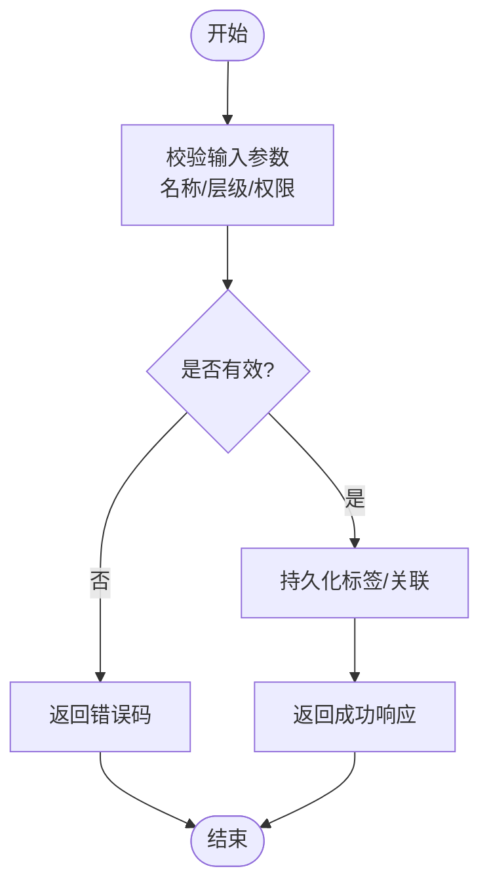
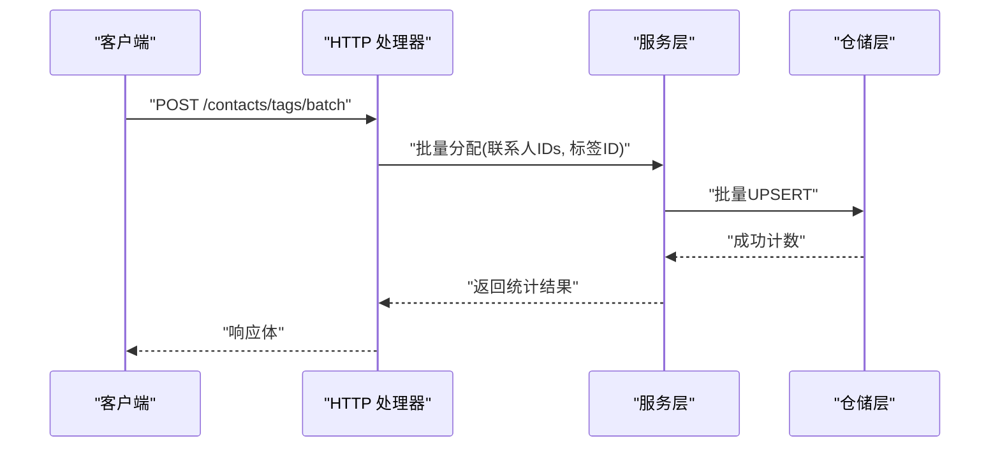
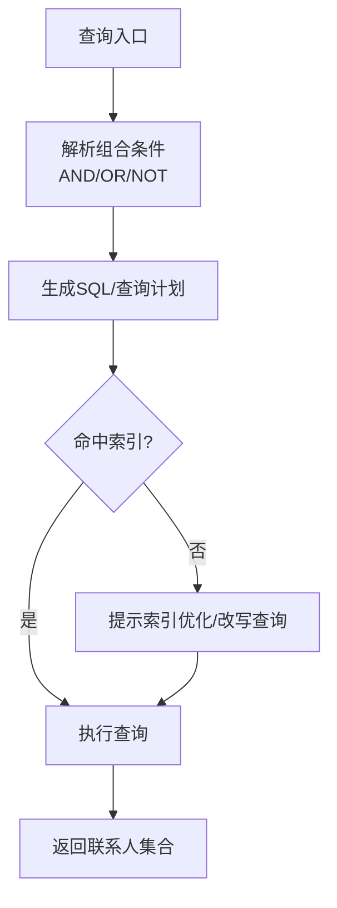
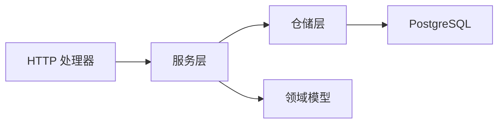

# 联系人标签管理API

<cite>
**本文引用的文件**   
- [contact_handler.go](file://notifuse/internal/http/contact_handler.go)
- [contact_service.go](file://notifuse/internal/service/contact_service.go)
- [contact_postgres.go](file://notifuse/internal/repository/contact_postgres.go)
- [contact.go](file://notifuse/internal/domain/contact.go)
- [segment_handler.go](file://notifuse/internal/http/segment_handler.go)
- [segment_service.go](file://notifuse/internal/service/segment_service.go)
- [segment_postgres.go](file://notifuse/internal/repository/segment_postgres.go)
- [segment.go](file://notifuse/internal/domain/segment.go)
- [openapi.yaml](file://notifuse/openapi/openapi.yaml)
- [contacts.yaml](file://notifuse/openapi/paths/contacts.yaml)
- [contact-lists.yaml](file://notifuse/openapi/paths/contact-lists.yaml)
- [broadcasts.yaml](file://notifuse/openapi/paths/broadcasts.yaml)
</cite>

## 目录
1. [简介](#简介)
2. [项目结构](#项目结构)
3. [核心组件](#核心组件)
4. [架构总览](#架构总览)
5. [详细组件分析](#详细组件分析)
6. [依赖分析](#依赖分析)
7. [性能考虑](#性能考虑)
8. [故障排查指南](#故障排查指南)
9. [结论](#结论)
10. [附录](#附录)

## 简介
本文件为 Notifuse 平台的“联系人标签管理”提供完整 API 文档与实现说明，覆盖标签的创建、分配、移除与查询；描述标签层级结构与命名规范；阐述权限控制机制；文档化批量操作、组合查询与统计分析能力；并结合邮件营销场景（个性化内容推送、精准营销）给出使用示例。同时包含性能优化、缓存策略与索引设计等技术细节建议。

## 项目结构
Notifuse 后端采用分层架构：HTTP 层暴露 RESTful API，服务层封装业务逻辑，仓储层对接数据库，领域层定义数据模型与约束。标签相关能力由联系人模块与分群模块共同支撑：
- HTTP 层：联系人处理器、分群处理器
- 服务层：联系人服务、分群服务
- 仓储层：联系人 Postgres 实现、分群 Postgres 实现
- 领域层：联系人实体、分群实体
- OpenAPI：对外接口契约

图表来源
- [contact_handler.go](file://notifuse/internal/http/contact_handler.go)
- [segment_handler.go](file://notifuse/internal/http/segment_handler.go)
- [contact_service.go](file://notifuse/internal/service/contact_service.go)
- [segment_service.go](file://notifuse/internal/service/segment_service.go)
- [contact_postgres.go](file://notifuse/internal/repository/contact_postgres.go)
- [segment_postgres.go](file://notifuse/internal/repository/segment_postgres.go)
- [contact.go](file://notifuse/internal/domain/contact.go)
- [segment.go](file://notifuse/internal/domain/segment.go)
- [openapi.yaml](file://notifuse/openapi/openapi.yaml)

章节来源
- [contact_handler.go](file://notifuse/internal/http/contact_handler.go)
- [segment_handler.go](file://notifuse/internal/http/segment_handler.go)
- [contact_service.go](file://notifuse/internal/service/contact_service.go)
- [segment_service.go](file://notifuse/internal/service/segment_service.go)
- [contact_postgres.go](file://notifuse/internal/repository/contact_postgres.go)
- [segment_postgres.go](file://notifuse/internal/repository/segment_postgres.go)
- [contact.go](file://notifuse/internal/domain/contact.go)
- [segment.go](file://notifuse/internal/domain/segment.go)
- [openapi.yaml](file://notifuse/openapi/openapi.yaml)

## 核心组件
- 联系人处理器：负责解析请求参数、鉴权与路由到服务层，返回统一响应格式。
- 联系人服务：实现标签的创建、分配、移除、查询、批量操作、组合查询与统计等核心业务。
- 联系人仓储：封装 SQL 与事务，保证读写一致性与并发安全。
- 联系人领域模型：定义标签字段、层级关系、唯一性约束与校验规则。
- 分群处理器与服务：基于标签条件构建动态受众集合，支持组合查询与增量更新。
- 分群仓储与领域模型：存储分群定义、计算结果与版本历史。
- OpenAPI 契约：定义标签与联系人相关的接口规范、请求/响应结构与错误码。

章节来源
- [contact_handler.go](file://notifuse/internal/http/contact_handler.go)
- [contact_service.go](file://notifuse/internal/service/contact_service.go)
- [contact_postgres.go](file://notifuse/internal/repository/contact_postgres.go)
- [contact.go](file://notifuse/internal/domain/contact.go)
- [segment_handler.go](file://notifuse/internal/http/segment_handler.go)
- [segment_service.go](file://notifuse/internal/service/segment_service.go)
- [segment_postgres.go](file://notifuse/internal/repository/segment_postgres.go)
- [segment.go](file://notifuse/internal/domain/segment.go)
- [openapi.yaml](file://notifuse/openapi/openapi.yaml)

## 架构总览
标签管理在 Notifuse 中与“联系人列表/分群”协同工作：静态标签用于对联系人进行直接标记，动态分群则基于标签条件自动维护受众集合。广播发送可基于静态标签或动态分群进行目标选择。

图表来源
- [contact_handler.go](file://notifuse/internal/http/contact_handler.go)
- [contact_service.go](file://notifuse/internal/service/contact_service.go)
- [contact_postgres.go](file://notifuse/internal/repository/contact_postgres.go)

## 详细组件分析

### 标签数据模型与约束
- 标签实体包含标识、名称、层级路径、所属工作区、可见性、元数据等字段。
- 层级结构通过父标签 ID 或路径字段表达，支持多级分类。
- 命名规范：在同一工作区内标签名唯一；建议使用小写英文字母、数字与短横线；避免保留字与系统前缀。
- 权限控制：标签属于工作区级别资源，需具备相应角色权限方可读写。

图表来源
- [contact.go](file://notifuse/internal/domain/contact.go)
- [segment.go](file://notifuse/internal/domain/segment.go)

章节来源
- [contact.go](file://notifuse/internal/domain/contact.go)
- [segment.go](file://notifuse/internal/domain/segment.go)

### 标签 CRUD 与分配/移除
- 创建标签：校验名称唯一性与层级合法性，持久化后返回标签详情。
- 分配标签：将标签与联系人建立关联，支持幂等写入。
- 移除标签：解除联系人-标签关联，若为最后引用则允许软删除或归档。
- 查询标签：按工作区、层级、名称模糊匹配分页检索。

图表来源
- [contact_handler.go](file://notifuse/internal/http/contact_handler.go)
- [contact_service.go](file://notifuse/internal/service/contact_service.go)
- [contact_postgres.go](file://notifuse/internal/repository/contact_postgres.go)

章节来源
- [contact_handler.go](file://notifuse/internal/http/contact_handler.go)
- [contact_service.go](file://notifuse/internal/service/contact_service.go)
- [contact_postgres.go](file://notifuse/internal/repository/contact_postgres.go)

### 批量标签操作
- 批量分配：接收联系人 ID 列表与标签 ID，执行批量 UPSERT，确保事务一致性。
- 批量移除：根据联系人 ID 列表与标签 ID 批量删除关联。
- 幂等与去重：同一批内重复条目自动去重；跨批次可通过版本号或时间戳保证幂等。

图表来源
- [contact_handler.go](file://notifuse/internal/http/contact_handler.go)
- [contact_service.go](file://notifuse/internal/service/contact_service.go)
- [contact_postgres.go](file://notifuse/internal/repository/contact_postgres.go)

章节来源
- [contact_handler.go](file://notifuse/internal/http/contact_handler.go)
- [contact_service.go](file://notifuse/internal/service/contact_service.go)
- [contact_postgres.go](file://notifuse/internal/repository/contact_postgres.go)

### 标签组合查询
- 组合条件：支持 AND/OR 组合多个标签条件，支持排除标签。
- 动态分群：将组合条件保存为分群定义，定期或触发式重建受众集合。
- 查询优化：利用索引与物化视图加速复杂条件检索。

图表来源
- [segment_handler.go](file://notifuse/internal/http/segment_handler.go)
- [segment_service.go](file://notifuse/internal/service/segment_service.go)
- [segment_postgres.go](file://notifuse/internal/repository/segment_postgres.go)

章节来源
- [segment_handler.go](file://notifuse/internal/http/segment_handler.go)
- [segment_service.go](file://notifuse/internal/service/segment_service.go)
- [segment_postgres.go](file://notifuse/internal/repository/segment_postgres.go)

### 标签统计分析
- 维度：按标签、层级、时间范围统计联系人数量、增长趋势、活跃度。
- 指标：覆盖率、重叠度、迁移率（标签变更频率）。
- 输出：聚合报表与导出接口，供运营与投放分析使用。

章节来源
- [contact_service.go](file://notifuse/internal/service/contact_service.go)
- [contact_postgres.go](file://notifuse/internal/repository/contact_postgres.go)

### 权限控制机制
- 工作区隔离：所有标签与联系人操作均绑定工作区上下文。
- 角色与授权：仅具备指定角色的用户可创建/修改/删除标签或分配/移除标签。
- 审计日志：关键操作记录操作人、时间与变更摘要。

章节来源
- [contact_handler.go](file://notifuse/internal/http/contact_handler.go)
- [contact_service.go](file://notifuse/internal/service/contact_service.go)

### 邮件营销应用场景
- 个性化内容推送：基于标签（如地区、兴趣、生命周期阶段）动态渲染模板变量。
- 精准营销：结合分群（标签组合）定向发送广播消息，提升打开与转化。
- 自动化流程：当联系人获得特定标签时触发后续动作（如跟进任务、二次触达）。

章节来源
- [broadcasts.yaml](file://notifuse/openapi/paths/broadcasts.yaml)
- [segment_handler.go](file://notifuse/internal/http/segment_handler.go)
- [segment_service.go](file://notifuse/internal/service/segment_service.go)

## 依赖分析
- 耦合关系：HTTP 处理器依赖服务层；服务层依赖仓储层与领域模型；仓储层依赖数据库驱动。
- 外部依赖：PostgreSQL 作为主数据存储；可选缓存层用于热点标签与分群结果。
- 潜在循环：服务层不应反向依赖 HTTP 层；仓储层不依赖服务层。

图表来源
- [contact_handler.go](file://notifuse/internal/http/contact_handler.go)
- [contact_service.go](file://notifuse/internal/service/contact_service.go)
- [contact_postgres.go](file://notifuse/internal/repository/contact_postgres.go)
- [contact.go](file://notifuse/internal/domain/contact.go)

章节来源
- [contact_handler.go](file://notifuse/internal/http/contact_handler.go)
- [contact_service.go](file://notifuse/internal/service/contact_service.go)
- [contact_postgres.go](file://notifuse/internal/repository/contact_postgres.go)
- [contact.go](file://notifuse/internal/domain/contact.go)

## 性能考虑
- 索引设计
  - 联系人-标签关联表：在 (contact_id, tag_id) 上建立复合索引以加速分配/移除与查询。
  - 标签表：在 (workspace_id, name) 上建立唯一索引保障唯一性与快速查找。
  - 分群条件表：在 (workspace_id, updated_at) 上建立索引以支持增量重建。
- 缓存策略
  - 热点标签详情与层级树：本地内存缓存，设置合理 TTL 与失效策略。
  - 分群结果集：按分群 ID 缓存，变更时主动失效。
- 查询优化
  - 组合查询优先走索引扫描，必要时使用物化视图或预聚合表。
  - 分页查询使用游标或键集分页避免深分页开销。
- 批量操作
  - 使用事务与批量 UPSERT 减少往返次数。
  - 分批提交，控制单批大小以避免长事务锁竞争。

[本节为通用性能建议，无需具体文件来源]

## 故障排查指南
- 常见错误
  - 名称冲突：同一工作区内标签名重复，检查唯一索引与并发写入。
  - 权限不足：无工作区标签管理权限，检查认证与授权中间件。
  - 关联不存在：分配/移除时联系人或标签不存在，先校验再操作。
- 定位方法
  - 查看处理器日志与服务层异常堆栈。
  - 检查仓储层 SQL 执行计划与慢查询日志。
  - 核对 OpenAPI 契约与实际请求参数差异。

章节来源
- [contact_handler.go](file://notifuse/internal/http/contact_handler.go)
- [contact_service.go](file://notifuse/internal/service/contact_service.go)
- [contact_postgres.go](file://notifuse/internal/repository/contact_postgres.go)

## 结论
Notifuse 的联系人标签管理以清晰的层次化模型与严格的权限控制为基础，结合分群能力实现灵活的受众组织与精准营销。通过合理的索引设计与缓存策略，可在大规模数据下保持稳定的查询与写入性能。建议在上线前完成压测与索引验证，并持续监控热点标签与分群的重建成本。

[本节为总结性内容，无需具体文件来源]

## 附录

### API 概览（标签与联系人）
- 标签管理
  - 创建标签：POST /tags
  - 更新标签：PATCH /tags/{id}
  - 删除标签：DELETE /tags/{id}
  - 查询标签：GET /tags?workspace_id=&parent_id=&q=
- 联系人标签
  - 分配标签：POST /contacts/{id}/tags
  - 移除标签：DELETE /contacts/{id}/tags/{tag_id}
  - 批量分配：POST /contacts/tags/batch
  - 批量移除：DELETE /contacts/tags/batch
  - 查询联系人标签：GET /contacts/{id}/tags
- 分群（标签组合）
  - 创建分群：POST /segments
  - 更新分群：PATCH /segments/{id}
  - 删除分群：DELETE /segments/{id}
  - 查询分群：GET /segments
  - 重建分群：POST /segments/{id}/rebuild
- 广播（应用标签/分群）
  - 创建广播：POST /broadcasts
  - 选择受众：基于标签或分群 ID
  - 发送与状态：GET /broadcasts/{id}

章节来源
- [openapi.yaml](file://notifuse/openapi/openapi.yaml)
- [contacts.yaml](file://notifuse/openapi/paths/contacts.yaml)
- [contact-lists.yaml](file://notifuse/openapi/paths/contact-lists.yaml)
- [broadcasts.yaml](file://notifuse/openapi/paths/broadcasts.yaml)