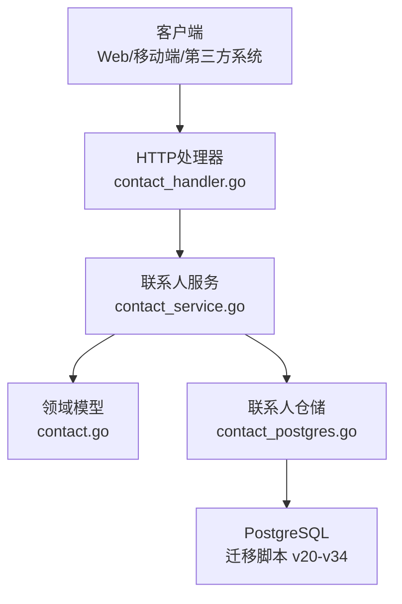
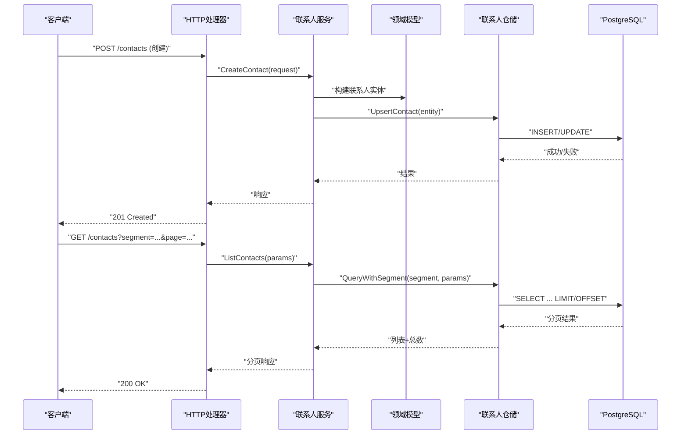
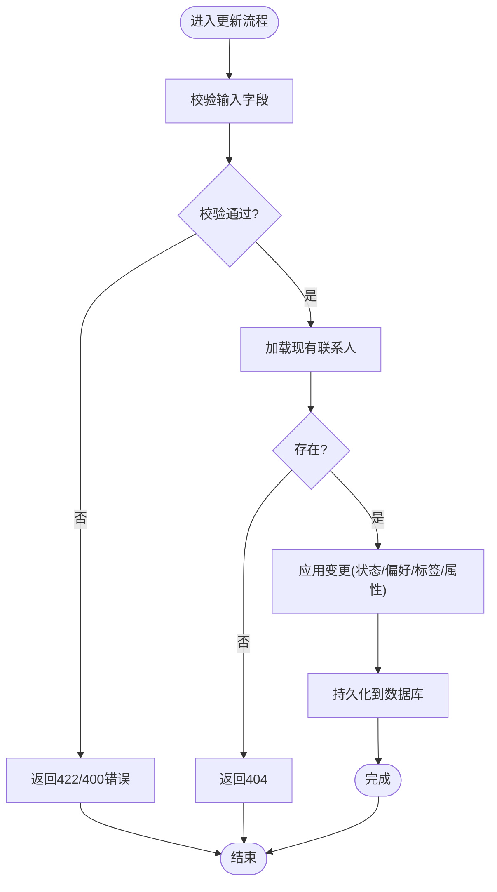
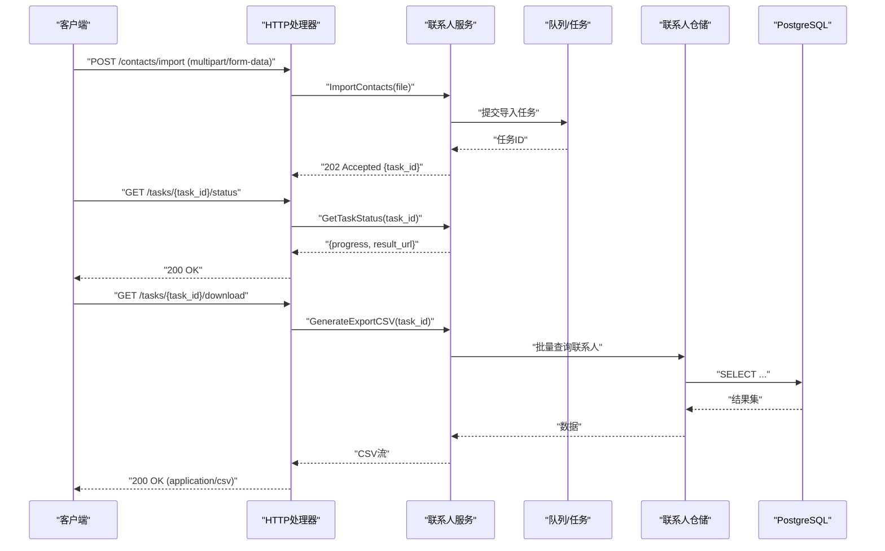
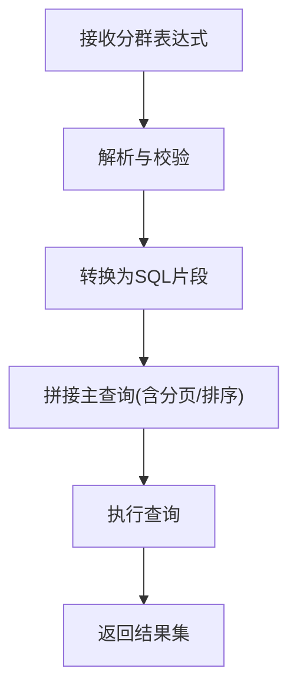
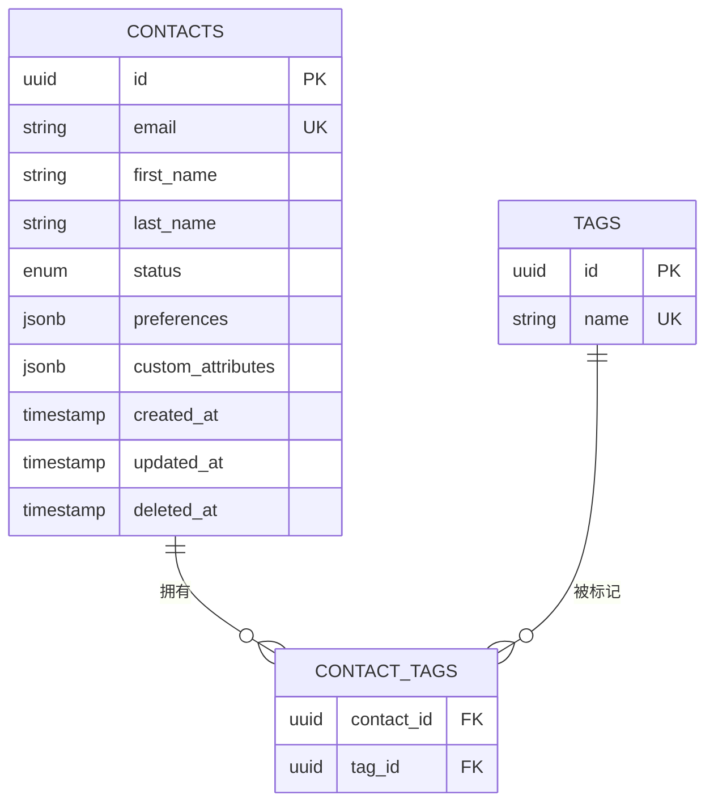
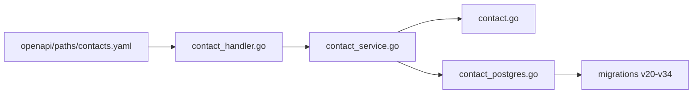

# 联系人管理API

<cite>
**本文引用的文件**   
- [openapi/paths/contacts.yaml](file://notifuse/openapi/paths/contacts.yaml)
- [internal/http/contact_handler.go](file://notifuse/internal/http/contact_handler.go)
- [internal/service/contact_service.go](file://notifuse/internal/service/contact_service.go)
- [internal/domain/contact.go](file://notifuse/internal/domain/contact.go)
- [internal/repository/contact_postgres.go](file://notifuse/internal/repository/contact_postgres.go)
- [internal/migrations/v20.go](file://notifuse/internal/migrations/v20.go)
- [internal/migrations/v21.go](file://notifuse/internal/migrations/v21.go)
- [internal/migrations/v22.go](file://notifuse/internal/migrations/v22.go)
- [internal/migrations/v23.go](file://notifuse/internal/migrations/v23.go)
- [internal/migrations/v24.go](file://notifuse/internal/migrations/v24.go)
- [internal/migrations/v25.go](file://notifuse/internal/migrations/v25.go)
- [internal/migrations/v26.go](file://notifuse/internal/migrations/v26.go)
- [internal/migrations/v27.go](file://notifuse/internal/migrations/v27.go)
- [internal/migrations/v28.go](file://notifuse/internal/migrations/v28.go)
- [internal/migrations/v29.go](file://notifuse/internal/migrations/v29.go)
- [internal/migrations/v30.go](file://notifuse/internal/migrations/v30.go)
- [internal/migrations/v31.go](file://notifuse/internal/migrations/v31.go)
- [internal/migrations/v32.go](file://notifuse/internal/migrations/v32.go)
- [internal/migrations/v33.go](file://notifuse/internal/migrations/v33.go)
- [internal/migrations/v34.go](file://notifuse/internal/migrations/v34.go)
- [samples/sample_contacts.csv](file://notifuse/samples/sample_contacts.csv)
- [samples/1000_contacts.csv](file://notifuse/samples/1000_contacts.csv)
</cite>

## 目录
1. [简介](#简介)
2. [项目结构](#项目结构)
3. [核心组件](#核心组件)
4. [架构总览](#架构总览)
5. [详细组件分析](#详细组件分析)
6. [依赖关系分析](#依赖关系分析)
7. [性能考虑](#性能考虑)
8. [故障排查指南](#故障排查指南)
9. [结论](#结论)
10. [附录](#附录)

## 简介
本文件为 Notifuse 平台的“联系人管理API”提供完整文档，覆盖联系人的创建、读取、更新、删除（CRUD）、批量导入导出、动态分群查询、标签管理等核心能力。同时包含CSV上传格式规范、数据验证规则、分页参数说明、状态与订阅偏好管理、GDPR合规与隐私保护机制，以及Python、JavaScript等主流语言的SDK使用示例和错误处理模式。

## 项目结构
Notifuse后端采用分层架构：HTTP层暴露REST接口，服务层封装业务逻辑，领域层定义实体与规则，仓储层对接数据库。OpenAPI规范位于 openapi/paths/contacts.yaml，用于统一描述联系人相关接口契约。

图表来源
- [internal/http/contact_handler.go](file://notifuse/internal/http/contact_handler.go)
- [internal/service/contact_service.go](file://notifuse/internal/service/contact_service.go)
- [internal/domain/contact.go](file://notifuse/internal/domain/contact.go)
- [internal/repository/contact_postgres.go](file://notifuse/internal/repository/contact_postgres.go)
- [internal/migrations/v20.go](file://notifuse/internal/migrations/v20.go)
- [internal/migrations/v21.go](file://notifuse/internal/migrations/v21.go)
- [internal/migrations/v22.go](file://notifuse/internal/migrations/v22.go)
- [internal/migrations/v23.go](file://notifuse/internal/migrations/v23.go)
- [internal/migrations/v24.go](file://notifuse/internal/migrations/v24.go)
- [internal/migrations/v25.go](file://notifuse/internal/migrations/v25.go)
- [internal/migrations/v26.go](file://notifuse/internal/migrations/v26.go)
- [internal/migrations/v27.go](file://notifuse/internal/migrations/v27.go)
- [internal/migrations/v28.go](file://notifuse/internal/migrations/v28.go)
- [internal/migrations/v29.go](file://notifuse/internal/migrations/v29.go)
- [internal/migrations/v30.go](file://notifuse/internal/migrations/v30.go)
- [internal/migrations/v31.go](file://notifuse/internal/migrations/v31.go)
- [internal/migrations/v32.go](file://notifuse/internal/migrations/v32.go)
- [internal/migrations/v33.go](file://notifuse/internal/migrations/v33.go)
- [internal/migrations/v34.go](file://notifuse/internal/migrations/v34.go)

章节来源
- [openapi/paths/contacts.yaml](file://notifuse/openapi/paths/contacts.yaml)
- [internal/http/contact_handler.go](file://notifuse/internal/http/contact_handler.go)
- [internal/service/contact_service.go](file://notifuse/internal/service/contact_service.go)
- [internal/domain/contact.go](file://notifuse/internal/domain/contact.go)
- [internal/repository/contact_postgres.go](file://notifuse/internal/repository/contact_postgres.go)

## 核心组件
- HTTP处理器：负责解析请求、鉴权、参数校验、调用服务层并返回响应。
- 联系人服务：实现联系人CRUD、批量导入导出、动态分群查询、标签管理等业务逻辑。
- 领域模型：定义联系人实体、状态、订阅偏好、标签等数据结构与约束。
- 仓储层：封装SQL操作，提供高效的数据访问与事务支持。
- OpenAPI规范：定义接口路径、请求/响应体、错误码、分页参数等契约。

章节来源
- [internal/http/contact_handler.go](file://notifuse/internal/http/contact_handler.go)
- [internal/service/contact_service.go](file://notifuse/internal/service/contact_service.go)
- [internal/domain/contact.go](file://notifuse/internal/domain/contact.go)
- [internal/repository/contact_postgres.go](file://notifuse/internal/repository/contact_postgres.go)
- [openapi/paths/contacts.yaml](file://notifuse/openapi/paths/contacts.yaml)

## 架构总览
下图展示从客户端到数据库的端到端调用链，包括批量导入与动态分群查询的关键路径。

图表来源
- [internal/http/contact_handler.go](file://notifuse/internal/http/contact_handler.go)
- [internal/service/contact_service.go](file://notifuse/internal/service/contact_service.go)
- [internal/repository/contact_postgres.go](file://notifuse/internal/repository/contact_postgres.go)
- [internal/domain/contact.go](file://notifuse/internal/domain/contact.go)

## 详细组件分析

### 接口契约与字段规范
- 基础字段：邮箱、姓名、自定义属性（键值对）、状态、订阅偏好、标签集合、时间戳等。
- 状态枚举：活跃、退订、软删除、黑名单等（具体以领域模型为准）。
- 订阅偏好：渠道开关（邮件、短信等）、语言、时区、同意记录（GDPR）。
- 标签：字符串或ID集合，支持按标签筛选。
- 分页：page、per_page、sort、filter、search等通用参数。
- 错误码：400（参数无效）、404（不存在）、409（冲突）、422（校验失败）、500（服务器错误）等。

章节来源
- [openapi/paths/contacts.yaml](file://notifuse/openapi/paths/contacts.yaml)
- [internal/domain/contact.go](file://notifuse/internal/domain/contact.go)

### 联系人CRUD
- 创建：支持单条与批量上送；重复邮箱默认去重或根据策略合并。
- 读取：支持按ID、邮箱、标签、状态、自定义属性过滤；支持搜索与排序。
- 更新：支持部分更新；可更新状态、订阅偏好、标签与自定义属性。
- 删除：支持硬删除与软删除；软删除保留审计轨迹。

图表来源
- [internal/http/contact_handler.go](file://notifuse/internal/http/contact_handler.go)
- [internal/service/contact_service.go](file://notifuse/internal/service/contact_service.go)
- [internal/repository/contact_postgres.go](file://notifuse/internal/repository/contact_postgres.go)

章节来源
- [internal/http/contact_handler.go](file://notifuse/internal/http/contact_handler.go)
- [internal/service/contact_service.go](file://notifuse/internal/service/contact_service.go)
- [internal/domain/contact.go](file://notifuse/internal/domain/contact.go)
- [internal/repository/contact_postgres.go](file://notifuse/internal/repository/contact_postgres.go)

### 批量导入与导出
- CSV上传：
  - 编码：UTF-8
  - 分隔符：逗号
  - 首行：列名映射（如 email, first_name, last_name, tags, status, custom_attributes, consent_granted_at, unsubscribed_at）
  - 必填：email
  - 可选：name、tags（逗号分隔）、status、custom_attributes（JSON字符串）、consent_granted_at、unsubscribed_at
  - 大小限制：建议单次不超过1MB，行数不超过10000
  - 去重策略：基于邮箱唯一键；冲突时可跳过、覆盖或合并
- 导出：
  - 支持按筛选条件导出CSV
  - 支持分页流式输出，避免大内存占用
- 进度与任务：
  - 异步任务返回任务ID，支持查询进度与下载链接

图表来源
- [internal/http/contact_handler.go](file://notifuse/internal/http/contact_handler.go)
- [internal/service/contact_service.go](file://notifuse/internal/service/contact_service.go)
- [internal/repository/contact_postgres.go](file://notifuse/internal/repository/contact_postgres.go)

章节来源
- [internal/http/contact_handler.go](file://notifuse/internal/http/contact_handler.go)
- [internal/service/contact_service.go](file://notifuse/internal/service/contact_service.go)
- [internal/repository/contact_postgres.go](file://notifuse/internal/repository/contact_postgres.go)
- [samples/sample_contacts.csv](file://notifuse/samples/sample_contacts.csv)
- [samples/1000_contacts.csv](file://notifuse/samples/1000_contacts.csv)

### 动态分群查询
- 分群表达式：支持布尔组合、字段比较、包含/不包含、正则匹配、时间范围等。
- 查询优化：将分群表达式编译为SQL片段，结合索引进行快速过滤。
- 缓存：热点分群结果可缓存，设置TTL与失效策略。
- 分页：page、per_page、sort、filter、search等参数与分群表达式组合使用。

图表来源
- [internal/service/contact_service.go](file://notifuse/internal/service/contact_service.go)
- [internal/repository/contact_postgres.go](file://notifuse/internal/repository/contact_postgres.go)

章节来源
- [internal/service/contact_service.go](file://notifuse/internal/service/contact_service.go)
- [internal/repository/contact_postgres.go](file://notifuse/internal/repository/contact_postgres.go)

### 标签管理系统
- 标签增删改查：支持批量添加/移除、按标签筛选联系人。
- 标签计数：统计每个标签下的联系人数量。
- 标签同步：与外部系统集成时，保持标签一致性。

章节来源
- [internal/service/contact_service.go](file://notifuse/internal/service/contact_service.go)
- [internal/domain/contact.go](file://notifuse/internal/domain/contact.go)

### 状态管理与订阅偏好
- 状态：活跃、退订、软删除、黑名单等；状态变更需记录审计日志。
- 订阅偏好：渠道开关、语言、时区、同意记录；退订后禁止营销类发送。
- GDPR：支持同意撤回、数据删除、数据导出；保留最小必要信息。

章节来源
- [internal/domain/contact.go](file://notifuse/internal/domain/contact.go)
- [internal/service/contact_service.go](file://notifuse/internal/service/contact_service.go)

### GDPR合规与隐私保护
- 同意记录：记录同意时间、来源、版本；支持撤销。
- 数据删除：硬删除或匿名化处理；确保关联数据清理。
- 数据导出：提供全量导出接口，便于用户行使权利。
- 审计追踪：关键操作留痕，满足合规要求。

章节来源
- [internal/domain/contact.go](file://notifuse/internal/domain/contact.go)
- [internal/service/contact_service.go](file://notifuse/internal/service/contact_service.go)

### 数据模型与数据库迁移
- 联系人表：包含邮箱、姓名、状态、订阅偏好、标签、自定义属性、时间戳等。
- 迁移脚本：v20至v34逐步演进联系人结构与索引，提升查询性能与扩展性。

图表来源
- [internal/migrations/v20.go](file://notifuse/internal/migrations/v20.go)
- [internal/migrations/v21.go](file://notifuse/internal/migrations/v21.go)
- [internal/migrations/v22.go](file://notifuse/internal/migrations/v22.go)
- [internal/migrations/v23.go](file://notifuse/internal/migrations/v23.go)
- [internal/migrations/v24.go](file://notifuse/internal/migrations/v24.go)
- [internal/migrations/v25.go](file://notifuse/internal/migrations/v25.go)
- [internal/migrations/v26.go](file://notifuse/internal/migrations/v26.go)
- [internal/migrations/v27.go](file://notifuse/internal/migrations/v27.go)
- [internal/migrations/v28.go](file://notifuse/internal/migrations/v28.go)
- [internal/migrations/v29.go](file://notifuse/internal/migrations/v29.go)
- [internal/migrations/v30.go](file://notifuse/internal/migrations/v30.go)
- [internal/migrations/v31.go](file://notifuse/internal/migrations/v31.go)
- [internal/migrations/v32.go](file://notifuse/internal/migrations/v32.go)
- [internal/migrations/v33.go](file://notifuse/internal/migrations/v33.go)
- [internal/migrations/v34.go](file://notifuse/internal/migrations/v34.go)

章节来源
- [internal/migrations/v20.go](file://notifuse/internal/migrations/v20.go)
- [internal/migrations/v21.go](file://notifuse/internal/migrations/v21.go)
- [internal/migrations/v22.go](file://notifuse/internal/migrations/v22.go)
- [internal/migrations/v23.go](file://notifuse/internal/migrations/v23.go)
- [internal/migrations/v24.go](file://notifuse/internal/migrations/v24.go)
- [internal/migrations/v25.go](file://notifuse/internal/migrations/v25.go)
- [internal/migrations/v26.go](file://notifuse/internal/migrations/v26.go)
- [internal/migrations/v27.go](file://notifuse/internal/migrations/v27.go)
- [internal/migrations/v28.go](file://notifuse/internal/migrations/v28.go)
- [internal/migrations/v29.go](file://notifuse/internal/migrations/v29.go)
- [internal/migrations/v30.go](file://notifuse/internal/migrations/v30.go)
- [internal/migrations/v31.go](file://notifuse/internal/migrations/v31.go)
- [internal/migrations/v32.go](file://notifuse/internal/migrations/v32.go)
- [internal/migrations/v33.go](file://notifuse/internal/migrations/v33.go)
- [internal/migrations/v34.go](file://notifuse/internal/migrations/v34.go)

## 依赖关系分析
- HTTP处理器依赖服务层，服务层依赖领域模型与仓储层。
- 仓储层直接操作数据库，受迁移脚本影响。
- OpenAPI规范作为契约驱动开发，保证前后端一致。

图表来源
- [internal/http/contact_handler.go](file://notifuse/internal/http/contact_handler.go)
- [internal/service/contact_service.go](file://notifuse/internal/service/contact_service.go)
- [internal/domain/contact.go](file://notifuse/internal/domain/contact.go)
- [internal/repository/contact_postgres.go](file://notifuse/internal/repository/contact_postgres.go)
- [openapi/paths/contacts.yaml](file://notifuse/openapi/paths/contacts.yaml)
- [internal/migrations/v20.go](file://notifuse/internal/migrations/v20.go)
- [internal/migrations/v21.go](file://notifuse/internal/migrations/v21.go)
- [internal/migrations/v22.go](file://notifuse/internal/migrations/v22.go)
- [internal/migrations/v23.go](file://notifuse/internal/migrations/v23.go)
- [internal/migrations/v24.go](file://notifuse/internal/migrations/v24.go)
- [internal/migrations/v25.go](file://notifuse/internal/migrations/v25.go)
- [internal/migrations/v26.go](file://notifuse/internal/migrations/v26.go)
- [internal/migrations/v27.go](file://notifuse/internal/migrations/v27.go)
- [internal/migrations/v28.go](file://notifuse/internal/migrations/v28.go)
- [internal/migrations/v29.go](file://notifuse/internal/migrations/v29.go)
- [internal/migrations/v30.go](file://notifuse/internal/migrations/v30.go)
- [internal/migrations/v31.go](file://notifuse/internal/migrations/v31.go)
- [internal/migrations/v32.go](file://notifuse/internal/migrations/v32.go)
- [internal/migrations/v33.go](file://notifuse/internal/migrations/v33.go)
- [internal/migrations/v34.go](file://notifuse/internal/migrations/v34.go)

章节来源
- [internal/http/contact_handler.go](file://notifuse/internal/http/contact_handler.go)
- [internal/service/contact_service.go](file://notifuse/internal/service/contact_service.go)
- [internal/domain/contact.go](file://notifuse/internal/domain/contact.go)
- [internal/repository/contact_postgres.go](file://notifuse/internal/repository/contact_postgres.go)
- [openapi/paths/contacts.yaml](file://notifuse/openapi/paths/contacts.yaml)

## 性能考虑
- 索引优化：对邮箱、状态、标签、更新时间建立合适索引，提升查询与更新性能。
- 分页与游标：优先使用page/per_page与排序字段，避免深度分页。
- 批量导入：分块写入、事务批处理、并发控制，减少锁竞争。
- 缓存策略：热点分群结果与常用查询结果缓存，合理设置TTL与失效。
- 连接池：调整数据库连接池大小与超时，避免资源耗尽。
- 监控与告警：跟踪慢查询、错误率、导入任务耗时，及时优化。

[本节为通用指导，不直接分析具体文件]

## 故障排查指南
- 常见错误：
  - 400：请求参数缺失或格式错误（检查必填字段、类型、长度）
  - 404：联系人不存在（确认ID或邮箱）
  - 409：邮箱冲突（去重策略与合并规则）
  - 422：数据校验失败（自定义属性JSON、日期格式、标签格式）
  - 500：服务器内部错误（查看日志与堆栈）
- 调试步骤：
  - 启用详细日志，记录请求ID与上下文
  - 检查数据库事务与锁等待
  - 验证OpenAPI契约与实际实现一致性
  - 复现问题并缩小范围（最小数据集）

章节来源
- [internal/http/contact_handler.go](file://notifuse/internal/http/contact_handler.go)
- [internal/service/contact_service.go](file://notifuse/internal/service/contact_service.go)

## 结论
Notifuse联系人管理API提供完整的CRUD、批量导入导出、动态分群查询与标签管理能力，遵循OpenAPI契约与领域驱动设计，具备良好可扩展性与性能优化空间。通过合理的索引、分页、缓存与监控策略，可满足大规模联系人管理的业务需求。GDPR合规与隐私保护机制确保数据治理与用户权利得到保障。

[本节为总结，不直接分析具体文件]

## 附录

### CSV上传格式规范
- 编码：UTF-8
- 分隔符：逗号
- 首行列名：email, first_name, last_name, tags, status, custom_attributes, consent_granted_at, unsubscribed_at
- 必填：email
- 可选：first_name, last_name, tags（逗号分隔）、status、custom_attributes（JSON字符串）、consent_granted_at、unsubscribed_at
- 大小限制：建议单次不超过1MB，行数不超过10000
- 去重策略：基于邮箱唯一键；冲突时可跳过、覆盖或合并

章节来源
- [samples/sample_contacts.csv](file://notifuse/samples/sample_contacts.csv)
- [samples/1000_contacts.csv](file://notifuse/samples/1000_contacts.csv)

### 分页查询参数
- page：页码，从1开始
- per_page：每页数量，建议10-100
- sort：排序字段，如 created_at、updated_at
- filter：过滤器，如 status=active、tag=newsletter
- search：全文搜索，如 q=john

章节来源
- [openapi/paths/contacts.yaml](file://notifuse/openapi/paths/contacts.yaml)

### SDK使用示例与错误处理模式
- Python：
  - 使用requests库发起HTTP请求，携带认证头
  - 处理4xx/5xx错误，重试与退避策略
  - 批量导入使用multipart/form-data
- JavaScript：
  - 使用fetch或axios发起请求
  - 处理Promise与异步错误
  - 导出CSV使用Blob与URL.createObjectURL下载

[本节为通用指导，不直接分析具体文件]