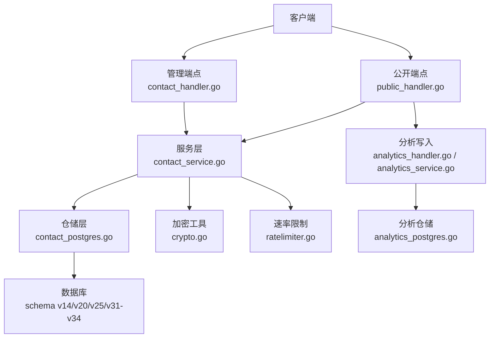
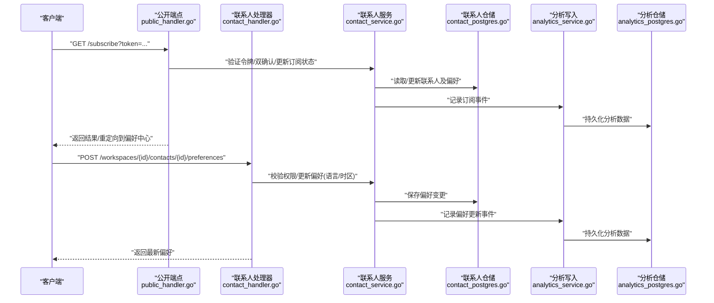
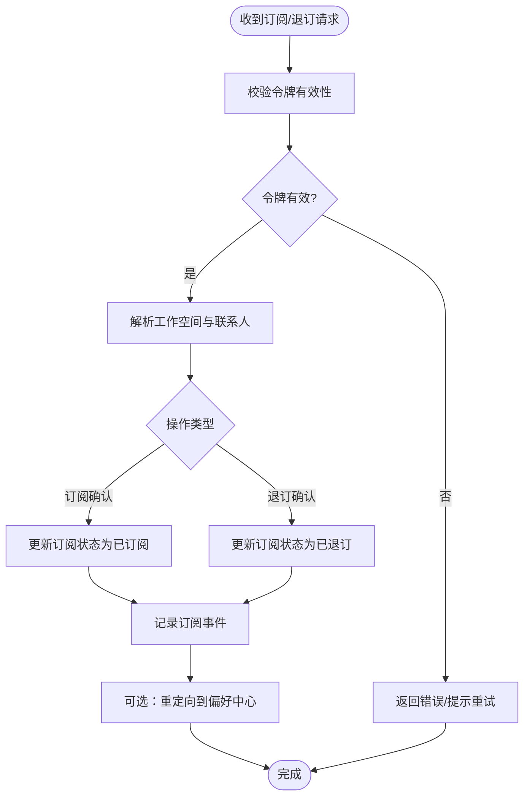
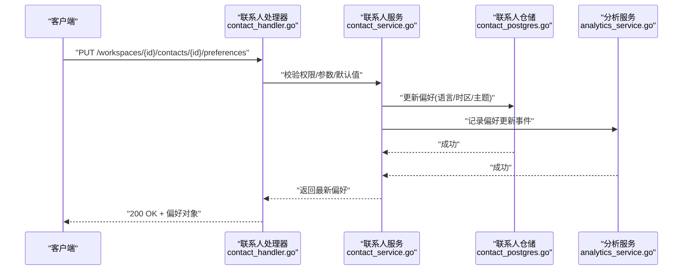
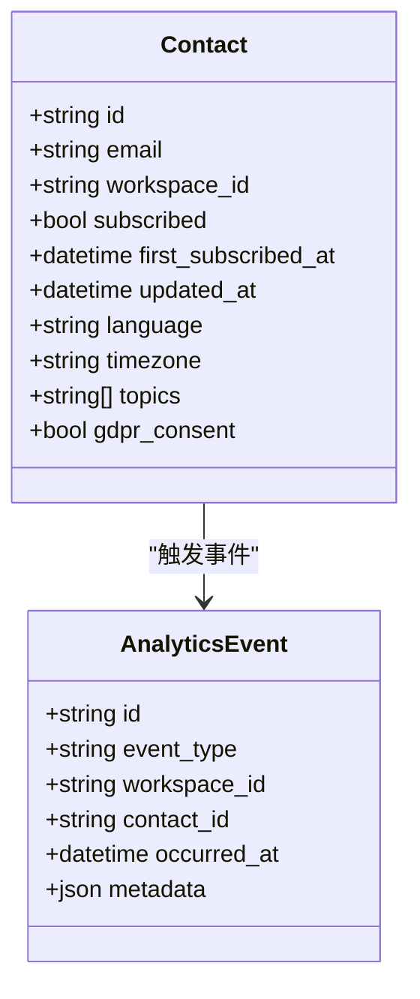
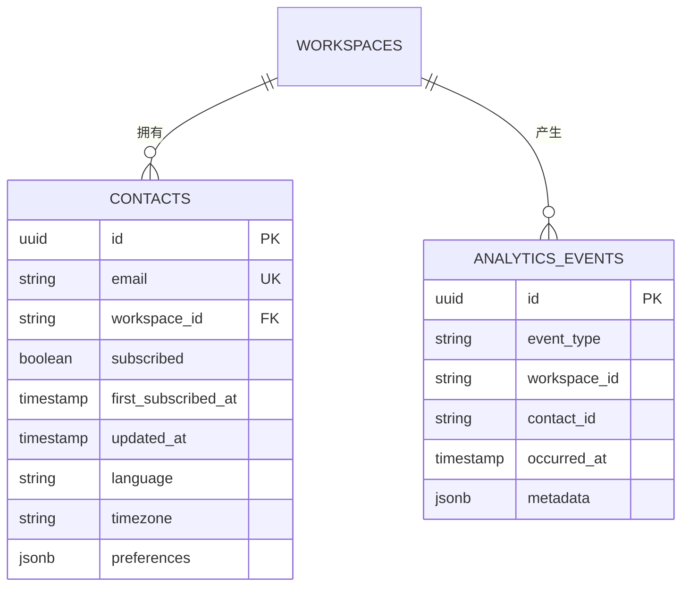
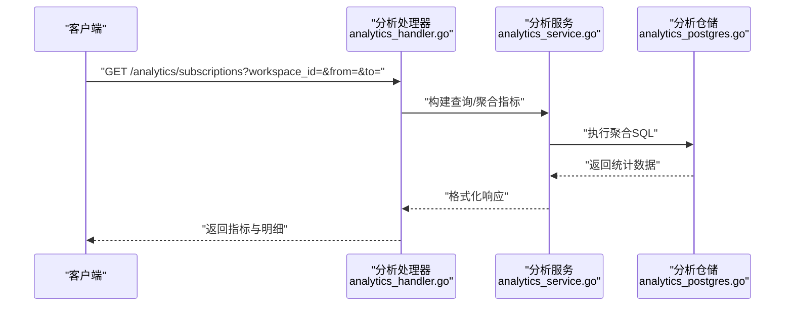
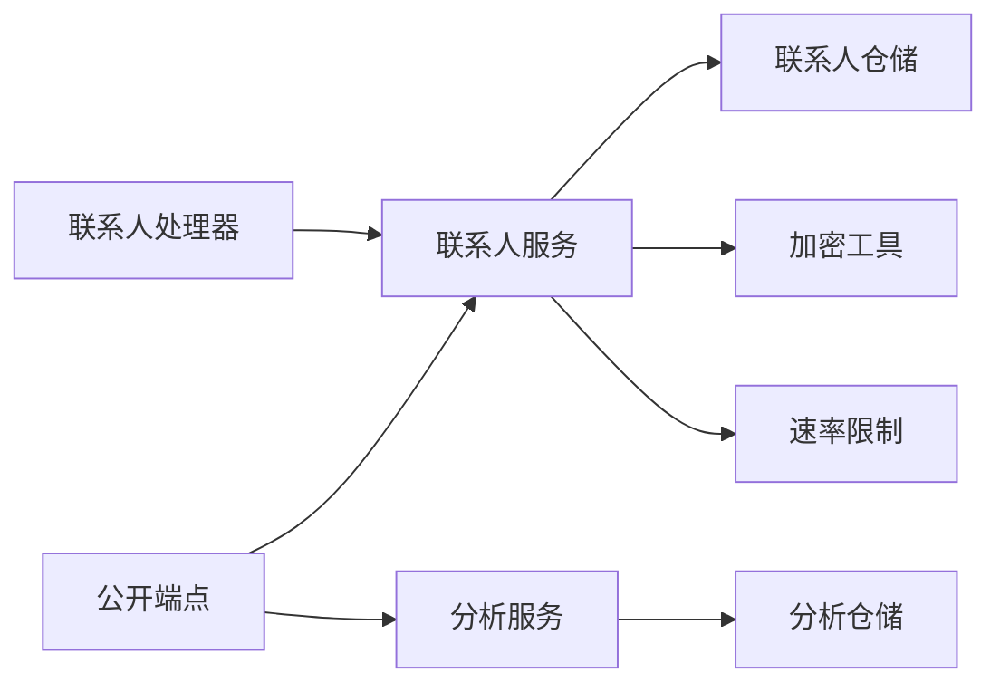

# 联系人订阅偏好API

<cite>
**本文引用的文件**   
- [openapi/paths/subscribe.yaml](file://notifuse/openapi/paths/subscribe.yaml)
- [openapi/paths/contacts.yaml](file://notifuse/openapi/paths/contacts.yaml)
- [internal/http/contact_handler.go](file://notifuse/internal/http/contact_handler.go)
- [internal/service/contact_service.go](file://notifuse/internal/service/contact_service.go)
- [internal/repository/contact_postgres.go](file://notifuse/internal/repository/contact_postgres.go)
- [internal/domain/contact.go](file://notifuse/internal/domain/contact.go)
- [internal/domain/timezones.go](file://notifuse/internal/domain/timezones.go)
- [internal/domain/languages.go](file://notifuse/internal/domain/languages.go)
- [internal/database/schema/v14.go](file://notifuse/internal/database/schema/v14.go)
- [internal/database/schema/v20.go](file://notifuse/internal/database/schema/v20.go)
- [internal/database/schema/v25.go](file://notifuse/internal/database/schema/v25.go)
- [internal/database/schema/v31.go](file://notifuse/internal/database/schema/v31.go)
- [internal/database/schema/v32.go](file://notifuse/internal/database/schema/v32.go)
- [internal/database/schema/v33.go](file://notifuse/internal/database/schema/v33.go)
- [internal/database/schema/v34.go](file://notifuse/internal/database/schema/v34.go)
- [pkg/crypto/crypto.go](file://notifuse/pkg/crypto/crypto.go)
- [pkg/ratelimiter/ratelimiter.go](file://notifuse/pkg/ratelimiter/ratelimiter.go)
- [internal/http/middleware/utils.go](file://notifuse/internal/http/middleware/utils.go)
- [internal/http/public_handler.go](file://notifuse/internal/http/public_handler.go)
- [internal/http/analytics_handler.go](file://notifuse/internal/http/analytics_handler.go)
- [internal/service/analytics_service.go](file://notifuse/internal/service/analytics_service.go)
- [internal/repository/analytics_postgres.go](file://notifuse/internal/repository/analytics_postgres.go)
- [internal/domain/analytics.go](file://notifuse/internal/domain/analytics.go)
</cite>

## 目录
1. [简介](#简介)
2. [项目结构](#项目结构)
3. [核心组件](#核心组件)
4. [架构总览](#架构总览)
5. [详细组件分析](#详细组件分析)
6. [依赖关系分析](#依赖关系分析)
7. [性能考虑](#性能考虑)
8. [故障排查指南](#故障排查指南)
9. [结论](#结论)
10. [附录](#附录) 

## 简介
本文件为 Notifuse 平台的“联系人订阅偏好管理”提供完整的 API 文档，覆盖以下能力：
- 订阅状态设置与取消订阅（含双确认流程）
- 订阅偏好配置接口（语言、时区、主题列表等）
- GDPR 合规处理、隐私保护机制与数据保留策略
- 退订链接生成与偏好中心页面集成
- 多语言支持、时区与文化适配的国际化说明
- 订阅统计、转化率分析与用户行为追踪的数据分析接口

## 项目结构
与订阅偏好相关的代码主要分布在以下模块：
- OpenAPI 规范定义：路径与请求/响应模型
- HTTP 层：路由与处理器
- 服务层：业务编排与校验
- 领域层：实体与常量（语言、时区等）
- 仓储层：PostgreSQL 持久化
- 数据库迁移：表结构与字段演进
- 安全与速率限制：签名、加密、限流
- 公共端点：公开访问的订阅/退订入口
- 分析层：事件记录与指标聚合

图表来源
- [internal/http/public_handler.go](file://notifuse/internal/http/public_handler.go)
- [internal/http/contact_handler.go](file://notifuse/internal/http/contact_handler.go)
- [internal/service/contact_service.go](file://notifuse/internal/service/contact_service.go)
- [internal/repository/contact_postgres.go](file://notifuse/internal/repository/contact_postgres.go)
- [internal/database/schema/v14.go](file://notifuse/internal/database/schema/v14.go)
- [internal/database/schema/v20.go](file://notifuse/internal/database/schema/v20.go)
- [internal/database/schema/v25.go](file://notifuse/internal/database/schema/v25.go)
- [internal/database/schema/v31.go](file://notifuse/internal/database/schema/v31.go)
- [internal/database/schema/v32.go](file://notifuse/internal/database/schema/v32.go)
- [internal/database/schema/v33.go](file://notifuse/internal/database/schema/v33.go)
- [internal/database/schema/v34.go](file://notifuse/internal/database/schema/v34.go)
- [pkg/crypto/crypto.go](file://notifuse/pkg/crypto/crypto.go)
- [pkg/ratelimiter/ratelimiter.go](file://notifuse/pkg/ratelimiter/ratelimiter.go)
- [internal/http/analytics_handler.go](file://notifuse/internal/http/analytics_handler.go)
- [internal/service/analytics_service.go](file://notifuse/internal/service/analytics_service.go)
- [internal/repository/analytics_postgres.go](file://notifuse/internal/repository/analytics_postgres.go)

章节来源
- [openapi/paths/subscribe.yaml](file://notifuse/openapi/paths/subscribe.yaml)
- [openapi/paths/contacts.yaml](file://notifuse/openapi/paths/contacts.yaml)

## 核心组件
- 公开订阅/退订入口：用于接收来自邮件或外部系统的订阅/退订请求，支持无鉴权访问。
- 联系人管理接口：用于工作空间内对联系人及其订阅偏好的增删改查。
- 服务层：负责参数校验、权限控制、GDPR 合规检查、双确认流程、偏好更新与分析事件埋点。
- 仓储层：负责联系人与订阅相关数据的持久化。
- 分析层：记录订阅/退订/打开/点击等行为，提供统计与转化分析。

章节来源
- [internal/http/public_handler.go](file://notifuse/internal/http/public_handler.go)
- [internal/http/contact_handler.go](file://notifuse/internal/http/contact_handler.go)
- [internal/service/contact_service.go](file://notifuse/internal/service/contact_service.go)
- [internal/repository/contact_postgres.go](file://notifuse/internal/repository/contact_postgres.go)
- [internal/http/analytics_handler.go](file://notifuse/internal/http/analytics_handler.go)
- [internal/service/analytics_service.go](file://notifuse/internal/service/analytics_service.go)
- [internal/repository/analytics_postgres.go](file://notifuse/internal/repository/analytics_postgres.go)

## 架构总览
下图展示了从公开端点到服务层、仓储层以及分析层的调用链，并体现安全与合规要点。

图表来源
- [internal/http/public_handler.go](file://notifuse/internal/http/public_handler.go)
- [internal/http/contact_handler.go](file://notifuse/internal/http/contact_handler.go)
- [internal/service/contact_service.go](file://notifuse/internal/service/contact_service.go)
- [internal/repository/contact_postgres.go](file://notifuse/internal/repository/contact_postgres.go)
- [internal/http/analytics_handler.go](file://notifuse/internal/http/analytics_handler.go)
- [internal/service/analytics_service.go](file://notifuse/internal/service/analytics_service.go)
- [internal/repository/analytics_postgres.go](file://notifuse/internal/repository/analytics_postgres.go)

## 详细组件分析

### 公开订阅/退订端点（无鉴权）
- 功能概述
  - 通过令牌进行订阅确认与退订，支持双确认流程。
  - 可携带语言与时区参数，实现偏好初始化。
  - 自动记录订阅/退订事件，供后续分析使用。
- 关键流程
  - 令牌校验与防重放
  - 权限与工作空间上下文解析
  - 订阅状态切换与偏好更新
  - 事件埋点与可选的重定向至偏好中心
- 安全与合规
  - 令牌签名校验与过期时间控制
  - 速率限制与反滥用
  - 最小化数据收集与可撤回同意

图表来源
- [internal/http/public_handler.go](file://notifuse/internal/http/public_handler.go)
- [internal/service/contact_service.go](file://notifuse/internal/service/contact_service.go)
- [pkg/crypto/crypto.go](file://notifuse/pkg/crypto/crypto.go)
- [pkg/ratelimiter/ratelimiter.go](file://notifuse/pkg/ratelimiter/ratelimiter.go)
- [internal/http/analytics_handler.go](file://notifuse/internal/http/analytics_handler.go)
- [internal/service/analytics_service.go](file://notifuse/internal/service/analytics_service.go)
- [internal/repository/analytics_postgres.go](file://notifuse/internal/repository/analytics_postgres.go)

章节来源
- [openapi/paths/subscribe.yaml](file://notifuse/openapi/paths/subscribe.yaml)
- [internal/http/public_handler.go](file://notifuse/internal/http/public_handler.go)
- [internal/service/contact_service.go](file://notifuse/internal/service/contact_service.go)
- [pkg/crypto/crypto.go](file://notifuse/pkg/crypto/crypto.go)
- [pkg/ratelimiter/ratelimiter.go](file://notifuse/pkg/ratelimiter/ratelimiter.go)
- [internal/http/analytics_handler.go](file://notifuse/internal/http/analytics_handler.go)
- [internal/service/analytics_service.go](file://notifuse/internal/service/analytics_service.go)
- [internal/repository/analytics_postgres.go](file://notifuse/internal/repository/analytics_postgres.go)

### 联系人偏好配置接口（需鉴权）
- 功能概述
  - 在工作空间范围内更新联系人的订阅偏好，包括语言、时区、主题列表等。
  - 支持批量更新与幂等性保证。
- 关键流程
  - 鉴权与工作空间隔离
  - 参数校验与默认值填充
  - 偏好更新与审计日志
  - 事件埋点与缓存失效
- 国际化与文化适配
  - 语言代码遵循 IETF BCP 47
  - 时区采用 IANA 标准
  - 文化相关格式（日期、数字）由前端渲染层处理

图表来源
- [internal/http/contact_handler.go](file://notifuse/internal/http/contact_handler.go)
- [internal/service/contact_service.go](file://notifuse/internal/service/contact_service.go)
- [internal/repository/contact_postgres.go](file://notifuse/internal/repository/contact_postgres.go)
- [internal/http/analytics_handler.go](file://notifuse/internal/http/analytics_handler.go)
- [internal/service/analytics_service.go](file://notifuse/internal/service/analytics_service.go)

章节来源
- [openapi/paths/contacts.yaml](file://notifuse/openapi/paths/contacts.yaml)
- [internal/http/contact_handler.go](file://notifuse/internal/http/contact_handler.go)
- [internal/service/contact_service.go](file://notifuse/internal/service/contact_service.go)
- [internal/repository/contact_postgres.go](file://notifuse/internal/repository/contact_postgres.go)
- [internal/domain/languages.go](file://notifuse/internal/domain/languages.go)
- [internal/domain/timezones.go](file://notifuse/internal/domain/timezones.go)

### 领域模型与数据结构
- 联系人实体
  - 标识符、邮箱、工作空间归属
  - 订阅状态、首次订阅时间、最后更新时间
  - 偏好：语言、时区、主题列表、同意标记
- 分析事件
  - 事件类型（订阅、退订、打开、点击、偏好更新）
  - 关联实体（联系人、工作空间、模板、渠道）
  - 时间戳与扩展属性

图表来源
- [internal/domain/contact.go](file://notifuse/internal/domain/contact.go)
- [internal/domain/analytics.go](file://notifuse/internal/domain/analytics.go)

章节来源
- [internal/domain/contact.go](file://notifuse/internal/domain/contact.go)
- [internal/domain/analytics.go](file://notifuse/internal/domain/analytics.go)

### 数据库模式与迁移
- 联系人表与索引
  - 主键、唯一约束（邮箱+工作空间）
  - 订阅状态与时间戳字段
  - 偏好字段（语言、时区、主题列表）
- 分析事件表
  - 事件类型、时间戳、元数据
  - 按工作空间与时间分区的查询优化
- 迁移版本
  - v14：基础联系人表与索引
  - v20：订阅状态与时间戳增强
  - v25：偏好字段扩展（语言、时区）
  - v31-v34：分析事件表与索引优化

图表来源
- [internal/database/schema/v14.go](file://notifuse/internal/database/schema/v14.go)
- [internal/database/schema/v20.go](file://notifuse/internal/database/schema/v20.go)
- [internal/database/schema/v25.go](file://notifuse/internal/database/schema/v25.go)
- [internal/database/schema/v31.go](file://notifuse/internal/database/schema/v31.go)
- [internal/database/schema/v32.go](file://notifuse/internal/database/schema/v32.go)
- [internal/database/schema/v33.go](file://notifuse/internal/database/schema/v33.go)
- [internal/database/schema/v34.go](file://notifuse/internal/database/schema/v34.go)

章节来源
- [internal/database/schema/v14.go](file://notifuse/internal/database/schema/v14.go)
- [internal/database/schema/v20.go](file://notifuse/internal/database/schema/v20.go)
- [internal/database/schema/v25.go](file://notifuse/internal/database/schema/v25.go)
- [internal/database/schema/v31.go](file://notifuse/internal/database/schema/v31.go)
- [internal/database/schema/v32.go](file://notifuse/internal/database/schema/v32.go)
- [internal/database/schema/v33.go](file://notifuse/internal/database/schema/v33.go)
- [internal/database/schema/v34.go](file://notifuse/internal/database/schema/v34.go)

### 安全与合规（GDPR、隐私、数据保留）
- 同意与撤回
  - 明确同意标记与时间戳
  - 支持随时撤回同意并立即生效
- 最小化与目的限定
  - 仅收集必要字段（邮箱、语言、时区、主题）
  - 分析事件去标识化与汇总
- 数据保留策略
  - 退订后保留最短必要时间用于审计与合规
  - 定期归档与清理策略
- 安全机制
  - 令牌签名与过期控制
  - 速率限制与异常检测
  - 传输加密与存储加密

章节来源
- [pkg/crypto/crypto.go](file://notifuse/pkg/crypto/crypto.go)
- [pkg/ratelimiter/ratelimiter.go](file://notifuse/pkg/ratelimiter/ratelimiter.go)
- [internal/domain/contact.go](file://notifuse/internal/domain/contact.go)
- [internal/domain/analytics.go](file://notifuse/internal/domain/analytics.go)

### 国际化与本地化
- 语言支持
  - 基于 IETF BCP 47 的语言代码
  - 默认语言回退策略
- 时区处理
  - 基于 IANA 时区数据库
  - 服务器统一 UTC 存储，前端按需转换
- 文化适配
  - 日期、数字、货币格式由前端根据语言/地区渲染
  - 内容模板支持变量替换与多语言资源

章节来源
- [internal/domain/languages.go](file://notifuse/internal/domain/languages.go)
- [internal/domain/timezones.go](file://notifuse/internal/domain/timezones.go)

### 数据分析接口（订阅统计、转化率、行为追踪）
- 事件采集
  - 订阅/退订、打开、点击、偏好更新
  - 事件元数据包含渠道、模板、来源等
- 指标聚合
  - 订阅率、退订率、打开率、点击率
  - 按工作空间、时间段、渠道维度聚合
- 查询与导出
  - 分页与过滤
  - 导出 CSV/JSON 供离线分析

图表来源
- [internal/http/analytics_handler.go](file://notifuse/internal/http/analytics_handler.go)
- [internal/service/analytics_service.go](file://notifuse/internal/service/analytics_service.go)
- [internal/repository/analytics_postgres.go](file://notifuse/internal/repository/analytics_postgres.go)

章节来源
- [internal/http/analytics_handler.go](file://notifuse/internal/http/analytics_handler.go)
- [internal/service/analytics_service.go](file://notifuse/internal/service/analytics_service.go)
- [internal/repository/analytics_postgres.go](file://notifuse/internal/repository/analytics_postgres.go)
- [internal/domain/analytics.go](file://notifuse/internal/domain/analytics.go)

## 依赖关系分析
- 组件耦合
  - 公开端点与服务层松耦合，通过接口传递上下文与结果
  - 服务层依赖仓储层进行数据持久化
  - 分析服务独立于联系人服务，通过事件解耦
- 外部依赖
  - 加密库用于令牌签名与校验
  - 速率限制器用于防滥用
  - PostgreSQL 作为主数据存储与分析聚合后端

图表来源
- [internal/http/public_handler.go](file://notifuse/internal/http/public_handler.go)
- [internal/http/contact_handler.go](file://notifuse/internal/http/contact_handler.go)
- [internal/service/contact_service.go](file://notifuse/internal/service/contact_service.go)
- [internal/repository/contact_postgres.go](file://notifuse/internal/repository/contact_postgres.go)
- [pkg/crypto/crypto.go](file://notifuse/pkg/crypto/crypto.go)
- [pkg/ratelimiter/ratelimiter.go](file://notifuse/pkg/ratelimiter/ratelimiter.go)
- [internal/http/analytics_handler.go](file://notifuse/internal/http/analytics_handler.go)
- [internal/service/analytics_service.go](file://notifuse/internal/service/analytics_service.go)
- [internal/repository/analytics_postgres.go](file://notifuse/internal/repository/analytics_postgres.go)

章节来源
- [internal/http/public_handler.go](file://notifuse/internal/http/public_handler.go)
- [internal/http/contact_handler.go](file://notifuse/internal/http/contact_handler.go)
- [internal/service/contact_service.go](file://notifuse/internal/service/contact_service.go)
- [internal/repository/contact_postgres.go](file://notifuse/internal/repository/contact_postgres.go)
- [pkg/crypto/crypto.go](file://notifuse/pkg/crypto/crypto.go)
- [pkg/ratelimiter/ratelimiter.go](file://notifuse/pkg/ratelimiter/ratelimiter.go)
- [internal/http/analytics_handler.go](file://notifuse/internal/http/analytics_handler.go)
- [internal/service/analytics_service.go](file://notifuse/internal/service/analytics_service.go)
- [internal/repository/analytics_postgres.go](file://notifuse/internal/repository/analytics_postgres.go)

## 性能考虑
- 连接池与事务
  - 合理配置数据库连接池大小
  - 将订阅状态更新与分析事件写入放入独立事务，避免长事务
- 索引与查询优化
  - 针对工作空间、邮箱、时间戳建立合适索引
  - 分析聚合查询使用物化视图或预计算表
- 缓存与一致性
  - 偏好读取可短期缓存，写操作后失效
  - 双确认令牌短生命周期，降低重放风险
- 异步与批处理
  - 分析事件写入可异步落盘，提升吞吐
  - 批量更新偏好时使用批量 SQL

[本节为通用性能建议，不直接分析具体文件]

## 故障排查指南
- 常见问题
  - 令牌无效或过期：检查签名算法、密钥与过期时间
  - 权限不足：确认工作空间与用户角色
  - 速率限制触发：检查客户端频率与限流阈值
  - 数据库连接失败：检查连接字符串与网络连通性
- 诊断步骤
  - 查看请求日志与链路追踪
  - 核对数据库迁移版本与当前 schema
  - 检查分析事件是否成功写入
- 恢复措施
  - 重置令牌并重试
  - 调整限流策略或扩容
  - 修复迁移脚本并重新应用

章节来源
- [internal/http/middleware/utils.go](file://notifuse/internal/http/middleware/utils.go)
- [internal/database/schema/v14.go](file://notifuse/internal/database/schema/v14.go)
- [internal/database/schema/v20.go](file://notifuse/internal/database/schema/v20.go)
- [internal/database/schema/v25.go](file://notifuse/internal/database/schema/v25.go)
- [internal/database/schema/v31.go](file://notifuse/internal/database/schema/v31.go)
- [internal/database/schema/v32.go](file://notifuse/internal/database/schema/v32.go)
- [internal/database/schema/v33.go](file://notifuse/internal/database/schema/v33.go)
- [internal/database/schema/v34.go](file://notifuse/internal/database/schema/v34.go)

## 结论
Notifuse 的联系人订阅偏好管理以清晰的层次化架构实现，涵盖公开端点与管理端点，结合安全与合规机制，提供完善的订阅/退订与偏好配置能力。通过事件驱动的分析体系，平台能够持续产出订阅统计与转化率指标，支撑精细化运营。建议在部署中关注数据库索引、连接池与缓存策略，确保高可用与高性能。

[本节为总结性内容，不直接分析具体文件]

## 附录
- 术语
  - 订阅：联系人选择接收特定主题或全部主题的通信
  - 退订：联系人撤销订阅，停止接收相关通信
  - 偏好：语言、时区、主题选择等个性化设置
  - 双确认：通过令牌二次确认，防止误操作与恶意订阅
- 参考
  - OpenAPI 规范：订阅与联系人路径定义
  - 领域模型：联系人与分析事件实体
  - 数据库迁移：各版本 schema 变更

[本节为补充信息，不直接分析具体文件]