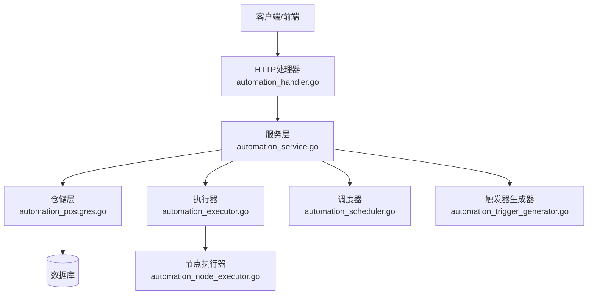
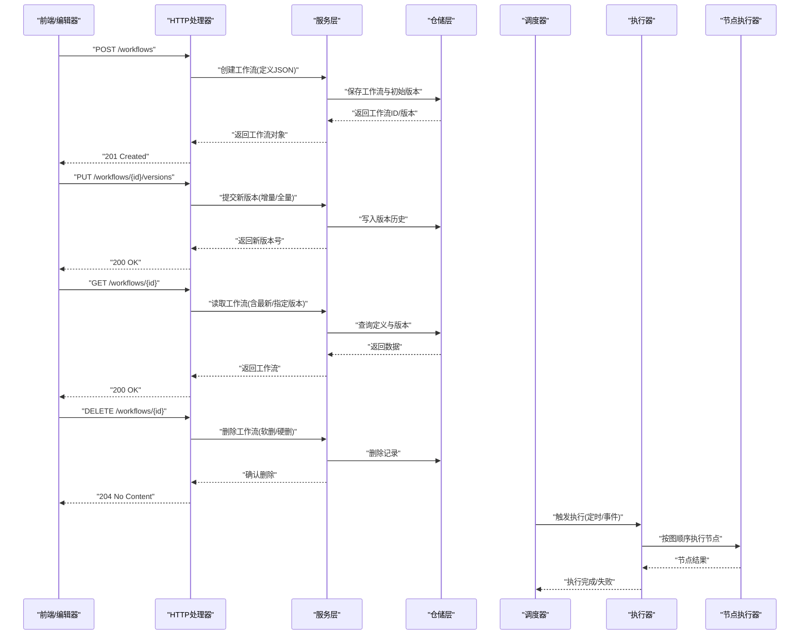
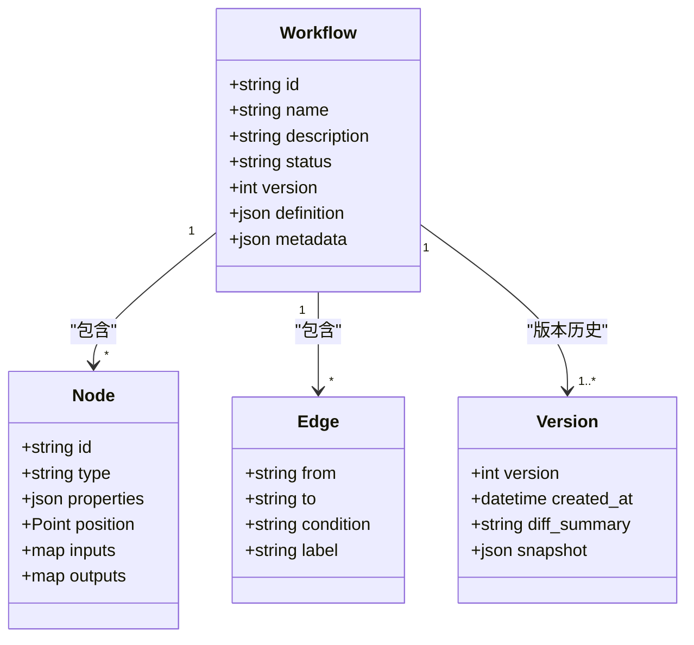
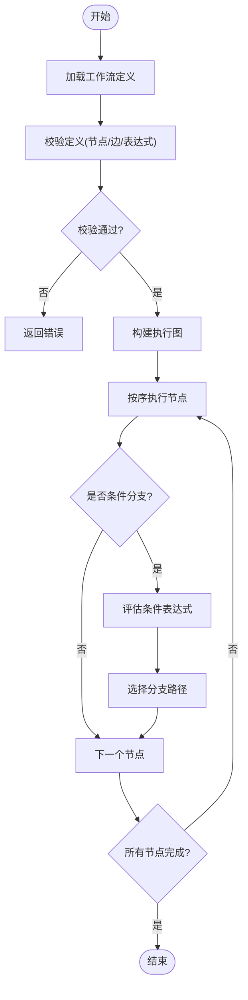
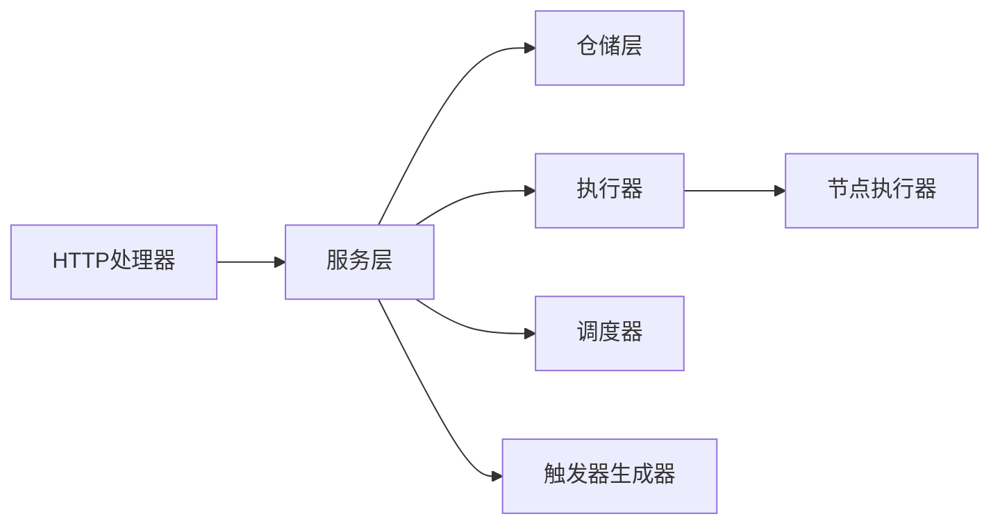

# 工作流设计API

<cite>
**本文档引用的文件**   
- [automation.go](file://notifuse/internal/domain/automation.go)
- [automation_handler.go](file://notifuse/internal/http/automation_handler.go)
- [automation_service.go](file://notifuse/internal/service/automation_service.go)
- [automation_postgres.go](file://notifuse/internal/repository/automation_postgres.go)
- [automation_executor.go](file://notifuse/internal/service/automation_executor.go)
- [automation_node_executor.go](file://notifuse/internal/service/automation_node_executor.go)
- [automation_scheduler.go](file://notifuse/internal/service/automation_scheduler.go)
- [automation_trigger_generator.go](file://notifuse/internal/service/automation_trigger_generator.go)
- [openapi.yaml](file://notifuse/openapi/openapi.yaml)
- [templates.yaml](file://notifuse/openapi/paths/templates.yaml)
</cite>

## 目录
1. [简介](#简介)
2. [项目结构](#项目结构)
3. [核心组件](#核心组件)
4. [架构总览](#架构总览)
5. [详细组件分析](#详细组件分析)
6. [依赖关系分析](#依赖关系分析)
7. [性能考虑](#性能考虑)
8. [故障排查指南](#故障排查指南)
9. [结论](#结论)
10. [附录](#附录)

## 简介
本文件面向“工作流设计API”的文档化目标，围绕自动化（工作流）的定义、版本管理、可视化编辑器交互数据模型、导入导出与模板复用机制进行系统化说明。内容覆盖：
- 工作流定义CRUD接口（创建、读取、更新、删除）
- 工作流JSON Schema结构与节点类型（触发器、条件分支、动作等）
- 边连接关系与流程图数据模型
- 可视化编辑器后端接口（拖拽、连线、属性配置的数据交换格式）
- 版本管理、导入导出与模板复用API规范
- 复杂嵌套工作流设计与动态节点生成示例

## 项目结构
本项目采用分层架构：HTTP层暴露REST API，服务层封装业务逻辑，仓储层对接数据库，领域层定义核心数据结构与规则。自动化（工作流）相关代码主要分布在以下目录：
- internal/domain：领域模型与枚举
- internal/http：HTTP处理器与路由绑定
- internal/service：工作流编排、调度、执行与触发器生成
- internal/repository：持久化实现（PostgreSQL）
- openapi：OpenAPI规范与路径定义

图表来源
- [automation_handler.go](file://notifuse/internal/http/automation_handler.go)
- [automation_service.go](file://notifuse/internal/service/automation_service.go)
- [automation_postgres.go](file://notifuse/internal/repository/automation_postgres.go)
- [automation_executor.go](file://notifuse/internal/service/automation_executor.go)
- [automation_scheduler.go](file://notifuse/internal/service/automation_scheduler.go)
- [automation_trigger_generator.go](file://notifuse/internal/service/automation_trigger_generator.go)
- [automation_node_executor.go](file://notifuse/internal/service/automation_node_executor.go)

章节来源
- [automation_handler.go](file://notifuse/internal/http/automation_handler.go)
- [automation_service.go](file://notifuse/internal/service/automation_service.go)
- [automation_postgres.go](file://notifuse/internal/repository/automation_postgres.go)
- [automation_executor.go](file://notifuse/internal/service/automation_executor.go)
- [automation_scheduler.go](file://notifuse/internal/service/automation_scheduler.go)
- [automation_trigger_generator.go](file://notifuse/internal/service/automation_trigger_generator.go)
- [automation_node_executor.go](file://notifuse/internal/service/automation_node_executor.go)

## 核心组件
- 领域模型（Domain）
  - 工作流实体：包含标识、名称、描述、状态、版本、定义（JSON）、元数据等字段
  - 节点与边：用于表示流程图中的节点类型、属性与连接关系
  - 版本信息：记录每次变更的版本号、时间戳与差异摘要
- 服务层（Service）
  - 工作流生命周期管理：创建、查询、更新、删除、启用/禁用、复制、版本切换
  - 导入导出：将工作流序列化为标准JSON并支持从JSON恢复
  - 模板复用：基于模板创建工作流或克隆已有工作流
  - 调度与执行：注册定时任务、事件驱动触发、按图执行节点
- 仓储层（Repository）
  - 持久化工作流定义、版本历史、关联资源
  - 提供事务性写入与并发控制（如乐观锁）
- 执行引擎（Executor & NodeExecutor）
  - 解析工作流图，遍历节点，调用具体节点执行器完成动作
  - 支持条件分支、循环、错误处理与重试策略

章节来源
- [automation.go](file://notifuse/internal/domain/automation.go)
- [automation_service.go](file://notifuse/internal/service/automation_service.go)
- [automation_postgres.go](file://notifuse/internal/repository/automation_postgres.go)
- [automation_executor.go](file://notifuse/internal/service/automation_executor.go)
- [automation_node_executor.go](file://notifuse/internal/service/automation_node_executor.go)

## 架构总览
下图展示了工作流设计API的整体架构与关键交互：

图表来源
- [automation_handler.go](file://notifuse/internal/http/automation_handler.go)
- [automation_service.go](file://notifuse/internal/service/automation_service.go)
- [automation_postgres.go](file://notifuse/internal/repository/automation_postgres.go)
- [automation_scheduler.go](file://notifuse/internal/service/automation_scheduler.go)
- [automation_executor.go](file://notifuse/internal/service/automation_executor.go)
- [automation_node_executor.go](file://notifuse/internal/service/automation_node_executor.go)

## 详细组件分析

### 工作流定义与JSON Schema
- 顶层字段
  - id：工作流唯一标识
  - name：名称
  - description：描述
  - status：状态（草稿、已发布、已禁用等）
  - version：当前版本号
  - definition：工作流图定义（JSON），包含nodes与edges
  - metadata：扩展元数据（标签、作者、环境等）
- 节点（nodes）
  - type：节点类型（trigger、condition、action、subflow、dynamic等）
  - id：节点唯一标识
  - position：在画布上的坐标（x, y）
  - properties：节点属性（因类型而异）
  - inputs/outputs：输入输出端口映射
- 边（edges）
  - from：源节点id
  - to：目标节点id
  - condition：可选条件表达式（用于条件分支）
  - label：边的显示标签
- 版本（versioning）
  - version：版本号（自增）
  - created_at：创建时间
  - diff_summary：变更摘要（文本）
  - snapshot：快照（可存储完整definition或增量diff）

建议的JSON Schema要点（概念性说明）：
- nodes数组中每个元素必须包含type、id、properties；position为可选但推荐
- edges数组中from与to必须存在且指向有效节点id
- condition表达式需遵循统一的表达式语言（例如简单布尔表达式）
- 子流程（subflow）引用外部工作流id，支持嵌套
- 动态节点（dynamic）通过运行时参数生成节点实例

章节来源
- [automation.go](file://notifuse/internal/domain/automation.go)

### 节点类型与执行语义
- 触发器（trigger）
  - 作用：作为工作流入口，响应外部事件或定时任务
  - 属性：事件类型、过滤条件、重试策略
- 条件分支（condition）
  - 作用：根据表达式选择不同分支
  - 属性：表达式、默认分支
- 动作（action）
  - 作用：执行具体操作（发送消息、调用API、写库等）
  - 属性：目标系统、参数映射、超时、重试
- 子流程（subflow）
  - 作用：复用其他工作流作为步骤
  - 属性：被引用工作流id、入参映射
- 动态节点（dynamic）
  - 作用：在运行时根据上下文生成节点实例
  - 属性：生成器函数、上下文变量、最大实例数

图表来源
- [automation.go](file://notifuse/internal/domain/automation.go)

章节来源
- [automation.go](file://notifuse/internal/domain/automation.go)

### 可视化编辑器后端接口
- 数据交换格式
  - 同步保存：前端提交完整definition（nodes+edges），后端校验并落盘
  - 增量同步：提交diff（新增/移动/删除节点与边），后端合并并生成新版本
  - 属性配置：针对选中节点的properties进行读写
- 典型请求
  - POST /workflows：创建工作流，携带definition
  - PUT /workflows/{id}：更新工作流（全量definition）
  - PATCH /workflows/{id}/diff：增量更新（diff）
  - GET /workflows/{id}：获取工作流及最新definition
  - GET /workflows/{id}/versions：列出版本
  - GET /workflows/{id}/versions/{v}：获取指定版本definition
  - DELETE /workflows/{id}：删除工作流
- 校验与约束
  - 节点id唯一性、无环检测、边连接合法性
  - 条件表达式语法校验
  - 子流程引用有效性检查

章节来源
- [automation_handler.go](file://notifuse/internal/http/automation_handler.go)
- [automation_service.go](file://notifuse/internal/service/automation_service.go)

### 版本管理与导入导出
- 版本管理
  - 每次提交生成新版本，保留历史快照
  - 支持回滚到指定版本（创建新版本的快照）
  - 并发控制：基于版本号或时间戳的乐观锁
- 导入导出
  - 导出：返回工作流的完整definition与元数据
  - 导入：接收definition并创建新工作流或合并到现有工作流
- 模板复用
  - 基于模板创建工作流（模板为只读的工作流定义）
  - 支持模板变量替换（如名称、描述、默认属性）

章节来源
- [automation_service.go](file://notifuse/internal/service/automation_service.go)
- [automation_postgres.go](file://notifuse/internal/repository/automation_postgres.go)

### 调度与执行
- 调度器
  - 定时任务：基于cron表达式注册周期执行
  - 事件驱动：监听外部事件触发工作流
- 执行器
  - 解析definition，构建执行图
  - 按拓扑顺序执行节点，处理分支与异常
- 节点执行器
  - 针对不同节点类型实现具体执行逻辑
  - 支持重试、超时、幂等性与日志追踪

图表来源
- [automation_executor.go](file://notifuse/internal/service/automation_executor.go)
- [automation_node_executor.go](file://notifuse/internal/service/automation_node_executor.go)
- [automation_scheduler.go](file://notifuse/internal/service/automation_scheduler.go)

章节来源
- [automation_executor.go](file://notifuse/internal/service/automation_executor.go)
- [automation_node_executor.go](file://notifuse/internal/service/automation_node_executor.go)
- [automation_scheduler.go](file://notifuse/internal/service/automation_scheduler.go)

### 触发器生成器
- 功能
  - 根据工作流定义自动生成触发器配置（如Webhook订阅、定时任务）
  - 维护触发器与工作流的映射关系
- 使用场景
  - 新建/更新工作流后自动注册触发器
  - 删除工作流时清理对应触发器

章节来源
- [automation_trigger_generator.go](file://notifuse/internal/service/automation_trigger_generator.go)

## 依赖关系分析
- 组件耦合
  - HTTP处理器依赖服务层，不直接访问仓储
  - 服务层组合仓储、执行器、调度器与触发器生成器
  - 执行器依赖节点执行器，节点执行器可扩展以支持新节点类型
- 外部依赖
  - 数据库：PostgreSQL（通过仓储层抽象）
  - 调度框架：内部调度器（可替换为外部任务队列）
  - 表达式引擎：用于条件分支评估

图表来源
- [automation_handler.go](file://notifuse/internal/http/automation_handler.go)
- [automation_service.go](file://notifuse/internal/service/automation_service.go)
- [automation_postgres.go](file://notifuse/internal/repository/automation_postgres.go)
- [automation_executor.go](file://notifuse/internal/service/automation_executor.go)
- [automation_scheduler.go](file://notifuse/internal/service/automation_scheduler.go)
- [automation_trigger_generator.go](file://notifuse/internal/service/automation_trigger_generator.go)
- [automation_node_executor.go](file://notifuse/internal/service/automation_node_executor.go)

章节来源
- [automation_handler.go](file://notifuse/internal/http/automation_handler.go)
- [automation_service.go](file://notifuse/internal/service/automation_service.go)
- [automation_postgres.go](file://notifuse/internal/repository/automation_postgres.go)
- [automation_executor.go](file://notifuse/internal/service/automation_executor.go)
- [automation_scheduler.go](file://notifuse/internal/service/automation_scheduler.go)
- [automation_trigger_generator.go](file://notifuse/internal/service/automation_trigger_generator.go)
- [automation_node_executor.go](file://notifuse/internal/service/automation_node_executor.go)

## 性能考虑
- 定义校验与图构建
  - 对大型definition进行增量校验与懒加载，避免一次性构建大图
- 版本快照
  - 大definition建议使用压缩存储与索引优化
- 执行性能
  - 节点执行器应支持并行执行无依赖节点
  - 引入缓存与批处理减少外部调用开销
- 调度器
  - 合理设置任务粒度与批大小，避免过多细粒度任务导致调度开销

## 故障排查指南
- 常见错误
  - 定义校验失败：检查节点id唯一性、边连接合法性、条件表达式语法
  - 版本冲突：提交前获取最新版本号，确保乐观锁一致
  - 执行失败：查看节点执行日志与重试次数，定位外部依赖问题
- 调试建议
  - 开启执行链路追踪，记录节点输入输出
  - 使用测试工作流验证复杂分支与动态节点生成逻辑
  - 对比版本diff快速定位变更影响范围

章节来源
- [automation_service.go](file://notifuse/internal/service/automation_service.go)
- [automation_executor.go](file://notifuse/internal/service/automation_executor.go)

## 结论
本工作流设计API通过清晰的领域模型与服务分层，提供了完整的CRUD、版本管理、导入导出与模板复用能力。结合可视化编辑器的数据交换格式，可实现高效的拖拽式工作流设计与实时协作。执行引擎与调度器保证了工作流的可靠运行与扩展性。建议在后续迭代中持续完善表达式引擎、节点类型生态与性能优化。

## 附录

### OpenAPI参考
- 全局规范与组件定义
  - [openapi.yaml](file://notifuse/openapi/openapi.yaml)
- 模板相关路径定义（可作为工作流模板复用的参考）
  - [templates.yaml](file://notifuse/openapi/paths/templates.yaml)

章节来源
- [openapi.yaml](file://notifuse/openapi/openapi.yaml)
- [templates.yaml](file://notifuse/openapi/paths/templates.yaml)