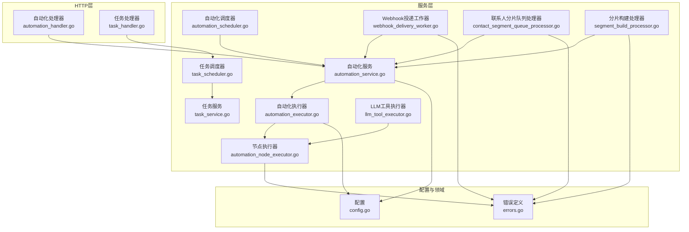
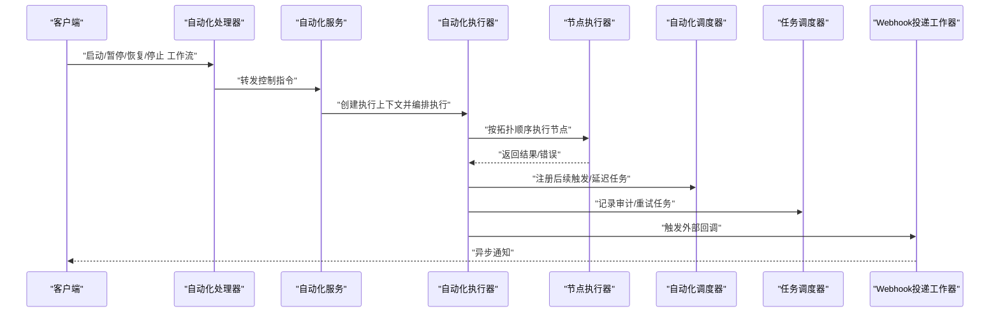
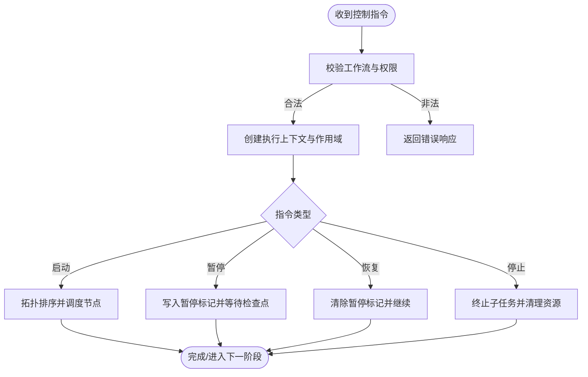
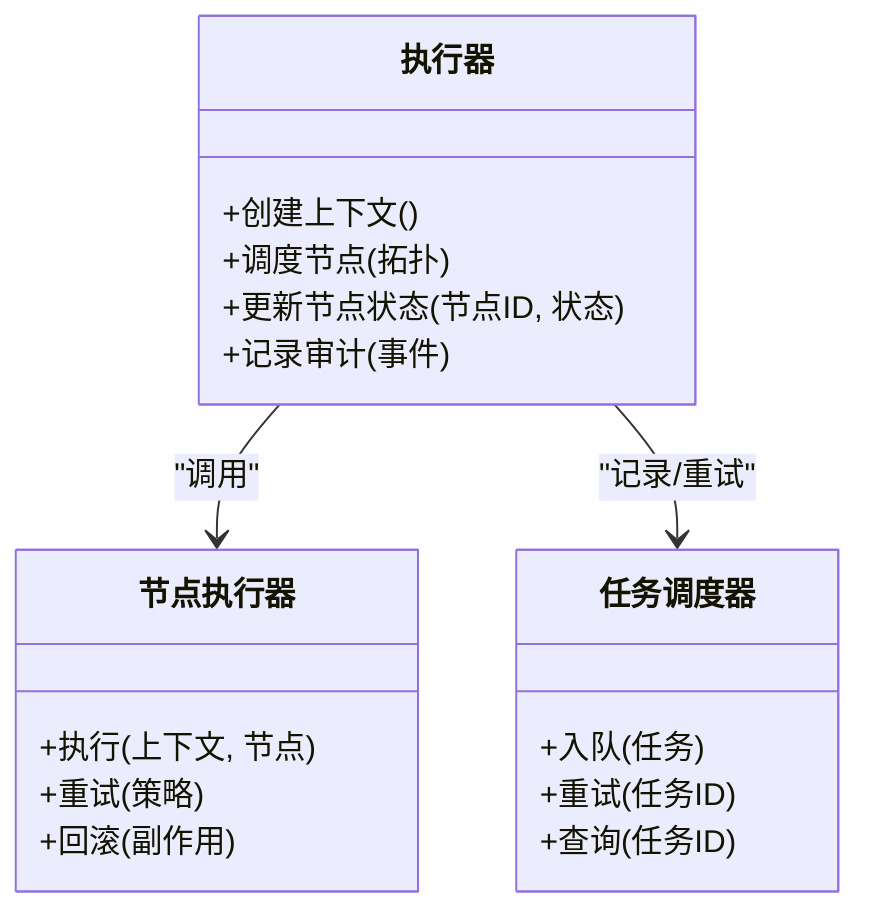
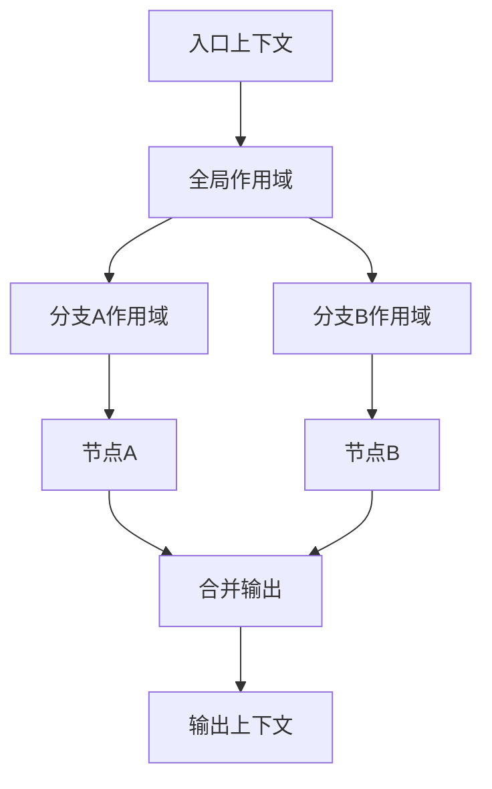
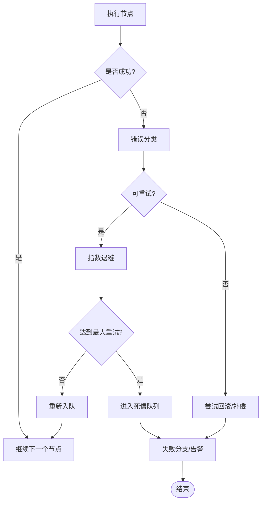
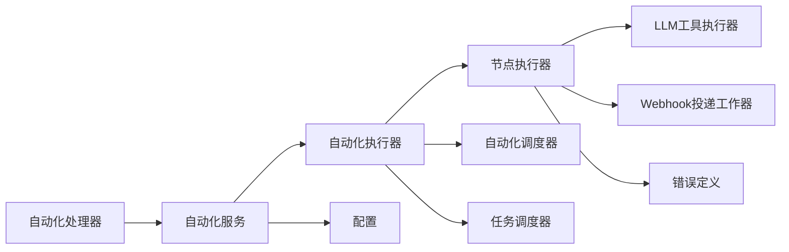

# 执行引擎API

<cite>
**本文引用的文件**   
- [automation_executor.go](file://notifuse/internal/service/automation_executor.go)
- [automation_node_executor.go](file://notifuse/internal/service/automation_node_executor.go)
- [automation_scheduler.go](file://notifuse/internal/service/automation_scheduler.go)
- [automation_service.go](file://notifuse/internal/service/automation_service.go)
- [task_scheduler.go](file://notifuse/internal/service/task_scheduler.go)
- [task_service.go](file://notifuse/internal/service/task_service.go)
- [webhook_delivery_worker.go](file://notifuse/internal/service/webhook_delivery_worker.go)
- [contact_segment_queue_processor.go](file://notifuse/internal/service/contact_segment_queue_processor.go)
- [segment_build_processor.go](file://notifuse/internal/service/segment_build_processor.go)
- [llm_tool_executor.go](file://notifuse/internal/service/llm_tool_executor.go)
- [automation_handler.go](file://notifuse/internal/http/automation_handler.go)
- [task_handler.go](file://notifuse/internal/http/task_handler.go)
- [config.go](file://notifuse/config/config.go)
- [errors.go](file://notifuse/internal/domain/errors.go)
</cite>

## 目录
1. [简介](#简介)
2. [项目结构](#项目结构)
3. [核心组件](#核心组件)
4. [架构总览](#架构总览)
5. [详细组件分析](#详细组件分析)
6. [依赖关系分析](#依赖关系分析)
7. [性能与并发控制](#性能与并发控制)
8. [错误处理、重试与回滚](#错误处理重试与回滚)
9. [日志、监控与调试](#日志监控与调试)
10. [最佳实践与复杂场景优化](#最佳实践与复杂场景优化)
11. [故障排查指南](#故障排查指南)
12. [结论](#结论)

## 简介
本文件面向“执行引擎API”的开发者与使用者，聚焦工作流（自动化）的执行生命周期控制（启动、暂停、恢复、停止）、节点执行状态跟踪、执行上下文传递与变量作用域管理、错误处理策略、重试机制与失败回滚流程，以及执行日志查询、性能监控指标和调试信息获取接口。同时提供并发执行控制、资源限制配置与超时管理的最佳实践，并给出在复杂业务场景下的执行模式选择与优化策略。

## 项目结构
该仓库采用分层组织：HTTP 层暴露控制器，服务层编排业务逻辑，调度器负责定时与队列任务，领域模型定义数据与错误类型，配置模块集中管理运行时参数。执行引擎相关能力主要分布在 internal/service 与 internal/http 下，并通过 config 进行参数化。

图表来源
- [automation_handler.go](file://notifuse/internal/http/automation_handler.go)
- [task_handler.go](file://notifuse/internal/http/task_handler.go)
- [automation_service.go](file://notifuse/internal/service/automation_service.go)
- [automation_executor.go](file://notifuse/internal/service/automation_executor.go)
- [automation_node_executor.go](file://notifuse/internal/service/automation_node_executor.go)
- [automation_scheduler.go](file://notifuse/internal/service/automation_scheduler.go)
- [task_scheduler.go](file://notifuse/internal/service/task_scheduler.go)
- [task_service.go](file://notifuse/internal/service/task_service.go)
- [webhook_delivery_worker.go](file://notifuse/internal/service/webhook_delivery_worker.go)
- [contact_segment_queue_processor.go](file://notifuse/internal/service/contact_segment_queue_processor.go)
- [segment_build_processor.go](file://notifuse/internal/service/segment_build_processor.go)
- [llm_tool_executor.go](file://notifuse/internal/service/llm_tool_executor.go)
- [config.go](file://notifuse/config/config.go)
- [errors.go](file://notifuse/internal/domain/errors.go)

章节来源
- [automation_handler.go](file://notifuse/internal/http/automation_handler.go)
- [task_handler.go](file://notifuse/internal/http/task_handler.go)
- [automation_service.go](file://notifuse/internal/service/automation_service.go)
- [automation_executor.go](file://notifuse/internal/service/automation_executor.go)
- [automation_node_executor.go](file://notifuse/internal/service/automation_node_executor.go)
- [automation_scheduler.go](file://notifuse/internal/service/automation_scheduler.go)
- [task_scheduler.go](file://notifuse/internal/service/task_scheduler.go)
- [task_service.go](file://notifuse/internal/service/task_service.go)
- [webhook_delivery_worker.go](file://notifuse/internal/service/webhook_delivery_worker.go)
- [contact_segment_queue_processor.go](file://notifuse/internal/service/contact_segment_queue_processor.go)
- [segment_build_processor.go](file://notifuse/internal/service/segment_build_processor.go)
- [llm_tool_executor.go](file://notifuse/internal/service/llm_tool_executor.go)
- [config.go](file://notifuse/config/config.go)
- [errors.go](file://notifuse/internal/domain/errors.go)

## 核心组件
- 自动化服务（Automation Service）：对外暴露工作流的生命周期控制（启动、暂停、恢复、停止），协调执行器与调度器，维护执行实例与状态。
- 自动化执行器（Automation Executor）：负责任务图解析、拓扑排序、并行度控制、上下文传播、变量作用域管理与结果汇聚。
- 节点执行器（Node Executor）：封装具体节点类型的执行逻辑（如 Webhook、LLM 工具等），统一错误与重试语义。
- 自动化调度器（Automation Scheduler）：基于触发器或定时计划驱动工作流启动，支持延迟与周期性执行。
- 任务调度器与服务（Task Scheduler & Service）：通用后台任务调度与持久化，支撑工作流的重试、补偿与审计。
- Webhook 投递工作器（Webhook Delivery Worker）：异步发送外部回调，具备独立的重试与退避策略。
- 分片与队列处理器（Segment Build / Contact Segment Queue）：批量数据处理流水线，体现高吞吐与背压控制。
- LLM 工具执行器（LLM Tool Executor）：将大模型调用作为可编排节点纳入工作流。

章节来源
- [automation_service.go](file://notifuse/internal/service/automation_service.go)
- [automation_executor.go](file://notifuse/internal/service/automation_executor.go)
- [automation_node_executor.go](file://notifuse/internal/service/automation_node_executor.go)
- [automation_scheduler.go](file://notifuse/internal/service/automation_scheduler.go)
- [task_scheduler.go](file://notifuse/internal/service/task_scheduler.go)
- [task_service.go](file://notifuse/internal/service/task_service.go)
- [webhook_delivery_worker.go](file://notifuse/internal/service/webhook_delivery_worker.go)
- [contact_segment_queue_processor.go](file://notifuse/internal/service/contact_segment_queue_processor.go)
- [segment_build_processor.go](file://notifuse/internal/service/segment_build_processor.go)
- [llm_tool_executor.go](file://notifuse/internal/service/llm_tool_executor.go)

## 架构总览
下图展示从 HTTP 请求到执行引擎内部调度的关键路径，包括生命周期控制、节点执行、重试与回调。

图表来源
- [automation_handler.go](file://notifuse/internal/http/automation_handler.go)
- [automation_service.go](file://notifuse/internal/service/automation_service.go)
- [automation_executor.go](file://notifuse/internal/service/automation_executor.go)
- [automation_node_executor.go](file://notifuse/internal/service/automation_node_executor.go)
- [automation_scheduler.go](file://notifuse/internal/service/automation_scheduler.go)
- [task_scheduler.go](file://notifuse/internal/service/task_scheduler.go)
- [webhook_delivery_worker.go](file://notifuse/internal/service/webhook_delivery_worker.go)

## 详细组件分析

### 工作流生命周期控制（启动、暂停、恢复、停止）
- 启动：通过 HTTP 处理器接收启动请求，服务层校验权限与工作流定义，执行器初始化执行上下文（包含工作流ID、租户/工作区、追踪ID、输入变量与作用域），并按拓扑顺序调度节点。
- 暂停：对运行中的执行实例写入暂停标记，执行器在节点边界检查暂停信号，安全挂起当前节点后等待恢复。
- 恢复：清除暂停标记，从最近检查点继续执行；若节点不可恢复，则根据策略重新入队或终止。
- 停止：立即终止所有子任务与并发分支，清理临时资源，记录最终状态为“已停止”。

图表来源
- [automation_handler.go](file://notifuse/internal/http/automation_handler.go)
- [automation_service.go](file://notifuse/internal/service/automation_service.go)
- [automation_executor.go](file://notifuse/internal/service/automation_executor.go)

章节来源
- [automation_handler.go](file://notifuse/internal/http/automation_handler.go)
- [automation_service.go](file://notifuse/internal/service/automation_service.go)
- [automation_executor.go](file://notifuse/internal/service/automation_executor.go)

### 节点执行状态跟踪
- 每个节点在执行前、执行中、执行后均更新状态（待执行、运行中、成功、失败、跳过、取消）。
- 执行器维护节点级元数据：开始/结束时间、耗时、重试次数、错误码与消息、输出摘要。
- 状态变更持久化至任务表，供查询与审计。

图表来源
- [automation_executor.go](file://notifuse/internal/service/automation_executor.go)
- [automation_node_executor.go](file://notifuse/internal/service/automation_node_executor.go)
- [task_scheduler.go](file://notifuse/internal/service/task_scheduler.go)

章节来源
- [automation_executor.go](file://notifuse/internal/service/automation_executor.go)
- [automation_node_executor.go](file://notifuse/internal/service/automation_node_executor.go)
- [task_scheduler.go](file://notifuse/internal/service/task_scheduler.go)

### 执行上下文传递与变量作用域管理
- 执行上下文贯穿整个工作流，包含：工作流标识、租户/工作区、追踪ID、用户身份、输入参数、环境变量、系统变量。
- 变量作用域分层：全局作用域（工作流级别）、分支作用域（并行分支隔离）、节点作用域（仅当前节点可见）。
- 上下文在节点间以只读方式传递，节点可通过“输出映射”将结果写入父作用域或子作用域，避免污染。

图表来源
- [automation_executor.go](file://notifuse/internal/service/automation_executor.go)
- [automation_node_executor.go](file://notifuse/internal/service/automation_node_executor.go)

章节来源
- [automation_executor.go](file://notifuse/internal/service/automation_executor.go)
- [automation_node_executor.go](file://notifuse/internal/service/automation_node_executor.go)

### 错误处理策略、重试机制与失败回滚
- 错误分类：可重试错误（网络抖动、限流）、不可重试错误（参数错误、权限不足）、业务异常（条件不满足）。
- 重试策略：指数退避、最大重试次数、死信队列；不同节点类型可配置差异化策略。
- 回滚机制：对具有副作用的节点（如写库、调用外部系统）提供补偿操作；若无法补偿，则标记失败并告警。
- 失败分支：工作流定义可指定失败路径，实现优雅降级与人工介入。

图表来源
- [automation_node_executor.go](file://notifuse/internal/service/automation_node_executor.go)
- [webhook_delivery_worker.go](file://notifuse/internal/service/webhook_delivery_worker.go)
- [task_scheduler.go](file://notifuse/internal/service/task_scheduler.go)
- [errors.go](file://notifuse/internal/domain/errors.go)

章节来源
- [automation_node_executor.go](file://notifuse/internal/service/automation_node_executor.go)
- [webhook_delivery_worker.go](file://notifuse/internal/service/webhook_delivery_worker.go)
- [task_scheduler.go](file://notifuse/internal/service/task_scheduler.go)
- [errors.go](file://notifuse/internal/domain/errors.go)

### 执行日志查询、性能监控指标与调试信息
- 执行日志：按工作流ID、节点ID、时间范围过滤，支持分页与关键字检索。
- 性能指标：节点耗时分布、成功率、重试次数、队列积压、吞吐与延迟。
- 调试信息：上下文快照、变量作用域树、依赖图可视化、断点式单步执行（开发环境）。

章节来源
- [automation_executor.go](file://notifuse/internal/service/automation_executor.go)
- [task_scheduler.go](file://notifuse/internal/service/task_scheduler.go)

### 并发执行控制、资源限制与超时管理
- 并发控制：全局并发度、分支并发度、节点级并发度；通过令牌桶或信号量限制。
- 资源限制：CPU/内存配额、外部API速率限制、数据库连接池大小。
- 超时管理：节点级超时、工作流级超时、I/O 超时与心跳保活。

章节来源
- [automation_executor.go](file://notifuse/internal/service/automation_executor.go)
- [config.go](file://notifuse/config/config.go)

### 复杂业务场景的执行模式选择与优化
- 批处理模式：大批量数据使用分片构建与队列处理器，结合背压与限速提升吞吐。
- 实时模式：低延迟触发与快速失败，减少重试与回滚成本。
- 混合模式：主流程实时、辅助任务异步，利用任务调度器解耦。

章节来源
- [contact_segment_queue_processor.go](file://notifuse/internal/service/contact_segment_queue_processor.go)
- [segment_build_processor.go](file://notifuse/internal/service/segment_build_processor.go)
- [automation_scheduler.go](file://notifuse/internal/service/automation_scheduler.go)

## 依赖关系分析
执行引擎各组件之间的耦合与协作如下：

图表来源
- [automation_handler.go](file://notifuse/internal/http/automation_handler.go)
- [automation_service.go](file://notifuse/internal/service/automation_service.go)
- [automation_executor.go](file://notifuse/internal/service/automation_executor.go)
- [automation_node_executor.go](file://notifuse/internal/service/automation_node_executor.go)
- [automation_scheduler.go](file://notifuse/internal/service/automation_scheduler.go)
- [task_scheduler.go](file://notifuse/internal/service/task_scheduler.go)
- [llm_tool_executor.go](file://notifuse/internal/service/llm_tool_executor.go)
- [webhook_delivery_worker.go](file://notifuse/internal/service/webhook_delivery_worker.go)
- [config.go](file://notifuse/config/config.go)
- [errors.go](file://notifuse/internal/domain/errors.go)

章节来源
- [automation_handler.go](file://notifuse/internal/http/automation_handler.go)
- [automation_service.go](file://notifuse/internal/service/automation_service.go)
- [automation_executor.go](file://notifuse/internal/service/automation_executor.go)
- [automation_node_executor.go](file://notifuse/internal/service/automation_node_executor.go)
- [automation_scheduler.go](file://notifuse/internal/service/automation_scheduler.go)
- [task_scheduler.go](file://notifuse/internal/service/task_scheduler.go)
- [llm_tool_executor.go](file://notifuse/internal/service/llm_tool_executor.go)
- [webhook_delivery_worker.go](file://notifuse/internal/service/webhook_delivery_worker.go)
- [config.go](file://notifuse/config/config.go)
- [errors.go](file://notifuse/internal/domain/errors.go)

## 性能与并发控制
- 建议设置合理的节点并发度，避免下游系统过载；对 I/O 密集型节点提高并发，CPU 密集型节点降低并发。
- 使用指数退避与抖动避免雪崩；对热点外部服务实施熔断与限流。
- 对长耗时任务启用异步与分片，结合任务调度器的重试与补偿。
- 监控关键指标：P95/P99 延迟、错误率、重试率、队列深度、资源利用率。

[本节为通用指导，无需特定文件引用]

## 错误处理、重试与回滚
- 明确区分可重试与不可重试错误，避免无效重试造成放大效应。
- 对幂等性差的节点引入去重键与幂等校验。
- 回滚应最小化影响面，优先采用补偿而非全量撤销。
- 建立告警与人工介入通道，确保关键路径失败可被及时处置。

章节来源
- [automation_node_executor.go](file://notifuse/internal/service/automation_node_executor.go)
- [webhook_delivery_worker.go](file://notifuse/internal/service/webhook_delivery_worker.go)
- [task_scheduler.go](file://notifuse/internal/service/task_scheduler.go)
- [errors.go](file://notifuse/internal/domain/errors.go)

## 日志、监控与调试
- 结构化日志：包含工作流ID、节点ID、追踪ID、耗时、错误码与消息。
- 指标上报：节点执行时长、成功率、重试次数、失败原因分布。
- 调试工具：上下文快照导出、依赖图渲染、慢查询定位。

章节来源
- [automation_executor.go](file://notifuse/internal/service/automation_executor.go)
- [task_scheduler.go](file://notifuse/internal/service/task_scheduler.go)

## 最佳实践与复杂场景优化
- 设计幂等节点：确保重试不会导致重复副作用。
- 合理划分作用域：避免变量污染，提升可测试性与可维护性。
- 分层超时：节点级短超时 + 工作流级长超时，配合心跳保活。
- 灰度与回滚：新版本工作流灰度发布，失败自动回滚到稳定版本。
- 容量规划：依据峰值QPS与平均耗时估算并发度与资源配额。

[本节为通用指导，无需特定文件引用]

## 故障排查指南
- 常见问题：
  - 工作流未启动：检查触发器与权限、工作流定义有效性。
  - 节点频繁失败：查看错误分类与重试策略，确认外部依赖健康。
  - 超时过多：调整节点与工作流超时，优化慢查询与外部调用。
  - 资源耗尽：降低并发度、扩容资源、启用背压。
- 诊断步骤：
  - 通过工作流ID与节点ID检索日志与指标。
  - 导出上下文快照与作用域树，定位变量问题。
  - 复现最小用例，逐步缩小范围。

章节来源
- [automation_handler.go](file://notifuse/internal/http/automation_handler.go)
- [automation_executor.go](file://notifuse/internal/service/automation_executor.go)
- [task_scheduler.go](file://notifuse/internal/service/task_scheduler.go)

## 结论
执行引擎API围绕工作流生命周期控制、节点执行与状态跟踪、上下文与作用域管理、错误与重试回滚、日志监控与调试、并发与资源控制等方面提供了完整能力。通过合理的模式选择与优化策略，可在复杂业务场景中实现高可靠、高性能与易维护的执行体系。