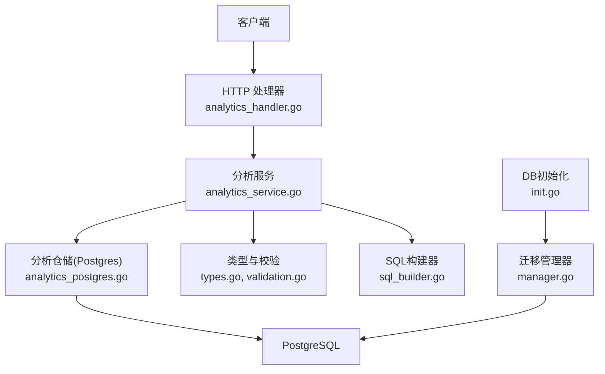
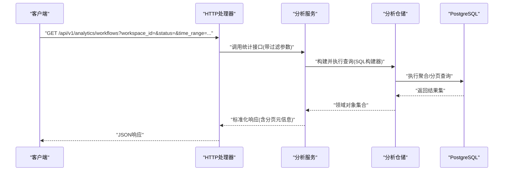
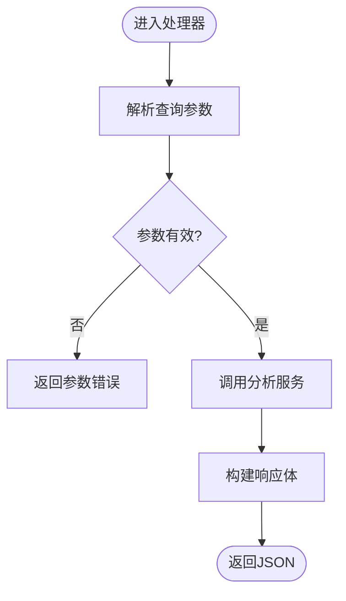
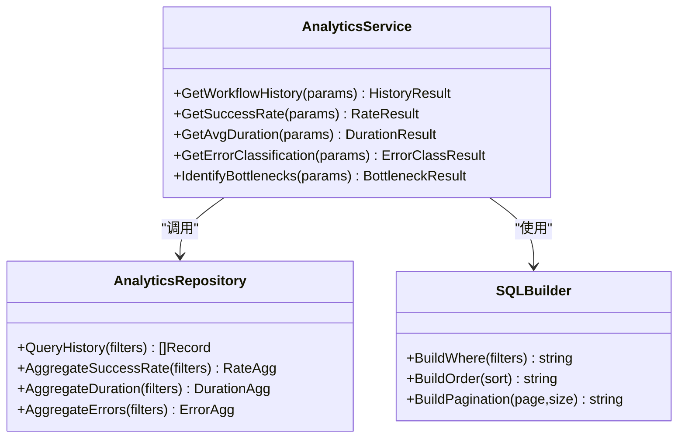
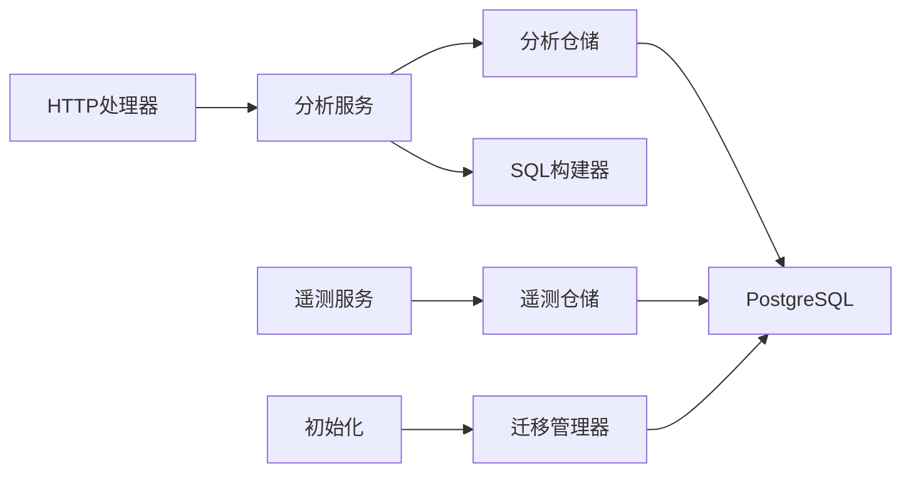
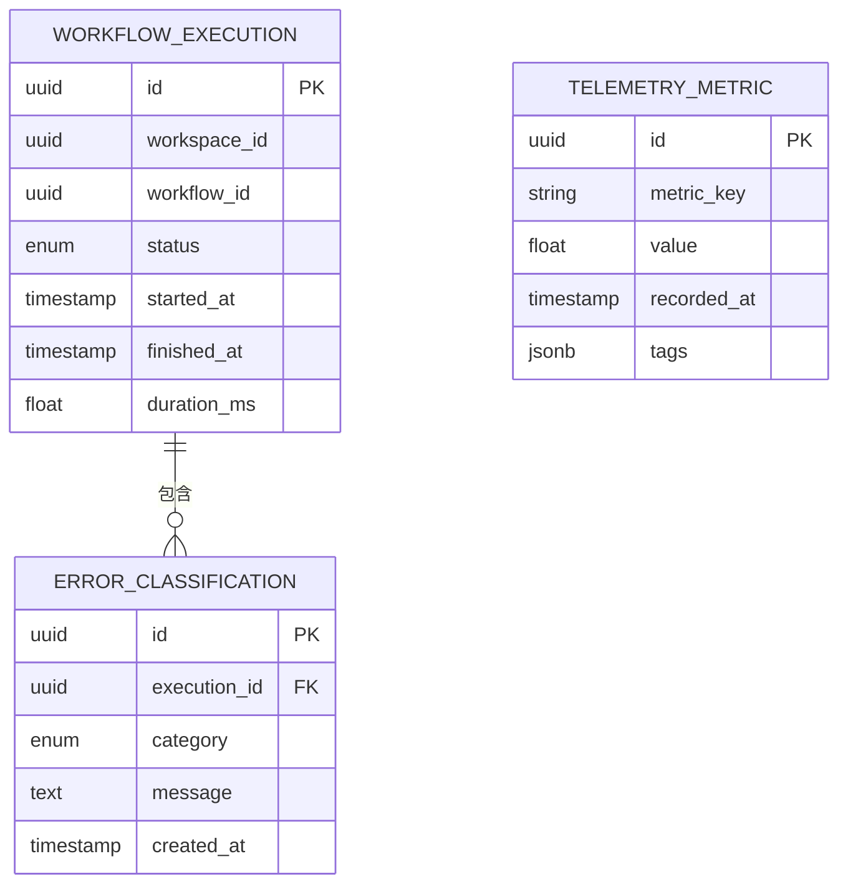

# 监控分析API

<cite>
**本文引用的文件**   
- [internal/http/analytics_handler.go](file://notifuse/internal/http/analytics_handler.go)
- [internal/service/analytics_service.go](file://notifuse/internal/service/analytics_service.go)
- [internal/repository/analytics_postgres.go](file://notifuse/internal/repository/analytics_postgres.go)
- [pkg/analytics/types.go](file://notifuse/pkg/analytics/types.go)
- [pkg/analytics/sql_builder.go](file://notifuse/pkg/analytics/sql_builder.go)
- [pkg/analytics/validation.go](file://notifuse/pkg/analytics/validation.go)
- [internal/database/init.go](file://notifuse/internal/database/init.go)
- [internal/migrations/manager.go](file://notifuse/internal/migrations/manager.go)
- [internal/domain/analytics.go](file://notifuse/internal/domain/analytics.go)
- [internal/service/telemetry_service.go](file://notifuse/internal/service/telemetry_service.go)
- [internal/repository/telemetry_postgres.go](file://notifuse/internal/repository/telemetry_postgres.go)
- [internal/domain/telemetry.go](file://notifuse/internal/domain/telemetry.go)
- [openapi/openapi.yaml](file://notifuse/openapi/openapi.yaml)
</cite>

## 目录
1. [简介](#简介)
2. [项目结构](#项目结构)
3. [核心组件](#核心组件)
4. [架构总览](#架构总览)
5. [详细组件分析](#详细组件分析)
6. [依赖分析](#依赖分析)
7. [性能考虑](#性能考虑)
8. [故障排查指南](#故障排查指南)
9. [结论](#结论)
10. [附录](#附录)

## 简介
本文件面向“自动化工作流监控分析API”的开发者与运维人员，系统化说明以下能力：
- 工作流执行历史查询、成功率统计、平均执行时间等监控指标接口
- 执行日志检索、错误分类统计与性能瓶颈识别方法
- 实时执行状态监控、告警规则配置与通知推送机制
- 自定义报表生成、数据导出与第三方监控系统集成规范
- 监控数据存储策略、查询优化与历史数据归档管理指南

该文档以代码仓库中的监控与分析相关实现为依据，提供从HTTP层到服务层、仓储层与数据库迁移的全链路说明，并辅以架构图与时序图帮助理解。

## 项目结构
监控分析能力主要分布在如下模块：
- HTTP处理层：负责路由、参数校验、响应封装
- 服务层：聚合业务逻辑、编排查询与计算
- 仓储层：PostgreSQL访问与SQL构建
- 领域模型与类型定义：统一数据结构与约束
- 迁移与初始化：表结构与索引创建
- OpenAPI规范：对外接口契约

图表来源
- [internal/http/analytics_handler.go](file://notifuse/internal/http/analytics_handler.go)
- [internal/service/analytics_service.go](file://notifuse/internal/service/analytics_service.go)
- [internal/repository/analytics_postgres.go](file://notifuse/internal/repository/analytics_postgres.go)
- [pkg/analytics/types.go](file://notifuse/pkg/analytics/types.go)
- [pkg/analytics/sql_builder.go](file://notifuse/pkg/analytics/sql_builder.go)
- [internal/database/init.go](file://notifuse/internal/database/init.go)
- [internal/migrations/manager.go](file://notifuse/internal/migrations/manager.go)

章节来源
- [internal/http/analytics_handler.go](file://notifuse/internal/http/analytics_handler.go)
- [internal/service/analytics_service.go](file://notifuse/internal/service/analytics_service.go)
- [internal/repository/analytics_postgres.go](file://notifuse/internal/repository/analytics_postgres.go)
- [pkg/analytics/types.go](file://notifuse/pkg/analytics/types.go)
- [pkg/analytics/sql_builder.go](file://notifuse/pkg/analytics/sql_builder.go)
- [internal/database/init.go](file://notifuse/internal/database/init.go)
- [internal/migrations/manager.go](file://notifuse/internal/migrations/manager.go)

## 核心组件
- HTTP处理器：暴露监控分析REST端点，解析查询参数，调用服务层，返回结构化结果
- 分析服务：组合多种查询与统计逻辑（成功率、耗时分布、错误分类），协调SQL构建与分页
- 分析仓储：基于PostgreSQL执行查询，使用SQL构建器拼装条件与排序
- 类型与校验：定义请求/响应模型、枚举与字段校验规则
- 迁移与初始化：确保监控相关表与索引存在，支持版本演进
- 遥测服务与仓储：采集系统级指标（CPU、内存、队列长度等），供监控大盘展示

章节来源
- [internal/http/analytics_handler.go](file://notifuse/internal/http/analytics_handler.go)
- [internal/service/analytics_service.go](file://notifuse/internal/service/analytics_service.go)
- [internal/repository/analytics_postgres.go](file://notifuse/internal/repository/analytics_postgres.go)
- [pkg/analytics/types.go](file://notifuse/pkg/analytics/types.go)
- [pkg/analytics/validation.go](file://notifuse/pkg/analytics/validation.go)
- [internal/database/init.go](file://notifuse/internal/database/init.go)
- [internal/migrations/manager.go](file://notifuse/internal/migrations/manager.go)
- [internal/service/telemetry_service.go](file://notifuse/internal/service/telemetry_service.go)
- [internal/repository/telemetry_postgres.go](file://notifuse/internal/repository/telemetry_postgres.go)
- [internal/domain/telemetry.go](file://notifuse/internal/domain/telemetry.go)

## 架构总览
监控分析API采用分层架构：HTTP层仅做协议适配与参数校验；服务层承载统计与聚合；仓储层专注数据访问；类型与SQL构建器保障一致性与可维护性。

图表来源
- [internal/http/analytics_handler.go](file://notifuse/internal/http/analytics_handler.go)
- [internal/service/analytics_service.go](file://notifuse/internal/service/analytics_service.go)
- [internal/repository/analytics_postgres.go](file://notifuse/internal/repository/analytics_postgres.go)
- [pkg/analytics/sql_builder.go](file://notifuse/pkg/analytics/sql_builder.go)

## 详细组件分析

### 组件A：分析HTTP处理器
职责
- 注册路由与中间件
- 解析查询参数（工作流ID、状态、时间范围、分页）
- 调用分析服务获取指标
- 返回统一格式响应（包含分页元信息与数据）

关键流程
- 参数校验：通过类型与校验模块进行边界检查
- 权限控制：按工作区隔离数据
- 响应封装：将服务层结果转换为标准JSON结构

图表来源
- [internal/http/analytics_handler.go](file://notifuse/internal/http/analytics_handler.go)
- [pkg/analytics/validation.go](file://notifuse/pkg/analytics/validation.go)

章节来源
- [internal/http/analytics_handler.go](file://notifuse/internal/http/analytics_handler.go)
- [pkg/analytics/validation.go](file://notifuse/pkg/analytics/validation.go)

### 组件B：分析服务
职责
- 编排统计逻辑：成功率、平均耗时、分位耗时、错误分类
- 组合多源数据：工作流执行记录、任务节点执行记录、错误分类
- 处理分页与排序：支持按时间、耗时、状态排序
- 缓存与限流：对热点指标进行短期缓存（可选）

核心方法
- 工作流执行历史查询：支持按工作区、工作流、状态、时间范围筛选
- 成功率统计：按时间窗口聚合成功/失败次数
- 平均执行时间分析：计算均值、P50/P90/P99
- 错误分类统计：按错误类别汇总占比与趋势
- 性能瓶颈识别：定位慢节点或阶段

图表来源
- [internal/service/analytics_service.go](file://notifuse/internal/service/analytics_service.go)
- [internal/repository/analytics_postgres.go](file://notifuse/internal/repository/analytics_postgres.go)
- [pkg/analytics/sql_builder.go](file://notifuse/pkg/analytics/sql_builder.go)

章节来源
- [internal/service/analytics_service.go](file://notifuse/internal/service/analytics_service.go)
- [internal/repository/analytics_postgres.go](file://notifuse/internal/repository/analytics_postgres.go)
- [pkg/analytics/sql_builder.go](file://notifuse/pkg/analytics/sql_builder.go)

### 组件C：分析仓储与SQL构建器
职责
- 执行复杂聚合与分组查询
- 动态拼接WHERE、ORDER BY、LIMIT/OFFSET
- 保证SQL注入防护与参数化

关键点
- 使用SQL构建器统一拼装条件，避免硬编码
- 针对高频查询建立合适索引（见“性能考虑”）
- 分页采用游标或偏移策略，兼顾大数据量场景

章节来源
- [internal/repository/analytics_postgres.go](file://notifuse/internal/repository/analytics_postgres.go)
- [pkg/analytics/sql_builder.go](file://notifuse/pkg/analytics/sql_builder.go)

### 组件D：类型与校验
职责
- 统一定义请求/响应结构
- 提供字段校验与默认值
- 定义枚举与状态码

章节来源
- [pkg/analytics/types.go](file://notifuse/pkg/analytics/types.go)
- [pkg/analytics/validation.go](file://notifuse/pkg/analytics/validation.go)

### 组件E：遥测服务与仓储（系统级指标）
职责
- 采集系统运行指标（CPU、内存、队列长度、外部依赖延迟）
- 持久化至PostgreSQL，供监控大盘与告警使用
- 提供查询接口用于自定义报表与导出

章节来源
- [internal/service/telemetry_service.go](file://notifuse/internal/service/telemetry_service.go)
- [internal/repository/telemetry_postgres.go](file://notifuse/internal/repository/telemetry_postgres.go)
- [internal/domain/telemetry.go](file://notifuse/internal/domain/telemetry.go)

### 组件F：数据库初始化与迁移
职责
- 启动时初始化连接与Schema
- 应用增量迁移，确保监控相关表与索引存在
- 支持回滚与版本管理

章节来源
- [internal/database/init.go](file://notifuse/internal/database/init.go)
- [internal/migrations/manager.go](file://notifuse/internal/migrations/manager.go)

## 依赖分析
- HTTP处理器依赖分析服务与类型校验
- 分析服务依赖分析仓储与SQL构建器
- 分析仓储依赖PostgreSQL驱动与连接池
- 遥测服务与仓储独立于分析模块，但共享数据库基础设施
- 迁移管理器在应用启动时执行，确保Schema一致性

图表来源
- [internal/http/analytics_handler.go](file://notifuse/internal/http/analytics_handler.go)
- [internal/service/analytics_service.go](file://notifuse/internal/service/analytics_service.go)
- [internal/repository/analytics_postgres.go](file://notifuse/internal/repository/analytics_postgres.go)
- [pkg/analytics/sql_builder.go](file://notifuse/pkg/analytics/sql_builder.go)
- [internal/service/telemetry_service.go](file://notifuse/internal/service/telemetry_service.go)
- [internal/repository/telemetry_postgres.go](file://notifuse/internal/repository/telemetry_postgres.go)
- [internal/database/init.go](file://notifuse/internal/database/init.go)
- [internal/migrations/manager.go](file://notifuse/internal/migrations/manager.go)

章节来源
- [internal/http/analytics_handler.go](file://notifuse/internal/http/analytics_handler.go)
- [internal/service/analytics_service.go](file://notifuse/internal/service/analytics_service.go)
- [internal/repository/analytics_postgres.go](file://notifuse/internal/repository/analytics_postgres.go)
- [pkg/analytics/sql_builder.go](file://notifuse/pkg/analytics/sql_builder.go)
- [internal/service/telemetry_service.go](file://notifuse/internal/service/telemetry_service.go)
- [internal/repository/telemetry_postgres.go](file://notifuse/internal/repository/telemetry_postgres.go)
- [internal/database/init.go](file://notifuse/internal/database/init.go)
- [internal/migrations/manager.go](file://notifuse/internal/migrations/manager.go)

## 性能考虑
- 索引建议
  - 在工作流执行记录表上为工作区ID、工作流ID、状态、开始时间建立复合索引，加速历史查询与聚合
  - 在错误分类维度表上为错误类别、时间戳建立索引，提升错误统计效率
  - 在遥测指标表上为时间戳与指标键建立索引，便于时序查询
- 查询优化
  - 使用SQL构建器动态生成WHERE与ORDER BY，避免全表扫描
  - 对大时间范围查询采用分区或物化视图，降低实时聚合开销
  - 分页优先使用游标式分页，减少OFFSET带来的性能退化
- 缓存策略
  - 对热点指标（如最近1小时成功率）设置短TTL缓存
  - 区分只读副本读取，减轻主库压力
- 资源限制
  - 对分析接口设置超时与并发限制，防止慢查询拖垮服务
  - 对导出与报表任务采用异步队列执行，避免阻塞在线请求

[本节为通用性能指导，不直接分析具体文件]

## 故障排查指南
常见问题与定位步骤
- 参数无效导致400错误
  - 检查查询参数的合法性与边界值
  - 参考类型与校验模块的定义
- 无数据返回
  - 确认时间范围与工作区过滤是否正确
  - 检查数据库迁移是否已执行，表是否存在
- 慢查询与超时
  - 查看执行计划，确认索引命中情况
  - 调整分页大小与时间窗口
- 错误分类不准确
  - 核对错误分类映射规则与上游错误码
  - 检查遥测指标采集是否完整

章节来源
- [pkg/analytics/validation.go](file://notifuse/pkg/analytics/validation.go)
- [internal/database/init.go](file://notifuse/internal/database/init.go)
- [internal/migrations/manager.go](file://notifuse/internal/migrations/manager.go)

## 结论
监控分析API通过清晰的分层设计与统一的类型/校验/SQL构建机制，提供了覆盖工作流执行历史、成功率、平均耗时、错误分类与瓶颈识别的完整能力。配合遥测服务与迁移管理，可实现从数据采集、存储、查询到可视化的闭环。建议在大规模部署中引入缓存、分区与只读副本，进一步提升查询性能与可用性。

[本节为总结性内容，不直接分析具体文件]

## 附录

### 接口规范与OpenAPI
- 对外接口契约定义位于OpenAPI文件中，涵盖路径、参数、响应结构与认证方式
- 建议客户端依据OpenAPI生成SDK，确保兼容性与一致性

章节来源
- [openapi/openapi.yaml](file://notifuse/openapi/openapi.yaml)

### 监控数据模型与关系

图表来源
- [internal/domain/analytics.go](file://notifuse/internal/domain/analytics.go)
- [internal/domain/telemetry.go](file://notifuse/internal/domain/telemetry.go)

### 实时执行状态监控与告警
- 实时状态
  - 通过订阅执行事件或轮询状态接口获取最新执行状态
  - 结合遥测指标观察系统负载与队列积压
- 告警规则
  - 基于成功率阈值、平均耗时上限、错误分类突增等条件触发
  - 支持Webhook回调与邮件通知
- 通知推送
  - 统一通知中心负责多渠道投递（邮件、Webhook、站内信）

章节来源
- [internal/service/telemetry_service.go](file://notifuse/internal/service/telemetry_service.go)
- [internal/repository/telemetry_postgres.go](file://notifuse/internal/repository/telemetry_postgres.go)
- [internal/domain/telemetry.go](file://notifuse/internal/domain/telemetry.go)

### 自定义报表与数据导出
- 自定义报表
  - 支持按维度（工作区、工作流、状态、错误类别）与时间窗口聚合
  - 提供CSV/JSON导出接口，便于离线分析
- 数据导出
  - 大体积导出采用异步任务与下载链接方式
  - 导出文件保留期与压缩策略由配置决定

章节来源
- [internal/service/analytics_service.go](file://notifuse/internal/service/analytics_service.go)
- [internal/repository/analytics_postgres.go](file://notifuse/internal/repository/analytics_postgres.go)

### 第三方监控系统集成
- 指标暴露
  - 提供Prometheus格式的指标端点（可选）
  - 或通过遥测仓储写入外部时序数据库
- 日志对接
  - 将执行日志输出至集中式日志平台（如ELK/Loki）
  - 通过TraceID关联执行链路

章节来源
- [internal/service/telemetry_service.go](file://notifuse/internal/service/telemetry_service.go)
- [internal/repository/telemetry_postgres.go](file://notifuse/internal/repository/telemetry_postgres.go)

### 历史数据归档与管理
- 归档策略
  - 按月或季度归档旧数据至冷存储
  - 保留热数据窗口（如最近90天）用于在线查询
- 生命周期管理
  - 定时任务清理过期遥测指标与错误分类明细
  - 归档后保留必要聚合结果，保障报表连续性

章节来源
- [internal/migrations/manager.go](file://notifuse/internal/migrations/manager.go)
- [internal/database/init.go](file://notifuse/internal/database/init.go)