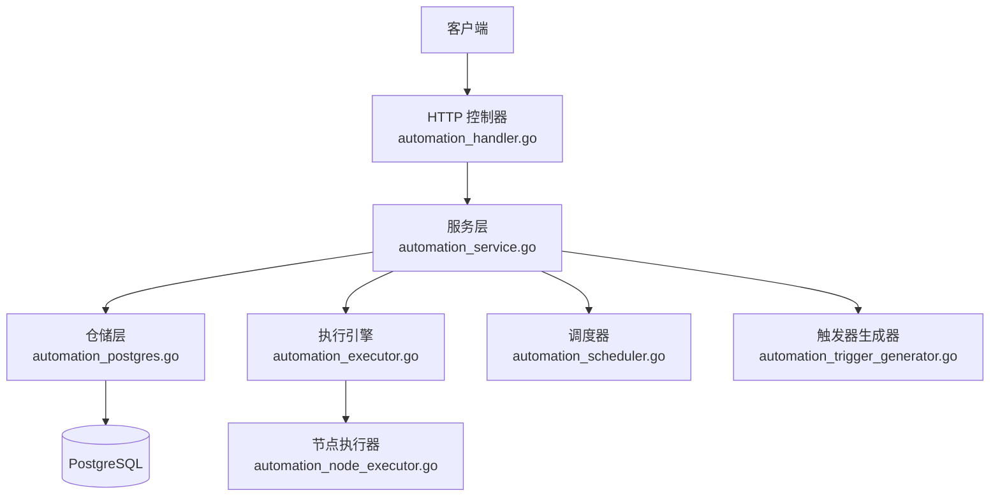
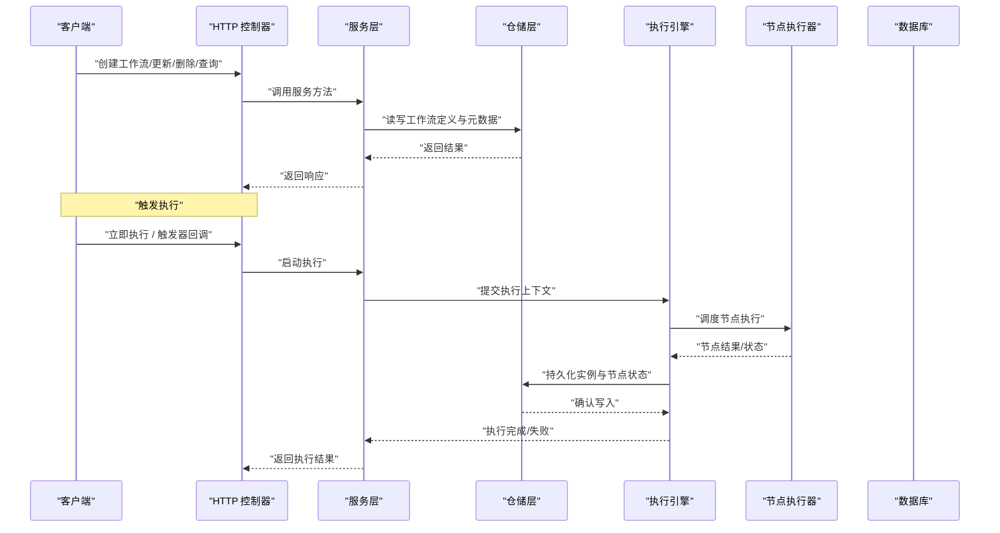
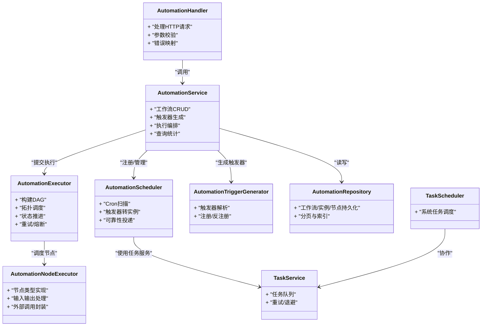

# 自动化工作流API

<cite>
**本文引用的文件**   
- [automation_handler.go](file://notifuse/internal/http/automation_handler.go)
- [automation_service.go](file://notifuse/internal/service/automation_service.go)
- [automation_executor.go](file://notifuse/internal/service/automation_executor.go)
- [automation_node_executor.go](file://notifuse/internal/service/automation_node_executor.go)
- [automation_scheduler.go](file://notifuse/internal/service/automation_scheduler.go)
- [automation_trigger_generator.go](file://notifuse/internal/service/automation_trigger_generator.go)
- [task_service.go](file://notifuse/internal/service/task_service.go)
- [task_scheduler.go](file://notifuse/internal/service/task_scheduler.go)
- [automation_postgres.go](file://notifuse/internal/repository/automation_postgres.go)
- [automation.go](file://notifuse/internal/domain/automation.go)
- [openapi.yaml](file://notifuse/openapi/openapi.yaml)
</cite>

## 目录
1. [简介](#简介)
2. [项目结构](#项目结构)
3. [核心组件](#核心组件)
4. [架构总览](#架构总览)
5. [详细组件分析](#详细组件分析)
6. [依赖关系分析](#依赖关系分析)
7. [性能与并发](#性能与并发)
8. [故障排查指南](#故障排查指南)
9. [结论](#结论)
10. [附录：API参考](#附录api参考)

## 简介
本文件为 Notifuse 平台的“自动化工作流”能力提供后端 API 文档，覆盖工作流的创建、编辑、执行、监控等全生命周期管理。内容包含触发器配置、条件分支逻辑、节点编排、状态管理与错误处理机制；并说明可视化流程图设计器的数据模型与 JSON Schema 校验方式、执行引擎调用路径、定时任务调度、事件驱动架构、并发控制与资源管理策略，以及复杂工作流的设计模式与最佳实践。

## 项目结构
自动化工作流相关代码主要分布在以下层次：
- HTTP 层：REST 接口定义与请求路由（控制器）
- 服务层：业务编排、触发器生成、调度与执行协调
- 执行层：工作流与节点的运行时执行、状态推进与错误处理
- 存储层：PostgreSQL 持久化
- 领域模型：工作流、节点、触发器等核心数据结构
- OpenAPI：对外 API 契约

图表来源
- [automation_handler.go](file://notifuse/internal/http/automation_handler.go)
- [automation_service.go](file://notifuse/internal/service/automation_service.go)
- [automation_postgres.go](file://notifuse/internal/repository/automation_postgres.go)
- [automation_executor.go](file://notifuse/internal/service/automation_executor.go)
- [automation_node_executor.go](file://notifuse/internal/service/automation_node_executor.go)
- [automation_scheduler.go](file://notifuse/internal/service/automation_scheduler.go)
- [automation_trigger_generator.go](file://notifuse/internal/service/automation_trigger_generator.go)

章节来源
- [automation_handler.go](file://notifuse/internal/http/automation_handler.go)
- [automation_service.go](file://notifuse/internal/service/automation_service.go)
- [automation_postgres.go](file://notifuse/internal/repository/automation_postgres.go)
- [automation_executor.go](file://notifuse/internal/service/automation_executor.go)
- [automation_node_executor.go](file://notifuse/internal/service/automation_node_executor.go)
- [automation_scheduler.go](file://notifuse/internal/service/automation_scheduler.go)
- [automation_trigger_generator.go](file://notifuse/internal/service/automation_trigger_generator.go)

## 核心组件
- HTTP 控制器：暴露 REST 接口，负责参数校验、鉴权上下文注入、响应封装与错误映射。
- 服务层：编排工作流生命周期操作（CRUD）、触发器生成、调度注册、执行入口与查询。
- 执行引擎：解析工作流定义、构建执行图、按拓扑顺序或 DAG 规则调度节点执行、维护运行态状态。
- 节点执行器：实现具体节点类型（如条件分支、延迟、外部调用、消息发送等）的执行逻辑。
- 调度器：基于时间表达式或系统任务队列，周期性扫描并触发工作流实例。
- 触发器生成器：将用户配置的触发器声明转换为可执行的调度条目或订阅项。
- 仓储层：对数据库进行读写，持久化工作流定义、实例、节点执行记录与状态。
- 领域模型：定义工作流、节点、触发器、实例、执行日志等数据结构与约束。

章节来源
- [automation_handler.go](file://notifuse/internal/http/automation_handler.go)
- [automation_service.go](file://notifuse/internal/service/automation_service.go)
- [automation_executor.go](file://notifuse/internal/service/automation_executor.go)
- [automation_node_executor.go](file://notifuse/internal/service/automation_node_executor.go)
- [automation_scheduler.go](file://notifuse/internal/service/automation_scheduler.go)
- [automation_trigger_generator.go](file://notifuse/internal/service/automation_trigger_generator.go)
- [automation_postgres.go](file://notifuse/internal/repository/automation_postgres.go)
- [automation.go](file://notifuse/internal/domain/automation.go)

## 架构总览
下图展示了从 HTTP 请求到工作流执行的关键路径，包括触发器与定时调度的两条主线。

图表来源
- [automation_handler.go](file://notifuse/internal/http/automation_handler.go)
- [automation_service.go](file://notifuse/internal/service/automation_service.go)
- [automation_postgres.go](file://notifuse/internal/repository/automation_postgres.go)
- [automation_executor.go](file://notifuse/internal/service/automation_executor.go)
- [automation_node_executor.go](file://notifuse/internal/service/automation_node_executor.go)

## 详细组件分析

### HTTP 控制器（REST 接口）
- 职责
  - 接收并校验工作流 CRUD、执行、查询请求
  - 注入工作区/用户上下文
  - 调用服务层并统一错误码与响应格式
- 关键端点（概念性描述）
  - 工作流定义：创建、更新、删除、获取详情、列表分页
  - 工作流实例：立即执行、查询实例列表与详情、重试失败实例
  - 触发器：启用/禁用、查看已注册触发器
  - 执行历史：查询节点执行记录、日志摘要
- 输入输出
  - 请求体遵循 OpenAPI 定义的 JSON Schema
  - 响应包含标准字段：状态码、数据体、错误信息、分页元数据

章节来源
- [automation_handler.go](file://notifuse/internal/http/automation_handler.go)
- [openapi.yaml](file://notifuse/openapi/openapi.yaml)

### 服务层（编排与协调）
- 职责
  - 工作流定义校验与版本管理
  - 触发器生成与注册
  - 执行入口与实例生命周期管理
  - 查询与统计（实例状态、成功率、耗时分布）
- 关键流程
  - 创建/更新：校验 JSON Schema -> 落库 -> 同步触发器
  - 执行：加载定义 -> 构建执行图 -> 提交执行引擎 -> 异步推进
  - 查询：聚合实例与节点执行状态

章节来源
- [automation_service.go](file://notifuse/internal/service/automation_service.go)
- [automation_trigger_generator.go](file://notifuse/internal/service/automation_trigger_generator.go)

### 执行引擎（运行时）
- 职责
  - 解析工作流定义，构建有向无环图（DAG）
  - 拓扑排序与并行度控制
  - 节点状态机推进（待执行、运行中、成功、失败、跳过）
  - 超时、重试、熔断与补偿
- 关键特性
  - 条件分支：根据上游节点输出与表达式求值选择路径
  - 并发控制：全局与节点级并发限制
  - 幂等性：支持重试与去重键
  - 可观测性：结构化日志、指标上报、追踪ID透传

章节来源
- [automation_executor.go](file://notifuse/internal/service/automation_executor.go)
- [automation_node_executor.go](file://notifuse/internal/service/automation_node_executor.go)

### 调度器（定时任务）
- 职责
  - 基于 Cron 表达式或系统任务表周期扫描
  - 将符合条件的触发器转为工作流实例
  - 与任务服务协作，保证可靠投递与失败重试
- 关键流程
  - 扫描 -> 匹配触发器 -> 生成实例 -> 提交执行引擎 -> 记录调度日志

章节来源
- [automation_scheduler.go](file://notifuse/internal/service/automation_scheduler.go)
- [task_service.go](file://notifuse/internal/service/task_service.go)
- [task_scheduler.go](file://notifuse/internal/service/task_scheduler.go)

### 仓储层（持久化）
- 职责
  - 工作流定义、实例、节点执行记录的增删改查
  - 索引优化与分页查询
  - 事务边界与一致性保障
- 关键表（概念性）
  - 工作流定义表：ID、名称、版本、JSON 定义、状态、更新时间
  - 实例表：ID、工作流ID、状态、输入快照、开始/结束时间
  - 节点执行表：ID、实例ID、节点ID、状态、输入/输出、错误信息

章节来源
- [automation_postgres.go](file://notifuse/internal/repository/automation_postgres.go)

### 领域模型（数据结构）
- 工作流
  - 标识、名称、版本、可见范围、状态
  - 定义体：节点集合、边集合、触发器集合、全局配置
- 节点
  - 类型、配置、输入/输出映射、重试策略、超时
- 触发器
  - 类型（定时、事件、Webhook）、过滤条件、目标工作流
- 实例与执行记录
  - 状态机、上下文快照、错误堆栈、审计字段

章节来源
- [automation.go](file://notifuse/internal/domain/automation.go)

## 依赖关系分析

图表来源
- [automation_handler.go](file://notifuse/internal/http/automation_handler.go)
- [automation_service.go](file://notifuse/internal/service/automation_service.go)
- [automation_executor.go](file://notifuse/internal/service/automation_executor.go)
- [automation_node_executor.go](file://notifuse/internal/service/automation_node_executor.go)
- [automation_scheduler.go](file://notifuse/internal/service/automation_scheduler.go)
- [automation_trigger_generator.go](file://notifuse/internal/service/automation_trigger_generator.go)
- [automation_postgres.go](file://notifuse/internal/repository/automation_postgres.go)
- [task_service.go](file://notifuse/internal/service/task_service.go)
- [task_scheduler.go](file://notifuse/internal/service/task_scheduler.go)

## 性能与并发
- 并发控制
  - 全局并发上限与节点级并发限制，避免下游过载
  - 背压与限流：结合任务队列容量与外部服务速率限制
- 资源管理
  - 连接池与超时：数据库、HTTP 客户端、模板渲染等资源的合理配置
  - 内存占用：大对象分块处理、流式输出、避免一次性加载全部上下文
- 可靠性
  - 幂等键与去重：防止重复执行导致副作用
  - 重试与退避：指数退避、抖动、最大重试次数
  - 熔断与降级：快速失败与回退策略
- 可观测性
  - 结构化日志、指标采集、分布式追踪ID贯穿请求链路

章节来源
- [automation_executor.go](file://notifuse/internal/service/automation_executor.go)
- [automation_node_executor.go](file://notifuse/internal/service/automation_node_executor.go)
- [task_service.go](file://notifuse/internal/service/task_service.go)
- [task_scheduler.go](file://notifuse/internal/service/task_scheduler.go)

## 故障排查指南
- 常见问题定位
  - 工作流定义无效：检查 JSON Schema 校验错误与必填字段
  - 触发器未生效：核对 Cron 表达式、时区、订阅注册状态
  - 节点执行失败：查看节点执行记录中的错误信息与堆栈
  - 实例卡住：检查是否等待外部依赖、是否存在死锁或无限循环
- 诊断步骤
  - 通过实例ID检索执行历史与节点日志
  - 验证工作流定义版本与当前运行版本一致性
  - 检查外部依赖健康状态与配额限制
  - 审查调度器任务表与重试计数
- 恢复建议
  - 修正定义后重新发布新版本
  - 对失败实例进行选择性重试
  - 调整并发与超时参数，缓解下游压力

章节来源
- [automation_handler.go](file://notifuse/internal/http/automation_handler.go)
- [automation_service.go](file://notifuse/internal/service/automation_service.go)
- [automation_executor.go](file://notifuse/internal/service/automation_executor.go)
- [automation_scheduler.go](file://notifuse/internal/service/automation_scheduler.go)

## 结论
Notifuse 的自动化工作流体系以清晰的层次划分与明确的职责边界为基础，通过服务层编排、执行引擎驱动、调度器与触发器协同，实现了高可用、可扩展的工作流运行时。配合完善的 JSON Schema 校验、状态机推进与可观测性能力，能够满足复杂业务流程的编排需求。建议在大规模场景下重点关注并发控制、资源隔离与幂等设计，并结合监控告警持续优化稳定性。

## 附录：API参考
- 接口契约
  - 所有工作流相关端点定义见 OpenAPI 规范
  - 请求/响应结构与字段约束由 JSON Schema 描述
- 典型端点（概念性）
  - 工作流定义
    - 创建：POST /workflows
    - 更新：PUT /workflows/{id}
    - 删除：DELETE /workflows/{id}
    - 获取：GET /workflows/{id}
    - 列表：GET /workflows?limit=&offset=&status=
  - 工作流实例
    - 立即执行：POST /workflows/{id}/execute
    - 实例详情：GET /workflows/{id}/instances/{instanceId}
    - 实例列表：GET /workflows/{id}/instances?status=&created_after=
    - 重试失败：POST /workflows/{id}/instances/{instanceId}/retry
  - 触发器
    - 启用/禁用：PATCH /workflows/{id}/triggers/{triggerId}/state
    - 列出触发器：GET /workflows/{id}/triggers
  - 执行历史
    - 节点执行记录：GET /workflows/{id}/instances/{instanceId}/nodes/{nodeId}/executions
    - 日志摘要：GET /workflows/{id}/instances/{instanceId}/logs
- 状态码与错误
  - 2xx：成功
  - 4xx：参数错误或权限不足
  - 5xx：服务器内部错误
  - 错误体包含错误码、消息与可选的字段级提示

章节来源
- [openapi.yaml](file://notifuse/openapi/openapi.yaml)
- [automation_handler.go](file://notifuse/internal/http/automation_handler.go)