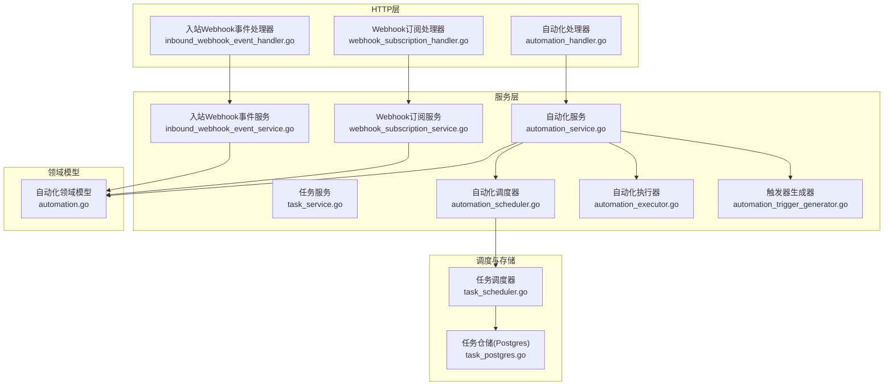
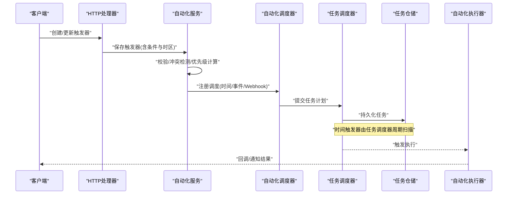
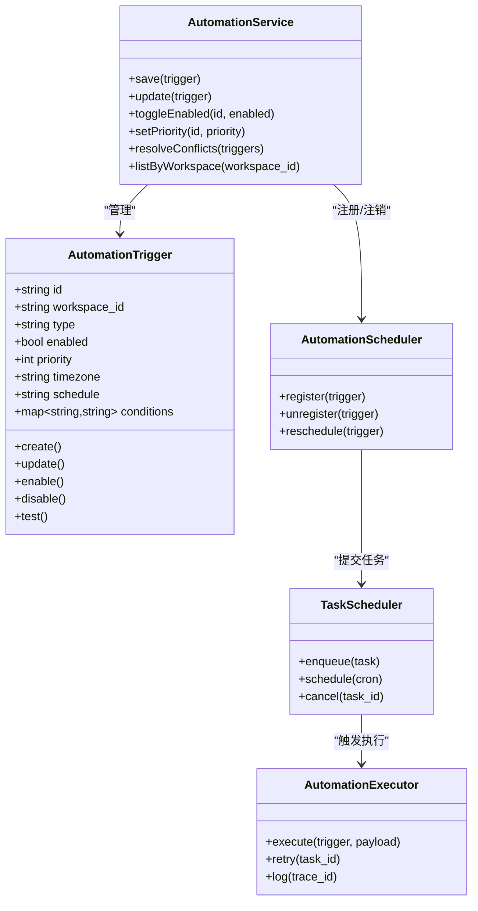
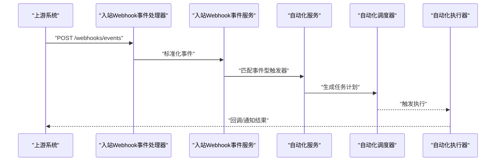
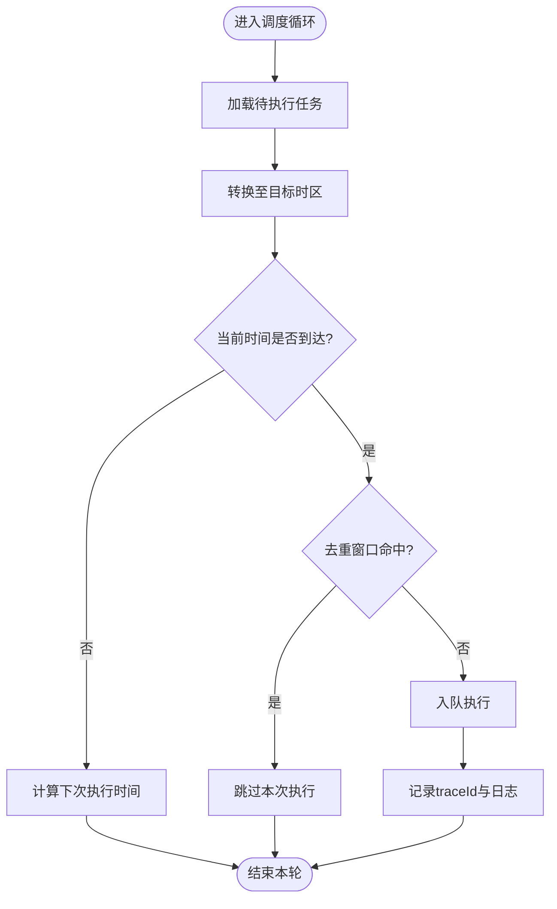
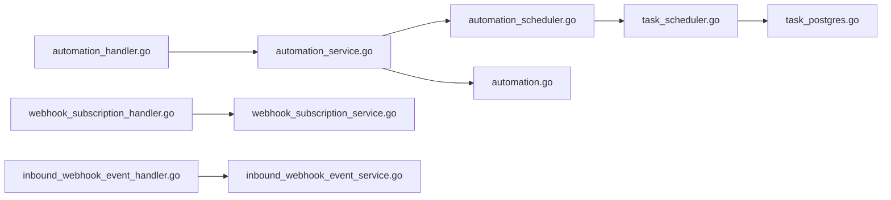

# 触发器管理API

<cite>
**本文引用的文件**   
- [automation.go](file://notifuse/internal/domain/automation.go)
- [automation_service.go](file://notifuse/internal/service/automation_service.go)
- [automation_scheduler.go](file://notifuse/internal/service/automation_scheduler.go)
- [automation_executor.go](file://notifuse/internal/service/automation_executor.go)
- [automation_trigger_generator.go](file://notifuse/internal/service/automation_trigger_generator.go)
- [automation_handler.go](file://notifuse/internal/http/automation_handler.go)
- [webhook_subscription_service.go](file://notifuse/internal/service/webhook_subscription_service.go)
- [webhook_subscription_handler.go](file://notifuse/internal/http/webhook_subscription_handler.go)
- [task_service.go](file://notifuse/internal/service/task_service.go)
- [task_scheduler.go](file://notifuse/internal/service/task_scheduler.go)
- [task_postgres.go](file://notifuse/internal/repository/task_postgres.go)
- [inbound_webhook_event_service.go](file://notifuse/internal/service/inbound_webhook_event_service.go)
- [inbound_webhook_event_handler.go](file://notifuse/internal/http/inbound_webhook_event_handler.go)
- [openapi.yaml](file://notifuse/openapi/openapi.yaml)
- [webhook-subscriptions.yaml](file://notifuse/openapi/paths/webhook-subscriptions.yaml)
</cite>

## 目录
1. [简介](#简介)
2. [项目结构](#项目结构)
3. [核心组件](#核心组件)
4. [架构总览](#架构总览)
5. [详细组件分析](#详细组件分析)
6. [依赖关系分析](#依赖关系分析)
7. [性能与调度特性](#性能与调度特性)
8. [故障排查指南](#故障排查指南)
9. [结论](#结论)
10. [附录：API定义与示例](#附录api定义与示例)

## 简介
本文件面向“触发器管理API”的开发者与集成者，系统化说明时间触发器、事件触发器、Webhook触发器的配置与管理接口，覆盖调度规则、时区处理、重复执行策略、启用/禁用状态、优先级排序与冲突解决机制，并提供测试与调试方法。同时给出复杂触发条件的组合逻辑与自定义触发器的扩展开发指南。

## 项目结构
本项目采用分层架构：HTTP层暴露REST API；服务层封装业务逻辑；领域模型定义数据结构与约束；仓储层负责持久化；调度与执行子系统负责定时任务与自动化流程编排。

图表来源
- [automation_handler.go](file://notifuse/internal/http/automation_handler.go)
- [webhook_subscription_handler.go](file://notifuse/internal/http/webhook_subscription_handler.go)
- [inbound_webhook_event_handler.go](file://notifuse/internal/http/inbound_webhook_event_handler.go)
- [automation_service.go](file://notifuse/internal/service/automation_service.go)
- [webhook_subscription_service.go](file://notifuse/internal/service/webhook_subscription_service.go)
- [inbound_webhook_event_service.go](file://notifuse/internal/service/inbound_webhook_event_service.go)
- [automation_scheduler.go](file://notifuse/internal/service/automation_scheduler.go)
- [automation_executor.go](file://notifuse/internal/service/automation_executor.go)
- [automation_trigger_generator.go](file://notifuse/internal/service/automation_trigger_generator.go)
- [task_scheduler.go](file://notifuse/internal/service/task_scheduler.go)
- [task_postgres.go](file://notifuse/internal/repository/task_postgres.go)
- [automation.go](file://notifuse/internal/domain/automation.go)

章节来源
- [automation_handler.go](file://notifuse/internal/http/automation_handler.go)
- [automation_service.go](file://notifuse/internal/service/automation_service.go)
- [automation_scheduler.go](file://notifuse/internal/service/automation_scheduler.go)
- [automation_executor.go](file://notifuse/internal/service/automation_executor.go)
- [automation_trigger_generator.go](file://notifuse/internal/service/automation_trigger_generator.go)
- [webhook_subscription_service.go](file://notifuse/internal/service/webhook_subscription_service.go)
- [webhook_subscription_handler.go](file://notifuse/internal/http/webhook_subscription_handler.go)
- [task_service.go](file://notifuse/internal/service/task_service.go)
- [task_scheduler.go](file://notifuse/internal/service/task_scheduler.go)
- [task_postgres.go](file://notifuse/internal/repository/task_postgres.go)
- [inbound_webhook_event_service.go](file://notifuse/internal/service/inbound_webhook_event_service.go)
- [inbound_webhook_event_handler.go](file://notifuse/internal/http/inbound_webhook_event_handler.go)
- [automation.go](file://notifuse/internal/domain/automation.go)

## 核心组件
- 自动化领域模型：定义触发器类型、条件表达式、调度规则、时区与重复策略等核心字段与校验规则。
- 自动化服务：提供触发器的CRUD、启用/禁用、优先级与冲突检测、批量操作等能力。
- 自动化调度器：将触发器转换为可执行的任务计划，协调任务调度器进行周期性或一次性执行。
- 自动化执行器：根据触发结果执行后续动作（如发送通知、调用外部系统）。
- 触发器生成器：将用户配置的触发条件解析为内部调度表示，支持时间、事件、Webhook等多类型。
- Webhook订阅服务与处理器：管理对外暴露的Webhook订阅与入站事件接收，驱动事件型触发器。
- 任务服务与调度器：统一的任务生命周期管理与持久化，支撑时间触发器与重复执行。
- 入站Webhook事件服务：标准化入站事件，供事件型触发器消费。

章节来源
- [automation.go](file://notifuse/internal/domain/automation.go)
- [automation_service.go](file://notifuse/internal/service/automation_service.go)
- [automation_scheduler.go](file://notifuse/internal/service/automation_scheduler.go)
- [automation_executor.go](file://notifuse/internal/service/automation_executor.go)
- [automation_trigger_generator.go](file://notifuse/internal/service/automation_trigger_generator.go)
- [webhook_subscription_service.go](file://notifuse/internal/service/webhook_subscription_service.go)
- [webhook_subscription_handler.go](file://notifuse/internal/http/webhook_subscription_handler.go)
- [task_service.go](file://notifuse/internal/service/task_service.go)
- [task_scheduler.go](file://notifuse/internal/service/task_scheduler.go)
- [inbound_webhook_event_service.go](file://notifuse/internal/service/inbound_webhook_event_service.go)
- [inbound_webhook_event_handler.go](file://notifuse/internal/http/inbound_webhook_event_handler.go)

## 架构总览
触发器管理的整体流程如下：客户端通过HTTP API创建或更新触发器；服务层完成参数校验、冲突检测与优先级计算；调度器将触发器转为任务并交由任务调度器执行；执行器在触发条件满足时运行动作；Webhook订阅与入站事件共同构成事件型触发器的数据源。

图表来源
- [automation_handler.go](file://notifuse/internal/http/automation_handler.go)
- [automation_service.go](file://notifuse/internal/service/automation_service.go)
- [automation_scheduler.go](file://notifuse/internal/service/automation_scheduler.go)
- [task_scheduler.go](file://notifuse/internal/service/task_scheduler.go)
- [task_postgres.go](file://notifuse/internal/repository/task_postgres.go)
- [automation_executor.go](file://notifuse/internal/service/automation_executor.go)

## 详细组件分析

### 触发器类型与配置参数
- 时间触发器
  - 关键参数：cron表达式、时区、开始/结束时间、重复策略（每日/每周/每月/自定义间隔）、最大并发与去重窗口。
  - 调度规则：基于任务调度器周期性扫描，按cron与去重窗口生成下一次执行时间。
- 事件触发器
  - 关键参数：事件类型、过滤条件（键值匹配、正则、JSON路径）、阈值与聚合窗口。
  - 数据源：来自入站Webhook事件服务或内部事件总线。
- Webhook触发器
  - 关键参数：目标URL、签名算法、重试策略、超时、头信息模板、失败告警。
  - 行为：当条件满足时发起HTTP请求，记录投递结果与重试次数。

章节来源
- [automation.go](file://notifuse/internal/domain/automation.go)
- [automation_trigger_generator.go](file://notifuse/internal/service/automation_trigger_generator.go)
- [task_service.go](file://notifuse/internal/service/task_service.go)
- [inbound_webhook_event_service.go](file://notifuse/internal/service/inbound_webhook_event_service.go)
- [webhook_subscription_service.go](file://notifuse/internal/service/webhook_subscription_service.go)

### 调度规则与时区处理
- 时区：所有时间相关字段以UTC存储，展示与计算使用指定时区；支持IANA时区标识符。
- 重复策略：支持固定间隔、cron表达式、日历重复（工作日/月末等）；具备“跳过已执行”和“延迟补偿”选项。
- 冲突解决：同一工作空间内相同触发条件存在冲突时，按优先级与时间窗口消解；高优先级优先执行，低优先级延后或取消。

章节来源
- [automation_service.go](file://notifuse/internal/service/automation_service.go)
- [automation_scheduler.go](file://notifuse/internal/service/automation_scheduler.go)
- [task_scheduler.go](file://notifuse/internal/service/task_scheduler.go)

### 启用/禁用状态与优先级
- 状态：启用/禁用/暂停（临时冻结不再生成新任务，但保留历史）。
- 优先级：数值越小优先级越高；同优先级按创建时间先后决定。
- 批量操作：支持批量启用/禁用与优先级调整。

章节来源
- [automation_service.go](file://notifuse/internal/service/automation_service.go)

### 触发器测试与调试工具
- 模拟触发：提供“立即触发”接口，用于验证条件与动作链路。
- 日志与追踪：每次触发生成唯一traceId，关联任务执行日志与Webhook投递记录。
- 回放模式：对历史事件进行回放，验证复杂条件组合。

章节来源
- [automation_handler.go](file://notifuse/internal/http/automation_handler.go)
- [automation_executor.go](file://notifuse/internal/service/automation_executor.go)
- [task_postgres.go](file://notifuse/internal/repository/task_postgres.go)

### 复杂触发条件组合与自定义扩展
- 组合逻辑：支持AND/OR/NOT嵌套，支持时间窗口与计数阈值（如“5分钟内出现3次”）。
- 自定义触发器：通过插件接口注册新的触发器类型；需实现条件评估、事件映射与资源清理。
- 安全与隔离：触发器作用域限定在工作空间内，跨工作空间不可见。

章节来源
- [automation_trigger_generator.go](file://notifuse/internal/service/automation_trigger_generator.go)
- [automation.go](file://notifuse/internal/domain/automation.go)

#### 类图：触发器相关核心对象

图表来源
- [automation.go](file://notifuse/internal/domain/automation.go)
- [automation_service.go](file://notifuse/internal/service/automation_service.go)
- [automation_scheduler.go](file://notifuse/internal/service/automation_scheduler.go)
- [task_scheduler.go](file://notifuse/internal/service/task_scheduler.go)
- [automation_executor.go](file://notifuse/internal/service/automation_executor.go)

#### 序列图：Webhook触发器执行流

图表来源
- [inbound_webhook_event_handler.go](file://notifuse/internal/http/inbound_webhook_event_handler.go)
- [inbound_webhook_event_service.go](file://notifuse/internal/service/inbound_webhook_event_service.go)
- [automation_service.go](file://notifuse/internal/service/automation_service.go)
- [automation_scheduler.go](file://notifuse/internal/service/automation_scheduler.go)
- [automation_executor.go](file://notifuse/internal/service/automation_executor.go)

#### 流程图：时间触发器调度与去重

图表来源
- [task_scheduler.go](file://notifuse/internal/service/task_scheduler.go)
- [task_postgres.go](file://notifuse/internal/repository/task_postgres.go)

## 依赖关系分析
- HTTP层与服务层松耦合：处理器仅做参数绑定与鉴权，核心逻辑在服务层。
- 调度器与任务调度器解耦：前者负责触发语义，后者负责通用任务队列与持久化。
- 领域模型集中定义：避免在各层重复定义触发器结构，保证一致性。
- 外部依赖：PostgreSQL用于任务与触发器元数据持久化；可选缓存用于去重窗口加速。

图表来源
- [automation_handler.go](file://notifuse/internal/http/automation_handler.go)
- [automation_service.go](file://notifuse/internal/service/automation_service.go)
- [webhook_subscription_handler.go](file://notifuse/internal/http/webhook_subscription_handler.go)
- [webhook_subscription_service.go](file://notifuse/internal/service/webhook_subscription_service.go)
- [inbound_webhook_event_handler.go](file://notifuse/internal/http/inbound_webhook_event_handler.go)
- [inbound_webhook_event_service.go](file://notifuse/internal/service/inbound_webhook_event_service.go)
- [automation_scheduler.go](file://notifuse/internal/service/automation_scheduler.go)
- [task_scheduler.go](file://notifuse/internal/service/task_scheduler.go)
- [task_postgres.go](file://notifuse/internal/repository/task_postgres.go)
- [automation.go](file://notifuse/internal/domain/automation.go)

## 性能与调度特性
- 去重与限流：触发器级别的去重窗口与全局速率限制，防止风暴式触发。
- 批处理与并行：支持批量任务入队与有限并行度，避免过载下游系统。
- 时区高效转换：批量转换与缓存常用时区偏移，减少CPU开销。
- 任务持久化：任务状态变更落库，保障重启后可恢复。

[本节为通用性能建议，无需特定文件引用]

## 故障排查指南
- 常见问题
  - 触发器未执行：检查时区设置、cron语法、启用状态与优先级冲突。
  - 重复触发：确认去重窗口与并发控制配置。
  - Webhook失败：查看重试次数、超时与签名校验错误。
- 定位手段
  - 使用traceId关联日志与任务记录。
  - 通过“立即触发”接口验证端到端链路。
  - 查询任务仓储中的最近执行与失败原因。

章节来源
- [automation_handler.go](file://notifuse/internal/http/automation_handler.go)
- [automation_executor.go](file://notifuse/internal/service/automation_executor.go)
- [task_postgres.go](file://notifuse/internal/repository/task_postgres.go)

## 结论
本API围绕“触发器即任务”的设计，将时间、事件与Webhook三类触发源统一抽象，配合清晰的优先级与冲突解决机制，以及完善的测试与调试能力，为构建稳定可靠的自动化流程提供了坚实基础。建议在复杂场景下结合组合条件与去重策略，确保触发的准确性与系统的稳定性。

[本节为总结性内容，无需特定文件引用]

## 附录：API定义与示例
- OpenAPI规范位置
  - 根定义：[openapi.yaml](file://notifuse/openapi/openapi.yaml)
  - Webhook订阅路径定义：[webhook-subscriptions.yaml](file://notifuse/openapi/paths/webhook-subscriptions.yaml)
- 主要接口类别
  - 触发器管理：创建、更新、删除、启用/禁用、优先级设置、冲突检测、立即触发测试。
  - Webhook订阅：创建订阅、获取订阅列表、更新回调地址与签名、删除订阅。
  - 入站事件：接收事件、事件标准化、事件查询与回放。
- 请求/响应要点
  - 触发器主体包含类型、条件、时区、调度与重复策略等字段。
  - Webhook订阅包含目标URL、认证方式、重试与超时策略。
  - 入站事件包含事件类型、负载与时间戳，服务端会返回标准化后的事件ID。

章节来源
- [openapi.yaml](file://notifuse/openapi/openapi.yaml)
- [webhook-subscriptions.yaml](file://notifuse/openapi/paths/webhook-subscriptions.yaml)
- [webhook_subscription_handler.go](file://notifuse/internal/http/webhook_subscription_handler.go)
- [inbound_webhook_event_handler.go](file://notifuse/internal/http/inbound_webhook_event_handler.go)