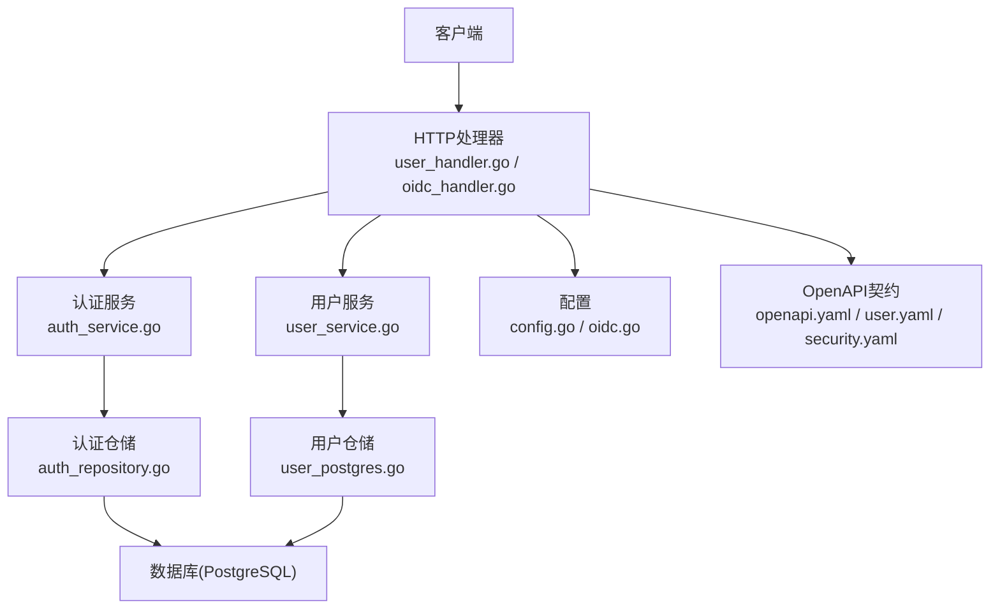
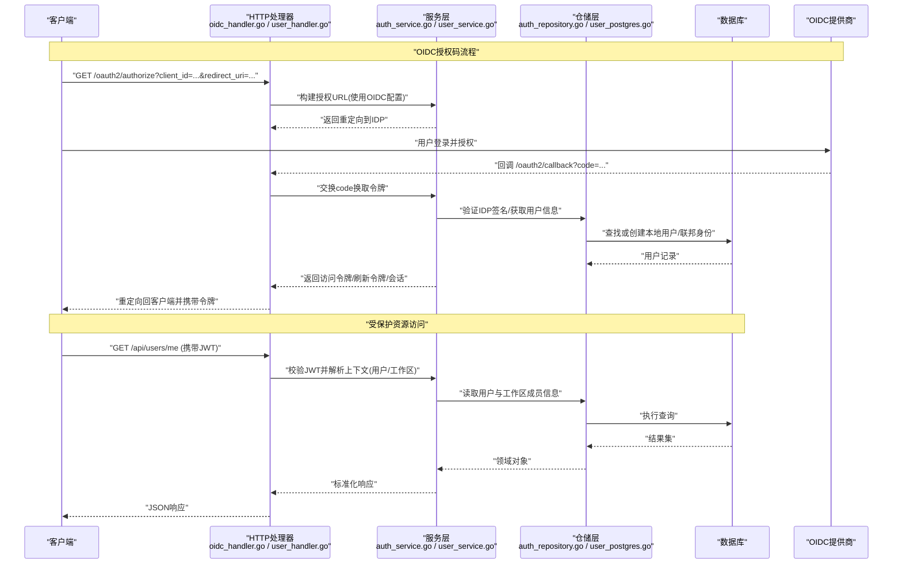
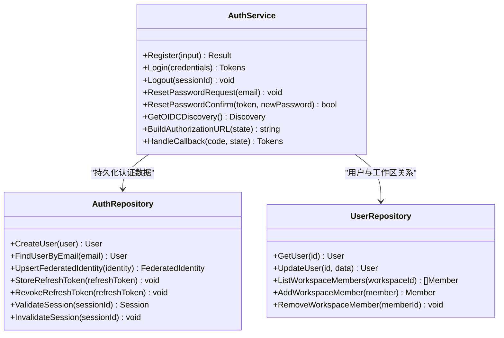
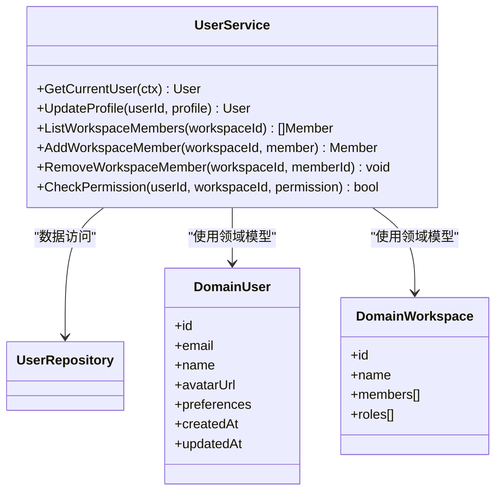
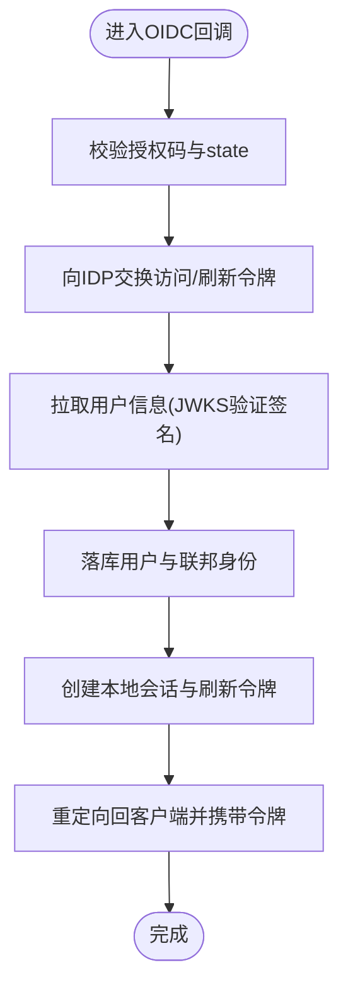
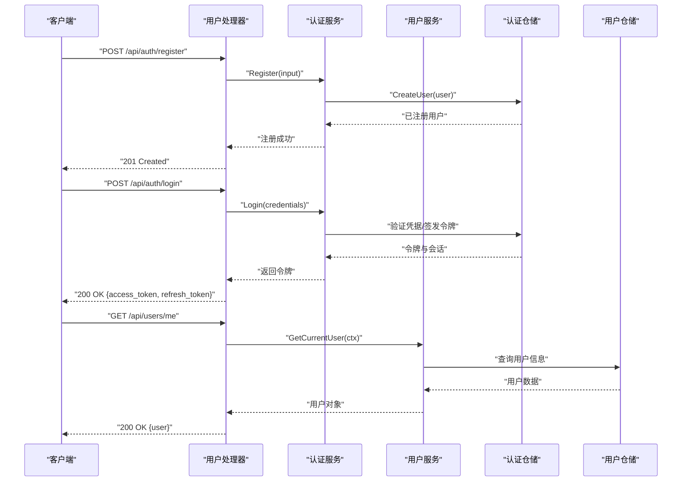
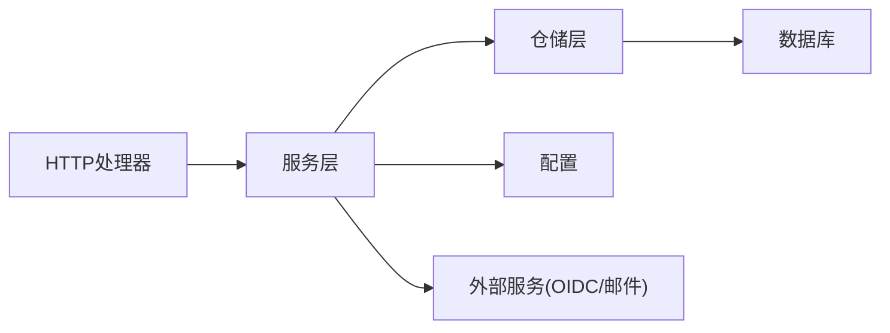

# 认证与用户管理API

<cite>
**本文引用的文件**   
- [cmd/api/main.go](file://notifuse/cmd/api/main.go)
- [internal/http/user_handler.go](file://notifuse/internal/http/user_handler.go)
- [internal/http/oidc_handler.go](file://notifuse/internal/http/oidc_handler.go)
- [internal/service/auth_service.go](file://notifuse/internal/service/auth_service.go)
- [internal/service/user_service.go](file://notifuse/internal/service/user_service.go)
- [internal/repository/auth_repository.go](file://notifuse/internal/repository/auth_repository.go)
- [internal/repository/user_postgres.go](file://notifuse/internal/repository/user_postgres.go)
- [internal/domain/user.go](file://notifuse/internal/domain/user.go)
- [internal/domain/workspace.go](file://notifuse/internal/domain/workspace.go)
- [internal/domain/federated_identity.go](file://notifuse/internal/domain/federated_identity.go)
- [internal/domain/errors.go](file://notifuse/internal/domain/errors.go)
- [config/config.go](file://notifuse/config/config.go)
- [config/oidc.go](file://notifuse/config/oidc.go)
- [openapi/openapi.yaml](file://notifuse/openapi/openapi.yaml)
- [openapi/paths/user.yaml](file://notifuse/openapi/paths/user.yaml)
- [openapi/components/security.yaml](file://notifuse/openapi/components/security.yaml)
</cite>

## 目录
1. [简介](#简介)
2. [项目结构](#项目结构)
3. [核心组件](#核心组件)
4. [架构总览](#架构总览)
5. [详细组件分析](#详细组件分析)
6. [依赖关系分析](#依赖关系分析)
7. [性能与安全考虑](#性能与安全考虑)
8. [故障排查指南](#故障排查指南)
9. [结论](#结论)
10. [附录：API参考](#附录api参考)

## 简介
本文件为 Notifuse 平台的“认证与用户管理API”提供系统化文档，覆盖以下能力：
- 认证相关端点：注册、登录、登出、密码重置、邮箱变更等
- 用户管理：用户信息CRUD、工作区成员管理、权限控制
- OAuth2/OIDC集成：授权码流程、回调处理、令牌签发与会话管理
- JWT机制：访问令牌与刷新令牌的签发、校验、刷新与撤销
- 多租户隔离：基于工作区的资源隔离与RBAC模型
- 错误处理策略与客户端集成建议

## 项目结构
本项目采用分层架构：HTTP层（路由与处理器）→ 服务层（业务逻辑）→ 仓储层（数据持久化）→ 领域模型。认证与用户管理涉及的关键路径如下：
- HTTP处理器：用户与OIDC相关接口实现
- 服务层：认证、用户与工作区等业务编排
- 仓储层：PostgreSQL读写实现
- 领域模型：用户、工作区、联邦身份等实体定义
- 配置：应用配置与OIDC提供者参数
- OpenAPI：API契约与安全方案定义

图表来源
- [cmd/api/main.go:1-200](file://notifuse/cmd/api/main.go#L1-L200)
- [internal/http/user_handler.go:1-200](file://notifuse/internal/http/user_handler.go#L1-L200)
- [internal/http/oidc_handler.go:1-200](file://notifuse/internal/http/oidc_handler.go#L1-L200)
- [internal/service/auth_service.go:1-200](file://notifuse/internal/service/auth_service.go#L1-L200)
- [internal/service/user_service.go:1-200](file://notifuse/internal/service/user_service.go#L1-L200)
- [internal/repository/auth_repository.go:1-200](file://notifuse/internal/repository/auth_repository.go#L1-L200)
- [internal/repository/user_postgres.go:1-200](file://notifuse/internal/repository/user_postgres.go#L1-L200)
- [config/config.go:1-200](file://notifuse/config/config.go#L1-L200)
- [config/oidc.go:1-200](file://notifuse/config/oidc.go#L1-L200)
- [openapi/openapi.yaml:1-200](file://notifuse/openapi/openapi.yaml#L1-L200)
- [openapi/paths/user.yaml:1-200](file://notifuse/openapi/paths/user.yaml#L1-L200)
- [openapi/components/security.yaml:1-200](file://notifuse/openapi/components/security.yaml#L1-L200)

章节来源
- [cmd/api/main.go:1-200](file://notifuse/cmd/api/main.go#L1-L200)
- [openapi/openapi.yaml:1-200](file://notifuse/openapi/openapi.yaml#L1-L200)

## 核心组件
- HTTP处理器
  - 用户处理器：负责用户注册、登录、登出、密码重置、用户信息查询与更新、工作区成员管理等请求的解析与响应封装
  - OIDC处理器：负责OIDC发现、授权链接生成、回调处理、令牌交换与会话建立
- 服务层
  - 认证服务：统一处理登录、注册、密码重置、会话与令牌生命周期管理
  - 用户服务：封装用户CRUD、工作区成员操作、角色与权限校验
- 仓储层
  - 认证仓储：存储与查询认证相关数据（如用户凭据、会话、刷新令牌等）
  - 用户仓储：用户与工作区成员数据的持久化
- 领域模型
  - 用户、工作区、联邦身份等实体定义，承载业务语义与约束
- 配置
  - 应用配置与OIDC提供者参数（客户端ID/密钥、授权端点、令牌端点、JWKS端点等）
- OpenAPI契约
  - 安全方案（JWT Bearer）、用户相关路径定义与公共组件

章节来源
- [internal/http/user_handler.go:1-200](file://notifuse/internal/http/user_handler.go#L1-L200)
- [internal/http/oidc_handler.go:1-200](file://notifuse/internal/http/oidc_handler.go#L1-L200)
- [internal/service/auth_service.go:1-200](file://notifuse/internal/service/auth_service.go#L1-L200)
- [internal/service/user_service.go:1-200](file://notifuse/internal/service/user_service.go#L1-L200)
- [internal/repository/auth_repository.go:1-200](file://notifuse/internal/repository/auth_repository.go#L1-L200)
- [internal/repository/user_postgres.go:1-200](file://notifuse/internal/repository/user_postgres.go#L1-L200)
- [internal/domain/user.go:1-200](file://notifuse/internal/domain/user.go#L1-L200)
- [internal/domain/workspace.go:1-200](file://notifuse/internal/domain/workspace.go#L1-L200)
- [internal/domain/federated_identity.go:1-200](file://notifuse/internal/domain/federated_identity.go#L1-L200)
- [config/config.go:1-200](file://notifuse/config/config.go#L1-L200)
- [config/oidc.go:1-200](file://notifuse/config/oidc.go#L1-L200)
- [openapi/openapi.yaml:1-200](file://notifuse/openapi/openapi.yaml#L1-L200)
- [openapi/paths/user.yaml:1-200](file://notifuse/openapi/paths/user.yaml#L1-L200)
- [openapi/components/security.yaml:1-200](file://notifuse/openapi/components/security.yaml#L1-L200)

## 架构总览
下图展示认证与用户管理的端到端调用链，包括OIDC授权码流程、JWT签发与会话管理、以及用户与工作区资源的访问控制。

图表来源
- [internal/http/oidc_handler.go:1-200](file://notifuse/internal/http/oidc_handler.go#L1-L200)
- [internal/http/user_handler.go:1-200](file://notifuse/internal/http/user_handler.go#L1-L200)
- [internal/service/auth_service.go:1-200](file://notifuse/internal/service/auth_service.go#L1-L200)
- [internal/service/user_service.go:1-200](file://notifuse/internal/service/user_service.go#L1-L200)
- [internal/repository/auth_repository.go:1-200](file://notifuse/internal/repository/auth_repository.go#L1-L200)
- [internal/repository/user_postgres.go:1-200](file://notifuse/internal/repository/user_postgres.go#L1-L200)
- [config/oidc.go:1-200](file://notifuse/config/oidc.go#L1-L200)

## 详细组件分析

### 认证服务（Auth Service）
职责
- 用户注册：校验输入、哈希密码、写入用户表、初始化默认工作区成员关系
- 登录：校验凭据、签发JWT访问令牌与刷新令牌、维护会话状态
- 登出：撤销会话与刷新令牌、清理缓存
- 密码重置：生成一次性令牌、发送邮件、校验令牌并更新密码
- OIDC集成：发现端点、生成授权链接、处理回调、交换令牌、同步用户信息

关键交互
- 与认证仓储交互进行凭据与令牌持久化
- 与用户仓储协作完成用户与工作区关系的初始化
- 从配置加载OIDC参数，调用外部IDP

图表来源
- [internal/service/auth_service.go:1-200](file://notifuse/internal/service/auth_service.go#L1-L200)
- [internal/repository/auth_repository.go:1-200](file://notifuse/internal/repository/auth_repository.go#L1-L200)
- [internal/repository/user_postgres.go:1-200](file://notifuse/internal/repository/user_postgres.go#L1-L200)

章节来源
- [internal/service/auth_service.go:1-200](file://notifuse/internal/service/auth_service.go#L1-L200)
- [internal/repository/auth_repository.go:1-200](file://notifuse/internal/repository/auth_repository.go#L1-L200)

### 用户服务（User Service）
职责
- 用户信息CRUD：查询当前用户、更新个人资料、头像、偏好设置
- 工作区成员管理：添加/移除成员、调整角色与权限、列出成员
- 权限校验：基于工作区与角色的访问控制（RBAC）

关键交互
- 通过用户仓储执行数据操作
- 结合领域模型中的用户与工作区实体进行权限判断

图表来源
- [internal/service/user_service.go:1-200](file://notifuse/internal/service/user_service.go#L1-L200)
- [internal/repository/user_postgres.go:1-200](file://notifuse/internal/repository/user_postgres.go#L1-L200)
- [internal/domain/user.go:1-200](file://notifuse/internal/domain/user.go#L1-L200)
- [internal/domain/workspace.go:1-200](file://notifuse/internal/domain/workspace.go#L1-L200)

章节来源
- [internal/service/user_service.go:1-200](file://notifuse/internal/service/user_service.go#L1-L200)
- [internal/repository/user_postgres.go:1-200](file://notifuse/internal/repository/user_postgres.go#L1-L200)
- [internal/domain/user.go:1-200](file://notifuse/internal/domain/user.go#L1-L200)
- [internal/domain/workspace.go:1-200](file://notifuse/internal/domain/workspace.go#L1-L200)

### OIDC处理器（OIDC Handler）
职责
- 暴露OIDC发现端点
- 生成授权链接并重定向至IDP
- 处理回调，交换授权码为令牌，建立本地会话
- 支持多租户场景下的工作区选择与绑定

图表来源
- [internal/http/oidc_handler.go:1-200](file://notifuse/internal/http/oidc_handler.go#L1-L200)
- [config/oidc.go:1-200](file://notifuse/config/oidc.go#L1-L200)

章节来源
- [internal/http/oidc_handler.go:1-200](file://notifuse/internal/http/oidc_handler.go#L1-L200)
- [config/oidc.go:1-200](file://notifuse/config/oidc.go#L1-L200)

### 用户处理器（User Handler）
职责
- 接收并校验用户相关请求（注册、登录、登出、密码重置、用户信息CRUD、工作区成员管理）
- 调用服务层执行业务逻辑
- 封装成功与错误响应，遵循OpenAPI契约

图表来源
- [internal/http/user_handler.go:1-200](file://notifuse/internal/http/user_handler.go#L1-L200)
- [internal/service/auth_service.go:1-200](file://notifuse/internal/service/auth_service.go#L1-L200)
- [internal/service/user_service.go:1-200](file://notifuse/internal/service/user_service.go#L1-L200)
- [internal/repository/auth_repository.go:1-200](file://notifuse/internal/repository/auth_repository.go#L1-L200)
- [internal/repository/user_postgres.go:1-200](file://notifuse/internal/repository/user_postgres.go#L1-L200)

章节来源
- [internal/http/user_handler.go:1-200](file://notifuse/internal/http/user_handler.go#L1-L200)

## 依赖关系分析
- 组件耦合
  - HTTP处理器仅依赖服务层接口，保持低耦合
  - 服务层组合多个仓储接口，便于替换实现与测试
  - 仓储层直接依赖数据库连接与SQL语句
- 外部依赖
  - OIDC提供商：用于授权码流程与用户信息拉取
  - 邮件服务：用于密码重置与通知
  - 缓存/会话存储：用于会话与刷新令牌管理（可选）
- 循环依赖
  - 通过接口与分层避免循环依赖

图表来源
- [cmd/api/main.go:1-200](file://notifuse/cmd/api/main.go#L1-L200)
- [internal/http/user_handler.go:1-200](file://notifuse/internal/http/user_handler.go#L1-L200)
- [internal/service/auth_service.go:1-200](file://notifuse/internal/service/auth_service.go#L1-L200)
- [internal/repository/auth_repository.go:1-200](file://notifuse/internal/repository/auth_repository.go#L1-L200)
- [config/config.go:1-200](file://notifuse/config/config.go#L1-L200)

章节来源
- [cmd/api/main.go:1-200](file://notifuse/cmd/api/main.go#L1-L200)
- [internal/http/user_handler.go:1-200](file://notifuse/internal/http/user_handler.go#L1-L200)
- [internal/service/auth_service.go:1-200](file://notifuse/internal/service/auth_service.go#L1-L200)
- [internal/repository/auth_repository.go:1-200](file://notifuse/internal/repository/auth_repository.go#L1-L200)
- [config/config.go:1-200](file://notifuse/config/config.go#L1-L200)

## 性能与安全考虑
- 性能
  - 数据库索引：对用户邮箱、工作区ID、成员关系字段建立索引以优化查询
  - 令牌缓存：对OIDC JWKS与用户信息进行短期缓存以减少外部调用
  - 批量操作：工作区成员批量导入时采用事务与分批提交
- 安全
  - 密码策略：强制复杂度、历史检查、定期轮换
  - 令牌安全：短寿命访问令牌+长寿命刷新令牌；刷新令牌可撤销；JWT签名使用强算法
  - 会话管理：服务端会话存储，支持主动失效与并发限制
  - 防暴力破解：登录与密码重置限流与验证码
  - 传输安全：全站HTTPS，严格TLS配置
  - 审计日志：关键操作留痕（登录、登出、成员变更、权限调整）

[本节为通用指导，不直接分析具体文件]

## 故障排查指南
- 常见问题
  - OIDC回调失败：检查授权码有效期、state一致性、重定向URI匹配
  - JWT校验失败：确认签名算法、公钥/JWKS端点可达、时钟偏差
  - 会话无效：检查会话存储可用性、过期策略、并发登录限制
  - 权限不足：确认工作区成员角色与权限映射是否正确
- 诊断步骤
  - 查看处理器与服务层日志，定位异常堆栈
  - 检查仓储层SQL执行计划与慢查询
  - 核对配置项（OIDC端点、密钥、域名）
  - 复现最小用例并启用调试模式

章节来源
- [internal/domain/errors.go:1-200](file://notifuse/internal/domain/errors.go#L1-L200)

## 结论
Notifuse的认证与用户管理模块通过清晰的分层设计与严格的权限控制，实现了安全的用户认证、灵活的OAuth2/OIDC集成、完善的JWT与会话管理，以及多租户环境下的工作区级资源隔离。建议在部署中强化限流、审计与监控，持续优化令牌与缓存策略，确保高可用与安全性。

[本节为总结性内容，不直接分析具体文件]

## 附录：API参考

### 安全方案
- 类型：JWT Bearer
- 头部：Authorization: Bearer <access_token>
- 令牌格式：标准JWT（含子标识、工作区上下文、权限声明）

章节来源
- [openapi/components/security.yaml:1-200](file://notifuse/openapi/components/security.yaml#L1-L200)

### 用户相关路径
- 用户信息
  - GET /api/users/me：获取当前用户资料
  - PATCH /api/users/me：更新个人资料
- 工作区成员
  - GET /api/workspaces/{workspaceId}/members：列出成员
  - POST /api/workspaces/{workspaceId}/members：添加成员
  - DELETE /api/workspaces/{workspaceId}/members/{memberId}：移除成员
- 认证
  - POST /api/auth/register：用户注册
  - POST /api/auth/login：用户登录
  - POST /api/auth/logout：用户登出
  - POST /api/auth/password-reset/request：发起密码重置
  - POST /api/auth/password-reset/confirm：确认重置

章节来源
- [openapi/paths/user.yaml:1-200](file://notifuse/openapi/paths/user.yaml#L1-L200)
- [openapi/openapi.yaml:1-200](file://notifuse/openapi/openapi.yaml#L1-L200)

### 请求与响应示例（摘要）
- 登录
  - 请求：POST /api/auth/login
    - 主体：{ email, password }
  - 响应：200 OK
    - 主体：{ access_token, refresh_token, expires_in }
- 获取当前用户
  - 请求：GET /api/users/me
    - 头：Authorization: Bearer <access_token>
  - 响应：200 OK
    - 主体：{ id, email, name, avatar_url, preferences }
- 添加工作区成员
  - 请求：POST /api/workspaces/{workspaceId}/members
    - 主体：{ email, role }
  - 响应：201 Created
    - 主体：{ id, email, role, status }

章节来源
- [openapi/paths/user.yaml:1-200](file://notifuse/openapi/paths/user.yaml#L1-L200)
- [openapi/components/security.yaml:1-200](file://notifuse/openapi/components/security.yaml#L1-L200)

### 错误处理策略
- 常见错误码
  - 400：请求参数无效
  - 401：未认证或令牌无效
  - 403：无权限访问资源
  - 404：资源不存在
  - 409：冲突（如邮箱已存在）
  - 429：限流触发
  - 500：服务器内部错误
- 错误体结构
  - { code, message, details }

章节来源
- [internal/domain/errors.go:1-200](file://notifuse/internal/domain/errors.go#L1-L200)

### 客户端集成指南
- 令牌管理
  - 保存访问令牌与刷新令牌
  - 在访问令牌过期前使用刷新令牌续期
  - 登出时调用登出端点并清除本地令牌
- 会话与多工作区
  - 在JWT中解析工作区上下文
  - 切换工作区时重新获取用户与工作区成员信息
- 安全最佳实践
  - 使用HTTPS
  - 避免将敏感令牌存储在localStorage
  - 实施CSRF防护（针对浏览器端）
  - 对敏感操作增加二次确认与审计

[本节为通用指导，不直接分析具体文件]