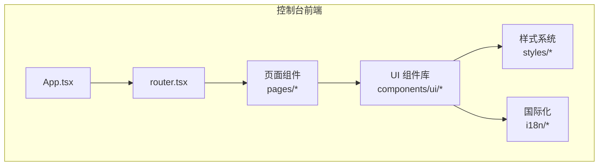
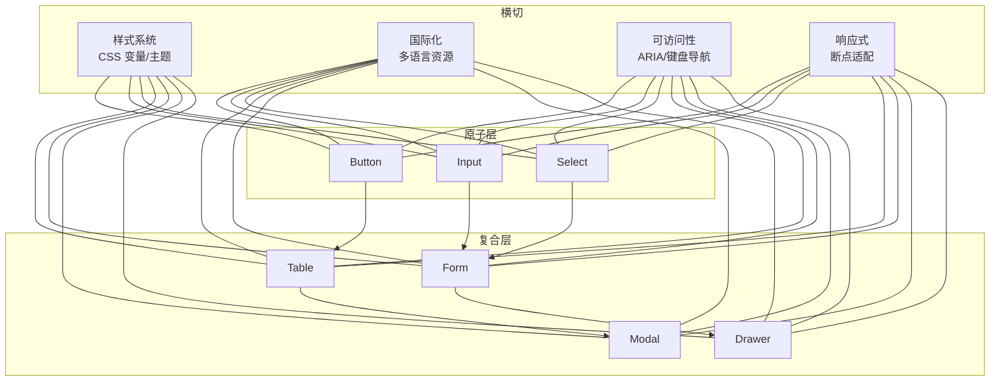
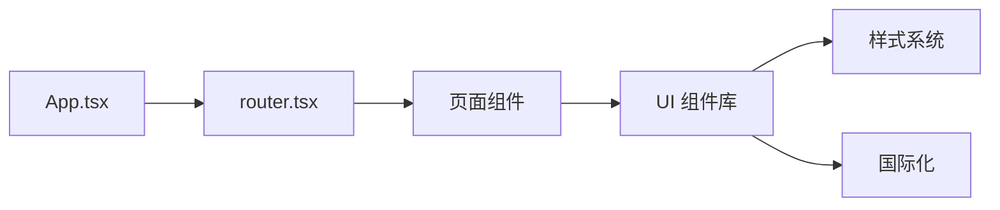

# UI组件库

<cite>
**本文引用的文件**   
- [notifuse/console/src/components/ui/button.tsx](file://notifuse/console/src/components/ui/button.tsx)
- [notifuse/console/src/components/ui/input.tsx](file://notifuse/console/src/components/ui/input.tsx)
- [notifuse/console/src/components/ui/select.tsx](file://notifuse/console/src/components/ui/select.tsx)
- [notifuse/console/src/components/ui/table.tsx](file://notifuse/console/src/components/ui/table.tsx)
- [notifuse/console/src/components/ui/form.tsx](file://notifuse/console/src/components/ui/form.tsx)
- [notifuse/console/src/components/ui/modal.tsx](file://notifuse/console/src/components/ui/modal.tsx)
- [notifuse/console/src/components/ui/drawer.tsx](file://notifuse/console/src/components/ui/drawer.tsx)
- [notifuse/console/src/i18n/translations.ts](file://notifuse/console/src/i18n/translations.ts)
- [notifuse/console/src/styles/global.css](file://notifuse/console/src/styles/global.css)
- [notifuse/console/src/App.tsx](file://notifuse/console/src/App.tsx)
- [notifuse/console/src/router.tsx](file://notifuse/console/src/router.tsx)
- [notifuse/console/package.json](file://notifuse/console/package.json)
</cite>

## 目录
1. [简介](#简介)
2. [项目结构](#项目结构)
3. [核心组件](#核心组件)
4. [架构总览](#架构总览)
5. [详细组件分析](#详细组件分析)
6. [依赖分析](#依赖分析)
7. [性能考虑](#性能考虑)
8. [故障排查指南](#故障排查指南)
9. [结论](#结论)
10. [附录](#附录) 

## 简介
本文件为 Notifuse 前端控制台的 UI 组件库提供系统化文档，覆盖设计理念、实现模式、基础与高级组件的使用方式与配置项、样式系统与主题定制、响应式策略、组合与扩展机制、可访问性、国际化与测试策略，以及开发规范与最佳实践。目标是帮助开发者快速上手并高质量地复用组件。

## 项目结构
控制台前端位于 notifuse/console 目录，UI 组件集中在 src/components/ui 下，遵循“按功能域组织”的目录结构；样式集中于 styles，国际化在 i18n，路由与入口在 router.tsx 与 App.tsx。

图表来源
- [notifuse/console/src/App.tsx](file://notifuse/console/src/App.tsx)
- [notifuse/console/src/router.tsx](file://notifuse/console/src/router.tsx)

章节来源
- [notifuse/console/src/App.tsx](file://notifuse/console/src/App.tsx)
- [notifuse/console/src/router.tsx](file://notifuse/console/src/router.tsx)

## 核心组件
本节概述基础与高级组件的设计目标与通用能力：
- 基础组件（按钮、输入框、选择器）：强调一致性、可组合性与无障碍支持。
- 高级组件（表格、表单、模态框、抽屉）：强调数据驱动、状态管理与交互体验。

章节来源
- [notifuse/console/src/components/ui/button.tsx](file://notifuse/console/src/components/ui/button.tsx)
- [notifuse/console/src/components/ui/input.tsx](file://notifuse/console/src/components/ui/input.tsx)
- [notifuse/console/src/components/ui/select.tsx](file://notifuse/console/src/components/ui/select.tsx)
- [notifuse/console/src/components/ui/table.tsx](file://notifuse/console/src/components/ui/table.tsx)
- [notifuse/console/src/components/ui/form.tsx](file://notifuse/console/src/components/ui/form.tsx)
- [notifuse/console/src/components/ui/modal.tsx](file://notifuse/console/src/components/ui/modal.tsx)
- [notifuse/console/src/components/ui/drawer.tsx](file://notifuse/console/src/components/ui/drawer.tsx)

## 架构总览
UI 组件库采用“原子化 + 组合式”的架构：
- 原子层：基础 UI 元素（Button、Input、Select）。
- 复合层：业务级容器（Table、Form、Modal、Drawer）。
- 横切关注点：样式系统（CSS 变量）、国际化（i18n）、可访问性（ARIA）、响应式（媒体查询）。

图表来源
- [notifuse/console/src/components/ui/button.tsx](file://notifuse/console/src/components/ui/button.tsx)
- [notifuse/console/src/components/ui/input.tsx](file://notifuse/console/src/components/ui/input.tsx)
- [notifuse/console/src/components/ui/select.tsx](file://notifuse/console/src/components/ui/select.tsx)
- [notifuse/console/src/components/ui/table.tsx](file://notifuse/console/src/components/ui/table.tsx)
- [notifuse/console/src/components/ui/form.tsx](file://notifuse/console/src/components/ui/form.tsx)
- [notifuse/console/src/components/ui/modal.tsx](file://notifuse/console/src/components/ui/modal.tsx)
- [notifuse/console/src/components/ui/drawer.tsx](file://notifuse/console/src/components/ui/drawer.tsx)
- [notifuse/console/src/styles/global.css](file://notifuse/console/src/styles/global.css)
- [notifuse/console/src/i18n/translations.ts](file://notifuse/console/src/i18n/translations.ts)

## 详细组件分析

### 基础组件：Button
- 设计要点
  - 语义化标签与键盘可达性（Enter/Space 触发）。
  - 变体（主操作、次要、危险等）通过属性或类名切换。
  - 尺寸与禁用态统一由样式系统控制。
- 常用属性
  - 类型：primary/secondary/ghost/danger 等。
  - 尺寸：sm/md/lg。
  - 状态：disabled/loading。
  - 事件：onClick、onKeyDown。
- 可访问性
  - role、aria-* 属性按需设置，确保屏幕阅读器可读。
- 示例路径
  - [button.tsx](file://notifuse/console/src/components/ui/button.tsx)

章节来源
- [notifuse/console/src/components/ui/button.tsx](file://notifuse/console/src/components/ui/button.tsx)

### 基础组件：Input
- 设计要点
  - 受控与非受控两种使用模式。
  - 校验提示与错误态展示。
  - 前缀/后缀插槽用于图标或附加控件。
- 常用属性
  - 值与变更：value、onChange、onBlur。
  - 占位符与标签：placeholder、label。
  - 校验：error、helperText。
  - 行为：disabled、readOnly、type。
- 可访问性
  - label 关联 htmlFor/id，错误信息 aria-describedby。
- 示例路径
  - [input.tsx](file://notifuse/console/src/components/ui/input.tsx)

章节来源
- [notifuse/console/src/components/ui/input.tsx](file://notifuse/console/src/components/ui/input.tsx)

### 基础组件：Select
- 设计要点
  - 选项渲染与搜索过滤。
  - 多选与单选模式。
  - 自定义选项渲染插槽。
- 常用属性
  - 数据：options、optionLabel、optionValue。
  - 值与变更：value、onChange、multiple。
  - 行为：disabled、searchable、clearable。
- 可访问性
  - 键盘导航（上下键、回车确认）、aria-selected。
- 示例路径
  - [select.tsx](file://notifuse/console/src/components/ui/select.tsx)

章节来源
- [notifuse/console/src/components/ui/select.tsx](file://notifuse/console/src/components/ui/select.tsx)

### 高级组件：Table
- 设计要点
  - 列定义驱动、分页/排序/筛选。
  - 行内操作与批量操作。
  - 虚拟滚动与大数据优化（可选）。
- 常用属性
  - 数据：dataSource、columns。
  - 交互：rowKey、onRowClick、onSelectionChange。
  - 布局：pagination、sortable、filterable。
- 可访问性
  - 表格标题 caption、行列语义、键盘可达。
- 示例路径
  - [table.tsx](file://notifuse/console/src/components/ui/table.tsx)

章节来源
- [notifuse/console/src/components/ui/table.tsx](file://notifuse/console/src/components/ui/table.tsx)

### 高级组件：Form
- 设计要点
  - 字段注册、联动校验与提交流程。
  - 异步校验与防抖。
  - 与 Input/Select 等基础组件无缝组合。
- 常用属性
  - 数据：initialValues、schema。
  - 事件：onSubmit、onValidate、onReset。
  - 行为：autoFocusFirstField、submitOnEnter。
- 可访问性
  - 表单级错误摘要、字段级错误提示与焦点管理。
- 示例路径
  - [form.tsx](file://notifuse/console/src/components/ui/form.tsx)

章节来源
- [notifuse/console/src/components/ui/form.tsx](file://notifuse/console/src/components/ui/form.tsx)

### 高级组件：Modal
- 设计要点
  - 遮罩、聚焦陷阱、ESC 关闭。
  - 可拖拽与全屏模式（可选）。
- 常用属性
  - 显隐：open/onOpenChange。
  - 内容：title、footer、closable。
  - 行为：maskClosable、destroyOnClose。
- 可访问性
  - aria-modal、role="dialog"、focus 初始定位。
- 示例路径
  - [modal.tsx](file://notifuse/console/src/components/ui/modal.tsx)

章节来源
- [notifuse/console/src/components/ui/modal.tsx](file://notifuse/console/src/components/ui/modal.tsx)

### 高级组件：Drawer
- 设计要点
  - 侧边滑出面板，适合编辑/详情场景。
  - 方向（左/右/上/下）与宽度可调。
- 常用属性
  - 显隐：visible/onVisibleChange。
  - 布局：placement、width、zIndex。
  - 行为：maskClosable、closeIcon。
- 可访问性
  - 与 Modal 类似的焦点与 ARIA 约定。
- 示例路径
  - [drawer.tsx](file://notifuse/console/src/components/ui/drawer.tsx)

章节来源
- [notifuse/console/src/components/ui/drawer.tsx](file://notifuse/console/src/components/ui/drawer.tsx)

### 组合与扩展模式
- 组合模式
  - Form + Input/Select 构建复杂表单。
  - Table + Modal/Drawer 实现行内编辑与详情查看。
- 插槽机制
  - 通过 children 与具名插槽注入自定义内容。
- 扩展点
  - 主题变量覆盖、全局样式钩子、事件拦截。

章节来源
- [notifuse/console/src/components/ui/form.tsx](file://notifuse/console/src/components/ui/form.tsx)
- [notifuse/console/src/components/ui/table.tsx](file://notifuse/console/src/components/ui/table.tsx)
- [notifuse/console/src/components/ui/modal.tsx](file://notifuse/console/src/components/ui/modal.tsx)
- [notifuse/console/src/components/ui/drawer.tsx](file://notifuse/console/src/components/ui/drawer.tsx)

### 样式系统与主题定制
- 设计令牌
  - 使用 CSS 变量定义颜色、间距、圆角、阴影等。
- 主题方案
  - 明暗主题切换、品牌色替换、组件级覆盖。
- 响应式
  - 基于断点的栅格与排版缩放。
- 示例路径
  - [global.css](file://notifuse/console/src/styles/global.css)

章节来源
- [notifuse/console/src/styles/global.css](file://notifuse/console/src/styles/global.css)

### 可访问性（a11y）
- 语义化标签与 ARIA 属性。
- 键盘导航与焦点管理。
- 色彩对比度与文本替代。
- 示例路径
  - [button.tsx](file://notifuse/console/src/components/ui/button.tsx)
  - [input.tsx](file://notifuse/console/src/components/ui/input.tsx)
  - [select.tsx](file://notifuse/console/src/components/ui/select.tsx)
  - [table.tsx](file://notifuse/console/src/components/ui/table.tsx)
  - [form.tsx](file://notifuse/console/src/components/ui/form.tsx)
  - [modal.tsx](file://notifuse/console/src/components/ui/modal.tsx)
  - [drawer.tsx](file://notifuse/console/src/components/ui/drawer.tsx)

章节来源
- [notifuse/console/src/components/ui/button.tsx](file://notifuse/console/src/components/ui/button.tsx)
- [notifuse/console/src/components/ui/input.tsx](file://notifuse/console/src/components/ui/input.tsx)
- [notifuse/console/src/components/ui/select.tsx](file://notifuse/console/src/components/ui/select.tsx)
- [notifuse/console/src/components/ui/table.tsx](file://notifuse/console/src/components/ui/table.tsx)
- [notifuse/console/src/components/ui/form.tsx](file://notifuse/console/src/components/ui/form.tsx)
- [notifuse/console/src/components/ui/modal.tsx](file://notifuse/console/src/components/ui/modal.tsx)
- [notifuse/console/src/components/ui/drawer.tsx](file://notifuse/console/src/components/ui/drawer.tsx)

### 国际化（i18n）
- 文案集中管理，组件通过 key 获取本地化字符串。
- 动态切换语言与回退策略。
- 示例路径
  - [translations.ts](file://notifuse/console/src/i18n/translations.ts)

章节来源
- [notifuse/console/src/i18n/translations.ts](file://notifuse/console/src/i18n/translations.ts)

### 测试策略
- 单元测试：组件渲染、属性与事件、边界条件。
- 集成测试：表单提交流程、表格交互、弹窗/抽屉状态机。
- 可访问性测试：键盘导航与屏幕阅读器兼容。
- 工具链参考
  - [package.json](file://notifuse/console/package.json)

章节来源
- [notifuse/console/package.json](file://notifuse/console/package.json)

## 依赖分析
- 组件间耦合
  - 高级组件依赖基础组件，避免循环依赖。
- 外部依赖
  - 构建与测试工具在 package.json 中声明。
- 路由与入口
  - App.tsx 作为应用入口，router.tsx 负责页面路由。

图表来源
- [notifuse/console/src/App.tsx](file://notifuse/console/src/App.tsx)
- [notifuse/console/src/router.tsx](file://notifuse/console/src/router.tsx)

章节来源
- [notifuse/console/src/App.tsx](file://notifuse/console/src/App.tsx)
- [notifuse/console/src/router.tsx](file://notifuse/console/src/router.tsx)
- [notifuse/console/package.json](file://notifuse/console/package.json)

## 性能考虑
- 列表与表格
  - 分页、懒加载、虚拟滚动减少首屏压力。
- 渲染优化
  - React.memo/useMemo/useCallback 合理使用。
- 网络与缓存
  - 请求去重、结果缓存、错误重试与降级。
- 样式与主题
  - 最小化 CSS 体积，按需引入样式。

[本节为通用指导，不直接分析具体文件]

## 故障排查指南
- 常见问题
  - 表单校验不生效：检查字段注册与 schema 配置。
  - 表格数据不更新：确认 rowKey 唯一性与数据引用变化。
  - 弹窗/抽屉无法关闭：检查 open/visible 绑定与事件回调。
  - 国际化文案缺失：确认翻译 key 存在且当前语言包已加载。
- 调试建议
  - 打开浏览器开发者工具，检查控制台与网络请求。
  - 使用 a11y 检测插件验证可访问性。
- 相关路径
  - [form.tsx](file://notifuse/console/src/components/ui/form.tsx)
  - [table.tsx](file://notifuse/console/src/components/ui/table.tsx)
  - [modal.tsx](file://notifuse/console/src/components/ui/modal.tsx)
  - [drawer.tsx](file://notifuse/console/src/components/ui/drawer.tsx)
  - [translations.ts](file://notifuse/console/src/i18n/translations.ts)

章节来源
- [notifuse/console/src/components/ui/form.tsx](file://notifuse/console/src/components/ui/form.tsx)
- [notifuse/console/src/components/ui/table.tsx](file://notifuse/console/src/components/ui/table.tsx)
- [notifuse/console/src/components/ui/modal.tsx](file://notifuse/console/src/components/ui/modal.tsx)
- [notifuse/console/src/components/ui/drawer.tsx](file://notifuse/console/src/components/ui/drawer.tsx)
- [notifuse/console/src/i18n/translations.ts](file://notifuse/console/src/i18n/translations.ts)

## 结论
本组件库以原子化与组合式为核心，结合统一的样式系统、国际化与可访问性保障，形成高一致性与高可维护性的前端 UI 体系。通过明确的开发规范与测试策略，可在保证质量的前提下持续提升交付效率。

[本节为总结性内容，不直接分析具体文件]

## 附录
- 命名约定
  - 组件文件使用小驼峰，导出默认组件与具名类型。
  - 属性命名遵循语义化与一致性原则。
- 代码复用最佳实践
  - 优先组合而非继承；将通用逻辑抽取为 Hook 或工具函数。
  - 保持组件单一职责，复杂场景拆分为子组件。
- 版本与发布
  - 通过 package.json 管理依赖与脚本，遵循语义化版本。

[本节为通用指导，不直接分析具体文件]