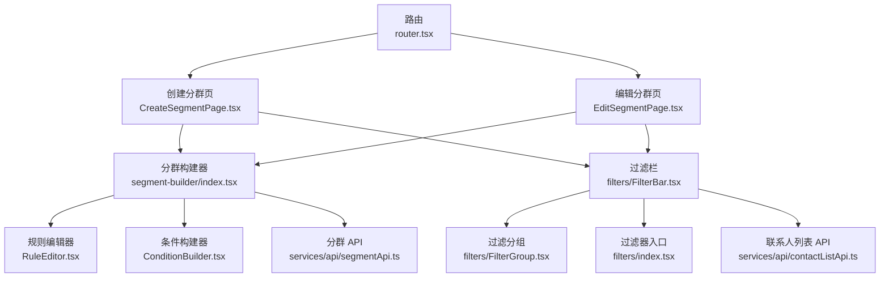
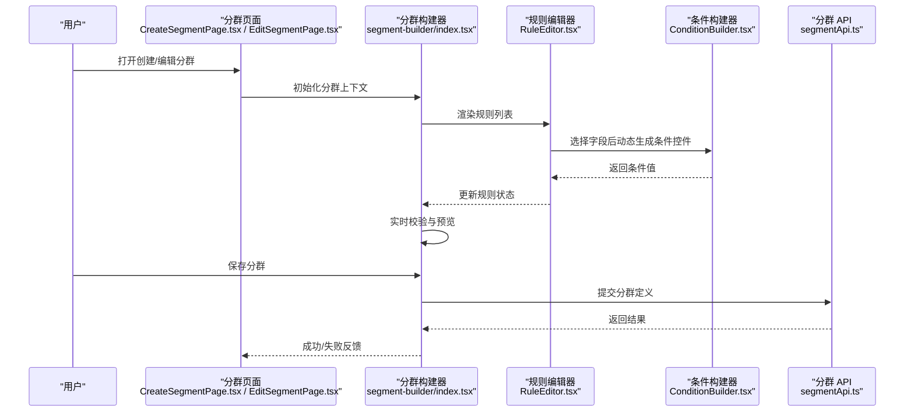
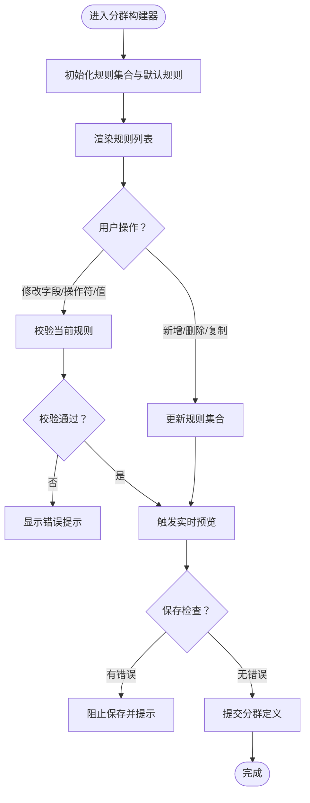
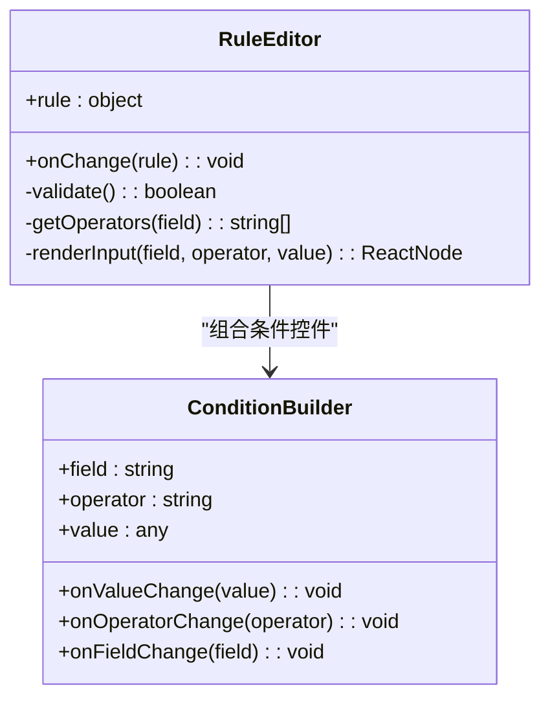
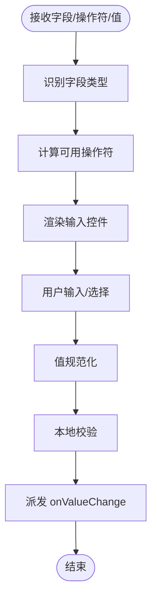
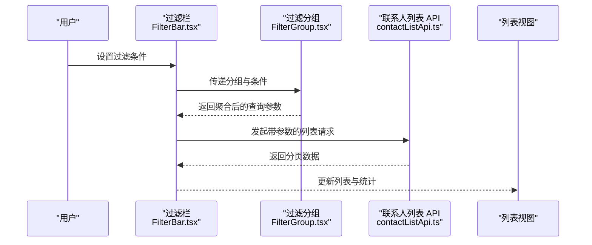
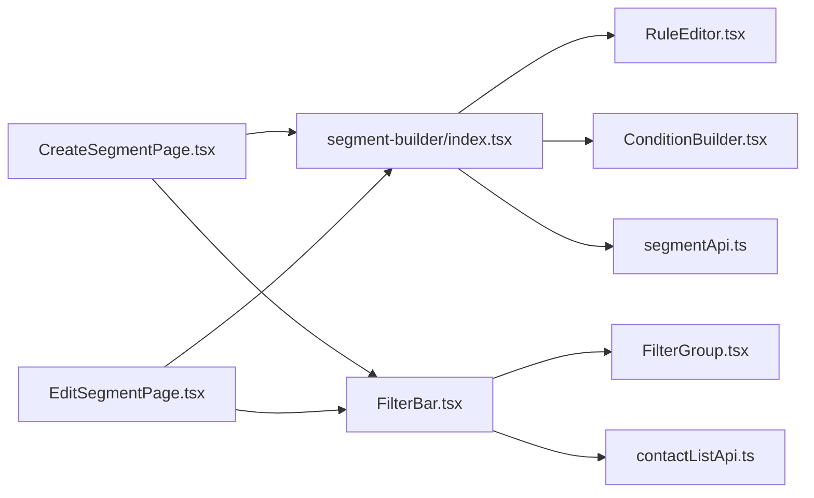

# 业务组件

<cite>
**本文引用的文件**   
- [console/src/components/segment-builder/index.tsx](file://notifuse/console/src/components/segment-builder/index.tsx)
- [console/src/components/segment-builder/RuleEditor.tsx](file://notifuse/console/src/components/segment-builder/RuleEditor.tsx)
- [console/src/components/segment-builder/ConditionBuilder.tsx](file://notifuse/console/src/components/segment-builder/ConditionBuilder.tsx)
- [console/src/components/filters/index.tsx](file://notifuse/console/src/components/filters/index.tsx)
- [console/src/components/filters/FilterBar.tsx](file://notifuse/console/src/components/filters/FilterBar.tsx)
- [console/src/components/filters/FilterGroup.tsx](file://notifuse/console/src/components/filters/FilterGroup.tsx)
- [console/src/services/api/segmentApi.ts](file://notifuse/console/src/services/api/segmentApi.ts)
- [console/src/services/api/contactListApi.ts](file://notifuse/console/src/services/api/contactListApi.ts)
- [console/src/pages/segments/CreateSegmentPage.tsx](file://notifuse/console/src/pages/segments/CreateSegmentPage.tsx)
- [console/src/pages/segments/EditSegmentPage.tsx](file://notifuse/console/src/pages/segments/EditSegmentPage.tsx)
- [console/src/router.tsx](file://notifuse/console/src/router.tsx)
</cite>

## 目录
1. [简介](#简介)
2. [项目结构](#项目结构)
3. [核心组件](#核心组件)
4. [架构总览](#架构总览)
5. [详细组件分析](#详细组件分析)
6. [依赖分析](#依赖分析)
7. [性能考虑](#性能考虑)
8. [故障排查指南](#故障排查指南)
9. [结论](#结论)
10. [附录](#附录)

## 简介
本文件聚焦 Notifuse 前端控制台与邮件营销业务相关的复杂 UI 组件，重点覆盖：
- 过滤器组件（列表筛选、分组、组合条件）
- 分群规则编辑器（可视化构建受众分群）
- 条件构建器（字段、操作符、值的动态组合）

文档将深入说明这些组件的业务逻辑实现、数据绑定机制、用户交互流程、配置选项、状态管理、验证规则与错误处理，并提供表单处理、动态字段生成、实时预览等特性的使用示例与集成指南。

## 项目结构
以下图示展示了与“分群”和“过滤”相关的前端模块组织关系，包括页面路由、API 服务层以及核心业务组件的协作方式。

图表来源
- [console/src/router.tsx](file://notifuse/console/src/router.tsx)
- [console/src/pages/segments/CreateSegmentPage.tsx](file://notifuse/console/src/pages/segments/CreateSegmentPage.tsx)
- [console/src/pages/segments/EditSegmentPage.tsx](file://notifuse/console/src/pages/segments/EditSegmentPage.tsx)
- [console/src/components/segment-builder/index.tsx](file://notifuse/console/src/components/segment-builder/index.tsx)
- [console/src/components/segment-builder/RuleEditor.tsx](file://notifuse/console/src/components/segment-builder/RuleEditor.tsx)
- [console/src/components/segment-builder/ConditionBuilder.tsx](file://notifuse/console/src/components/segment-builder/ConditionBuilder.tsx)
- [console/src/components/filters/index.tsx](file://notifuse/console/src/components/filters/index.tsx)
- [console/src/components/filters/FilterBar.tsx](file://notifuse/console/src/components/filters/FilterBar.tsx)
- [console/src/components/filters/FilterGroup.tsx](file://notifuse/console/src/components/filters/FilterGroup.tsx)
- [console/src/services/api/segmentApi.ts](file://notifuse/console/src/services/api/segmentApi.ts)
- [console/src/services/api/contactListApi.ts](file://notifuse/console/src/services/api/contactListApi.ts)

章节来源
- [console/src/router.tsx](file://notifuse/console/src/router.tsx)
- [console/src/pages/segments/CreateSegmentPage.tsx](file://notifuse/console/src/pages/segments/CreateSegmentPage.tsx)
- [console/src/pages/segments/EditSegmentPage.tsx](file://notifuse/console/src/pages/segments/EditSegmentPage.tsx)
- [console/src/components/segment-builder/index.tsx](file://notifuse/console/src/components/segment-builder/index.tsx)
- [console/src/components/filters/index.tsx](file://notifuse/console/src/components/filters/index.tsx)
- [console/src/components/filters/FilterBar.tsx](file://notifuse/console/src/components/filters/FilterBar.tsx)
- [console/src/components/filters/FilterGroup.tsx](file://notifuse/console/src/components/filters/FilterGroup.tsx)
- [console/src/services/api/segmentApi.ts](file://notifuse/console/src/services/api/segmentApi.ts)
- [console/src/services/api/contactListApi.ts](file://notifuse/console/src/services/api/contactListApi.ts)

## 核心组件
本节概述关键业务组件的职责与交互边界：
- 分群构建器：编排规则集合，驱动实时预览与校验，协调规则编辑器与条件构建器。
- 规则编辑器：维护单条规则的元信息（字段、操作符、值），提供增删改与联动行为。
- 条件构建器：根据所选字段动态渲染输入控件，支持多值、范围、包含/不包含等操作。
- 过滤器组件族：提供列表级筛选能力，支持分组、组合条件与即时刷新。

章节来源
- [console/src/components/segment-builder/index.tsx](file://notifuse/console/src/components/segment-builder/index.tsx)
- [console/src/components/segment-builder/RuleEditor.tsx](file://notifuse/console/src/components/segment-builder/RuleEditor.tsx)
- [console/src/components/segment-builder/ConditionBuilder.tsx](file://notifuse/console/src/components/segment-builder/ConditionBuilder.tsx)
- [console/src/components/filters/index.tsx](file://notifuse/console/src/components/filters/index.tsx)
- [console/src/components/filters/FilterBar.tsx](file://notifuse/console/src/components/filters/FilterBar.tsx)
- [console/src/components/filters/FilterGroup.tsx](file://notifuse/console/src/components/filters/FilterGroup.tsx)

## 架构总览
下图展示从页面到组件再到 API 的调用链路与数据流向，强调“规则-条件-预览-提交”的主路径。

图表来源
- [console/src/pages/segments/CreateSegmentPage.tsx](file://notifuse/console/src/pages/segments/CreateSegmentPage.tsx)
- [console/src/pages/segments/EditSegmentPage.tsx](file://notifuse/console/src/pages/segments/EditSegmentPage.tsx)
- [console/src/components/segment-builder/index.tsx](file://notifuse/console/src/components/segment-builder/index.tsx)
- [console/src/components/segment-builder/RuleEditor.tsx](file://notifuse/console/src/components/segment-builder/RuleEditor.tsx)
- [console/src/components/segment-builder/ConditionBuilder.tsx](file://notifuse/console/src/components/segment-builder/ConditionBuilder.tsx)
- [console/src/services/api/segmentApi.ts](file://notifuse/console/src/services/api/segmentApi.ts)

## 详细组件分析

### 分群构建器（Segment Builder）
职责与特性
- 编排多条规则，维护规则集合的状态与顺序。
- 驱动实时预览：基于当前规则集计算命中联系人数量或样本。
- 统一校验：必填字段、操作符与值匹配、重复字段检测等。
- 与过滤器联动：在创建/编辑分群时复用过滤能力进行快速定位。

数据绑定与状态管理
- 通过受控模式绑定规则数组与单条规则对象。
- 变更事件向上冒泡至页面层，用于保存与预览。
- 错误状态集中管理，按规则维度提示。

用户交互流程
- 新增/删除/复制规则；切换字段时自动适配可用操作符与输入控件。
- 拖拽排序（如实现）以调整规则优先级。
- 一键清空、批量禁用/启用规则。

配置选项（典型）
- 是否允许空规则、是否强制至少一条规则。
- 是否开启实时预览、预览延迟阈值。
- 是否显示调试面板（输出中间结果）。

验证规则与错误处理
- 字段-操作符-值三元组合法性校验。
- 类型不匹配（字符串 vs 数字）提示。
- 网络异常与超时重试策略。

图表来源
- [console/src/components/segment-builder/index.tsx](file://notifuse/console/src/components/segment-builder/index.tsx)

章节来源
- [console/src/components/segment-builder/index.tsx](file://notifuse/console/src/components/segment-builder/index.tsx)

### 规则编辑器（Rule Editor）
职责与特性
- 封装单条规则的编辑界面，包含字段选择、操作符选择、值输入区。
- 根据字段类型动态决定操作符集合与输入控件。
- 提供规则级错误提示与撤销/重做（若实现）。

数据绑定与状态管理
- 受控组件：父级传入 rule 对象，onChange 回调同步回父级。
- 内部缓存临时值，失焦或确认后再合并入父级状态。

用户交互流程
- 选择字段 -> 加载可用操作符 -> 渲染对应输入控件 -> 输入值 -> 触发校验。
- 支持快捷模板（如“最近活跃”、“未订阅”）一键填充。

配置选项（典型）
- 是否允许空值、是否限制最大长度。
- 是否显示帮助文案与占位符。
- 是否启用防抖以减少频繁校验。

验证规则与错误处理
- 必填性、格式（邮箱、URL、日期）、范围（数值区间）。
- 与后端枚举值一致性校验。

图表来源
- [console/src/components/segment-builder/RuleEditor.tsx](file://notifuse/console/src/components/segment-builder/RuleEditor.tsx)
- [console/src/components/segment-builder/ConditionBuilder.tsx](file://notifuse/console/src/components/segment-builder/ConditionBuilder.tsx)

章节来源
- [console/src/components/segment-builder/RuleEditor.tsx](file://notifuse/console/src/components/segment-builder/RuleEditor.tsx)
- [console/src/components/segment-builder/ConditionBuilder.tsx](file://notifuse/console/src/components/segment-builder/ConditionBuilder.tsx)

### 条件构建器（Condition Builder）
职责与特性
- 根据字段与操作符动态生成输入控件（文本框、下拉、多选、日期范围、数值区间等）。
- 支持多值输入与结构化值（键值对、JSON 片段）。
- 内置常用操作符映射与格式化（大小写敏感/忽略、正则表达式开关）。

数据绑定与状态管理
- 受控模式：外部传入 field/operator/value，内部仅负责渲染与派发变更事件。
- 值规范化：去除空白、标准化日期时间、单位换算。

用户交互流程
- 选择字段 -> 选择操作符 -> 渲染输入控件 -> 输入/选择值 -> 触发 onValueChange。
- 实时预览：输入即触发预览更新（可配置延迟）。

配置选项（典型）
- 字段元数据（类型、枚举、是否必填、是否唯一）。
- 操作符定义（标签、图标、是否支持多值、是否支持正则）。
- 输入控件约束（最小/最大值、步长、正则表达式）。

验证规则与错误处理
- 类型校验、范围校验、正则匹配。
- 非法输入高亮与友好提示。

图表来源
- [console/src/components/segment-builder/ConditionBuilder.tsx](file://notifuse/console/src/components/segment-builder/ConditionBuilder.tsx)

章节来源
- [console/src/components/segment-builder/ConditionBuilder.tsx](file://notifuse/console/src/components/segment-builder/ConditionBuilder.tsx)

### 过滤器组件族（Filters）
职责与特性
- 为列表页提供多维筛选能力，支持分组、组合条件与即时刷新。
- 与分群构建器共享部分字段与操作符定义，保证一致性。
- 支持 URL 参数持久化与分享链接。

数据绑定与状态管理
- 过滤状态与 URL 双向同步，支持浏览器前进后退。
- 分组内 AND/OR 组合，组间独立作用域。

用户交互流程
- 添加过滤项 -> 选择字段/操作符/值 -> 应用过滤 -> 刷新列表。
- 一键重置、导出当前过滤条件。

配置选项（典型）
- 是否启用分组、是否允许嵌套。
- 是否显示计数（命中数预估）。
- 是否缓存历史过滤条件。

验证规则与错误处理
- 必填字段校验、冲突条件检测（如互斥操作符）。
- 网络请求失败时的降级与重试。

图表来源
- [console/src/components/filters/FilterBar.tsx](file://notifuse/console/src/components/filters/FilterBar.tsx)
- [console/src/components/filters/FilterGroup.tsx](file://notifuse/console/src/components/filters/FilterGroup.tsx)
- [console/src/services/api/contactListApi.ts](file://notifuse/console/src/services/api/contactListApi.ts)

章节来源
- [console/src/components/filters/index.tsx](file://notifuse/console/src/components/filters/index.tsx)
- [console/src/components/filters/FilterBar.tsx](file://notifuse/console/src/components/filters/FilterBar.tsx)
- [console/src/components/filters/FilterGroup.tsx](file://notifuse/console/src/components/filters/FilterGroup.tsx)

### 页面集成与路由
- 创建分群页：初始化空规则集，提供新建规则与预览面板。
- 编辑分群页：加载已有分群定义，回填规则与条件，支持版本对比（若实现）。
- 路由配置：将上述页面挂载至控制台导航。

章节来源
- [console/src/pages/segments/CreateSegmentPage.tsx](file://notifuse/console/src/pages/segments/CreateSegmentPage.tsx)
- [console/src/pages/segments/EditSegmentPage.tsx](file://notifuse/console/src/pages/segments/EditSegmentPage.tsx)
- [console/src/router.tsx](file://notifuse/console/src/router.tsx)

## 依赖分析
组件间的依赖关系如下：页面依赖构建器与过滤器；构建器依赖规则编辑器与条件构建器；过滤器依赖联系人列表 API；构建器依赖分群 API。

图表来源
- [console/src/pages/segments/CreateSegmentPage.tsx](file://notifuse/console/src/pages/segments/CreateSegmentPage.tsx)
- [console/src/pages/segments/EditSegmentPage.tsx](file://notifuse/console/src/pages/segments/EditSegmentPage.tsx)
- [console/src/components/segment-builder/index.tsx](file://notifuse/console/src/components/segment-builder/index.tsx)
- [console/src/components/segment-builder/RuleEditor.tsx](file://notifuse/console/src/components/segment-builder/RuleEditor.tsx)
- [console/src/components/segment-builder/ConditionBuilder.tsx](file://notifuse/console/src/components/segment-builder/ConditionBuilder.tsx)
- [console/src/components/filters/FilterBar.tsx](file://notifuse/console/src/components/filters/FilterBar.tsx)
- [console/src/components/filters/FilterGroup.tsx](file://notifuse/console/src/components/filters/FilterGroup.tsx)
- [console/src/services/api/segmentApi.ts](file://notifuse/console/src/services/api/segmentApi.ts)
- [console/src/services/api/contactListApi.ts](file://notifuse/console/src/services/api/contactListApi.ts)

章节来源
- [console/src/components/segment-builder/index.tsx](file://notifuse/console/src/components/segment-builder/index.tsx)
- [console/src/components/filters/FilterBar.tsx](file://notifuse/console/src/components/filters/FilterBar.tsx)
- [console/src/services/api/segmentApi.ts](file://notifuse/console/src/services/api/segmentApi.ts)
- [console/src/services/api/contactListApi.ts](file://notifuse/console/src/services/api/contactListApi.ts)

## 性能考虑
- 防抖与节流：对输入变更与预览计算进行防抖，避免频繁渲染与计算。
- 增量更新：仅对受影响规则与条件进行局部重渲染。
- 虚拟滚动：当规则或过滤项较多时，采用虚拟列表提升性能。
- 缓存策略：缓存字段元数据、操作符映射与历史过滤条件。
- 懒加载：按需加载重型控件（如正则编辑器、富文本）。

[本节为通用指导，无需源码引用]

## 故障排查指南
常见问题与定位建议
- 规则无法保存：检查必填字段、操作符与值匹配、是否存在空规则。
- 预览结果为空：确认字段名与后端一致、操作符是否支持该字段类型。
- 过滤器无效：核对 URL 参数是否正确、分组逻辑是否符合预期。
- 网络错误：查看 API 响应码与错误消息，必要时重试或降级。

章节来源
- [console/src/components/segment-builder/index.tsx](file://notifuse/console/src/components/segment-builder/index.tsx)
- [console/src/components/filters/FilterBar.tsx](file://notifuse/console/src/components/filters/FilterBar.tsx)
- [console/src/services/api/segmentApi.ts](file://notifuse/console/src/services/api/segmentApi.ts)
- [console/src/services/api/contactListApi.ts](file://notifuse/console/src/services/api/contactListApi.ts)

## 结论
通过分群构建器、规则编辑器、条件构建器与过滤器组件族的协同，Notifuse 前端控制台实现了高度可配置的邮件营销受众筛选与分群能力。组件遵循受控模式与声明式渲染，结合实时预览与严格校验，既保证了用户体验，也提升了业务准确性。建议在后续迭代中持续优化性能与可访问性，并完善国际化与无障碍支持。

[本节为总结，无需源码引用]

## 附录
- 使用示例
  - 创建分群：在创建分群页新增规则，选择字段与操作符，输入值，观察实时预览，点击保存。
  - 编辑分群：加载已有分群，修改某条规则的条件，重新预览并保存。
  - 列表过滤：在联系人列表页添加过滤分组，设置多个条件，应用后刷新列表。
- 集成指南
  - 在页面中引入分群构建器与过滤器组件，传入初始数据与回调函数。
  - 对接分群 API 与联系人列表 API，处理成功与失败分支。
  - 将过滤条件同步至 URL，支持分享与书签。

[本节为概念性内容，无需源码引用]