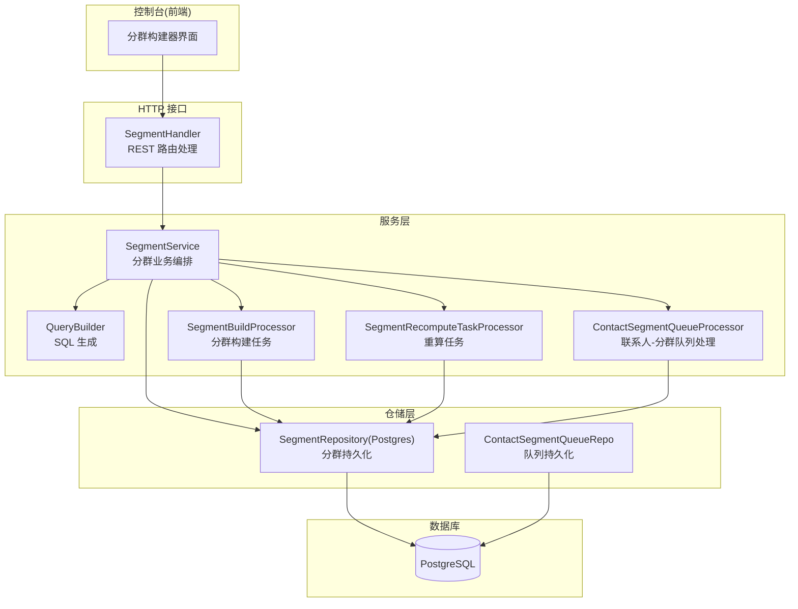
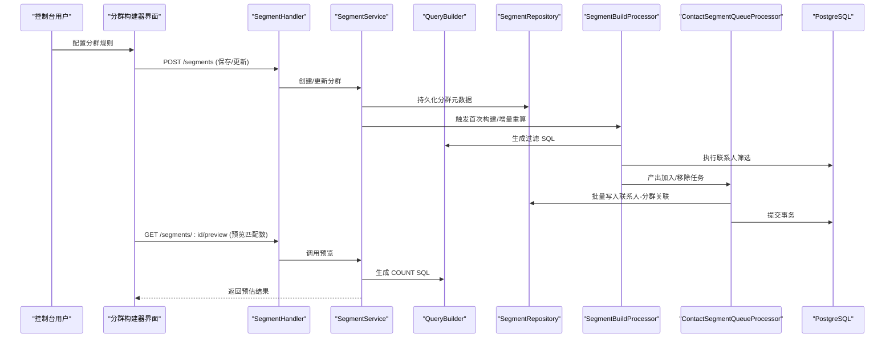
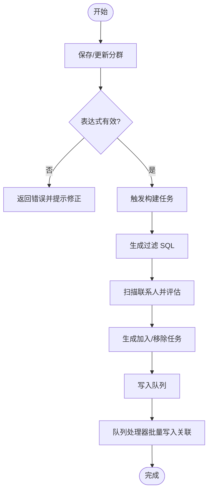
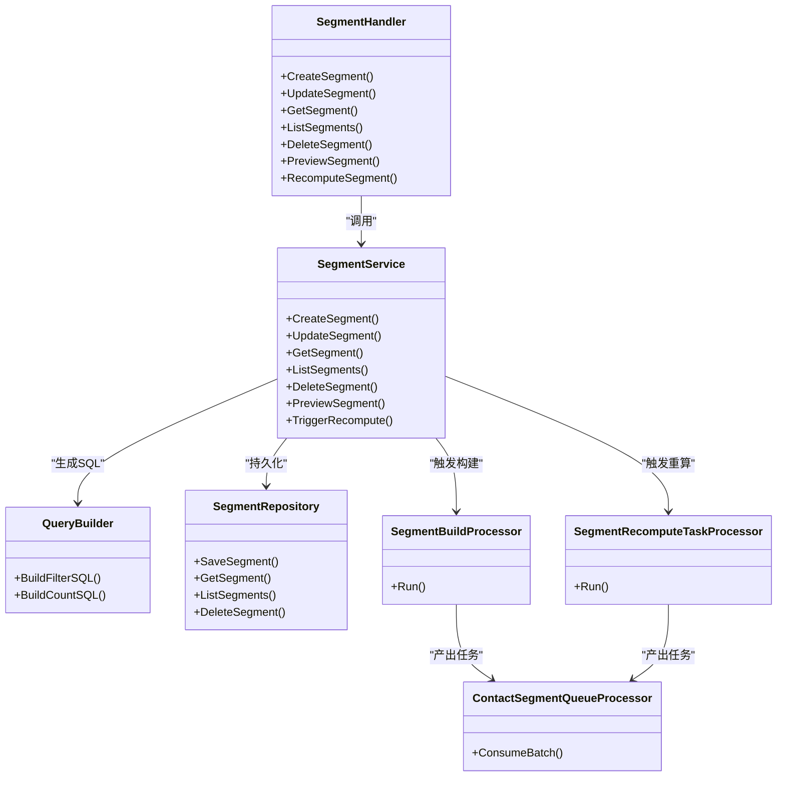

# 分群构建器

<cite>
**本文引用的文件**   
- [segment.go](file://notifuse/internal/domain/segment.go)
- [segment_handler.go](file://notifuse/internal/http/segment_handler.go)
- [segment_service.go](file://notifuse/internal/service/segment_service.go)
- [segment_build_processor.go](file://notifuse/internal/service/segment_build_processor.go)
- [segment_recompute_task_processor.go](file://notifuse/internal/service/segment_recompute_task_processor.go)
- [segment_postgres.go](file://notifuse/internal/repository/segment_postgres.go)
- [contact_segment_queue.go](file://notifuse/internal/domain/contact_segment_queue.go)
- [contact_segment_queue_processor.go](file://notifuse/internal/service/contact_segment_queue_processor.go)
- [query_builder.go](file://notifuse/internal/service/query_builder.go)
- [segment_test.go](file://notifuse/internal/domain/segment_test.go)
- [segment_handler_test.go](file://notifuse/internal/http/segment_handler_test.go)
- [segment_service_test.go](file://notifuse/internal/service/segment_service_test.go)
- [segment_build_processor_test.go](file://notifuse/internal/service/segment_build_processor_test.go)
- [segment_recompute_task_processor_test.go](file://notifuse/internal/service/segment_recompute_task_processor_test.go)
- [segment_postgres_test.go](file://notifuse/internal/repository/segment_postgres_test.go)
- [contact_segment_queue_processor_test.go](file://notifuse/internal/service/contact_segment_queue_processor_test.go)
- [query_builder_test.go](file://notifuse/internal/service/query_builder_test.go)
</cite>

## 目录
1. [简介](#简介)
2. [项目结构](#项目结构)
3. [核心组件](#核心组件)
4. [架构总览](#架构总览)
5. [详细组件分析](#详细组件分析)
6. [依赖关系分析](#依赖关系分析)
7. [性能考虑](#性能考虑)
8. [故障排查指南](#故障排查指南)
9. [结论](#结论)
10. [附录](#附录)

## 简介
本文件面向 Notifuse 控制台的“联系人分群构建器”，聚焦动态分群规则的可视化编辑与后端实现。文档覆盖：
- 字段类型定义、操作符选择与条件组合逻辑
- 各操作符组件（等于、包含、大于小于等）的实现原理与交互流程
- 分群表达式语法规范、验证规则与性能优化策略
- 复杂分群条件的构建示例、调试工具与常见问题解决方案
- 与后端 API 的集成方式与数据同步机制

## 项目结构
Notifuse 的分群能力由前端控制台与后端服务协同完成。后端采用领域模型 + 服务层 + 仓储层的分层架构，并通过队列处理器异步执行分群计算任务。

图表来源
- [segment_handler.go](file://notifuse/internal/http/segment_handler.go)
- [segment_service.go](file://notifuse/internal/service/segment_service.go)
- [segment_build_processor.go](file://notifuse/internal/service/segment_build_processor.go)
- [segment_recompute_task_processor.go](file://notifuse/internal/service/segment_recompute_task_processor.go)
- [contact_segment_queue_processor.go](file://notifuse/internal/service/contact_segment_queue_processor.go)
- [segment_postgres.go](file://notifuse/internal/repository/segment_postgres.go)
- [query_builder.go](file://notifuse/internal/service/query_builder.go)

章节来源
- [segment.go](file://notifuse/internal/domain/segment.go)
- [segment_handler.go](file://notifuse/internal/http/segment_handler.go)
- [segment_service.go](file://notifuse/internal/service/segment_service.go)
- [segment_build_processor.go](file://notifuse/internal/service/segment_build_processor.go)
- [segment_recompute_task_processor.go](file://notifuse/internal/service/segment_recompute_task_processor.go)
- [contact_segment_queue_processor.go](file://notifuse/internal/service/contact_segment_queue_processor.go)
- [segment_postgres.go](file://notifuse/internal/repository/segment_postgres.go)
- [query_builder.go](file://notifuse/internal/service/query_builder.go)

## 核心组件
- 领域模型
  - 分群实体与表达式树：用于描述分群规则的结构化表示，包括字段、操作符、值与逻辑组合。
  - 联系人-分群关联队列：记录需要加入或移除分群的联系人任务，支持异步批处理。
- HTTP 层
  - 分群处理器：提供分群 CRUD、预览、触发重算等 REST 接口。
- 服务层
  - 分群服务：协调表达式校验、SQL 生成、任务调度与结果落库。
  - 查询构建器：将表达式树转换为高效 SQL 片段，支持索引友好型谓词。
  - 分群构建处理器：按批次扫描联系人并评估表达式，写入联系人-分群关联表。
  - 重算任务处理器：对指定分群进行增量或全量重算。
  - 联系人-分群队列处理器：消费队列中的加入/移除任务，批量更新关联关系。
- 仓储层
  - 分群仓储：读写分群元数据与状态。
  - 队列仓储：读写联系人-分群队列项。

章节来源
- [segment.go](file://notifuse/internal/domain/segment.go)
- [contact_segment_queue.go](file://notifuse/internal/domain/contact_segment_queue.go)
- [segment_handler.go](file://notifuse/internal/http/segment_handler.go)
- [segment_service.go](file://notifuse/internal/service/segment_service.go)
- [query_builder.go](file://notifuse/internal/service/query_builder.go)
- [segment_build_processor.go](file://notifuse/internal/service/segment_build_processor.go)
- [segment_recompute_task_processor.go](file://notifuse/internal/service/segment_recompute_task_processor.go)
- [contact_segment_queue_processor.go](file://notifuse/internal/service/contact_segment_queue_processor.go)
- [segment_postgres.go](file://notifuse/internal/repository/segment_postgres.go)

## 架构总览
下图展示从控制台到后端的端到端调用链，以及异步构建与重算流程。

图表来源
- [segment_handler.go](file://notifuse/internal/http/segment_handler.go)
- [segment_service.go](file://notifuse/internal/service/segment_service.go)
- [query_builder.go](file://notifuse/internal/service/query_builder.go)
- [segment_build_processor.go](file://notifuse/internal/service/segment_build_processor.go)
- [contact_segment_queue_processor.go](file://notifuse/internal/service/contact_segment_queue_processor.go)
- [segment_postgres.go](file://notifuse/internal/repository/segment_postgres.go)

## 详细组件分析

### 分群表达式与字段类型
- 字段类型
  - 文本类：字符串比较、包含、前缀匹配、正则匹配等
  - 数值类：等于、不等于、大于、小于、区间
  - 布尔类：真/假判断
  - 枚举类：多选/单选匹配
  - 日期时间类：等于、早于、晚于、区间
  - 空值类：为空/不为空
- 操作符族
  - 相等性：等于、不等于
  - 集合性：包含、不包含、在集合中
  - 大小比较：大于、大于等于、小于、小于等于
  - 模式匹配：前缀匹配、后缀匹配、包含子串、正则
  - 空值判断：为空、不为空
  - 逻辑组合：AND、OR、NOT
- 表达式树
  - 节点类型：条件节点（字段+操作符+值）、逻辑节点（AND/OR/NOT）
  - 叶子节点为原子条件，内部节点为逻辑组合
  - 支持嵌套括号以表达任意复杂度的布尔表达式

章节来源
- [segment.go](file://notifuse/internal/domain/segment.go)
- [segment_test.go](file://notifuse/internal/domain/segment_test.go)

### 操作符组件实现与交互
- 前端交互
  - 字段选择器：根据字段类型动态渲染可用操作符列表
  - 值输入控件：文本框、数字框、日期选择器、下拉多选、正则编辑器等
  - 条件组：支持添加/删除条件、切换 AND/OR、拖拽排序
  - 实时校验：语法错误即时提示，非法值高亮
- 后端校验
  - 类型安全：操作符与字段类型必须兼容
  - 值域检查：数值范围、日期格式、正则合法性
  - 复杂度限制：防止过深嵌套或过长表达式导致性能问题
- 转换与生成
  - 表达式树序列化存储
  - 运行时解析为 SQL 片段，优先使用索引友好的谓词

章节来源
- [segment.go](file://notifuse/internal/domain/segment.go)
- [segment_test.go](file://notifuse/internal/domain/segment_test.go)
- [query_builder.go](file://notifuse/internal/service/query_builder.go)
- [query_builder_test.go](file://notifuse/internal/service/query_builder_test.go)

### 分群构建与重算流程
- 首次构建
  - 保存分群后自动触发构建任务
  - 生成过滤 SQL，扫描联系人表，产出加入/移除任务
  - 队列处理器批量写入联系人-分群关联表
- 增量重算
  - 当联系人属性变更时，仅对受影响分群进行增量重算
  - 基于变更事件生成重算任务，避免全量扫描
- 手动触发
  - 控制台提供“立即重算”入口，适用于批量修复或迁移场景

图表来源
- [segment_handler.go](file://notifuse/internal/http/segment_handler.go)
- [segment_service.go](file://notifuse/internal/service/segment_service.go)
- [segment_build_processor.go](file://notifuse/internal/service/segment_build_processor.go)
- [contact_segment_queue_processor.go](file://notifuse/internal/service/contact_segment_queue_processor.go)
- [segment_postgres.go](file://notifuse/internal/repository/segment_postgres.go)

章节来源
- [segment_build_processor.go](file://notifuse/internal/service/segment_build_processor.go)
- [segment_build_processor_test.go](file://notifuse/internal/service/segment_build_processor_test.go)
- [contact_segment_queue_processor.go](file://notifuse/internal/service/contact_segment_queue_processor.go)
- [contact_segment_queue_processor_test.go](file://notifuse/internal/service/contact_segment_queue_processor_test.go)
- [segment_recompute_task_processor.go](file://notifuse/internal/service/segment_recompute_task_processor.go)
- [segment_recompute_task_processor_test.go](file://notifuse/internal/service/segment_recompute_task_processor_test.go)

### 与后端 API 的集成
- 主要接口
  - 创建/更新分群：POST/PUT /segments
  - 获取分群详情：GET /segments/:id
  - 列出分群：GET /segments
  - 删除分群：DELETE /segments/:id
  - 预览匹配数量：GET /segments/:id/preview
  - 触发重算：POST /segments/:id/recompute
- 请求/响应要点
  - 请求体包含分群名称、描述、表达式树、可见性与标签等
  - 预览接口返回预估匹配数与分页信息
  - 重算接口返回任务 ID 与预计完成时间
- 鉴权与权限
  - 基于工作空间与角色控制访问
  - 敏感操作需管理员权限

章节来源
- [segment_handler.go](file://notifuse/internal/http/segment_handler.go)
- [segment_handler_test.go](file://notifuse/internal/http/segment_handler_test.go)
- [segment_service.go](file://notifuse/internal/service/segment_service.go)
- [segment_service_test.go](file://notifuse/internal/service/segment_service_test.go)

### 数据同步机制
- 队列驱动
  - 联系人-分群队列项记录目标联系人、目标分群、动作（加入/移除）
  - 队列处理器按批次消费，保证幂等与重试
- 一致性保障
  - 使用事务包裹批量写入，失败回滚
  - 去重键：联系人ID+分群ID+动作，避免重复写入
- 监控与可观测性
  - 队列长度、处理速率、失败率指标上报
  - 关键步骤日志与追踪 ID 贯穿调用链

章节来源
- [contact_segment_queue.go](file://notifuse/internal/domain/contact_segment_queue.go)
- [contact_segment_queue_processor.go](file://notifuse/internal/service/contact_segment_queue_processor.go)
- [contact_segment_queue_processor_test.go](file://notifuse/internal/service/contact_segment_queue_processor_test.go)

## 依赖关系分析
- 组件耦合
  - SegmentHandler 依赖 SegmentService 暴露 HTTP 能力
  - SegmentService 依赖 QueryBuilder 生成 SQL、依赖 SegmentRepository 持久化、依赖构建与重算处理器
  - 构建与重算处理器依赖队列处理器完成最终关联写入
- 外部依赖
  - PostgreSQL 作为主数据存储
  - 可选消息队列用于任务分发（若启用）

图表来源
- [segment_handler.go](file://notifuse/internal/http/segment_handler.go)
- [segment_service.go](file://notifuse/internal/service/segment_service.go)
- [query_builder.go](file://notifuse/internal/service/query_builder.go)
- [segment_build_processor.go](file://notifuse/internal/service/segment_build_processor.go)
- [segment_recompute_task_processor.go](file://notifuse/internal/service/segment_recompute_task_processor.go)
- [contact_segment_queue_processor.go](file://notifuse/internal/service/contact_segment_queue_processor.go)
- [segment_postgres.go](file://notifuse/internal/repository/segment_postgres.go)

章节来源
- [segment_handler.go](file://notifuse/internal/http/segment_handler.go)
- [segment_service.go](file://notifuse/internal/service/segment_service.go)
- [query_builder.go](file://notifuse/internal/service/query_builder.go)
- [segment_build_processor.go](file://notifuse/internal/service/segment_build_processor.go)
- [segment_recompute_task_processor.go](file://notifuse/internal/service/segment_recompute_task_processor.go)
- [contact_segment_queue_processor.go](file://notifuse/internal/service/contact_segment_queue_processor.go)
- [segment_postgres.go](file://notifuse/internal/repository/segment_postgres.go)

## 性能考虑
- SQL 生成优化
  - 优先使用等值与范围谓词，充分利用索引
  - 避免对大表进行无索引列的全表扫描
  - 对正则匹配进行白名单与复杂度限制
- 构建与重算优化
  - 增量重算优先：仅对变更联系人所在分群重算
  - 分批处理：每次处理固定数量的联系人，降低内存峰值
  - 幂等写入：利用唯一约束与 Upsert 减少重复开销
- 队列与并发
  - 合理设置消费者并发度与批大小
  - 失败重试与死信队列，避免阻塞
- 监控与告警
  - 跟踪构建耗时、队列积压、失败率
  - 慢查询分析与索引建议

[本节为通用指导，不直接分析具体文件]

## 故障排查指南
- 常见错误
  - 表达式无效：字段类型与操作符不兼容、值格式错误、正则非法
  - 构建超时：表达式过于复杂或缺少必要索引
  - 队列堆积：消费者不足或下游写入缓慢
- 定位方法
  - 查看分群预览接口返回的错误码与消息
  - 检查构建与重算任务的日志与追踪 ID
  - 观察队列长度与处理速率指标
- 修复建议
  - 简化表达式，拆分复杂条件为多个分群
  - 为常用过滤字段建立合适索引
  - 调整消费者并发与批大小，扩容资源

章节来源
- [segment_handler_test.go](file://notifuse/internal/http/segment_handler_test.go)
- [segment_service_test.go](file://notifuse/internal/service/segment_service_test.go)
- [segment_build_processor_test.go](file://notifuse/internal/service/segment_build_processor_test.go)
- [segment_recompute_task_processor_test.go](file://notifuse/internal/service/segment_recompute_task_processor_test.go)
- [contact_segment_queue_processor_test.go](file://notifuse/internal/service/contact_segment_queue_processor_test.go)
- [segment_postgres_test.go](file://notifuse/internal/repository/segment_postgres_test.go)

## 结论
分群构建器通过可视化的表达式树与严格的后端校验，实现了灵活且高性能的动态分群能力。借助查询构建器与异步队列处理器，系统在保证一致性的同时具备良好的扩展性与可观测性。建议在复杂场景中结合索引设计与增量重算策略，以获得更优的性能表现。

[本节为总结，不直接分析具体文件]

## 附录
- 术语
  - 分群：一组满足特定条件的联系人集合
  - 表达式树：描述分群规则的树形结构
  - 增量重算：仅对受影响的联系人重新评估分群条件
- 最佳实践
  - 将复杂条件拆分为多个分群，提升可读性与性能
  - 优先使用等值与范围谓词，避免全表扫描
  - 定期审查与清理未使用的分群，降低维护成本

[本节为补充说明，不直接分析具体文件]