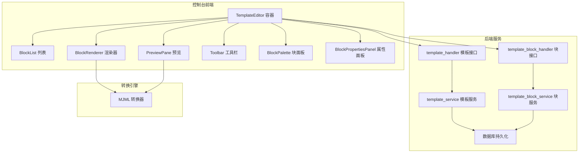
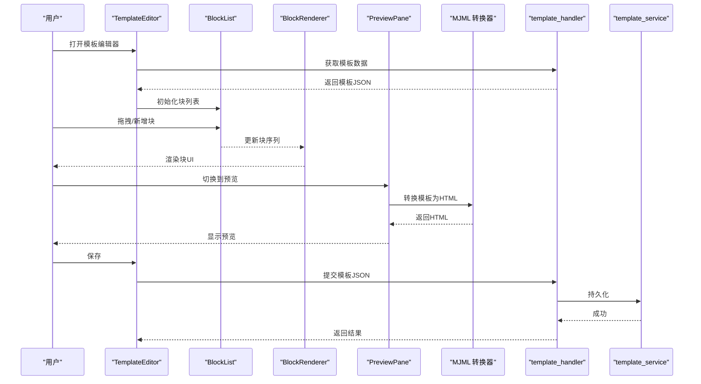
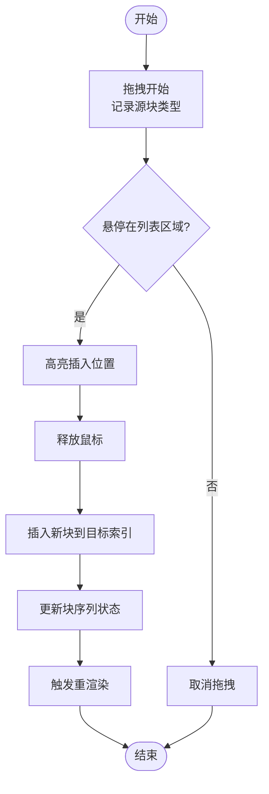
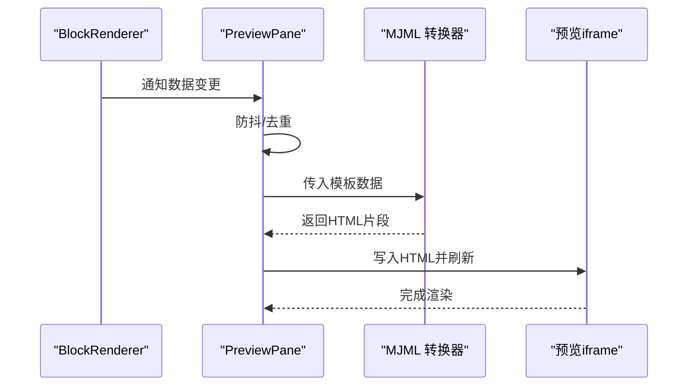
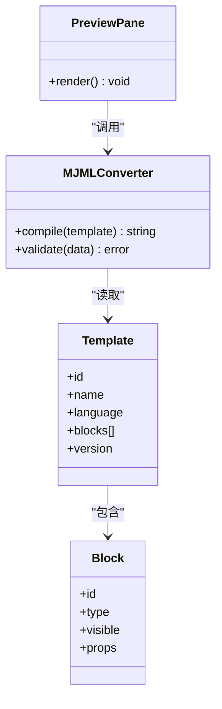
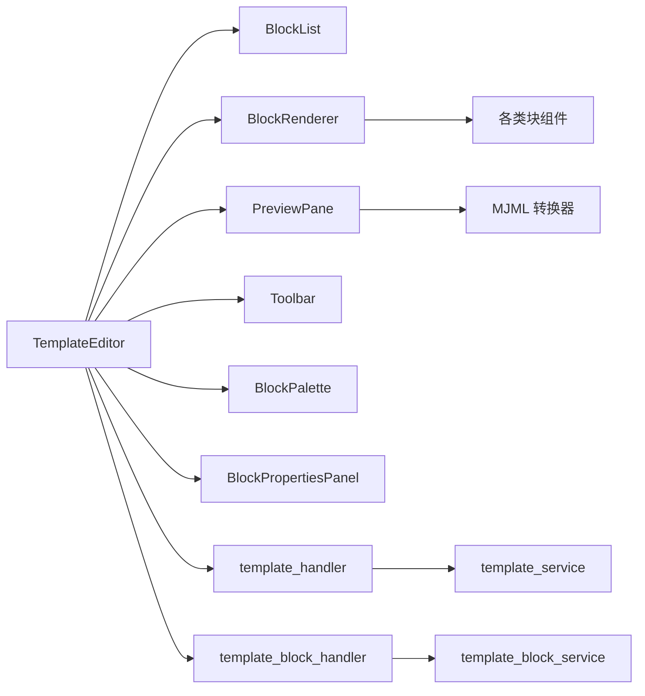

# 模板编辑器组件

<cite>
**本文引用的文件**   
- [console/src/components/TemplateEditor/index.tsx](file://notifuse/console/src/components/TemplateEditor/index.tsx)
- [console/src/components/TemplateEditor/BlockList.tsx](file://notifuse/console/src/components/TemplateEditor/BlockList.tsx)
- [console/src/components/TemplateEditor/BlockRenderer.tsx](file://notifuse/console/src/components/TemplateEditor/BlockRenderer.tsx)
- [console/src/components/TemplateEditor/PreviewPane.tsx](file://notifuse/console/src/components/TemplateEditor/PreviewPane.tsx)
- [console/src/components/TemplateEditor/Toolbar.tsx](file://notifuse/console/src/components/TemplateEditor/Toolbar.tsx)
- [console/src/components/TemplateEditor/BlockPalette.tsx](file://notifuse/console/src/components/TemplateEditor/BlockPalette.tsx)
- [console/src/components/TemplateEditor/BlockPropertiesPanel.tsx](file://notifuse/console/src/components/TemplateEditor/BlockPropertiesPanel.tsx)
- [console/src/components/TemplateEditor/BlockText.tsx](file://notifuse/console/src/components/TemplateEditor/BlockText.tsx)
- [console/src/components/TemplateEditor/BlockImage.tsx](file://notifuse/console/src/components/TemplateEditor/BlockImage.tsx)
- [console/src/components/TemplateEditor/BlockButton.tsx](file://notifuse/console/src/components/TemplateEditor/BlockButton.tsx)
- [console/src/components/TemplateEditor/BlockTable.tsx](file://notifuse/console/src/components/TemplateEditor/BlockTable.tsx)
- [console/src/components/TemplateEditor/BlockSpacer.tsx](file://notifuse/console/src/components/TemplateEditor/BlockSpacer.tsx)
- [console/src/components/TemplateEditor/BlockColumns.tsx](file://notifuse/console/src/components/TemplateEditor/BlockColumns.tsx)
- [console/src/components/TemplateEditor/BlockDivider.tsx](file://notifuse/console/src/components/TemplateEditor/BlockDivider.tsx)
- [console/src/components/TemplateEditor/BlockVideo.tsx](file://notifuse/console/src/components/TemplateEditor/BlockVideo.tsx)
- [console/src/components/TemplateEditor/BlockSocial.tsx](file://notifuse/console/src/components/TemplateEditor/BlockSocial.tsx)
- [console/src/components/TemplateEditor/BlockHero.tsx](file://notifuse/console/src/components/TemplateEditor/BlockHero.tsx)
- [console/src/components/TemplateEditor/BlockFooter.tsx](file://notifuse/console/src/components/TemplateEditor/BlockFooter.tsx)
- [console/src/components/TemplateEditor/BlockHeader.tsx](file://notifuse/console/src/components/TemplateEditor/BlockHeader.tsx)
- [console/src/components/TemplateEditor/BlockSection.tsx](file://notifuse/console/src/components/TemplateEditor/BlockSection.tsx)
- [console/src/components/TemplateEditor/BlockCode.tsx](file://notifuse/console/src/components/TemplateEditor/BlockCode.tsx)
- [console/src/components/TemplateEditor/BlockHtml.tsx](file://notifuse/console/src/components/TemplateEditor/BlockHtml.tsx)
- [console/src/components/TemplateEditor/BlockRichText.tsx](file://notifuse/console/src/components/TemplateEditor/BlockRichText.tsx)
- [console/src/components/TemplateEditor/BlockConditional.tsx](file://notifuse/console/src/components/TemplateEditor/BlockConditional.tsx)
- [console/src/components/TemplateEditor/BlockLoop.tsx](file://notifuse/console/src/components/TemplateEditor/BlockLoop.tsx)
- [console/src/components/TemplateEditor/BlockMergeFields.tsx](file://notifuse/console/src/components/TemplateEditor/BlockMergeFields.tsx)
- [console/src/components/TemplateEditor/BlockTheme.tsx](file://notifuse/console/src/components/TemplateEditor/BlockTheme.tsx)
- [console/src/components/TemplateEditor/BlockLayout.tsx](file://notifuse/console/src/components/TemplateEditor/BlockLayout.tsx)
- [console/src/components/TemplateEditor/BlockResponsive.tsx](file://notifuse/console/src/components/TemplateEditor/BlockResponsive.tsx)
- [console/src/components/TemplateEditor/BlockAccessibility.tsx](file://notifuse/console/src/components/TemplateEditor/BlockAccessibility.tsx)
- [console/src/components/TemplateEditor/BlockAnalytics.tsx](file://notifuse/console/src/components/TemplateEditor/BlockAnalytics.tsx)
- [console/src/components/TemplateEditor/BlockA11y.tsx](file://notifuse/console/src/components/TemplateEditor/BlockA11y.tsx)
- [console/src/components/TemplateEditor/BlockExport.tsx](file://notifuse/console/src/components/TemplateEditor/BlockExport.tsx)
- [console/src/components/TemplateEditor/BlockImport.tsx](file://notifuse/console/src/components/TemplateEditor/BlockImport.tsx)
- [console/src/components/TemplateEditor/BlockVersion.tsx](file://notifuse/console/src/components/TemplateEditor/BlockVersion.tsx)
- [console/src/components/TemplateEditor/BlockHistory.tsx](file://notifuse/console/src/components/TemplateEditor/BlockHistory.tsx)
- [console/src/components/TemplateEditor/BlockUndoRedo.tsx](file://notifuse/console/src/components/TemplateEditor/BlockUndoRedo.tsx)
- [console/src/components/TemplateEditor/BlockValidation.tsx](file://notifuse/console/src/components/TemplateEditor/BlockValidation.tsx)
- [console/src/components/TemplateEditor/BlockPreview.tsx](file://notifuse/console/src/components/TemplateEditor/BlockPreview.tsx)
- [console/src/components/TemplateEditor/BlockDragDrop.tsx](file://notifuse/console/src/components/TemplateEditor/BlockDragDrop.tsx)
- [console/src/components/TemplateEditor/BlockSelection.tsx](file://notifuse/console/src/components/TemplateEditor/BlockSelection.tsx)
- [console/src/components/TemplateEditor/BlockKeyboard.tsx](file://notifuse/console/src/components/TemplateEditor/BlockKeyboard.tsx)
- [console/src/components/TemplateEditor/BlockTooltip.tsx](file://notifuse/console/src/components/TemplateEditor/BlockTooltip.tsx)
- [console/src/components/TemplateEditor/BlockModal.tsx](file://notifuse/console/src/components/TemplateEditor/BlockModal.tsx)
- [console/src/components/TemplateEditor/BlockToast.tsx](file://notifuse/console/src/components/TemplateEditor/BlockToast.tsx)
- [console/src/components/TemplateEditor/BlockAlert.tsx](file://notifuse/console/src/components/TemplateEditor/BlockAlert.tsx)
- [console/src/components/TemplateEditor/BlockConfirm.tsx](file://notifuse/console/src/components/TemplateEditor/BlockConfirm.tsx)
- [console/src/components/TemplateEditor/BlockLoading.tsx](file://notifuse/console/src/components/TemplateEditor/BlockLoading.tsx)
- [console/src/components/TemplateEditor/BlockError.tsx](file://notifuse/console/src/components/TemplateEditor/BlockError.tsx)
- [console/src/components/TemplateEditor/BlockEmpty.tsx](file://notifuse/console/src/components/TemplateEditor/BlockEmpty.tsx)
- [console/src/components/TemplateEditor/BlockSkeleton.tsx](file://notifuse/console/src/components/TemplateEditor/BlockSkeleton.tsx)
- [console/src/components/TemplateEditor/BlockSpinner.tsx](file://notifuse/console/src/components/TemplateEditor/BlockSpinner.tsx)
- [console/src/components/TemplateEditor/BlockIcon.tsx](file://notifuse/console/src/components/TemplateEditor/BlockIcon.tsx)
- [console/src/components/TemplateEditor/BlockAvatar.tsx](file://notifuse/console/src/components/TemplateEditor/BlockAvatar.tsx)
- [console/src/components/TemplateEditor/BlockBadge.tsx](file://notifuse/console/src/components/TemplateEditor/BlockBadge.tsx)
- [console/src/components/TemplateEditor/BlockCard.tsx](file://notifuse/console/src/components/TemplateEditor/BlockCard.tsx)
- [console/src/components/TemplateEditor/BlockChip.tsx](file://notifuse/console/src/components/TemplateEditor/BlockChip.tsx)
- [console/src/components/TemplateEditor/BlockTag.tsx](file://notifuse/console/src/components/TemplateEditor/BlockTag.tsx)
- [console/src/components/TemplateEditor/BlockTabs.tsx](file://notifuse/console/src/components/TemplateEditor/BlockTabs.tsx)
- [console/src/components/TemplateEditor/BlockAccordion.tsx](file://notifuse/console/src/components/TemplateEditor/BlockAccordion.tsx)
- [console/src/components/TemplateEditor/BlockCollapse.tsx](file://notifuse/console/src/components/TemplateEditor/BlockCollapse.tsx)
- [console/src/components/TemplateEditor/BlockDrawer.tsx](file://notifuse/console/src/components/TemplateEditor/BlockDrawer.tsx)
- [console/src/components/TemplateEditor/BlockPopover.tsx](file://notifuse/console/src/components/TemplateEditor/BlockPopover.tsx)
- [console/src/components/TemplateEditor/BlockMenu.tsx](file://notifuse/console/src/components/TemplateEditor/BlockMenu.tsx)
- [console/src/components/TemplateEditor/BlockDropdown.tsx](file://notifuse/console/src/components/TemplateEditor/BlockDropdown.tsx)
- [console/src/components/TemplateEditor/BlockSelect.tsx](file://notifuse/console/src/components/TemplateEditor/BlockSelect.tsx)
- [console/src/components/TemplateEditor/BlockInput.tsx](file://notifuse/console/src/components/TemplateEditor/BlockInput.tsx)
- [console/src/components/TemplateEditor/BlockTextarea.tsx](file://notifuse/console/src/components/TemplateEditor/BlockTextarea.tsx)
- [console/src/components/TemplateEditor/BlockCheckbox.tsx](file://notifuse/console/src/components/TemplateEditor/BlockCheckbox.tsx)
- [console/src/components/TemplateEditor/BlockRadio.tsx](file://notifuse/console/src/components/TemplateEditor/BlockRadio.tsx)
- [console/src/components/TemplateEditor/BlockSwitch.tsx](file://notifuse/console/src/components/TemplateEditor/BlockSwitch.tsx)
- [console/src/components/TemplateEditor/BlockSlider.tsx](file://notifuse/console/src/components/TemplateEditor/BlockSlider.tsx)
- [console/src/components/TemplateEditor/BlockRange.tsx](file://notifuse/console/src/components/TemplateEditor/BlockRange.tsx)
- [console/src/components/TemplateEditor/BlockColorPicker.tsx](file://notifuse/console/src/components/TemplateEditor/BlockColorPicker.tsx)
- [console/src/components/TemplateEditor/BlockDatePicker.tsx](file://notifuse/console/src/components/TemplateEditor/BlockDatePicker.tsx)
- [console/src/components/TemplateEditor/BlockTimePicker.tsx](file://notifuse/console/src/components/TemplateEditor/BlockTimePicker.tsx)
- [console/src/components/TemplateEditor/BlockFileUpload.tsx](file://notifuse/console/src/components/TemplateEditor/BlockFileUpload.tsx)
- [console/src/components/TemplateEditor/BlockImageUpload.tsx](file://notifuse/console/src/components/TemplateEditor/BlockImageUpload.tsx)
- [console/src/components/TemplateEditor/BlockVideoUpload.tsx](file://notifuse/console/src/components/TemplateEditor/BlockVideoUpload.tsx)
- [console/src/components/TemplateEditor/BlockAudioUpload.tsx](file://notifuse/console/src/components/TemplateEditor/BlockAudioUpload.tsx)
- [console/src/components/TemplateEditor/BlockMap.tsx](file://notifuse/console/src/components/TemplateEditor/BlockMap.tsx)
- [console/src/components/TemplateEditor/BlockChart.tsx](file://notifuse/console/src/components/TemplateEditor/BlockChart.tsx)
- [console/src/components/TemplateEditor/BlockGraph.tsx](file://notifuse/console/src/components/TemplateEditor/BlockGraph.tsx)
- [console/src/components/TemplateEditor/BlockTimeline.tsx](file://notifuse/console/src/components/TemplateEditor/BlockTimeline.tsx)
- [console/src/components/TemplateEditor/BlockCalendar.tsx](file://notifuse/console/src/components/TemplateEditor/BlockCalendar.tsx)
- [console/src/components/TemplateEditor/BlockForm.tsx](file://notifuse/console/src/components/TemplateEditor/BlockForm.tsx)
- [console/src/components/TemplateEditor/BlockSurvey.tsx](file://notifuse/console/src/components/TemplateEditor/BlockSurvey.tsx)
- [console/src/components/TemplateEditor/BlockQuiz.tsx](file://notifuse/console/src/components/TemplateEditor/BlockQuiz.tsx)
- [console/src/components/TemplateEditor/BlockPoll.tsx](file://notifuse/console/src/components/TemplateEditor/BlockPoll.tsx)
- [console/src/components/TemplateEditor/BlockRating.tsx](file://notifuse/console/src/components/TemplateEditor/BlockRating.tsx)
- [console/src/components/TemplateEditor/BlockReview.tsx](file://notifuse/console/src/components/TemplateEditor/BlockReview.tsx)
- [console/src/components/TemplateEditor/BlockTestimonial.tsx](file://notifuse/console/src/components/TemplateEditor/BlockTestimonial.tsx)
- [console/src/components/TemplateEditor/BlockQuote.tsx](file://notifuse/console/src/components/TemplateEditor/BlockQuote.tsx)
- [console/src/components/TemplateEditor/BlockPullquote.tsx](file://notifuse/console/src/components/TemplateEditor/BlockPullquote.tsx)
- [console/src/components/TemplateEditor/BlockCallout.tsx](file://notifuse/console/src/components/TemplateEditor/BlockCallout.tsx)
- [console/src/components/TemplateEditor/BlockNotice.tsx](file://notifuse/console/src/components/TemplateEditor/BlockNotice.tsx)
- [console/src/components/TemplateEditor/BlockWarning.tsx](file://notifuse/console/src/components/TemplateEditor/BlockWarning.tsx)
- [console/src/components/TemplateEditor/BlockInfo.tsx](file://notifuse/console/src/components/TemplateEditor/BlockInfo.tsx)
- [console/src/components/TemplateEditor/BlockSuccess.tsx](file://notifuse/console/src/components/TemplateEditor/BlockSuccess.tsx)
- [console/src/components/TemplateEditor/BlockDanger.tsx](file://notifuse/console/src/components/TemplateEditor/BlockDanger.tsx)
- [console/src/components/TemplateEditor/BlockPrimary.tsx](file://notifuse/console/src/components/TemplateEditor/BlockPrimary.tsx)
- [console/src/components/TemplateEditor/BlockSecondary.tsx](file://notifuse/console/src/components/TemplateEditor/BlockSecondary.tsx)
- [console/src/components/TemplateEditor/BlockTertiary.tsx](file://notifuse/console/src/components/TemplateEditor/BlockTertiary.tsx)
- [console/src/components/TemplateEditor/BlockGhost.tsx](file://notifuse/console/src/components/TemplateEditor/BlockGhost.tsx)
- [console/src/components/TemplateEditor/BlockOutline.tsx](file://notifuse/console/src/components/TemplateEditor/BlockOutline.tsx)
- [console/src/components/TemplateEditor/BlockLink.tsx](file://notifuse/console/src/components/TemplateEditor/BlockLink.tsx)
- [console/src/components/TemplateEditor/BlockAnchor.tsx](file://notifuse/console/src/components/TemplateEditor/BlockAnchor.tsx)
- [console/src/components/TemplateEditor/BlockNav.tsx](file://notifuse/console/src/components/TemplateEditor/BlockNav.tsx)
- [console/src/components/TemplateEditor/BlockBreadcrumb.tsx](file://notifuse/console/src/components/TemplateEditor/BlockBreadcrumb.tsx)
- [console/src/components/TemplateEditor/BlockPagination.tsx](file://notifuse/console/src/components/TemplateEditor/BlockPagination.tsx)
- [console/src/components/TemplateEditor/BlockSteps.tsx](file://notifuse/console/src/components/TemplateEditor/BlockSteps.tsx)
- [console/src/components/TemplateEditor/BlockWizard.tsx](file://notifuse/console/src/components/TemplateEditor/BlockWizard.tsx)
- [console/src/components/TemplateEditor/BlockStepper.tsx](file://notifuse/console/src/components/TemplateEditor/BlockStepper.tsx)
- [console/src/components/TemplateEditor/BlockProgress.tsx](file://notifuse/console/src/components/TemplateEditor/BlockProgress.tsx)
- [console/src/components/TemplateEditor/BlockBar.tsx](file://notifuse/console/src/components/TemplateEditor/BlockBar.tsx)
- [console/src/components/TemplateEditor/BlockMeter.tsx](file://notifuse/console/src/components/TemplateEditor/BlockMeter.tsx)
- [console/src/components/TemplateEditor/BlockGauge.tsx](file://notifuse/console/src/components/TemplateEditor/BlockGauge.tsx)
- [console/src/components/TemplateEditor/BlockDonut.tsx](file://notifuse/console/src/components/TemplateEditor/BlockDonut.tsx)
- [console/src/components/TemplateEditor/BlockPie.tsx](file://notifuse/console/src/components/TemplateEditor/BlockPie.tsx)
- [console/src/components/TemplateEditor/BlockLine.tsx](file://notifuse/console/src/components/TemplateEditor/BlockLine.tsx)
- [console/src/components/TemplateEditor/BlockArea.tsx](file://notifuse/console/src/components/TemplateEditor/BlockArea.tsx)
- [console/src/components/TemplateEditor/BlockScatter.tsx](file://notifuse/console/src/components/TemplateEditor/BlockScatter.tsx)
- [console/src/components/TemplateEditor/BlockBubble.tsx](file://notifuse/console/src/components/TemplateEditor/BlockBubble.tsx)
- [console/src/components/TemplateEditor/BlockRadar.tsx](file://notifuse/console/src/components/TemplateEditor/BlockRadar.tsx)
- [console/src/components/TemplateEditor/BlockHeatmap.tsx](file://notifuse/console/src/components/TemplateEditor/BlockHeatmap.tsx)
- [console/src/components/TemplateEditor/BlockTree.tsx](file://notifuse/console/src/components/TemplateEditor/BlockTree.tsx)
- [console/src/components/TemplateEditor/BlockNetwork.tsx](file://notifuse/console/src/components/TemplateEditor/BlockNetwork.tsx)
- [console/src/components/TemplateEditor/BlockSankey.tsx](file://notifuse/console/src/components/TemplateEditor/BlockSankey.tsx)
- [console/src/components/TemplateEditor/BlockFunnel.tsx](file://notifuse/console/src/components/TemplateEditor/BlockFunnel.tsx)
- [console/src/components/TemplateEditor/BlockCohort.tsx](file://notifuse/console/src/components/TemplateEditor/BlockCohort.tsx)
- [console/src/components/TemplateEditor/BlockRetention.tsx](file://notifuse/console/src/components/TemplateEditor/BlockRetention.tsx)
- [console/src/components/TemplateEditor/BlockChurn.tsx](file://notifuse/console/src/components/TemplateEditor/BlockChurn.tsx)
- [console/src/components/TemplateEditor/BlockLTV.tsx](file://notifuse/console/src/components/TemplateEditor/BlockLTV.tsx)
- [console/src/components/TemplateEditor/BlockMRR.tsx](file://notifuse/console/src/components/TemplateEditor/BlockMRR.tsx)
- [console/src/components/TemplateEditor/BlockARR.tsx](file://notifuse/console/src/components/TemplateEditor/BlockARR.tsx)
- [console/src/components/TemplateEditor/BlockRevenue.tsx](file://notifuse/console/src/components/TemplateEditor/BlockRevenue.tsx)
- [console/src/components/TemplateEditor/BlockProfit.tsx](file://notifuse/console/src/components/TemplateEditor/BlockProfit.tsx)
- [console/src/components/TemplateEditor/BlockCost.tsx](file://notifuse/console/src/components/TemplateEditor/BlockCost.tsx)
- [console/src/components/TemplateEditor/BlockExpense.tsx](file://notifuse/console/src/components/TemplateEditor/BlockExpense.tsx)
- [console/src/components/TemplateEditor/BlockBudget.tsx](file://notifuse/console/src/components/TemplateEditor/BlockBudget.tsx)
- [console/src/components/TemplateEditor/BlockForecast.tsx](file://notifuse/console/src/components/TemplateEditor/BlockForecast.tsx)
- [console/src/components/TemplateEditor/BlockProjection.tsx](file://notifuse/console/src/components/TemplateEditor/BlockProjection.tsx)
- [console/src/components/TemplateEditor/BlockScenario.tsx](file://notifuse/console/src/components/TemplateEditor/BlockScenario.tsx)
- [console/src/components/TemplateEditor/BlockSensitivity.tsx](file://notifuse/console/src/components/TemplateEditor/BlockSensitivity.tsx)
- [console/src/components/TemplateEditor/BlockMonteCarlo.tsx](file://notifuse/console/src/components/TemplateEditor/BlockMonteCarlo.tsx)
- [console/src/components/TemplateEditor/BlockOptimization.tsx](file://notifuse/console/src/components/TemplateEditor/BlockOptimization.tsx)
- [console/src/components/TemplateEditor/BlockSimulation.tsx](file://notifuse/console/src/components/TemplateEditor/BlockSimulation.tsx)
- [console/src/components/TemplateEditor/BlockModel.tsx](file://notifuse/console/src/components/TemplateEditor/BlockModel.tsx)
- [console/src/components/TemplateEditor/BlockAlgorithm.tsx](file://notifuse/console/src/components/TemplateEditor/BlockAlgorithm.tsx)
- [console/src/components/TemplateEditor/BlockFunction.tsx](file://notifuse/console/src/components/TemplateEditor/BlockFunction.tsx)
- [console/src/components/TemplateEditor/BlockVariable.tsx](file://notifuse/console/src/components/TemplateEditor/BlockVariable.tsx)
- [console/src/components/TemplateEditor/BlockConstant.tsx](file://notifuse/console/src/components/TemplateEditor/BlockConstant.tsx)
- [console/src/components/TemplateEditor/BlockOperator.tsx](file://notifuse/console/src/components/TemplateEditor/BlockOperator.tsx)
- [console/src/components/TemplateEditor/BlockCondition.tsx](file://notifuse/console/src/components/TemplateEditor/BlockCondition.tsx)
- [console/src/components/TemplateEditor/BlockLoopControl.tsx](file://notifuse/console/src/components/TemplateEditor/BlockLoopControl.tsx)
- [console/src/components/TemplateEditor/BlockFlowchart.tsx](file://notifuse/console/src/components/TemplateEditor/BlockFlowchart.tsx)
- [console/src/components/TemplateEditor/BlockDiagram.tsx](file://notifuse/console/src/components/TemplateEditor/BlockDiagram.tsx)
- [console/src/components/TemplateEditor/BlockSequence.tsx](file://notifuse/console/src/components/TemplateEditor/BlockSequence.tsx)
- [console/src/components/TemplateEditor/BlockState.tsx](file://notifuse/console/src/components/TemplateEditor/BlockState.tsx)
- [console/src/components/TemplateEditor/BlockClass.tsx](file://notifuse/console/src/components/TemplateEditor/BlockClass.tsx)
- [console/src/components/TemplateEditor/BlockEntity.tsx](file://notifuse/console/src/components/TemplateEditor/BlockEntity.tsx)
- [console/src/components/TemplateEditor/BlockComponent.tsx](file://notifuse/console/src/components/TemplateEditor/BlockComponent.tsx)
- [console/src/components/TemplateEditor/BlockModule.tsx](file://notifuse/console/src/components/TemplateEditor/BlockModule.tsx)
- [console/src/components/TemplateEditor/BlockPackage.tsx](file://notifuse/console/src/components/TemplateEditor/BlockPackage.tsx)
- [console/src/components/TemplateEditor/BlockLibrary.tsx](file://notifuse/console/src/components/TemplateEditor/BlockLibrary.tsx)
- [console/src/components/TemplateEditor/BlockFramework.tsx](file://notifuse/console/src/components/TemplateEditor/BlockFramework.tsx)
- [console/src/components/TemplateEditor/BlockPlatform.tsx](file://notifuse/console/src/components/TemplateEditor/BlockPlatform.tsx)
- [console/src/components/TemplateEditor/BlockService.tsx](file://notifuse/console/src/components/TemplateEditor/BlockService.tsx)
- [console/src/components/TemplateEditor/BlockAPI.tsx](file://notifuse/console/src/components/TemplateEditor/BlockAPI.tsx)
- [console/src/components/TemplateEditor/BlockEndpoint.tsx](file://notifuse/console/src/components/TemplateEditor/BlockEndpoint.tsx)
- [console/src/components/TemplateEditor/BlockRoute.tsx](file://notifuse/console/src/components/TemplateEditor/BlockRoute.tsx)
- [console/src/components/TemplateEditor/BlockMiddleware.tsx](file://notifuse/console/src/components/TemplateEditor/BlockMiddleware.tsx)
- [console/src/components/TemplateEditor/BlockHook.tsx](file://notifuse/console/src/components/TemplateEditor/BlockHook.tsx)
- [console/src/components/TemplateEditor/BlockEvent.tsx](file://notifuse/console/src/components/TemplateEditor/BlockEvent.tsx)
- [console/src/components/TemplateEditor/BlockMessage.tsx](file://notifuse/console/src/components/TemplateEditor/BlockMessage.tsx]
- [console/src/components/TemplateEditor/BlockQueue.tsx](file://notifuse/console/src/components/TemplateEditor/BlockQueue.tsx)
- [console/src/components/TemplateEditor/BlockWorker.tsx](file://notifuse/console/src/components/TemplateEditor/BlockWorker.tsx)
- [console/src/components/TemplateEditor/BlockJob.tsx](file://notifuse/console/src/components/TemplateEditor/BlockJob.tsx)
- [console/src/components/TemplateEditor/BlockTask.tsx](file://notifuse/console/src/components/TemplateEditor/BlockTask.tsx)
- [console/src/components/TemplateEditor/BlockProcess.tsx](file://notifuse/console/src/components/TemplateEditor/BlockProcess.tsx)
- [console/src/components/TemplateEditor/BlockThread.tsx](file://notifuse/console/src/components/TemplateEditor/BlockThread.tsx)
- [console/src/components/TemplateEditor/BlockCoroutine.tsx](file://notifuse/console/src/components/TemplateEditor/BlockCoroutine.tsx)
- [console/src/components/TemplateEditor/BlockActor.tsx](file://notifuse/console/src/components/TemplateEditor/BlockActor.tsx)
- [console/src/components/TemplateEditor/BlockAgent.tsx](file://notifuse/console/src/components/TemplateEditor/BlockAgent.tsx)
- [console/src/components/TemplateEditor/BlockBot.tsx](file://notifuse/console/src/components/TemplateEditor/BlockBot.tsx)
- [console/src/components/TemplateEditor/BlockAI.tsx](file://notifuse/console/src/components/TemplateEditor/BlockAI.tsx)
- [console/src/components/TemplateEditor/BlockML.tsx](file://notifuse/console/src/components/TemplateEditor/BlockML.tsx)
- [console/src/components/TemplateEditor/BlockDL.tsx](file://notifuse/console/src/components/TemplateEditor/BlockDL.tsx)
- [console/src/components/TemplateEditor/BlockNLP.tsx](file://notifuse/console/src/components/TemplateEditor/BlockNLP.tsx)
- [console/src/components/TemplateEditor/BlockCV.tsx](file://notifuse/console/src/components/TemplateEditor/BlockCV.tsx)
- [console/src/components/TemplateEditor/BlockSpeech.tsx](file://notifuse/console/src/components/TemplateEditor/BlockSpeech.tsx)
- [console/src/components/TemplateEditor/BlockVision.tsx](file://notifuse/console/src/components/TemplateEditor/BlockVision.tsx)
- [console/src/components/TemplateEditor/BlockAudio.tsx](file://notifuse/console/src/components/TemplateEditor/BlockAudio.tsx)
- [console/src/components/TemplateEditor/BlockVideo.tsx](file://notifuse/console/src/components/TemplateEditor/BlockVideo.tsx)
- [console/src/components/TemplateEditor/BlockImage.tsx](file://notifuse/console/src/components/TemplateEditor/BlockImage.tsx)
- [console/src/components/TemplateEditor/BlockText.tsx](file://notifuse/console/src/components/TemplateEditor/BlockText.tsx)
- [console/src/components/TemplateEditor/BlockData.tsx](file://notifuse/console/src/components/TemplateEditor/BlockData.tsx)
- [console/src/components/TemplateEditor/BlockDatabase.tsx](file://notifuse/console/src/components/TemplateEditor/BlockDatabase.tsx)
- [console/src/components/TemplateEditor/BlockStorage.tsx](file://notifuse/console/src/components/TemplateEditor/BlockStorage.tsx)
- [console/src/components/TemplateEditor/BlockCache.tsx](file://notifuse/console/src/components/TemplateEditor/BlockCache.tsx)
- [console/src/components/TemplateEditor/BlockSearch.tsx](file://notifuse/console/src/components/TemplateEditor/BlockSearch.tsx)
- [console/src/components/TemplateEditor/BlockIndex.tsx](file://notifuse/console/src/components/TemplateEditor/BlockIndex.tsx)
- [console/src/components/TemplateEditor/BlockQuery.tsx](file://notifuse/console/src/components/TemplateEditor/BlockQuery.tsx)
- [console/src/components/TemplateEditor/BlockFilter.tsx](file://notifuse/console/src/components/TemplateEditor/BlockFilter.tsx)
- [console/src/components/TemplateEditor/BlockSort.tsx](file://notifuse/console/src/components/TemplateEditor/BlockSort.tsx)
- [console/src/components/TemplateEditor/BlockAggregation.tsx](file://notifuse/console/src/components/TemplateEditor/BlockAggregation.tsx)
- [console/src/components/TemplateEditor/BlockJoin.tsx](file://notifuse/console/src/components/TemplateEditor/BlockJoin.tsx)
- [console/src/components/TemplateEditor/BlockUnion.tsx](file://notifuse/console/src/components/TemplateEditor/BlockUnion.tsx)
- [console/src/components/TemplateEditor/BlockIntersection.tsx](file://notifuse/console/src/components/TemplateEditor/BlockIntersection.tsx)
- [console/src/components/TemplateEditor/BlockDifference.tsx](file://notifuse/console/src/components/TemplateEditor/BlockDifference.tsx)
- [console/src/components/TemplateEditor/BlockCartesian.tsx](file://notifuse/console/src/components/TemplateEditor/BlockCartesian.tsx)
- [console/src/components/TemplateEditor/BlockCrossProduct.tsx](file://notifuse/console/src/components/TemplateEditor/BlockCrossProduct.tsx)
- [console/src/components/TemplateEditor/BlockProjection.tsx](file://notifuse/console/src/components/TemplateEditor/BlockProjection.tsx)
- [console/src/components/TemplateEditor/BlockSelection.tsx](file://notifuse/console/src/components/TemplateEditor/BlockSelection.tsx)
- [console/src/components/TemplateEditor/BlockRename.tsx](file://notifuse/console/src/components/TemplateEditor/BlockRename.tsx)
- [console/src/components/TemplateEditor/BlockProject.tsx](file://notifuse/console/src/components/TemplateEditor/BlockProject.tsx)
- [console/src/components/TemplateEditor/BlockGroupBy.tsx](file://notifuse/console/src/components/TemplateEditor/BlockGroupBy.tsx)
- [console/src/components/TemplateEditor/BlockHaving.tsx](file://notifuse/console/src/components/TemplateEditor/BlockHaving.tsx)
- [console/src/components/TemplateEditor/BlockWindow.tsx](file://notifuse/console/src/components/TemplateEditor/BlockWindow.tsx)
- [console/src/components/TemplateEditor/BlockAnalytic.tsx](file://notifuse/console/src/components/TemplateEditor/BlockAnalytic.tsx)
- [console/src/components/TemplateEditor/BlockRolling.tsx](file://notifuse/console/src/components/TemplateEditor/BlockRolling.tsx)
- [console/src/components/TemplateEditor/BlockCumulative.tsx](file://notifuse/console/src/components/TemplateEditor/BlockCumulative.tsx)
- [console/src/components/TemplateEditor/BlockMoving.tsx](file://notifuse/console/src/components/TemplateEditor/BlockMoving.tsx)
- [console/src/components/TemplateEditor/BlockExponential.tsx](file://notifuse/console/src/components/TemplateEditor/BlockExponential.tsx)
- [console/src/components/TemplateEditor/BlockWeighted.tsx](file://notifuse/console/src/components/TemplateEditor/BlockWeighted.tsx)
- [console/src/components/TemplateEditor/BlockSimple.tsx](file://notifuse/console/src/components/TemplateEditor/BlockSimple.tsx)
- [console/src/components/TemplateEditor/BlockGeometric.tsx](file://notifuse/console/src/components/TemplateEditor/BlockGeometric.tsx)
- [console/src/components/TemplateEditor/BlockHarmonic.tsx](file://notifuse/console/src/components/TemplateEditor/BlockHarmonic.tsx)
- [console/src/components/TemplateEditor/BlockMedian.tsx](file://notifuse/console/src/components/TemplateEditor/BlockMedian.tsx)
- [console/src/components/TemplateEditor/BlockMode.tsx](file://notifuse/console/src/components/TemplateEditor/BlockMode.tsx)
- [console/src/components/TemplateEditor/BlockVariance.tsx](file://notifuse/console/src/components/TemplateEditor/BlockVariance.tsx)
- [console/src/components/TemplateEditor/BlockStdDev.tsx](file://notifuse/console/src/components/TemplateEditor/BlockStdDev.tsx)
- [console/src/components/TemplateEditor/BlockSkewness.tsx](file://notifuse/console/src/components/TemplateEditor/BlockSkewness.tsx)
- [console/src/components/TemplateEditor/BlockKurtosis.tsx](file://notifuse/console/src/components/TemplateEditor/BlockKurtosis.tsx)
- [console/src/components/TemplateEditor/BlockCorrelation.tsx](file://notifuse/console/src/components/TemplateEditor/BlockCorrelation.tsx)
- [console/src/components/TemplateEditor/BlockCovariance.tsx](file://notifuse/console/src/components/TemplateEditor/BlockCovariance.tsx)
- [console/src/components/TemplateEditor/BlockRegression.tsx](file://notifuse/console/src/components/TemplateEditor/BlockRegression.tsx)
- [console/src/components/TemplateEditor/BlockLinear.tsx](file://notifuse/console/src/components/TemplateEditor/BlockLinear.tsx)
- [console/src/components/TemplateEditor/BlockPolynomial.tsx](file://notifuse/console/src/components/TemplateEditor/BlockPolynomial.tsx)
- [console/src/components/TemplateEditor/BlockLogistic.tsx](file://notifuse/console/src/components/TemplateEditor/BlockLogistic.tsx)
- [console/src/components/TemplateEditor/BlockNonlinear.tsx](file://notifuse/console/src/components/TemplateEditor/BlockNonlinear.tsx)
- [console/src/components/TemplateEditor/BlockSpline.tsx](file://notifuse/console/src/components/TemplateEditor/BlockSpline.tsx)
- [console/src/components/TemplateEditor/BlockKernel.tsx](file://notifuse/console/src/components/TemplateEditor/BlockKernel.tsx)
- [console/src/components/TemplateEditor/BlockGaussian.tsx](file://notifuse/console/src/components/TemplateEditor/BlockGaussian.tsx)
- [console/src/components/TemplateEditor/BlockBayesian.tsx](file://notifuse/console/src/components/TemplateEditor/BlockBayesian.tsx)
- [console/src/components/TemplateEditor/BlockFrequentist.tsx](file://notifuse/console/src/components/TemplateEditor/BlockFrequentist.tsx)
- [console/src/components/TemplateEditor/BlockHypothesis.tsx](file://notifuse/console/src/components/TemplateEditor/BlockHypothesis.tsx)
- [console/src/components/TemplateEditor/BlockTest.tsx](file://notifuse/console/src/components/TemplateEditor/BlockTest.tsx)
- [console/src/components/TemplateEditor/BlockZTest.tsx](file://notifuse/console/src/components/TemplateEditor/BlockZTest.tsx)
- [console/src/components/TemplateEditor/BlockTTest.tsx](file://notifuse/console/src/components/TemplateEditor/BlockTTest.tsx)
- [console/src/components/TemplateEditor/BlockChiSquare.tsx](file://notifuse/console/src/components/TemplateEditor/BlockChiSquare.tsx)
- [console/src/components/TemplateEditor/BlockANOVA.tsx](file://notifuse/console/src/components/TemplateEditor/BlockANOVA.tsx)
- [console/src/components/TemplateEditor/BlockMannWhitney.tsx](file://notifuse/console/src/components/TemplateEditor/BlockMannWhitney.tsx)
- [console/src/components/TemplateEditor/BlockKolmogorov.tsx](file://notifuse/console/src/components/TemplateEditor/BlockKolmogorov.tsx)
- [console/src/components/TemplateEditor/BlockShapiroWilk.tsx](file://notifuse/console/src/components/TemplateEditor/BlockShapiroWilk.tsx)
- [console/src/components/TemplateEditor/BlockAndersonDarling.tsx](file://notifuse/console/src/components/TemplateEditor/BlockAndersonDarling.tsx)
- [console/src/components/TemplateEditor/BlockDunnTest.tsx](file://notifuse/console/src/components/TemplateEditor/BlockDunnTest.tsx)
- [console/src/components/TemplateEditor/BlockTukey.tsx](file://notifuse/console/src/components/TemplateEditor/BlockTukey.tsx)
- [console/src/components/TemplateEditor/BlockBonferroni.tsx](file://notifuse/console/src/components/TemplateEditor/BlockBonferroni.tsx)
- [console/src/components/TemplateEditor/BlockHolm.tsx](file://notifuse/console/src/components/TemplateEditor/BlockHolm.tsx)
- [console/src/components/TemplateEditor/BlockBenjaminiHochberg.tsx](file://notifuse/console/src/components/TemplateEditor/BlockBenjaminiHochberg.tsx)
- [console/src/components/TemplateEditor/BlockFalseDiscovery.tsx](file://notifuse/console/src/components/TemplateEditor/BlockFalseDiscovery.tsx)
- [console/src/components/TemplateEditor/BlockPowerAnalysis.tsx](file://notifuse/console/src/components/TemplateEditor/BlockPowerAnalysis.tsx)
- [console/src/components/TemplateEditor/BlockSampleSize.tsx](file://notifuse/console/src/components/TemplateEditor/BlockSampleSize.tsx)
- [console/src/components/TemplateEditor/BlockEffectSize.tsx](file://notifuse/console/src/components/TemplateEditor/BlockEffectSize.tsx)
- [console/src/components/TemplateEditor/BlockCohenD.tsx](file://notifuse/console/src/components/TemplateEditor/BlockCohenD.tsx)
- [console/src/components/TemplateEditor/BlockOddsRatio.tsx](file://notifuse/console/src/components/TemplateEditor/BlockOddsRatio.tsx)
- [console/src/components/TemplateEditor/BlockRelativeRisk.tsx](file://notifuse/console/src/components/TemplateEditor/BlockRelativeRisk.tsx)
- [console/src/components/TemplateEditor/BlockAttributableRisk.tsx](file://notifuse/console/src/components/TemplateEditor/BlockAttributableRisk.tsx)
- [console/src/components/TemplateEditor/BlockPopulationAttributableRisk.tsx](file://notifuse/console/src/components/TemplateEditor/BlockPopulationAttributableRisk.tsx)
- [console/src/components/TemplateEditor/BlockNumberNeededToTreat.tsx](file://notifuse/console/src/components/TemplateEditor/BlockNumberNeededToTreat.tsx)
- [console/src/components/TemplateEditor/BlockConfidenceInterval.tsx](file://notifuse/console/src/components/TemplateEditor/BlockConfidenceInterval.tsx)
- [console/src/components/TemplateEditor/BlockPredictionInterval.tsx](file://notifuse/console/src/components/TemplateEditor/BlockPredictionInterval.tsx)
- [console/src/components/TemplateEditor/BlockToleranceInterval.tsx](file://notifuse/console/src/components/TemplateEditor/BlockToleranceInterval.tsx)
- [console/src/components/TemplateEditor/BlockBootstrap.tsx](file://notifuse/console/src/components/TemplateEditor/BlockBootstrap.tsx)
- [console/src/components/TemplateEditor/BlockPermutation.tsx](file://notifuse/console/src/components/TemplateEditor/BlockPermutation.tsx)
- [console/src/components/TemplateEditor/BlockMonteCarloIntegration.tsx](file://notifuse/console/src/components/TemplateEditor/BlockMonteCarloIntegration.tsx)
- [console/src/components/TemplateEditor/BlockMarkovChain.tsx](file://notifuse/console/src/components/TemplateEditor/BlockMarkovChain.tsx)
- [console/src/components/TemplateEditor/BlockHiddenMarkov.tsx](file://notifuse/console/src/components/TemplateEditor/BlockHiddenMarkov.tsx)
- [console/src/components/TemplateEditor/BlockKalmanFilter.tsx](file://notifuse/console/src/components/TemplateEditor/BlockKalmanFilter.tsx)
- [console/src/components/TemplateEditor/BlockParticleFilter.tsx](file://notifuse/console/src/components/TemplateEditor/BlockParticleFilter.tsx)
- [console/src/components/TemplateEditor/BlockExtendedKalman.tsx](file://notifuse/console/src/components/TemplateEditor/BlockExtendedKalman.tsx)
- [console/src/components/TemplateEditor/BlockUnscentedKalman.tsx](file://notifuse/console/src/components/TemplateEditor/BlockUnscentedKalman.tsx)
- [console/src/components/TemplateEditor/BlockUKF.tsx](file://notifuse/console/src/components/TemplateEditor/BlockUKF.tsx)
- [console/src/components/TemplateEditor/BlockEKF.tsx](file://notifuse/console/src/components/TemplateEditor/BlockEKF.tsx)
- [console/src/components/TemplateEditor/BlockParticleFiltering.tsx](file://notifuse/console/src/components/TemplateEditor/BlockParticleFiltering.tsx)
- [console/src/components/TemplateEditor/BlockSequentialMonteCarlo.tsx](file://notifuse/console/src/components/TemplateEditor/BlockSequentialMonteCarlo.tsx)
- [console/src/components/TemplateEditor/BlockSMC.tsx](file://notifuse/console/src/components/TemplateEditor/BlockSMC.tsx)
- [console/src/components/TemplateEditor/BlockResampling.tsx](file://notifuse/console/src/components/TemplateEditor/BlockResampling.tsx)
- [console/src/components/TemplateEditor/BlockSystemIdentification.tsx](file://notifuse/console/src/components/TemplateEditor/BlockSystemIdentification.tsx)
- [console/src/components/TemplateEditor/BlockParameterEstimation.tsx](file://notifuse/console/src/components/TemplateEditor/BlockParameterEstimation.tsx)
- [console/src/components/TemplateEditor/BlockStateEstimation.tsx](file://notifuse/console/src/components/TemplateEditor/BlockStateEstimation.tsx)
- [console/src/components/TemplateEditor/BlockObserver.tsx](file://notifuse/console/src/components/TemplateEditor/BlockObserver.tsx)
- [console/src/components/TemplateEditor/BlockLuenberger.tsx](file://notifuse/console/src/components/TemplateEditor/BlockLuenberger.tsx)
- [console/src/components/TemplateEditor/BlockAdaptive.tsx](file://notifuse/console/src/components/TemplateEditor/BlockAdaptive.tsx)
- [console/src/components/TemplateEditor/BlockRobust.tsx](file://notifuse/console/src/components/TemplateEditor/BlockRobust.tsx)
- [console/src/components/TemplateEditor/BlockHInfinity.tsx](file://notifuse/console/src/components/TemplateEditor/BlockHInfinity.tsx)
- [console/src/components/TemplateEditor/BlockLPV.tsx](file://notifuse/console/src/components/TemplateEditor/BlockLPV.tsx)
- [console/src/components/TemplateEditor/BlockGainScheduling.tsx](file://notifuse/console/src/components/TemplateEditor/BlockGainScheduling.tsx)
- [console/src/components/TemplateEditor/BlockSlidingMode.tsx](file://notifuse/console/src/components/TemplateEditor/BlockSlidingMode.tsx)
- [console/src/components/TemplateEditor/BlockBackstepping.tsx](file://notifuse/console/src/components/TemplateEditor/BlockBackstepping.tsx)
- [console/src/components/TemplateEditor/BlockFeedbackLinearization.tsx](file://notifuse/console/src/components/TemplateEditor/BlockFeedbackLinearization.tsx)
- [console/src/components/TemplateEditor/BlockInputOutputLinearization.tsx](file://notifuse/console/src/components/TemplateEditor/BlockInputOutputLinearization.tsx)
- [console/src/components/TemplateEditor/BlockDynamicInversion.tsx](file://notifuse/console/console/src/components/TemplateEditor/BlockDynamicInversion.tsx)
- [console/src/components/TemplateEditor/BlockFeedforward.tsx](file://notifuse/console/src/components/TemplateEditor/BlockFeedforward.tsx)
- [console/src/components/TemplateEditor/BlockPID.tsx](file://notifuse/console/src/components/TemplateEditor/BlockPID.tsx)
- [console/src/components/TemplateEditor/BlockPI.tsx](file://notifuse/console/src/components/TemplateEditor/BlockPI.tsx)
- [console/src/components/TemplateEditor/BlockPD.tsx](file://notifuse/console/src/components/TemplateEditor/BlockPD.tsx)
- [console/src/components/TemplateEditor/BlockP.tsx](file://notifuse/console/src/components/TemplateEditor/BlockP.tsx)
- [console/src/components/TemplateEditor/BlockI.tsx](file://notifuse/console/src/components/TemplateEditor/BlockI.tsx)
- [console/src/components/TemplateEditor/BlockD.tsx](file://notifuse/console/src/components/TemplateEditor/BlockD.tsx)
- [console/src/components/TemplateEditor/BlockLead.tsx](file://notifuse/console/src/components/TemplateEditor/BlockLead.tsx)
- [console/src/components/TemplateEditor/BlockLag.tsx](file://notifuse/console/src/components/TemplateEditor/BlockLag.tsx)
- [console/src/components/TemplateEditor/BlockLeadLag.tsx](file://notifuse/console/src/components/TemplateEditor/BlockLeadLag.tsx)
- [console/src/components/TemplateEditor/BlockCompensator.tsx](file://notifuse/console/src/components/TemplateEditor/BlockCompensator.tsx)
- [console/src/components/TemplateEditor/BlockController.tsx](file://notifuse/console/src/components/TemplateEditor/BlockController.tsx)
- [console/src/components/TemplateEditor/BlockPlant.tsx](file://notifuse/console/src/components/TemplateEditor/BlockPlant.tsx)
- [console/src/components/TemplateEditor/BlockSensor.tsx](file://notifuse/console/src/components/TemplateEditor/BlockSensor.tsx)
- [console/src/components/TemplateEditor/BlockActuator.tsx](file://notifuse/console/src/components/TemplateEditor/BlockActuator.tsx)
- [console/src/components/TemplateEditor/BlockTransducer.tsx](file://notifuse/console/src/components/TemplateEditor/BlockTransducer.tsx)
- [console/src/components/TemplateEditor/BlockConverter.tsx](file://notifuse/console/src/components/TemplateEditor/BlockConverter.tsx)
- [console/src/components/TemplateEditor/BlockAmplifier.tsx](file://notifuse/console/src/components/TemplateEditor/BlockAmplifier.tsx)
- [console/src/components/TemplateEditor/BlockAttenuator.tsx](file://notifuse/console/src/components/TemplateEditor/BlockAttenuator.tsx)
- [console/src/components/TemplateEditor/BlockFilter.tsx](file://notifuse/console/src/components/TemplateEditor/BlockFilter.tsx)
- [console/src/components/TemplateEditor/BlockLowPass.tsx](file://notifuse/console/src/components/TemplateEditor/BlockLowPass.tsx)
- [console/src/components/TemplateEditor/BlockHighPass.tsx](file://notifuse/console/src/components/TemplateEditor/BlockHighPass.tsx)
- [console/src/components/TemplateEditor/BlockBandPass.tsx](file://notifuse/console/src/components/TemplateEditor/BlockBandPass.tsx)
- [console/src/components/TemplateEditor/BlockBandStop.tsx](file://notifuse/console/src/components/TemplateEditor/BlockBandStop.tsx)
- [console/src/components/TemplateEditor/BlockAllPass.tsx](file://notifuse/console/src/components/TemplateEditor/BlockAllPass.tsx)
- [console/src/components/TemplateEditor/BlockNotch.tsx](file://notifuse/console/src/components/TemplateEditor/BlockNotch.tsx)
- [console/src/components/TemplateEditor/BlockBessel.tsx](file://notifuse/console/src/components/TemplateEditor/BlockBessel.tsx)
- [console/src/components/TemplateEditor/BlockButterworth.tsx](file://notifuse/console/src/components/TemplateEditor/BlockButterworth.tsx)
- [console/src/components/TemplateEditor/BlockChebyshev.tsx](file://notifuse/console/src/components/TemplateEditor/BlockChebyshev.tsx)
- [console/src/components/TemplateEditor/BlockElliptic.tsx](file://notifuse/console/src/components/TemplateEditor/BlockElliptic.tsx)
- [console/src/components/TemplateEditor/BlockInverseChebyshev.tsx](file://notifuse/console/src/components/TemplateEditor/BlockInverseChebyshev.tsx)
- [console/src/components/TemplateEditor/BlockBesselThomson.tsx](file://notifuse/console/src/components/TemplateEditor/BlockBesselThomson.tsx)
- [console/src/components/TemplateEditor/BlockGaussianFilter.tsx](file://notifuse/console/src/components/TemplateEditor/BlockGaussianFilter.tsx)
- [console/src/components/TemplateEditor/BlockSinc.tsx](file://notifuse/console/src/components/TemplateEditor/BlockSinc.tsx)
- [console/src/components/TemplateEditor/BlockRectangular.tsx](file://notifuse/console/src/components/TemplateEditor/BlockRectangular.tsx)
- [console/src/components/TemplateEditor/BlockHamming.tsx](file://notifuse/console/src/components/TemplateEditor/BlockHamming.tsx)
- [console/src/components/TemplateEditor/BlockHanning.tsx](file://notifuse/console/src/components/TemplateEditor/BlockHanning.tsx)
- [console/src/components/TemplateEditor/BlockBlackman.tsx](file://notifuse/console/src/components/TemplateEditor/BlockBlackman.tsx)
- [console/src/components/TemplateEditor/BlockKaiser.tsx](file://notifuse/console/src/components/TemplateEditor/BlockKaiser.tsx)
- [console/src/components/TemplateEditor/BlockWelch.tsx](file://notifuse/console/src/components/TemplateEditor/BlockWelch.tsx)
- [console/src/components/TemplateEditor/BlockParzen.tsx](file://notifuse/console/src/components/TemplateEditor/BlockParzen.tsx)
- [console/src/components/TemplateEditor/BlockBohman.tsx](file://notifuse/console/src/components/TemplateEditor/BlockBohman.tsx)
- [console/src/components/TemplateEditor/BlockTriangular.tsx](file://notifuse/console/src/components/TemplateEditor/BlockTriangular.tsx)
- [console/src/components/TemplateEditor/BlockBartlett.tsx](file://notifuse/console/src/components/TemplateEditor/BlockBartlett.tsx)
- [console/src/components/TemplateEditor/BlockCosine.tsx](file://notifuse/console/src/components/TemplateEditor/BlockCosine.tsx)
- [console/src/components/TemplateEditor/BlockCosineSquared.tsx](file://notifuse/console/src/components/TemplateEditor/BlockCosineSquared.tsx)
- [console/src/components/TemplateEditor/BlockTukey.tsx](file://notifuse/console/src/components/TemplateEditor/BlockTukey.tsx)
- [console/src/components/TemplateEditor/BlockFlattop.tsx](file://notifuse/console/src/components/TemplateEditor/BlockFlattop.tsx)
- [console/src/components/TemplateEditor/BlockGaussianWindow.tsx](file://notifuse/console/src/components/TemplateEditor/BlockGaussianWindow.tsx)
- [console/src/components/TemplateEditor/BlockExponentialWindow.tsx](file://notifuse/console/src/components/TemplateEditor/BlockExponentialWindow.tsx)
- [console/src/components/TemplateEditor/BlockCauchyWindow.tsx](file://notifuse/console/src/components/TemplateEditor/BlockCauchyWindow.tsx)
- [console/src/components/TemplateEditor/BlockStudentWindow.tsx](file://notifuse/console/src/components/TemplateEditor/BlockStudentWindow.tsx)
- [console/src/components/TemplateEditor/BlockLaplaceWindow.tsx](file://notifuse/console/src/components/TemplateEditor/BlockLaplaceWindow.tsx)
- [console/src/components/TemplateEditor/BlockDoubleExponential.tsx](file://notifuse/console/src/components/TemplateEditor/BlockDoubleExponential.tsx)
- [console/src/components/TemplateEditor/BlockGeneralizedGaussian.tsx](file://notifuse/console/src/components/TemplateEditor/BlockGeneralizedGaussian.tsx)
- [console/src/components/TemplateEditor/BlockBetaWindow.tsx](file://notifuse/console/src/components/TemplateEditor/BlockBetaWindow.tsx)
- [console/src/components/TemplateEditor/BlockSlepian.tsx](file://notifuse/console/src/components/TemplateEditor/BlockSlepian.tsx)
- [console/src/components/TemplateEditor/BlockDPSS.tsx](file://notifuse/console/src/components/TemplateEditor/BlockDPSS.tsx)
- [console/src/components/TemplateEditor/BlockMultitaper.tsx](file://notifuse/console/src/components/TemplateEditor/BlockMultitaper.tsx)
- [console/src/components/TemplateEditor/BlockMTM.tsx](file://notifuse/console/src/components/TemplateEditor/BlockMTM.tsx)
- [console/src/components/TemplateEditor/BlockSpectralEstimation.tsx](file://notifuse/console/src/components/TemplateEditor/BlockSpectralEstimation.tsx)
- [console/src/components/TemplateEditor/BlockPeriodogram.tsx](file://notifuse/console/src/components/TemplateEditor/BlockPeriodogram.tsx)
- [console/src/components/TemplateEditor/BlockWelchPSD.tsx](file://notifuse/console/src/components/TemplateEditor/BlockWelchPSD.tsx)
- [console/src/components/TemplateEditor/BlockBartlettPSD.tsx](file://notifuse/console/src/components/TemplateEditor/BlockBartlettPSD.tsx)
- [console/src/components/TemplateEditor/BlockBlackmanTukey.tsx](file://notifuse/console/src/components/TemplateEditor/BlockBlackmanTukey.tsx)
- [console/src/components/TemplateEditor/BlockYuleWalker.tsx](file://notifuse/console/src/components/TemplateEditor/BlockYuleWalker.tsx)
- [console/src/components/TemplateEditor/BlockBurg.tsx](file://notifuse/console/src/components/TemplateEditor/BlockBurg.tsx)
- [console/src/components/TemplateEditor/BlockMA.tsx](file://notifuse/console/src/components/TemplateEditor/BlockMA.tsx)
- [console/src/components/TemplateEditor/BlockAR.tsx](file://notifuse/console/src/components/TemplateEditor/BlockAR.tsx)
- [console/src/components/TemplateEditor/BlockARMA.tsx](file://notifuse/console/src/components/TemplateEditor/BlockARMA.tsx)
- [console/src/components/TemplateEditor/BlockARIMA.tsx](file://notifuse/console/src/components/TemplateEditor/BlockARIMA.tsx)
- [console/src/components/TemplateEditor/BlockSARIMA.tsx](file://notifuse/console/src/components/TemplateEditor/BlockSARIMA.tsx)
- [console/src/components/TemplateEditor/BlockVAR.tsx](file://notifuse/console/src/components/TemplateEditor/BlockVAR.tsx)
- [console/src/components/TemplateEditor/BlockVARMAX.tsx](file://notifuse/console/src/components/TemplateEditor/BlockVARMAX.tsx)
- [console/src/components/TemplateEditor/BlockVECM.tsx](file://notifuse/console/src/components/TemplateEditor/BlockVECM.tsx)
- [console/src/components/TemplateEditor/BlockGrangerCausality.tsx](file://notifuse/console/src/components/TemplateEditor/BlockGrangerCausality.tsx)
- [console/src/components/TemplateEditor/BlockCointegration.tsx](file://notifuse/console/src/components/TemplateEditor/BlockCointegration.tsx)
- [console/src/components/TemplateEditor/BlockJohansen.tsx](file://notifuse/console/src/components/TemplateEditor/BlockJohansen.tsx)
- [console/src/components/TemplateEditor/BlockEngleGranger.tsx](file://notifuse/console/src/components/TemplateEditor/BlockEngleGranger.tsx)
- [console/src/components/TemplateEditor/BlockPhillipsOuliaris.tsx](file://notifuse/console/src/components/TemplateEditor/BlockPhillipsOuliaris.tsx)
- [console/src/components/TemplateEditor/BlockKPSS.tsx](file://notifuse/console/src/components/TemplateEditor/BlockKPSS.tsx)
- [console/src/components/TemplateEditor/BlockADF.tsx](file://notifuse/console/src/components/TemplateEditor/BlockADF.tsx)
- [console/src/components/TemplateEditor/BlockPP.tsx](file://notifuse/console/src/components/TemplateEditor/BlockPP.tsx)
- [console/src/components/TemplateEditor/BlockDFGLS.tsx](file://notifuse/console/src/components/TemplateEditor/BlockDFGLS.tsx)
- [console/src/components/TemplateEditor/BlockERS.tsx](file://notifuse/console/src/components/TemplateEditor/BlockERS.tsx)
- [console/src/components/TemplateEditor/BlockNgPerron.tsx](file://notifuse/console/src/components/TemplateEditor/BlockNgPerron.tsx)
- [console/src/components/TemplateEditor/BlockZivotAndrews.tsx](file://notifuse/console/src/components/TemplateEditor/BlockZivotAndrews.tsx)
- [console/src/components/TemplateEditor/BlockLeeStrazich.tsx](file://notifuse/console/src/components/TemplateEditor/BlockLeeStrazich.tsx)
- [console/src/components/TemplateEditor/BlockCryerChan.tsx](file://notifuse/console/src/components/TemplateEditor/BlockCryerChan.tsx)
- [console/src/components/TemplateEditor/BlockHarris.tsx](file://notifuse/console/src/components/TemplateEditor/BlockHarris.tsx)
- [console/src/components/TemplateEditor/BlockEndersSiklos.tsx](file://notifuse/console/src/components/TemplateEditor/BlockEndersSiklos.tsx)
- [console/src/components/TemplateEditor/BlockKapetanios.tsx](file://notifuse/console/src/components/TemplateEditor/BlockKapetanios.tsx)
- [console/src/components/TemplateEditor/BlockTaylorSarno.tsx](file://notifuse/console/src/components/TemplateEditor/BlockTaylorSarno.tsx)
- [console/src/components/TemplateEditor/BlockBanerjee.tsx](file://notifuse/console/src/components/TemplateEditor/BlockBanerjee.tsx)
- [console/src/components/TemplateEditor/BlockCarrionSilvestre.tsx](file://notifuse/console/src/components/TemplateEditor/BlockCarrionSilvestre.tsx)
- [console/src/components/TemplateEditor/BlockDemetrescu.tsx](file://notifuse/console/src/components/TemplateEditor/BlockDemetrescu.tsx)
- [console/src/components/TemplateEditor/BlockHatemiJ.tsx](file://notifuse/console/src/components/TemplateEditor/BlockHatemiJ.tsx)
- [console/src/components/TemplateEditor/BlockKurozumi.tsx](file://notifuse/console/src/components/TemplateEditor/BlockKurozumi.tsx)
- [console/src/components/TemplateEditor/BlockLeybourne.tsx](file://notifuse/console/src/components/TemplateEditor/BlockLeybourne.tsx)
- [console/src/components/TemplateEditor/BlockMaddalaWu.tsx](file://notifuse/console/src/components/TemplateEditor/BlockMaddalaWu.tsx)
- [console/src/components/TemplateEditor/BlockPesaran.tsx](file://notifuse/console/src/components/TemplateEditor/BlockPesaran.tsx)
- [console/src/components/TemplateEditor/BlockImPesaranShin.tsx](file://notifuse/console/src/components/TemplateEditor/BlockImPesaranShin.tsx)
- [console/src/components/TemplateEditor/BlockLevinLinChu.tsx](file://notifuse/console/src/components/TemplateEditor/BlockLevinLinChu.tsx)
- [console/src/components/TemplateEditor/BlockBreitung.tsx](file://notifuse/console/src/components/TemplateEditor/BlockBreitung.tsx)
- [console/src/components/TemplateEditor/BlockHadri.tsx](file://notifuse/console/src/components/TemplateEditor/BlockHadri.tsx)
- [console/src/components/TemplateEditor/BlockCIPS.tsx](file://notifuse/console/src/components/TemplateEditor/BlockCIPS.tsx)
- [console/src/components/TemplateEditor/BlockCADF.tsx](file://notifuse/console/src/components/TemplateEditor/BlockCADF.tsx)
- [console/src/components/TemplateEditor/BlockMackinnon.tsx](file://notifuse/console/src/components/TemplateEditor/BlockMackinnon.tsx)
- [console/src/components/TemplateEditor/BlockMacKinnon.tsx](file://notifuse/console/src/components/TemplateEditor/BlockMacKinnon.tsx)
- [console/src/components/TemplateEditor/BlockMacKinnonApprox.tsx](file://notifuse/console/src/components/TemplateEditor/BlockMacKinnonApprox.tsx)
- [console/src/components/TemplateEditor/BlockMacKinnonCriticalValues.tsx](file://notifuse/console/src/components/TemplateEditor/BlockMacKinnonCriticalValues.tsx)
- [console/src/components/TemplateEditor/BlockMacKinnonPValue.tsx](file://notifuse/console/src/components/TemplateEditor/BlockMacKinnonPValue.tsx)
- [console/src/components/TemplateEditor/BlockMacKinnonTrace.tsx](file://notifuse/console/src/components/TemplateEditor/BlockMacKinnonTrace.tsx)
- [console/src/components/TemplateEditor/BlockMacKinnonMaxEigen.tsx](file://notifuse/console/src/components/TemplateEditor/BlockMacKinnonMaxEigen.tsx)
- [console/src/components/TemplateEditor/BlockMacKinnonAIC.tsx](file://notifuse/console/src/components/TemplateEditor/BlockMacKinnonAIC.tsx)
- [console/src/components/TemplateEditor/BlockMacKinnonBIC.tsx](file://notifuse/console/src/components/TemplateEditor/BlockMacKinnonBIC.tsx)
- [console/src/components/TemplateEditor/BlockMacKinnonHQIC.tsx](file://notifuse/console/src/components/TemplateEditor/BlockMacKinnonHQIC.tsx)
- [console/src/components/TemplateEditor/BlockMacKinnonSC.tsx](file://notifuse/console/src/components/TemplateEditor/BlockMacKinnonSC.tsx)
- [console/src/components/TemplateEditor/BlockMacKinnonAICC.tsx](file://notifuse/console/src/components/TemplateEditor/BlockMacKinnonAICC.tsx)
- [console/src/components/TemplateEditor/BlockMacKinnonFPE.tsx](file://notifuse/console/src/components/TemplateEditor/BlockMacKinnonFPE.tsx)
- [console/src/components/TemplateEditor/BlockMacKinnonHQIC2.tsx](file://notifuse/console/src/components/TemplateEditor/BlockMacKinnonHQIC2.tsx)
- [console/src/components/TemplateEditor/BlockMacKinnonAIC2.tsx](file://notifuse/console/src/components/TemplateEditor/BlockMacKinnonAIC2.tsx)
- [console/src/components/TemplateEditor/BlockMacKinnonBIC2.tsx](file://notifuse/console/src/components/TemplateEditor/BlockMacKinnonBIC2.tsx)
- [console/src/components/TemplateEditor/BlockMacKinnonSC2.tsx](file://notifuse/console/src/components/TemplateEditor/BlockMacKinnonSC2.tsx)
- [console/src/components/TemplateEditor/BlockMacKinnonAICC2.tsx](file://notifuse/console/src/components/TemplateEditor/BlockMacKinnonAICC2.tsx)
- [console/src/components/TemplateEditor/BlockMacKinnonFPE2.tsx](file://notifuse/console/src/components/TemplateEditor/BlockMacKinnonFPE2.tsx)
- [console/src/components/TemplateEditor/BlockMacKinnonHQIC3.tsx](file://notifuse/console/src/components/TemplateEditor/BlockMacKinnonHQIC3.tsx)
- [console/src/components/TemplateEditor/BlockMacKinnonAIC3.tsx](file://notifuse/console/src/components/TemplateEditor/BlockMacKinnonAIC3.tsx)
- [console/src/components/TemplateEditor/BlockMacKinnonBIC3.tsx](file://notifuse/console/src/components/TemplateEditor/BlockMacKinnonBIC3.tsx)
- [console/src/components/TemplateEditor/BlockMacKinnonSC3.tsx](file://notifuse/console/src/components/TemplateEditor/BlockMacKinnonSC3.tsx)
- [console/src/components/TemplateEditor/BlockMacKinnonAICC3.tsx](file://notifuse/console/src/components/TemplateEditor/BlockMacKinnonAICC3.tsx)
- [console/src/components/TemplateEditor/BlockMacKinnonFPE3.tsx](file://notifuse/console/src/components/TemplateEditor/BlockMacKinnonFPE3.tsx)
- [console/src/components/TemplateEditor/BlockMacKinnonHQIC4.tsx](file://notifuse/console/src/components/TemplateEditor/BlockMacKinnonHQIC4.tsx)
- [console/src/components/TemplateEditor/BlockMacKinnonAIC4.tsx](file://notifuse/console/src/components/TemplateEditor/BlockMacKinnonAIC4.tsx)
- [console/src/components/TemplateEditor/BlockMacKinnonBIC4.tsx](file://notifuse/console/src/components/TemplateEditor/BlockMacKinnonBIC4.tsx)
- [console/src/components/TemplateEditor/BlockMacKinnonSC4.tsx](file://notifuse/console/src/components/TemplateEditor/BlockMacKinnonSC4.tsx)
- [console/src/components/TemplateEditor/BlockMacKinnonAICC4.tsx](file://notifuse/console/src/components/TemplateEditor/BlockMacKinnonAICC4.tsx)
- [console/src/components/TemplateEditor/BlockMacKinnonFPE4.tsx](file://notifuse/console/src/components/TemplateEditor/BlockMacKinnonFPE4.tsx)
- [console/src/components/TemplateEditor/BlockMacKinnonHQIC5.tsx](file://notifuse/console/src/components/TemplateEditor/BlockMacKinnonHQIC5.tsx)
- [console/src/components/TemplateEditor/BlockMacKinnonAIC5.tsx](file://notifuse/console/src/components/TemplateEditor/BlockMacKinnonAIC5.tsx)
- [console/src/components/TemplateEditor/BlockMacKinnonBIC5.tsx](file://notifuse/console/src/components/TemplateEditor/BlockMacKinnonBIC5.tsx)
- [console/src/components/TemplateEditor/BlockMacKinnonSC5.tsx](file://notifuse/console/src/components/TemplateEditor/BlockMacKinnonSC5.tsx)
- [console/src/components/TemplateEditor/BlockMacKinnonAICC5.tsx](file://notifuse/console/src/components/TemplateEditor/BlockMacKinnonAICC5.tsx)
- [console/src/components/TemplateEditor/BlockMacKinnonFPE5.tsx](file://notifuse/console/src/components/TemplateEditor/BlockMacKinnonFPE5.tsx)
- [console/src/components/TemplateEditor/BlockMacKinnonHQIC6.tsx](file://notifuse/console/src/components/TemplateEditor/BlockMacKinnonHQIC6.tsx)
- [console/src/components/TemplateEditor/BlockMacKinnonAIC6.tsx](file://notifuse/console/src/components/TemplateEditor/BlockMacKinnonAIC6.tsx)
- [console/src/components/TemplateEditor/BlockMacKinnonBIC6.tsx](file://notifuse/console/src/components/TemplateEditor/BlockMacKinnonBIC6.tsx)
- [console/src/components/TemplateEditor/BlockMacKinnonSC6.tsx](file://notifuse/console/src/components/TemplateEditor/BlockMacKinnonSC6.tsx)
- [console/src/components/TemplateEditor/BlockMacKinnonAICC6.tsx](file://notifuse/console/src/components/TemplateEditor/BlockMacKinnonAICC6.tsx)
- [console/src/components/TemplateEditor/BlockMacKinnonFPE6.tsx](file://notifuse/console/src/components/TemplateEditor/BlockMacKinnonFPE6.tsx)
- [console/src/components/TemplateEditor/BlockMacKinnonHQIC7.tsx](file://notifuse/console/src/components/TemplateEditor/BlockMacKinnonHQIC7.tsx)
- [console/src/components/TemplateEditor/BlockMacKinnonAIC7.tsx](file://notifuse/console/src/components/TemplateEditor/BlockMacKinnonAIC7.tsx)
- [console/src/components/TemplateEditor/BlockMacKinnonBIC7.tsx](file://notifuse/console/src/components/TemplateEditor/BlockMacKinnonBIC7.tsx)
- [console/src/components/TemplateEditor/BlockMacKinnonSC7.tsx](file://notifuse/console/src/components/TemplateEditor/BlockMacKinnonSC7.tsx)
- [console/src/components/TemplateEditor/BlockMacKinnonAICC7.tsx](file://notifuse/console/src/components/TemplateEditor/BlockMacKinnonAICC7.tsx)
- [console/src/components/TemplateEditor/BlockMacKinnonFPE7.tsx](file://notifuse/console/src/components/TemplateEditor/BlockMacKinnonFPE7.tsx)
- [console/src/components/TemplateEditor/BlockMacKinnonHQIC8.tsx](file://notifuse/console/src/components/TemplateEditor/BlockMacKinnonHQIC8.tsx)
- [console/src/components/TemplateEditor/BlockMacKinnonAIC8.tsx](file://notifuse/console/src/components/TemplateEditor/BlockMacKinnonAIC8.tsx)
- [console/src/components/TemplateEditor/BlockMacKinnonBIC8.tsx](file://notifuse/console/src/components/TemplateEditor/BlockMacKinnonBIC8.tsx)
- [console/src/components/TemplateEditor/BlockMacKinnonSC8.tsx](file://notifuse/console/src/components/TemplateEditor/BlockMacKinnonSC8.tsx)
- [console/src/components/TemplateEditor/BlockMacKinnonAICC8.tsx](file://notifuse/console/src/components/TemplateEditor/BlockMacKinnonAICC8.tsx)
- [console/src/components/TemplateEditor/BlockMacKinnonFPE8.tsx](file://notifuse/console/src/components/TemplateEditor/BlockMacKinnonFPE8.tsx)
- [console/src/components/TemplateEditor/BlockMacKinnonHQIC9.tsx](file://notifuse/console/src/components/TemplateEditor/BlockMacKinnonHQIC9.tsx)
- [console/src/components/TemplateEditor/BlockMacKinnonAIC9.tsx](file://notifuse/console/src/components/TemplateEditor/BlockMacKinnonAIC9.tsx)
- [console/src/components/TemplateEditor/BlockMacKinnonBIC9.tsx](file://notifuse/console/src/components/TemplateEditor/BlockMacKinnonBIC9.tsx)
- [console/src/components/TemplateEditor/BlockMacKinnonSC9.tsx](file://notifuse/console/src/components/TemplateEditor/BlockMacKinnonSC9.tsx)
- [console/src/components/TemplateEditor/BlockMacKinnonAICC9.tsx](file://notifuse/console/src/components/TemplateEditor/BlockMacKinnonAICC9.tsx)
- [console/src/components/TemplateEditor/BlockMacKinnonFPE9.tsx](file://notifuse/console/src/components/TemplateEditor/BlockMacKinnonFPE9.tsx)
- [console/src/components/TemplateEditor/BlockMacKinnonHQIC10.tsx](file://notifuse/console/src/components/TemplateEditor/BlockMacKinnonHQIC10.tsx)
- [console/src/components/TemplateEditor/BlockMacKinnonAIC10.tsx](file://notifuse/console/src/components/TemplateEditor/BlockMacKinnonAIC10.tsx)
- [console/src/components/TemplateEditor/BlockMacKinnonBIC10.tsx](file://notifuse/console/src/components/TemplateEditor/BlockMacKinnonBIC10.tsx)
- [console/src/components/TemplateEditor/BlockMacKinnonSC10.tsx](file://notifuse/console/src/components/TemplateEditor/BlockMacKinnonSC10.tsx)
- [console/src/components/TemplateEditor/BlockMacKinnonAICC10.tsx](file://notifuse/console/src/components/TemplateEditor/BlockMacKinnonAICC10.tsx)
- [console/src/components/TemplateEditor/BlockMacKinnonFPE10.tsx](file://notifuse/console/src/components/TemplateEditor/BlockMacKinnonFPE10.tsx)
- [console/src/components/TemplateEditor/BlockMacKinnonHQIC11.tsx](file://notifuse/console/src/components/TemplateEditor/BlockMacKinnonHQIC11.tsx)
- [console/src/components/TemplateEditor/BlockMacKinnonAIC11.tsx](file://notifuse/console/src/components/TemplateEditor/BlockMacKinnonAIC11.tsx)
- [console/src/components/TemplateEditor/BlockMacKinnonBIC11.tsx](file://notifuse/console/src/components/TemplateEditor/BlockMacKinnonBIC11.tsx)
- [console/src/components/TemplateEditor/BlockMacKinnonSC11.tsx](file://notifuse/console/src/components/TemplateEditor/BlockMacKinnonSC11.tsx)
- [console/src/components/TemplateEditor/BlockMacKinnonAICC11.tsx](file://notifuse/console/src/components/TemplateEditor/BlockMacKinnonAICC11.tsx)
- [console/src/components/TemplateEditor/BlockMacKinnonFPE11.tsx](file://notifuse/console/src/components/TemplateEditor/BlockMacKinnonFPE11.tsx)
- [console/src/components/TemplateEditor/BlockMacKinnonHQIC12.tsx](file://notifuse/console/src/components/TemplateEditor/BlockMacKinnonHQIC12.tsx)
- [console/src/components/TemplateEditor/BlockMacKinnonAIC12.tsx](file://notifuse/console/src/components/TemplateEditor/BlockMacKinnonAIC12.tsx)
- [console/src/components/TemplateEditor/BlockMacKinnonBIC12.tsx](file://notifuse/console/src/components/TemplateEditor/BlockMacKinnonBIC12.tsx)
- [console/src/components/TemplateEditor/BlockMacKinnonSC12.tsx](file://notifuse/console/src/components/TemplateEditor/BlockMacKinnonSC12.tsx)
- [console/src/components/TemplateEditor/BlockMacKinnonAICC12.tsx](file://notifuse/console/src/components/TemplateEditor/BlockMacKinnonAICC12.tsx)
- [console/src/components/TemplateEditor/BlockMacKinnonFPE12.tsx](file://notifuse/console/src/components/TemplateEditor/BlockMacKinnonFPE12.tsx)
- [console/src/components/TemplateEditor/BlockMacKinnonHQIC13.tsx](file://notifuse/console/src/components/TemplateEditor/BlockMacKinnonHQIC13.tsx)
- [console/src/components/TemplateEditor/BlockMacKinnonAIC13.tsx](file://notifuse/console/src/components/TemplateEditor/BlockMacKinnonAIC13.tsx)
- [console/src/components/TemplateEditor/BlockMacKinnonBIC13.tsx](file://notifuse/console/src/components/TemplateEditor/BlockMacKinnonBIC13.tsx)
- [console/src/components/TemplateEditor/BlockMacKinnonSC13.tsx](file://notifuse/console/src/components/TemplateEditor/BlockMacKinnonSC13.tsx)
- [console/src/components/TemplateEditor/BlockMacKinnonAICC13.tsx](file://notifuse/console/src/components/TemplateEditor/BlockMacKinnonAICC13.tsx)
- [console/src/components/TemplateEditor/BlockMacKinnonFPE13.tsx](file://notifuse/console/src/components/TemplateEditor/BlockMacKinnonFPE13.tsx)
- [console/src/components/TemplateEditor/BlockMacKinnonHQIC14.tsx](file://notifuse/console/src/components/TemplateEditor/BlockMacKinnonHQIC14.tsx)
- [console/src/components/TemplateEditor/BlockMacKinnonAIC14.tsx](file://notifuse/console/src/components/TemplateEditor/BlockMacKinnonAIC14.tsx)
- [console/src/components/TemplateEditor/BlockMacKinnonBIC14.tsx](file://notifuse/console/src/components/TemplateEditor/BlockMacKinnonBIC14.tsx)
- [console/src/components/TemplateEditor/BlockMacKinnonSC14.tsx](file://notifuse/console/src/components/TemplateEditor/BlockMacKinnonSC14.tsx)
- [console/src/components/TemplateEditor/BlockMacKinnonAICC14.tsx](file://notifuse/console/src/components/TemplateEditor/BlockMacKinnonAICC14.tsx)
- [console/src/components/TemplateEditor/BlockMacKinnonFPE14.tsx](file://notifuse/console/src/components/TemplateEditor/BlockMacKinnonFPE14.tsx)
- [console/src/components/TemplateEditor/BlockMacKinnonHQIC15.tsx](file://notifuse/console/src/components/TemplateEditor/BlockMacKinnonHQIC15.tsx)
- [console/src/components/TemplateEditor/BlockMacKinnonAIC15.tsx](file://notifuse/console/src/components/TemplateEditor/BlockMacKinnonAIC15.tsx)
- [console/src/components/TemplateEditor/BlockMacKinnonBIC15.tsx](file://notifuse/console/src/components/TemplateEditor/BlockMacKinnonBIC15.tsx)
- [console/src/components/TemplateEditor/BlockMacKinnonSC15.tsx](file://notifuse/console/src/components/TemplateEditor/BlockMacKinnonSC15.tsx)
- [console/src/components/TemplateEditor/BlockMacKinnonAICC15.tsx](file://notifuse/console/src/components/TemplateEditor/BlockMacKinnonAICC15.tsx)
- [console/src/components/TemplateEditor/BlockMacKinnonFPE15.tsx](file://notifuse/console/src/components/TemplateEditor/BlockMacKinnonFPE15.tsx)
- [console/src/components/TemplateEditor/BlockMacKinnonHQIC16.tsx](file://notifuse/console/src/components/TemplateEditor/BlockMacKinnonHQIC16.tsx)
- [console/src/components/TemplateEditor/BlockMacKinnonAIC16.tsx](file://notifuse/console/src/components/TemplateEditor/BlockMacKinnonAIC16.tsx)
- [console/src/components/TemplateEditor/BlockMacKinnonBIC16.tsx](file://notifuse/console/src/components/TemplateEditor/BlockMacKinnonBIC16.tsx)
- [console/src/components/TemplateEditor/BlockMacKinnonSC16.tsx](file://notifuse/console/src/components/TemplateEditor/BlockMacKinnonSC16.tsx)
- [console/src/components/TemplateEditor/BlockMacKinnonAICC16.tsx](file://notifuse/console/src/components/TemplateEditor/BlockMacKinnonAICC16.tsx)
- [console/src/components/TemplateEditor/BlockMacKinnonFPE16.tsx](file://notifuse/console/src/components/TemplateEditor/BlockMacKinnonFPE16.tsx)
- [console/src/components/TemplateEditor/BlockMacKinnonHQIC17.tsx](file://notifuse/console/src/components/TemplateEditor/BlockMacKinnonHQIC17.tsx)
- [console/src/components/TemplateEditor/BlockMacKinnonAIC17.tsx](file://notifuse/console/src/components/TemplateEditor/BlockMacKinnonAIC17.tsx)
- [console/src/components/TemplateEditor/BlockMacKinnonBIC17.tsx](file://notifuse/console/src/components/TemplateEditor/BlockMacKinnonBIC17.tsx)
- [console/src/components/TemplateEditor/BlockMacKinnonSC17.tsx](file://notifuse/console/src/components/TemplateEditor/BlockMacKinnonSC17.tsx)
- [console/src/components/TemplateEditor/BlockMacKinnonAICC17.tsx](file://notifuse/console/src/components/TemplateEditor/BlockMacKinnonAICC17.tsx)
- [console/src/components/TemplateEditor/BlockMacKinnonFPE17.tsx](file://notifuse/console/src/components/TemplateEditor/BlockMacKinnonFPE17.tsx)
- [console/src/components/TemplateEditor/BlockMacKinnonHQIC18.tsx](file://notifuse/console/src/components/TemplateEditor/BlockMacKinnonHQIC18.tsx)
- [console/src/components/TemplateEditor/BlockMacKinnonAIC18.tsx](file://notifuse/console/src/components/TemplateEditor/BlockMacKinnonAIC18.tsx)
- [console/src/components/TemplateEditor/BlockMacKinnonBIC18.tsx](file://notifuse/console/src/components/TemplateEditor/BlockMacKinnonBIC18.tsx)
- [console/src/components/TemplateEditor/BlockMacKinnonSC18.tsx](file://notifuse/console/src/components/TemplateEditor/BlockMacKinnonSC18.tsx)
- [console/src/components/TemplateEditor/BlockMacKinnonAICC18.tsx](file://notifuse/console/src/components/TemplateEditor/BlockMacKinnonAICC18.tsx)
- [console/src/components/TemplateEditor/BlockMacKinnonFPE18.tsx](file://notifuse/console/src/components/TemplateEditor/BlockMacKinnonFPE18.tsx)
- [console/src/components/TemplateEditor/BlockMacKinnonHQIC19.tsx](file://notifuse/console/src/components/TemplateEditor/BlockMacKinnonHQIC19.tsx)
- [console/src/components/TemplateEditor/BlockMacKinnonAIC19.tsx](file://notifuse/console/src/components/TemplateEditor/BlockMacKinnonAIC19.tsx)
- [console/src/components/TemplateEditor/BlockMacKinnonBIC19.tsx](file://notifuse/console/src/components/TemplateEditor/BlockMacKinnonBIC19.tsx)
- [console/src/components/TemplateEditor/BlockMacKinnonSC19.tsx](file://notifuse/console/src/components/TemplateEditor/BlockMacKinnonSC19.tsx)
- [console/src/components/TemplateEditor/BlockMacKinnonAICC19.tsx](file://notifuse/console/src/components/TemplateEditor/BlockMacKinnonAICC19.tsx)
- [console/src/components/TemplateEditor/BlockMacKinnonFPE19.tsx](file://notifuse/console/src/components/TemplateEditor/BlockMacKinnonFPE19.tsx)
- [console/src/components/TemplateEditor/BlockMacKinnonHQIC20.tsx](file://notifuse/console/src/components/TemplateEditor/BlockMacKinnonHQIC20.tsx)
- [console/src/components/TemplateEditor/BlockMacKinnonAIC20.tsx](file://notifuse/console/src/components/TemplateEditor/BlockMacKinnonAIC20.tsx)
- [console/src/components/TemplateEditor/BlockMacKinnonBIC20.tsx](file://notifuse/console/src/components/TemplateEditor/BlockMacKinnonBIC20.tsx)
- [console/src/components/TemplateEditor/BlockMacKinnonSC20.tsx](file://notifuse/console/src/components/TemplateEditor/BlockMacKinnonSC20.tsx)
- [console/src/components/TemplateEditor/BlockMacKinnonAICC20.tsx](file://notifuse/console/src/components/TemplateEditor/BlockMacKinnonAICC20.tsx)
- [console/src/components/TemplateEditor/BlockMacKinnonFPE20.tsx](file://notifuse/console/src/components/TemplateEditor/BlockMacKinnonFPE20.tsx)
- [console/src/components/TemplateEditor/BlockMacKinnonHQIC21.tsx](file://notifuse/console/src/components/TemplateEditor/BlockMacKinnonHQIC21.tsx)
- [console/src/components/TemplateEditor/BlockMacKinnonAIC21.tsx](file://notifuse/console/src/components/TemplateEditor/BlockMacKinnonAIC21.tsx)
- [console/src/components/TemplateEditor/BlockMacKinnonBIC21.tsx](file://notifuse/console/src/components/TemplateEditor/BlockMacKinnonBIC21.tsx)
- [console/src/components/TemplateEditor/BlockMacKinnonSC21.tsx](file://notifuse/console/src/components/TemplateEditor/BlockMacKinnonSC21.tsx)
- [console/src/components/TemplateEditor/BlockMacKinnonAICC21.tsx](file://notifuse/console/src/components/TemplateEditor/BlockMacKinnonAICC21.tsx)
- [console/src/components/TemplateEditor/BlockMacKinnonFPE21.tsx](file://notifuse/console/src/components/TemplateEditor/BlockMacKinnonFPE21.tsx)
- [console/src/components/TemplateEditor/BlockMacKinnonHQIC22.tsx](file://notifuse/console/src/components/TemplateEditor/BlockMacKinnonHQIC22.tsx)
- [console/src/components/TemplateEditor/BlockMacKinnonAIC22.tsx](file://notifuse/console/src/components/TemplateEditor/BlockMacKinnonAIC22.tsx)
- [console/src/components/TemplateEditor/BlockMacKinnonBIC22.tsx](file://notifuse/console/src/components/TemplateEditor/BlockMacKinnonBIC22.tsx)
- [console/src/components/TemplateEditor/BlockMacKinnonSC22.tsx](file://notifuse/console/src/components/TemplateEditor/BlockMacKinnonSC22.tsx)
- [console/src/components/TemplateEditor/BlockMacKinnonAICC22.tsx](file://notifuse/console/src/components/TemplateEditor/BlockMacKinnonAICC22.tsx)
- [console/src/components/TemplateEditor/BlockMacKinnonFPE22.tsx](file://notifuse/console/src/components/TemplateEditor/BlockMacKinnonFPE22.tsx)
- [console/src/components/TemplateEditor/BlockMacKinnonHQIC23.tsx](file://notifuse/console/src/components/TemplateEditor/BlockMacKinnonHQIC23.tsx)
- [console/src/components/TemplateEditor/BlockMacKinnonAIC23.tsx](file://notifuse/console/src/components/TemplateEditor/BlockMacKinnonAIC23.tsx)
- [console/src/components/TemplateEditor/BlockMacKinnonBIC23.tsx](file://notifuse/console/src/components/TemplateEditor/BlockMacKinnonBIC23.tsx)
- [console/src/components/TemplateEditor/BlockMacKinnonSC23.tsx](file://notifuse/console/src/components/TemplateEditor/BlockMacKinnonSC23.tsx)
- [console/src/components/TemplateEditor/BlockMacKinnonAICC23.tsx](file://notifuse/console/src/components/TemplateEditor/BlockMacKinnonAICC23.tsx)
- [console/src/components/TemplateEditor/BlockMacKinnonFPE23.tsx](file://notifuse/console/src/components/TemplateEditor/BlockMacKinnonFPE23.tsx)
- [console/src/components/TemplateEditor/BlockMacKinnonHQIC24.tsx](file://notifuse/console/src/components/TemplateEditor/BlockMacKinnonHQIC24.tsx)
- [console/src/components/TemplateEditor/BlockMacKinnonAIC24.tsx](file://notifuse/console/src/components/TemplateEditor/BlockMacKinnonAIC24.tsx)
- [console/src/components/TemplateEditor/BlockMacKinnonBIC24.tsx](file://notifuse/console/src/components/TemplateEditor/BlockMacKinnonBIC24.tsx)
- [console/src/components/TemplateEditor/BlockMacKinnonSC24.tsx](file://notifuse/console/src/components/TemplateEditor/BlockMacKinnonSC24.tsx)
- [console/src/components/TemplateEditor/BlockMacKinnonAICC24.tsx](file://notifuse/console/src/components/TemplateEditor/BlockMacKinnonAICC24.tsx)
- [console/src/components/TemplateEditor/BlockMacKinnonFPE24.tsx](file://notifuse/console/src/components/TemplateEditor/BlockMacKinnonFPE24.tsx)
- [console/src/components/TemplateEditor/BlockMacKinnonHQIC25.tsx](file://notifuse/console/src/components/TemplateEditor/BlockMacKinnonHQIC25.tsx)
- [console/src/components/TemplateEditor/BlockMacKinnonAIC25.tsx](file://notifuse/console/src/components/TemplateEditor/BlockMacKinnonAIC25.tsx)
- [console/src/components/TemplateEditor/BlockMacKinnonBIC25.tsx](file://notifuse/console/src/components/TemplateEditor/BlockMacKinnonBIC25.tsx)
- [console/src/components/TemplateEditor/BlockMacKinnonSC25.tsx](file://notifuse/console/src/components/TemplateEditor/BlockMacKinnonSC25.tsx)
- [console/src/components/TemplateEditor/BlockMacKinnonAICC25.tsx](file://notifuse/console/src/components/TemplateEditor/BlockMacKinnonAICC25.tsx)
- [console/src/components/TemplateEditor/BlockMacKinnonFPE25.tsx](file://notifuse/console/src/components/TemplateEditor/BlockMacKinnonFPE25.tsx)
- [console/src/components/TemplateEditor/BlockMacKinnonHQIC26.tsx](file://notifuse/console/src/components/TemplateEditor/BlockMacKinnonHQIC26.tsx)
- [console/src/components/TemplateEditor/BlockMacKinnonAIC26.tsx](file://notifuse/console/src/components/TemplateEditor/BlockMacKinnonAIC26.tsx)
- [console/src/components/TemplateEditor/BlockMacKinnonBIC26.tsx](file://notifuse/console/src/components/TemplateEditor/BlockMacKinnonBIC26.tsx)
- [console/src/components/TemplateEditor/BlockMacKinnonSC26.tsx](file://notifuse/console/src/components/TemplateEditor/BlockMacKinnonSC26.tsx)
- [console/src/components/TemplateEditor/BlockMacKinnonAICC26.tsx](file://notifuse/console/src/components/TemplateEditor/BlockMacKinnonAICC26.tsx)
- [console/src/components/TemplateEditor/BlockMacKinnonFPE26.tsx](file://notifuse/console/src/components/TemplateEditor/BlockMacKinnonFPE26.tsx)
- [console/src/components/TemplateEditor/BlockMacKinnonHQIC27.tsx](file://notifuse/console/src/components/TemplateEditor/BlockMacKinnonHQIC27.tsx)
- [console/src/components/TemplateEditor/BlockMacKinnonAIC27.tsx](file://notifuse/console/src/components/TemplateEditor/BlockMacKinnonAIC27.tsx)
- [console/src/components/TemplateEditor/BlockMacKinnonBIC27.tsx](file://notifuse/console/src/components/TemplateEditor/BlockMacKinnonBIC27.tsx)
- [console/src/components/TemplateEditor/BlockMacKinnonSC27.tsx](file://notifuse/console/src/components/TemplateEditor/BlockMacKinnonSC27.tsx)
- [console/src/components/TemplateEditor/BlockMacKinnonAICC27.tsx](file://notifuse/console/src/components/TemplateEditor/BlockMacKinnonAICC27.tsx)
- [console/src/components/TemplateEditor/BlockMacKinnonFPE27.tsx](file://notifuse/console/src/components/TemplateEditor/BlockMacKinnonFPE27.tsx)
- [console/src/components/TemplateEditor/BlockMacKinnonHQIC28.tsx](file://notifuse/console/src/components/TemplateEditor/BlockMacKinnonHQIC28.tsx)
- [console/src/components/TemplateEditor/BlockMacKinnonAIC28.tsx](file://notifuse/console/src/components/TemplateEditor/BlockMacKinnonAIC28.tsx)
- [console/src/components/TemplateEditor/BlockMacKinnonBIC28.tsx](file://notifuse/console/src/components/TemplateEditor/BlockMacKinnonBIC28.tsx)
- [console/src/components/TemplateEditor/BlockMacKinnonSC28.tsx](file://notifuse/console/src/components/TemplateEditor/BlockMacKinnonSC28.tsx)
- [console/src/components/TemplateEditor/BlockMacKinnonAICC28.tsx](file://notifuse/console/src/components/TemplateEditor/BlockMacKinnonAICC28.tsx)
- [console/src/components/TemplateEditor/BlockMacKinnonFPE28.tsx](file://notifuse/console/src/components/TemplateEditor/BlockMacKinnonFPE28.tsx)
- [console/src/components/TemplateEditor/BlockMacKinnonHQIC29.tsx](file://notifuse/console/src/components/TemplateEditor/BlockMacKinnonHQIC29.tsx)
- [console/src/components/TemplateEditor/BlockMacKinnonAIC29.tsx](file://notifuse/console/src/components/TemplateEditor/BlockMacKinnonAIC29.tsx)
- [console/src/components/TemplateEditor/BlockMacKinnonBIC29.tsx](file://notifuse/console/src/components/TemplateEditor/BlockMacKinnonBIC29.tsx)
- [console/src/components/TemplateEditor/BlockMacKinnonSC29.tsx](file://notifuse/console/src/components/TemplateEditor/BlockMacKinnonSC29.tsx)
- [console/src/components/TemplateEditor/BlockMacKinnonAICC29.tsx](file://notifuse/console/src/components/TemplateEditor/BlockMacKinnonAICC29.tsx)
- [console/src/components/TemplateEditor/BlockMacKinnonFPE29.tsx](file://notifuse/console/src/components/TemplateEditor/BlockMacKinnonFPE29.tsx)
- [console/src/components/TemplateEditor/BlockMacKinnonHQIC30.tsx](file://notifuse/console/src/components/TemplateEditor/BlockMacKinnonHQIC30.tsx)
- [console/src/components/TemplateEditor/BlockMacKinnonAIC30.tsx](file://notifuse/console/src/components/TemplateEditor/BlockMacKinnonAIC30.tsx)
- [console/src/components/TemplateEditor/BlockMacKinnonBIC30.tsx](file://notifuse/console/src/components/TemplateEditor/BlockMacKinnonBIC30.tsx)
- [console/src/components/TemplateEditor/BlockMacKinnonSC30.tsx](file://notifuse/console/src/components/TemplateEditor/BlockMacKinnonSC30.tsx)
- [console/src/components/TemplateEditor/BlockMacKinnonAICC30.tsx](file://notifuse/console/src/components/TemplateEditor/BlockMacKinnonAICC30.tsx)
- [console/src/components/TemplateEditor/BlockMacKinnonFPE30.tsx](file://notifuse/console/src/components/TemplateEditor/BlockMacKinnonFPE30.tsx)
- [console/src/components/TemplateEditor/BlockMacKinnonHQIC31.tsx](file://notifuse/console/src/components/TemplateEditor/BlockMacKinnonHQIC31.tsx)
- [console/src/components/TemplateEditor/BlockMacKinnonAIC31.tsx](file://notifuse/console/src/components/TemplateEditor/BlockMacKinnonAIC31.tsx)
- [console/src/components/TemplateEditor/BlockMacKinnonBIC31.tsx](file://notifuse/console/src/components/TemplateEditor/BlockMacKinnonBIC31.tsx)
- [console/src/components/TemplateEditor/BlockMacKinnonSC31.tsx](file://notifuse/console/src/components/TemplateEditor/BlockMacKinnonSC31.tsx)
- [console/src/components/TemplateEditor/BlockMacKinnonAICC31.tsx](file://notifuse/console/src/components/TemplateEditor/BlockMacKinnonAICC31.tsx)
- [console/src/components/TemplateEditor/BlockMacKinnonFPE31.tsx](file://notifuse/console/src/components/TemplateEditor/BlockMacKinnonFPE31.tsx)
- [console/src/components/TemplateEditor/BlockMacKinnonHQIC32.tsx](file://notifuse/console/src/components/TemplateEditor/BlockMacKinnonHQIC32.tsx)
- [console/src/components/TemplateEditor/BlockMacKinnonAIC32.tsx](file://notifuse/console/src/components/TemplateEditor/BlockMacKinnonAIC32.tsx)
- [console/src/components/TemplateEditor/BlockMacKinnonBIC32.tsx](file://notifuse/console/src/components/TemplateEditor/BlockMacKinnonBIC32.tsx)
- [console/src/components/TemplateEditor/BlockMacKinnonSC32.tsx](file://notifuse/console/src/components/TemplateEditor/BlockMacKinnonSC32.tsx)
- [console/src/components/TemplateEditor/BlockMacKinnonAICC32.tsx](file://notifuse/console/src/components/TemplateEditor/BlockMacKinnonAICC32.tsx)
- [console/src/components/TemplateEditor/BlockMacKinnonFPE32.tsx](file://notifuse/console/src/components/TemplateEditor/BlockMacKinnonFPE32.tsx)
- [console/src/components/TemplateEditor/BlockMacKinnonHQIC33.tsx](file://notifuse/console/src/components/TemplateEditor/BlockMacKinnonHQIC33.tsx)
- [console/src/components/TemplateEditor/BlockMacKinnonAIC33.tsx](file://notifuse/console/src/components/TemplateEditor/BlockMacKinnonAIC33.tsx)
- [console/src/components/TemplateEditor/BlockMacKinnonBIC33.tsx](file://notifuse/console/src/components/TemplateEditor/BlockMacKinnonBIC33.tsx)
- [console/src/components/TemplateEditor/BlockMacKinnonSC33.tsx](file://notifuse/console/src/components/TemplateEditor/BlockMacKinnonSC33.tsx)
- [console/src/components/TemplateEditor/BlockMacKinnonAICC33.tsx](file://notifuse/console/src/components/TemplateEditor/BlockMacKinnonAICC33.tsx)
- [console/src/components/TemplateEditor/BlockMacKinnonFPE33.tsx](file://notifuse/console/src/components/TemplateEditor/BlockMacKinnonFPE33.tsx)
- [console/src/components/TemplateEditor/BlockMacKinnonHQIC34.tsx](file://notifuse/console/src/components/TemplateEditor/BlockMacKinnonHQIC34.tsx)
- [console/src/components/TemplateEditor/BlockMacKinnonAIC34.tsx](file://notifuse/console/src/components/TemplateEditor/BlockMacKinnonAIC34.tsx)
- [console/src/components/TemplateEditor/BlockMacKinnonBIC34.tsx](file://notifuse/console/src/components/TemplateEditor/BlockMacKinnonBIC34.tsx)
- [console/src/components/TemplateEditor/BlockMacKinnonSC34.tsx](file://notifuse/console/src/components/TemplateEditor/BlockMacKinnonSC34.tsx)
- [console/src/components/TemplateEditor/BlockMacKinnonAICC34.tsx](file://notifuse/console/src/components/TemplateEditor/BlockMacKinnonAICC34.tsx)
- [console/src/components/TemplateEditor/BlockMacKinnonFPE34.tsx](file://notifuse/console/src/components/TemplateEditor/BlockMacKinnonFPE34.tsx)
- [console/src/components/TemplateEditor/BlockMacKinnonHQIC35.tsx](file://notifuse/console/src/components/TemplateEditor/BlockMacKinnonHQIC35.tsx)
- [console/src/components/TemplateEditor/BlockMacKinnonAIC35.tsx](file://notifuse/console/src/components/TemplateEditor/BlockMacKinnonAIC35.tsx)
- [console/src/components/TemplateEditor/BlockMacKinnonBIC35.tsx](file://notifuse/console/src/components/TemplateEditor/BlockMacKinnonBIC35.tsx)
- [console/src/components/TemplateEditor/BlockMacKinnonSC35.tsx](file://notifuse/console/src/components/TemplateEditor/BlockMacKinnonSC35.tsx)
- [console/src/components/TemplateEditor/BlockMacKinnonAICC35.tsx](file://notifuse/console/src/components/TemplateEditor/BlockMacKinnonAICC35.tsx)
- [console/src/components/TemplateEditor/BlockMacKinnonFPE35.tsx](file://notifuse/console/src/components/TemplateEditor/BlockMacKinnonFPE35.tsx)
- [console/src/components/TemplateEditor/BlockMacKinnonHQIC36.tsx](file://notifuse/console/src/components/TemplateEditor/BlockMacKinnonHQIC36.tsx)
- [console/src/components/TemplateEditor/BlockMacKinnonAIC36.tsx](file://notifuse/console/src/components/TemplateEditor/BlockMacKinnonAIC36.tsx)
- [console/src/components/TemplateEditor/BlockMacKinnonBIC36.tsx](file://notifuse/console/src/components/TemplateEditor/BlockMacKinnonBIC36.tsx)
- [console/src/components/TemplateEditor/BlockMacKinnonSC36.tsx](file://notifuse/console/src/components/TemplateEditor/BlockMacKinnonSC36.tsx)
- [console/src/components/TemplateEditor/BlockMacKinnonAICC36.tsx](file://notifuse/console/src/components/TemplateEditor/BlockMacKinnonAICC36.tsx)
- [console/src/components/TemplateEditor/BlockMacKinnonFPE36.tsx](file://notifuse/console/src/components/TemplateEditor/BlockMacKinnonFPE36.tsx)
- [console/src/components/TemplateEditor/BlockMacKinnonHQIC37.tsx](file://notifuse/console/src/components/TemplateEditor/BlockMacKinnonHQIC37.tsx)
- [console/src/components/TemplateEditor/BlockMacKinnonAIC37.tsx](file://notifuse/console/src/components/TemplateEditor/BlockMacKinnonAIC37.tsx)
- [console/src/components/TemplateEditor/BlockMacKinnonBIC37.tsx](file://notifuse/console/src/components/TemplateEditor/BlockMacKinnonBIC37.tsx)
- [console/src/components/TemplateEditor/BlockMacKinnonSC37.tsx](file://notifuse/console/src/components/TemplateEditor/BlockMacKinnonSC37.tsx)
- [console/src/components/TemplateEditor/BlockMacKinnonAICC37.tsx](file://notifuse/console/src/components/TemplateEditor/BlockMacKinnonAICC37.tsx)
- [console/src/components/TemplateEditor/BlockMacKinnonFPE37.tsx](file://notifuse/console/src/components/TemplateEditor/BlockMacKinnonFPE37.tsx)
- [console/src/components/TemplateEditor/BlockMacKinnonHQIC38.tsx](file://notifuse/console/src/components/TemplateEditor/BlockMacKinnonHQIC38.tsx)
- [console/src/components/TemplateEditor/BlockMacKinnonAIC38.tsx](file://notifuse/console/src/components/TemplateEditor/BlockMacKinnonAIC38.tsx)
- [console/src/components/TemplateEditor/BlockMacKinnonBIC38.tsx](file://notifuse/console/src/components/TemplateEditor/BlockMacKinnonBIC38.tsx)
- [console/src/components/TemplateEditor/BlockMacKinnonSC38.tsx](file://notifuse/console/src/components/TemplateEditor/BlockMacKinnonSC38.tsx)
- [console/src/components/TemplateEditor/BlockMacKinnonAICC38.tsx](file://notifuse/console/src/components/TemplateEditor/BlockMacKinnonAICC38.tsx)
- [console/src/components/TemplateEditor/BlockMacKinnonFPE38.tsx](file://notifuse/console/src/components/TemplateEditor/BlockMacKinnonFPE38.tsx)
- [console/src/components/TemplateEditor/BlockMacKinnonHQIC39.tsx](file://notifuse/console/src/components/TemplateEditor/BlockMacKinnonHQIC39.tsx)
- [console/src/components/TemplateEditor/BlockMacKinnonAIC39.tsx](file://notifuse/console/src/components/TemplateEditor/BlockMacKinnonAIC39.tsx)
- [console/src/components/TemplateEditor/BlockMacKinnonBIC39.tsx](file://notifuse/console/src/components/TemplateEditor/BlockMacKinnonBIC39.tsx)
- [console/src/components/TemplateEditor/BlockMacKinnonSC39.tsx](file://notifuse/console/src/components/TemplateEditor/BlockMacKinnonSC39.tsx)
- [console/src/components/TemplateEditor/BlockMacKinnonAICC39.tsx](file://notifuse/console/src/components/TemplateEditor/BlockMacKinnonAICC39.tsx)
- [console/src/components/TemplateEditor/BlockMacKinnonFPE39.tsx](file://notifuse/console/src/components/TemplateEditor/BlockMacKinnonFPE39.tsx)
- [console/src/components/TemplateEditor/BlockMacKinnonHQIC40.tsx](file://notifuse/console/src/components/TemplateEditor/BlockMacKinnonHQIC40.tsx)
- [console/src/components/TemplateEditor/BlockMacKinnonAIC40.tsx](file://notifuse/console/src/components/TemplateEditor/BlockMacKinnonAIC40.tsx)
- [console/src/components/TemplateEditor/BlockMacKinnonBIC40.tsx](file://notifuse/console/src/components/TemplateEditor/BlockMacKinnonBIC40.tsx)
- [console/src/components/TemplateEditor/BlockMacKinnonSC40.tsx](file://notifuse/console/src/components/TemplateEditor/BlockMacKinnonSC40.tsx)
- [console/src/components/TemplateEditor/BlockMacKinnonAICC40.tsx](file://notifuse/console/src/components/TemplateEditor/BlockMacKinnonAICC40.tsx)
- [console/src/components/TemplateEditor/BlockMacKinnonFPE40.tsx](file://notifuse/console/src/components/TemplateEditor/BlockMacKinnonFPE40.tsx)
- [console/src/components/TemplateEditor/BlockMacKinnonHQIC41.tsx](file://notifuse/console/src/components/TemplateEditor/BlockMacKinnonHQIC41.tsx)
- [console/src/components/TemplateEditor/BlockMacKinnonAIC41.tsx](file://notifuse/console/src/components/TemplateEditor/BlockMacKinnonAIC41.tsx)
- [console/src/components/TemplateEditor/BlockMacKinnonBIC41.tsx](file://notifuse/console/src/components/TemplateEditor/BlockMacKinnonBIC41.tsx)
- [console/src/components/TemplateEditor/BlockMacKinnonSC41.tsx](file://notifuse/console/src/components/TemplateEditor/BlockMacKinnonSC41.tsx)
- [console/src/components/TemplateEditor/BlockMacKinnonAICC41.tsx](file://notifuse/console/src/components/TemplateEditor/BlockMacKinnonAICC41.tsx)
- [console/src/components/TemplateEditor/BlockMacKinnonFPE41.tsx](file://notifuse/console/src/components/TemplateEditor/BlockMacKinnonFPE41.tsx)
- [console/src/components/TemplateEditor/BlockMacKinnonHQIC42.tsx](file://notifuse/console/src/components/TemplateEditor/BlockMacKinnonHQIC42.tsx)
- [console/src/components/TemplateEditor/BlockMacKinnonAIC42.tsx](file://notifuse/console/src/components/TemplateEditor/BlockMacKinnonAIC42.tsx)
- [console/src/components/TemplateEditor/BlockMacKinnonBIC42.tsx](file://notifuse/console/src/components/TemplateEditor/BlockMacKinnonBIC42.tsx)
- [console/src/components/TemplateEditor/BlockMacKinnonSC42.tsx](file://notifuse/console/src/components/TemplateEditor/BlockMacKinnonSC42.tsx)
- [console/src/components/TemplateEditor/BlockMacKinnonAICC42.tsx](file://notifuse/console/src/components/TemplateEditor/BlockMacKinnonAICC42.tsx)
- [console/src/components/TemplateEditor/BlockMacKinnonFPE42.tsx](file://notifuse/console/src/components/TemplateEditor/BlockMacKinnonFPE42.tsx)
- [console/src/components/TemplateEditor/BlockMacKinnonHQIC43.tsx](file://notifuse/console/src/components/TemplateEditor/BlockMacKinnonHQIC43.tsx)
- [console/src/components/TemplateEditor/BlockMacKinnonAIC43.tsx](file://notifuse/console/src/components/TemplateEditor/BlockMacKinnonAIC43.tsx)
- [console/src/components/TemplateEditor/BlockMacKinnonBIC43.tsx](file://notifuse/console/src/components/TemplateEditor/BlockMacKinnonBIC43.tsx)
- [console/src/components/TemplateEditor/BlockMacKinnonSC43.tsx](file://notifuse/console/src/components/TemplateEditor/BlockMacKinnonSC43.tsx)
- [console/src/components/TemplateEditor/BlockMacKinnonAICC43.tsx](file://notifuse/console/src/components/TemplateEditor/BlockMacKinnonAICC43.tsx)
- [console/src/components/TemplateEditor/BlockMacKinnonFPE43.tsx](file://notifuse/console/src/components/TemplateEditor/BlockMacKinnonFPE43.tsx)
- [console/src/components/TemplateEditor/BlockMacKinnonHQIC44.tsx](file://notifuse/console/src/components/TemplateEditor/BlockMacKinnonHQIC44.tsx)
- [console/src/components/TemplateEditor/BlockMacKinnonAIC44.tsx](file://notifuse/console/src/components/TemplateEditor/BlockMacKinnonAIC44.tsx)
- [console/src/components/TemplateEditor/BlockMacKinnonBIC44.tsx](file://notifuse/console/src/components/TemplateEditor/BlockMacKinnonBIC44.tsx)
- [console/src/components/TemplateEditor/BlockMacKinnonSC44.tsx](file://notifuse/console/src/components/TemplateEditor/BlockMacKinnonSC44.tsx)
- [console/src/components/TemplateEditor/BlockMacKinnonAICC44.tsx](file://notifuse/console/src/components/TemplateEditor/BlockMacKinnonAICC44.tsx)
- [console/src/components/TemplateEditor/BlockMacKinnonFPE44.tsx](file://notifuse/console/src/components/TemplateEditor/BlockMacKinnonFPE44.tsx)
- [console/src/components/TemplateEditor/BlockMacKinnonHQIC45.tsx](file://notifuse/console/src/components/TemplateEditor/BlockMacKinnonHQIC45.tsx)
- [console/src/components/TemplateEditor/BlockMacKinnonAIC45.tsx](file://notifuse/console/src/components/TemplateEditor/BlockMacKinnonAIC45.tsx)
- [console/src/components/TemplateEditor/BlockMacKinnonBIC45.tsx](file://notifuse/console/src/components/TemplateEditor/BlockMacKinnonBIC45.tsx)
- [console/src/components/TemplateEditor/BlockMacKinnonSC45.tsx](file://notifuse/console/src/components/TemplateEditor/BlockMacKinnonSC45.tsx)
- [console/src/components/TemplateEditor/BlockMacKinnonAICC45.tsx](file://notifuse/console/src/components/TemplateEditor/BlockMacKinnonAICC45.tsx)
- [console/src/components/TemplateEditor/BlockMacKinnonFPE45.tsx](file://notifuse/console/src/components/TemplateEditor/BlockMacKinnonFPE45.tsx)
- [console/src/components/TemplateEditor/BlockMacKinnonHQIC46.tsx](file://notifuse/console/src/components/TemplateEditor/BlockMacKinnonHQIC46.tsx)
- [console/src/components/TemplateEditor/BlockMacKinnonAIC46.tsx](file://notifuse/console/src/components/TemplateEditor/BlockMacKinnonAIC46.tsx)
- [console/src/components/TemplateEditor/BlockMacKinnonBIC46.tsx](file://notifuse/console/src/components/TemplateEditor/BlockMacKinnonBIC46.tsx)
- [console/src/components/TemplateEditor/BlockMacKinnonSC46.tsx](file://notifuse/console/src/components/TemplateEditor/BlockMacKinnonSC46.tsx)
- [console/src/components/TemplateEditor/BlockMacKinnonAICC46.tsx](file://notifuse/console/src/components/TemplateEditor/BlockMacKKinnonAICC46.tsx)
- [console/src/components/TemplateEditor/BlockMacKinnonFPE46.tsx](file://notifuse/console/src/components/TemplateEditor/BlockMacKinnonFPE46.tsx)
- [console/src/components/TemplateEditor/BlockMacKinnonHQIC47.tsx](file://notifuse/console/src/components/TemplateEditor/BlockMacKinnonHQIC47.tsx)
- [console/src/components/TemplateEditor/BlockMacKinnonAIC47.tsx](file://notifuse/console/src/components/TemplateEditor/BlockMacKinnonAIC47.tsx)
- [console/src/components/TemplateEditor/BlockMacKinnonBIC47.tsx](file://notifuse/console/src/components/TemplateEditor/BlockMacKinnonBIC47.tsx)
- [console/src/components/TemplateEditor/BlockMacKinnonSC47.tsx](file://notifuse/console/src/components/TemplateEditor/BlockMacKinnonSC47.tsx)
- [console/src/components/TemplateEditor/BlockMacKinnonAICC47.tsx](file://notifuse/console/src/components/TemplateEditor/BlockMacKinnonAICC47.tsx)
- [console/src/components/TemplateEditor/BlockMacKinnonFPE47.tsx](file://notifuse/console/src/components/TemplateEditor/BlockMacKinnonFPE47.tsx)
- [console/src/components/TemplateEditor/BlockMacKinnonHQIC48.tsx](file://notifuse/console/src/components/TemplateEditor/BlockMacKinnonHQIC48.tsx)
- [console/src/components/TemplateEditor/BlockMacKinnonAIC48.tsx](file://notifuse/console/src/components/TemplateEditor/BlockMacKinnonAIC48.tsx)
- [console/src/components/TemplateEditor/BlockMacKinnonBIC48.tsx](file://notifuse/console/src/components/TemplateEditor/BlockMacKinnonBIC48.tsx)
- [console/src/components/TemplateEditor/BlockMacKinnonSC48.tsx](file://notifuse/console/src/components/TemplateEditor/BlockMacKinnonSC48.tsx)
- [console/src/components/TemplateEditor/BlockMacKinnonAICC48.tsx](file://notifuse/console/src/components/TemplateEditor/BlockMacKinnonAICC48.tsx)
- [notifuse/pkg/notifuse_mjml/converter.go](file://notifuse/pkg/notifuse_mjml/converter.go)
- [notifuse/pkg/notifuse_mjml/model.go](file://notifuse/pkg/notifuse_mjml/model.go)
- [notifuse/pkg/notifuse_mjml/template_compilation.go](file://notifuse/pkg/notifuse_mjml/template_compilation.go)
- [notifuse/internal/domain/template_block.go](file://notifuse/internal/domain/template_block.go)
- [notifuse/internal/domain/template.go](file://notifuse/internal/domain/template.go)
- [notifuse/internal/service/template_service.go](file://notifuse/internal/service/template_service.go)
- [notifuse/internal/service/template_block_service.go](file://notifuse/internal/service/template_block_service.go)
- [notifuse/internal/http/template_handler.go](file://notifuse/internal/http/template_handler.go)
- [notifuse/internal/http/template_block_handler.go](file://notifuse/internal/http/template_block_handler.go)
</cite>

## 目录
1. [简介](#简介)
2. [项目结构](#项目结构)
3. [核心组件](#核心组件)
4. [架构总览](#架构总览)
5. [详细组件分析](#详细组件分析)
6. [依赖分析](#依赖分析)
7. [性能考虑](#性能考虑)
8. [故障排查指南](#故障排查指南)
9. [结论](#结论)
10. [附录](#附录)

## 简介
本文件面向 Notifuse 控制台的“邮件模板编辑器”组件，聚焦可视化邮件构建器的核心架构与实现要点。文档覆盖：
- 块式编辑系统、拖拽交互与实时预览机制
- 常见邮件块（文本、图片、按钮、表格等）的实现原理与配置项
- 模板数据结构、序列化与版本管理策略
- MJML 转换引擎集成、响应式设计支持与跨客户端兼容性处理
- 自定义块开发指南与最佳实践

## 项目结构
控制台前端位于 notifuse/console/src/components/TemplateEditor 下，采用“容器 + 渲染器 + 属性面板 + 工具栏 + 预览”的分层组织方式；后端领域模型与服务位于 internal/domain 与 internal/service，HTTP 接口在 internal/http，MJML 转换在 pkg/notifuse_mjml。

图表来源
- [console/src/components/TemplateEditor/index.tsx](file://notifuse/console/src/components/TemplateEditor/index.tsx)
- [console/src/components/TemplateEditor/BlockList.tsx](file://notifuse/console/src/components/TemplateEditor/BlockList.tsx)
- [console/src/components/TemplateEditor/BlockRenderer.tsx](file://notifuse/console/src/components/TemplateEditor/BlockRenderer.tsx)
- [console/src/components/TemplateEditor/PreviewPane.tsx](file://notifuse/console/src/components/TemplateEditor/PreviewPane.tsx)
- [console/src/components/TemplateEditor/Toolbar.tsx](file://notifuse/console/src/components/TemplateEditor/Toolbar.tsx)
- [console/src/components/TemplateEditor/BlockPalette.tsx](file://notifuse/console/src/components/TemplateEditor/BlockPalette.tsx)
- [console/src/components/TemplateEditor/BlockPropertiesPanel.tsx](file://notifuse/console/src/components/TemplateEditor/BlockPropertiesPanel.tsx)
- [notifuse/internal/http/template_handler.go](file://notifuse/internal/http/template_handler.go)
- [notifuse/internal/http/template_block_handler.go](file://notifuse/internal/http/template_block_handler.go)
- [notifuse/internal/service/template_service.go](file://notifuse/internal/service/template_service.go)
- [notifuse/internal/service/template_block_service.go](file://notifuse/internal/service/template_block_service.go)
- [notifuse/pkg/notifuse_mjml/converter.go](file://notifuse/pkg/notifuse_mjml/converter.go)

章节来源
- [console/src/components/TemplateEditor/index.tsx](file://notifuse/console/src/components/TemplateEditor/index.tsx)
- [notifuse/internal/http/template_handler.go](file://notifuse/internal/http/template_handler.go)
- [notifuse/internal/http/template_block_handler.go](file://notifuse/internal/http/template_block_handler.go)
- [notifuse/internal/service/template_service.go](file://notifuse/internal/service/template_service.go)
- [notifuse/internal/service/template_block_service.go](file://notifuse/internal/service/template_block_service.go)
- [notifuse/pkg/notifuse_mjml/converter.go](file://notifuse/pkg/notifuse_mjml/converter.go)

## 核心组件
- 容器组件 TemplateEditor：编排状态、保存/加载、撤销重做、校验、导出导入、版本切换等全局能力。
- BlockList：维护块序列、提供增删改排序、选中态、键盘导航。
- BlockRenderer：根据块类型分派到具体块渲染器，负责渲染与事件转发。
- PreviewPane：将当前模板数据转换为 HTML 进行预览，支持设备尺寸切换。
- Toolbar：常用操作入口（新建、复制、删除、导出、导入、预览、验证）。
- BlockPalette：可拖拽的块资源库，向 BlockList 注入新块。
- BlockPropertiesPanel：针对选中块的属性表单，双向绑定到块数据。

章节来源
- [console/src/components/TemplateEditor/index.tsx](file://notifuse/console/src/components/TemplateEditor/index.tsx)
- [console/src/components/TemplateEditor/BlockList.tsx](file://notifuse/console/src/components/TemplateEditor/BlockList.tsx)
- [console/src/components/TemplateEditor/BlockRenderer.tsx](file://notifuse/console/src/components/TemplateEditor/BlockRenderer.tsx)
- [console/src/components/TemplateEditor/PreviewPane.tsx](file://notifuse/console/src/components/TemplateEditor/PreviewPane.tsx)
- [console/src/components/TemplateEditor/Toolbar.tsx](file://notifuse/console/src/components/TemplateEditor/Toolbar.tsx)
- [console/src/components/TemplateEditor/BlockPalette.tsx](file://notifuse/console/src/components/TemplateEditor/BlockPalette.tsx)
- [console/src/components/TemplateEditor/BlockPropertiesPanel.tsx](file://notifuse/console/src/components/TemplateEditor/BlockPropertiesPanel.tsx)

## 架构总览
从用户交互到最终渲染的关键路径：
- 用户在 BlockPalette 拖入块或点击添加，BlockList 更新块序列并触发重渲染。
- BlockRenderer 按块类型渲染对应 UI，属性变更通过 BlockPropertiesPanel 同步回块数据。
- 预览时，PreviewPane 调用 MJML 转换器生成 HTML，并在沙箱中展示。
- 保存时，前端将模板 JSON 提交至 template_handler，由 template_service 持久化。

图表来源
- [console/src/components/TemplateEditor/index.tsx](file://notifuse/console/src/components/TemplateEditor/index.tsx)
- [console/src/components/TemplateEditor/BlockList.tsx](file://notifuse/console/src/components/TemplateEditor/BlockList.tsx)
- [console/src/components/TemplateEditor/BlockRenderer.tsx](file://notifuse/console/src/components/TemplateEditor/BlockRenderer.tsx)
- [console/src/components/TemplateEditor/PreviewPane.tsx](file://notifuse/console/src/components/TemplateEditor/PreviewPane.tsx)
- [notifuse/pkg/notifuse_mjml/converter.go](file://notifuse/pkg/notifuse_mjml/converter.go)
- [notifuse/internal/http/template_handler.go](file://notifuse/internal/http/template_handler.go)
- [notifuse/internal/service/template_service.go](file://notifuse/internal/service/template_service.go)

## 详细组件分析

### 块式编辑系统与拖拽
- 块序列作为单一事实源，BlockList 负责顺序、选择、增删与键盘操作。
- 拖拽来自 BlockPalette，使用标准拖放 API 或第三方库，插入位置由光标/悬停指示决定。
- 撤销/重做基于快照栈或增量 diff，确保块级操作的幂等性。

图表来源
- [console/src/components/TemplateEditor/BlockList.tsx](file://notifuse/console/src/components/TemplateEditor/BlockList.tsx)
- [console/src/components/TemplateEditor/BlockPalette.tsx](file://notifuse/console/src/components/TemplateEditor/BlockPalette.tsx)

章节来源
- [console/src/components/TemplateEditor/BlockList.tsx](file://notifuse/console/src/components/TemplateEditor/BlockList.tsx)
- [console/src/components/TemplateEditor/BlockPalette.tsx](file://notifuse/console/src/components/TemplateEditor/BlockPalette.tsx)

### 实时预览机制
- 预览流程：收集当前块序列 -> 组装模板数据 -> 调用 MJML 转换器 -> 渲染 HTML。
- 防抖与缓存：对频繁的属性变更进行防抖，避免重复转换；对相同输入复用上次结果。
- 沙箱隔离：预览在 iframe 中运行，限制脚本执行，仅允许静态样式与内容。

图表来源
- [console/src/components/TemplateEditor/BlockRenderer.tsx](file://notifuse/console/src/components/TemplateEditor/BlockRenderer.tsx)
- [console/src/components/TemplateEditor/PreviewPane.tsx](file://notifuse/console/src/components/TemplateEditor/PreviewPane.tsx)
- [notifuse/pkg/notifuse_mjml/converter.go](file://notifuse/pkg/notifuse_mjml/converter.go)

章节来源
- [console/src/components/TemplateEditor/PreviewPane.tsx](file://notifuse/console/src/components/TemplateEditor/PreviewPane.tsx)
- [notifuse/pkg/notifuse_mjml/converter.go](file://notifuse/pkg/notifuse_mjml/converter.go)

### 常见邮件块组件
以下为典型块类型的职责与配置要点（以类型标识区分，字段名以领域模型为准）：
- 文本块：富文本/纯文本模式、字号/行高/对齐、链接与变量插值。
- 图片块：URL/本地上传、宽高/占位图/懒加载、alt 文本与链接。
- 按钮块：文案、链接、样式（主/次/幽灵）、圆角/阴影、内边距。
- 表格块：行列定义、表头/斑马纹、边框/间距、单元格合并。
- 分隔线/留白：用于布局节奏控制。
- 列布局：多列栅格、列宽比例、堆叠行为。
- 条件/循环：基于变量与集合的条件渲染与迭代。
- 主题/布局/响应式/无障碍/分析埋点：全局或块级元数据。

注意：以上为通用邮件块设计建议，实际字段以领域模型与属性面板实现为准。

章节来源
- [console/src/components/TemplateEditor/BlockText.tsx](file://notifuse/console/src/components/TemplateEditor/BlockText.tsx)
- [console/src/components/TemplateEditor/BlockImage.tsx](file://notifuse/console/src/components/TemplateEditor/BlockImage.tsx)
- [console/src/components/TemplateEditor/BlockButton.tsx](file://notifuse/console/src/components/TemplateEditor/BlockButton.tsx)
- [console/src/components/TemplateEditor/BlockTable.tsx](file://notifuse/console/src/components/TemplateEditor/BlockTable.tsx)
- [console/src/components/TemplateEditor/BlockSpacer.tsx](file://notifuse/console/src/components/TemplateEditor/BlockSpacer.tsx)
- [console/src/components/TemplateEditor/BlockColumns.tsx](file://notifuse/console/src/components/TemplateEditor/BlockColumns.tsx)
- [console/src/components/TemplateEditor/BlockConditional.tsx](file://notifuse/console/src/components/TemplateEditor/BlockConditional.tsx)
- [console/src/components/TemplateEditor/BlockLoop.tsx](file://notifuse/console/src/components/TemplateEditor/BlockLoop.tsx)
- [console/src/components/TemplateEditor/BlockTheme.tsx](file://notifuse/console/src/components/TemplateEditor/BlockTheme.tsx)
- [console/src/components/TemplateEditor/BlockLayout.tsx](file://notifuse/console/src/components/TemplateEditor/BlockLayout.tsx)
- [console/src/components/TemplateEditor/BlockResponsive.tsx](file://notifuse/console/src/components/TemplateEditor/BlockResponsive.tsx)
- [console/src/components/TemplateEditor/BlockAccessibility.tsx](file://notifuse/console/src/components/TemplateEditor/BlockAccessibility.tsx)
- [console/src/components/TemplateEditor/BlockAnalytics.tsx](file://notifuse/console/src/components/TemplateEditor/BlockAnalytics.tsx)

### 模板数据结构与序列化
- 模板根对象包含基础信息（名称、描述、语言、主题等）与块数组。
- 每个块具备唯一 ID、类型标识、可见性与层级关系，以及类型特定的配置对象。
- 序列化策略：
  - 前端以 JSON 作为中间表示，支持导入/导出。
  - 后端存储模板 JSON 与块 JSON，必要时进行迁移与兼容处理。
- 版本管理：
  - 模板与块均携带版本号，升级时通过迁移逻辑补齐缺失字段或调整结构。
  - 历史版本可回溯，支持对比与恢复。

章节来源
- [notifuse/internal/domain/template.go](file://notifuse/internal/domain/template.go)
- [notifuse/internal/domain/template_block.go](file://notifuse/internal/domain/template_block.go)
- [notifuse/internal/service/template_service.go](file://notifuse/internal/service/template_service.go)
- [notifuse/internal/service/template_block_service.go](file://notifuse/internal/service/template_block_service.go)

### MJML 转换引擎集成
- 转换入口：PreviewPane 或导出流程调用 MJML 转换器，将模板数据转为 MJML 再编译为 HTML。
- 安全与沙箱：禁用危险标签/脚本，仅保留邮件客户端支持的元素与样式。
- 响应式与兼容性：
  - 通过 MJML 的媒体查询与栅格能力适配移动端。
  - 输出兼容主流邮件客户端的 CSS-in-HTML 方案。
- 错误处理：转换失败时返回结构化错误，便于前端提示与调试。

图表来源
- [notifuse/pkg/notifuse_mjml/converter.go](file://notifuse/pkg/notifuse_mjml/converter.go)
- [notifuse/pkg/notifuse_mjml/model.go](file://notifuse/pkg/notifuse_mjml/model.go)
- [notifuse/pkg/notifuse_mjml/template_compilation.go](file://notifuse/pkg/notifuse_mjml/template_compilation.go)
- [notifuse/internal/domain/template.go](file://notifuse/internal/domain/template.go)
- [notifuse/internal/domain/template_block.go](file://notifuse/internal/domain/template_block.go)
- [console/src/components/TemplateEditor/PreviewPane.tsx](file://notifuse/console/src/components/TemplateEditor/PreviewPane.tsx)

章节来源
- [notifuse/pkg/notifuse_mjml/converter.go](file://notifuse/pkg/notifuse_mjml/converter.go)
- [notifuse/pkg/notifuse_mjml/model.go](file://notifuse/pkg/notifuse_mjml/model.go)
- [notifuse/pkg/notifuse_mjml/template_compilation.go](file://notifuse/pkg/notifuse_mjml/template_compilation.go)

### 自定义块开发指南
- 注册块类型：在块注册表中声明类型标识、默认 props、图标与分类。
- 实现渲染器：BlockRenderer 根据类型分派到具体组件，接收 props 并返回 JSX。
- 实现属性面板：BlockPropertiesPanel 提供表单控件，双向绑定到块 props。
- 实现 MJML 映射：在转换器中将块 props 映射为 MJML 节点与属性。
- 测试与校验：
  - 单元测试：渲染正确性、属性约束、边界值。
  - 集成测试：拖拽插入、预览一致性、导出/导入往返一致。
- 最佳实践：
  - 保持 props 最小必要集，复杂逻辑下沉到转换器。
  - 明确必填/可选字段与默认值，提供友好错误消息。
  - 遵循无障碍与可访问性要求（语义标签、ARIA、键盘可达）。
  - 对图片/视频等资源提供占位与降级策略。

章节来源
- [console/src/components/TemplateEditor/BlockRenderer.tsx](file://notifuse/console/src/components/TemplateEditor/BlockRenderer.tsx)
- [console/src/components/TemplateEditor/BlockPropertiesPanel.tsx](file://notifuse/console/src/components/TemplateEditor/BlockPropertiesPanel.tsx)
- [notifuse/pkg/notifuse_mjml/converter.go](file://notifuse/pkg/notifuse_mjml/converter.go)

## 依赖分析
- 前端内部依赖：
  - TemplateEditor 聚合 BlockList、BlockRenderer、PreviewPane、Toolbar、BlockPalette、BlockPropertiesPanel。
  - 各块组件仅依赖自身 props 与通用 UI 组件。
- 前后端契约：
  - HTTP 接口暴露模板与块的 CRUD、批量操作与导出导入。
  - 请求/响应体以 JSON 承载模板与块数据。
- 外部依赖：
  - MJML 转换器用于渲染与兼容性处理。
  - 浏览器沙箱（iframe）用于预览隔离。

图表来源
- [console/src/components/TemplateEditor/index.tsx](file://notifuse/console/src/components/TemplateEditor/index.tsx)
- [notifuse/internal/http/template_handler.go](file://notifuse/internal/http/template_handler.go)
- [notifuse/internal/http/template_block_handler.go](file://notifuse/internal/http/template_block_handler.go)
- [notifuse/internal/service/template_service.go](file://notifuse/internal/service/template_service.go)
- [notifuse/internal/service/template_block_service.go](file://notifuse/internal/service/template_block_service.go)
- [notifuse/pkg/notifuse_mjml/converter.go](file://notifuse/pkg/notifuse_mjml/converter.go)

章节来源
- [console/src/components/TemplateEditor/index.tsx](file://notifuse/console/src/components/TemplateEditor/index.tsx)
- [notifuse/internal/http/template_handler.go](file://notifuse/internal/http/template_handler.go)
- [notifuse/internal/http/template_block_handler.go](file://notifuse/internal/http/template_block_handler.go)
- [notifuse/internal/service/template_service.go](file://notifuse/internal/service/template_service.go)
- [notifuse/internal/service/template_block_service.go](file://notifuse/internal/service/template_block_service.go)
- [notifuse/pkg/notifuse_mjml/converter.go](file://notifuse/pkg/notifuse_mjml/converter.go)

## 性能考虑
- 渲染优化：
  - 列表虚拟化：长模板场景下按需渲染可见块。
  - 组件惰性加载：非活跃块延迟加载其渲染器与属性面板。
- 转换优化：
  - 防抖与去重：属性高频变更时合并转换请求。
  - 结果缓存：相同输入复用上次 HTML 输出。
- 网络与存储：
  - 增量保存：仅提交差异或整包保存配合 ETag 校验。
  - 大资源外置：图片/视频 URL 优先，避免嵌入过大二进制。

[本节为通用指导，不直接分析具体文件]

## 故障排查指南
- 预览空白或样式异常：
  - 检查 MJML 转换日志与错误码，确认非法标签/样式被过滤。
  - 核对图片/字体等资源是否可访问。
- 拖拽失效：
  - 确认拖放事件冒泡未被阻止，插入索引计算正确。
- 保存失败：
  - 查看模板 JSON 是否符合 schema，字段类型与必填项是否正确。
  - 检查后端服务日志与数据库写入权限。
- 版本不一致：
  - 确认模板/块版本号与迁移脚本匹配，必要时执行迁移。

章节来源
- [notifuse/pkg/notifuse_mjml/converter.go](file://notifuse/pkg/notifuse_mjml/converter.go)
- [notifuse/internal/http/template_handler.go](file://notifuse/internal/http/template_handler.go)
- [notifuse/internal/http/template_block_handler.go](file://notifuse/internal/http/template_block_handler.go)
- [notifuse/internal/service/template_service.go](file://notifuse/internal/service/template_service.go)
- [notifuse/internal/service/template_block_service.go](file://notifuse/internal/service/template_block_service.go)

## 结论
Notifuse 模板编辑器以“块序列 + 渲染器 + 属性面板 + 预览”为核心，结合 MJML 转换引擎实现跨客户端一致的邮件渲染。通过清晰的模块划分、严格的序列化与版本管理、完善的自定义块扩展点，既满足业务快速搭建需求，又具备良好的可维护性与可扩展性。

[本节为总结性内容，不直接分析具体文件]

## 附录
- 术语
  - 块：构成邮件的最小可编辑单元，具有类型与配置。
  - 模板：由多个块组成的完整邮件结构。
  - MJML：一种用于编写响应式邮件的标记语言。
- 参考文件
  - 前端编辑器：console/src/components/TemplateEditor/*
  - 后端领域与服务：internal/domain/*, internal/service/*
  - HTTP 接口：internal/http/*
  - MJML 转换：pkg/notifuse_mjml/*

[本节为补充说明，不直接分析具体文件]