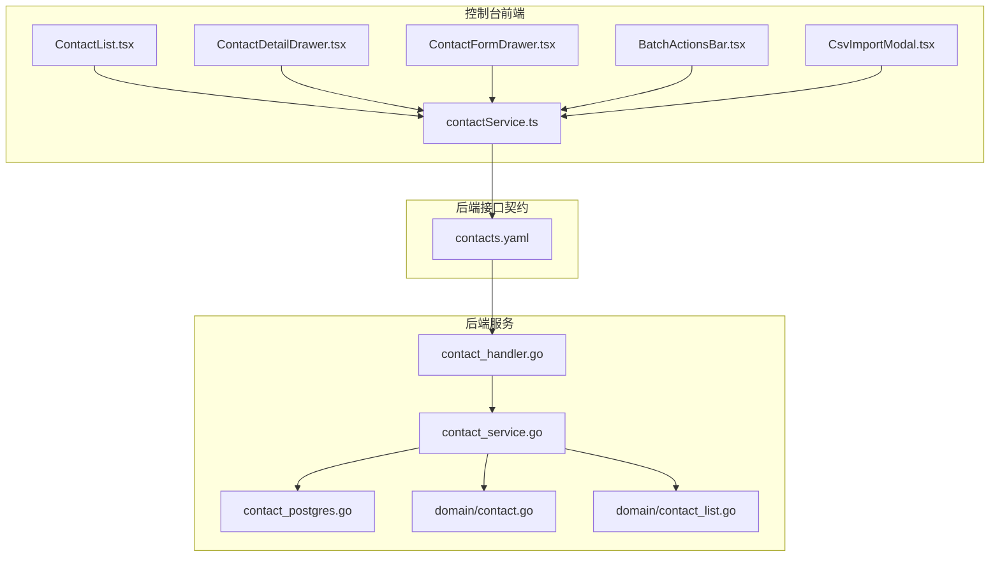
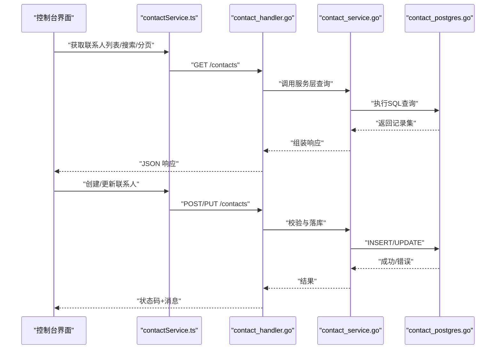
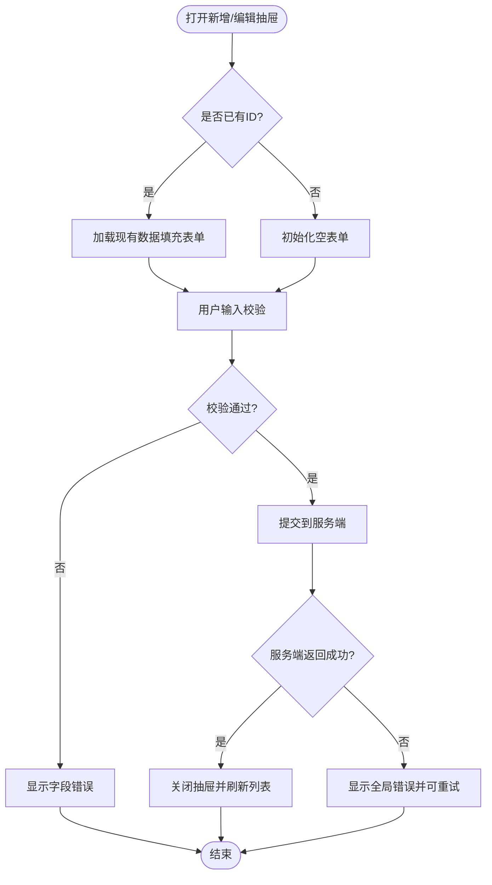
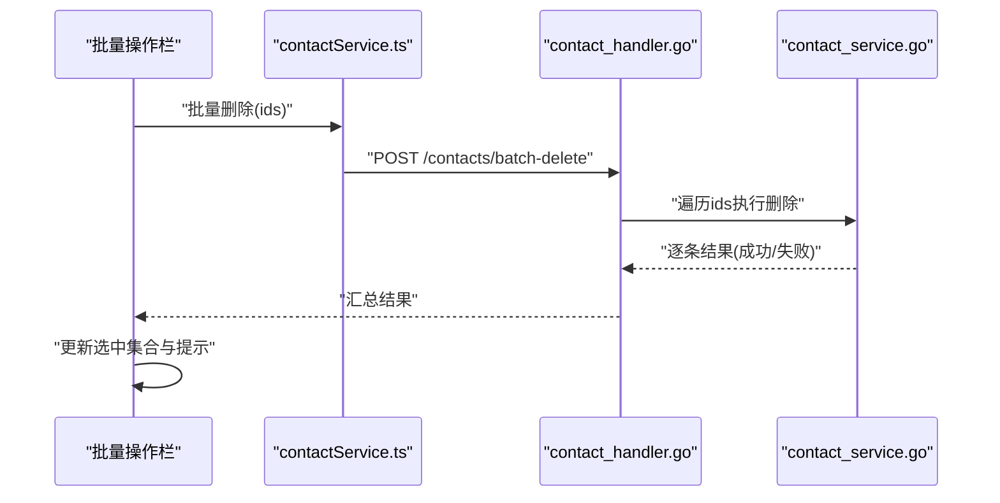
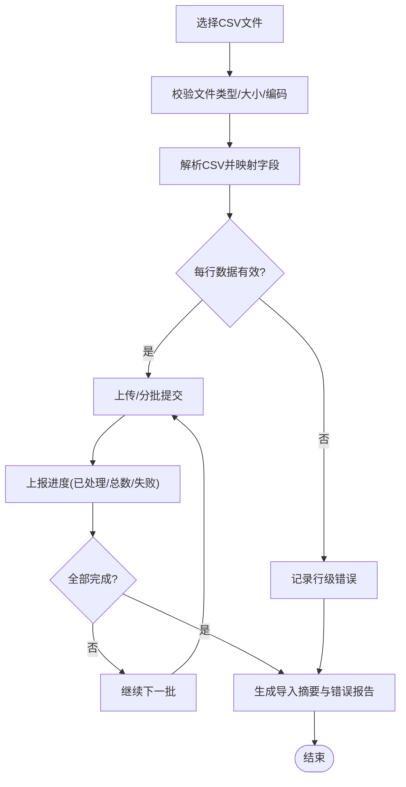
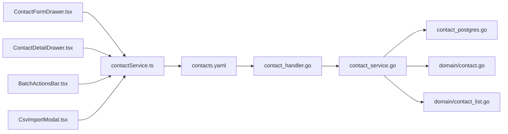

# 联系人管理组件

<cite>
**本文引用的文件**   
- [contact.go](file://notifuse/internal/domain/contact.go)
- [contact_list.go](file://notifuse/internal/domain/contact_list.go)
- [contact_handler.go](file://notifuse/internal/http/contact_handler.go)
- [contact_service.go](file://notifuse/internal/service/contact_service.go)
- [contact_postgres.go](file://notifuse/internal/repository/contact_postgres.go)
- [contacts.yaml](file://notifuse/openapi/paths/contacts.yaml)
- [ContactList.tsx](file://notifuse/console/src/pages/ContactList.tsx)
- [ContactDetailDrawer.tsx](file://notifuse/console/src/components/contacts/ContactDetailDrawer.tsx)
- [ContactFormDrawer.tsx](file://notifuse/console/src/components/contacts/ContactFormDrawer.tsx)
- [BatchActionsBar.tsx](file://notifuse/console/src/components/contacts/BatchActionsBar.tsx)
- [CsvImportModal.tsx](file://notifuse/console/src/components/contacts/CsvImportModal.tsx)
- [contactService.ts](file://notifuse/console/src/services/api/contactService.ts)
</cite>

## 目录
1. [简介](#简介)
2. [项目结构](#项目结构)
3. [核心组件](#核心组件)
4. [架构总览](#架构总览)
5. [详细组件分析](#详细组件分析)
6. [依赖关系分析](#依赖关系分析)
7. [性能考虑](#性能考虑)
8. [故障排查指南](#故障排查指南)
9. [结论](#结论)
10. [附录](#附录)

## 简介
本文件面向 Notifuse 控制台的“联系人管理”功能，聚焦以下前端组件与后端能力：
- 联系人详情抽屉（展示、只读信息）
- 新增/编辑抽屉（表单校验、提交、错误提示）
- 批量操作栏（多选、批量删除/更新等）
- CSV 导入组件（上传、解析、进度、错误恢复）

文档将覆盖联系人的 CRUD 流程、表单验证与数据持久化机制；批量操作的实现原理、进度跟踪与错误恢复策略；文件上传处理、数据格式验证与用户体验优化方案；并提供联系人数据模型定义、字段映射与业务规则说明。

## 项目结构
控制台侧的联系人相关页面与组件位于 console 子工程，后端领域模型、HTTP 处理器、服务层与仓储层位于 internal 目录，OpenAPI 规范定义了前后端契约。

图表来源
- [ContactList.tsx](file://notifuse/console/src/pages/ContactList.tsx)
- [ContactDetailDrawer.tsx](file://notifuse/console/src/components/contacts/ContactDetailDrawer.tsx)
- [ContactFormDrawer.tsx](file://notifuse/console/src/components/contacts/ContactFormDrawer.tsx)
- [BatchActionsBar.tsx](file://notifuse/console/src/components/contacts/BatchActionsBar.tsx)
- [CsvImportModal.tsx](file://notifuse/console/src/components/contacts/CsvImportModal.tsx)
- [contactService.ts](file://notifuse/console/src/services/api/contactService.ts)
- [contacts.yaml](file://notifuse/openapi/paths/contacts.yaml)
- [contact_handler.go](file://notifuse/internal/http/contact_handler.go)
- [contact_service.go](file://notifuse/internal/service/contact_service.go)
- [contact_postgres.go](file://notifuse/internal/repository/contact_postgres.go)
- [contact.go](file://notifuse/internal/domain/contact.go)
- [contact_list.go](file://notifuse/internal/domain/contact_list.go)

章节来源
- [ContactList.tsx](file://notifuse/console/src/pages/ContactList.tsx)
- [contactService.ts](file://notifuse/console/src/services/api/contactService.ts)
- [contacts.yaml](file://notifuse/openapi/paths/contacts.yaml)
- [contact_handler.go](file://notifuse/internal/http/contact_handler.go)
- [contact_service.go](file://notifuse/internal/service/contact_service.go)
- [contact_postgres.go](file://notifuse/internal/repository/contact_postgres.go)
- [contact.go](file://notifuse/internal/domain/contact.go)
- [contact_list.go](file://notifuse/internal/domain/contact_list.go)

## 核心组件
本节概述各组件职责与交互要点：
- 联系人列表页：分页、筛选、选择、跳转详情、触发批量操作与导入。
- 详情抽屉：只读展示联系人基本信息、标签、分组、时间线入口等。
- 新增/编辑抽屉：表单字段、校验规则、提交到服务端、错误回显。
- 批量操作栏：选中项计数、批量删除/打标签/加入或移出列表等。
- CSV 导入：文件选择、格式校验、分片/进度上报、失败重试与行级错误报告。

章节来源
- [ContactList.tsx](file://notifuse/console/src/pages/ContactList.tsx)
- [ContactDetailDrawer.tsx](file://notifuse/console/src/components/contacts/ContactDetailDrawer.tsx)
- [ContactFormDrawer.tsx](file://notifuse/console/src/components/contacts/ContactFormDrawer.tsx)
- [BatchActionsBar.tsx](file://notifuse/console/src/components/contacts/BatchActionsBar.tsx)
- [CsvImportModal.tsx](file://notifuse/console/src/components/contacts/CsvImportModal.tsx)

## 架构总览
前后端通过 OpenAPI 定义的 REST 接口进行通信。前端使用 contactService.ts 封装请求，后端由 HTTP 处理器接收并交由服务层执行领域逻辑，最终通过仓储层访问数据库。

图表来源
- [contactService.ts](file://notifuse/console/src/services/api/contactService.ts)
- [contacts.yaml](file://notifuse/openapi/paths/contacts.yaml)
- [contact_handler.go](file://notifuse/internal/http/contact_handler.go)
- [contact_service.go](file://notifuse/internal/service/contact_service.go)
- [contact_postgres.go](file://notifuse/internal/repository/contact_postgres.go)

## 详细组件分析

### 联系人详情抽屉
- 目标：以只读方式展示单个联系人的关键信息与关联数据，支持从列表快速查看。
- 数据来源：通过 contactService.ts 调用后端 GET 单条接口，渲染字段包括基础信息、所属列表、标签、更新时间等。
- 交互：关闭抽屉后刷新列表或保持当前视图；提供跳转到时间线的快捷入口。
- 错误处理：网络异常或服务端错误时显示友好提示，允许重试。

章节来源
- [ContactDetailDrawer.tsx](file://notifuse/console/src/components/contacts/ContactDetailDrawer.tsx)
- [contactService.ts](file://notifuse/console/src/services/api/contactService.ts)
- [contacts.yaml](file://notifuse/openapi/paths/contacts.yaml)

### 新增/编辑抽屉
- 目标：统一的新增与编辑入口，复用同一表单组件，根据上下文决定模式。
- 表单字段：邮箱（必填且唯一）、姓名、电话、地址、备注、所属列表、标签等。
- 校验规则：
  - 客户端：邮箱格式、必填项、长度限制、重复检测（可选）。
  - 服务端：遵循 OpenAPI 约束与领域规则（唯一性、枚举值等）。
- 提交流程：
  - 新建：POST 创建，成功后关闭抽屉并刷新列表。
  - 编辑：PUT 更新，成功后同步本地缓存并关闭。
- 错误回显：将服务端错误映射为字段级或全局提示。

图表来源
- [ContactFormDrawer.tsx](file://notifuse/console/src/components/contacts/ContactFormDrawer.tsx)
- [contactService.ts](file://notifuse/console/src/services/api/contactService.ts)
- [contacts.yaml](file://notifuse/openapi/paths/contacts.yaml)

章节来源
- [ContactFormDrawer.tsx](file://notifuse/console/src/components/contacts/ContactFormDrawer.tsx)
- [contactService.ts](file://notifuse/console/src/services/api/contactService.ts)
- [contacts.yaml](file://notifuse/openapi/paths/contacts.yaml)

### 批量操作栏
- 目标：在列表顶部或底部提供批量操作入口，如批量删除、批量打标签、批量加入/移出列表。
- 选择机制：复选框全选/反选，支持按筛选条件批量选择。
- 操作语义：
  - 批量删除：逐个调用删除接口或走批量删除接口（取决于后端能力），失败项保留选中状态以便重试。
  - 批量更新：合并变更，避免重复请求。
- 进度与反馈：进行中显示计数与状态，完成后汇总成功/失败数量。

图表来源
- [BatchActionsBar.tsx](file://notifuse/console/src/components/contacts/BatchActionsBar.tsx)
- [contactService.ts](file://notifuse/console/src/services/api/contactService.ts)
- [contact_handler.go](file://notifuse/internal/http/contact_handler.go)
- [contact_service.go](file://notifuse/internal/service/contact_service.go)

章节来源
- [BatchActionsBar.tsx](file://notifuse/console/src/components/contacts/BatchActionsBar.tsx)
- [contactService.ts](file://notifuse/console/src/services/api/contactService.ts)
- [contact_handler.go](file://notifuse/internal/http/contact_handler.go)
- [contact_service.go](file://notifuse/internal/service/contact_service.go)

### CSV 导入组件
- 目标：支持从 CSV 文件批量导入联系人，具备进度反馈与错误恢复。
- 文件处理：
  - 类型与大小校验（仅 .csv，最大体积限制）。
  - 编码与分隔符识别（UTF-8、逗号/制表符）。
- 解析与映射：
  - 列头映射到联系人字段（邮箱、姓名、电话等）。
  - 缺失列或非法值标记为行级错误。
- 上传与进度：
  - 分片上传或流式上传（视后端能力）。
  - 实时进度回调（已处理行数/总数/失败数）。
- 错误恢复：
  - 失败行跳过并记录原因，支持下载错误报告。
  - 可重试指定行或整批重试。

图表来源
- [CsvImportModal.tsx](file://notifuse/console/src/components/contacts/CsvImportModal.tsx)
- [contactService.ts](file://notifuse/console/src/services/api/contactService.ts)
- [contacts.yaml](file://notifuse/openapi/paths/contacts.yaml)

章节来源
- [CsvImportModal.tsx](file://notifuse/console/src/components/contacts/CsvImportModal.tsx)
- [contactService.ts](file://notifuse/console/src/services/api/contactService.ts)
- [contacts.yaml](file://notifuse/openapi/paths/contacts.yaml)

### 联系人数据模型、字段映射与业务规则
- 数据模型（后端领域对象）：
  - 联系人实体包含标识、工作区归属、邮箱、姓名、电话、地址、备注、标签、所属列表、时间戳等。
  - 列表实体用于组织联系人集合。
- 字段映射（前端表单/CSV 列头 → 后端字段）：
  - 邮箱 → email（必填、唯一）
  - 姓名 → name（可选）
  - 电话 → phone（可选）
  - 地址 → address（可选）
  - 备注 → notes（可选）
  - 列表ID → list_ids（可选）
  - 标签 → tags（可选）
- 业务规则：
  - 邮箱唯一性约束（跨工作区或按工作区隔离，依配置而定）。
  - 必填字段校验（至少邮箱）。
  - 批量导入时，重复邮箱的处理策略（跳过/覆盖/合并，依后端实现）。
  - 敏感字段脱敏展示（如手机号部分隐藏）。

章节来源
- [contact.go](file://notifuse/internal/domain/contact.go)
- [contact_list.go](file://notifuse/internal/domain/contact_list.go)
- [contacts.yaml](file://notifuse/openapi/paths/contacts.yaml)

## 依赖关系分析
- 前端组件依赖 contactService.ts 提供的 API 方法。
- contactService.ts 基于 OpenAPI 契约构造请求参数与路径。
- 后端 HTTP 处理器负责鉴权、参数校验与路由分发。
- 服务层编排业务逻辑（去重、事务、事件通知等）。
- 仓储层负责 SQL 构建与数据库交互。

图表来源
- [ContactFormDrawer.tsx](file://notifuse/console/src/components/contacts/ContactFormDrawer.tsx)
- [ContactDetailDrawer.tsx](file://notifuse/console/src/components/contacts/ContactDetailDrawer.tsx)
- [BatchActionsBar.tsx](file://notifuse/console/src/components/contacts/BatchActionsBar.tsx)
- [CsvImportModal.tsx](file://notifuse/console/src/components/contacts/CsvImportModal.tsx)
- [contactService.ts](file://notifuse/console/src/services/api/contactService.ts)
- [contacts.yaml](file://notifuse/openapi/paths/contacts.yaml)
- [contact_handler.go](file://notifuse/internal/http/contact_handler.go)
- [contact_service.go](file://notifuse/internal/service/contact_service.go)
- [contact_postgres.go](file://notifuse/internal/repository/contact_postgres.go)
- [contact.go](file://notifuse/internal/domain/contact.go)
- [contact_list.go](file://notifuse/internal/domain/contact_list.go)

章节来源
- [contactService.ts](file://notifuse/console/src/services/api/contactService.ts)
- [contacts.yaml](file://notifuse/openapi/paths/contacts.yaml)
- [contact_handler.go](file://notifuse/internal/http/contact_handler.go)
- [contact_service.go](file://notifuse/internal/service/contact_service.go)
- [contact_postgres.go](file://notifuse/internal/repository/contact_postgres.go)
- [contact.go](file://notifuse/internal/domain/contact.go)
- [contact_list.go](file://notifuse/internal/domain/contact_list.go)

## 性能考虑
- 列表分页与懒加载：默认分页尺寸合理，滚动加载减少首屏压力。
- 批量操作并发控制：对大批量删除/更新采用限流与重试退避，避免雪崩。
- CSV 导入分片：大文件分块上传，降低内存占用与超时风险。
- 前端缓存：详情与下拉选项适当缓存，减少重复请求。
- 索引建议：邮箱、列表ID、更新时间等高频查询字段建立索引。

## 故障排查指南
- 常见错误与定位：
  - 400 参数错误：检查表单校验与 OpenAPI 约束，确认必填字段与格式。
  - 409 冲突：邮箱重复，提示用户修改或选择覆盖策略。
  - 500 服务器错误：查看后端日志与服务层异常堆栈。
- 批量导入问题：
  - 解析失败：核对列头映射与分隔符，确认编码为 UTF-8。
  - 行级错误：下载错误报告，定位具体行号与原因。
  - 进度停滞：检查网络与后端队列，必要时重试失败批次。
- 调试建议：
  - 浏览器开发者工具 Network 面板查看请求/响应。
  - 开启前端调试日志，打印关键状态变化。
  - 后端启用结构化日志，记录请求ID便于追踪。

章节来源
- [contact_handler.go](file://notifuse/internal/http/contact_handler.go)
- [contact_service.go](file://notifuse/internal/service/contact_service.go)
- [contact_postgres.go](file://notifuse/internal/repository/contact_postgres.go)

## 结论
联系人管理模块在前端通过清晰的组件拆分与统一的 API 服务层，实现了完整的 CRUD、批量操作与 CSV 导入能力。后端以领域模型为核心，结合服务层与仓储层保证数据一致性与可扩展性。通过合理的校验、错误恢复与进度反馈，提升了用户体验与系统健壮性。后续可在导入性能、批量并发与数据一致性方面持续优化。

## 附录
- 术语
  - 工作区：数据隔离边界，联系人属于特定工作区。
  - 列表：联系人集合，用于分组与管理。
  - 标签：轻量分类标记，便于检索与筛选。
- 参考
  - OpenAPI 路径定义：[contacts.yaml](file://notifuse/openapi/paths/contacts.yaml)
  - 领域模型：[contact.go](file://notifuse/internal/domain/contact.go)、[contact_list.go](file://notifuse/internal/domain/contact_list.go)
  - 服务与仓储：[contact_service.go](file://notifuse/internal/service/contact_service.go)、[contact_postgres.go](file://notifuse/internal/repository/contact_postgres.go)
  - 前端服务：[contactService.ts](file://notifuse/console/src/services/api/contactService.ts)