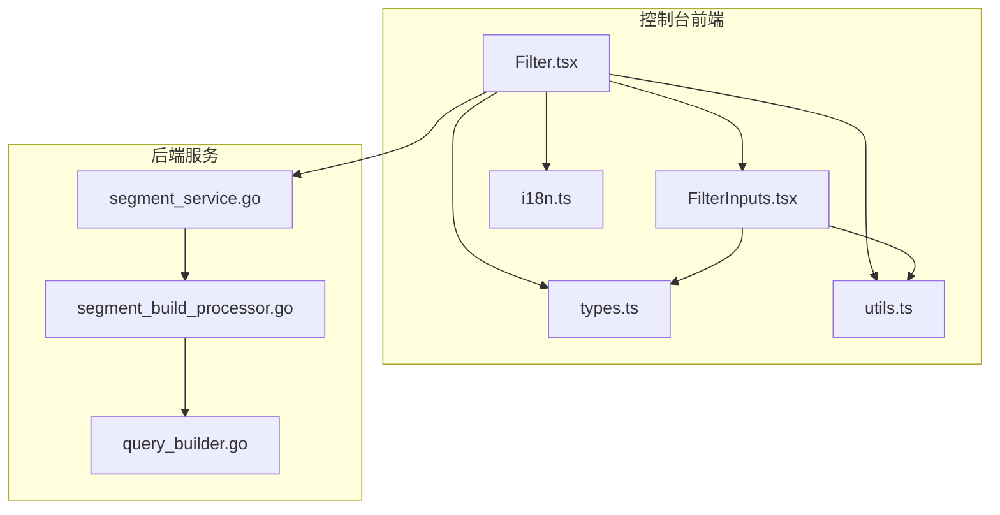
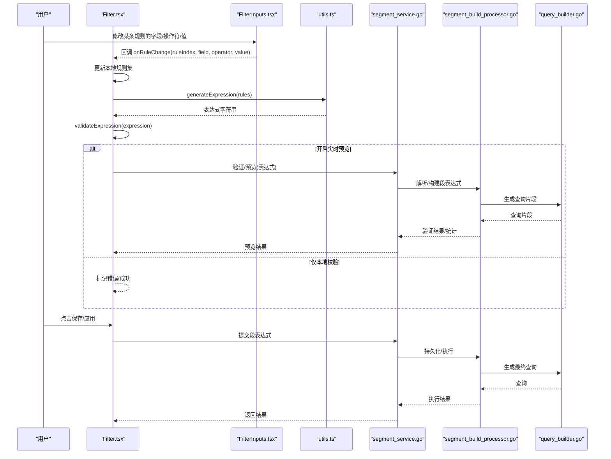
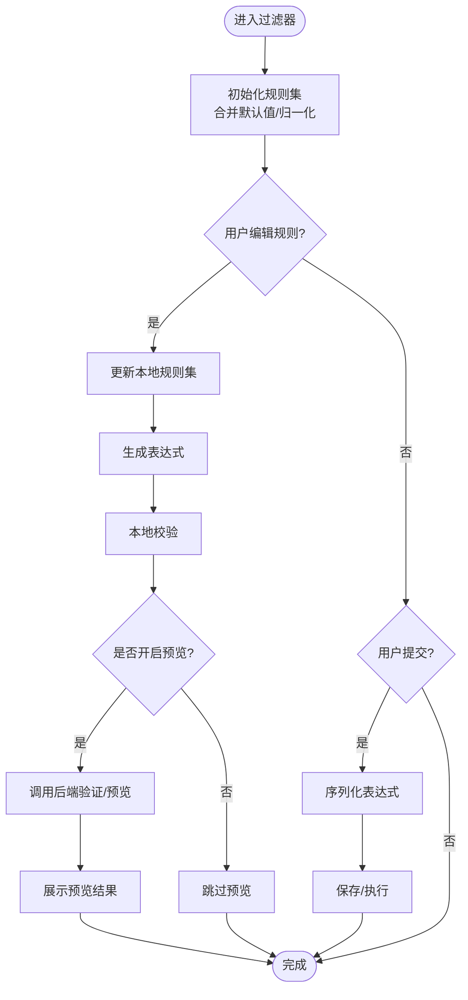
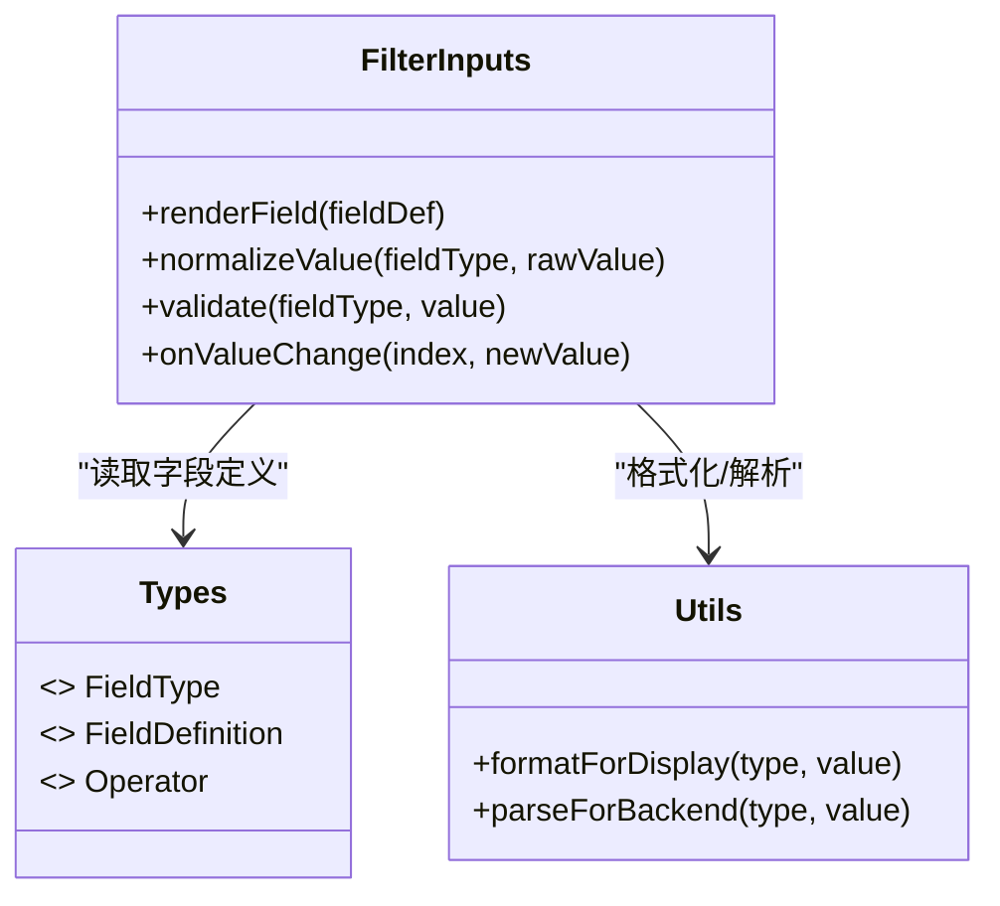
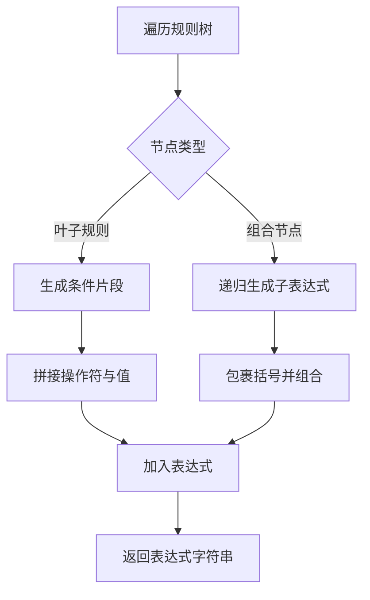
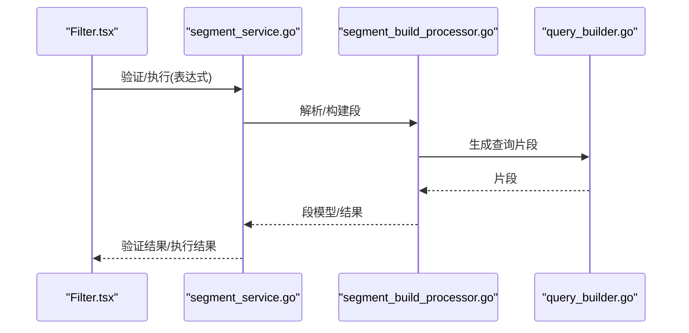
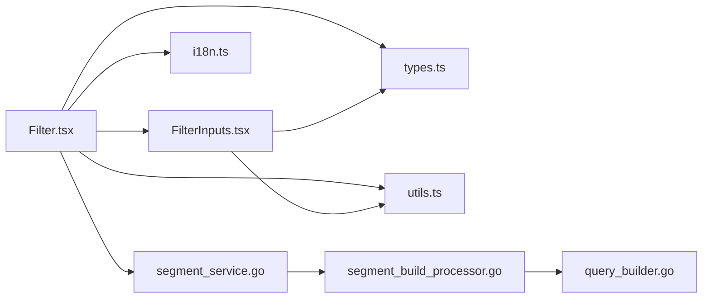

# 过滤器组件

<cite>
**本文引用的文件**   
- [Filter.tsx](file://notifuse/console/src/components/Filter/Filter.tsx)
- [FilterInputs.tsx](file://notifuse/console/src/components/Filter/FilterInputs.tsx)
- [types.ts](file://notifuse/console/src/components/Filter/types.ts)
- [utils.ts](file://notifuse/console/src/components/Filter/utils.ts)
- [i18n.ts](file://notifuse/console/src/components/Filter/i18n.ts)
- [segment_service.go](file://notifuse/internal/service/segment_service.go)
- [segment_build_processor.go](file://notifuse/internal/service/segment_build_processor.go)
- [query_builder.go](file://notifuse/internal/service/query_builder.go)
</cite>

## 目录
1. [简介](#简介)
2. [项目结构](#项目结构)
3. [核心组件](#核心组件)
4. [架构总览](#架构总览)
5. [详细组件分析](#详细组件分析)
6. [依赖关系分析](#依赖关系分析)
7. [性能考虑](#性能考虑)
8. [故障排查指南](#故障排查指南)
9. [结论](#结论)
10. [附录](#附录) 

## 简介
本文件面向 Notifuse 控制台中的“过滤器”功能，聚焦 Filter 与 FilterInputs 两个前端组件的实现原理与使用方式。文档覆盖以下主题：
- 过滤条件的构建、校验与渲染机制
- 不同类型输入控件（文本、数字、日期、选择器等）的处理逻辑
- 复杂条件组合的表达式生成
- 过滤器的状态管理、数据绑定与实时预览
- 过滤器规则的配置项、事件处理与错误处理
- 实际业务场景的使用示例与集成指南

## 项目结构
过滤器相关的前端代码位于 console 子项目中，核心文件包括：
- Filter.tsx：过滤器容器组件，负责状态管理、规则编排、预览与提交
- FilterInputs.tsx：具体输入控件集合，按字段类型渲染不同控件并收集值
- types.ts：过滤器数据结构、操作符枚举、字段定义等类型声明
- utils.ts：表达式生成、校验、格式化等工具函数
- i18n.ts：国际化文案

后端侧涉及段（Segment）构建与查询生成，关键文件：
- segment_service.go：段服务接口与服务实现
- segment_build_processor.go：段构建处理器，将前端过滤器转换为后端可执行的段表达式
- query_builder.go：查询构建器，将段表达式转为数据库查询

图表来源
- [Filter.tsx](file://notifuse/console/src/components/Filter/Filter.tsx)
- [FilterInputs.tsx](file://notifuse/console/src/components/Filter/FilterInputs.tsx)
- [types.ts](file://notifuse/console/src/components/Filter/types.ts)
- [utils.ts](file://notifuse/console/src/components/Filter/utils.ts)
- [i18n.ts](file://notifuse/console/src/components/Filter/i18n.ts)
- [segment_service.go](file://notifuse/internal/service/segment_service.go)
- [segment_build_processor.go](file://notifuse/internal/service/segment_build_processor.go)
- [query_builder.go](file://notifuse/internal/service/query_builder.go)

章节来源
- [Filter.tsx](file://notifuse/console/src/components/Filter/Filter.tsx)
- [FilterInputs.tsx](file://notifuse/console/src/components/Filter/FilterInputs.tsx)
- [types.ts](file://notifuse/console/src/components/Filter/types.ts)
- [utils.ts](file://notifuse/console/src/components/Filter/utils.ts)
- [i18n.ts](file://notifuse/console/src/components/Filter/i18n.ts)
- [segment_service.go](file://notifuse/internal/service/segment_service.go)
- [segment_build_processor.go](file://notifuse/internal/service/segment_build_processor.go)
- [query_builder.go](file://notifuse/internal/service/query_builder.go)

## 核心组件
- Filter 组件
  - 职责：维护过滤器规则列表、组合逻辑（AND/OR）、当前编辑态、预览结果、错误信息；提供添加/删除/移动/复制规则的能力；将规则序列化为表达式并调用后端服务进行验证或执行。
  - 关键点：受控模式下的 props 同步、本地状态变更、防抖预览、表达式生成与校验、错误提示聚合。
- FilterInputs 组件
  - 职责：根据字段类型渲染对应输入控件（文本、数字、日期、选择器、布尔等），对输入值进行规范化与即时校验，输出结构化值供上层组装为过滤条件。
  - 关键点：字段元数据驱动渲染、操作符与值的联动、空值与边界值处理、国际化显示。

章节来源
- [Filter.tsx](file://notifuse/console/src/components/Filter/Filter.tsx)
- [FilterInputs.tsx](file://notifuse/console/src/components/Filter/FilterInputs.tsx)
- [types.ts](file://notifuse/console/src/components/Filter/types.ts)
- [utils.ts](file://notifuse/console/src/components/Filter/utils.ts)

## 架构总览
从用户交互到后端执行的端到端流程如下：
- 用户在 FilterInputs 中修改某个条件值
- Filter 组件更新本地规则集，触发表达式生成与校验
- 若启用实时预览，则调用后端服务进行验证或返回匹配计数
- 最终提交时，将完整规则序列化为段表达式，交由后端构建查询

图表来源
- [Filter.tsx](file://notifuse/console/src/components/Filter/Filter.tsx)
- [FilterInputs.tsx](file://notifuse/console/src/components/Filter/FilterInputs.tsx)
- [utils.ts](file://notifuse/console/src/components/Filter/utils.ts)
- [segment_service.go](file://notifuse/internal/service/segment_service.go)
- [segment_build_processor.go](file://notifuse/internal/service/segment_build_processor.go)
- [query_builder.go](file://notifuse/internal/service/query_builder.go)

## 详细组件分析

### Filter 组件
- 状态模型
  - rules：规则数组，每条规则包含字段标识、操作符、值、可选的子规则（用于嵌套组合）
  - groupOperator：顶层组合逻辑（AND/OR）
  - previewEnabled：是否开启实时预览
  - errors：错误对象，键为规则索引或路径，值为错误消息
  - previewResult：预览结果（如命中数、错误详情）
- 生命周期与事件
  - 初始化：接收外部 props 的规则集，必要时做默认值填充与格式归一化
  - 变更：onRuleChange、onGroupOperatorChange、onAddRule、onDeleteRule、onMoveRule、onDuplicateRule
  - 预览：debounce 后调用后端验证接口，展示命中数量或错误定位
  - 提交：序列化表达式并调用后端保存/执行接口
- 表达式生成与校验
  - 通过工具函数将规则树转换为表达式字符串
  - 校验包括：必填字段、操作符与值类型匹配、范围约束、非法字符等
  - 错误聚合：将各条规则的错误汇总到 errors 对象，并在 UI 上高亮提示
- 数据绑定与受控模式
  - 支持受控与非受控两种用法；当作为受控组件时，外部 state 变化会重置内部状态
  - 对外暴露 getRules()、getExpression()、reset() 等方法便于集成

图表来源
- [Filter.tsx](file://notifuse/console/src/components/Filter/Filter.tsx)
- [utils.ts](file://notifuse/console/src/components/Filter/utils.ts)

章节来源
- [Filter.tsx](file://notifuse/console/src/components/Filter/Filter.tsx)
- [utils.ts](file://notifuse/console/src/components/Filter/utils.ts)

### FilterInputs 组件
- 字段元数据驱动
  - 基于 types.ts 中的字段定义，动态决定可用操作符、占位符、默认值、校验规则与显示标签
- 输入控件映射
  - 文本：支持模糊/精确/包含/不包含等操作符，长度与正则校验
  - 数字：支持比较类操作符（大于、小于、区间等），数值范围与精度校验
  - 日期：支持时间范围、相对时间（如最近7天）、时区处理与格式转换
  - 选择器：下拉单选/多选，支持搜索与分组，值映射到后端期望的枚举或ID
  - 布尔：开关或单选框，true/false 映射
- 值规范化与即时校验
  - 在 onChange 时进行类型转换与去空白
  - 对空值、非法值给出即时反馈，阻止无效表达式生成
- 组合与嵌套
  - 支持在单条规则内嵌入子规则（例如“地址包含A且城市等于B”）
  - 子规则同样遵循相同的字段/操作符/值规范

图表来源
- [FilterInputs.tsx](file://notifuse/console/src/components/Filter/FilterInputs.tsx)
- [types.ts](file://notifuse/console/src/components/Filter/types.ts)
- [utils.ts](file://notifuse/console/src/components/Filter/utils.ts)

章节来源
- [FilterInputs.tsx](file://notifuse/console/src/components/Filter/FilterInputs.tsx)
- [types.ts](file://notifuse/console/src/components/Filter/types.ts)
- [utils.ts](file://notifuse/console/src/components/Filter/utils.ts)

### 表达式生成与校验
- 生成策略
  - 将规则树深度优先遍历，按操作符拼接为表达式字符串
  - 支持括号优先级以表达 AND/OR 混合逻辑
- 校验规则
  - 字段存在性、操作符合法性、值类型匹配、范围约束、特殊字符转义
  - 针对日期与数字的边界检查（如负数、越界、非法格式）
- 错误定位
  - 以规则索引或路径为键，记录错误消息，便于 UI 精准高亮

图表来源
- [utils.ts](file://notifuse/console/src/components/Filter/utils.ts)

章节来源
- [utils.ts](file://notifuse/console/src/components/Filter/utils.ts)

### 后端集成与查询构建
- 段服务
  - 提供验证与执行入口，接收前端生成的表达式
- 段构建处理器
  - 将表达式解析为内部段模型，进行语义校验与优化
- 查询构建器
  - 将段模型转换为数据库查询片段，适配不同存储引擎

图表来源
- [segment_service.go](file://notifuse/internal/service/segment_service.go)
- [segment_build_processor.go](file://notifuse/internal/service/segment_build_processor.go)
- [query_builder.go](file://notifuse/internal/service/query_builder.go)

章节来源
- [segment_service.go](file://notifuse/internal/service/segment_service.go)
- [segment_build_processor.go](file://notifuse/internal/service/segment_build_processor.go)
- [query_builder.go](file://notifuse/internal/service/query_builder.go)

## 依赖关系分析
- 前端内部依赖
  - Filter 依赖 FilterInputs、types、utils、i18n
  - FilterInputs 依赖 types、utils
- 前后端契约
  - 表达式字符串为前后端约定的中间表示
  - 错误码与消息结构需保持一致，以便前端统一展示
- 潜在耦合点
  - 字段定义与操作符枚举在前端与后端需保持同步
  - 日期与时区处理需两端一致

图表来源
- [Filter.tsx](file://notifuse/console/src/components/Filter/Filter.tsx)
- [FilterInputs.tsx](file://notifuse/console/src/components/Filter/FilterInputs.tsx)
- [types.ts](file://notifuse/console/src/components/Filter/types.ts)
- [utils.ts](file://notifuse/console/src/components/Filter/utils.ts)
- [i18n.ts](file://notifuse/console/src/components/Filter/i18n.ts)
- [segment_service.go](file://notifuse/internal/service/segment_service.go)
- [segment_build_processor.go](file://notifuse/internal/service/segment_build_processor.go)
- [query_builder.go](file://notifuse/internal/service/query_builder.go)

章节来源
- [Filter.tsx](file://notifuse/console/src/components/Filter/Filter.tsx)
- [FilterInputs.tsx](file://notifuse/console/src/components/Filter/FilterInputs.tsx)
- [types.ts](file://notifuse/console/src/components/Filter/types.ts)
- [utils.ts](file://notifuse/console/src/components/Filter/utils.ts)
- [i18n.ts](file://notifuse/console/src/components/Filter/i18n.ts)
- [segment_service.go](file://notifuse/internal/service/segment_service.go)
- [segment_build_processor.go](file://notifuse/internal/service/segment_build_processor.go)
- [query_builder.go](file://notifuse/internal/service/query_builder.go)

## 性能考虑
- 防抖预览：对频繁输入变更进行 debounce，避免过多后端请求
- 增量校验：仅在变更的规则上进行局部校验，减少全量计算
- 表达式缓存：相同规则集的表达式结果可缓存，避免重复生成
- 懒加载字段定义：按需拉取字段元数据，降低首屏开销
- 分页与限制：预览命中数过大时采用近似计数或限制上限

[本节为通用指导，不直接分析具体文件]

## 故障排查指南
- 常见错误
  - 字段不存在或操作符不匹配：检查 types.ts 中的字段与操作符定义
  - 值类型错误：确认 FilterInputs 的 normalizeValue 与 parseForBackend 逻辑
  - 日期格式异常：核对时区与格式转换
  - 表达式语法错误：查看 utils.ts 的生成与校验逻辑
- 调试建议
  - 打印表达式字符串与错误对象，定位问题规则索引
  - 在后端日志中检索段解析失败的原因
  - 使用最小复现用例逐步添加规则，隔离问题

章节来源
- [Filter.tsx](file://notifuse/console/src/components/Filter/Filter.tsx)
- [FilterInputs.tsx](file://notifuse/console/src/components/Filter/FilterInputs.tsx)
- [utils.ts](file://notifuse/console/src/components/Filter/utils.ts)

## 结论
Filter 与 FilterInputs 组件通过类型驱动的渲染与工具函数驱动的表达式生成，实现了灵活、可扩展的过滤器能力。结合后端段构建与查询构建，形成从前端到后端的完整链路。建议在扩展新字段与操作符时，严格对齐前后端契约，完善校验与错误提示，以提升用户体验与系统稳定性。

[本节为总结，不直接分析具体文件]

## 附录
- 配置选项（示例）
  - fields：字段定义数组，包含字段名、显示名、类型、操作符列表、默认值、校验规则
  - groupOperators：组合操作符（AND/OR）
  - previewEnabled：是否启用实时预览
  - debounceMs：预览防抖延迟
  - maxRules：最大规则数限制
- 事件处理
  - onRuleChange：规则变更回调
  - onGroupOperatorChange：组合逻辑变更回调
  - onValidate：表达式校验回调
  - onSubmit：提交回调
- 错误处理
  - 前端错误对象：{ ruleIndex: string, message: string }[]
  - 后端错误码：与前端约定一致的枚举与消息

[本节为概念性说明，不直接分析具体文件]