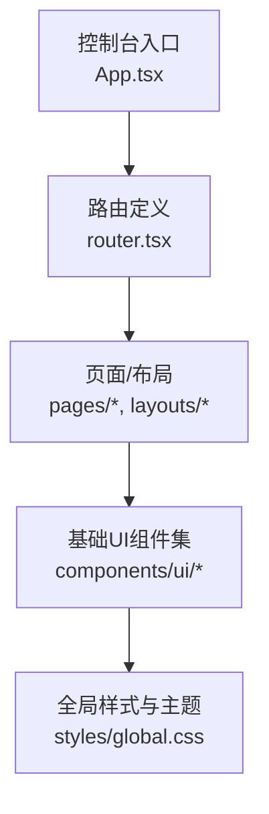
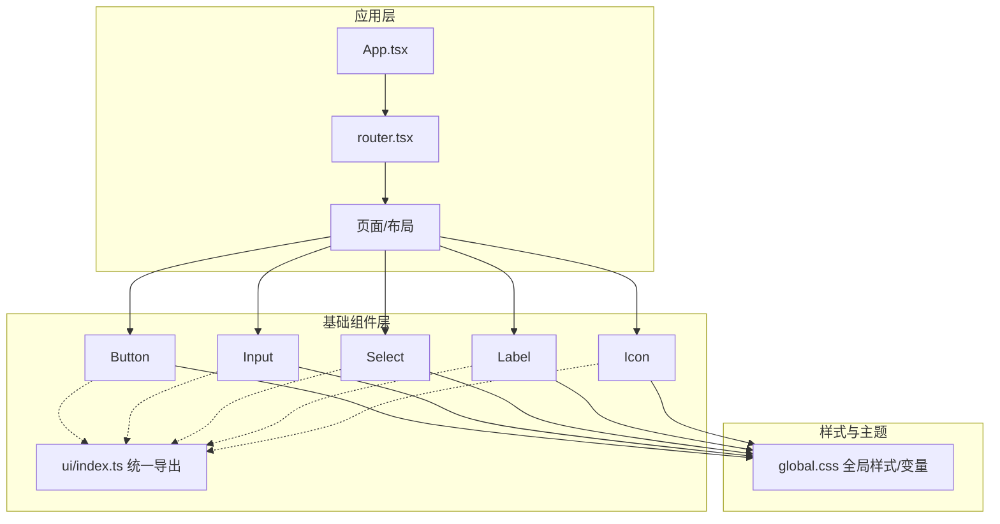
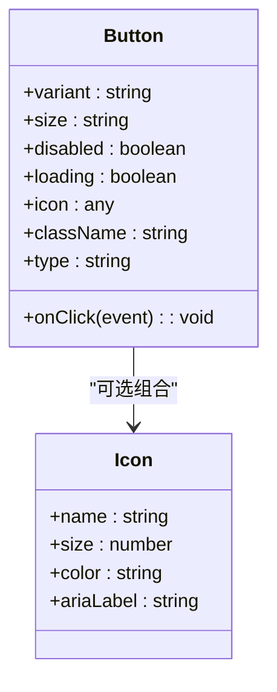
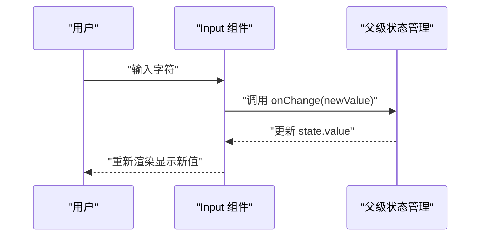
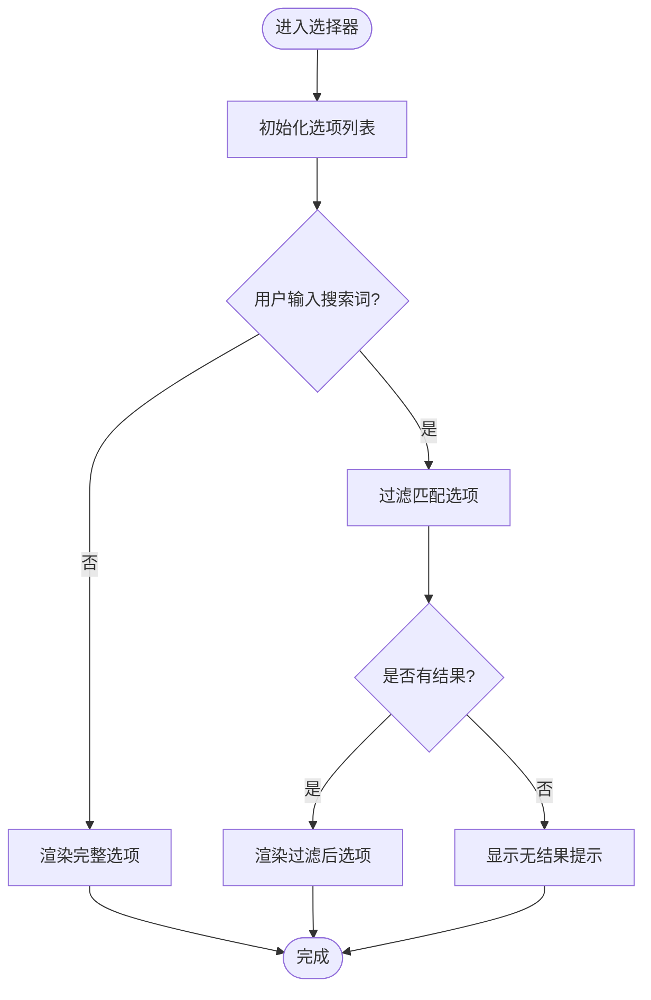
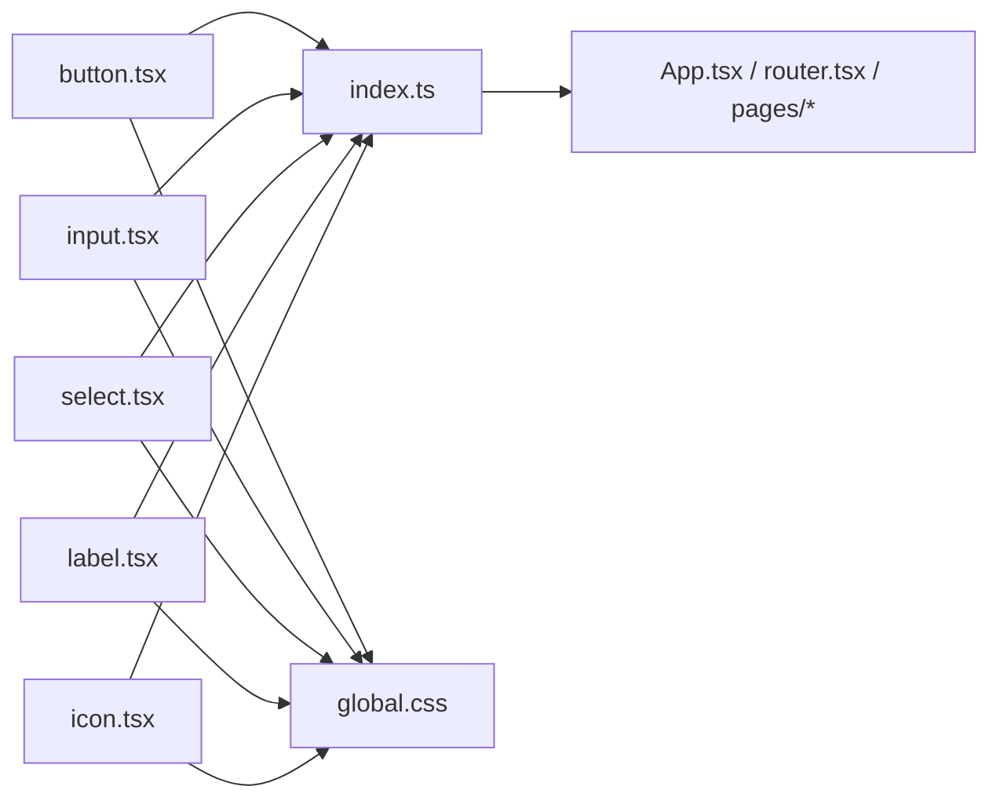

# 基础组件

<cite>
**本文引用的文件**   
- [notifuse/console/src/components/ui/button.tsx](file://notifuse/console/src/components/ui/button.tsx)
- [notifuse/console/src/components/ui/input.tsx](file://notifuse/console/src/components/ui/input.tsx)
- [notifuse/console/src/components/ui/select.tsx](file://notifuse/console/src/components/ui/select.tsx)
- [notifuse/console/src/components/ui/label.tsx](file://notifuse/console/src/components/ui/label.tsx)
- [notifuse/console/src/components/ui/icon.tsx](file://notifuse/console/src/components/ui/icon.tsx)
- [notifuse/console/src/components/ui/index.ts](file://notifuse/console/src/components/ui/index.ts)
- [notifuse/console/src/App.tsx](file://notifuse/console/src/App.tsx)
- [notifuse/console/src/router.tsx](file://notifuse/console/src/router.tsx)
- [notifuse/console/src/styles/global.css](file://notifuse/console/src/styles/global.css)
</cite>

## 目录
1. [简介](#简介)
2. [项目结构](#项目结构)
3. [核心组件](#核心组件)
4. [架构总览](#架构总览)
5. [详细组件分析](#详细组件分析)
6. [依赖分析](#依赖分析)
7. [性能考虑](#性能考虑)
8. [故障排查指南](#故障排查指南)
9. [结论](#结论)
10. [附录](#附录)

## 简介
本章节面向 Notifuse 前端控制台的基础 UI 组件，聚焦通用基础组件（按钮、输入框、选择器、标签、图标等）的使用方式、属性配置与样式定制。文档将说明每个组件的 Props 接口、事件处理、默认值与自定义选项，并提供使用示例路径、最佳实践与常见问题解决方案。同时解释组件的可访问性支持、响应式设计与主题适配机制，并给出组合使用模式与扩展开发指南。

## 项目结构
Notifuse 控制台的前端位于 notifuse/console 目录，基础 UI 组件集中在 src/components/ui 下，采用“按功能域组织”的方式，便于统一维护与按需引用。全局样式与主题变量通常由全局 CSS 或构建工具注入，组件通过语义化类名与 CSS 变量实现主题化。

图表来源
- [notifuse/console/src/App.tsx](file://notifuse/console/src/App.tsx)
- [notifuse/console/src/router.tsx](file://notifuse/console/src/router.tsx)
- [notifuse/console/src/styles/global.css](file://notifuse/console/src/styles/global.css)

章节来源
- [notifuse/console/src/App.tsx](file://notifuse/console/src/App.tsx)
- [notifuse/console/src/router.tsx](file://notifuse/console/src/router.tsx)
- [notifuse/console/src/styles/global.css](file://notifuse/console/src/styles/global.css)

## 核心组件
本节概述基础组件的职责与共性：
- 按钮 Button：触发操作，支持多种尺寸、变体与禁用态，具备键盘可访问性与焦点管理。
- 输入框 Input：文本输入控件，支持占位符、只读、禁用、大小与错误状态提示。
- 选择器 Select：下拉选择控件，支持单选/多选、搜索过滤、分组与受控/非受控模式。
- 标签 Label：表单关联标签，提升可访问性与可用性。
- 图标 Icon：统一的图标渲染入口，支持尺寸、颜色与无障碍描述。

这些组件遵循一致的命名约定与 API 设计，提供稳定的类型定义与导出入口，便于在业务页面中组合复用。

章节来源
- [notifuse/console/src/components/ui/button.tsx](file://notifuse/console/src/components/ui/button.tsx)
- [notifuse/console/src/components/ui/input.tsx](file://notifuse/console/src/components/ui/input.tsx)
- [notifuse/console/src/components/ui/select.tsx](file://notifuse/console/src/components/ui/select.tsx)
- [notifuse/console/src/components/ui/label.tsx](file://notifuse/console/src/components/ui/label.tsx)
- [notifuse/console/src/components/ui/icon.tsx](file://notifuse/console/src/components/ui/icon.tsx)
- [notifuse/console/src/components/ui/index.ts](file://notifuse/console/src/components/ui/index.ts)

## 架构总览
基础组件层位于应用与页面之间，向上暴露稳定 API，向下依赖全局样式与主题变量。组件内部尽量保持无副作用与纯展示逻辑，复杂交互由上层业务 Hook 或容器组件管理。

图表来源
- [notifuse/console/src/App.tsx](file://notifuse/console/src/App.tsx)
- [notifuse/console/src/router.tsx](file://notifuse/console/src/router.tsx)
- [notifuse/console/src/components/ui/button.tsx](file://notifuse/console/src/components/ui/button.tsx)
- [notifuse/console/src/components/ui/input.tsx](file://notifuse/console/src/components/ui/input.tsx)
- [notifuse/console/src/components/ui/select.tsx](file://notifuse/console/src/components/ui/select.tsx)
- [notifuse/console/src/components/ui/label.tsx](file://notifuse/console/src/components/ui/label.tsx)
- [notifuse/console/src/components/ui/icon.tsx](file://notifuse/console/src/components/ui/icon.tsx)
- [notifuse/console/src/components/ui/index.ts](file://notifuse/console/src/components/ui/index.ts)
- [notifuse/console/src/styles/global.css](file://notifuse/console/src/styles/global.css)

## 详细组件分析

### 按钮 Button
- 职责：提供可点击的操作入口，支持不同尺寸、变体（如主按钮、次按钮、危险按钮）、禁用态与加载态。
- 关键特性：
  - 键盘可访问性：支持 Enter/Space 触发，清晰的焦点样式。
  - 组合能力：可与图标组合，形成带图标的按钮。
  - 事件处理：onClick 回调；支持阻止默认行为与冒泡控制。
  - 样式定制：通过 className 覆盖、CSS 变量或主题开关调整外观。
- 常用属性（Props）：
  - variant：按钮风格（主/次/危险等）。
  - size：尺寸（小/中/大）。
  - disabled：是否禁用。
  - loading：是否显示加载指示。
  - icon：前置或后置图标。
  - onClick：点击事件处理器。
  - className：自定义类名。
  - type：原生 button 类型（button/submit/reset）。
- 默认值：
  - variant 默认为“主按钮”。
  - size 默认为“中”。
  - disabled/loading 默认为 false。
- 使用示例路径：
  - [按钮基本用法示例](file://notifuse/console/src/components/ui/button.tsx)
  - [按钮组合图标示例](file://notifuse/console/src/components/ui/button.tsx)
- 最佳实践：
  - 对高风险操作使用“危险”变体，避免误触。
  - 异步操作时启用 loading，防止重复提交。
  - 为所有按钮提供明确的 aria-label 或可见文本。
- 常见问题：
  - 点击无效：检查是否被外层遮罩或 pointer-events 拦截。
  - 样式不生效：确认 className 优先级与主题变量覆盖顺序。

章节来源
- [notifuse/console/src/components/ui/button.tsx](file://notifuse/console/src/components/ui/button.tsx)
- [notifuse/console/src/components/ui/index.ts](file://notifuse/console/src/components/ui/index.ts)

#### 类关系图（Button 相关）

图表来源
- [notifuse/console/src/components/ui/button.tsx](file://notifuse/console/src/components/ui/button.tsx)
- [notifuse/console/src/components/ui/icon.tsx](file://notifuse/console/src/components/ui/icon.tsx)

### 输入框 Input
- 职责：提供文本输入能力，支持占位符、只读、禁用、大小与错误状态提示。
- 关键特性：
  - 受控与非受控模式：可通过 value 与 onChange 实现受控，或使用 defaultValue 实现非受控。
  - 验证反馈：结合 error/success 状态与辅助文本进行提示。
  - 可访问性：与 Label 关联，支持 aria-describedby 指向帮助/错误信息。
- 常用属性（Props）：
  - value/defaultValue：当前值或初始值。
  - onChange：值变化回调。
  - placeholder：占位符文本。
  - disabled：是否禁用。
  - readOnly：是否只读。
  - size：尺寸（小/中/大）。
  - error：错误消息或布尔标志。
  - helperText：辅助说明文本。
  - id/name：用于表单关联与提交。
  - className：自定义类名。
- 默认值：
  - size 默认为“中”。
  - error/helperText 默认为空。
- 使用示例路径：
  - [输入框受控模式示例](file://notifuse/console/src/components/ui/input.tsx)
  - [输入框错误提示示例](file://notifuse/console/src/components/ui/input.tsx)
- 最佳实践：
  - 始终为输入框设置 id 并与 Label 的 htmlFor 对应。
  - 错误消息应清晰具体，避免仅用红色边框表示错误。
  - 长表单中使用 helperText 引导用户填写。
- 常见问题：
  - 值不更新：检查是否为受控组件且正确绑定 onChange。
  - 焦点丢失：避免在每次渲染时创建新的对象作为 value。

章节来源
- [notifuse/console/src/components/ui/input.tsx](file://notifuse/console/src/components/ui/input.tsx)
- [notifuse/console/src/components/ui/label.tsx](file://notifuse/console/src/components/ui/label.tsx)
- [notifuse/console/src/components/ui/index.ts](file://notifuse/console/src/components/ui/index.ts)

#### 序列图（输入框受控流程）

图表来源
- [notifuse/console/src/components/ui/input.tsx](file://notifuse/console/src/components/ui/input.tsx)

### 选择器 Select
- 职责：提供下拉选择能力，支持单选/多选、搜索过滤、分组与受控/非受控模式。
- 关键特性：
  - 受控模式：通过 value/options 与 onChange 管理选中项。
  - 搜索与过滤：支持输入关键字快速定位选项。
  - 分组与禁用：可对选项分组与禁用部分选项。
  - 可访问性：键盘导航、ARIA 角色与描述。
- 常用属性（Props）：
  - options：选项数组（含 label/value/disabled/group 等字段）。
  - value：当前选中值（单选为字符串，多选为字符串数组）。
  - onChange：选中变化回调。
  - placeholder：未选择时的占位文本。
  - searchable：是否启用搜索。
  - multiple：是否多选。
  - disabled：是否禁用。
  - error：错误消息或布尔标志。
  - className：自定义类名。
- 默认值：
  - searchable/multiple/disabled/error 默认为 false。
- 使用示例路径：
  - [选择器单选示例](file://notifuse/console/src/components/ui/select.tsx)
  - [选择器多选与搜索示例](file://notifuse/console/src/components/ui/select.tsx)
- 最佳实践：
  - 大数据量时使用虚拟滚动或分页加载。
  - 为每个选项提供清晰的 label，避免仅显示 value。
  - 多选场景下提供清除全部与批量操作。
- 常见问题：
  - 选项不更新：确保 options 引用稳定或正确触发重渲染。
  - 搜索失效：检查搜索键名与选项数据结构匹配。

章节来源
- [notifuse/console/src/components/ui/select.tsx](file://notifuse/console/src/components/ui/select.tsx)
- [notifuse/console/src/components/ui/index.ts](file://notifuse/console/src/components/ui/index.ts)

#### 流程图（选择器搜索过滤）

图表来源
- [notifuse/console/src/components/ui/select.tsx](file://notifuse/console/src/components/ui/select.tsx)

### 标签 Label
- 职责：为表单控件提供可读的关联标签，提升可访问性与可用性。
- 关键特性：
  - 与 Input 关联：通过 htmlFor/id 建立关联。
  - 可访问性：自动设置 role="label" 或 aria-labelledby。
- 常用属性（Props）：
  - htmlFor：关联输入框的 id。
  - required：是否必填标记。
  - className：自定义类名。
- 默认值：
  - required 默认为 false。
- 使用示例路径：
  - [标签与输入框关联示例](file://notifuse/console/src/components/ui/label.tsx)
- 最佳实践：
  - 始终为每个输入框提供对应的 Label。
  - 必填项使用视觉标记与 aria-required 双重提示。
- 常见问题：
  - 关联失败：检查 htmlFor 与输入框 id 一致。

章节来源
- [notifuse/console/src/components/ui/label.tsx](file://notifuse/console/src/components/ui/label.tsx)
- [notifuse/console/src/components/ui/input.tsx](file://notifuse/console/src/components/ui/input.tsx)

### 图标 Icon
- 职责：统一渲染图标资源，支持尺寸、颜色与无障碍描述。
- 关键特性：
  - 主题适配：通过 CSS 变量或主题上下文获取颜色。
  - 可访问性：支持 aria-hidden 与 aria-label。
- 常用属性（Props）：
  - name：图标名称。
  - size：尺寸（数字或预设）。
  - color：颜色（继承或指定）。
  - ariaLabel：无障碍描述。
  - className：自定义类名。
- 默认值：
  - size/color 通常继承父级样式。
- 使用示例路径：
  - [图标基本用法示例](file://notifuse/console/src/components/ui/icon.tsx)
- 最佳实践：
  - 装饰性图标设置 aria-hidden="true"。
  - 功能性图标提供 aria-label 描述用途。
- 常见问题：
  - 图标不显示：检查 name 是否存在与字体/图标库加载。

章节来源
- [notifuse/console/src/components/ui/icon.tsx](file://notifuse/console/src/components/ui/icon.tsx)
- [notifuse/console/src/components/ui/index.ts](file://notifuse/console/src/components/ui/index.ts)

### 组件组合模式
- 表单组合：Label + Input + Helper/Error 文本，构成标准输入单元。
- 操作栏组合：Button + Icon，形成带图标的操作按钮。
- 筛选面板组合：Select（多选/搜索）+ Button（重置/查询），提升数据筛选体验。
- 主题适配：通过全局 CSS 变量与组件 className 覆盖，实现明暗主题切换。

章节来源
- [notifuse/console/src/components/ui/button.tsx](file://notifuse/console/src/components/ui/button.tsx)
- [notifuse/console/src/components/ui/input.tsx](file://notifuse/console/src/components/ui/input.tsx)
- [notifuse/console/src/components/ui/select.tsx](file://notifuse/console/src/components/ui/select.tsx)
- [notifuse/console/src/components/ui/label.tsx](file://notifuse/console/src/components/ui/label.tsx)
- [notifuse/console/src/components/ui/icon.tsx](file://notifuse/console/src/components/ui/icon.tsx)
- [notifuse/console/src/styles/global.css](file://notifuse/console/src/styles/global.css)

## 依赖分析
基础组件之间的耦合度较低，主要依赖全局样式与主题变量。统一导出入口 index.ts 提供集中导入，降低页面层的引入复杂度。

图表来源
- [notifuse/console/src/components/ui/button.tsx](file://notifuse/console/src/components/ui/button.tsx)
- [notifuse/console/src/components/ui/input.tsx](file://notifuse/console/src/components/ui/input.tsx)
- [notifuse/console/src/components/ui/select.tsx](file://notifuse/console/src/components/ui/select.tsx)
- [notifuse/console/src/components/ui/label.tsx](file://notifuse/console/src/components/ui/label.tsx)
- [notifuse/console/src/components/ui/icon.tsx](file://notifuse/console/src/components/ui/icon.tsx)
- [notifuse/console/src/components/ui/index.ts](file://notifuse/console/src/components/ui/index.ts)
- [notifuse/console/src/App.tsx](file://notifuse/console/src/App.tsx)
- [notifuse/console/src/router.tsx](file://notifuse/console/src/router.tsx)
- [notifuse/console/src/styles/global.css](file://notifuse/console/src/styles/global.css)

章节来源
- [notifuse/console/src/components/ui/index.ts](file://notifuse/console/src/components/ui/index.ts)
- [notifuse/console/src/styles/global.css](file://notifuse/console/src/styles/global.css)

## 性能考虑
- 避免不必要的重渲染：为受控组件的值与选项提供稳定引用，减少 React 重渲染开销。
- 大数据量优化：选择器与列表组件可采用虚拟滚动或分页加载。
- 事件节流：高频输入场景（如搜索）使用防抖/节流策略。
- 样式合并：谨慎使用 className 覆盖，避免深层 DOM 遍历导致的样式计算成本。

[本节为通用指导，无需特定文件来源]

## 故障排查指南
- 按钮点击无效：
  - 检查外层是否设置了 pointer-events:none 或被遮罩层覆盖。
  - 确认 onClick 未被 preventDefault 阻断。
- 输入框值不更新：
  - 确认是否为受控组件且 onChange 正确绑定。
  - 避免在每次渲染时创建新的对象作为 value。
- 选择器选项不刷新：
  - 检查 options 的引用稳定性与 key 的唯一性。
  - 搜索模式下确认搜索键名与数据结构匹配。
- 标签与输入框未关联：
  - 核对 Label 的 htmlFor 与 Input 的 id 一致。
- 图标不显示：
  - 检查 name 是否正确与图标库是否加载成功。
  - 确认 CSS 变量或主题上下文已正确注入。

章节来源
- [notifuse/console/src/components/ui/button.tsx](file://notifuse/console/src/components/ui/button.tsx)
- [notifuse/console/src/components/ui/input.tsx](file://notifuse/console/src/components/ui/input.tsx)
- [notifuse/console/src/components/ui/select.tsx](file://notifuse/console/src/components/ui/select.tsx)
- [notifuse/console/src/components/ui/label.tsx](file://notifuse/console/src/components/ui/label.tsx)
- [notifuse/console/src/components/ui/icon.tsx](file://notifuse/console/src/components/ui/icon.tsx)

## 结论
基础组件为 Notifuse 控制台提供了稳定、可访问、可主题化的 UI 能力。通过统一的 Props 接口与组合模式，开发者可以快速构建一致的界面体验。建议在实际项目中遵循最佳实践，关注可访问性与性能优化，并通过全局样式与主题变量实现灵活的视觉定制。

[本节为总结性内容，无需特定文件来源]

## 附录
- 使用示例路径汇总：
  - [按钮示例](file://notifuse/console/src/components/ui/button.tsx)
  - [输入框示例](file://notifuse/console/src/components/ui/input.tsx)
  - [选择器示例](file://notifuse/console/src/components/ui/select.tsx)
  - [标签示例](file://notifuse/console/src/components/ui/label.tsx)
  - [图标示例](file://notifuse/console/src/components/ui/icon.tsx)
- 统一导出入口：
  - [ui/index.ts](file://notifuse/console/src/components/ui/index.ts)
- 全局样式与主题：
  - [styles/global.css](file://notifuse/console/src/styles/global.css)