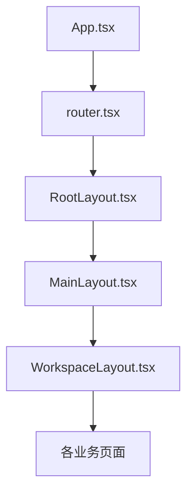
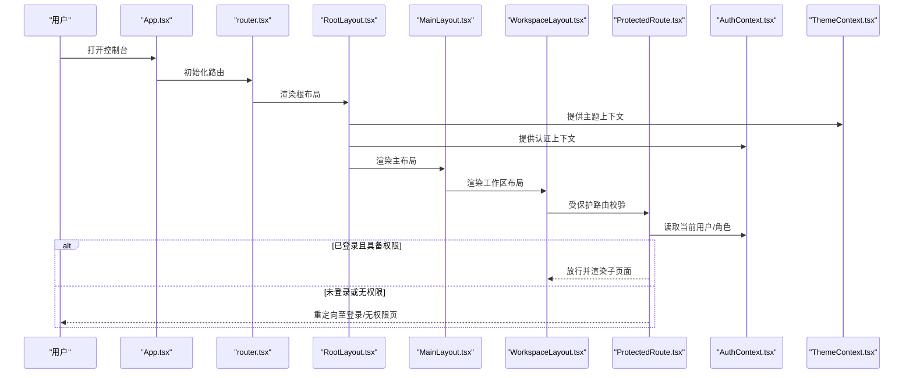
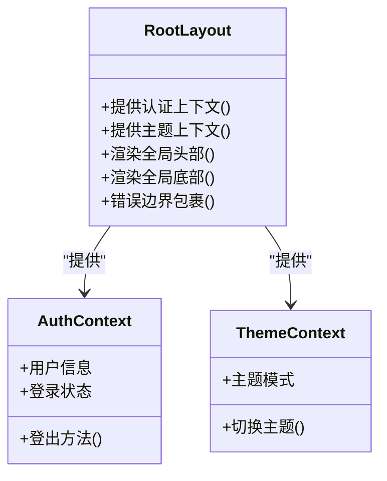
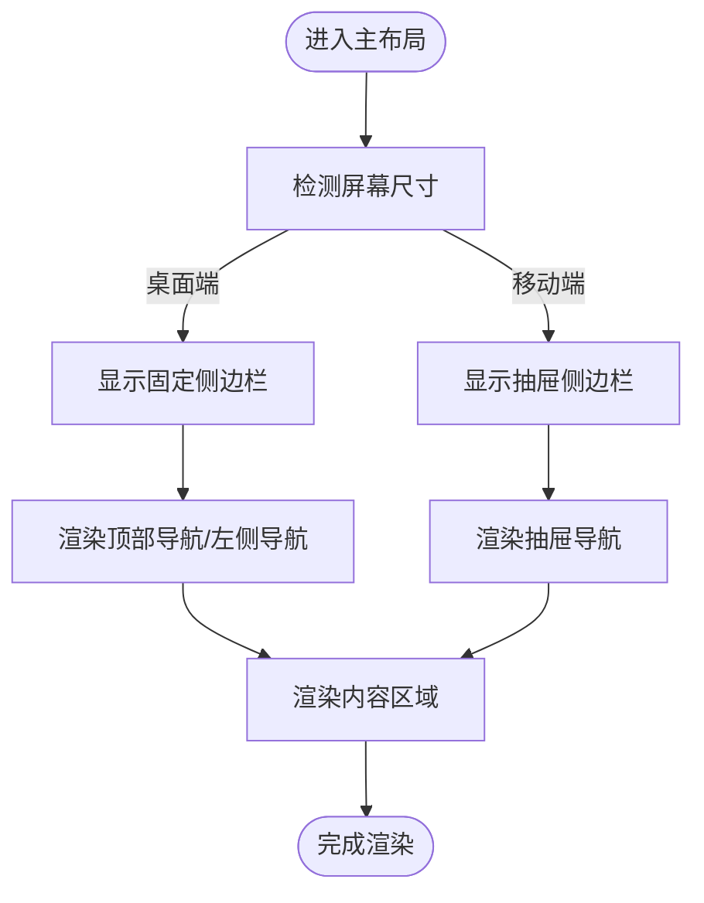
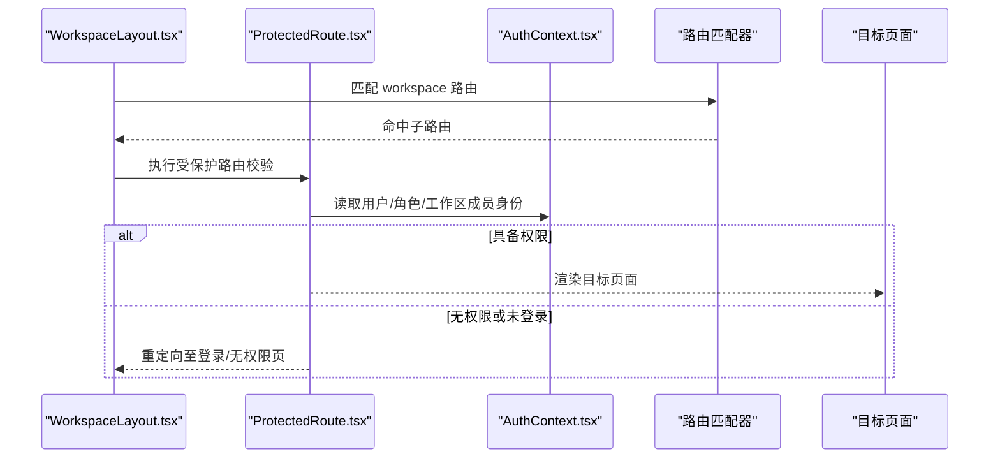
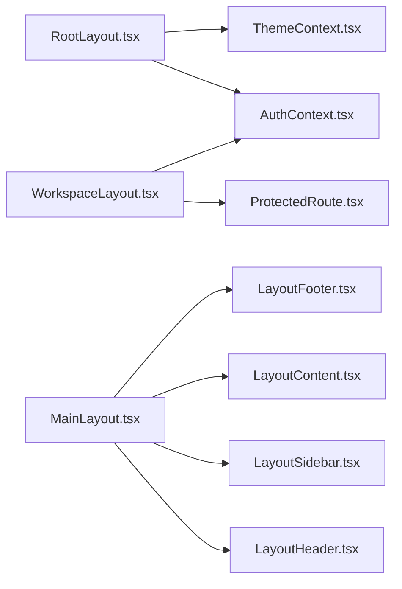

# 布局组件

<cite>
**本文引用的文件**   
- [console/src/layouts/RootLayout.tsx](file://console/src/layouts/RootLayout.tsx)
- [console/src/layouts/MainLayout.tsx](file://console/src/layouts/MainLayout.tsx)
- [console/src/layouts/WorkspaceLayout.tsx](file://console/src/layouts/WorkspaceLayout.tsx)
- [console/src/router.tsx](file://console/src/router.tsx)
- [console/src/App.tsx](file://console/src/App.tsx)
- [console/src/components/ui/LayoutHeader.tsx](file://console/src/components/ui/LayoutHeader.tsx)
- [console/src/components/ui/LayoutSidebar.tsx](file://console/src/components/ui/LayoutSidebar.tsx)
- [console/src/components/ui/LayoutContent.tsx](file://console/src/components/ui/LayoutContent.tsx)
- [console/src/components/ui/LayoutFooter.tsx](file://console/src/components/ui/LayoutFooter.tsx)
- [console/src/components/auth/ProtectedRoute.tsx](file://console/src/components/auth/ProtectedRoute.tsx)
- [console/src/contexts/AuthContext.tsx](file://console/src/contexts/AuthContext.tsx)
- [console/src/contexts/ThemeContext.tsx](file://console/src/contexts/ThemeContext.tsx)
- [console/src/styles/global.css](file://console/src/styles/global.css)
</cite>

## 目录
1. [简介](#简介)
2. [项目结构](#项目结构)
3. [核心组件](#核心组件)
4. [架构总览](#架构总览)
5. [详细组件分析](#详细组件分析)
6. [依赖关系分析](#依赖关系分析)
7. [性能考虑](#性能考虑)
8. [故障排查指南](#故障排查指南)
9. [结论](#结论)
10. [附录：自定义布局开发指南与最佳实践](#附录自定义布局开发指南与最佳实践)

## 简介
本文件面向 Notifuse 前端控制台（console）的布局体系，系统性梳理根布局、主布局与工作区布局的结构设计、嵌套关系、路由集成与权限控制机制。文档同时覆盖响应式策略、侧边栏管理、导航结构与内容区域组织，并给出主题定制、样式覆盖与性能优化建议，以及扩展自定义布局的实践指南。

## 项目结构
控制台采用“三层布局”分层模式：
- 根布局 RootLayout：应用级外壳，承载全局上下文（认证、主题）、全局头部/底部、错误边界等。
- 主布局 MainLayout：控制台通用外壳，提供顶部导航、左侧导航、面包屑、通知入口等。
- 工作区布局 WorkspaceLayout：针对 workspace 域的路由容器，负责工作区切换、权限校验与子页面渲染。

图表来源
- [console/src/App.tsx](file://console/src/App.tsx)
- [console/src/router.tsx](file://console/src/router.tsx)
- [console/src/layouts/RootLayout.tsx](file://console/src/layouts/RootLayout.tsx)
- [console/src/layouts/MainLayout.tsx](file://console/src/layouts/MainLayout.tsx)
- [console/src/layouts/WorkspaceLayout.tsx](file://console/src/layouts/WorkspaceLayout.tsx)

章节来源
- [console/src/App.tsx](file://console/src/App.tsx)
- [console/src/router.tsx](file://console/src/router.tsx)
- [console/src/layouts/RootLayout.tsx](file://console/src/layouts/RootLayout.tsx)
- [console/src/layouts/MainLayout.tsx](file://console/src/layouts/MainLayout.tsx)
- [console/src/layouts/WorkspaceLayout.tsx](file://console/src/layouts/WorkspaceLayout.tsx)

## 核心组件
- 根布局 RootLayout
  - 职责：挂载全局上下文（认证、主题）、全局头部/底部、错误边界、全局样式注入。
  - 关键能力：主题切换、用户状态订阅、全局快捷键与提示。
- 主布局 MainLayout
  - 职责：控制台通用外壳，包含顶部导航、左侧导航、面包屑、通知入口、内容区域占位。
  - 关键能力：侧边栏折叠/展开、移动端抽屉模式、导航高亮与活动项同步。
- 工作区布局 WorkspaceLayout
  - 职责：workspace 域路由容器，负责工作区选择、权限校验、子页面渲染。
  - 关键能力：工作区切换、基于角色的访问控制（RBAC）前置检查、未授权跳转。

章节来源
- [console/src/layouts/RootLayout.tsx](file://console/src/layouts/RootLayout.tsx)
- [console/src/layouts/MainLayout.tsx](file://console/src/layouts/MainLayout.tsx)
- [console/src/layouts/WorkspaceLayout.tsx](file://console/src/layouts/WorkspaceLayout.tsx)

## 架构总览
下图展示从应用启动到页面渲染的布局装配流程，以及权限与主题的贯穿方式。

图表来源
- [console/src/App.tsx](file://console/src/App.tsx)
- [console/src/router.tsx](file://console/src/router.tsx)
- [console/src/layouts/RootLayout.tsx](file://console/src/layouts/RootLayout.tsx)
- [console/src/layouts/MainLayout.tsx](file://console/src/layouts/MainLayout.tsx)
- [console/src/layouts/WorkspaceLayout.tsx](file://console/src/layouts/WorkspaceLayout.tsx)
- [console/src/components/auth/ProtectedRoute.tsx](file://console/src/components/auth/ProtectedRoute.tsx)
- [console/src/contexts/AuthContext.tsx](file://console/src/contexts/AuthContext.tsx)
- [console/src/contexts/ThemeContext.tsx](file://console/src/contexts/ThemeContext.tsx)

## 详细组件分析

### 根布局 RootLayout
- 设计要点
  - 作为应用外壳，集中提供全局上下文（认证、主题），确保所有子树可消费。
  - 统一处理全局样式、字体、暗色/亮色主题变量注入。
  - 可选的全局头部/底部条，承载系统公告、版本信息、帮助入口等。
- 数据流
  - 通过上下文将用户信息与主题状态向下游传递。
  - 监听认证状态变化，必要时触发全局刷新或重定向。
- 错误处理
  - 包裹错误边界，捕获渲染异常并降级为友好错误页。
- 响应式
  - 在极小屏下隐藏非关键全局元素，保证首屏可读性。

图表来源
- [console/src/layouts/RootLayout.tsx](file://console/src/layouts/RootLayout.tsx)
- [console/src/contexts/AuthContext.tsx](file://console/src/contexts/AuthContext.tsx)
- [console/src/contexts/ThemeContext.tsx](file://console/src/contexts/ThemeContext.tsx)

章节来源
- [console/src/layouts/RootLayout.tsx](file://console/src/layouts/RootLayout.tsx)
- [console/src/contexts/AuthContext.tsx](file://console/src/contexts/AuthContext.tsx)
- [console/src/contexts/ThemeContext.tsx](file://console/src/contexts/ThemeContext.tsx)

### 主布局 MainLayout
- 设计要点
  - 提供控制台通用外壳：顶部导航、左侧导航、面包屑、通知入口、内容区域。
  - 侧边栏支持折叠/展开与移动端抽屉模式，保持内容区域自适应。
- 导航与高亮
  - 根据当前路由自动高亮对应菜单项，支持分组与二级菜单。
- 内容区域组织
  - 使用固定宽高占位，内部滚动，避免整页滚动抖动。
- 响应式
  - 小屏时侧边栏以抽屉形式出现，点击遮罩关闭。

图表来源
- [console/src/layouts/MainLayout.tsx](file://console/src/layouts/MainLayout.tsx)
- [console/src/components/ui/LayoutHeader.tsx](file://console/src/components/ui/LayoutHeader.tsx)
- [console/src/components/ui/LayoutSidebar.tsx](file://console/src/components/ui/LayoutSidebar.tsx)
- [console/src/components/ui/LayoutContent.tsx](file://console/src/components/ui/LayoutContent.tsx)
- [console/src/components/ui/LayoutFooter.tsx](file://console/src/components/ui/LayoutFooter.tsx)

章节来源
- [console/src/layouts/MainLayout.tsx](file://console/src/layouts/MainLayout.tsx)
- [console/src/components/ui/LayoutHeader.tsx](file://console/src/components/ui/LayoutHeader.tsx)
- [console/src/components/ui/LayoutSidebar.tsx](file://console/src/components/ui/LayoutSidebar.tsx)
- [console/src/components/ui/LayoutContent.tsx](file://console/src/components/ui/LayoutContent.tsx)
- [console/src/components/ui/LayoutFooter.tsx](file://console/src/components/ui/LayoutFooter.tsx)

### 工作区布局 WorkspaceLayout
- 设计要点
  - 作为 workspace 域的路由容器，负责工作区切换、权限校验与子页面渲染。
  - 在进入子路由前进行权限检查，不满足条件则重定向至无权限或登录页。
- 权限控制机制
  - 结合认证上下文与路由守卫，实现基于角色的访问控制（RBAC）。
  - 支持按资源维度（如某 workspace 的编辑/查看）细粒度控制。
- 路由集成
  - 将 workspace 相关路由挂载于该布局之下，便于共享布局与鉴权逻辑。

图表来源
- [console/src/layouts/WorkspaceLayout.tsx](file://console/src/layouts/WorkspaceLayout.tsx)
- [console/src/components/auth/ProtectedRoute.tsx](file://console/src/components/auth/ProtectedRoute.tsx)
- [console/src/contexts/AuthContext.tsx](file://console/src/contexts/AuthContext.tsx)

章节来源
- [console/src/layouts/WorkspaceLayout.tsx](file://console/src/layouts/WorkspaceLayout.tsx)
- [console/src/components/auth/ProtectedRoute.tsx](file://console/src/components/auth/ProtectedRoute.tsx)
- [console/src/contexts/AuthContext.tsx](file://console/src/contexts/AuthContext.tsx)

## 依赖关系分析
- 组件耦合
  - RootLayout 依赖认证与主题上下文；MainLayout 依赖 UI 基础组件（头部、侧边栏、内容、底部）；WorkspaceLayout 依赖受保护路由与认证上下文。
- 外部依赖
  - 路由库用于声明式路由与导航；UI 组件库用于构建一致的界面元素。
- 潜在循环依赖
  - 布局层不应直接依赖具体业务页面，避免反向引用导致循环。

图表来源
- [console/src/layouts/RootLayout.tsx](file://console/src/layouts/RootLayout.tsx)
- [console/src/layouts/MainLayout.tsx](file://console/src/layouts/MainLayout.tsx)
- [console/src/layouts/WorkspaceLayout.tsx](file://console/src/layouts/WorkspaceLayout.tsx)
- [console/src/components/ui/LayoutHeader.tsx](file://console/src/components/ui/LayoutHeader.tsx)
- [console/src/components/ui/LayoutSidebar.tsx](file://console/src/components/ui/LayoutSidebar.tsx)
- [console/src/components/ui/LayoutContent.tsx](file://console/src/components/ui/LayoutContent.tsx)
- [console/src/components/ui/LayoutFooter.tsx](file://console/src/components/ui/LayoutFooter.tsx)
- [console/src/components/auth/ProtectedRoute.tsx](file://console/src/components/auth/ProtectedRoute.tsx)
- [console/src/contexts/AuthContext.tsx](file://console/src/contexts/AuthContext.tsx)
- [console/src/contexts/ThemeContext.tsx](file://console/src/contexts/ThemeContext.tsx)

章节来源
- [console/src/layouts/RootLayout.tsx](file://console/src/layouts/RootLayout.tsx)
- [console/src/layouts/MainLayout.tsx](file://console/src/layouts/MainLayout.tsx)
- [console/src/layouts/WorkspaceLayout.tsx](file://console/src/layouts/WorkspaceLayout.tsx)
- [console/src/components/ui/LayoutHeader.tsx](file://console/src/components/ui/LayoutHeader.tsx)
- [console/src/components/ui/LayoutSidebar.tsx](file://console/src/components/ui/LayoutSidebar.tsx)
- [console/src/components/ui/LayoutContent.tsx](file://console/src/components/ui/LayoutContent.tsx)
- [console/src/components/ui/LayoutFooter.tsx](file://console/src/components/ui/LayoutFooter.tsx)
- [console/src/components/auth/ProtectedRoute.tsx](file://console/src/components/auth/ProtectedRoute.tsx)
- [console/src/contexts/AuthContext.tsx](file://console/src/contexts/AuthContext.tsx)
- [console/src/contexts/ThemeContext.tsx](file://console/src/contexts/ThemeContext.tsx)

## 性能考虑
- 懒加载与代码分割
  - 对大型页面与第三方模块按需加载，减少首屏体积。
- 列表与表格虚拟化
  - 大数据量列表使用虚拟滚动，降低 DOM 节点数量。
- 状态提升与局部更新
  - 将频繁变化的状态尽量下沉到最小必要组件，避免整棵子树重渲染。
- 图片与媒体优化
  - 启用懒加载、压缩与合适的格式，避免阻塞渲染。
- 样式与主题
  - 使用 CSS 变量驱动主题切换，避免全量重新计算样式。
- 路由级缓存
  - 对稳定页面启用路由级缓存，减少重复请求与渲染成本。

[本节为通用指导，无需源码引用]

## 故障排查指南
- 登录后仍被重定向
  - 检查认证上下文是否成功写入，受保护路由是否正确读取用户与角色。
- 侧边栏在小屏无法收起
  - 确认断点判断与抽屉开关状态是否一致，检查遮罩事件绑定。
- 主题切换无效
  - 验证主题上下文是否被正确提供，CSS 变量是否生效。
- 工作区页面空白
  - 检查工作区权限校验逻辑与路由参数解析是否正确。

章节来源
- [console/src/components/auth/ProtectedRoute.tsx](file://console/src/components/auth/ProtectedRoute.tsx)
- [console/src/contexts/AuthContext.tsx](file://console/src/contexts/AuthContext.tsx)
- [console/src/contexts/ThemeContext.tsx](file://console/src/contexts/ThemeContext.tsx)
- [console/src/layouts/MainLayout.tsx](file://console/src/layouts/MainLayout.tsx)
- [console/src/layouts/WorkspaceLayout.tsx](file://console/src/layouts/WorkspaceLayout.tsx)

## 结论
Notifuse 控制台采用清晰的三层布局架构：根布局提供全局上下文与外壳，主布局封装控制台通用交互，工作区布局聚焦领域路由与权限控制。该结构具备良好的可扩展性与可维护性，配合响应式设计与主题系统，可满足多设备与多主题场景。通过合理的性能优化与规范的权限控制，可在复杂业务中保持稳定体验。

[本节为总结性内容，无需源码引用]

## 附录：自定义布局开发指南与最佳实践
- 何时创建新布局
  - 当存在与现有布局差异较大的页面集合（如独立门户、营销页、设置向导）时，新建布局以提升内聚性。
- 如何继承与组合
  - 复用 RootLayout 提供的上下文能力，组合 MainLayout 的通用 UI 组件，快速搭建新布局。
- 路由集成
  - 在新布局下注册一组路由，确保受保护路由与权限校验位于合适层级。
- 侧边栏与导航
  - 遵循统一的导航数据结构与高亮规则，保持跨布局一致性。
- 响应式适配
  - 使用一致的断点与栅格策略，确保移动端体验。
- 主题与样式覆盖
  - 优先通过 CSS 变量与主题上下文进行定制，避免硬编码样式。
- 性能与可访问性
  - 合理使用懒加载与缓存，关注键盘导航与屏幕阅读器支持。

章节来源
- [console/src/layouts/RootLayout.tsx](file://console/src/layouts/RootLayout.tsx)
- [console/src/layouts/MainLayout.tsx](file://console/src/layouts/MainLayout.tsx)
- [console/src/layouts/WorkspaceLayout.tsx](file://console/src/layouts/WorkspaceLayout.tsx)
- [console/src/router.tsx](file://console/src/router.tsx)
- [console/src/styles/global.css](file://console/src/styles/global.css)