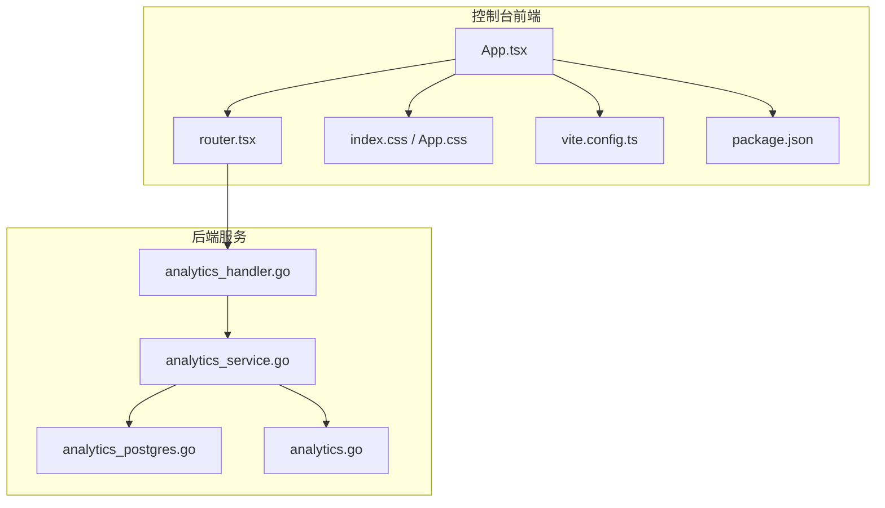
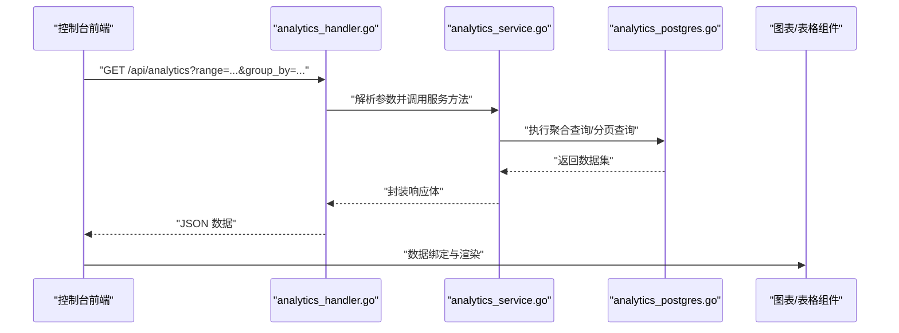
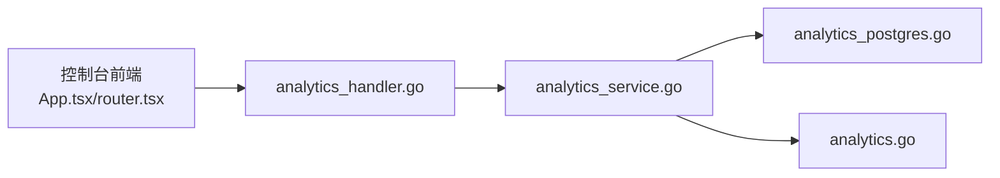

# 数据展示组件

<cite>
**本文引用的文件**   
- [package.json](file://notifuse/console/package.json)
- [vite.config.ts](file://notifuse/console/vite.config.ts)
- [App.tsx](file://notifuse/console/src/App.tsx)
- [router.tsx](file://notifuse/console/src/router.tsx)
- [index.css](file://notifuse/console/src/index.css)
- [App.css](file://notifuse/console/src/App.css)
- [analytics_handler.go](file://notifuse/internal/http/analytics_handler.go)
- [analytics_service.go](file://notifuse/internal/service/analytics_service.go)
- [analytics_postgres.go](file://notifuse/internal/repository/analytics_postgres.go)
- [analytics.go](file://notifuse/internal/domain/analytics.go)
</cite>

## 目录
1. [简介](#简介)
2. [项目结构](#项目结构)
3. [核心组件](#核心组件)
4. [架构总览](#架构总览)
5. [详细组件分析](#详细组件分析)
6. [依赖分析](#依赖分析)
7. [性能考虑](#性能考虑)
8. [故障排查指南](#故障排查指南)
9. [结论](#结论)
10. [附录](#附录)

## 简介
本文件面向 Notifuse 前端控制台的数据展示组件，聚焦图表可视化、数据表格与统计面板的实现与使用。文档覆盖以下主题：
- 图表库集成与配置（含主题定制）
- 数据绑定与交互（筛选、分页、排序、导出）
- 大数据量渲染优化策略
- 实时更新机制（轮询/增量更新）
- 多语言支持
- 响应式适配
- 最佳实践与性能调优建议

说明：由于仓库未包含具体前端图表组件源码，本文基于现有工程结构与后端接口进行架构级分析与使用指导，并提供可落地的实现建议与流程图示。

## 项目结构
Notifuse 控制台位于 notifuse/console 目录，采用 Vite + React + TypeScript 技术栈。关键入口与配置文件如下：
- 应用入口与样式：src/main.tsx、src/index.css、src/App.tsx、src/App.css
- 路由：src/router.tsx
- 构建与插件：vite.config.ts、package.json
- 后端分析数据接口：internal/http/analytics_handler.go
- 服务层与仓储层：internal/service/analytics_service.go、internal/repository/analytics_postgres.go
- 领域模型：internal/domain/analytics.go

图示来源
- [App.tsx:1-200](file://notifuse/console/src/App.tsx#L1-L200)
- [router.tsx:1-200](file://notifuse/console/src/router.tsx#L1-L200)
- [index.css:1-200](file://notifuse/console/src/index.css#L1-L200)
- [App.css:1-200](file://notifuse/console/src/App.css#L1-L200)
- [vite.config.ts:1-200](file://notifuse/console/vite.config.ts#L1-L200)
- [package.json:1-200](file://notifuse/console/package.json#L1-L200)
- [analytics_handler.go:1-200](file://notifuse/internal/http/analytics_handler.go#L1-L200)
- [analytics_service.go:1-200](file://notifuse/internal/service/analytics_service.go#L1-L200)
- [analytics_postgres.go:1-200](file://notifuse/internal/repository/analytics_postgres.go#L1-L200)
- [analytics.go:1-200](file://notifuse/internal/domain/analytics.go#L1-L200)

章节来源
- [package.json:1-200](file://notifuse/console/package.json#L1-L200)
- [vite.config.ts:1-200](file://notifuse/console/vite.config.ts#L1-L200)
- [App.tsx:1-200](file://notifuse/console/src/App.tsx#L1-L200)
- [router.tsx:1-200](file://notifuse/console/src/router.tsx#L1-L200)
- [index.css:1-200](file://notifuse/console/src/index.css#L1-L200)
- [App.css:1-200](file://notifuse/console/src/App.css#L1-L200)

## 核心组件
本节概述数据展示相关的前端能力与后端支撑点，便于快速定位实现位置与扩展方向。

- 图表可视化
  - 建议集成方案：在 package.json 中引入图表库（如 ECharts、AntV G2Plot、Recharts），通过 Vite 按需加载与主题配置。
  - 数据绑定：从 analytics 接口获取聚合指标或时序数据，映射为图表所需数据结构。
  - 交互功能：缩放、图例切换、提示框、下钻到明细列表。
  - 主题定制：通过全局主题对象或 CSS 变量统一控制颜色、字体、间距。

- 数据表格
  - 建议方案：使用高性能表格库（如 AG Grid、TanStack Table）实现虚拟滚动、列排序、过滤、分页与导出。
  - 数据源：对接后端分页接口，结合查询参数（时间范围、维度、状态等）。
  - 导出：CSV/Excel 导出，优先服务端生成大文件，前端触发下载。

- 统计面板
  - 指标卡片：展示关键指标（发送量、打开率、退信率等），支持刷新按钮与时间选择器。
  - 联动：点击指标跳转至对应图表或明细页。

- 多语言与国际化
  - 使用 i18n 工具（如 lingui/react-intl）管理文案，图表标题、轴标签、提示文本均纳入翻译资源。

- 响应式适配
  - 基于容器尺寸动态调整图表布局与字号；表格在小屏启用横向滚动或折叠行。

章节来源
- [package.json:1-200](file://notifuse/console/package.json#L1-L200)
- [vite.config.ts:1-200](file://notifuse/console/vite.config.ts#L1-L200)
- [App.tsx:1-200](file://notifuse/console/src/App.tsx#L1-L200)
- [router.tsx:1-200](file://notifuse/console/src/router.tsx#L1-L200)
- [index.css:1-200](file://notifuse/console/src/index.css#L1-L200)
- [App.css:1-200](file://notifuse/console/src/App.css#L1-L200)

## 架构总览
下图展示了控制台数据展示端到端流程：前端页面发起请求，后端处理器调用服务层，服务层访问仓储层读取数据库，返回结构化数据供前端渲染。

图示来源
- [analytics_handler.go:1-200](file://notifuse/internal/http/analytics_handler.go#L1-L200)
- [analytics_service.go:1-200](file://notifuse/internal/service/analytics_service.go#L1-L200)
- [analytics_postgres.go:1-200](file://notifuse/internal/repository/analytics_postgres.go#L1-L200)
- [analytics.go:1-200](file://notifuse/internal/domain/analytics.go#L1-L200)

## 详细组件分析

### 图表可视化组件
- 集成要点
  - 在 package.json 中添加图表库依赖，并通过 vite.config.ts 配置按需加载与别名。
  - 定义统一的主题配置对象，集中管理颜色、背景、字体、网格线等。
- 数据绑定
  - 将后端返回的时序/分类数据转换为图表系列格式，确保字段命名一致。
  - 对空值或缺失时间点做插值或占位处理，避免断链。
- 交互功能
  - 提供时间范围选择器、维度切换、图例多选、提示框格式化。
  - 点击图表项跳转到明细列表或详情页。
- 自定义配置
  - 暴露配置项：是否显示网格、是否允许缩放、是否启用动画、默认时间粒度等。
- 示例参考路径
  - 前端入口与样式：[App.tsx:1-200](file://notifuse/console/src/App.tsx#L1-L200)、[index.css:1-200](file://notifuse/console/src/index.css#L1-L200)、[App.css:1-200](file://notifuse/console/src/App.css#L1-L200)
  - 构建配置：[vite.config.ts:1-200](file://notifuse/console/vite.config.ts#L1-L200)
  - 依赖清单：[package.json:1-200](file://notifuse/console/package.json#L1-L200)

章节来源
- [package.json:1-200](file://notifuse/console/package.json#L1-L200)
- [vite.config.ts:1-200](file://notifuse/console/vite.config.ts#L1-L200)
- [App.tsx:1-200](file://notifuse/console/src/App.tsx#L1-L200)
- [index.css:1-200](file://notifuse/console/src/index.css#L1-L200)
- [App.css:1-200](file://notifuse/console/src/App.css#L1-L200)

### 数据表格组件
- 功能特性
  - 分页、排序、过滤、列宽拖拽、固定列、虚拟滚动。
  - 批量操作与导出（CSV/Excel/PDF）。
- 数据流
  - 根据 URL 查询参数或表单状态构造请求，拉取当前页数据。
  - 本地缓存最近一次查询结果，减少重复请求。
- 导出策略
  - 小数据量：前端生成 CSV。
  - 大数据量：请求后端导出接口，返回文件流或下载链接。
- 示例参考路径
  - 路由与页面组织：[router.tsx:1-200](file://notifuse/console/src/router.tsx#L1-L200)
  - 样式与主题：[index.css:1-200](file://notifuse/console/src/index.css#L1-L200)、[App.css:1-200](file://notifuse/console/src/App.css#L1-L200)

章节来源
- [router.tsx:1-200](file://notifuse/console/src/router.tsx#L1-L200)
- [index.css:1-200](file://notifuse/console/src/index.css#L1-L200)
- [App.css:1-200](file://notifuse/console/src/App.css#L1-L200)

### 统计面板组件
- 指标卡片
  - 展示关键指标及同比/环比变化，支持刷新与时间选择。
- 联动行为
  - 点击卡片进入对应图表或明细页，携带上下文参数。
- 示例参考路径
  - 页面组织与路由：[router.tsx:1-200](file://notifuse/console/src/router.tsx#L1-L200)
  - 应用样式：[App.css:1-200](file://notifuse/console/src/App.css#L1-L200)

章节来源
- [router.tsx:1-200](file://notifuse/console/src/router.tsx#L1-L200)
- [App.css:1-200](file://notifuse/console/src/App.css#L1-L200)

### 主题定制与多语言支持
- 主题定制
  - 通过 CSS 变量或主题对象统一管理色彩、字体、圆角、阴影等。
  - 图表主题与服务端配色保持一致，保证品牌一致性。
- 多语言
  - 使用 i18n 工具管理文案，包括图表标题、坐标轴、提示文本、错误消息。
  - 运行时切换语言后，重新渲染图表与表格以应用新文案。
- 示例参考路径
  - 样式入口：[index.css:1-200](file://notifuse/console/src/index.css#L1-L200)
  - 应用样式：[App.css:1-200](file://notifuse/console/src/App.css#L1-L200)
  - 构建配置：[vite.config.ts:1-200](file://notifuse/console/vite.config.ts#L1-L200)

章节来源
- [index.css:1-200](file://notifuse/console/src/index.css#L1-L200)
- [App.css:1-200](file://notifuse/console/src/App.css#L1-L200)
- [vite.config.ts:1-200](file://notifuse/console/vite.config.ts#L1-L200)

### 响应式适配
- 图表
  - 监听容器尺寸变化，动态重绘与调整布局。
  - 在小屏设备隐藏次要图例或简化提示框内容。
- 表格
  - 启用横向滚动或行折叠，保证可读性。
- 示例参考路径
  - 应用入口与样式：[App.tsx:1-200](file://notifuse/console/src/App.tsx#L1-L200)、[index.css:1-200](file://notifuse/console/src/index.css#L1-L200)

章节来源
- [App.tsx:1-200](file://notifuse/console/src/App.tsx#L1-L200)
- [index.css:1-200](file://notifuse/console/src/index.css#L1-L200)

### 大数据量渲染优化
- 图表
  - 启用采样/降采样、限制同时显示的系列数量、关闭不必要的动画。
  - 使用 Web Worker 预处理数据，避免阻塞主线程。
- 表格
  - 开启虚拟滚动，仅渲染可视区域行。
  - 分页+服务端排序/过滤，减少传输体积。
- 缓存
  - 对热点查询结果进行短期缓存，设置合理过期时间。
- 示例参考路径
  - 构建与依赖：[vite.config.ts:1-200](file://notifuse/console/vite.config.ts#L1-L200)、[package.json:1-200](file://notifuse/console/package.json#L1-L200)

章节来源
- [vite.config.ts:1-200](file://notifuse/console/vite.config.ts#L1-L200)
- [package.json:1-200](file://notifuse/console/package.json#L1-L200)

### 实时更新机制
- 轮询
  - 使用定时器周期性拉取最新指标，注意去抖与节流。
- 增量更新
  - 若后端支持增量推送，前端维护局部状态，仅合并差异数据。
- 错误恢复
  - 网络异常时指数退避重试，失败时降级为静态数据或提示用户。
- 示例参考路径
  - 页面与路由：[router.tsx:1-200](file://notifuse/console/src/router.tsx#L1-L200)
  - 应用样式：[App.css:1-200](file://notifuse/console/src/App.css#L1-L200)

章节来源
- [router.tsx:1-200](file://notifuse/console/src/router.tsx#L1-L200)
- [App.css:1-200](file://notifuse/console/src/App.css#L1-L200)

### 导出功能
- 前端导出
  - 小数据量直接生成 CSV/Excel，提供下载链接。
- 后端导出
  - 大数据量由后端生成文件，返回流或预签名下载链接。
- 进度反馈
  - 长任务显示进度条或“稍后下载”通知。
- 示例参考路径
  - 路由与页面：[router.tsx:1-200](file://notifuse/console/src/router.tsx#L1-L200)
  - 样式：[index.css:1-200](file://notifuse/console/src/index.css#L1-L200)

章节来源
- [router.tsx:1-200](file://notifuse/console/src/router.tsx#L1-L200)
- [index.css:1-200](file://notifuse/console/src/index.css#L1-L200)

### 后端接口与数据模型（用于数据绑定）
- 接口职责
  - 接收时间范围、分组维度、分页参数，返回聚合或明细数据。
- 数据模型
  - 领域模型定义指标、维度、时间序列等结构，前后端共享契约。
- 示例参考路径
  - 处理器：[analytics_handler.go:1-200](file://notifuse/internal/http/analytics_handler.go#L1-L200)
  - 服务层：[analytics_service.go:1-200](file://notifuse/internal/service/analytics_service.go#L1-L200)
  - 仓储层：[analytics_postgres.go:1-200](file://notifuse/internal/repository/analytics_postgres.go#L1-L200)
  - 领域模型：[analytics.go:1-200](file://notifuse/internal/domain/analytics.go#L1-L200)

章节来源
- [analytics_handler.go:1-200](file://notifuse/internal/http/analytics_handler.go#L1-L200)
- [analytics_service.go:1-200](file://notifuse/internal/service/analytics_service.go#L1-L200)
- [analytics_postgres.go:1-200](file://notifuse/internal/repository/analytics_postgres.go#L1-L200)
- [analytics.go:1-200](file://notifuse/internal/domain/analytics.go#L1-L200)

## 依赖分析
前端与后端的关键依赖关系如下：
- 前端依赖
  - 图表库（待添加）、表格库（待添加）、i18n 工具（待添加）
  - 构建工具：Vite、TypeScript
- 后端依赖
  - HTTP 处理器 -> 服务层 -> 仓储层 -> 数据库
  - 领域模型贯穿各层

图示来源
- [App.tsx:1-200](file://notifuse/console/src/App.tsx#L1-L200)
- [router.tsx:1-200](file://notifuse/console/src/router.tsx#L1-L200)
- [analytics_handler.go:1-200](file://notifuse/internal/http/analytics_handler.go#L1-L200)
- [analytics_service.go:1-200](file://notifuse/internal/service/analytics_service.go#L1-L200)
- [analytics_postgres.go:1-200](file://notifuse/internal/repository/analytics_postgres.go#L1-L200)
- [analytics.go:1-200](file://notifuse/internal/domain/analytics.go#L1-L200)

章节来源
- [package.json:1-200](file://notifuse/console/package.json#L1-L200)
- [vite.config.ts:1-200](file://notifuse/console/vite.config.ts#L1-L200)
- [analytics_handler.go:1-200](file://notifuse/internal/http/analytics_handler.go#L1-L200)
- [analytics_service.go:1-200](file://notifuse/internal/service/analytics_service.go#L1-L200)
- [analytics_postgres.go:1-200](file://notifuse/internal/repository/analytics_postgres.go#L1-L200)
- [analytics.go:1-200](file://notifuse/internal/domain/analytics.go#L1-L200)

## 性能考虑
- 数据传输
  - 压缩响应体，按需返回字段，避免冗余数据。
  - 使用分页与游标，限制单次返回行数。
- 渲染性能
  - 图表禁用不必要动画，启用数据采样与增量更新。
  - 表格启用虚拟滚动与列虚拟化。
- 缓存策略
  - 浏览器缓存与内存缓存结合，设置合理的失效策略。
- 并发控制
  - 对高频刷新进行节流与去抖，避免雪崩请求。
- 监控与诊断
  - 记录关键指标（首帧时间、渲染耗时、错误率），持续优化。

## 故障排查指南
- 常见问题
  - 图表不显示：检查数据格式与字段映射是否正确，确认容器尺寸非零。
  - 表格卡顿：确认是否开启虚拟滚动，检查是否有大量同步计算。
  - 导出失败：确认文件大小与后端导出接口可用性，检查权限与跨域。
  - 实时数据不更新：检查轮询间隔、网络状态与错误重试逻辑。
- 调试建议
  - 使用浏览器开发者工具观察网络请求与性能面板。
  - 在后端日志中核对查询参数与返回结构。
- 示例参考路径
  - 前端入口与样式：[App.tsx:1-200](file://notifuse/console/src/App.tsx#L1-L200)、[index.css:1-200](file://notifuse/console/src/index.css#L1-L200)
  - 后端处理器与服务层：[analytics_handler.go:1-200](file://notifuse/internal/http/analytics_handler.go#L1-L200)、[analytics_service.go:1-200](file://notifuse/internal/service/analytics_service.go#L1-L200)

章节来源
- [App.tsx:1-200](file://notifuse/console/src/App.tsx#L1-L200)
- [index.css:1-200](file://notifuse/console/src/index.css#L1-L200)
- [analytics_handler.go:1-200](file://notifuse/internal/http/analytics_handler.go#L1-L200)
- [analytics_service.go:1-200](file://notifuse/internal/service/analytics_service.go#L1-L200)

## 结论
本文围绕 Notifuse 控制台的数据展示组件，提供了从架构到实现的系统性说明。尽管当前仓库未包含具体前端图表组件源码，但通过明确的后端接口与领域模型，前端可按本文建议完成图表、表格与统计面板的集成与优化。建议在后续迭代中逐步落地主题定制、多语言、响应式与性能优化，以提升用户体验与系统稳定性。

## 附录
- 术语
  - 图表可视化：将数据以折线图、柱状图、饼图等图形化方式呈现。
  - 数据表格：以行列形式展示结构化数据，支持排序、过滤、分页与导出。
  - 统计面板：以指标卡片形式展示关键业务指标。
- 参考路径汇总
  - 前端入口与样式：[App.tsx:1-200](file://notifuse/console/src/App.tsx#L1-L200)、[index.css:1-200](file://notifuse/console/src/index.css#L1-L200)、[App.css:1-200](file://notifuse/console/src/App.css#L1-L200)
  - 路由与页面组织：[router.tsx:1-200](file://notifuse/console/src/router.tsx#L1-L200)
  - 构建与依赖：[vite.config.ts:1-200](file://notifuse/console/vite.config.ts#L1-L200)、[package.json:1-200](file://notifuse/console/package.json#L1-L200)
  - 后端接口与数据模型：[analytics_handler.go:1-200](file://notifuse/internal/http/analytics_handler.go#L1-L200)、[analytics_service.go:1-200](file://notifuse/internal/service/analytics_service.go#L1-L200)、[analytics_postgres.go:1-200](file://notifuse/internal/repository/analytics_postgres.go#L1-L200)、[analytics.go:1-200](file://notifuse/internal/domain/analytics.go#L1-L200)