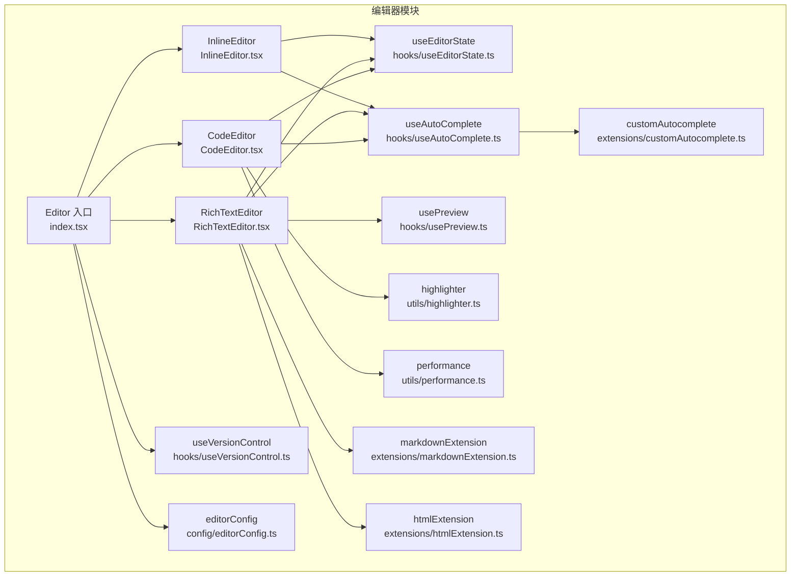
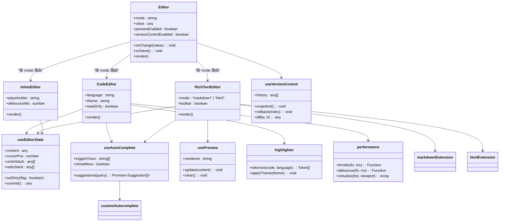
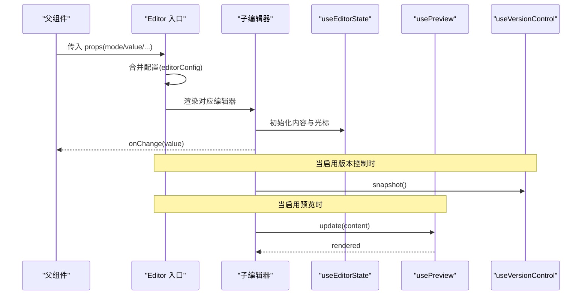
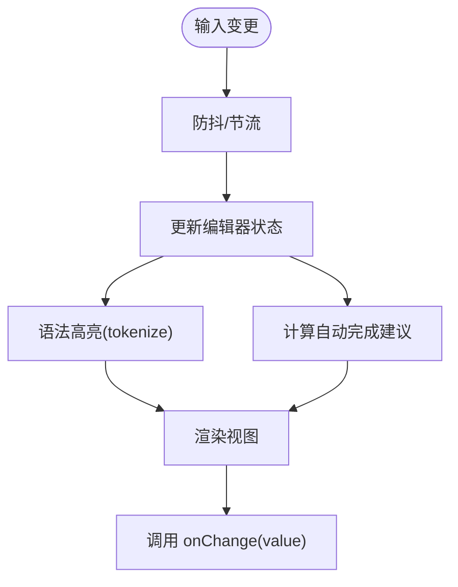
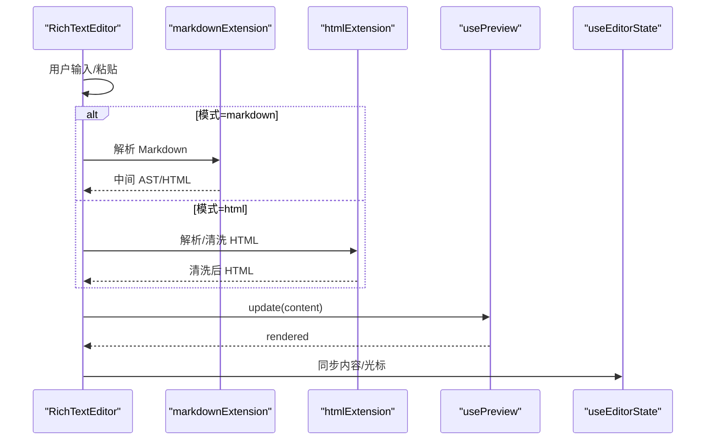
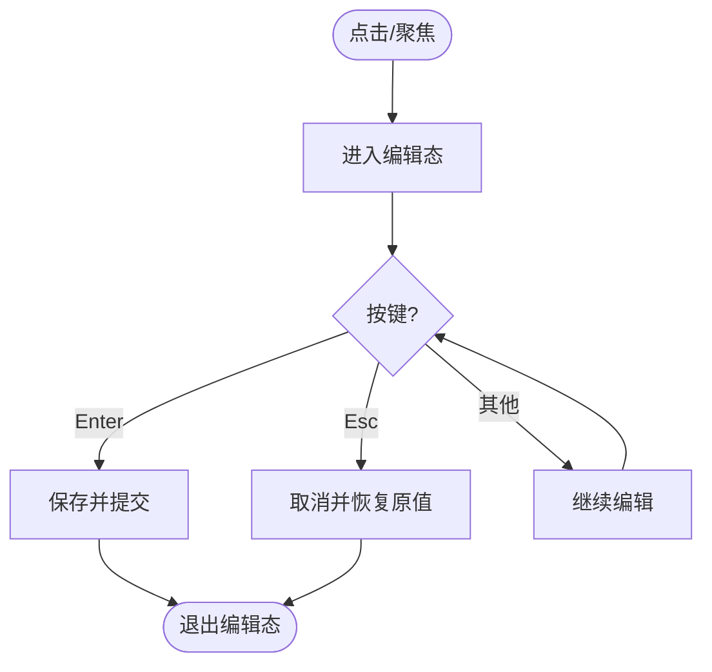
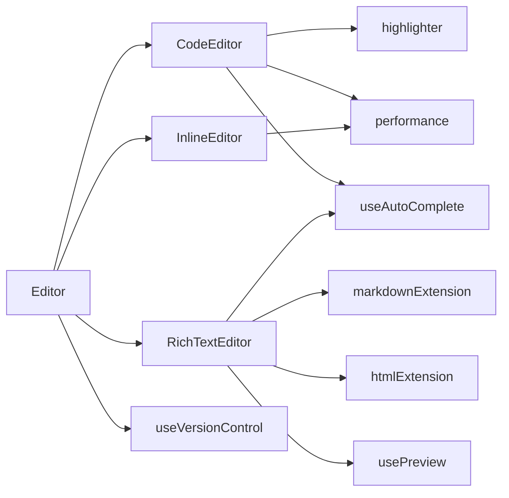

# 编辑器组件

<cite>
**本文引用的文件**   
- [console/src/components/Editor/index.tsx](file://notifuse/console/src/components/Editor/index.tsx)
- [console/src/components/Editor/CodeEditor.tsx](file://notifuse/console/src/components/Editor/CodeEditor.tsx)
- [console/src/components/Editor/RichTextEditor.tsx](file://notifuse/console/src/components/Editor/RichTextEditor.tsx)
- [console/src/components/Editor/InlineEditor.tsx](file://notifuse/console/src/components/Editor/InlineEditor.tsx)
- [console/src/components/Editor/hooks/useEditorState.ts](file://notifuse/console/src/components/Editor/hooks/useEditorState.ts)
- [console/src/components/Editor/hooks/useAutoComplete.ts](file://notifuse/console/src/components/Editor/hooks/useAutoComplete.ts)
- [console/src/components/Editor/hooks/usePreview.ts](file://notifuse/console/src/components/Editor/hooks/usePreview.ts)
- [console/src/components/Editor/hooks/useVersionControl.ts](file://notifuse/console/src/components/Editor/hooks/useVersionControl.ts)
- [console/src/components/Editor/utils/highlighter.ts](file://notifuse/console/src/components/Editor/utils/highlighter.ts)
- [console/src/components/Editor/utils/performance.ts](file://notifuse/console/src/components/Editor/utils/performance.ts)
- [console/src/components/Editor/config/editorConfig.ts](file://notifuse/console/src/components/Editor/config/editorConfig.ts)
- [console/src/components/Editor/extensions/markdownExtension.ts](file://notifuse/console/src/components/Editor/extensions/markdownExtension.ts)
- [console/src/components/Editor/extensions/htmlExtension.ts](file://notifuse/console/src/components/Editor/extensions/htmlExtension.ts)
- [console/src/components/Editor/extensions/customAutocomplete.ts](file://notifuse/console/src/components/Editor/extensions/customAutocomplete.ts)
</cite>

## 目录
1. [简介](#简介)
2. [项目结构](#项目结构)
3. [核心组件](#核心组件)
4. [架构总览](#架构总览)
5. [详细组件分析](#详细组件分析)
6. [依赖分析](#依赖分析)
7. [性能考虑](#性能考虑)
8. [故障排查指南](#故障排查指南)
9. [结论](#结论)
10. [附录](#附录)

## 简介
本文件为 Notifuse 前端控制台“编辑器组件”的权威文档，覆盖代码编辑器、富文本编辑器与内联编辑器的实现细节。重点说明语法高亮、自动完成、实时预览与版本控制等能力，并给出配置选项、扩展机制、自定义开发指引，以及性能优化、内存管理与大数据处理策略。文末提供集成示例与高级用法，帮助快速落地与二次开发。

## 项目结构
编辑器模块采用“统一入口 + 多模式子组件 + hooks + utils + extensions”的分层组织方式：
- 统一入口：对外暴露统一的 Editor 组件，内部根据类型选择具体实现（代码/富文本/内联）。
- 子组件：分别封装 CodeEditor、RichTextEditor、InlineEditor，聚焦各自渲染与交互逻辑。
- Hooks：状态管理、自动完成、预览、版本控制等横切能力以 hooks 形式复用。
- Utils：语法高亮、性能优化等通用工具。
- Extensions：可插拔的扩展点（Markdown/HTML 扩展、自定义自动完成等）。

图表来源
- [console/src/components/Editor/index.tsx](file://notifuse/console/src/components/Editor/index.tsx)
- [console/src/components/Editor/CodeEditor.tsx](file://notifuse/console/src/components/Editor/CodeEditor.tsx)
- [console/src/components/Editor/RichTextEditor.tsx](file://notifuse/console/src/components/Editor/RichTextEditor.tsx)
- [console/src/components/Editor/InlineEditor.tsx](file://notifuse/console/src/components/Editor/InlineEditor.tsx)
- [console/src/components/Editor/hooks/useEditorState.ts](file://notifuse/console/src/components/Editor/hooks/useEditorState.ts)
- [console/src/components/Editor/hooks/useAutoComplete.ts](file://notifuse/console/src/components/Editor/hooks/useAutoComplete.ts)
- [console/src/components/Editor/hooks/usePreview.ts](file://notifuse/console/src/components/Editor/hooks/usePreview.ts)
- [console/src/components/Editor/hooks/useVersionControl.ts](file://notifuse/console/src/components/Editor/hooks/useVersionControl.ts)
- [console/src/components/Editor/utils/highlighter.ts](file://notifuse/console/src/components/Editor/utils/highlighter.ts)
- [console/src/components/Editor/utils/performance.ts](file://notifuse/console/src/components/Editor/utils/performance.ts)
- [console/src/components/Editor/extensions/markdownExtension.ts](file://notifuse/console/src/components/Editor/extensions/markdownExtension.ts)
- [console/src/components/Editor/extensions/htmlExtension.ts](file://notifuse/console/src/components/Editor/extensions/htmlExtension.ts)
- [console/src/components/Editor/extensions/customAutocomplete.ts](file://notifuse/console/src/components/Editor/extensions/customAutocomplete.ts)
- [console/src/components/Editor/config/editorConfig.ts](file://notifuse/console/src/components/Editor/config/editorConfig.ts)

章节来源
- [console/src/components/Editor/index.tsx](file://notifuse/console/src/components/Editor/index.tsx)
- [console/src/components/Editor/config/editorConfig.ts](file://notifuse/console/src/components/Editor/config/editorConfig.ts)

## 核心组件
- 统一入口 Editor
  - 职责：接收统一 props（如 mode、value、onChange、onSave、preview、versionControl 等），按 mode 路由到具体编辑器；聚合 hooks 与扩展；提供一致的 API。
  - 关键特性：按需加载子组件、集中式配置注入、事件归一化。
- 代码编辑器 CodeEditor
  - 职责：基于底层编辑器内核（例如 monaco 或 codemirror）提供代码输入体验。
  - 关键特性：语法高亮、自动补全、错误提示、主题切换、快捷键、行号、折叠、搜索替换。
- 富文本编辑器 RichTextEditor
  - 职责：提供所见即所得的富文本编辑能力，支持 Markdown 与 HTML 两种模式。
  - 关键特性：工具栏、块级元素、图片/链接插入、实时预览、导出 HTML/Markdown。
- 内联编辑器 InlineEditor
  - 职责：在表格单元格、标题、标签等场景下提供轻量内联编辑。
  - 关键特性：失焦保存、回车确认、ESC 取消、最小 UI 开销。

章节来源
- [console/src/components/Editor/index.tsx](file://notifuse/console/src/components/Editor/index.tsx)
- [console/src/components/Editor/CodeEditor.tsx](file://notifuse/console/src/components/Editor/CodeEditor.tsx)
- [console/src/components/Editor/RichTextEditor.tsx](file://notifuse/console/src/components/Editor/RichTextEditor.tsx)
- [console/src/components/Editor/InlineEditor.tsx](file://notifuse/console/src/components/Editor/InlineEditor.tsx)

## 架构总览
编辑器整体遵循“组件驱动 + hooks 协作 + 扩展点开放”的架构：
- 组件层：Editor 作为门面，分发到具体编辑器。
- 状态层：useEditorState 统一管理内容、光标位置、撤销栈、脏标记等。
- 能力层：useAutoComplete、usePreview、useVersionControl 提供横向能力。
- 工具层：highlighter、performance 提供通用能力。
- 扩展层：extensions 提供 Markdown/HTML 解析器与自定义自动完成插件。

图表来源
- [console/src/components/Editor/index.tsx](file://notifuse/console/src/components/Editor/index.tsx)
- [console/src/components/Editor/CodeEditor.tsx](file://notifuse/console/src/components/Editor/CodeEditor.tsx)
- [console/src/components/Editor/RichTextEditor.tsx](file://notifuse/console/src/components/Editor/RichTextEditor.tsx)
- [console/src/components/Editor/InlineEditor.tsx](file://notifuse/console/src/components/Editor/InlineEditor.tsx)
- [console/src/components/Editor/hooks/useEditorState.ts](file://notifuse/console/src/components/Editor/hooks/useEditorState.ts)
- [console/src/components/Editor/hooks/useAutoComplete.ts](file://notifuse/console/src/components/Editor/hooks/useAutoComplete.ts)
- [console/src/components/Editor/hooks/usePreview.ts](file://notifuse/console/src/components/Editor/hooks/usePreview.ts)
- [console/src/components/Editor/hooks/useVersionControl.ts](file://notifuse/console/src/components/Editor/hooks/useVersionControl.ts)
- [console/src/components/Editor/utils/highlighter.ts](file://notifuse/console/src/components/Editor/utils/highlighter.ts)
- [console/src/components/Editor/utils/performance.ts](file://notifuse/console/src/components/Editor/utils/performance.ts)
- [console/src/components/Editor/extensions/markdownExtension.ts](file://notifuse/console/src/components/Editor/extensions/markdownExtension.ts)
- [console/src/components/Editor/extensions/htmlExtension.ts](file://notifuse/console/src/components/Editor/extensions/htmlExtension.ts)
- [console/src/components/Editor/extensions/customAutocomplete.ts](file://notifuse/console/src/components/Editor/extensions/customAutocomplete.ts)

## 详细组件分析

### 统一入口 Editor
- 功能要点
  - 根据 mode 动态渲染 CodeEditor / RichTextEditor / InlineEditor。
  - 将 editorConfig 中的默认值与用户传入 props 合并。
  - 统一派发 onChange/onSave 事件，屏蔽底层差异。
  - 可选开启 preview 与 versionControl 能力。
- 关键流程
  - 初始化：读取配置 -> 创建状态 -> 注册扩展 -> 渲染子组件。
  - 更新：内容变更 -> 触发自动保存/快照 -> 更新预览（若启用）。
  - 销毁：清理定时器/订阅/缓存。

图表来源
- [console/src/components/Editor/index.tsx](file://notifuse/console/src/components/Editor/index.tsx)
- [console/src/components/Editor/hooks/useEditorState.ts](file://notifuse/console/src/components/Editor/hooks/useEditorState.ts)
- [console/src/components/Editor/hooks/usePreview.ts](file://notifuse/console/src/components/Editor/hooks/usePreview.ts)
- [console/src/components/Editor/hooks/useVersionControl.ts](file://notifuse/console/src/components/Editor/hooks/useVersionControl.ts)

章节来源
- [console/src/components/Editor/index.tsx](file://notifuse/console/src/components/Editor/index.tsx)
- [console/src/components/Editor/config/editorConfig.ts](file://notifuse/console/src/components/Editor/config/editorConfig.ts)

### 代码编辑器 CodeEditor
- 功能特性
  - 语法高亮：通过 highlighter.tokenize 对语言进行分词与着色。
  - 自动完成：结合 useAutoComplete 与 customAutocomplete 扩展，提供上下文建议。
  - 性能优化：使用 performance.debounce/throttle 降低高频事件开销；虚拟滚动应对大文档。
- 关键数据流
  - 输入变更 -> debounce -> 更新状态 -> 触发高亮/补全 -> 回调 onChange。
- 扩展点
  - 新增语言：在 highlighter 中注册语言规则。
  - 自定义补全：在 customAutocomplete 中实现 suggestions 源。

图表来源
- [console/src/components/Editor/CodeEditor.tsx](file://notifuse/console/src/components/Editor/CodeEditor.tsx)
- [console/src/components/Editor/utils/highlighter.ts](file://notifuse/console/src/components/Editor/utils/highlighter.ts)
- [console/src/components/Editor/utils/performance.ts](file://notifuse/console/src/components/Editor/utils/performance.ts)
- [console/src/components/Editor/hooks/useAutoComplete.ts](file://notifuse/console/src/components/Editor/hooks/useAutoComplete.ts)
- [console/src/components/Editor/extensions/customAutocomplete.ts](file://notifuse/console/src/components/Editor/extensions/customAutocomplete.ts)

章节来源
- [console/src/components/Editor/CodeEditor.tsx](file://notifuse/console/src/components/Editor/CodeEditor.tsx)
- [console/src/components/Editor/utils/highlighter.ts](file://notifuse/console/src/components/Editor/utils/highlighter.ts)
- [console/src/components/Editor/utils/performance.ts](file://notifuse/console/src/components/Editor/utils/performance.ts)
- [console/src/components/Editor/hooks/useAutoComplete.ts](file://notifuse/console/src/components/Editor/hooks/useAutoComplete.ts)
- [console/src/components/Editor/extensions/customAutocomplete.ts](file://notifuse/console/src/components/Editor/extensions/customAutocomplete.ts)

### 富文本编辑器 RichTextEditor
- 功能特性
  - 双模式：Markdown 与 HTML 无缝切换。
  - 实时预览：usePreview 将内容渲染为 HTML 供预览面板展示。
  - 扩展：markdownExtension 与 htmlExtension 负责解析与转换。
- 关键流程
  - 内容变更 -> 解析(Markdown/HTML) -> 生成预览 -> 同步状态。
- 注意事项
  - 安全过滤：对 HTML 白名单进行校验，避免 XSS。
  - 性能：长文档预览需分页/懒加载。

图表来源
- [console/src/components/Editor/RichTextEditor.tsx](file://notifuse/console/src/components/Editor/RichTextEditor.tsx)
- [console/src/components/Editor/extensions/markdownExtension.ts](file://notifuse/console/src/components/Editor/extensions/markdownExtension.ts)
- [console/src/components/Editor/extensions/htmlExtension.ts](file://notifuse/console/src/components/Editor/extensions/htmlExtension.ts)
- [console/src/components/Editor/hooks/usePreview.ts](file://notifuse/console/src/components/Editor/hooks/usePreview.ts)
- [console/src/components/Editor/hooks/useEditorState.ts](file://notifuse/console/src/components/Editor/hooks/useEditorState.ts)

章节来源
- [console/src/components/Editor/RichTextEditor.tsx](file://notifuse/console/src/components/Editor/RichTextEditor.tsx)
- [console/src/components/Editor/extensions/markdownExtension.ts](file://notifuse/console/src/components/Editor/extensions/markdownExtension.ts)
- [console/src/components/Editor/extensions/htmlExtension.ts](file://notifuse/console/src/components/Editor/extensions/htmlExtension.ts)
- [console/src/components/Editor/hooks/usePreview.ts](file://notifuse/console/src/components/Editor/hooks/usePreview.ts)

### 内联编辑器 InlineEditor
- 功能特性
  - 轻量交互：点击进入编辑，失焦/回车保存，ESC 取消。
  - 防抖保存：debounceMs 控制保存时机，减少频繁写入。
- 适用场景
  - 表格单元格、标题、标签、注释等短文本编辑。

图表来源
- [console/src/components/Editor/InlineEditor.tsx](file://notifuse/console/src/components/Editor/InlineEditor.tsx)
- [console/src/components/Editor/utils/performance.ts](file://notifuse/console/src/components/Editor/utils/performance.ts)

章节来源
- [console/src/components/Editor/InlineEditor.tsx](file://notifuse/console/src/components/Editor/InlineEditor.tsx)
- [console/src/components/Editor/utils/performance.ts](file://notifuse/console/src/components/Editor/utils/performance.ts)

### 状态与能力 Hooks
- useEditorState
  - 维护内容、光标、撤销/重做栈、脏标记；提供 commit/setDirty 等方法。
- useAutoComplete
  - 管理触发字符、建议列表、菜单显隐；支持异步建议源。
- usePreview
  - 将内容转换为可渲染 HTML，支持增量更新与缓存。
- useVersionControl
  - 维护历史快照、回滚、差异对比；支持定时快照与手动快照。

章节来源
- [console/src/components/Editor/hooks/useEditorState.ts](file://notifuse/console/src/components/Editor/hooks/useEditorState.ts)
- [console/src/components/Editor/hooks/useAutoComplete.ts](file://notifuse/console/src/components/Editor/hooks/useAutoComplete.ts)
- [console/src/components/Editor/hooks/usePreview.ts](file://notifuse/console/src/components/Editor/hooks/usePreview.ts)
- [console/src/components/Editor/hooks/useVersionControl.ts](file://notifuse/console/src/components/Editor/hooks/useVersionControl.ts)

### 工具与扩展
- highlighter
  - 提供 tokenize 与主题应用，支持多语言规则注册。
- performance
  - 提供 debounce、throttle、虚拟列表等基础工具。
- extensions
  - markdownExtension：Markdown 到 HTML 的解析与转换。
  - htmlExtension：HTML 清洗、白名单校验与规范化。
  - customAutocomplete：自定义自动完成建议源，可按上下文返回候选项。

章节来源
- [console/src/components/Editor/utils/highlighter.ts](file://notifuse/console/src/components/Editor/utils/highlighter.ts)
- [console/src/components/Editor/utils/performance.ts](file://notifuse/console/src/components/Editor/utils/performance.ts)
- [console/src/components/Editor/extensions/markdownExtension.ts](file://notifuse/console/src/components/Editor/extensions/markdownExtension.ts)
- [console/src/components/Editor/extensions/htmlExtension.ts](file://notifuse/console/src/components/Editor/extensions/htmlExtension.ts)
- [console/src/components/Editor/extensions/customAutocomplete.ts](file://notifuse/console/src/components/Editor/extensions/customAutocomplete.ts)

## 依赖分析
- 组件耦合
  - Editor 与子组件松耦合，通过 mode 与 props 解耦。
  - hooks 之间低耦合，通过返回值与事件通信。
- 外部依赖
  - 语法高亮与自动完成可能依赖第三方库（如 monaco/codemirror），通过 highlighter 与 customAutocomplete 抽象隔离。
- 潜在循环依赖
  - 当前结构以 hooks 与 utils 为主，未见直接循环引用风险。

图表来源
- [console/src/components/Editor/index.tsx](file://notifuse/console/src/components/Editor/index.tsx)
- [console/src/components/Editor/CodeEditor.tsx](file://notifuse/console/src/components/Editor/CodeEditor.tsx)
- [console/src/components/Editor/RichTextEditor.tsx](file://notifuse/console/src/components/Editor/RichTextEditor.tsx)
- [console/src/components/Editor/InlineEditor.tsx](file://notifuse/console/src/components/Editor/InlineEditor.tsx)
- [console/src/components/Editor/utils/highlighter.ts](file://notifuse/console/src/components/Editor/utils/highlighter.ts)
- [console/src/components/Editor/utils/performance.ts](file://notifuse/console/src/components/Editor/utils/performance.ts)
- [console/src/components/Editor/extensions/markdownExtension.ts](file://notifuse/console/src/components/Editor/extensions/markdownExtension.ts)
- [console/src/components/Editor/extensions/htmlExtension.ts](file://notifuse/console/src/components/Editor/extensions/htmlExtension.ts)
- [console/src/components/Editor/hooks/usePreview.ts](file://notifuse/console/src/components/Editor/hooks/usePreview.ts)
- [console/src/components/Editor/hooks/useAutoComplete.ts](file://notifuse/console/src/components/Editor/hooks/useAutoComplete.ts)
- [console/src/components/Editor/hooks/useVersionControl.ts](file://notifuse/console/src/components/Editor/hooks/useVersionControl.ts)

章节来源
- [console/src/components/Editor/index.tsx](file://notifuse/console/src/components/Editor/index.tsx)

## 性能考虑
- 输入与渲染
  - 使用 debounce/throttle 降低高频输入导致的重渲染与计算压力。
  - 大文档采用虚拟滚动与增量更新，避免一次性渲染全部节点。
- 自动完成
  - 建议源异步加载与本地缓存，减少网络抖动影响。
  - 限制建议数量与延迟显示，提升响应性。
- 预览
  - 预览结果缓存，仅在内容变化时重新计算。
  - 长内容分页/懒加载，避免主线程阻塞。
- 版本控制
  - 快照去重与压缩，限制历史长度，避免内存膨胀。
- 内存管理
  - 组件卸载时清理定时器、订阅与缓存。
  - 避免闭包持有大对象引用。

[本节为通用性能指导，不直接分析具体文件]

## 故障排查指南
- 常见问题
  - 自动完成不触发：检查 triggerChars 配置与 suggestions 源是否返回有效数据。
  - 预览空白：确认 Markdown/HTML 解析链路是否正常，查看清洗白名单是否过严。
  - 卡顿：增大 debounce 间隔或关闭不必要的实时高亮/补全。
  - 内存泄漏：确认 useEffect 清理逻辑是否执行，避免保留大对象引用。
- 定位方法
  - 在 useEditorState 中打印 content 与 undo/redo 栈大小，评估状态增长。
  - 在 usePreview 中记录渲染耗时，定位慢路径。
  - 在 useVersionControl 中检查快照频率与历史长度。

章节来源
- [console/src/components/Editor/hooks/useEditorState.ts](file://notifuse/console/src/components/Editor/hooks/useEditorState.ts)
- [console/src/components/Editor/hooks/usePreview.ts](file://notifuse/console/src/components/Editor/hooks/usePreview.ts)
- [console/src/components/Editor/hooks/useVersionControl.ts](file://notifuse/console/src/components/Editor/hooks/useVersionControl.ts)

## 结论
编辑器组件通过统一入口与模块化设计，实现了代码、富文本与内联三种编辑模式的统一体验。借助 hooks 与扩展机制，系统具备良好的可定制性与可扩展性。配合完善的性能优化策略与版本控制能力，可满足复杂业务场景下的编辑需求。

[本节为总结性内容，不直接分析具体文件]

## 附录

### 配置选项（示例）
- 全局配置（editorConfig）
  - theme：主题名称
  - language：默认语言（代码编辑器）
  - placeholder：占位文本
  - readOnly：只读模式
  - showToolbar：是否显示工具栏（富文本）
  - previewEnabled：是否启用实时预览
  - versionControlEnabled：是否启用版本控制
  - autoComplete：自动完成开关与建议源
  - performance：防抖/节流时间、虚拟滚动阈值

章节来源
- [console/src/components/Editor/config/editorConfig.ts](file://notifuse/console/src/components/Editor/config/editorConfig.ts)

### 扩展机制与自定义开发
- 新增语言高亮
  - 在 highlighter 中注册语言规则与关键词集合。
- 自定义自动完成
  - 在 customAutocomplete 中实现 suggestions 函数，支持异步与上下文感知。
- 富文本扩展
  - 在 markdownExtension 中添加新指令/语法映射。
  - 在 htmlExtension 中扩展白名单与清洗规则。

章节来源
- [console/src/components/Editor/utils/highlighter.ts](file://notifuse/console/src/components/Editor/utils/highlighter.ts)
- [console/src/components/Editor/extensions/customAutocomplete.ts](file://notifuse/console/src/components/Editor/extensions/customAutocomplete.ts)
- [console/src/components/Editor/extensions/markdownExtension.ts](file://notifuse/console/src/components/Editor/extensions/markdownExtension.ts)
- [console/src/components/Editor/extensions/htmlExtension.ts](file://notifuse/console/src/components/Editor/extensions/htmlExtension.ts)

### 集成示例与高级用法
- 基本集成
  - 在页面中引入 Editor，设置 mode 与 value/onChange，即可使用。
- 启用预览与版本控制
  - 设置 previewEnabled 与 versionControlEnabled，并在 onSave 中持久化。
- 自定义补全
  - 在 customAutocomplete 中接入后端接口，实现智能建议。
- 大数据处理
  - 开启虚拟滚动与增量预览，限制快照频率与历史长度。

章节来源
- [console/src/components/Editor/index.tsx](file://notifuse/console/src/components/Editor/index.tsx)
- [console/src/components/Editor/hooks/usePreview.ts](file://notifuse/console/src/components/Editor/hooks/usePreview.ts)
- [console/src/components/Editor/hooks/useVersionControl.ts](file://notifuse/console/src/components/Editor/hooks/useVersionControl.ts)
- [console/src/components/Editor/extensions/customAutocomplete.ts](file://notifuse/console/src/components/Editor/extensions/customAutocomplete.ts)