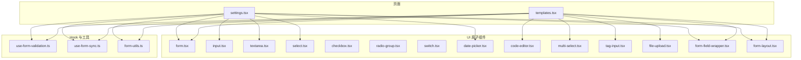
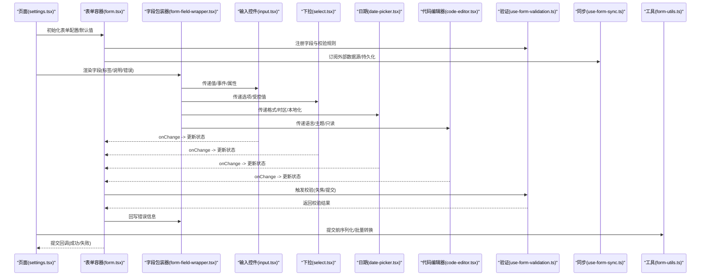
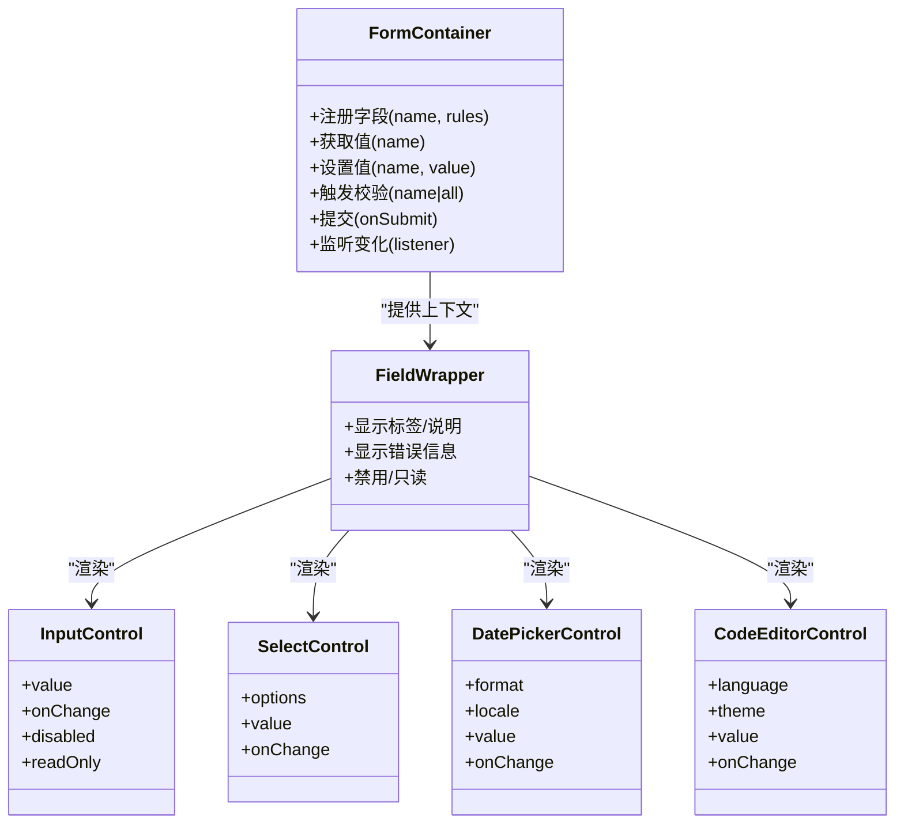
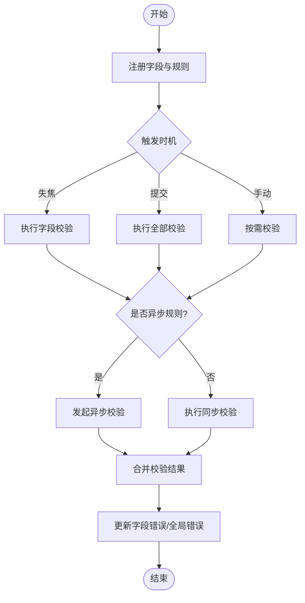
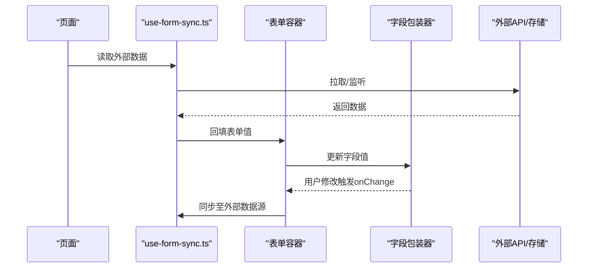
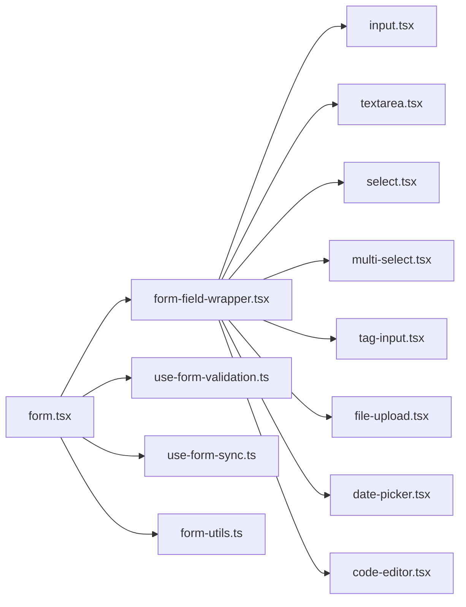

# 表单组件

<cite>
**本文引用的文件**   
- [console/src/components/ui/form.tsx](file://notifuse/console/src/components/ui/form.tsx)
- [console/src/components/ui/input.tsx](file://notifuse/console/src/components/ui/input.tsx)
- [console/src/components/ui/textarea.tsx](file://notifuse/console/src/components/ui/textarea.tsx)
- [console/src/components/ui/select.tsx](file://notifuse/console/src/components/ui/select.tsx)
- [console/src/components/ui/checkbox.tsx](file://notifuse/console/src/components/ui/checkbox.tsx)
- [console/src/components/ui/radio-group.tsx](file://notifuse/console/src/components/ui/radio-group.tsx)
- [console/src/components/ui/switch.tsx](file://notifuse/console/src/components/ui/switch.tsx)
- [console/src/components/ui/date-picker.tsx](file://notifuse/console/src/components/ui/date-picker.tsx)
- [console/src/components/ui/code-editor.tsx](file://notifuse/console/src/components/ui/code-editor.tsx)
- [console/src/components/ui/multi-select.tsx](file://notifuse/console/src/components/ui/multi-select.tsx)
- [console/src/components/ui/tag-input.tsx](file://notifuse/console/src/components/ui/tag-input.tsx)
- [console/src/components/ui/file-upload.tsx](file://notifuse/console/src/components/ui/file-upload.tsx)
- [console/src/components/ui/form-field-wrapper.tsx](file://notifuse/console/src/components/ui/form-field-wrapper.tsx)
- [console/src/components/ui/form-layout.tsx](file://notifuse/console/src/components/ui/form-layout.tsx)
- [console/src/hooks/use-form-validation.ts](file://notifuse/console/src/hooks/use-form-validation.ts)
- [console/src/hooks/use-form-sync.ts](file://notifuse/console/src/hooks/use-form-sync.ts)
- [console/src/lib/form-utils.ts](file://notifuse/console/src/lib/form-utils.ts)
- [console/src/pages/settings.tsx](file://notifuse/console/src/pages/settings.tsx)
- [console/src/pages/templates.tsx](file://notifuse/console/src/pages/templates.tsx)
</cite>

## 目录
1. [简介](#简介)
2. [项目结构](#项目结构)
3. [核心组件](#核心组件)
4. [架构总览](#架构总览)
5. [详细组件分析](#详细组件分析)
6. [依赖关系分析](#依赖关系分析)
7. [性能考虑](#性能考虑)
8. [故障排查指南](#故障排查指南)
9. [结论](#结论)
10. [附录](#附录)

## 简介
本文件面向 Notifuse 前端控制台，系统化梳理并文档化其“表单组件”体系。内容覆盖：
- 基础与高级输入控件（文本、代码编辑器、下拉选择、日期选择等）
- 表单验证机制、错误处理、数据绑定与状态同步
- 复杂表单构建模式、动态表单生成与批量操作
- 性能优化、用户体验设计与可访问性支持
- 自定义开发与扩展指南

目标是帮助开发者快速理解现有实现，并在不破坏一致性的前提下进行扩展与定制。

## 项目结构
控制台前端采用“UI 原子组件 + 领域页面组合”的分层组织方式。表单相关代码主要分布在以下位置：
- UI 原子组件：位于 console/src/components/ui/*，提供通用输入控件与布局封装
- 表单 Hook：位于 console/src/hooks/*，封装验证、同步等跨组件逻辑
- 表单工具库：位于 console/src/lib/*，提供校验规则、序列化、批量操作等能力
- 页面级表单：位于 console/src/pages/*，组合 UI 组件与 Hook 完成业务表单

图表来源
- [console/src/components/ui/form.tsx](file://notifuse/console/src/components/ui/form.tsx)
- [console/src/components/ui/input.tsx](file://notifuse/console/src/components/ui/input.tsx)
- [console/src/components/ui/textarea.tsx](file://notifuse/console/src/components/ui/textarea.tsx)
- [console/src/components/ui/select.tsx](file://notifuse/console/src/components/ui/select.tsx)
- [console/src/components/ui/checkbox.tsx](file://notifuse/console/src/components/ui/checkbox.tsx)
- [console/src/components/ui/radio-group.tsx](file://notifuse/console/src/components/ui/radio-group.tsx)
- [console/src/components/ui/switch.tsx](file://notifuse/console/src/components/ui/switch.tsx)
- [console/src/components/ui/date-picker.tsx](file://notifuse/console/src/components/ui/date-picker.tsx)
- [console/src/components/ui/code-editor.tsx](file://notifuse/console/src/components/ui/code-editor.tsx)
- [console/src/components/ui/multi-select.tsx](file://notifuse/console/src/components/ui/multi-select.tsx)
- [console/src/components/ui/tag-input.tsx](file://notifuse/console/src/components/ui/tag-input.tsx)
- [console/src/components/ui/file-upload.tsx](file://notifuse/console/src/components/ui/file-upload.tsx)
- [console/src/components/ui/form-field-wrapper.tsx](file://notifuse/console/src/components/ui/form-field-wrapper.tsx)
- [console/src/components/ui/form-layout.tsx](file://notifuse/console/src/components/ui/form-layout.tsx)
- [console/src/hooks/use-form-validation.ts](file://notifuse/console/src/hooks/use-form-validation.ts)
- [console/src/hooks/use-form-sync.ts](file://notifuse/console/src/hooks/use-form-sync.ts)
- [console/src/lib/form-utils.ts](file://notifuse/console/src/lib/form-utils.ts)
- [console/src/pages/settings.tsx](file://notifuse/console/src/pages/settings.tsx)
- [console/src/pages/templates.tsx](file://notifuse/console/src/pages/templates.tsx)

章节来源
- [console/src/components/ui/form.tsx](file://notifuse/console/src/components/ui/form.tsx)
- [console/src/components/ui/form-field-wrapper.tsx](file://notifuse/console/src/components/ui/form-field-wrapper.tsx)
- [console/src/components/ui/form-layout.tsx](file://notifuse/console/src/components/ui/form-layout.tsx)
- [console/src/hooks/use-form-validation.ts](file://notifuse/console/src/hooks/use-form-validation.ts)
- [console/src/hooks/use-form-sync.ts](file://notifuse/console/src/hooks/use-form-sync.ts)
- [console/src/lib/form-utils.ts](file://notifuse/console/src/lib/form-utils.ts)
- [console/src/pages/settings.tsx](file://notifuse/console/src/pages/settings.tsx)
- [console/src/pages/templates.tsx](file://notifuse/console/src/pages/templates.tsx)

## 核心组件
本节聚焦于表单体系的“骨架”与“关键构件”，包括表单容器、字段包装器、布局以及常用输入控件。

- 表单容器与上下文
  - 负责维护表单整体状态、注册字段、聚合校验结果、提交生命周期管理
  - 对外暴露字段注册接口、值读写接口、校验触发接口、提交回调
- 字段包装器
  - 统一渲染标签、说明、错误信息、禁用态、只读态
  - 将字段 ID、名称、校验状态与 UI 展示解耦
- 布局组件
  - 提供栅格、分节、步骤式等布局能力，适配不同复杂度的表单
- 基础输入控件
  - 文本输入、多行文本、开关、单选组、复选框、下拉选择、多选、标签输入、文件上传、日期选择、代码编辑器等

章节来源
- [console/src/components/ui/form.tsx](file://notifuse/console/src/components/ui/form.tsx)
- [console/src/components/ui/form-field-wrapper.tsx](file://notifuse/console/src/components/ui/form-field-wrapper.tsx)
- [console/src/components/ui/form-layout.tsx](file://notifuse/console/src/components/ui/form-layout.tsx)
- [console/src/components/ui/input.tsx](file://notifuse/console/src/components/ui/input.tsx)
- [console/src/components/ui/textarea.tsx](file://notifuse/console/src/components/ui/textarea.tsx)
- [console/src/components/ui/checkbox.tsx](file://notifuse/console/src/components/ui/checkbox.tsx)
- [console/src/components/ui/radio-group.tsx](file://notifuse/console/src/components/ui/radio-group.tsx)
- [console/src/components/ui/switch.tsx](file://notifuse/console/src/components/ui/switch.tsx)
- [console/src/components/ui/select.tsx](file://notifuse/console/src/components/ui/select.tsx)
- [console/src/components/ui/multi-select.tsx](file://notifuse/console/src/components/ui/multi-select.tsx)
- [console/src/components/ui/tag-input.tsx](file://notifuse/console/src/components/ui/tag-input.tsx)
- [console/src/components/ui/file-upload.tsx](file://notifuse/console/src/components/ui/file-upload.tsx)
- [console/src/components/ui/date-picker.tsx](file://notifuse/console/src/components/ui/date-picker.tsx)
- [console/src/components/ui/code-editor.tsx](file://notifuse/console/src/components/ui/code-editor.tsx)

## 架构总览
下图展示了从页面到 UI 组件、再到 Hook 与工具的调用关系，体现“声明式表单 + 受控组件 + 集中校验”的架构风格。

图表来源
- [console/src/pages/settings.tsx](file://notifuse/console/src/pages/settings.tsx)
- [console/src/components/ui/form.tsx](file://notifuse/console/src/components/ui/form.tsx)
- [console/src/components/ui/form-field-wrapper.tsx](file://notifuse/console/src/components/ui/form-field-wrapper.tsx)
- [console/src/components/ui/input.tsx](file://notifuse/console/src/components/ui/input.tsx)
- [console/src/components/ui/select.tsx](file://notifuse/console/src/components/ui/select.tsx)
- [console/src/components/ui/date-picker.tsx](file://notifuse/console/src/components/ui/date-picker.tsx)
- [console/src/components/ui/code-editor.tsx](file://notifuse/console/src/components/ui/code-editor.tsx)
- [console/src/hooks/use-form-validation.ts](file://notifuse/console/src/hooks/use-form-validation.ts)
- [console/src/hooks/use-form-sync.ts](file://notifuse/console/src/hooks/use-form-sync.ts)
- [console/src/lib/form-utils.ts](file://notifuse/console/src/lib/form-utils.ts)

## 详细组件分析

### 表单容器与字段注册
- 职责
  - 维护表单全局状态（值、错误、提交中、已提交）
  - 提供字段注册/注销 API，按字段名或路径聚合状态
  - 协调校验与同步，统一触发时机（onBlur/onSubmit/手动）
- 设计要点
  - 使用受控模式，所有输入通过 props 控制值与变更
  - 校验结果缓存与增量更新，避免全表重算
  - 提交阶段执行最终校验与数据清洗

图表来源
- [console/src/components/ui/form.tsx](file://notifuse/console/src/components/ui/form.tsx)
- [console/src/components/ui/form-field-wrapper.tsx](file://notifuse/console/src/components/ui/form-field-wrapper.tsx)
- [console/src/components/ui/input.tsx](file://notifuse/console/src/components/ui/input.tsx)
- [console/src/components/ui/select.tsx](file://notifuse/console/src/components/ui/select.tsx)
- [console/src/components/ui/date-picker.tsx](file://notifuse/console/src/components/ui/date-picker.tsx)
- [console/src/components/ui/code-editor.tsx](file://notifuse/console/src/components/ui/code-editor.tsx)

章节来源
- [console/src/components/ui/form.tsx](file://notifuse/console/src/components/ui/form.tsx)
- [console/src/components/ui/form-field-wrapper.tsx](file://notifuse/console/src/components/ui/form-field-wrapper.tsx)

### 基础输入控件
- 文本输入
  - 支持占位符、长度限制、类型约束（数字/邮箱等）、只读/禁用
  - 与表单容器的值/错误双向绑定
- 多行文本
  - 自适应高度、字符计数、换行处理
- 开关/复选框/单选组
  - 语义化标签、键盘可达、无障碍描述
- 下拉选择/多选/标签输入
  - 搜索过滤、分页加载、虚拟滚动（大数据量）
  - 多选去重、排序、最大数量限制
- 文件上传
  - 拖拽、预览、大小/类型校验、并发上传、断点续传（可选）
- 日期选择
  - 本地化、时区、范围选择、快捷区间
- 代码编辑器
  - 语法高亮、自动补全、主题、只读、保存快捷键

章节来源
- [console/src/components/ui/input.tsx](file://notifuse/console/src/components/ui/input.tsx)
- [console/src/components/ui/textarea.tsx](file://notifuse/console/src/components/ui/textarea.tsx)
- [console/src/components/ui/checkbox.tsx](file://notifuse/console/src/components/ui/checkbox.tsx)
- [console/src/components/ui/radio-group.tsx](file://notifuse/console/src/components/ui/radio-group.tsx)
- [console/src/components/ui/switch.tsx](file://notifuse/console/src/components/ui/switch.tsx)
- [console/src/components/ui/select.tsx](file://notifuse/console/src/components/ui/select.tsx)
- [console/src/components/ui/multi-select.tsx](file://notifuse/console/src/components/ui/multi-select.tsx)
- [console/src/components/ui/tag-input.tsx](file://notifuse/console/src/components/ui/tag-input.tsx)
- [console/src/components/ui/file-upload.tsx](file://notifuse/console/src/components/ui/file-upload.tsx)
- [console/src/components/ui/date-picker.tsx](file://notifuse/console/src/components/ui/date-picker.tsx)
- [console/src/components/ui/code-editor.tsx](file://notifuse/console/src/components/ui/code-editor.tsx)

### 表单验证机制与错误处理
- 验证策略
  - 声明式规则注册（必填、长度、正则、异步校验）
  - 触发时机：失焦、输入防抖、提交前、手动触发
  - 异步校验：取消重复请求、超时与重试策略
- 错误呈现
  - 字段级错误、全局错误、首次交互后显示
  - 错误消息国际化与可配置模板
- 校验流程示意

图表来源
- [console/src/hooks/use-form-validation.ts](file://notifuse/console/src/hooks/use-form-validation.ts)
- [console/src/components/ui/form.tsx](file://notifuse/console/src/components/ui/form.tsx)
- [console/src/components/ui/form-field-wrapper.tsx](file://notifuse/console/src/components/ui/form-field-wrapper.tsx)

章节来源
- [console/src/hooks/use-form-validation.ts](file://notifuse/console/src/hooks/use-form-validation.ts)
- [console/src/components/ui/form.tsx](file://notifuse/console/src/components/ui/form.tsx)
- [console/src/components/ui/form-field-wrapper.tsx](file://notifuse/console/src/components/ui/form-field-wrapper.tsx)

### 数据绑定与状态同步
- 受控绑定
  - 所有输入均通过 value/onChange 与表单容器保持同步
  - 支持嵌套对象与数组路径赋值
- 外部数据源同步
  - 使用同步 Hook 订阅后端数据、URL 参数、本地存储
  - 变更时回填表单，避免竞态与重复渲染
- 批量操作
  - 批量启用/禁用、批量删除、批量导入导出
  - 结合工具库进行数据转换与校验

图表来源
- [console/src/hooks/use-form-sync.ts](file://notifuse/console/src/hooks/use-form-sync.ts)
- [console/src/components/ui/form.tsx](file://notifuse/console/src/components/ui/form.tsx)
- [console/src/components/ui/form-field-wrapper.tsx](file://notifuse/console/src/components/ui/form-field-wrapper.tsx)

章节来源
- [console/src/hooks/use-form-sync.ts](file://notifuse/console/src/hooks/use-form-sync.ts)
- [console/src/components/ui/form.tsx](file://notifuse/console/src/components/ui/form.tsx)
- [console/src/components/ui/form-field-wrapper.tsx](file://notifuse/console/src/components/ui/form-field-wrapper.tsx)

### 复杂表单构建模式
- 分步/分节
  - 使用布局组件划分区域，配合导航与进度指示
- 条件字段
  - 基于其他字段值动态显示/隐藏或启用/禁用
- 动态表单
  - 根据配置或后端返回动态生成字段集合
  - 支持新增/删除行、复制粘贴、拖拽排序
- 批量操作
  - 表格内联编辑、全选/反选、批量校验与提交

章节来源
- [console/src/components/ui/form-layout.tsx](file://notifuse/console/src/components/ui/form-layout.tsx)
- [console/src/components/ui/form-field-wrapper.tsx](file://notifuse/console/src/components/ui/form-field-wrapper.tsx)
- [console/src/lib/form-utils.ts](file://notifuse/console/src/lib/form-utils.ts)

### 页面集成示例
- 设置页
  - 包含基础输入、日期选择、开关、下拉等，演示常规表单用法
- 模板页
  - 包含代码编辑器、多选、标签输入、文件上传，演示高级表单场景

章节来源
- [console/src/pages/settings.tsx](file://notifuse/console/src/pages/settings.tsx)
- [console/src/pages/templates.tsx](file://notifuse/console/src/pages/templates.tsx)

## 依赖关系分析
- 组件耦合
  - 表单容器与字段包装器强耦合（上下文与状态），输入控件弱耦合（仅通过 props）
- 外部依赖
  - 第三方 UI 库（如日期、编辑器、多选等）通过适配器封装，降低替换成本
- 潜在循环依赖
  - 建议将校验规则与工具函数置于 lib 层，避免在组件间互相引用

图表来源
- [console/src/components/ui/form.tsx](file://notifuse/console/src/components/ui/form.tsx)
- [console/src/components/ui/form-field-wrapper.tsx](file://notifuse/console/src/components/ui/form-field-wrapper.tsx)
- [console/src/components/ui/input.tsx](file://notifuse/console/src/components/ui/input.tsx)
- [console/src/components/ui/textarea.tsx](file://notifuse/console/src/components/ui/textarea.tsx)
- [console/src/components/ui/select.tsx](file://notifuse/console/src/components/ui/select.tsx)
- [console/src/components/ui/multi-select.tsx](file://notifuse/console/src/components/ui/multi-select.tsx)
- [console/src/components/ui/tag-input.tsx](file://notifuse/console/src/components/ui/tag-input.tsx)
- [console/src/components/ui/file-upload.tsx](file://notifuse/console/src/components/ui/file-upload.tsx)
- [console/src/components/ui/date-picker.tsx](file://notifuse/console/src/components/ui/date-picker.tsx)
- [console/src/components/ui/code-editor.tsx](file://notifuse/console/src/components/ui/code-editor.tsx)
- [console/src/hooks/use-form-validation.ts](file://notifuse/console/src/hooks/use-form-validation.ts)
- [console/src/hooks/use-form-sync.ts](file://notifuse/console/src/hooks/use-form-sync.ts)
- [console/src/lib/form-utils.ts](file://notifuse/console/src/lib/form-utils.ts)

章节来源
- [console/src/components/ui/form.tsx](file://notifuse/console/src/components/ui/form.tsx)
- [console/src/hooks/use-form-validation.ts](file://notifuse/console/src/hooks/use-form-validation.ts)
- [console/src/hooks/use-form-sync.ts](file://notifuse/console/src/hooks/use-form-sync.ts)
- [console/src/lib/form-utils.ts](file://notifuse/console/src/lib/form-utils.ts)

## 性能考虑
- 渲染优化
  - 大列表多选/标签输入使用虚拟滚动
  - 代码编辑器按需加载语法包与主题
- 计算优化
  - 校验结果缓存与增量更新，避免全表重算
  - 输入防抖与节流，减少频繁状态更新
- 网络优化
  - 下拉选项分页加载与缓存
  - 异步校验取消重复请求与超时控制
- 内存管理
  - 组件卸载时清理定时器与监听器
  - 大文件上传分片与断点续传

[本节为通用指导，无需特定文件来源]

## 故障排查指南
- 常见错误
  - 字段未注册导致无法取值/报错
  - 异步校验未取消导致竞态与闪烁
  - 外部数据源与表单值不同步导致回写失败
- 定位方法
  - 检查字段注册与命名一致性
  - 查看校验触发时机与错误回写链路
  - 确认同步 Hook 的数据源与副作用清理
- 日志与调试
  - 在表单容器与字段包装器增加关键状态打印
  - 对异步校验添加请求 ID 与耗时统计

章节来源
- [console/src/components/ui/form.tsx](file://notifuse/console/src/components/ui/form.tsx)
- [console/src/components/ui/form-field-wrapper.tsx](file://notifuse/console/src/components/ui/form-field-wrapper.tsx)
- [console/src/hooks/use-form-validation.ts](file://notifuse/console/src/hooks/use-form-validation.ts)
- [console/src/hooks/use-form-sync.ts](file://notifuse/console/src/hooks/use-form-sync.ts)

## 结论
Notifuse 前端控制台的表单体系以“受控组件 + 集中校验 + 工具化”为核心，具备良好可扩展性与一致性。通过统一的容器与包装器，结合 Hook 与工具库，能够高效支撑从简单设置页到复杂模板编辑的多类表单场景。建议在后续迭代中持续完善可访问性、国际化与性能监控，进一步提升用户体验与开发效率。

[本节为总结，无需特定文件来源]

## 附录
- 自定义开发指南
  - 新增输入控件
    - 遵循受控模式（value/onChange）
    - 接入字段包装器，继承标签/错误/禁用/只读行为
    - 在表单容器中注册新控件类型
  - 扩展校验规则
    - 在工具库中添加规则函数，支持同步/异步
    - 在验证 Hook 中注册规则映射
  - 动态表单
    - 使用布局与包装器组合，按配置渲染字段树
    - 利用工具库进行批量增删改与校验
- 可访问性建议
  - 为每个输入提供 label 与 aria-describedby
  - 确保键盘可达与焦点顺序合理
  - 错误提示使用 role="alert" 或等价语义

[本节为通用指导，无需特定文件来源]