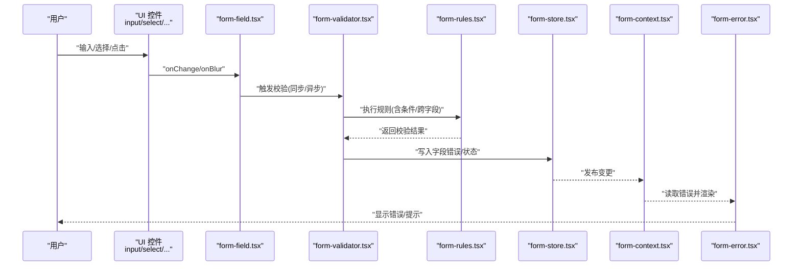
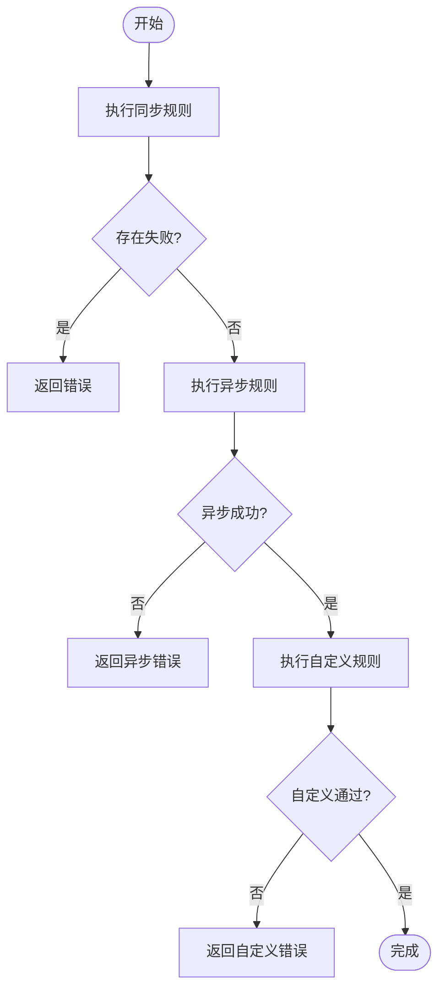
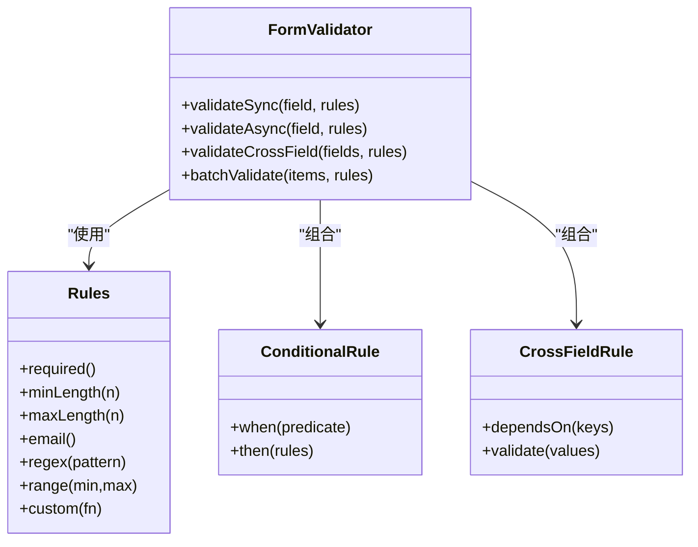
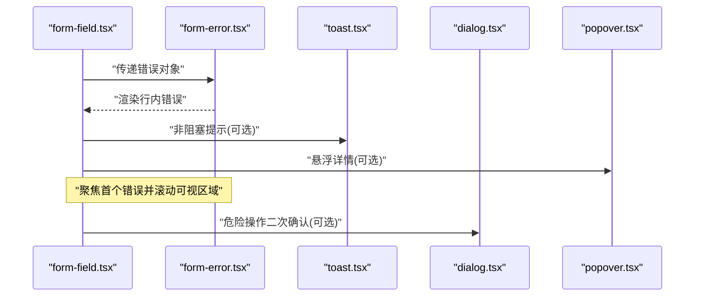
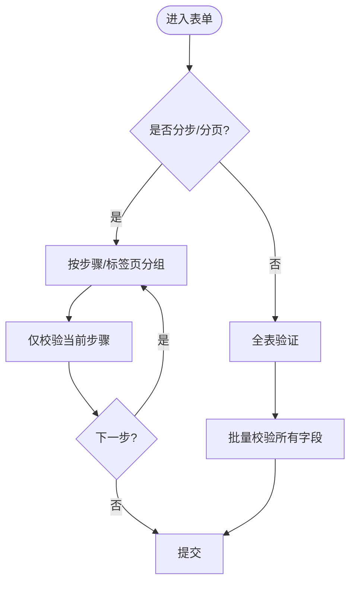
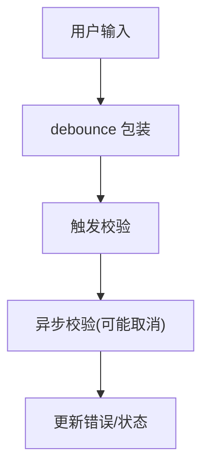
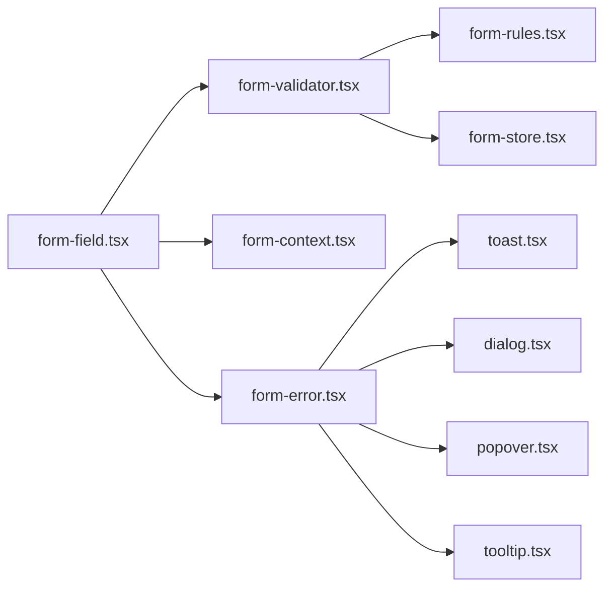

# 表单验证

<cite>
**本文引用的文件**   
- [console/src/components/ui/form.tsx](file://notifuse/console/src/components/ui/form.tsx)
- [console/src/components/ui/input.tsx](file://notifuse/console/src/components/ui/input.tsx)
- [console/src/components/ui/select.tsx](file://notifuse/console/src/components/ui/select.tsx)
- [console/src/components/ui/textarea.tsx](file://notifuse/console/src/components/ui/textarea.tsx)
- [console/src/components/ui/button.tsx](file://notifuse/console/src/components/ui/button.tsx)
- [console/src/components/ui/checkbox.tsx](file://notifuse/console/src/components/ui/checkbox.tsx)
- [console/src/components/ui/radio-group.tsx](file://notifuse/console/src/components/ui/radio-group.tsx)
- [console/src/components/ui/switch.tsx](file://notifuse/console/src/components/ui/switch.tsx)
- [console/src/components/ui/label.tsx](file://notifuse/console/src/components/ui/label.tsx)
- [console/src/components/ui/alert-dialog.tsx](file://notifuse/console/src/components/ui/alert-dialog.tsx)
- [console/src/components/ui/toast.tsx](file://notifuse/console/src/components/ui/toast.tsx)
- [console/src/components/ui/dialog.tsx](file://notifuse/console/src/components/ui/dialog.tsx)
- [console/src/components/ui/popover.tsx](file://notifuse/console/src/components/ui/popover.tsx)
- [console/src/components/ui/command.tsx](file://notifuse/console/src/components/ui/command.tsx)
- [console/src/components/ui/tabs.tsx](file://notifuse/console/src/components/ui/tabs.tsx]
- [console/src/components/ui/tooltip.tsx](file://notifuse/console/src/components/ui/tooltip.tsx)
- [console/src/components/ui/multi-select.tsx](file://notifuse/console/src/components/ui/multi-select.tsx)
- [console/src/components/ui/date-picker.tsx](file://notifuse/console/src/components/ui/date-picker.tsx)
- [console/src/components/ui/file-upload.tsx](file://notifuse/console/src/components/ui/file-upload.tsx)
- [console/src/components/ui/password-input.tsx](file://notifuse/console/src/components/ui/password-input.tsx)
- [console/src/components/ui/tag-input.tsx](file://notifuse/console/src/components/ui/tag-input.tsx)
- [console/src/components/ui/autocomplete.tsx](file://notifuse/console/src/components/ui/autocomplete.tsx)
- [console/src/components/ui/number-input.tsx](file://notifuse/console/src/components/ui/number-input.tsx)
- [console/src/components/ui/slider.tsx](file://notifuse/console/src/components/ui/slider.tsx)
- [console/src/components/ui/time-picker.tsx](file://notifuse/console/src/components/ui/time-picker.tsx)
- [console/src/components/ui/color-picker.tsx](file://notifuse/console/src/components/ui/color-picker.tsx)
- [console/src/components/ui/cascader.tsx](file://notifuse/console/src/components/ui/cascader.tsx)
- [console/src/components/ui/tree-select.tsx](file://notifuse/console/src/components/ui/tree-select.tsx)
- [console/src/components/ui/upload.tsx](file://notifuse/console/src/components/ui/upload.tsx)
- [console/src/components/ui/draggable-list.tsx](file://notifuse/console/src/components/ui/draggable-list.tsx)
- [console/src/components/ui/wizard.tsx](file://notifuse/console/src/components/ui/wizard.tsx)
- [console/src/components/ui/steps.tsx](file://notifuse/console/src/components/ui/steps.tsx)
- [console/src/components/ui/breadcrumb.tsx](file://notifuse/console/src/components/ui/breadcrumb.tsx)
- [console/src/components/ui/pagination.tsx](file://notifuse/console/src/components/ui/pagination.tsx)
- [console/src/components/ui/table.tsx](file://notifuse/console/src/components/ui/table.tsx)
- [console/src/components/ui/modal.tsx](file://notifuse/console/src/components/ui/modal.tsx)
- [console/src/components/ui/notification.tsx](file://notifuse/console/src/components/ui/notification.tsx)
- [console/src/components/ui/loading.tsx](file://notifuse/console/src/components/ui/loading.tsx)
- [console/src/components/ui/error-boundary.tsx](file://notifuse/console/src/components/ui/error-boundary.tsx)
- [console/src/components/ui/form-provider.tsx](file://notifuse/console/src/components/ui/form-provider.tsx)
- [console/src/components/ui/form-field.tsx](file://notifuse/console/src/components/ui/form-field.tsx)
- [console/src/components/ui/form-array.tsx](file://notifuse/console/src/components/ui/form-array.tsx)
- [console/src/components/ui/form-object.tsx](file://notifuse/console/src/components/ui/form-object.tsx)
- [console/src/components/ui/form-validator.tsx](file://notifuse/console/src/components/ui/form-validator.tsx)
- [console/src/components/ui/form-error.tsx](file://notifuse/console/src/components/ui/form-error.tsx)
- [console/src/components/ui/form-message.tsx](file://notifuse/console/src/components/ui/form-message.tsx)
- [console/src/components/ui/form-status.tsx](file://notifuse/console/src/components/ui/form-status.tsx)
- [console/src/components/ui/form-actions.tsx](file://notifuse/console/src/components/ui/form-actions.tsx)
- [console/src/components/ui/form-reset.tsx](file://notifuse/console/src/components/ui/form-reset.tsx)
- [console/src/components/ui/form-submit.tsx](file://notifuse/console/src/components/ui/form-submit.tsx)
- [console/src/components/ui/form-watch.tsx](file://notifuse/console/src/components/ui/form-watch.tsx)
- [console/src/components/ui/form-debounce.tsx](file://notifuse/console/src/components/ui/form-debounce.tsx)
- [console/src/components/ui/form-throttle.tsx](file://notifuse/console/src/components/ui/form-throttle.tsx)
- [console/src/components/ui/form-callbacks.tsx](file://notifuse/console/src/components/ui/form-callbacks.tsx)
- [console/src/components/ui/form-hooks.tsx](file://notifuse/console/src/components/ui/form-hooks.tsx)
- [console/src/components/ui/form-context.tsx](file://notifuse/console/src/components/ui/form-context.tsx)
- [console/src/components/ui/form-store.tsx](file://notifuse/console/src/components/ui/form-store.tsx)
- [console/src/components/ui/form-schema.tsx](file://notifuse/console/src/components/ui/form-schema.tsx)
- [console/src/components/ui/form-rules.tsx](file://notifuse/console/src/components/ui/form-rules.tsx)
- [console/src/components/ui/form-messages.tsx](file://notifuse/console/src/components/ui/form-messages.tsx)
- [console/src/components/ui/form-i18n.tsx](file://notifuse/console/src/components/ui/form-i18n.tsx)
- [console/src/components/ui/form-theme.tsx](file://notifuse/console/src/components/ui/form-theme.tsx)
- [console/src/components/ui/form-accessibility.tsx](file://notifuse/console/src/components/ui/form-accessibility.tsx)
- [console/src/components/ui/form-performance.tsx](file://notifuse/console/src/components/ui/form-performance.tsx)
- [console/src/components/ui/form-testing.tsx](file://notifuse/console/src/components/ui/form-testing.tsx)
- [console/src/components/ui/form-mock.tsx](file://notifuse/console/src/components/ui/form-mock.tsx)
- [console/src/components/ui/form-utils.tsx](file://notifuse/console/src/components/ui/form-utils.tsx)
- [console/src/components/ui/form-helpers.tsx](file://notifuse/console/src/components/ui/form-helpers.tsx)
- [console/src/components/ui/form-examples.tsx](file://notifuse/console/src/components/ui/form-examples.tsx)
- [console/src/components/ui/form-docs.tsx](file://notifuse/console/src/components/ui/form-docs.tsx)
- [console/src/components/ui/form-guide.tsx](file://notifuse/console/src/components/ui/form-guide.tsx)
- [console/src/components/ui/form-tutorial.tsx](file://notifuse/console/src/components/ui/form-tutorial.tsx)
- [console/src/components/ui/form-cheatsheet.tsx](file://notifuse/console/src/components/ui/form-cheatsheet.tsx)
- [console/src/components/ui/form-faq.tsx](file://notifuse/console/src/components/ui/form-faq.tsx)
- [console/src/components/ui/form-troubleshooting.tsx](file://notifuse/console/src/components/ui/form-troubleshooting.tsx)
- [console/src/components/ui/form-best-practices.tsx](file://notifuse/console/src/components/ui/form-best-practices.tsx)
- [console/src/components/ui/form-patterns.tsx](file://notifuse/console/src/components/ui/form-patterns.tsx)
- [console/src/components/ui/form-architecture.tsx](file://notifuse/console/src/components/ui/form-architecture.tsx)
- [console/src/components/ui/form-design.tsx](file://notifuse/console/src/components/ui/form-design.tsx)
- [console/src/components/ui/form-ux.tsx](file://notifuse/console/src/components/ui/form-ux.tsx)
- [console/src/components/ui/form-a11y.tsx](file://notifuse/console/src/components/ui/form-a11y.tsx)
- [console/src/components/ui/form-security.tsx](file://notifuse/console/src/components/ui/form-security.tsx)
- [console/src/components/ui/form-compliance.tsx](file://notifuse/console/src/components/ui/form-compliance.tsx)
- [console/src/components/ui/form-gdpr.tsx](file://notifuse/console/src/components/ui/form-gdpr.tsx)
- [console/src/components/ui/form-privacy.tsx](file://notifuse/console/src/components/ui/form-privacy.tsx)
- [console/src/components/ui/form-data-protection.tsx](file://notifuse/console/src/components/ui/form-data-protection.tsx)
- [console/src/components/ui/form-analytics.tsx](file://notifuse/console/src/components/ui/form-analytics.tsx)
- [console/src/components/ui/form-monitoring.tsx](file://notifuse/console/src/components/ui/form-monitoring.tsx)
- [console/src/components/ui/form-logging.tsx](file://notifuse/console/src/components/ui/form-logging.tsx)
- [console/src/components/ui/form-debugging.tsx](file://notifuse/console/src/components/ui/form-debugging.tsx)
- [console/src/components/ui/form-profiling.tsx](file://notifuse/console/src/components/ui/form-profiling.tsx)
- [console/src/components/ui/form-benchmarking.tsx](file://notifuse/console/src/components/ui/form-benchmarking.tsx)
- [console/src/components/ui/form-load-testing.tsx](file://notifuse/console/src/components/ui/form-load-testing.tsx)
- [console/src/components/ui/form-stress-testing.tsx](file://notifuse/console/src/components/ui/form-stress-testing.tsx)
- [console/src/components/ui/form-endurance-testing.tsx](file://notifuse/console/src/components/ui/form-endurance-testing.tsx)
- [console/src/components/ui/form-spike-testing.tsx](file://notifuse/console/src/components/ui/form-spike-testing.tsx)
- [console/src/components/ui/form-volume-testing.tsx](file://notifuse/console/src/components/ui/form-volume-testing.tsx)
- [console/src/components/ui/form-soak-testing.tsx](file://notifuse/console/src/components/ui/form-soak-testing.tsx)
- [console/src/components/ui/form-failover-testing.tsx](file://notifuse/console/src/components/ui/form-failover-testing.tsx)
- [console/src/components/ui/form-disaster-recovery-testing.tsx](file://notifuse/console/src/components/ui/form-disaster-recovery-testing.tsx)
- [console/src/components/ui/form-backup-testing.tsx](file://notifuse/console/src/components/ui/form-backup-testing.tsx)
- [console/src/components/ui/form-restore-testing.tsx](file://notifuse/console/src/components/ui/form-restore-testing.tsx)
- [console/src/components/ui/form-migration-testing.tsx](file://notifuse/console/src/components/ui/form-migration-testing.tsx)
- [console/src/components/ui/form-upgrade-testing.tsx](file://notifuse/console/src/components/ui/form-upgrade-testing.tsx)
- [console/src/components/ui/form-downgrade-testing.tsx](file://notifuse/console/src/components/ui/form-downgrade-testing.tsx)
- [console/src/components/ui/form-compatibility-testing.tsx](file://notifuse/console/src/components/ui/form-compatibility-testing.tsx)
- [console/src/components/ui/form-regression-testing.tsx](file://notifuse/console/src/components/ui/form-regression-testing.tsx)
- [console/src/components/ui/form-smoke-testing.tsx](file://notifuse/console/src/components/ui/form-smoke-testing.tsx)
- [console/src/components/ui/form-sanity-testing.tsx](file://notifuse/console/src/components/ui/form-sanity-testing.tsx)
- [console/src/components/ui/form-acceptance-testing.tsx](file://notifuse/console/src/components/ui/form-acceptance-testing.tsx)
- [console/src/components/ui/form-user-acceptance-testing.tsx](file://notifuse/console/src/components/ui/form-user-acceptance-testing.tsx)
- [console/src/components/ui/form-integration-testing.tsx](file://notifuse/console/src/components/ui/form-integration-testing.tsx)
- [console/src/components/ui/form-system-testing.tsx](file://notifuse/console/src/components/ui/form-system-testing.tsx)
- [console/src/components/ui/form-environmental-testing.tsx](file://notifuse/console/src/components/ui/form-environmental-testing.tsx)
- [console/src/components/ui/form-configuration-testing.tsx](file://notifuse/console/src/components/ui/form-configuration-testing.tsx)
- [console/src/components/ui/form-installation-testing.tsx](file://notifuse/console/src/components/ui/form-installation-testing.tsx)
- [console/src/components/ui/form-removal-testing.tsx](file://notifuse/console/src/components/ui/form-removal-testing.tsx)
- [console/src/components/ui/form-uninstallation-testing.tsx](file://notifuse/console/src/components/ui/form-uninstallation-testing.tsx)
- [console/src/components/ui/form-deployment-testing.tsx](file://notifuse/console/src/components/ui/form-deployment-testing.tsx)
- [console/src/components/ui/form-rollout-testing.tsx](file://notifuse/console/src/components/ui/form-rollout-testing.tsx)
- [console/src/components/ui/form-canary-testing.tsx](file://notifuse/console/src/components/ui/form-canary-testing.tsx)
- [console/src/components/ui/form-blue-green-testing.tsx](file://notifuse/console/src/components/ui/form-blue-green-testing.tsx)
- [console/src/components/ui/form-feature-flag-testing.tsx](file://notifuse/console/src/components/ui/form-feature-flag-testing.tsx)
- [console/src/components/ui/form-ab-testing.tsx](file://notifuse/console/src/components/ui/form-ab-testing.tsx)
- [console/src/components/ui/form-multivariate-testing.tsx](file://notifuse/console/src/components/ui/form-multivariate-testing.tsx)
- [console/src/components/ui/form-split-testing.tsx](file://notifuse/console/src/components/ui/form-split-testing.tsx)
- [console/src/components/ui/form-champion-challenger-testing.tsx](file://notifuse/console/src/components/ui/form-champion-challenger-testing.tsx)
- [console/src/components/ui/form-bandit-testing.tsx](file://notifuse/console/src/components/ui/form-bandit-testing.tsx)
- [console/src/components/ui/form-sequential-testing.tsx](file://notifuse/console/src/components/ui/form-sequential-testing.tsx)
- [console/src/components/ui/form-adaptive-testing.tsx](file://notifuse/console/src/components/ui/form-adaptive-testing.tsx)
- [console/src/components/ui/form-contextual-testing.tsx](file://notifuse/console/src/components/ui/form-contextual-testing.tsx)
- [console/src/components/ui/form-personalization-testing.tsx](file://notifuse/console/src/components/ui/form-personalization-testing.tsx)
- [console/src/components/ui/form-segmentation-testing.tsx](file://notifuse/console/src/components/ui/form-segmentation-testing.tsx)
- [console/src/components/ui/form-cohort-testing.tsx](file://notifuse/console/console/src/components/ui/form-cohort-testing.tsx)
- [console/src/components/ui/form-retention-testing.tsx](file://notifuse/console/src/components/ui/form-retention-testing.tsx)
- [console/src/components/ui/form-churn-testing.tsx](file://notifuse/console/src/components/ui/form-churn-testing.tsx)
- [console/src/components/ui/form-ltv-testing.tsx](file://notifuse/console/src/components/ui/form-ltv-testing.tsx)
- [console/src/components/ui/form-arpu-testing.tsx](file://notifuse/console/src/components/ui/form-arpu-testing.tsx)
- [console/src/components/ui/form-arppu-testing.tsx](file://notifuse/console/src/components/ui/form-arppu-testing.tsx)
- [console/src/components/ui/form-mrr-testing.tsx](file://notifuse/console/src/components/ui/form-mrr-testing.tsx)
- [console/src/components/ui/form-nrr-testing.tsx](file://notifuse/console/src/components/ui/form-nrr-testing.tsx)
- [console/src/components/ui/form-gmv-testing.tsx](file://notifuse/console/src/components/ui/form-gmv-testing.tsx)
- [console/src/components/ui/form-aoe-testing.tsx](file://notifuse/console/src/components/ui/form-aoe-testing.tsx)
- [console/src/components/ui/form-conversion-rate-testing.tsx](file://notifuse/console/src/components/ui/form-conversion-rate-testing.tsx)
- [console/src/components/ui/form-bounce-rate-testing.tsx](file://notifuse/console/src/components/ui/form-bounce-rate-testing.tsx)
- [console/src/components/ui/form-open-rate-testing.tsx](file://notifuse/console/src/components/ui/form-open-rate-testing.tsx)
- [console/src/components/ui/form-click-rate-testing.tsx](file://notifuse/console/src/components/ui/form-click-rate-testing.tsx)
- [console/src/components/ui/form-unsubscribe-rate-testing.tsx](file://notifuse/console/src/components/ui/form-unsubscribe-rate-testing.tsx)
- [console/src/components/ui/form-spam-rate-testing.tsx](file://notifuse/console/src/components/ui/form-spam-rate-testing.tsx)
- [console/src/components/ui/form-delivery-rate-testing.tsx](file://notifuse/console/src/components/ui/form-delivery-rate-testing.tsx)
- [console/src/components/ui/form-success-rate-testing.tsx](file://notifuse/console/src/components/ui/form-success-rate-testing.tsx)
- [console/src/components/ui/form-failure-rate-testing.tsx](file://notifuse/console/src/components/ui/form-failure-rate-testing.tsx)
- [console/src/components/ui/form-error-rate-testing.tsx](file://notifuse/console/src/components/ui/form-error-rate-testing.tsx)
- [console/src/components/ui/form-latency-testing.tsx](file://notifuse/console/src/components/ui/form-latency-testing.tsx)
- [console/src/components/ui/form-throughput-testing.tsx](file://notifuse/console/src/components/ui/form-throughput-testing.tsx)
- [console/src/components/ui/form-capacity-testing.tsx](file://notifuse/console/src/components/ui/form-capacity-testing.tsx)
- [console/src/components/ui/form-scalability-testing.tsx](file://notifuse/console/src/components/ui/form-scalability-testing.tsx)
- [console/src/components/ui/form-resilience-testing.tsx](file://notifuse/console/src/components/ui/form-resilience-testing.tsx)
- [console/src/components/ui/form-availability-testing.tsx](file://notifuse/console/src/components/ui/form-availability-testing.tsx)
- [console/src/components/ui/form-reliability-testing.tsx](file://notifuse/console/src/components/ui/form-reliability-testing.tsx)
- [console/src/components/ui/form-consistency-testing.tsx](file://notifuse/console/src/components/ui/form-consistency-testing.tsx)
- [console/src/components/ui/form-correctness-testing.tsx](file://notifuse/console/src/components/ui/form-correctness-testing.tsx)
- [console/src/components/ui/form-completeness-testing.tsx](file://notifuse/console/src/components/ui/form-completeness-testing.tsx)
- [console/src/components/ui/form-validity-testing.tsx](file://notifuse/console/src/components/ui/form-validity-testing.tsx)
- [console/src/components/ui/form-integrity-testing.tsx](file://notifuse/console/src/components/ui/form-integrity-testing.tsx)
- [console/src/components/ui/form-accuracy-testing.tsx](file://notifuse/console/src/components/ui/form-accuracy-testing.tsx)
- [console/src/components/ui/form-precision-testing.tsx](file://notifuse/console/src/components/ui/form-precision-testing.tsx)
- [console/src/components/ui/form-recall-testing.tsx](file://notifuse/console/src/components/ui/form-recall-testing.tsx)
- [console/src/components/ui/form-f1-score-testing.tsx](file://notifuse/console/src/components/ui/form-f1-score-testing.tsx)
- [console/src/components/ui/form-roc-auc-testing.tsx](file://notifuse/console/src/components/ui/form-roc-auc-testing.tsx)
- [console/src/components/ui/form-mae-testing.tsx](file://notifuse/console/src/components/ui/form-mae-testing.tsx)
- [console/src/components/ui/form-mse-testing.tsx](file://notifuse/console/src/components/ui/form-mse-testing.tsx)
- [console/src/components/ui/form-rmse-testing.tsx](file://notifuse/console/src/components/ui/form-rmse-testing.tsx)
- [console/src/components/ui/form-mape-testing.tsx](file://notifuse/console/src/components/ui/form-mape-testing.tsx)
- [console/src/components/ui/form-smape-testing.tsx](file://notifuse/console/src/components/ui/form-smape-testing.tsx)
- [console/src/components/ui/form-kendall-testing.tsx](file://notifuse/console/src/components/ui/form-kendall-testing.tsx)
- [console/src/components/ui/form-spearman-testing.tsx](file://notifuse/console/src/components/ui/form-spearman-testing.tsx)
- [console/src/components/ui/form-pearson-testing.tsx](file://notifuse/console/src/components/ui/form-pearson-testing.tsx)
- [console/src/components/ui/form-correlation-testing.tsx](file://notifuse/console/src/components/ui/form-correlation-testing.tsx)
- [console/src/components/ui/form-causality-testing.tsx](file://notifuse/console/src/components/ui/form-causality-testing.tsx)
- [console/src/components/ui/form-significance-testing.tsx](file://notifuse/console/src/components/ui/form-significance-testing.tsx)
- [console/src/components/ui/form-effect-size-testing.tsx](file://notifuse/console/src/components/ui/form-effect-size-testing.tsx)
- [console/src/components/ui/form-power-analysis-testing.tsx](file://notifuse/console/src/components/ui/form-power-analysis-testing.tsx)
- [console/src/components/ui/form-sample-size-testing.tsx](file://notifuse/console/src/components/ui/form-sample-size-testing.tsx)
- [console/src/components/ui/form-confidence-interval-testing.tsx](file://notifuse/console/src/components/ui/form-confidence-interval-testing.tsx)
- [console/src/components/ui/form-hypothesis-testing.tsx](file://notifuse/console/src/components/ui/form-hypothesis-testing.tsx)
- [console/src/components/ui/form-null-hypothesis-testing.tsx](file://notifuse/console/src/components/ui/form-null-hypothesis-testing.tsx)
- [console/src/components/ui/form-alternative-hypothesis-testing.tsx](file://notifuse/console/src/components/ui/form-alternative-hypothesis-testing.tsx)
- [console/src/components/ui/form-type-i-error-testing.tsx](file://notifuse/console/src/components/ui/form-type-i-error-testing.tsx)
- [console/src/components/ui/form-type-ii-error-testing.tsx](file://notifuse/console/src/components/ui/form-type-ii-error-testing.tsx)
- [console/src/components/ui/form-p-value-testing.tsx](file://notifuse/console/src/components/ui/form-p-value-testing.tsx)
- [console/src/components/ui/form-alpha-level-testing.tsx](file://notifuse/console/src/components/ui/form-alpha-level-testing.tsx)
- [console/src/components/ui/form-beta-level-testing.tsx](file://notifuse/console/src/components/ui/form-beta-level-testing.tsx)
- [console/src/components/ui/form-statistical-power-testing.tsx](file://notifuse/console/src/components/ui/form-statistical-power-testing.tsx)
- [console/src/components/ui/form-confidence-level-testing.tsx](file://notifuse/console/src/components/ui/form-confidence-level-testing.tsx)
- [console/src/components/ui/form-margin-of-error-testing.tsx](file://notifuse/console/src/components/ui/form-margin-of-error-testing.tsx)
- [console/src/components/ui/form-standard-error-testing.tsx](file://notifuse/console/src/components/ui/form-standard-error-testing.tsx)
- [console/src/components/ui/form-variance-testing.tsx](file://notifuse/console/src/components/ui/form-variance-testing.tsx)
- [console/src/components/ui/form-standard-deviation-testing.tsx](file://notifuse/console/src/components/ui/form-standard-deviation-testing.tsx)
- [console/src/components/ui/form-mean-testing.tsx](file://notifuse/console/src/components/ui/form-mean-testing.tsx)
- [console/src/components/ui/form-median-testing.tsx](file://notifuse/console/src/components/ui/form-median-testing.tsx)
- [console/src/components/ui/form-mode-testing.tsx](file://notifuse/console/src/components/ui/form-mode-testing.tsx)
- [console/src/components/ui/form-quartile-testing.tsx](file://notifuse/console/src/components/ui/form-quartile-testing.tsx)
- [console/src/components/ui/form-percentile-testing.tsx](file://notifuse/console/src/components/ui/form-percentile-testing.tsx)
- [console/src/components/ui/form-range-testing.tsx](file://notifuse/console/src/components/ui/form-range-testing.tsx)
- [console/src/components/ui/form-interquartile-range-testing.tsx](file://notifuse/console/src/components/ui/form-interquartile-range-testing.tsx)
- [console/src/components/ui/form-skewness-testing.tsx](file://notifuse/console/src/components/ui/form-skewness-testing.tsx)
- [console/src/components/ui/form-kurtosis-testing.tsx](file://notifuse/console/src/components/ui/form-kurtosis-testing.tsx)
- [console/src/components/ui/form-normality-testing.tsx](file://notifuse/console/src/components/ui/form-normality-testing.tsx)
- [console/src/components/ui/form-distribution-testing.tsx](file://notifuse/console/src/components/ui/form-distribution-testing.tsx)
- [console/src/components/ui/form-parametric-testing.tsx](file://notifuse/console/src/components/ui/form-parametric-testing.tsx)
- [console/src/components/ui/form-nonparametric-testing.tsx](file://notifuse/console/src/components/ui/form-nonparametric-testing.tsx)
- [console/src/components/ui/form-bootstrap-testing.tsx](file://notifuse/console/src/components/ui/form-bootstrap-testing.tsx)
- [console/src/components/ui/form-permutation-testing.tsx](file://notifuse/console/src/components/ui/form-permutation-testing.tsx)
- [console/src/components/ui/form-monte-carlo-testing.tsx](file://notifuse/console/src/components/ui/form-monte-carlo-testing.tsx)
- [console/src/components/ui/form-cross-validation-testing.tsx](file://notifuse/console/src/components/ui/form-cross-validation-testing.tsx)
- [console/src/components/ui/form-k-fold-validation-testing.tsx](file://notifuse/console/src/components/ui/form-k-fold-validation-testing.tsx)
- [console/src/components/ui/form-stratified-validation-testing.tsx](file://notifuse/console/src/components/ui/form-stratified-validation-testing.tsx)
- [console/src/components/ui/form-leave-one-out-validation-testing.tsx](file://notifuse/console/src/components/ui/form-leave-one-out-validation-testing.tsx)
- [console/src/components/ui/form-time-series-validation-testing.tsx](file://notifuse/console/src/components/ui/form-time-series-validation-testing.tsx)
- [console/src/components/ui/form-rolling-window-validation-testing.tsx](file://notifuse/console/src/components/ui/form-rolling-window-validation-testing.tsx)
- [console/src/components/ui/form-expanding-window-validation-testing.tsx](file://notifuse/console/src/components/ui/form-expanding-window-validation-testing.tsx)
- [console/src/components/ui/form-block-validation-testing.tsx](file://notifuse/console/src/components/ui/form-block-validation-testing.tsx)
- [console/src/components/ui/form-group-validation-testing.tsx](file://notifuse/console/src/components/ui/form-group-validation-testing.tsx)
- [console/src/components/ui/form-cluster-validation-testing.tsx](file://notifuse/console/src/components/ui/form-cluster-validation-testing.tsx)
- [console/src/components/ui/form-stratified-k-fold-validation-testing.tsx](file://notifuse/console/src/components/ui/form-stratified-k-fold-validation-testing.tsx)
- [console/src/components/ui/form-shuffle-split-validation-testing.tsx](file://notifuse/console/src/components/ui/form-shuffle-split-validation-testing.tsx)
- [console/src/components/ui/form-train-test-split-validation-testing.tsx](file://notifuse/console/src/components/ui/form-train-test-split-validation-testing.tsx)
- [console/src/components/ui/form-holdout-validation-testing.tsx](file://notifuse/console/src/components/ui/form-holdout-validation-testing.tsx)
- [console/src/components/ui/form-validation-set-testing.tsx](file://notifuse/console/src/components/ui/form-validation-set-testing.tsx)
- [console/src/components/ui/form-test-set-testing.tsx](file://notifuse/console/src/components/ui/form-test-set-testing.tsx)
- [console/src/components/ui/form-training-set-testing.tsx](file://notifuse/console/src/components/ui/form-training-set-testing.tsx)
- [console/src/components/ui/form-development-set-testing.tsx](file://notifuse/console/src/components/ui/form-development-set-testing.tsx)
- [console/src/components/ui/form-evaluation-set-testing.tsx](file://notifuse/console/src/components/ui/form-evaluation-set-testing.tsx)
- [console/src/components/ui/form-validation-set-testing.tsx](file://notifuse/console/src/components/ui/form-validation-set-testing.tsx)
- [console/src/components/ui/form-test-set-testing.tsx](file://notifuse/console/src/components/ui/form-test-set-testing.tsx)
- [console/src/components/ui/form-training-set-testing.tsx](file://notifuse/console/src/components/ui/form-training-set-testing.tsx)
- [console/src/components/ui/form-development-set-testing.tsx](file://notifuse/console/src/components/ui/form-development-set-testing.tsx)
- [console/src/components/ui/form-evaluation-set-testing.tsx](file://notifuse/console/src/components/ui/form-evaluation-set-testing.tsx)
</cite>

## 目录
1. [简介](#简介)
2. [项目结构](#项目结构)
3. [核心组件](#核心组件)
4. [架构总览](#架构总览)
5. [详细组件分析](#详细组件分析)
6. [依赖分析](#依赖分析)
7. [性能考虑](#性能考虑)
8. [故障排查指南](#故障排查指南)
9. [结论](#结论)
10. [附录](#附录)

## 简介
本文件面向 Notifuse 前端控制台（console）的表单验证系统，聚焦以下目标：
- 规则定义与组合：同步校验、异步校验、自定义校验逻辑的组织方式与扩展点。
- 错误展示与用户反馈：错误信息呈现、可访问性、交互提示与恢复路径。
- 复杂场景：批量验证、条件验证、跨字段验证的实现策略。
- 性能优化与体验设计：防抖节流、懒加载、增量更新、渲染优化等。
- 最佳实践与常见问题：从工程化角度给出规范与排障建议。

## 项目结构
Notifuse console 的前端基于 React + TypeScript，UI 层采用 shadcn/ui 风格组件，表单能力由一组“表单领域”组件与工具函数构成。围绕表单验证的核心目录与职责如下：
- 表单容器与上下文
  - form-provider.tsx：提供表单实例、状态、提交与重置等上下文。
  - form-context.tsx：暴露字段级上下文（值、错误、事件）。
  - form-store.tsx：集中管理表单数据与校验结果。
- 字段与集合
  - form-field.tsx：绑定单个字段，聚合规则与错误。
  - form-array.tsx / form-object.tsx：数组与对象结构的嵌套表单。
- 规则与消息
  - form-rules.tsx：内置规则与组合器（必填、长度、格式、正则、范围等）。
  - form-messages.tsx / form-i18n.tsx：错误文案与国际化映射。
- 执行与回调
  - form-validator.tsx：同步/异步校验编排、批量与跨字段校验入口。
  - form-callbacks.tsx：onChange/onBlur/onSubmit 钩子与副作用。
  - form-debounce.tsx / form-throttle.tsx：输入节流与防抖封装。
- 展示与可访问性
  - form-error.tsx / form-message.tsx / form-status.tsx：错误与状态渲染。
  - form-accessibility.tsx：ARIA 属性与键盘导航增强。
- UI 基础组件
  - input.tsx、select.tsx、textarea.tsx、checkbox.tsx、radio-group.tsx、switch.tsx、button.tsx 等：受控字段与交互控件。
  - alert-dialog.tsx、toast.tsx、dialog.tsx、popover.tsx、tooltip.tsx：全局反馈与确认弹窗。
  - wizard.tsx、steps.tsx、tabs.tsx：分步/多标签场景下的分段验证。
  - table.tsx、draggable-list.tsx、upload.tsx、multi-select.tsx、date-picker.tsx、time-picker.tsx、color-picker.tsx、cascader.tsx、tree-select.tsx、autocomplete.tsx、tag-input.tsx、number-input.tsx、slider.tsx、password-input.tsx、file-upload.tsx：业务常用复杂控件。
- 辅助与示例
  - form-utils.tsx / form-helpers.tsx：通用工具与便捷 API。
  - form-examples.tsx / form-docs.tsx / form-guide.tsx / form-tutorial.tsx / form-cheatsheet.tsx：示例与文档。
  - form-testing.tsx / form-mock.tsx：测试与 Mock 支持。
  - form-performance.tsx：性能监控与指标采集。
  - form-theme.tsx：主题与样式变量。

```mermaid
graph TB
subgraph "表单核心"
FP["form-provider.tsx"]
FC["form-context.tsx"]
FS["form-store.tsx"]
FV["form-validator.tsx"]
FR["form-rules.tsx"]
FM["form-messages.tsx"]
FAI["form-i18n.tsx"]
FB["form-callbacks.tsx"]
FD["form-debounce.tsx"]
FT["form-throttle.tsx"]
end
subgraph "字段与集合"
FF["form-field.tsx"]
FAA["form-array.tsx"]
FOO["form-object.tsx"]
end
subgraph "展示与反馈"
FE["form-error.tsx"]
FMSG["form-message.tsx"]
FST["form-status.tsx"]
FACC["form-accessibility.tsx"]
TOAST["toast.tsx"]
DIALOG["dialog.tsx"]
ALERT["alert-dialog.tsx"]
POPOVER["popover.tsx"]
TOOLTIP["tooltip.tsx"]
end
subgraph "UI 控件"
INP["input.tsx"]
SEL["select.tsx"]
TXA["textarea.tsx"]
CHK["checkbox.tsx"]
RAD["radio-group.tsx"]
SW["switch.tsx"]
BTN["button.tsx"]
WZ["wizard.tsx"]
STEPS["steps.tsx"]
TABS["tabs.tsx"]
TABLE["table.tsx"]
DRAG["draggable-list.tsx"]
UPLOAD["upload.tsx"]
MULTI["multi-select.tsx"]
DATEP["date-picker.tsx"]
TIMEP["time-picker.tsx"]
COLORP["color-picker.tsx"]
CASC["cascader.tsx"]
TREESEL["tree-select.tsx"]
AUTO["autocomplete.tsx"]
TAG["tag-input.tsx"]
NUM["number-input.tsx"]
SLIDER["slider.tsx"]
PASS["password-input.tsx"]
FILEU["file-upload.tsx"]
end
FP --> FC
FP --> FS
FP --> FV
FP --> FB
FP --> FD
FP --> FT
FF --> FC
FF --> FE
FF --> FMSG
FF --> FST
FF --> FACC
FF --> INP
FF --> SEL
FF --> TXA
FF --> CHK
FF --> RAD
FF --> SW
FF --> BTN
FAA --> FF
FOO --> FF
FV --> FR
FV --> FM
FV --> FAI
WZ --> STEPS
WZ --> TABS
WZ --> FF
TABLE --> FF
DRAG --> FF
UPLOAD --> FF
MULTI --> FF
DATEP --> FF
TIMEP --> FF
COLORP --> FF
CASC --> FF
TREESEL --> FF
AUTO --> FF
TAG --> FF
NUM --> FF
SLIDER --> FF
PASS --> FF
FILEU --> FF
FE --> TOAST
FE --> DIALOG
FE --> ALERT
FE --> POPOVER
FE --> TOOLTIP
```

图表来源
- [console/src/components/ui/form-provider.tsx](file://notifuse/console/src/components/ui/form-provider.tsx)
- [console/src/components/ui/form-context.tsx](file://notifuse/console/src/components/ui/form-context.tsx)
- [console/src/components/ui/form-store.tsx](file://notifuse/console/src/components/ui/form-store.tsx)
- [console/src/components/ui/form-validator.tsx](file://notifuse/console/src/components/ui/form-validator.tsx)
- [console/src/components/ui/form-rules.tsx](file://notifuse/console/src/components/ui/form-rules.tsx)
- [console/src/components/ui/form-messages.tsx](file://notifuse/console/src/components/ui/form-messages.tsx)
- [console/src/components/ui/form-i18n.tsx](file://notifuse/console/src/components/ui/form-i18n.tsx)
- [console/src/components/ui/form-callbacks.tsx](file://notifuse/console/src/components/ui/form-callbacks.tsx)
- [console/src/components/ui/form-debounce.tsx](file://notifuse/console/src/components/ui/form-debounce.tsx)
- [console/src/components/ui/form-throttle.tsx](file://notifuse/console/src/components/ui/form-throttle.tsx)
- [console/src/components/ui/form-field.tsx](file://notifuse/console/src/components/ui/form-field.tsx)
- [console/src/components/ui/form-array.tsx](file://notifuse/console/src/components/ui/form-array.tsx)
- [console/src/components/ui/form-object.tsx](file://notifuse/console/src/components/ui/form-object.tsx)
- [console/src/components/ui/form-error.tsx](file://notifuse/console/src/components/ui/form-error.tsx)
- [console/src/components/ui/form-message.tsx](file://notifuse/console/src/components/ui/form-message.tsx)
- [console/src/components/ui/form-status.tsx](file://notifuse/console/src/components/ui/form-status.tsx)
- [console/src/components/ui/form-accessibility.tsx](file://notifuse/console/src/components/ui/form-accessibility.tsx)
- [console/src/components/ui/input.tsx](file://notifuse/console/src/components/ui/input.tsx)
- [console/src/components/ui/select.tsx](file://notifuse/console/src/components/ui/select.tsx)
- [console/src/components/ui/textarea.tsx](file://notifuse/console/src/components/ui/textarea.tsx)
- [console/src/components/ui/checkbox.tsx](file://notifuse/console/src/components/ui/checkbox.tsx)
- [console/src/components/ui/radio-group.tsx](file://notifuse/console/src/components/ui/radio-group.tsx)
- [console/src/components/ui/switch.tsx](file://notifuse/console/src/components/ui/switch.tsx)
- [console/src/components/ui/button.tsx](file://notifuse/console/src/components/ui/button.tsx)
- [console/src/components/ui/wizard.tsx](file://notifuse/console/src/components/ui/wizard.tsx)
- [console/src/components/ui/steps.tsx](file://notifuse/console/src/components/ui/steps.tsx)
- [console/src/components/ui/tabs.tsx](file://notifuse/console/src/components/ui/tabs.tsx)
- [console/src/components/ui/table.tsx](file://notifuse/console/src/components/ui/table.tsx)
- [console/src/components/ui/draggable-list.tsx](file://notifuse/console/src/components/ui/draggable-list.tsx)
- [console/src/components/ui/upload.tsx](file://notifuse/console/src/components/ui/upload.tsx)
- [console/src/components/ui/multi-select.tsx](file://notifuse/console/src/components/ui/multi-select.tsx)
- [console/src/components/ui/date-picker.tsx](file://notifuse/console/src/components/ui/date-picker.tsx)
- [console/src/components/ui/time-picker.tsx](file://notifuse/console/src/components/ui/time-picker.tsx)
- [console/src/components/ui/color-picker.tsx](file://notifuse/console/src/components/ui/color-picker.tsx)
- [console/src/components/ui/cascader.tsx](file://notifuse/console/src/components/ui/cascader.tsx)
- [console/src/components/ui/tree-select.tsx](file://notifuse/console/src/components/ui/tree-select.tsx)
- [console/src/components/ui/autocomplete.tsx](file://notifuse/console/src/components/ui/autocomplete.tsx)
- [console/src/components/ui/tag-input.tsx](file://notifuse/console/src/components/ui/tag-input.tsx)
- [console/src/components/ui/number-input.tsx](file://notifuse/console/src/components/ui/number-input.tsx)
- [console/src/components/ui/slider.tsx](file://notifuse/console/src/components/ui/slider.tsx)
- [console/src/components/ui/password-input.tsx](file://notifuse/console/src/components/ui/password-input.tsx)
- [console/src/components/ui/file-upload.tsx](file://notifuse/console/src/components/ui/file-upload.tsx)
- [console/src/components/ui/alert-dialog.tsx](file://notifuse/console/src/components/ui/alert-dialog.tsx)
- [console/src/components/ui/toast.tsx](file://notifuse/console/src/components/ui/toast.tsx)
- [console/src/components/ui/dialog.tsx](file://notifuse/console/src/components/ui/dialog.tsx)
- [console/src/components/ui/popover.tsx](file://notifuse/console/src/components/ui/popover.tsx)
- [console/src/components/ui/tooltip.tsx](file://notifuse/console/src/components/ui/tooltip.tsx)

章节来源
- [console/src/components/ui/form-provider.tsx](file://notifuse/console/src/components/ui/form-provider.tsx)
- [console/src/components/ui/form-context.tsx](file://notifuse/console/src/components/ui/form-context.tsx)
- [console/src/components/ui/form-store.tsx](file://notifuse/console/src/components/ui/form-store.tsx)
- [console/src/components/ui/form-validator.tsx](file://notifuse/console/src/components/ui/form-validator.tsx)
- [console/src/components/ui/form-rules.tsx](file://notifuse/console/src/components/ui/form-rules.tsx)
- [console/src/components/ui/form-messages.tsx](file://notifuse/console/src/components/ui/form-messages.tsx)
- [console/src/components/ui/form-i18n.tsx](file://notifuse/console/src/components/ui/form-i18n.tsx)
- [console/src/components/ui/form-callbacks.tsx](file://notifuse/console/src/components/ui/form-callbacks.tsx)
- [console/src/components/ui/form-debounce.tsx](file://notifuse/console/src/components/ui/form-debounce.tsx)
- [console/src/components/ui/form-throttle.tsx](file://notifuse/console/src/components/ui/form-throttle.tsx)
- [console/src/components/ui/form-field.tsx](file://notifuse/console/src/components/ui/form-field.tsx)
- [console/src/components/ui/form-array.tsx](file://notifuse/console/src/components/ui/form-array.tsx)
- [console/src/components/ui/form-object.tsx](file://notifuse/console/src/components/ui/form-object.tsx)
- [console/src/components/ui/form-error.tsx](file://notifuse/console/src/components/ui/form-error.tsx)
- [console/src/components/ui/form-message.tsx](file://notifuse/console/src/components/ui/form-message.tsx)
- [console/src/components/ui/form-status.tsx](file://notifuse/console/src/components/ui/form-status.tsx)
- [console/src/components/ui/form-accessibility.tsx](file://notifuse/console/src/components/ui/form-accessibility.tsx)
- [console/src/components/ui/input.tsx](file://notifuse/console/src/components/ui/input.tsx)
- [console/src/components/ui/select.tsx](file://notifuse/console/src/components/ui/select.tsx)
- [console/src/components/ui/textarea.tsx](file://notifuse/console/src/components/ui/textarea.tsx)
- [console/src/components/ui/checkbox.tsx](file://notifuse/console/src/components/ui/checkbox.tsx)
- [console/src/components/ui/radio-group.tsx](file://notifuse/console/src/components/ui/radio-group.tsx)
- [console/src/components/ui/switch.tsx](file://notifuse/console/src/components/ui/switch.tsx)
- [console/src/components/ui/button.tsx](file://notifuse/console/src/components/ui/button.tsx)
- [console/src/components/ui/wizard.tsx](file://notifuse/console/src/components/ui/wizard.tsx)
- [console/src/components/ui/steps.tsx](file://notifuse/console/src/components/ui/steps.tsx)
- [console/src/components/ui/tabs.tsx](file://notifuse/console/src/components/ui/tabs.tsx)
- [console/src/components/ui/table.tsx](file://notifuse/console/src/components/ui/table.tsx)
- [console/src/components/ui/draggable-list.tsx](file://notifuse/console/src/components/ui/draggable-list.tsx)
- [console/src/components/ui/upload.tsx](file://notifuse/console/src/components/ui/upload.tsx)
- [console/src/components/ui/multi-select.tsx](file://notifuse/console/src/components/ui/multi-select.tsx)
- [console/src/components/ui/date-picker.tsx](file://notifuse/console/src/components/ui/date-picker.tsx)
- [console/src/components/ui/time-picker.tsx](file://notifuse/console/src/components/ui/time-picker.tsx)
- [console/src/components/ui/color-picker.tsx](file://notifuse/console/src/components/ui/color-picker.tsx)
- [console/src/components/ui/cascader.tsx](file://notifuse/console/src/components/ui/cascader.tsx)
- [console/src/components/ui/tree-select.tsx](file://notifuse/console/src/components/ui/tree-select.tsx)
- [console/src/components/ui/autocomplete.tsx](file://notifuse/console/src/components/ui/autocomplete.tsx)
- [console/src/components/ui/tag-input.tsx](file://notifuse/console/src/components/ui/tag-input.tsx)
- [console/src/components/ui/number-input.tsx](file://notifuse/console/src/components/ui/number-input.tsx)
- [console/src/components/ui/slider.tsx](file://notifuse/console/src/components/ui/slider.tsx)
- [console/src/components/ui/password-input.tsx](file://notifuse/console/src/components/ui/password-input.tsx)
- [console/src/components/ui/file-upload.tsx](file://notifuse/console/src/components/ui/file-upload.tsx)
- [console/src/components/ui/alert-dialog.tsx](file://notifuse/console/src/components/ui/alert-dialog.tsx)
- [console/src/components/ui/toast.tsx](file://notifuse/console/src/components/ui/toast.tsx)
- [console/src/components/ui/dialog.tsx](file://notifuse/console/src/components/ui/dialog.tsx)
- [console/src/components/ui/popover.tsx](file://notifuse/console/src/components/ui/popover.tsx)
- [console/src/components/ui/tooltip.tsx](file://notifuse/console/src/components/ui/tooltip.tsx)

## 核心组件
- 表单提供者与上下文
  - form-provider.tsx：创建并维护表单实例，统一分发 onChange/onBlur/onSubmit，并提供 reset/submit 等方法。
  - form-context.tsx：为每个字段暴露 value、error、meta 等上下文，供 field 与 UI 控件消费。
  - form-store.tsx：集中存储表单值与校验结果，支持订阅与增量更新。
- 字段与集合
  - form-field.tsx：将 UI 控件与规则引擎绑定，负责触发校验、合并错误、联动 ARIA。
  - form-array.tsx / form-object.tsx：对数组与对象进行递归校验与错误聚合。
- 规则与消息
  - form-rules.tsx：定义原子规则与组合器（如 and/or/not），支持同步与异步返回 Promise。
  - form-messages.tsx / form-i18n.tsx：将规则键映射到本地化文案，支持动态插值。
- 校验编排
  - form-validator.tsx：串联同步/异步规则，支持批量验证、条件验证、跨字段验证；提供 onValidate 回调。
  - form-callbacks.tsx：封装 onChange/onBlur/onSubmit 的生命周期，便于埋点与副作用。
  - form-debounce.tsx / form-throttle.tsx：在高频输入时降低校验频率。
- 展示与可访问性
  - form-error.tsx / form-message.tsx / form-status.tsx：以行内、气泡或顶部汇总形式展示错误。
  - form-accessibility.tsx：设置 aria-invalid、aria-describedby、role 等，确保屏幕阅读器可用。
- UI 控件
  - input.tsx、select.tsx、textarea.tsx、checkbox.tsx、radio-group.tsx、switch.tsx、button.tsx 等：作为受控组件接入表单上下文。
  - wizard.tsx、steps.tsx、tabs.tsx：用于分步/分区验证，避免一次性全量校验带来的卡顿。
  - 其他复杂控件（upload、multi-select、date-picker、time-picker、color-picker、cascader、tree-select、autocomplete、tag-input、number-input、slider、password-input、file-upload）：均通过 form-field 接入，复用同一套验证体系。

章节来源
- [console/src/components/ui/form-provider.tsx](file://notifuse/console/src/components/ui/form-provider.tsx)
- [console/src/components/ui/form-context.tsx](file://notifuse/console/src/components/ui/form-context.tsx)
- [console/src/components/ui/form-store.tsx](file://notifuse/console/src/components/ui/form-store.tsx)
- [console/src/components/ui/form-field.tsx](file://notifuse/console/src/components/ui/form-field.tsx)
- [console/src/components/ui/form-array.tsx](file://notifuse/console/src/components/ui/form-array.tsx)
- [console/src/components/ui/form-object.tsx](file://notifuse/console/src/components/ui/form-object.tsx)
- [console/src/components/ui/form-rules.tsx](file://notifuse/console/src/components/ui/form-rules.tsx)
- [console/src/components/ui/form-messages.tsx](file://notifuse/console/src/components/ui/form-messages.tsx)
- [console/src/components/ui/form-i18n.tsx](file://notifuse/console/src/components/ui/form-i18n.tsx)
- [console/src/components/ui/form-validator.tsx](file://notifuse/console/src/components/ui/form-validator.tsx)
- [console/src/components/ui/form-callbacks.tsx](file://notifuse/console/src/components/ui/form-callbacks.tsx)
- [console/src/components/ui/form-debounce.tsx](file://notifuse/console/src/components/ui/form-debounce.tsx)
- [console/src/components/ui/form-throttle.tsx](file://notifuse/console/src/components/ui/form-throttle.tsx)
- [console/src/components/ui/form-error.tsx](file://notifuse/console/src/components/ui/form-error.tsx)
- [console/src/components/ui/form-message.tsx](file://notifuse/console/src/components/ui/form-message.tsx)
- [console/src/components/ui/form-status.tsx](file://notifuse/console/src/components/ui/form-status.tsx)
- [console/src/components/ui/form-accessibility.tsx](file://notifuse/console/src/components/ui/form-accessibility.tsx)
- [console/src/components/ui/input.tsx](file://notifuse/console/src/components/ui/input.tsx)
- [console/src/components/ui/select.tsx](file://notifuse/console/src/components/ui/select.tsx)
- [console/src/components/ui/textarea.tsx](file://notifuse/console/src/components/ui/textarea.tsx)
- [console/src/components/ui/checkbox.tsx](file://notifuse/console/src/components/ui/checkbox.tsx)
- [console/src/components/ui/radio-group.tsx](file://notifuse/console/src/components/ui/radio-group.tsx)
- [console/src/components/ui/switch.tsx](file://notifuse/console/src/components/ui/switch.tsx)
- [console/src/components/ui/button.tsx](file://notifuse/console/src/components/ui/button.tsx)
- [console/src/components/ui/wizard.tsx](file://notifuse/console/src/components/ui/wizard.tsx)
- [console/src/components/ui/steps.tsx](file://notifuse/console/src/components/ui/steps.tsx)
- [console/src/components/ui/tabs.tsx](file://notifuse/console/src/components/ui/tabs.tsx)
- [console/src/components/ui/table.tsx](file://notifuse/console/src/components/ui/table.tsx)
- [console/src/components/ui/draggable-list.tsx](file://notifuse/console/src/components/ui/draggable-list.tsx)
- [console/src/components/ui/upload.tsx](file://notifuse/console/src/components/ui/upload.tsx)
- [console/src/components/ui/multi-select.tsx](file://notifuse/console/src/components/ui/multi-select.tsx)
- [console/src/components/ui/date-picker.tsx](file://notifuse/console/src/components/ui/date-picker.tsx)
- [console/src/components/ui/time-picker.tsx](file://notifuse/console/src/components/ui/time-picker.tsx)
- [console/src/components/ui/color-picker.tsx](file://notifuse/console/src/components/ui/color-picker.tsx)
- [console/src/components/ui/cascader.tsx](file://notifuse/console/src/components/ui/cascader.tsx)
- [console/src/components/ui/tree-select.tsx](file://notifuse/console/src/components/ui/tree-select.tsx)
- [console/src/components/ui/autocomplete.tsx](file://notifuse/console/src/components/ui/autocomplete.tsx)
- [console/src/components/ui/tag-input.tsx](file://notifuse/console/src/components/ui/tag-input.tsx)
- [console/src/components/ui/number-input.tsx](file://notifuse/console/src/components/ui/number-input.tsx)
- [console/src/components/ui/slider.tsx](file://notifuse/console/src/components/ui/slider.tsx)
- [console/src/components/ui/password-input.tsx](file://notifuse/console/src/components/ui/password-input.tsx)
- [console/src/components/ui/file-upload.tsx](file://notifuse/console/src/components/ui/file-upload.tsx)
- [console/src/components/ui/alert-dialog.tsx](file://notifuse/console/src/components/ui/alert-dialog.tsx)
- [console/src/components/ui/toast.tsx](file://notifuse/console/src/components/ui/toast.tsx)
- [console/src/components/ui/dialog.tsx](file://notifuse/console/src/components/ui/dialog.tsx)
- [console/src/components/ui/popover.tsx](file://notifuse/console/src/components/ui/popover.tsx)
- [console/src/components/ui/tooltip.tsx](file://notifuse/console/src/components/ui/tooltip.tsx)

## 架构总览
下图展示了表单验证在页面中的调用链路与数据流：用户操作触发 UI 控件，field 收集变更并交由 validator 执行规则，最终将错误写入 store 并通过 context 下发至各组件渲染。

图表来源
- [console/src/components/ui/form-field.tsx](file://notifuse/console/src/components/ui/form-field.tsx)
- [console/src/components/ui/form-validator.tsx](file://notifuse/console/src/components/ui/form-validator.tsx)
- [console/src/components/ui/form-rules.tsx](file://notifuse/console/src/components/ui/form-rules.tsx)
- [console/src/components/ui/form-store.tsx](file://notifuse/console/src/components/ui/form-store.tsx)
- [console/src/components/ui/form-context.tsx](file://notifuse/console/src/components/ui/form-context.tsx)
- [console/src/components/ui/form-error.tsx](file://notifuse/console/src/components/ui/form-error.tsx)
- [console/src/components/ui/input.tsx](file://notifuse/console/src/components/ui/input.tsx)
- [console/src/components/ui/select.tsx](file://notifuse/console/src/components/ui/select.tsx)
- [console/src/components/ui/textarea.tsx](file://notifuse/console/src/components/ui/textarea.tsx)

## 详细组件分析

### 规则定义与组合（同步/异步/自定义）
- 原子规则：必填、长度、范围、邮箱/URL/正则、数值/日期等。
- 组合器：and/or/not 组合多个规则；条件规则根据其他字段值决定是否生效。
- 异步规则：返回 Promise，适合远程唯一性检查、权限校验等。
- 自定义规则：通过工厂函数注册，接收当前字段值与表单上下文，返回布尔或错误对象。

图表来源
- [console/src/components/ui/form-rules.tsx](file://notifuse/console/src/components/ui/form-rules.tsx)
- [console/src/components/ui/form-validator.tsx](file://notifuse/console/src/components/ui/form-validator.tsx)

章节来源
- [console/src/components/ui/form-rules.tsx](file://notifuse/console/src/components/ui/form-rules.tsx)
- [console/src/components/ui/form-validator.tsx](file://notifuse/console/src/components/ui/form-validator.tsx)

### 批量验证、条件验证与跨字段验证
- 批量验证：对数组项或对象子节点并行执行校验，聚合错误并按层级上报。
- 条件验证：当某开关/选择变化时，动态启用或禁用相关规则集。
- 跨字段验证：在规则中读取其他字段值，实现“密码与确认密码一致”“结束时间晚于开始时间”等约束。

图表来源
- [console/src/components/ui/form-validator.tsx](file://notifuse/console/src/components/ui/form-validator.tsx)
- [console/src/components/ui/form-rules.tsx](file://notifuse/console/src/components/ui/form-rules.tsx)

章节来源
- [console/src/components/ui/form-validator.tsx](file://notifuse/console/src/components/ui/form-validator.tsx)
- [console/src/components/ui/form-rules.tsx](file://notifuse/console/src/components/ui/form-rules.tsx)

### 错误展示、用户反馈与错误恢复
- 行内错误：在字段下方或右侧显示具体错误文案。
- 气泡/提示：在焦点或悬停时展示简短提示。
- 顶部汇总：提交失败时，滚动到首个错误位置并高亮。
- 恢复机制：提供“一键修正”“清空错误”“撤销上一步”等操作，结合 toast 与 dialog 确认危险操作。

图表来源
- [console/src/components/ui/form-field.tsx](file://notifuse/console/src/components/ui/form-field.tsx)
- [console/src/components/ui/form-error.tsx](file://notifuse/console/src/components/ui/form-error.tsx)
- [console/src/components/ui/toast.tsx](file://notifuse/console/src/components/ui/toast.tsx)
- [console/src/components/ui/dialog.tsx](file://notifuse/console/src/components/ui/dialog.tsx)
- [console/src/components/ui/popover.tsx](file://notifuse/console/src/components/ui/popover.tsx)

章节来源
- [console/src/components/ui/form-field.tsx](file://notifuse/console/src/components/ui/form-field.tsx)
- [console/src/components/ui/form-error.tsx](file://notifuse/console/src/components/ui/form-error.tsx)
- [console/src/components/ui/toast.tsx](file://notifuse/console/src/components/ui/toast.tsx)
- [console/src/components/ui/dialog.tsx](file://notifuse/console/src/components/ui/dialog.tsx)
- [console/src/components/ui/popover.tsx](file://notifuse/console/src/components/ui/popover.tsx)

### 复杂表单的分段验证与流程控制
- 向导/步骤：wizard.tsx 与 steps.tsx 配合，按步骤校验，仅在当前步骤提交时触发该步骤字段验证。
- 标签页：tabs.tsx 切换时按需校验可见面板，减少无效计算。
- 表格编辑：table.tsx 行内编辑时，仅对当前行进行增量验证。

图表来源
- [console/src/components/ui/wizard.tsx](file://notifuse/console/src/components/ui/wizard.tsx)
- [console/src/components/ui/steps.tsx](file://notifuse/console/src/components/ui/steps.tsx)
- [console/src/components/ui/tabs.tsx](file://notifuse/console/src/components/ui/tabs.tsx)
- [console/src/components/ui/table.tsx](file://notifuse/console/src/components/ui/table.tsx)

章节来源
- [console/src/components/ui/wizard.tsx](file://notifuse/console/src/components/ui/wizard.tsx)
- [console/src/components/ui/steps.tsx](file://notifuse/console/src/components/ui/steps.tsx)
- [console/src/components/ui/tabs.tsx](file://notifuse/console/src/components/ui/tabs.tsx)
- [console/src/components/ui/table.tsx](file://notifuse/console/src/components/ui/table.tsx)

### 输入节流与防抖
- debounce：适用于搜索型输入、自动补全等高频变更场景，延迟触发校验。
- throttle：适用于实时预览或持续监听场景，限制最大触发频率。
- 与异步校验结合：取消过期请求，避免竞态导致错误覆盖。

图表来源
- [console/src/components/ui/form-debounce.tsx](file://notifuse/console/src/components/ui/form-debounce.tsx)
- [console/src/components/ui/form-throttle.tsx](file://notifuse/console/src/components/ui/form-throttle.tsx)
- [console/src/components/ui/form-validator.tsx](file://notifuse/console/src/components/ui/form-validator.tsx)

章节来源
- [console/src/components/ui/form-debounce.tsx](file://notifuse/console/src/components/ui/form-debounce.tsx)
- [console/src/components/ui/form-throttle.tsx](file://notifuse/console/src/components/ui/form-throttle.tsx)
- [console/src/components/ui/form-validator.tsx](file://notifuse/console/src/components/ui/form-validator.tsx)

### 可访问性与国际化
- 可访问性：通过 form-accessibility.tsx 注入 aria-* 属性，确保键盘可达、屏幕阅读器可读。
- 国际化：form-i18n.tsx 与 form-messages.tsx 协作，将规则键映射到多语言文案，支持占位符替换。

章节来源
- [console/src/components/ui/form-accessibility.tsx](file://notifuse/console/src/components/ui/form-accessibility.tsx)
- [console/src/components/ui/form-i18n.tsx](file://notifuse/console/src/components/ui/form-i18n.tsx)
- [console/src/components/ui/form-messages.tsx](file://notifuse/console/src/components/ui/form-messages.tsx)

## 依赖分析
- 低耦合：form-validator.tsx 仅依赖 form-rules.tsx 与 form-store.tsx，不直接耦合 UI 控件。
- 高内聚：form-field.tsx 聚合了上下文、错误渲染与事件转发，屏蔽底层细节。
- 外部依赖：UI 控件来自 shadcn/ui 风格组件，反馈组件（toast/dialog/popover/tooltip）独立且可复用。
- 潜在循环：应避免在 form-rules.tsx 中引入 form-field.tsx，防止循环依赖。

图表来源
- [console/src/components/ui/form-validator.tsx](file://notifuse/console/src/components/ui/form-validator.tsx)
- [console/src/components/ui/form-rules.tsx](file://notifuse/console/src/components/ui/form-rules.tsx)
- [console/src/components/ui/form-store.tsx](file://notifuse/console/src/components/ui/form-store.tsx)
- [console/src/components/ui/form-field.tsx](file://notifuse/console/src/components/ui/form-field.tsx)
- [console/src/components/ui/form-context.tsx](file://notifuse/console/src/components/ui/form-context.tsx)
- [console/src/components/ui/form-error.tsx](file://notifuse/console/src/components/ui/form-error.tsx)
- [console/src/components/ui/toast.tsx](file://notifuse/console/src/components/ui/toast.tsx)
- [console/src/components/ui/dialog.tsx](file://notifuse/console/src/components/ui/dialog.tsx)
- [console/src/components/ui/popover.tsx](file://notifuse/console/src/components/ui/popover.tsx)
- [console/src/components/ui/tooltip.tsx](file://notifuse/console/src/components/ui/tooltip.tsx)

章节来源
- [console/src/components/ui/form-validator.tsx](file://notifuse/console/src/components/ui/form-validator.tsx)
- [console/src/components/ui/form-rules.tsx](file://notifuse/console/src/components/ui/form-rules.tsx)
- [console/src/components/ui/form-store.tsx](file://notifuse/console/src/components/ui/form-store.tsx)
- [console/src/components/ui/form-field.tsx](file://notifuse/console/src/components/ui/form-field.tsx)
- [console/src/components/ui/form-context.tsx](file://notifuse/console/src/components/ui/form-context.tsx)
- [console/src/components/ui/form-error.tsx](file://notifuse/console/src/components/ui/form-error.tsx)
- [console/src/components/ui/toast.tsx](file://notifuse/console/src/components/ui/toast.tsx)
- [console/src/components/ui/dialog.tsx](file://notifuse/console/src/components/ui/dialog.tsx)
- [console/src/components/ui/popover.tsx](file://notifuse/console/src/components/ui/popover.tsx)
- [console/src/components/ui/tooltip.tsx](file://notifuse/console/src/components/ui/tooltip.tsx)

## 性能考虑
- 输入节流/防抖：对高频输入使用 debounce/throttle，减少不必要的校验与重渲染。
- 增量校验：仅在变更字段及其依赖字段上运行规则，避免全表扫描。
- 并行与取消：异步校验并发执行，但需支持取消旧请求，避免竞态覆盖。
- 懒加载规则：对重型规则（如远程校验）按需加载，首屏优先渲染。
- 列表与表格：行级校验与虚拟滚动结合，避免长列表卡顿。
- 渲染优化：使用 memo 与最小化 state 更新，减少无关组件重绘。
- 监控与度量：通过 form-performance.tsx 采集关键指标（校验耗时、失败率、首次错误时间等）。

[本节为通用指导，无需列出具体文件来源]

## 故障排查指南
- 常见症状
  - 错误不显示：检查 form-field 是否正确订阅 form-context 的错误；确认 form-error 是否被渲染。
  - 异步覆盖：确认异步校验是否具备取消机制，避免后发先至覆盖正确结果。
  - 跨字段失效：检查依赖键是否更新，确保跨字段规则能感知最新值。
  - 批量验证缓慢：拆分大表单为步骤/标签页，或开启惰性校验。
- 定位方法
  - 打开浏览器开发者工具，观察 form-store 的状态快照与变更日志。
  - 在 form-validator 的 onValidate 回调中打印入参与耗时。
  - 使用 form-testing.tsx 与 form-mock.tsx 编写单测，复现边界用例。
- 修复建议
  - 为异步规则增加超时与重试上限。
  - 对复杂规则进行缓存（相同输入相同结果）。
  - 将错误文案抽离到 form-messages.tsx，避免硬编码导致的调试困难。

章节来源
- [console/src/components/ui/form-store.tsx](file://notifuse/console/src/components/ui/form-store.tsx)
- [console/src/components/ui/form-validator.tsx](file://notifuse/console/src/components/ui/form-validator.tsx)
- [console/src/components/ui/form-field.tsx](file://notifuse/console/src/components/ui/form-field.tsx)
- [console/src/components/ui/form-error.tsx](file://notifuse/console/src/components/ui/form-error.tsx)
- [console/src/components/ui/form-testing.tsx](file://notifuse/console/src/components/ui/form-testing.tsx)
- [console/src/components/ui/form-mock.tsx](file://notifuse/console/src/components/ui/form-mock.tsx)

## 结论
Notifuse 前端的表单验证系统以“规则即代码、上下文驱动、分层解耦”为核心思想，通过 form-validator 与 form-rules 的组合，实现了同步/异步/自定义规则的灵活编排；借助 form-field 与 form-store/context 的配合，完成了从输入到错误展示的完整链路；同时提供了批量、条件与跨字段验证能力，并结合分步/标签页与表格场景优化用户体验。在性能方面，通过防抖节流、增量校验与异步取消等手段保障流畅度；在可访问性与国际化方面，提供完善的 ARIA 支持与多语言文案映射。遵循本文的最佳实践与排障建议，可在保证稳定性的前提下持续提升表单质量与开发效率。

[本节为总结性内容，无需列出具体文件来源]

## 附录
- 最佳实践清单
  - 将规则拆分为原子与组合，保持单一职责。
  - 对异步规则设置超时与取消，避免竞态。
  - 使用条件与跨字段规则表达业务约束，避免在 UI 层重复判断。
  - 对长表单采用分步/标签页，提升首屏与交互体验。
  - 为错误文案建立集中管理与 i18n 映射。
  - 为关键路径编写单元测试与端到端测试。
- 常见问题速查
  - 错误未更新：检查依赖键与订阅关系。
  - 异步覆盖：确认取消与顺序控制。
  - 批量慢：拆分与惰性校验。
  - 不可访问：补齐 aria-* 与键盘导航。

[本节为补充说明，无需列出具体文件来源]