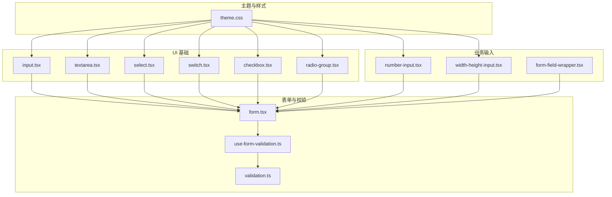
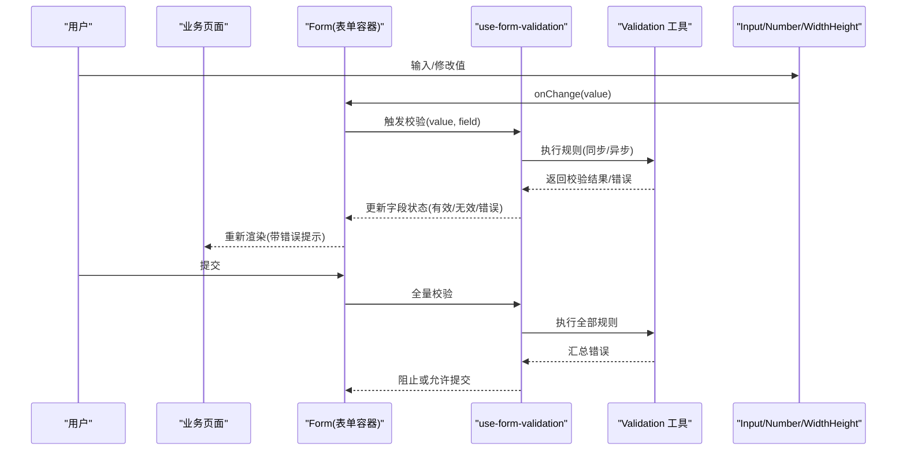
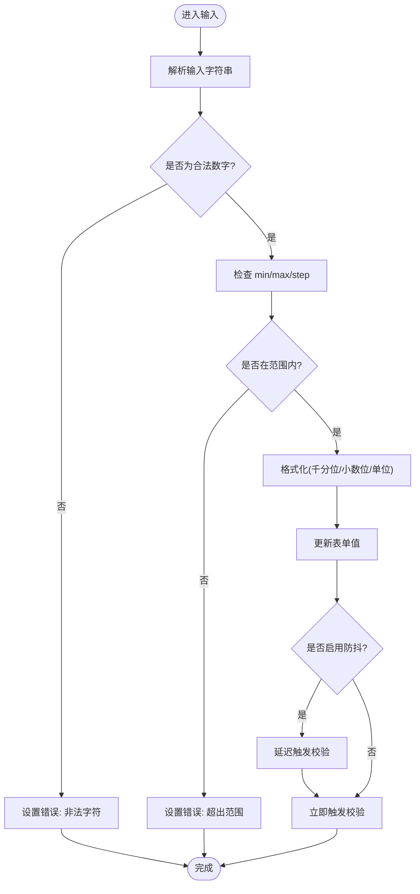
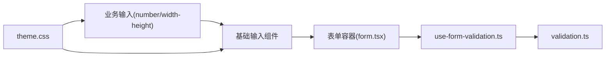

# 输入组件

<cite>
**本文引用的文件**   
- [console/src/components/ui/input.tsx](file://notifuse/console/src/components/ui/input.tsx)
- [console/src/components/ui/textarea.tsx](file://notifuse/console/src/components/ui/textarea.tsx)
- [console/src/components/ui/select.tsx](file://notifuse/console/src/components/ui/select.tsx)
- [console/src/components/ui/switch.tsx](file://notifuse/console/src/components/ui/switch.tsx)
- [console/src/components/ui/checkbox.tsx](file://notifuse/console/src/components/ui/checkbox.tsx)
- [console/src/components/ui/radio-group.tsx](file://notifuse/console/src/components/ui/radio-group.tsx)
- [console/src/components/ui/form.tsx](file://notifuse/console/src/components/ui/form.tsx)
- [console/src/components/ui/button.tsx](file://notifuse/console/src/components/ui/button.tsx)
- [console/src/components/ui/popover.tsx](file://notifuse/console/src/components/ui/popover.tsx)
- [console/src/components/ui/dialog.tsx](file://notifuse/console/src/components/ui/dialog.tsx)
- [console/src/components/ui/tabs.tsx](file://notifuse/console/src/components/ui/tabs.tsx)
- [console/src/components/ui/alert-dialog.tsx](file://notifuse/console/src/components/ui/alert-dialog.tsx)
- [console/src/components/ui/toast.tsx](file://notifuse/console/src/components/ui/toast.tsx)
- [console/src/components/ui/command.tsx](file://notifuse/console/src/components/ui/command.tsx)
- [console/src/components/ui/tooltip.tsx](file://notifuse/console/src/components/ui/tooltip.tsx)
- [console/src/components/ui/label.tsx](file://notifuse/console/src/components/ui/label.tsx)
- [console/src/components/ui/dropdown-menu.tsx](file://notifuse/console/src/components/ui/dropdown-menu.tsx)
- [console/src/components/ui/navigation-menu.tsx](file://notifuse/console/src/components/ui/navigation-menu.tsx)
- [console/src/components/ui/badge.tsx](file://notifuse/console/src/components/ui/badge.tsx)
- [console/src/components/ui/avatar.tsx](file://notifuse/console/src/components/ui/avatar.tsx)
- [console/src/components/ui/card.tsx](file://notifuse/console/src/components/ui/card.tsx)
- [console/src/components/ui/calendar.tsx](file://notifuse/console/src/components/ui/calendar.tsx)
- [console/src/components/ui/accordion.tsx](file://notifuse/console/src/components/ui/accordion.tsx)
- [console/src/components/ui/collapsible.tsx](file://notifuse/console/src/components/ui/collapsible.tsx)
- [console/src/components/ui/context-menu.tsx](file://notifuse/console/src/components/ui/context-menu.tsx)
- [console/src/components/ui/hover-card.tsx](file://notifuse/console/src/components/ui/hover-card.tsx)
- [console/src/components/ui/menubar.tsx](file://notifuse/console/src/components/ui/menubar.tsx)
- [console/src/components/ui/pagination.tsx](file://notifuse/console/src/components/ui/pagination.tsx)
- [console/src/components/ui/resizable.tsx](file://notifuse/console/src/components/ui/resizable.tsx)
- [console/src/components/ui/scroll-area.tsx](file://notifuse/console/src/components/ui/scroll-area.tsx)
- [console/src/components/ui/sheet.tsx](file://notifuse/console/src/components/ui/sheet.tsx)
- [console/src/components/ui/slider.tsx](file://notifuse/console/src/components/ui/slider.tsx)
- [console/src/components/ui/table.tsx](file://notifuse/console/src/components/ui/table.tsx)
- [console/src/components/ui/toggle.tsx](file://notifuse/console/src/components/ui/toggle.tsx)
- [console/src/components/ui/toggle-group.tsx](file://notifuse/console/src/components/ui/toggle-group.tsx)
- [console/src/components/ui/separator.tsx](file://notifuse/console/src/components/ui/separator.tsx)
- [console/src/components/ui/skeleton.tsx](file://notifuse/console/src/components/ui/skeleton.tsx)
- [console/src/components/ui/sonner.tsx](file://notifuse/console/src/components/ui/sonner.tsx)
- [console/src/components/ui/progress.tsx](file://notifuse/console/src/components/ui/progress.tsx)
- [console/src/components/ui/aspect-ratio.tsx](file://notifuse/console/src/components/ui/aspect-ratio.tsx)
- [console/src/components/ui/breadcrumb.tsx](file://notifuse/console/src/components/ui/breadcrumb.tsx)
- [console/src/components/ui/chart.tsx](file://notifuse/console/src/components/ui/chart.tsx)
- [console/src/components/ui/drawer.tsx](file://notifuse/console/src/components/ui/drawer.tsx)
- [console/src/components/ui/input-otp.tsx](file://notifuse/console/src/components/ui/input-otp.tsx)
- [console/src/components/ui/number-input.tsx](file://notifuse/console/src/components/ui/number-input.tsx)
- [console/src/components/ui/width-height-input.tsx](file://notifuse/console/src/components/ui/width-height-input.tsx)
- [console/src/components/ui/form-field-wrapper.tsx](file://notifuse/console/src/components/ui/form-field-wrapper.tsx)
- [console/src/components/ui/index.ts](file://notifuse/console/src/components/ui/index.ts)
- [console/src/utils/validation.ts](file://notifuse/console/src/utils/validation.ts)
- [console/src/hooks/use-form-validation.ts](file://notifuse/console/src/hooks/use-form-validation.ts)
- [console/src/styles/theme.css](file://notifuse/console/src/styles/theme.css)
</cite>

## 目录
1. [简介](#简介)
2. [项目结构](#项目结构)
3. [核心组件](#核心组件)
4. [架构总览](#架构总览)
5. [详细组件分析](#详细组件分析)
6. [依赖关系分析](#依赖关系分析)
7. [性能考量](#性能考量)
8. [故障排查指南](#故障排查指南)
9. [结论](#结论)
10. [附录](#附录)

## 简介
本文件为 Notifuse 前端控制台的输入组件提供系统化文档，覆盖基础输入控件（文本、数值、宽高等）、表单验证机制、格式化规则、错误提示与用户体验优化。同时说明属性配置、事件处理、状态管理、样式定制、主题支持与响应式设计，并提供使用示例与最佳实践，帮助开发者快速集成并稳定扩展。

## 项目结构
控制台前端采用基于 shadcn/ui 的 UI 组件体系，结合 React Hook Form 进行表单状态与验证管理。输入相关的基础能力集中在以下位置：
- UI 基础输入组件：位于 console/src/components/ui 下，包含 input、textarea、select、switch、checkbox、radio-group 等
- 表单容器与校验：form 组件与 hooks 层负责绑定、校验与错误展示
- 业务型输入：如 number-input、width-height-input 等封装了特定格式与约束
- 工具与主题：validation 工具函数、theme 样式变量、全局样式入口

图表来源
- [console/src/components/ui/input.tsx](file://notifuse/console/src/components/ui/input.tsx)
- [console/src/components/ui/textarea.tsx](file://notifuse/console/src/components/ui/textarea.tsx)
- [console/src/components/ui/select.tsx](file://notifuse/console/src/components/ui/select.tsx)
- [console/src/components/ui/switch.tsx](file://notifuse/console/src/components/ui/switch.tsx)
- [console/src/components/ui/checkbox.tsx](file://notifuse/console/src/components/ui/checkbox.tsx)
- [console/src/components/ui/radio-group.tsx](file://notifuse/console/src/components/ui/radio-group.tsx)
- [console/src/components/ui/form.tsx](file://notifuse/console/src/components/ui/form.tsx)
- [console/src/hooks/use-form-validation.ts](file://notifuse/console/src/hooks/use-form-validation.ts)
- [console/src/utils/validation.ts](file://notifuse/console/src/utils/validation.ts)
- [console/src/components/ui/number-input.tsx](file://notifuse/console/src/components/ui/number-input.tsx)
- [console/src/components/ui/width-height-input.tsx](file://notifuse/console/src/components/ui/width-height-input.tsx)
- [console/src/components/ui/form-field-wrapper.tsx](file://notifuse/console/src/components/ui/form-field-wrapper.tsx)
- [console/src/styles/theme.css](file://notifuse/console/src/styles/theme.css)

章节来源
- [console/src/components/ui/input.tsx](file://notifuse/console/src/components/ui/input.tsx)
- [console/src/components/ui/form.tsx](file://notifuse/console/src/components/ui/form.tsx)
- [console/src/hooks/use-form-validation.ts](file://notifuse/console/src/hooks/use-form-validation.ts)
- [console/src/utils/validation.ts](file://notifuse/console/src/utils/validation.ts)
- [console/src/components/ui/number-input.tsx](file://notifuse/console/src/components/ui/number-input.tsx)
- [console/src/components/ui/width-height-input.tsx](file://notifuse/console/src/components/ui/width-height-input.tsx)
- [console/src/components/ui/form-field-wrapper.tsx](file://notifuse/console/src/components/ui/form-field-wrapper.tsx)
- [console/src/styles/theme.css](file://notifuse/console/src/styles/theme.css)

## 核心组件
本节聚焦通用输入控件及其在表单中的协作方式。

- 文本输入框（Input）
  - 职责：提供受控/非受控文本输入，支持占位符、禁用态、只读、前缀/后缀图标、尺寸与宽度控制
  - 与表单集成：通过 form 组件注册字段，自动获取 value、onChange、onBlur、错误信息
  - 可访问性：关联 label、aria-describedby、role 等语义化属性
  - 主题：通过 CSS 变量与 Tailwind 类名实现明暗主题适配

- 多行文本（Textarea）
  - 职责：长文本输入，支持自适应高度、最大行数限制
  - 与表单集成：同 Input，统一错误展示与校验流程

- 选择器（Select）
  - 职责：下拉单选/多选，支持搜索、分组、禁用项
  - 与表单集成：值变更触发表单更新，错误提示与输入一致

- 开关（Switch）
  - 职责：布尔值切换，常用于功能开关
  - 与表单集成：双向绑定到表单字段，支持键盘操作

- 复选框（Checkbox）
  - 职责：布尔勾选，常与表单联动
  - 与表单集成：值类型 boolean，支持组合场景

- 单选组（Radio Group）
  - 职责：一组互斥选项，适合枚举值选择
  - 与表单集成：选中值直接映射到表单字段

- 表单容器（Form）
  - 职责：聚合字段、提交、重置、批量校验、错误收集与展示
  - 与校验：配合 use-form-validation 与 validation 工具完成同步/异步校验

章节来源
- [console/src/components/ui/input.tsx](file://notifuse/console/src/components/ui/input.tsx)
- [console/src/components/ui/textarea.tsx](file://notifuse/console/src/components/ui/textarea.tsx)
- [console/src/components/ui/select.tsx](file://notifuse/console/src/components/ui/select.tsx)
- [console/src/components/ui/switch.tsx](file://notifuse/console/src/components/ui/switch.tsx)
- [console/src/components/ui/checkbox.tsx](file://notifuse/console/src/components/ui/checkbox.tsx)
- [console/src/components/ui/radio-group.tsx](file://notifuse/console/src/components/ui/radio-group.tsx)
- [console/src/components/ui/form.tsx](file://notifuse/console/src/components/ui/form.tsx)

## 架构总览
输入组件整体遵循“基础 UI + 表单容器 + 校验工具”的分层设计：
- 基础 UI 层：提供无业务逻辑的可复用输入控件
- 表单层：负责字段注册、值同步、事件派发、错误收集
- 校验层：集中定义规则与错误消息，支持同步与异步校验
- 主题层：通过 CSS 变量与样式系统统一外观与交互反馈

图表来源
- [console/src/components/ui/form.tsx](file://notifuse/console/src/components/ui/form.tsx)
- [console/src/hooks/use-form-validation.ts](file://notifuse/console/src/hooks/use-form-validation.ts)
- [console/src/utils/validation.ts](file://notifuse/console/src/utils/validation.ts)
- [console/src/components/ui/input.tsx](file://notifuse/console/src/components/ui/input.tsx)
- [console/src/components/ui/number-input.tsx](file://notifuse/console/src/components/ui/number-input.tsx)
- [console/src/components/ui/width-height-input.tsx](file://notifuse/console/src/components/ui/width-height-input.tsx)

## 详细组件分析

### 文本输入框（Input）
- 关键特性
  - 受控与非受控模式：支持 value/onChange 与 defaultValue
  - 尺寸与宽度：提供 sm/md/lg 尺寸与固定/百分比宽度
  - 前缀/后缀：支持图标插槽，便于单位显示或快捷操作
  - 状态反馈：focus、hover、disabled、readOnly、error、success
  - 无障碍：label 关联、aria-invalid、aria-describedby
- 与表单集成
  - 通过 form 组件注册字段，自动绑定 value、onChange、onBlur
  - 错误信息通过 aria-describedby 指向错误提示区域
- 主题与样式
  - 使用 CSS 变量控制边框、背景、文字颜色
  - 响应式：在小屏上自动调整内边距与字号
- 常见用法路径
  - 参考：[console/src/components/ui/input.tsx](file://notifuse/console/src/components/ui/input.tsx)

章节来源
- [console/src/components/ui/input.tsx](file://notifuse/console/src/components/ui/input.tsx)
- [console/src/components/ui/form.tsx](file://notifuse/console/src/components/ui/form.tsx)
- [console/src/styles/theme.css](file://notifuse/console/src/styles/theme.css)

### 数值输入（Number Input）
- 关键特性
  - 数值范围：min/max、step 步进
  - 格式化：千分位、小数位数、单位后缀
  - 防抖：输入节流避免频繁触发校验
  - 错误提示：非法字符、越界、必填
- 与表单集成
  - 值类型始终为 number，空值可转为 null 或默认值
  - 与 form 组件联动，实时校验与错误展示
- 主题与样式
  - 对齐、滚动条隐藏、按钮增减器样式
- 常见用法路径
  - 参考：[console/src/components/ui/number-input.tsx](file://notifuse/console/src/components/ui/number-input.tsx)

章节来源
- [console/src/components/ui/number-input.tsx](file://notifuse/console/src/components/ui/number-input.tsx)
- [console/src/components/ui/form.tsx](file://notifuse/console/src/components/ui/form.tsx)

### 宽度/高度输入（Width Height Input）
- 关键特性
  - 双字段：宽与高独立输入，支持联动锁定比例
  - 单位：px/%/vw/vh 等可选单位
  - 校验：正数、范围限制、必填
  - 快捷操作：一键清空、恢复默认
- 与表单集成
  - 输出对象 { width, height } 或分别绑定两个字段
  - 与 form 组件联动，支持整体验证
- 主题与样式
  - 紧凑布局，移动端堆叠显示
- 常见用法路径
  - 参考：[console/src/components/ui/width-height-input.tsx](file://notifuse/console/src/components/ui/width-height-input.tsx)

章节来源
- [console/src/components/ui/width-height-input.tsx](file://notifuse/console/src/components/ui/width-height-input.tsx)
- [console/src/components/ui/form.tsx](file://notifuse/console/src/components/ui/form.tsx)

### 表单容器与校验（Form + use-form-validation + validation）
- 职责分工
  - form.tsx：字段注册、值同步、提交/重置、错误收集与展示
  - use-form-validation.ts：封装校验生命周期，支持同步/异步、延迟校验、批量校验
  - validation.ts：集中定义规则与错误消息，保证一致性
- 校验流程
  - 输入变更触发字段级校验
  - 提交时触发全量校验
  - 异步校验（如唯一性检查）通过 Promise 返回错误
- 错误展示
  - 每个字段维护 error 状态，通过 aria-describedby 关联提示
  - 支持全局错误（提交失败）与字段级错误并存
- 常见用法路径
  - 参考：[console/src/components/ui/form.tsx](file://notifuse/console/src/components/ui/form.tsx)、[console/src/hooks/use-form-validation.ts](file://notifuse/console/src/hooks/use-form-validation.ts)、[console/src/utils/validation.ts](file://notifuse/console/src/utils/validation.ts)

章节来源
- [console/src/components/ui/form.tsx](file://notifuse/console/src/components/ui/form.tsx)
- [console/src/hooks/use-form-validation.ts](file://notifuse/console/src/hooks/use-form-validation.ts)
- [console/src/utils/validation.ts](file://notifuse/console/src/utils/validation.ts)

### 辅助组件与布局（Label、Field Wrapper、Toast、Tooltip 等）
- Label：为输入提供可点击的标签，提升可访问性
- Field Wrapper：统一包裹字段，提供标题、描述、错误提示、加载态
- Toast：提交成功/失败的轻量通知
- Tooltip：对复杂输入提供简短说明
- 常见用法路径
  - 参考：[console/src/components/ui/label.tsx](file://notifuse/console/src/components/ui/label.tsx)、[console/src/components/ui/form-field-wrapper.tsx](file://notifuse/console/src/components/ui/form-field-wrapper.tsx)、[console/src/components/ui/toast.tsx](file://notifuse/console/src/components/ui/toast.tsx)、[console/src/components/ui/tooltip.tsx](file://notifuse/console/src/components/ui/tooltip.tsx)

章节来源
- [console/src/components/ui/label.tsx](file://notifuse/console/src/components/ui/label.tsx)
- [console/src/components/ui/form-field-wrapper.tsx](file://notifuse/console/src/components/ui/form-field-wrapper.tsx)
- [console/src/components/ui/toast.tsx](file://notifuse/console/src/components/ui/toast.tsx)
- [console/src/components/ui/tooltip.tsx](file://notifuse/console/src/components/ui/tooltip.tsx)

### 复杂输入流程图（以 Number Input 为例）

图表来源
- [console/src/components/ui/number-input.tsx](file://notifuse/console/src/components/ui/number-input.tsx)
- [console/src/hooks/use-form-validation.ts](file://notifuse/console/src/hooks/use-form-validation.ts)
- [console/src/utils/validation.ts](file://notifuse/console/src/utils/validation.ts)

## 依赖关系分析
- 组件耦合
  - 基础输入组件低耦合，仅依赖 form 组件提供的注册接口
  - 业务输入（number-input、width-height-input）依赖基础输入与校验工具
- 外部依赖
  - 表单状态与校验：React Hook Form（由 form.tsx 与 use-form-validation.ts 封装）
  - 样式系统：Tailwind + CSS 变量（theme.css）
- 潜在循环依赖
  - 当前分层清晰，未见循环引用；建议保持“UI -> 表单 -> 校验”单向依赖

图表来源
- [console/src/components/ui/input.tsx](file://notifuse/console/src/components/ui/input.tsx)
- [console/src/components/ui/number-input.tsx](file://notifuse/console/src/components/ui/number-input.tsx)
- [console/src/components/ui/width-height-input.tsx](file://notifuse/console/src/components/ui/width-height-input.tsx)
- [console/src/components/ui/form.tsx](file://notifuse/console/src/components/ui/form.tsx)
- [console/src/hooks/use-form-validation.ts](file://notifuse/console/src/hooks/use-form-validation.ts)
- [console/src/utils/validation.ts](file://notifuse/console/src/utils/validation.ts)
- [console/src/styles/theme.css](file://notifuse/console/src/styles/theme.css)

章节来源
- [console/src/components/ui/input.tsx](file://notifuse/console/src/components/ui/input.tsx)
- [console/src/components/ui/number-input.tsx](file://notifuse/console/src/components/ui/number-input.tsx)
- [console/src/components/ui/width-height-input.tsx](file://notifuse/console/src/components/ui/width-height-input.tsx)
- [console/src/components/ui/form.tsx](file://notifuse/console/src/components/ui/form.tsx)
- [console/src/hooks/use-form-validation.ts](file://notifuse/console/src/hooks/use-form-validation.ts)
- [console/src/utils/validation.ts](file://notifuse/console/src/utils/validation.ts)
- [console/src/styles/theme.css](file://notifuse/console/src/styles/theme.css)

## 性能考量
- 输入防抖：对高频输入（如数值输入）启用防抖，减少不必要的校验与重渲染
- 局部更新：仅在字段级别触发校验，避免全表单重算
- 懒校验：失焦或提交时再执行昂贵校验（如远程唯一性检查）
- 样式性能：优先使用 CSS 变量与 Tailwind 原子类，避免复杂计算样式
- 可访问性：确保键盘导航与屏幕阅读器友好，降低额外渲染开销

## 故障排查指南
- 常见问题
  - 值未更新：确认是否使用受控模式且正确绑定 onChange
  - 校验不生效：检查字段是否正确注册、规则是否匹配字段类型
  - 错误提示不显示：确认 aria-describedby 指向的错误元素存在
  - 主题不一致：检查 theme.css 中对应变量是否被覆盖
- 定位步骤
  - 打开浏览器控制台，查看表单字段状态与错误集合
  - 临时关闭防抖，观察输入变化与校验触发时机
  - 使用最小复现用例隔离问题（单一字段+单条规则）
- 参考路径
  - 表单与校验：[console/src/components/ui/form.tsx](file://notifuse/console/src/components/ui/form.tsx)、[console/src/hooks/use-form-validation.ts](file://notifuse/console/src/hooks/use-form-validation.ts)、[console/src/utils/validation.ts](file://notifuse/console/src/utils/validation.ts)
  - 主题样式：[console/src/styles/theme.css](file://notifuse/console/src/styles/theme.css)

章节来源
- [console/src/components/ui/form.tsx](file://notifuse/console/src/components/ui/form.tsx)
- [console/src/hooks/use-form-validation.ts](file://notifuse/console/src/hooks/use-form-validation.ts)
- [console/src/utils/validation.ts](file://notifuse/console/src/utils/validation.ts)
- [console/src/styles/theme.css](file://notifuse/console/src/styles/theme.css)

## 结论
Notifuse 输入组件体系以清晰的层次划分与统一的校验策略为核心，兼顾易用性与可扩展性。通过基础输入、表单容器与校验工具的协作，实现了稳定的表单体验；借助主题系统与响应式策略，保证了跨设备的一致性。建议在新增业务输入时遵循现有分层与约定，复用校验与主题能力，以获得一致的交互与视觉表现。

## 附录
- 使用示例（路径指引）
  - 文本输入：[console/src/components/ui/input.tsx](file://notifuse/console/src/components/ui/input.tsx)
  - 数值输入：[console/src/components/ui/number-input.tsx](file://notifuse/console/src/components/ui/number-input.tsx)
  - 宽高输入：[console/src/components/ui/width-height-input.tsx](file://notifuse/console/src/components/ui/width-height-input.tsx)
  - 表单集成：[console/src/components/ui/form.tsx](file://notifuse/console/src/components/ui/form.tsx)
  - 校验工具：[console/src/utils/validation.ts](file://notifuse/console/src/utils/validation.ts)、[console/src/hooks/use-form-validation.ts](file://notifuse/console/src/hooks/use-form-validation.ts)
  - 主题样式：[console/src/styles/theme.css](file://notifuse/console/src/styles/theme.css)
- 最佳实践
  - 始终为输入提供明确的 label 与错误提示
  - 对数值输入设置合理的 min/max/step，并在边界处给出友好提示
  - 使用防抖与懒校验平衡即时反馈与性能
  - 通过 CSS 变量与主题类名定制外观，避免内联样式
  - 在移动端测试输入可用性（键盘弹出、触摸目标大小）