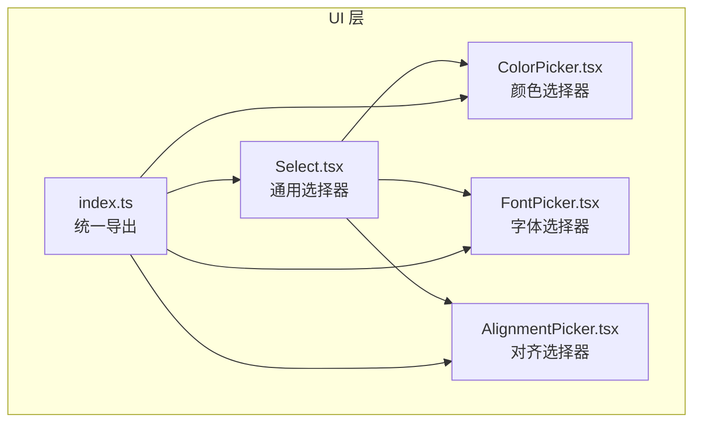
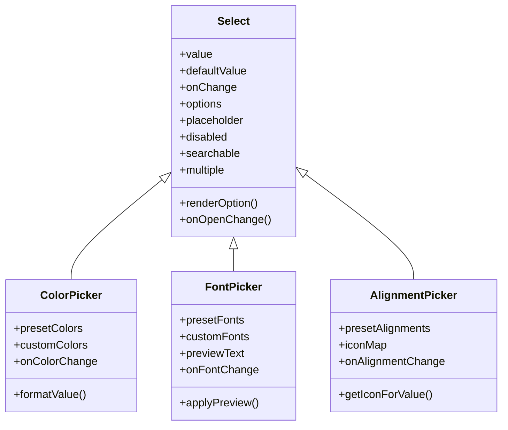
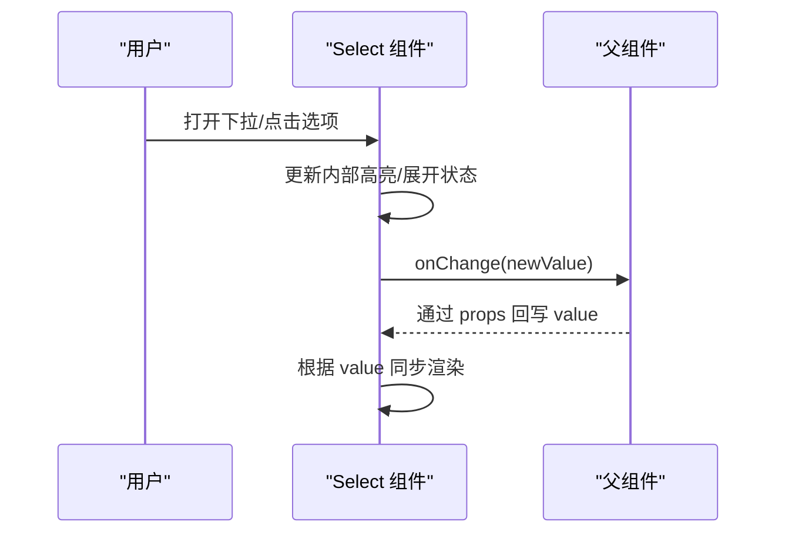
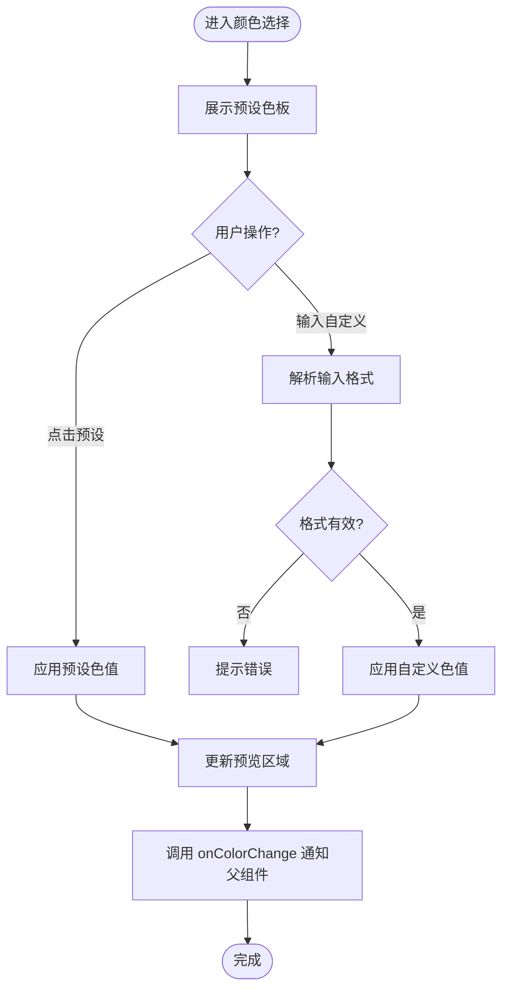
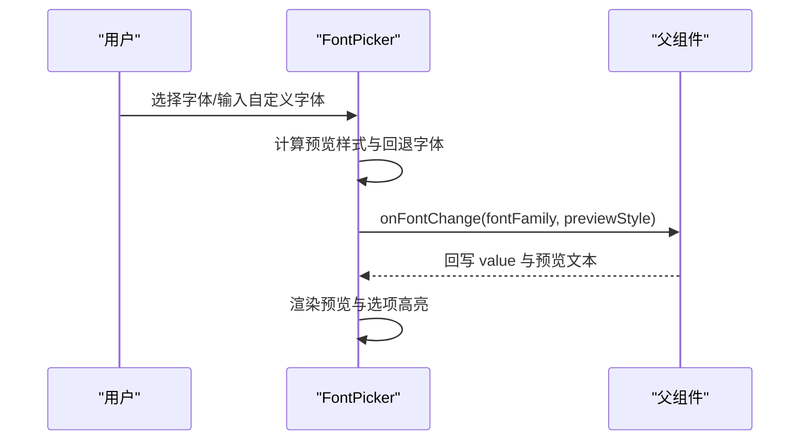
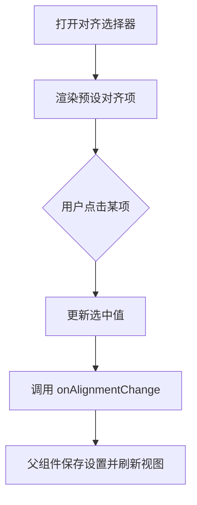
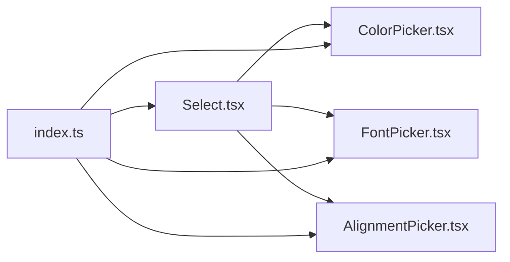

# 选择组件

<cite>
**本文引用的文件**   
- [console/src/components/ui/Select.tsx](file://notifuse/console/src/components/ui/Select.tsx)
- [console/src/components/ui/ColorPicker.tsx](file://notifuse/console/src/components/ui/ColorPicker.tsx)
- [console/src/components/ui/FontPicker.tsx](file://notifuse/console/src/components/ui/FontPicker.tsx)
- [console/src/components/ui/AlignmentPicker.tsx](file://notifuse/console/src/components/ui/AlignmentPicker.tsx)
- [console/src/components/ui/index.ts](file://notifuse/console/src/components/ui/index.ts)
</cite>

## 目录
1. [简介](#简介)
2. [项目结构](#项目结构)
3. [核心组件](#核心组件)
4. [架构总览](#架构总览)
5. [详细组件分析](#详细组件分析)
6. [依赖关系分析](#依赖关系分析)
7. [性能考虑](#性能考虑)
8. [故障排查指南](#故障排查指南)
9. [结论](#结论)
10. [附录](#附录)

## 简介
本文件为 Notifuse 前端控制台的选择组件提供系统化文档，覆盖通用选择器与专用选择控件（颜色选择器、字体样式选择器、对齐方式选择器等）。内容涵盖数据绑定、预设值管理、自定义选项配置、交互设计、键盘导航与屏幕阅读器支持，以及大数据集场景下的性能优化策略。同时提供集成示例与扩展开发指南，帮助开发者快速上手并安全地扩展能力。

## 项目结构
选择组件位于控制台 UI 层，采用“基础组件 + 领域专用组件”的组织方式：
- 基础选择器：提供通用的受控/非受控选择能力、键盘导航、无障碍支持与可访问性属性透传。
- 专用选择器：在通用选择器之上封装业务语义（颜色、字体、对齐），并提供默认预设与常用快捷操作。
- 统一导出：通过索引文件集中导出，便于上层页面按需引入。

图表来源
- [console/src/components/ui/Select.tsx](file://notifuse/console/src/components/ui/Select.tsx)
- [console/src/components/ui/ColorPicker.tsx](file://notifuse/console/src/components/ui/ColorPicker.tsx)
- [console/src/components/ui/FontPicker.tsx](file://notifuse/console/src/components/ui/FontPicker.tsx)
- [console/src/components/ui/AlignmentPicker.tsx](file://notifuse/console/src/components/ui/AlignmentPicker.tsx)
- [console/src/components/ui/index.ts](file://notifuse/console/src/components/ui/index.ts)

章节来源
- [console/src/components/ui/Select.tsx](file://notifuse/console/src/components/ui/Select.tsx)
- [console/src/components/ui/index.ts](file://notifuse/console/src/components/ui/index.ts)

## 核心组件
本节聚焦选择组件的数据模型、受控与非受控模式、预设值管理与自定义选项配置。

- 数据绑定
  - 受控模式：通过 value 与 onChange 实现双向绑定，父组件负责状态维护与校验。
  - 非受控模式：通过 defaultValue 设置初始值，内部维护本地状态；适用于简单表单或一次性选择。
  - 事件回调：onChange 在用户交互后触发，携带当前选中项的标识或完整对象，由父组件决定持久化时机。

- 预设值管理
  - 内置预设：各专用选择器提供常用预设集合（如常见色板、常用字体族、常用对齐方式）。
  - 动态预设：支持从外部传入预设数组，按 key/value 或 label/value 形式渲染。
  - 预设过滤：当数据集较大时，建议结合搜索框进行客户端过滤，避免全量渲染。

- 自定义选项配置
  - 选项结构：每个选项至少包含唯一标识与显示文本，可选图标、禁用态、分组等元信息。
  - 渲染钩子：允许自定义选项渲染函数，以支持复杂展示（缩略图、预览、标签等）。
  - 行为开关：是否启用多选、是否允许清空、是否启用搜索、是否启用分页/虚拟滚动等。

章节来源
- [console/src/components/ui/Select.tsx](file://notifuse/console/src/components/ui/Select.tsx)
- [console/src/components/ui/ColorPicker.tsx](file://notifuse/console/src/components/ui/ColorPicker.tsx)
- [console/src/components/ui/FontPicker.tsx](file://notifuse/console/src/components/ui/FontPicker.tsx)
- [console/src/components/ui/AlignmentPicker.tsx](file://notifuse/console/src/components/ui/AlignmentPicker.tsx)

## 架构总览
选择组件采用分层设计：通用选择器作为基座，专用选择器在其上叠加领域语义与默认预设。所有组件遵循一致的 API 契约，便于替换与组合。

图表来源
- [console/src/components/ui/Select.tsx](file://notifuse/console/src/components/ui/Select.tsx)
- [console/src/components/ui/ColorPicker.tsx](file://notifuse/console/src/components/ui/ColorPicker.tsx)
- [console/src/components/ui/FontPicker.tsx](file://notifuse/console/src/components/ui/FontPicker.tsx)
- [console/src/components/ui/AlignmentPicker.tsx](file://notifuse/console/src/components/ui/AlignmentPicker.tsx)

## 详细组件分析

### 通用选择器（Select）
通用选择器提供稳定的选择能力与交互体验，包括：
- 受控/非受控两种模式
- 键盘导航（上下键移动、回车确认、Esc 关闭）
- 无障碍支持（aria-* 属性、role、焦点管理）
- 搜索与过滤（可选）
- 多选与单选（可选）
- 自定义选项渲染（可选）

图表来源
- [console/src/components/ui/Select.tsx](file://notifuse/console/src/components/ui/Select.tsx)

章节来源
- [console/src/components/ui/Select.tsx](file://notifuse/console/src/components/ui/Select.tsx)

### 颜色选择器（ColorPicker）
颜色选择器在通用选择器基础上提供：
- 预设色板与自定义颜色输入
- 实时预览与格式化输出（十六进制、RGB、HSL 等）
- 常用操作（复制色值、最近使用记录）

图表来源
- [console/src/components/ui/ColorPicker.tsx](file://notifuse/console/src/components/ui/ColorPicker.tsx)

章节来源
- [console/src/components/ui/ColorPicker.tsx](file://notifuse/console/src/components/ui/ColorPicker.tsx)

### 字体样式选择器（FontPicker）
字体选择器提供：
- 预设字体族列表与自定义字体添加
- 实时预览文本，直观感受字体效果
- 字体加载与降级策略（未加载时的回退字体）

图表来源
- [console/src/components/ui/FontPicker.tsx](file://notifuse/console/src/components/ui/FontPicker.tsx)

章节来源
- [console/src/components/ui/FontPicker.tsx](file://notifuse/console/src/components/ui/FontPicker.tsx)

### 对齐方式选择器（AlignmentPicker）
对齐选择器提供：
- 常用对齐预设（左对齐、居中、右对齐、两端对齐等）
- 图标映射与可视化反馈
- 简洁的单选交互，适合工具栏或排版设置

图表来源
- [console/src/components/ui/AlignmentPicker.tsx](file://notifuse/console/src/components/ui/AlignmentPicker.tsx)

章节来源
- [console/src/components/ui/AlignmentPicker.tsx](file://notifuse/console/src/components/ui/AlignmentPicker.tsx)

### 统一导出（index.ts）
通过索引文件集中导出选择组件，简化上层引用路径，确保命名一致性与版本可控。

章节来源
- [console/src/components/ui/index.ts](file://notifuse/console/src/components/ui/index.ts)

## 依赖关系分析
选择组件之间形成清晰的继承与组合关系：专用选择器依赖通用选择器提供的交互与渲染能力，并通过自身预设与格式化逻辑增强业务语义。

图表来源
- [console/src/components/ui/Select.tsx](file://notifuse/console/src/components/ui/Select.tsx)
- [console/src/components/ui/ColorPicker.tsx](file://notifuse/console/src/components/ui/ColorPicker.tsx)
- [console/src/components/ui/FontPicker.tsx](file://notifuse/console/src/components/ui/FontPicker.tsx)
- [console/src/components/ui/AlignmentPicker.tsx](file://notifuse/console/src/components/ui/AlignmentPicker.tsx)
- [console/src/components/ui/index.ts](file://notifuse/console/src/components/ui/index.ts)

章节来源
- [console/src/components/ui/index.ts](file://notifuse/console/src/components/ui/index.ts)

## 性能考虑
针对大数据集与高频交互场景，建议采取以下优化策略：
- 虚拟滚动：对长列表选项启用虚拟化渲染，仅渲染可视区域内的节点，显著降低 DOM 压力。
- 搜索与过滤：在客户端进行增量过滤，避免每次重排全部选项；必要时结合防抖减少频繁计算。
- 预加载与缓存：对字体等资源进行预加载与缓存，避免首次渲染卡顿。
- 事件节流：对 onChange 进行节流或批量提交，减少父组件重渲染次数。
- 惰性渲染：仅在面板打开时构建选项树，关闭时释放资源。
- 结构化数据：将选项数据扁平化或分块加载，配合分组与分页提升响应速度。

[本节为通用指导，不直接分析具体文件]

## 故障排查指南
常见问题与定位思路：
- 值不同步
  - 检查是否为受控模式且父组件正确回写 value。
  - 确认 onChange 返回值类型与选项结构一致。
- 键盘导航异常
  - 验证 aria-* 属性与 role 是否正确传递。
  - 检查焦点容器与 Tab 顺序是否符合预期。
- 搜索无结果
  - 核对搜索字段与选项数据结构是否匹配。
  - 检查大小写与空格处理逻辑。
- 颜色/字体预览异常
  - 确认格式转换函数返回合法值。
  - 检查字体加载失败的回退策略。

章节来源
- [console/src/components/ui/Select.tsx](file://notifuse/console/src/components/ui/Select.tsx)
- [console/src/components/ui/ColorPicker.tsx](file://notifuse/console/src/components/ui/ColorPicker.tsx)
- [console/src/components/ui/FontPicker.tsx](file://notifuse/console/src/components/ui/FontPicker.tsx)
- [console/src/components/ui/AlignmentPicker.tsx](file://notifuse/console/src/components/ui/AlignmentPicker.tsx)

## 结论
选择组件体系以通用选择器为核心，向上提供颜色、字体、对齐等专用能力，兼顾易用性、可访问性与可扩展性。通过合理的数据绑定、预设管理与性能优化策略，可在复杂业务场景中稳定运行。建议在上层页面中优先使用专用选择器以获得更好的开箱体验，并在需要时基于通用选择器进行深度定制。

[本节为总结性内容，不直接分析具体文件]

## 附录

### 集成示例（概念流程）
- 在表单中使用受控模式：
  - 父组件维护 value 与 onChange。
  - 将 value 与 onChange 传递给选择组件。
  - 在 onChange 中进行校验与持久化。
- 使用专用选择器：
  - 颜色选择器：传入预设色板与自定义颜色输入。
  - 字体选择器：传入预设字体与预览文本。
  - 对齐选择器：传入预设对齐项与图标映射。

[本节为概念说明，不直接分析具体文件]

### 扩展开发指南
- 新增专用选择器：
  - 继承通用选择器的 API 契约（value、onChange、options 等）。
  - 定义领域预设与格式化逻辑。
  - 提供必要的预览与辅助功能。
- 自定义选项渲染：
  - 实现 renderOption 钩子，返回自定义 JSX。
  - 保持键盘导航与无障碍属性的一致性。
- 测试与验收：
  - 覆盖键盘导航、屏幕阅读器读出的用例。
  - 验证大数据集下的渲染性能与内存占用。

[本节为概念说明，不直接分析具体文件]