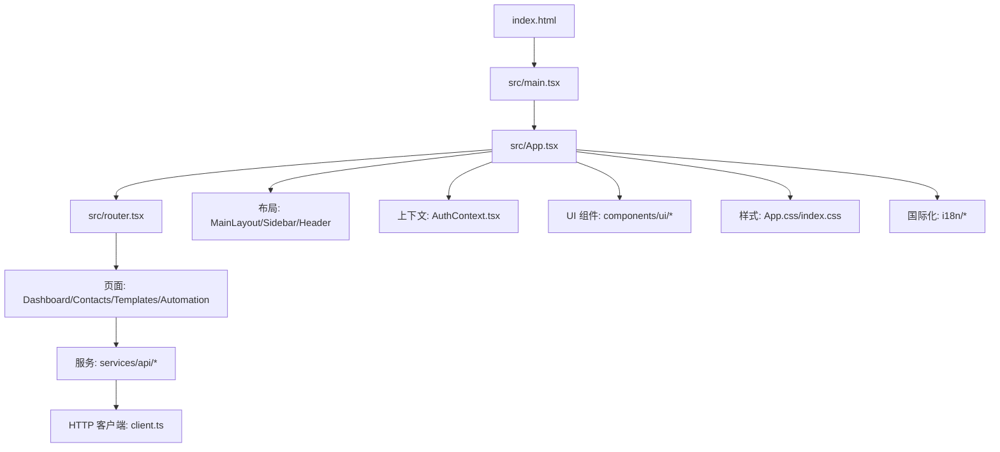
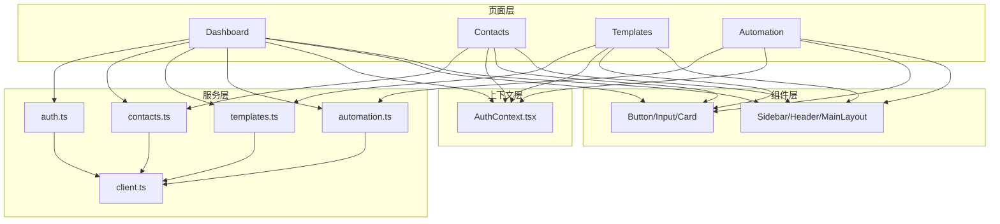
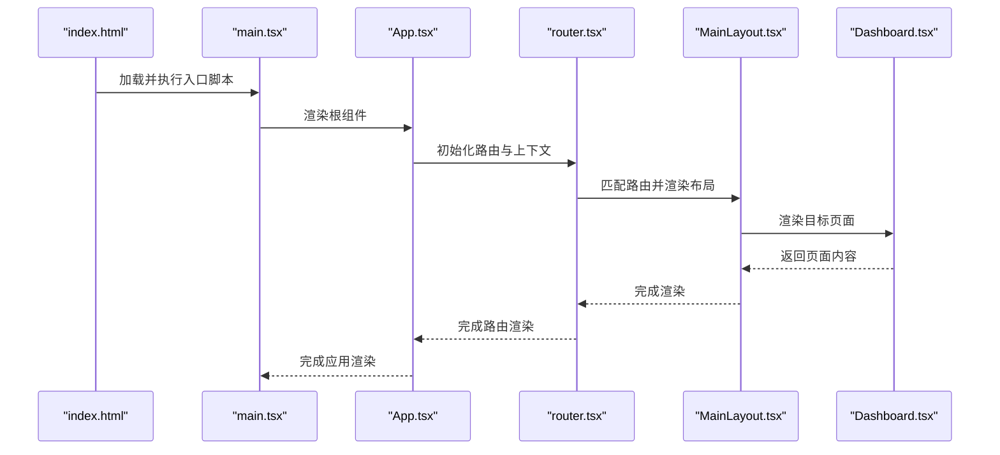
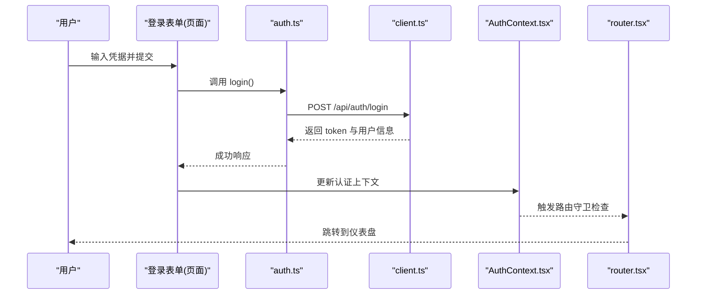
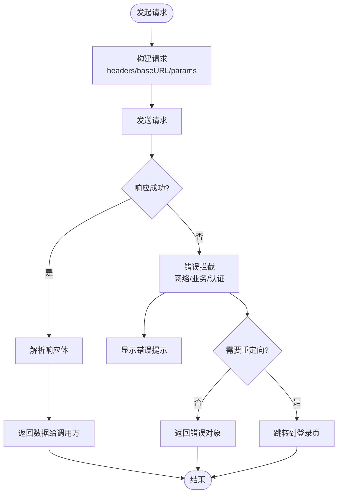
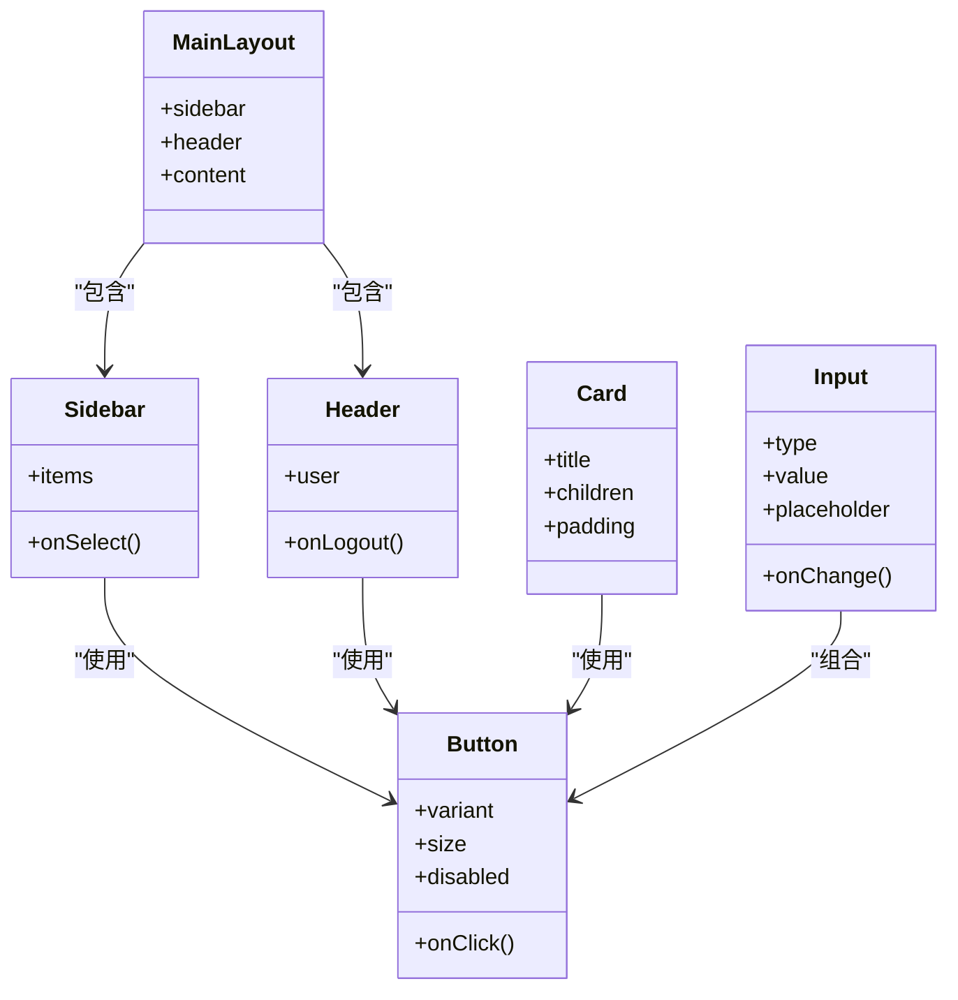
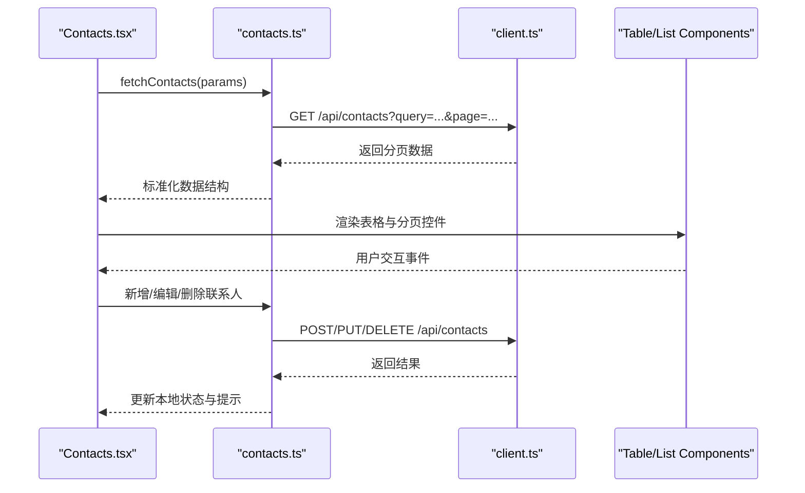
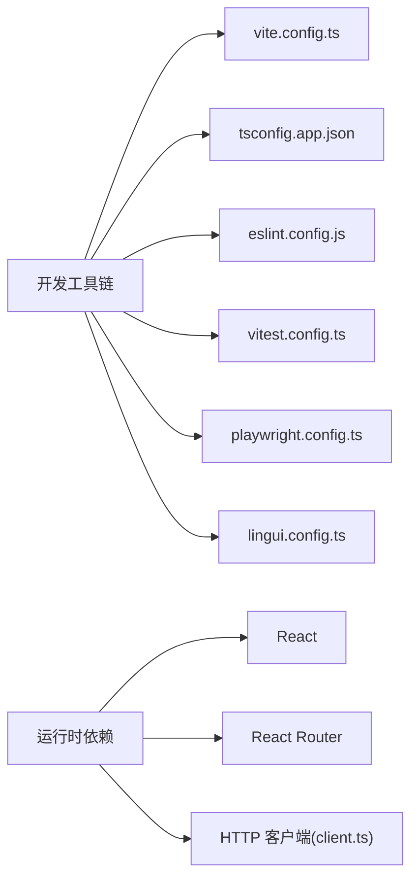

# 前端控制台

<cite>
**本文引用的文件**   
- [package.json](file://notifuse/console/package.json)
- [vite.config.ts](file://notifuse/console/vite.config.ts)
- [tsconfig.app.json](file://notifuse/console/tsconfig.app.json)
- [eslint.config.js](file://notifuse/console/eslint.config.js)
- [vitest.config.ts](file://notifuse/console/vitest.config.ts)
- [playwright.config.ts](file://notifuse/console/playwright.config.ts)
- [lingui.config.ts](file://notifuse/console/lingui.config.ts)
- [index.html](file://notifuse/console/index.html)
- [main.tsx](file://notifuse/console/src/main.tsx)
- [App.tsx](file://notifuse/console/src/App.tsx)
- [router.tsx](file://notifuse/console/src/router.tsx)
- [App.css](file://notifuse/console/src/App.css)
- [index.css](file://notifuse/console/src/index.css)
- [vite-env.d.ts](file://notifuse/console/src/vite-env.d.ts)
- [constants/index.ts](file://notifuse/console/src/constants/index.ts)
- [types/api.ts](file://notifuse/console/src/types/api.ts)
- [types/ui.ts](file://notifuse/console/src/types/ui.ts)
- [hooks/useAuth.ts](file://notifuse/console/src/hooks/useAuth.ts)
- [contexts/AuthContext.tsx](file://notifuse/console/src/contexts/AuthContext.tsx)
- [components/ui/Button.tsx](file://notifuse/console/src/components/ui/Button.tsx)
- [components/ui/Input.tsx](file://notifuse/console/src/components/ui/Input.tsx)
- [components/ui/Card.tsx](file://notifuse/console/src/components/ui/Card.tsx)
- [components/layout/Sidebar.tsx](file://notifuse/console/src/components/layout/Sidebar.tsx)
- [components/layout/Header.tsx](file://notifuse/console/src/components/layout/Header.tsx)
- [components/layout/MainLayout.tsx](file://notifuse/console/src/components/layout/MainLayout.tsx)
- [pages/Dashboard.tsx](file://notifuse/console/src/pages/Dashboard.tsx)
- [pages/Contacts.tsx](file://notifuse/console/src/pages/Contacts.tsx)
- [pages/Templates.tsx](file://notifuse/console/src/pages/Templates.tsx)
- [pages/Automation.tsx](file://notifuse/console/src/pages/Automation.tsx)
- [services/api/client.ts](file://notifuse/console/src/services/api/client.ts)
- [services/api/auth.ts](file://notifuse/console/src/services/api/auth.ts)
- [services/api/contacts.ts](file://notifuse/console/src/services/api/contacts.ts)
- [services/api/templates.ts](file://notifuse/console/src/services/api/templates.ts)
- [services/api/automation.ts](file://notifuse/console/src/services/api/automation.ts)
- [lib/utils.ts](file://notifuse/console/src/lib/utils.ts)
- [utils/formatters.ts](file://notifuse/console/src/utils/formatters.ts)
- [i18n/messages/en.po](file://notifuse/console/src/i18n/messages/en.po)
- [i18n/messages/zh.po](file://notifuse/console/src/i18n/messages/zh.po)
</cite>

## 目录
1. [简介](#简介)
2. [项目结构](#项目结构)
3. [核心组件](#核心组件)
4. [架构总览](#架构总览)
5. [详细组件分析](#详细组件分析)
6. [依赖关系分析](#依赖关系分析)
7. [性能考虑](#性能考虑)
8. [故障排查指南](#故障排查指南)
9. [结论](#结论)
10. [附录](#附录)

## 简介
本文件为 Notifuse 前端控制台的开发文档，面向使用 React + TypeScript 构建的 Web 控制台。文档覆盖以下方面：
- 组件化开发模式与页面组织
- 路由管理机制与导航策略
- 状态管理策略（上下文、Hooks、服务端状态）
- 主要页面实现要点（仪表盘、联系人管理、模板编辑器、自动化工作流设计器）
- UI 组件库、样式系统与主题定制方案
- 后端 API 集成方式、错误处理与用户反馈机制
- 构建配置、开发环境设置与性能优化技巧
- 组件复用模式、代码规范与测试策略

## 项目结构
前端位于 notifuse/console 目录，采用 Vite + React + TypeScript 技术栈，结合 ESLint、Vitest、Playwright、Lingui i18n 等工具链。整体结构遵循“按功能域分层 + 通用能力抽取”的组织方式：
- src/components：可复用 UI 组件与布局组件
- src/pages：页面级组件，对应路由
- src/services/api：API 客户端与服务封装
- src/hooks / src/contexts：自定义 Hooks 与全局上下文
- src/types：类型定义
- src/lib / src/utils：通用工具函数
- src/i18n：国际化资源
- src/styles：全局样式入口
- 根配置：vite.config.ts、tsconfig*.json、eslint.config.js、vitest.config.ts、playwright.config.ts、lingui.config.ts

图表来源
- [index.html](file://notifuse/console/index.html)
- [main.tsx](file://notifuse/console/src/main.tsx)
- [App.tsx](file://notifuse/console/src/App.tsx)
- [router.tsx](file://notifuse/console/src/router.tsx)
- [MainLayout.tsx](file://notifuse/console/src/components/layout/MainLayout.tsx)
- [client.ts](file://notifuse/console/src/services/api/client.ts)
- [AuthContext.tsx](file://notifuse/console/src/contexts/AuthContext.tsx)
- [Button.tsx](file://notifuse/console/src/components/ui/Button.tsx)
- [App.css](file://notifuse/console/src/App.css)
- [index.css](file://notifuse/console/src/index.css)
- [en.po](file://notifuse/console/src/i18n/messages/en.po)

章节来源
- [package.json](file://notifuse/console/package.json)
- [vite.config.ts](file://notifuse/console/vite.config.ts)
- [tsconfig.app.json](file://notifuse/console/tsconfig.app.json)
- [eslint.config.js](file://notifuse/console/eslint.config.js)
- [vitest.config.ts](file://notifuse/console/vitest.config.ts)
- [playwright.config.ts](file://notifuse/console/playwright.config.ts)
- [lingui.config.ts](file://notifuse/console/lingui.config.ts)
- [index.html](file://notifuse/console/index.html)
- [main.tsx](file://notifuse/console/src/main.tsx)
- [App.tsx](file://notifuse/console/src/App.tsx)
- [router.tsx](file://notifuse/console/src/router.tsx)

## 核心组件
本节聚焦控制台的核心能力与关键模块：
- 应用入口与根组件：初始化全局样式、主题、国际化与路由
- 路由系统：基于 React Router 的声明式路由与嵌套布局
- 认证上下文：登录态、权限与用户信息的全局共享
- API 客户端：统一请求封装、拦截器、错误处理与重试策略
- UI 组件库：基础按钮、输入框、卡片等原子组件
- 布局组件：侧边栏、头部、主内容区组合
- 页面组件：仪表盘、联系人、模板、自动化四大核心页面

章节来源
- [main.tsx](file://notifuse/console/src/main.tsx)
- [App.tsx](file://notifuse/console/src/App.tsx)
- [router.tsx](file://notifuse/console/src/router.tsx)
- [AuthContext.tsx](file://notifuse/console/src/contexts/AuthContext.tsx)
- [client.ts](file://notifuse/console/src/services/api/client.ts)
- [Button.tsx](file://notifuse/console/src/components/ui/Button.tsx)
- [Input.tsx](file://notifuse/console/src/components/ui/Input.tsx)
- [Card.tsx](file://notifuse/console/src/components/ui/Card.tsx)
- [Sidebar.tsx](file://notifuse/console/src/components/layout/Sidebar.tsx)
- [Header.tsx](file://notifuse/console/src/components/layout/Header.tsx)
- [MainLayout.tsx](file://notifuse/console/src/components/layout/MainLayout.tsx)
- [Dashboard.tsx](file://notifuse/console/src/pages/Dashboard.tsx)
- [Contacts.tsx](file://notifuse/console/src/pages/Contacts.tsx)
- [Templates.tsx](file://notifuse/console/src/pages/Templates.tsx)
- [Automation.tsx](file://notifuse/console/src/pages/Automation.tsx)

## 架构总览
前端控制台采用“页面-服务-上下文-组件”的分层架构：
- 页面层负责业务编排与数据聚合
- 服务层封装 API 调用，提供领域方法
- 上下文层维护跨页面的全局状态（如认证）
- 组件层提供可复用的 UI 能力与布局

图表来源
- [Dashboard.tsx](file://notifuse/console/src/pages/Dashboard.tsx)
- [Contacts.tsx](file://notifuse/console/src/pages/Contacts.tsx)
- [Templates.tsx](file://notifuse/console/src/pages/Templates.tsx)
- [Automation.tsx](file://notifuse/console/src/pages/Automation.tsx)
- [auth.ts](file://notifuse/console/src/services/api/auth.ts)
- [contacts.ts](file://notifuse/console/src/services/api/contacts.ts)
- [templates.ts](file://notifuse/console/src/services/api/templates.ts)
- [automation.ts](file://notifuse/console/src/services/api/automation.ts)
- [client.ts](file://notifuse/console/src/services/api/client.ts)
- [AuthContext.tsx](file://notifuse/console/src/contexts/AuthContext.tsx)
- [Button.tsx](file://notifuse/console/src/components/ui/Button.tsx)
- [Input.tsx](file://notifuse/console/src/components/ui/Input.tsx)
- [Card.tsx](file://notifuse/console/src/components/ui/Card.tsx)
- [Sidebar.tsx](file://notifuse/console/src/components/layout/Sidebar.tsx)
- [Header.tsx](file://notifuse/console/src/components/layout/Header.tsx)
- [MainLayout.tsx](file://notifuse/console/src/components/layout/MainLayout.tsx)

## 详细组件分析

### 应用入口与根组件
- main.tsx：创建 React 根节点，挂载到 DOM，引入全局样式与国际化初始化
- App.tsx：注册路由、提供全局上下文（如认证）、包裹布局与错误边界
- router.tsx：集中定义路由表，包含受保护路由与公共路由，支持嵌套布局

图表来源
- [index.html](file://notifuse/console/index.html)
- [main.tsx](file://notifuse/console/src/main.tsx)
- [App.tsx](file://notifuse/console/src/App.tsx)
- [router.tsx](file://notifuse/console/src/router.tsx)
- [MainLayout.tsx](file://notifuse/console/src/components/layout/MainLayout.tsx)
- [Dashboard.tsx](file://notifuse/console/src/pages/Dashboard.tsx)

章节来源
- [main.tsx](file://notifuse/console/src/main.tsx)
- [App.tsx](file://notifuse/console/src/App.tsx)
- [router.tsx](file://notifuse/console/src/router.tsx)

### 认证上下文与鉴权流程
- AuthContext.tsx：提供登录态、用户信息与登出动作，供页面与布局消费
- useAuth.ts：封装常用认证逻辑（如刷新令牌、权限判断）
- auth.ts：封装登录、注销、获取用户信息等 API 调用
- 受保护路由：在 router.tsx 中根据认证状态决定跳转或拒绝访问

图表来源
- [AuthContext.tsx](file://notifuse/console/src/contexts/AuthContext.tsx)
- [useAuth.ts](file://notifuse/console/src/hooks/useAuth.ts)
- [auth.ts](file://notifuse/console/src/services/api/auth.ts)
- [client.ts](file://notifuse/console/src/services/api/client.ts)
- [router.tsx](file://notifuse/console/src/router.tsx)

章节来源
- [AuthContext.tsx](file://notifuse/console/src/contexts/AuthContext.tsx)
- [useAuth.ts](file://notifuse/console/src/hooks/useAuth.ts)
- [auth.ts](file://notifuse/console/src/services/api/auth.ts)
- [router.tsx](file://notifuse/console/src/router.tsx)

### API 客户端与错误处理
- client.ts：统一 HTTP 客户端，封装请求头、基础路径、超时、重试、错误拦截与消息提示
- 各服务模块：按领域拆分 API 调用，保持页面简洁
- 错误处理：网络异常、业务错误码、未授权重定向与用户反馈

图表来源
- [client.ts](file://notifuse/console/src/services/api/client.ts)

章节来源
- [client.ts](file://notifuse/console/src/services/api/client.ts)
- [contacts.ts](file://notifuse/console/src/services/api/contacts.ts)
- [templates.ts](file://notifuse/console/src/services/api/templates.ts)
- [automation.ts](file://notifuse/console/src/services/api/automation.ts)

### UI 组件库与样式系统
- 原子组件：Button、Input、Card 等，提供一致的交互与视觉风格
- 布局组件：Sidebar、Header、MainLayout 组合形成控制台骨架
- 样式系统：通过 CSS 变量与主题类实现主题切换；全局样式入口 index.css 与 App.css 分别承载基础与页面级样式
- 主题定制：通过 CSS 变量与上下文注入主题键值，支持明暗主题与品牌色替换

图表来源
- [Button.tsx](file://notifuse/console/src/components/ui/Button.tsx)
- [Input.tsx](file://notifuse/console/src/components/ui/Input.tsx)
- [Card.tsx](file://notifuse/console/src/components/ui/Card.tsx)
- [Sidebar.tsx](file://notifuse/console/src/components/layout/Sidebar.tsx)
- [Header.tsx](file://notifuse/console/src/components/layout/Header.tsx)
- [MainLayout.tsx](file://notifuse/console/src/components/layout/MainLayout.tsx)
- [App.css](file://notifuse/console/src/App.css)
- [index.css](file://notifuse/console/src/index.css)

章节来源
- [Button.tsx](file://notifuse/console/src/components/ui/Button.tsx)
- [Input.tsx](file://notifuse/console/src/components/ui/Input.tsx)
- [Card.tsx](file://notifuse/console/src/components/ui/Card.tsx)
- [Sidebar.tsx](file://notifuse/console/src/components/layout/Sidebar.tsx)
- [Header.tsx](file://notifuse/console/src/components/layout/Header.tsx)
- [MainLayout.tsx](file://notifuse/console/src/components/layout/MainLayout.tsx)
- [App.css](file://notifuse/console/src/App.css)
- [index.css](file://notifuse/console/src/index.css)

### 页面组件实现要点
- 仪表盘（Dashboard）：聚合统计指标、最近活动、快捷入口；从多个服务拉取数据并缓存
- 联系人管理（Contacts）：列表展示、搜索过滤、分页、批量操作；与 contacts.ts 服务协作
- 模板编辑器（Templates）：模板 CRUD、预览、版本管理；与 templates.ts 服务协作
- 自动化工作流设计器（Automation）：可视化编排触发器与动作节点；与 automation.ts 服务协作

图表来源
- [Contacts.tsx](file://notifuse/console/src/pages/Contacts.tsx)
- [contacts.ts](file://notifuse/console/src/services/api/contacts.ts)
- [client.ts](file://notifuse/console/src/services/api/client.ts)

章节来源
- [Dashboard.tsx](file://notifuse/console/src/pages/Dashboard.tsx)
- [Contacts.tsx](file://notifuse/console/src/pages/Contacts.tsx)
- [Templates.tsx](file://notifuse/console/src/pages/Templates.tsx)
- [Automation.tsx](file://notifuse/console/src/pages/Automation.tsx)

### 国际化与多语言
- Lingui 配置：lingui.config.ts 定义源目录、输出目录与编译选项
- 资源文件：messages/en.po、messages/zh.po 存放翻译键值
- 使用方式：在组件中使用 t`文本` 进行标记，运行时动态加载当前语言包

章节来源
- [lingui.config.ts](file://notifuse/console/lingui.config.ts)
- [en.po](file://notifuse/console/src/i18n/messages/en.po)
- [zh.po](file://notifuse/console/src/i18n/messages/zh.po)

## 依赖关系分析
- 构建与开发工具：Vite、TypeScript、ESLint、Vitest、Playwright、Lingui
- 运行时依赖：React、React Router、HTTP 客户端（如 axios/fetch 封装）
- 样式与主题：CSS 变量、主题上下文、Tailwind 或原生 CSS 模块化（视具体实现）

图表来源
- [vite.config.ts](file://notifuse/console/vite.config.ts)
- [tsconfig.app.json](file://notifuse/console/tsconfig.app.json)
- [eslint.config.js](file://notifuse/console/eslint.config.js)
- [vitest.config.ts](file://notifuse/console/vitest.config.ts)
- [playwright.config.ts](file://notifuse/console/playwright.config.ts)
- [lingui.config.ts](file://notifuse/console/lingui.config.ts)
- [client.ts](file://notifuse/console/src/services/api/client.ts)

章节来源
- [package.json](file://notifuse/console/package.json)
- [vite.config.ts](file://notifuse/console/vite.config.ts)
- [tsconfig.app.json](file://notifuse/console/tsconfig.app.json)
- [eslint.config.js](file://notifuse/console/eslint.config.js)
- [vitest.config.ts](file://notifuse/console/vitest.config.ts)
- [playwright.config.ts](file://notifuse/console/playwright.config.ts)
- [lingui.config.ts](file://notifuse/console/lingui.config.ts)

## 性能考虑
- 路由懒加载：对大页面（如自动化设计器）按需加载，减少首屏体积
- 数据缓存：对静态或低频变更数据使用内存缓存或浏览器存储
- 列表虚拟化：大数据量列表使用虚拟滚动提升渲染性能
- 图片与资源优化：启用压缩、CDN 与懒加载
- 请求合并与去抖：避免重复请求与频繁提交
- 主题切换开销：通过 CSS 变量与最小重绘降低切换成本

[本节为通用指导，不直接分析具体文件]

## 故障排查指南
- 认证失败：检查登录接口返回、token 存储与路由守卫逻辑
- 网络错误：查看 client.ts 的错误拦截与重试策略，确认后端可达性与 CORS
- 页面空白：检查路由匹配与受保护路由条件，确认上下文是否就绪
- 样式错乱：确认主题变量与全局样式加载顺序，检查浏览器开发者工具中的样式覆盖
- 国际化缺失：确认 lingui 编译产物是否存在，语言包是否正确加载

章节来源
- [client.ts](file://notifuse/console/src/services/api/client.ts)
- [router.tsx](file://notifuse/console/src/router.tsx)
- [AuthContext.tsx](file://notifuse/console/src/contexts/AuthContext.tsx)
- [App.css](file://notifuse/console/src/App.css)
- [index.css](file://notifuse/console/src/index.css)
- [lingui.config.ts](file://notifuse/console/lingui.config.ts)

## 结论
Notifuse 前端控制台以 React + TypeScript 为核心，采用清晰的层次化架构与组件化模式，配合统一的 API 客户端与上下文管理，实现了仪表盘、联系人、模板与自动化等核心能力的稳定交付。通过完善的构建与测试工具链、国际化与主题体系，以及良好的错误处理与用户体验设计，为后续扩展与维护提供了坚实基础。

[本节为总结性内容，不直接分析具体文件]

## 附录
- 环境变量与构建配置：参考 vite.config.ts 与 tsconfig.app.json
- 代码规范：参考 eslint.config.js 与团队约定
- 测试策略：单元测试（Vitest）、端到端（Playwright）
- 类型定义：集中在 types 目录，确保前后端契约一致

章节来源
- [vite.config.ts](file://notifuse/console/vite.config.ts)
- [tsconfig.app.json](file://notifuse/console/tsconfig.app.json)
- [eslint.config.js](file://notifuse/console/eslint.config.js)
- [vitest.config.ts](file://notifuse/console/vitest.config.ts)
- [playwright.config.ts](file://notifuse/console/playwright.config.ts)
- [api.ts](file://notifuse/console/src/types/api.ts)
- [ui.ts](file://notifuse/console/src/types/ui.ts)