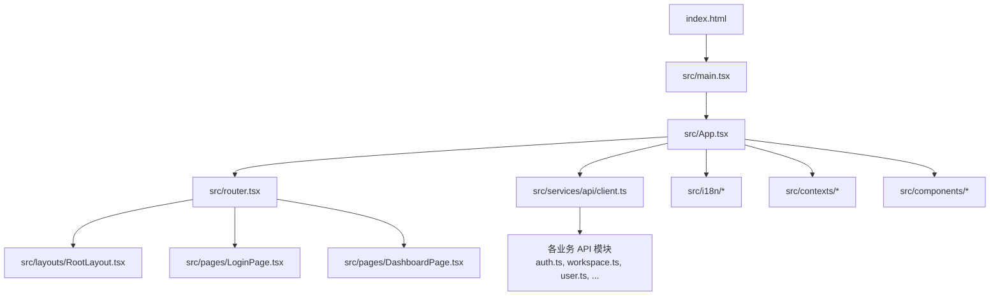
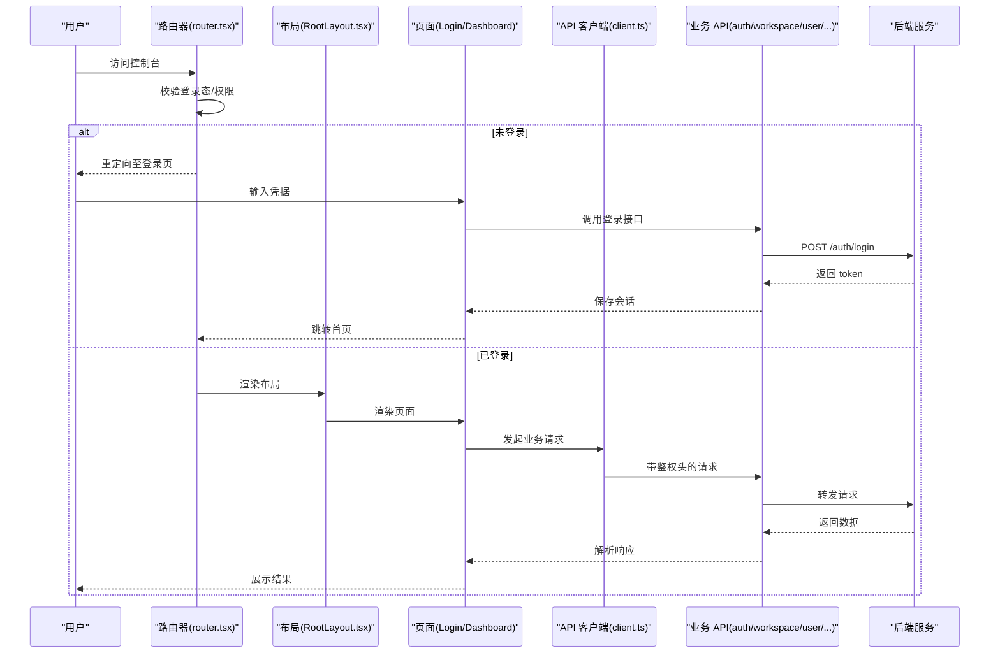
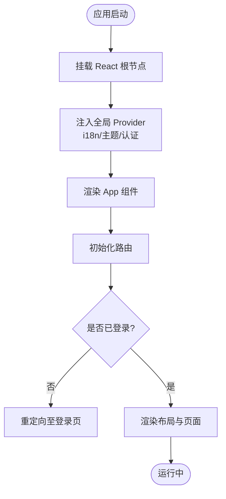
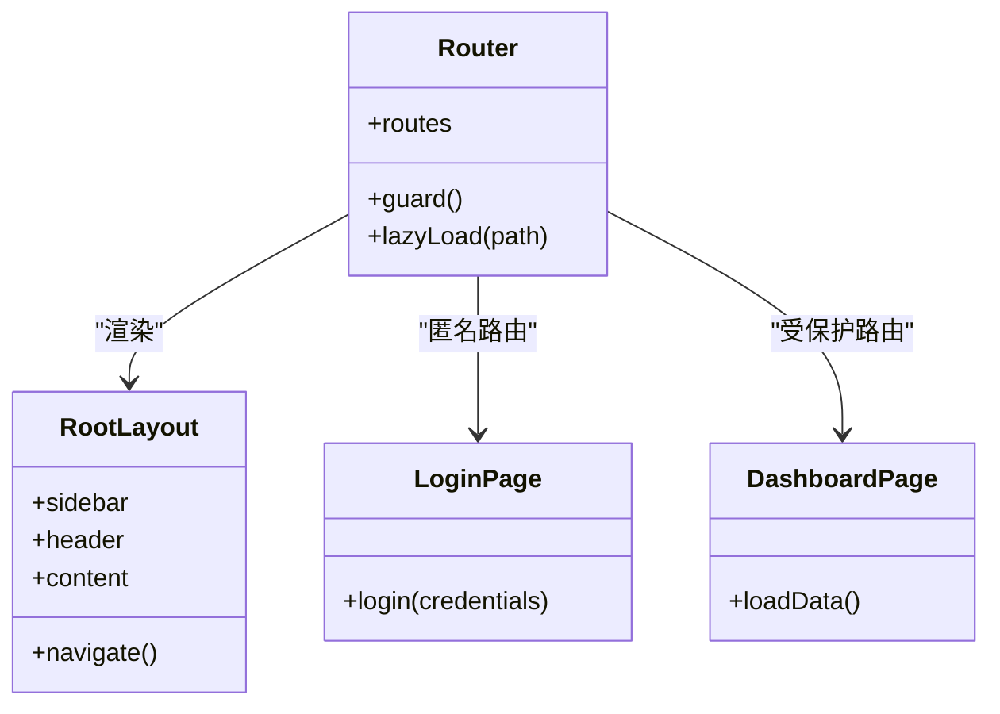
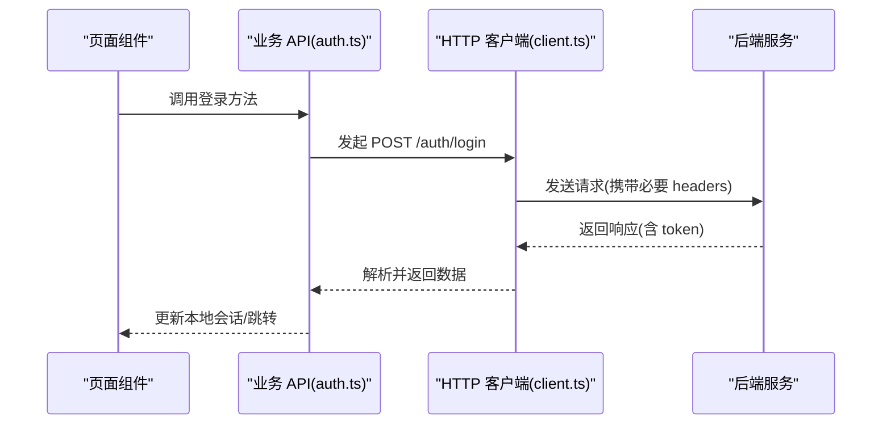
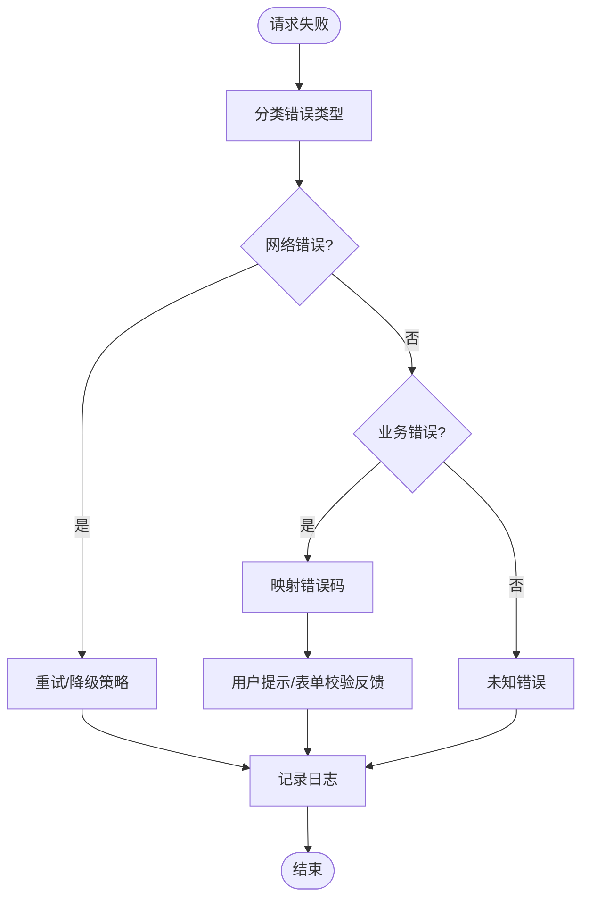
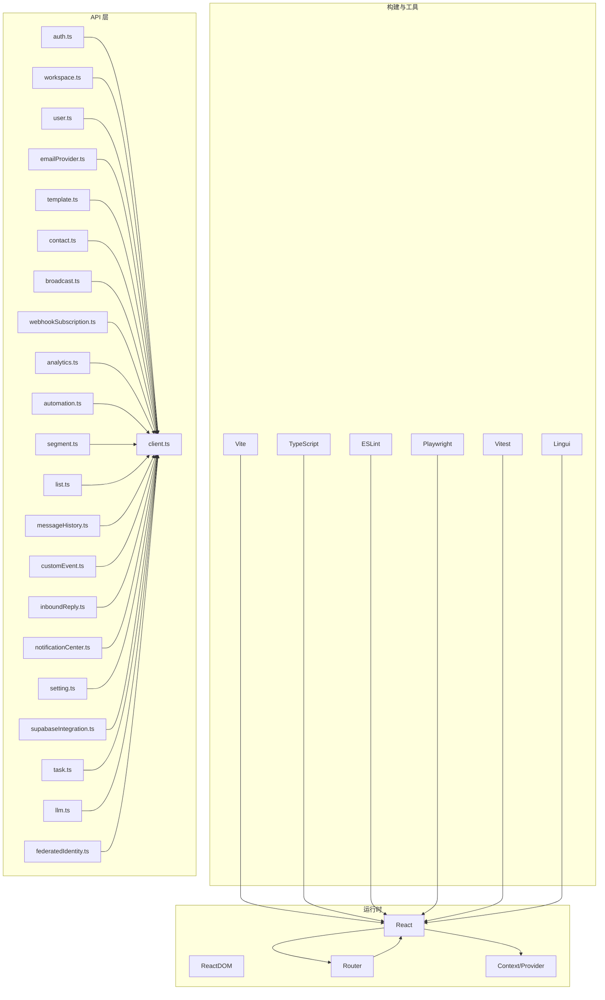

# 前端架构设计

<cite>
**本文引用的文件**   
- [console/package.json](file://notifuse/console/package.json)
- [console/vite.config.ts](file://notifuse/console/vite.config.ts)
- [console/tsconfig.json](file://notifuse/console/tsconfig.json)
- [console/tsconfig.app.json](file://notifuse/console/tsconfig.app.json)
- [console/tsconfig.node.json](file://notifuse/console/tsconfig.node.json)
- [console/index.html](file://notifuse/console/index.html)
- [console/src/main.tsx](file://notifuse/console/src/main.tsx)
- [console/src/App.tsx](file://notifuse/console/src/App.tsx)
- [console/src/router.tsx](file://notifuse/console/src/router.tsx)
- [console/src/layouts/RootLayout.tsx](file://notifuse/console/src/layouts/RootLayout.tsx)
- [console/src/pages/LoginPage.tsx](file://notifuse/console/src/pages/LoginPage.tsx)
- [console/src/pages/DashboardPage.tsx](file://notifuse/console/src/pages/DashboardPage.tsx)
- [console/src/services/api/client.ts](file://notifuse/console/src/services/api/client.ts)
- [console/src/services/api/auth.ts](file://notifuse/console/src/services/api/auth.ts)
- [console/src/services/api/workspace.ts](file://notifuse/console/src/services/api/workspace.ts)
- [console/src/services/api/user.ts](file://notifuse/console/src/services/api/user.ts)
- [console/src/services/api/emailProvider.ts](file://notifuse/console/src/services/api/emailProvider.ts)
- [console/src/services/api/template.ts](file://notifuse/console/src/services/api/template.ts)
- [console/src/services/api/contact.ts](file://notifuse/console/src/services/api/contact.ts)
- [console/src/services/api/broadcast.ts](file://notifuse/console/src/services/api/broadcast.ts)
- [console/src/services/api/webhookSubscription.ts](file://notifuse/console/src/services/api/webhookSubscription.ts)
- [console/src/services/api/analytics.ts](file://notifuse/console/src/services/api/analytics.ts)
- [console/src/services/api/automation.ts](file://notifuse/console/src/services/api/automation.ts)
- [console/src/services/api/segment.ts](file://notifuse/console/src/services/api/segment.ts)
- [console/src/services/api/list.ts](file://notifuse/console/src/services/api/list.ts)
- [console/src/services/api/messageHistory.ts](file://notifuse/console/src/services/api/messageHistory.ts)
- [console/src/services/api/customEvent.ts](file://notifuse/console/src/services/api/customEvent.ts)
- [console/src/services/api/inboundReply.ts](file://notifuse/console/src/services/api/inboundReply.ts)
- [console/src/services/api/notificationCenter.ts](file://notifuse/console/src/services/api/notificationCenter.ts)
- [console/src/services/api/setting.ts](file://notifuse/console/src/services/api/setting.ts)
- [console/src/services/api/supabaseIntegration.ts](file://notifuse/console/src/services/api/supabaseIntegration.ts)
- [console/src/services/api/task.ts](file://notifuse/console/src/services/api/task.ts)
- [console/src/services/api/llm.ts](file://notifuse/console/src/services/api/llm.ts)
- [console/src/services/api/federatedIdentity.ts](file://notifuse/console/src/services/api/federatedIdentity.ts)
- [console/src/utils/errorHandler.ts](file://notifuse/console/src/utils/errorHandler.ts)
- [console/src/i18n/locales/en/messages.po](file://notifuse/console/src/i18n/locales/en/messages.po)
- [console/src/i18n/locales/zh-CN/messages.po](file://notifuse/console/src/i18n/locales/zh-CN/messages.po)
- [console/eslint.config.js](file://notifuse/console/eslint.config.js)
- [console/playwright.config.ts](file://notifuse/console/playwright.config.ts)
- [console/vitest.config.ts](file://notifuse/console/vitest.config.ts)
</cite>

## 目录
1. [简介](#简介)
2. [项目结构](#项目结构)
3. [核心组件](#核心组件)
4. [架构总览](#架构总览)
5. [详细组件分析](#详细组件分析)
6. [依赖分析](#依赖分析)
7. [性能考虑](#性能考虑)
8. [故障排查指南](#故障排查指南)
9. [结论](#结论)
10. [附录](#附录)

## 简介
本文件为 Notifuse 控制台（Console）前端的架构设计文档，聚焦于基于 React + TypeScript 的前端整体架构。内容涵盖应用初始化流程、路由管理、模块组织方式、Vite 构建配置、TypeScript 编译设置、开发环境搭建、组件化与目录结构设计原则、代码分割策略、状态管理方案、API 客户端封装、错误处理机制、性能优化与打包优化、部署配置以及开发工具链与调试技巧等。目标是帮助开发者快速理解并高效扩展控制台前端。

## 项目结构
控制台前端位于 notifuse/console 目录下，采用 Vite + React + TypeScript 技术栈，结合 ESLint、Playwright、Vitest 等工具形成完整的开发与测试体系。

- 入口与根节点
  - index.html：应用 HTML 模板与资源注入点
  - src/main.tsx：React 应用启动与全局上下文挂载
  - src/App.tsx：顶层应用组件，负责全局样式、国际化与布局容器
  - src/router.tsx：路由定义与守卫逻辑

- 页面与布局
  - src/pages/*：按功能域划分的页面组件
  - src/layouts/*：布局组件（如 RootLayout），提供侧边栏、头部、面包屑等公共结构

- 服务与 API
  - src/services/api/*：按业务域拆分的 API 客户端模块，统一通过 HTTP 客户端发起请求
  - src/services/api/client.ts：HTTP 客户端封装（拦截器、基础 URL、错误处理）

- 通用能力
  - src/components/*：可复用 UI 组件
  - src/hooks/*：自定义 Hook
  - src/contexts/*：全局 Context（如认证、主题、语言）
  - src/lib/*：领域库或第三方封装
  - src/utils/*：工具函数（含错误处理、格式化等）
  - src/types/*：类型定义
  - src/assets/*：静态资源
  - src/styles/*：全局样式

- 国际化
  - src/i18n/*：Lingui 多语言资源与配置

- 构建与工程化
  - vite.config.ts：Vite 构建配置（插件、代理、分包、别名等）
  - tsconfig.json / tsconfig.app.json / tsconfig.node.json：TypeScript 编译配置
  - eslint.config.js：ESLint 规则
  - playwright.config.ts：E2E 测试配置
  - vitest.config.ts：单元测试配置
  - package.json：脚本与依赖声明

图表来源
- [console/index.html](file://notifuse/console/index.html)
- [console/src/main.tsx](file://notifuse/console/src/main.tsx)
- [console/src/App.tsx](file://notifuse/console/src/App.tsx)
- [console/src/router.tsx](file://notifuse/console/src/router.tsx)
- [console/src/layouts/RootLayout.tsx](file://notifuse/console/src/layouts/RootLayout.tsx)
- [console/src/pages/LoginPage.tsx](file://notifuse/console/src/pages/LoginPage.tsx)
- [console/src/pages/DashboardPage.tsx](file://notifuse/console/src/pages/DashboardPage.tsx)
- [console/src/services/api/client.ts](file://notifuse/console/src/services/api/client.ts)

章节来源
- [console/package.json](file://notifuse/console/package.json)
- [console/vite.config.ts](file://notifuse/console/vite.config.ts)
- [console/tsconfig.json](file://notifuse/console/tsconfig.json)
- [console/tsconfig.app.json](file://notifuse/console/tsconfig.app.json)
- [console/tsconfig.node.json](file://notifuse/console/tsconfig.node.json)
- [console/index.html](file://notifuse/console/index.html)
- [console/src/main.tsx](file://notifuse/console/src/main.tsx)
- [console/src/App.tsx](file://notifuse/console/src/App.tsx)
- [console/src/router.tsx](file://notifuse/console/src/router.tsx)

## 核心组件
- 应用初始化
  - main.tsx：创建 React 根节点，挂载全局 Provider（如 i18n、主题、认证上下文），渲染 App 组件
  - App.tsx：配置全局样式、错误边界、路由容器、布局外壳

- 路由管理
  - router.tsx：集中式路由表，包含受保护路由、重定向、懒加载（按需引入页面）
  - layouts/RootLayout.tsx：提供导航、侧边栏、头部、消息提示等布局能力

- API 客户端
  - services/api/client.ts：封装 fetch/axios，统一设置 baseURL、headers、超时、重试、取消令牌、错误码映射、鉴权头注入
  - services/api/*.ts：按业务域拆分 API 方法，返回 Promise，便于在组件中调用

- 错误处理
  - utils/errorHandler.ts：统一错误分类、用户提示、日志上报、重试策略

- 国际化
  - i18n/*：Lingui 多语言资源与运行时切换，支持动态加载

章节来源
- [console/src/main.tsx](file://notifuse/console/src/main.tsx)
- [console/src/App.tsx](file://notifuse/console/src/App.tsx)
- [console/src/router.tsx](file://notifuse/console/src/router.tsx)
- [console/src/layouts/RootLayout.tsx](file://notifuse/console/src/layouts/RootLayout.tsx)
- [console/src/services/api/client.ts](file://notifuse/console/src/services/api/client.ts)
- [console/src/utils/errorHandler.ts](file://notifuse/console/src/utils/errorHandler.ts)
- [console/src/i18n/locales/en/messages.po](file://notifuse/console/src/i18n/locales/en/messages.po)
- [console/src/i18n/locales/zh-CN/messages.po](file://notifuse/console/src/i18n/locales/zh-CN/messages.po)

## 架构总览
下图展示了从浏览器到后端 API 的端到端数据流，包括认证、路由、布局、页面、API 客户端与错误处理的交互关系。

图表来源
- [console/src/router.tsx](file://notifuse/console/src/router.tsx)
- [console/src/layouts/RootLayout.tsx](file://notifuse/console/src/layouts/RootLayout.tsx)
- [console/src/pages/LoginPage.tsx](file://notifuse/console/src/pages/LoginPage.tsx)
- [console/src/pages/DashboardPage.tsx](file://notifuse/console/src/pages/DashboardPage.tsx)
- [console/src/services/api/client.ts](file://notifuse/console/src/services/api/client.ts)
- [console/src/services/api/auth.ts](file://notifuse/console/src/services/api/auth.ts)
- [console/src/services/api/workspace.ts](file://notifuse/console/src/services/api/workspace.ts)
- [console/src/services/api/user.ts](file://notifuse/console/src/services/api/user.ts)

## 详细组件分析

### 应用初始化与根组件
- main.tsx
  - 作用：创建 React 根节点，挂载全局 Provider（i18n、主题、认证等），渲染 App
  - 关键点：确保在 DOM 可用后挂载；初始化全局错误捕获；注册必要的中间件

- App.tsx
  - 作用：顶层应用组件，集成路由、布局、全局样式、错误边界
  - 关键点：根据环境切换调试开关；提供全局上下文；统一错误处理

图表来源
- [console/src/main.tsx](file://notifuse/console/src/main.tsx)
- [console/src/App.tsx](file://notifuse/console/src/App.tsx)
- [console/src/router.tsx](file://notifuse/console/src/router.tsx)

章节来源
- [console/src/main.tsx](file://notifuse/console/src/main.tsx)
- [console/src/App.tsx](file://notifuse/console/src/App.tsx)

### 路由管理与布局
- router.tsx
  - 作用：集中式路由表，定义受保护路由、匿名路由、懒加载页面
  - 关键点：使用动态 import() 实现代码分割；统一权限校验与重定向

- layouts/RootLayout.tsx
  - 作用：提供侧边栏、顶部导航、面包屑、通知中心、用户菜单等
  - 关键点：与路由联动高亮当前项；承载全局消息提示与模态框

图表来源
- [console/src/router.tsx](file://notifuse/console/src/router.tsx)
- [console/src/layouts/RootLayout.tsx](file://notifuse/console/src/layouts/RootLayout.tsx)
- [console/src/pages/LoginPage.tsx](file://notifuse/console/src/pages/LoginPage.tsx)
- [console/src/pages/DashboardPage.tsx](file://notifuse/console/src/pages/DashboardPage.tsx)

章节来源
- [console/src/router.tsx](file://notifuse/console/src/router.tsx)
- [console/src/layouts/RootLayout.tsx](file://notifuse/console/src/layouts/RootLayout.tsx)
- [console/src/pages/LoginPage.tsx](file://notifuse/console/src/pages/LoginPage.tsx)
- [console/src/pages/DashboardPage.tsx](file://notifuse/console/src/pages/DashboardPage.tsx)

### API 客户端与服务层
- client.ts
  - 作用：统一 HTTP 客户端封装，处理 baseURL、headers、超时、重试、取消、错误码映射、鉴权头注入
  - 关键点：拦截器模式；自动刷新 token；网络异常降级；请求/响应日志（开发环境）

- 业务 API 模块
  - auth.ts：登录、登出、刷新 token、获取当前用户信息
  - workspace.ts：工作区 CRUD、成员管理、邀请
  - user.ts：用户资料、密码修改、偏好设置
  - emailProvider.ts：邮件服务商配置与测试
  - template.ts：模板列表、预览、版本管理
  - contact.ts：联系人增删改查、导入导出、标签
  - broadcast.ts：广播任务创建、发送、统计
  - webhookSubscription.ts：订阅管理、事件过滤、签名验证
  - analytics.ts：指标查询、报表导出
  - automation.ts：自动化流程编排、执行历史
  - segment.ts：分群规则、计算任务
  - list.ts：列表管理、同步
  - messageHistory.ts：消息历史检索、详情
  - customEvent.ts：自定义事件定义与采集
  - inboundReply.ts：入站回复处理、路由规则
  - notificationCenter.ts：通知中心读写
  - setting.ts：系统设置、SMTP、OIDC、平台配置
  - supabaseIntegration.ts：Supabase 集成配置与同步
  - task.ts：任务调度、队列监控
  - llm.ts：LLM 提供商配置、对话记录
  - federatedIdentity.ts：联邦身份源管理

图表来源
- [console/src/services/api/client.ts](file://notifuse/console/src/services/api/client.ts)
- [console/src/services/api/auth.ts](file://notifuse/console/src/services/api/auth.ts)

章节来源
- [console/src/services/api/client.ts](file://notifuse/console/src/services/api/client.ts)
- [console/src/services/api/auth.ts](file://notifuse/console/src/services/api/auth.ts)
- [console/src/services/api/workspace.ts](file://notifuse/console/src/services/api/workspace.ts)
- [console/src/services/api/user.ts](file://notifuse/console/src/services/api/user.ts)
- [console/src/services/api/emailProvider.ts](file://notifuse/console/src/services/api/emailProvider.ts)
- [console/src/services/api/template.ts](file://notifuse/console/src/services/api/template.ts)
- [console/src/services/api/contact.ts](file://notifuse/console/src/services/api/contact.ts)
- [console/src/services/api/broadcast.ts](file://notifuse/console/src/services/api/broadcast.ts)
- [console/src/services/api/webhookSubscription.ts](file://notifuse/console/src/services/api/webhookSubscription.ts)
- [console/src/services/api/analytics.ts](file://notifuse/console/src/services/api/analytics.ts)
- [console/src/services/api/automation.ts](file://notifuse/console/src/services/api/automation.ts)
- [console/src/services/api/segment.ts](file://notifuse/console/src/services/api/segment.ts)
- [console/src/services/api/list.ts](file://notifuse/console/src/services/api/list.ts)
- [console/src/services/api/messageHistory.ts](file://notifuse/console/src/services/api/messageHistory.ts)
- [console/src/services/api/customEvent.ts](file://notifuse/console/src/services/api/customEvent.ts)
- [console/src/services/api/inboundReply.ts](file://notifuse/console/src/services/api/inboundReply.ts)
- [console/src/services/api/notificationCenter.ts](file://notifuse/console/src/services/api/notificationCenter.ts)
- [console/src/services/api/setting.ts](file://notifuse/console/src/services/api/setting.ts)
- [console/src/services/api/supabaseIntegration.ts](file://notifuse/console/src/services/api/supabaseIntegration.ts)
- [console/src/services/api/task.ts](file://notifuse/console/src/services/api/task.ts)
- [console/src/services/api/llm.ts](file://notifuse/console/src/services/api/llm.ts)
- [console/src/services/api/federatedIdentity.ts](file://notifuse/console/src/services/api/federatedIdentity.ts)

### 错误处理机制
- errorHandler.ts
  - 作用：统一错误分类（网络错误、业务错误、权限错误）、用户提示、日志上报、重试策略
  - 关键点：错误码映射；敏感信息脱敏；可插拔的错误处理器（Toast、Modal、日志）

图表来源
- [console/src/utils/errorHandler.ts](file://notifuse/console/src/utils/errorHandler.ts)

章节来源
- [console/src/utils/errorHandler.ts](file://notifuse/console/src/utils/errorHandler.ts)

### 国际化与多语言
- i18n/*
  - 作用：Lingui 多语言资源与运行时切换，支持动态加载与热更新
  - 关键点：messages.po 维护翻译键值；默认语言与回退策略；区域化格式（日期、数字）

章节来源
- [console/src/i18n/locales/en/messages.po](file://notifuse/console/src/i18n/locales/en/messages.po)
- [console/src/i18n/locales/zh-CN/messages.po](file://notifuse/console/src/i18n/locales/zh-CN/messages.po)

## 依赖分析
控制台前端依赖关系如下：
- 构建与工具链
  - Vite：开发与构建引擎
  - React + ReactDOM：UI 框架
  - TypeScript：类型系统与编译
  - ESLint：代码质量检查
  - Playwright：E2E 测试
  - Vitest：单元测试
  - Lingui：国际化

- 业务 API 模块
  - 每个业务域对应一个 API 模块，统一通过 HTTP 客户端发起请求
  - 模块间低耦合，避免跨域直接依赖

图表来源
- [console/package.json](file://notifuse/console/package.json)
- [console/vite.config.ts](file://notifuse/console/vite.config.ts)
- [console/src/services/api/client.ts](file://notifuse/console/src/services/api/client.ts)
- [console/src/services/api/auth.ts](file://notifuse/console/src/services/api/auth.ts)
- [console/src/services/api/workspace.ts](file://notifuse/console/src/services/api/workspace.ts)
- [console/src/services/api/user.ts](file://notifuse/console/src/services/api/user.ts)
- [console/src/services/api/emailProvider.ts](file://notifuse/console/src/services/api/emailProvider.ts)
- [console/src/services/api/template.ts](file://notifuse/console/src/services/api/template.ts)
- [console/src/services/api/contact.ts](file://notifuse/console/src/services/api/contact.ts)
- [console/src/services/api/broadcast.ts](file://notifuse/console/src/services/api/broadcast.ts)
- [console/src/services/api/webhookSubscription.ts](file://notifuse/console/src/services/api/webhookSubscription.ts)
- [console/src/services/api/analytics.ts](file://notifuse/console/src/services/api/analytics.ts)
- [console/src/services/api/automation.ts](file://notifuse/console/src/services/api/automation.ts)
- [console/src/services/api/segment.ts](file://notifuse/console/src/services/api/segment.ts)
- [console/src/services/api/list.ts](file://notifuse/console/src/services/api/list.ts)
- [console/src/services/api/messageHistory.ts](file://notifuse/console/src/services/api/messageHistory.ts)
- [console/src/services/api/customEvent.ts](file://notifuse/console/src/services/api/customEvent.ts)
- [console/src/services/api/inboundReply.ts](file://notifuse/console/src/services/api/inboundReply.ts)
- [console/src/services/api/notificationCenter.ts](file://notifuse/console/src/services/api/notificationCenter.ts)
- [console/src/services/api/setting.ts](file://notifuse/console/src/services/api/setting.ts)
- [console/src/services/api/supabaseIntegration.ts](file://notifuse/console/src/services/api/supabaseIntegration.ts)
- [console/src/services/api/task.ts](file://notifuse/console/src/services/api/task.ts)
- [console/src/services/api/llm.ts](file://notifuse/console/src/services/api/llm.ts)
- [console/src/services/api/federatedIdentity.ts](file://notifuse/console/src/services/api/federatedIdentity.ts)

章节来源
- [console/package.json](file://notifuse/console/package.json)
- [console/vite.config.ts](file://notifuse/console/vite.config.ts)
- [console/src/services/api/client.ts](file://notifuse/console/src/services/api/client.ts)

## 性能考虑
- 构建与打包优化
  - 使用 Vite 的分包与预构建能力，合理拆分 vendor 与业务代码
  - 启用 gzip/brotli 压缩，减少传输体积
  - 图片与字体资源进行压缩与懒加载
  - 使用 CDN 缓存静态资源，配合版本号与指纹

- 运行时优化
  - 路由级代码分割（动态 import）
  - 大组件懒加载与虚拟滚动
  - 列表分页与增量更新
  - 请求去抖与节流，避免重复请求
  - 合理使用 React.memo、useMemo、useCallback 减少重渲染

- 缓存策略
  - 对只读数据进行短期缓存（内存/IndexedDB）
  - 对频繁读取的配置类数据做持久化缓存
  - 失效策略与一致性保证（时间戳、版本号）

[本节为通用指导，不直接分析具体文件]

## 故障排查指南
- 常见问题定位
  - 网络问题：检查 baseURL、代理配置、跨域策略、证书与端口
  - 鉴权问题：确认 token 存储位置、刷新逻辑、过期处理
  - 路由问题：检查路由守卫、重定向路径、懒加载资源是否可用
  - 国际化问题：确认 messages.po 是否完整、键名是否正确、回退语言是否生效

- 调试技巧
  - 使用浏览器开发者工具的网络面板查看请求/响应
  - 开启 Vite 开发服务器日志与错误堆栈
  - 使用 ESLint 与 TypeScript 编译器提前发现潜在问题
  - 使用 Playwright 录制与回放 E2E 用例复现问题

章节来源
- [console/vite.config.ts](file://notifuse/console/vite.config.ts)
- [console/eslint.config.js](file://notifuse/console/eslint.config.js)
- [console/playwright.config.ts](file://notifuse/console/playwright.config.ts)
- [console/vitest.config.ts](file://notifuse/console/vitest.config.ts)

## 结论
Notifuse 控制台前端采用模块化、分层清晰的架构设计，以 Vite 为核心构建工具，结合 React + TypeScript 提供类型安全与良好 DX。通过集中式路由与布局、按业务域拆分的 API 客户端、统一的错误处理与国际化方案，实现了高内聚、低耦合的可维护前端系统。在生产环境中，建议持续优化打包体积与运行时性能，完善监控与告警，提升用户体验与稳定性。

[本节为总结性内容，不直接分析具体文件]

## 附录
- 开发环境搭建
  - 安装 Node.js 与包管理器
  - 进入 console 目录，安装依赖
  - 启动开发服务器，访问本地地址
  - 配置环境变量与代理（如需对接后端）

- 构建与部署
  - 执行生产构建命令，输出静态资源
  - 将产物部署至 Web 服务器或 CDN
  - 配置反向代理与 HTTPS 证书

- 测试
  - 运行单元测试与 E2E 测试
  - 生成覆盖率报告，纳入 CI 流水线

章节来源
- [console/package.json](file://notifuse/console/package.json)
- [console/vite.config.ts](file://notifuse/console/vite.config.ts)
- [console/playwright.config.ts](file://notifuse/console/playwright.config.ts)
- [console/vitest.config.ts](file://notifuse/console/vitest.config.ts)