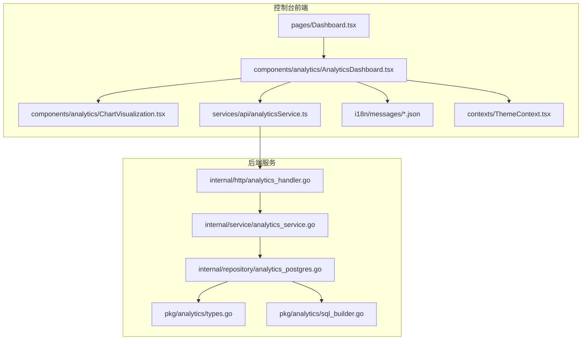
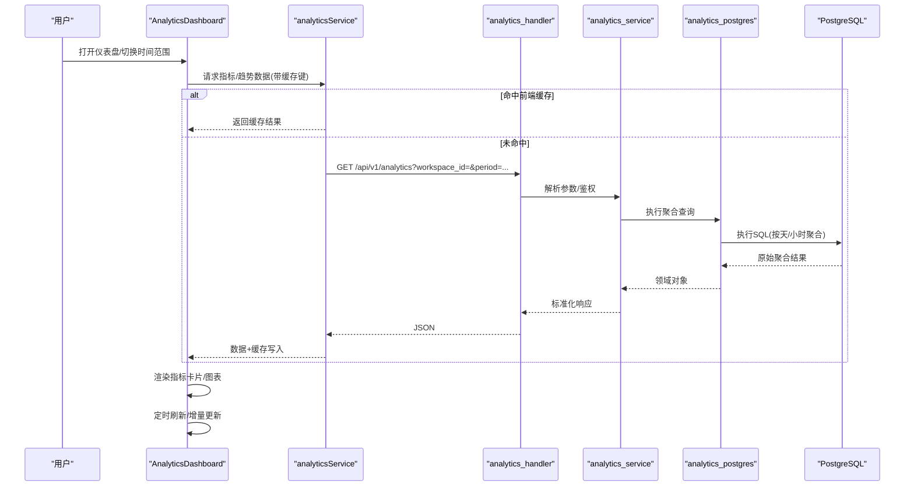
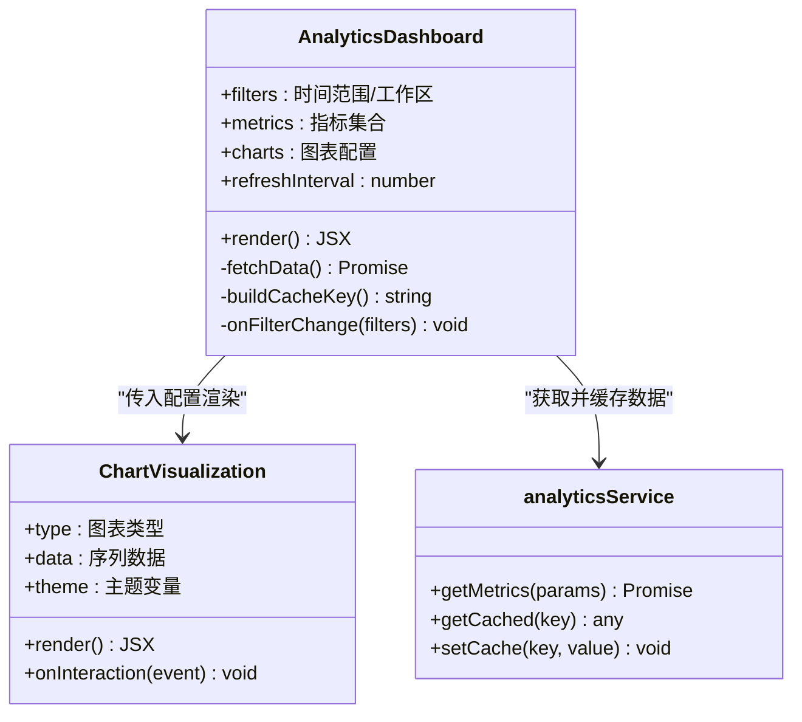
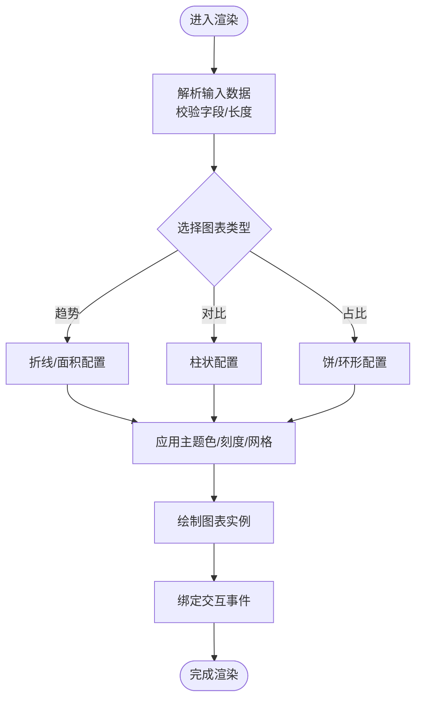
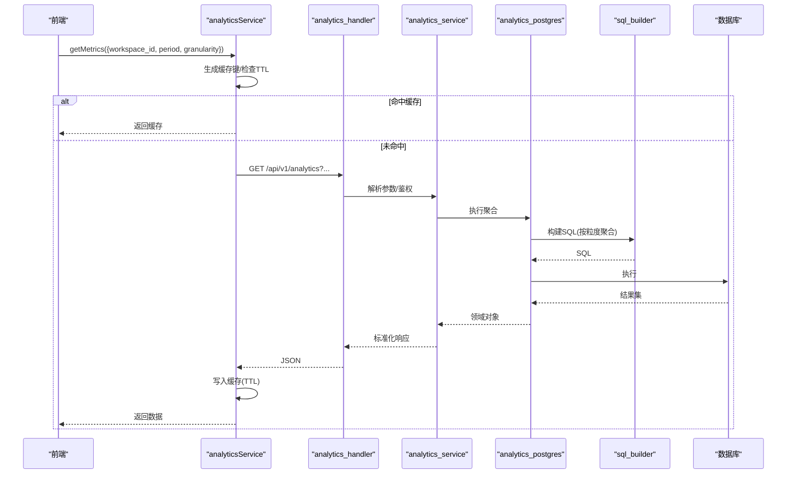
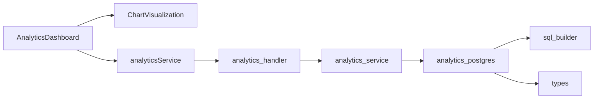

# 仪表盘页面

<cite>
**本文引用的文件**   
- [console/src/pages/Dashboard.tsx](file://notifuse/console/src/pages/Dashboard.tsx)
- [console/src/components/analytics/AnalyticsDashboard.tsx](file://notifuse/console/src/components/analytics/AnalyticsDashboard.tsx)
- [console/src/components/analytics/ChartVisualization.tsx](file://notifuse/console/src/components/analytics/ChartVisualization.tsx)
- [console/src/services/api/analyticsService.ts](file://notifuse/console/src/services/api/analyticsService.ts)
- [internal/http/analytics_handler.go](file://notifuse/internal/http/analytics_handler.go)
- [internal/service/analytics_service.go](file://notifuse/internal/service/analytics_service.go)
- [internal/repository/analytics_postgres.go](file://notifuse/internal/repository/analytics_postgres.go)
- [pkg/analytics/types.go](file://notifuse/pkg/analytics/types.go)
- [pkg/analytics/sql_builder.go](file://notifuse/pkg/analytics/sql_builder.go)
- [console/src/i18n/messages/en.json](file://notifuse/console/src/i18n/messages/en.json)
- [console/src/i18n/messages/zh.json](file://notifuse/console/src/i18n/messages/zh.json)
- [console/src/contexts/ThemeContext.tsx](file://notifuse/console/src/contexts/ThemeContext.tsx)
</cite>

## 目录
1. [简介](#简介)
2. [项目结构](#项目结构)
3. [核心组件](#核心组件)
4. [架构总览](#架构总览)
5. [详细组件分析](#详细组件分析)
6. [依赖关系分析](#依赖关系分析)
7. [性能考量](#性能考量)
8. [故障排查指南](#故障排查指南)
9. [结论](#结论)
10. [附录](#附录)

## 简介
本文件面向 Notifuse 控制台“仪表盘”页面，系统性梳理数据展示架构与实现细节。重点覆盖：
- 关键指标卡片、趋势图表的布局与渲染机制
- 实时数据更新策略（轮询/增量刷新）
- AnalyticsDashboard 组件布局设计
- ChartVisualization 图表组件的渲染逻辑与类型选择
- 数据获取与缓存策略（前端缓存、后端缓存、数据库聚合）
- 性能指标计算方式与可视化最佳实践
- 响应式适配、主题切换与国际化支持
- 大数据量处理与交互体验优化方案

## 项目结构
控制台前端位于 notifuse/console/src，仪表盘相关代码主要分布在 pages、components/analytics、services/api、i18n、contexts 等目录；后端服务位于 internal 与 pkg 目录，提供分析数据的 HTTP 接口与查询能力。

图示来源
- [console/src/pages/Dashboard.tsx](file://notifuse/console/src/pages/Dashboard.tsx)
- [console/src/components/analytics/AnalyticsDashboard.tsx](file://notifuse/console/src/components/analytics/AnalyticsDashboard.tsx)
- [console/src/components/analytics/ChartVisualization.tsx](file://notifuse/console/src/components/analytics/ChartVisualization.tsx)
- [console/src/services/api/analyticsService.ts](file://notifuse/console/src/services/api/analyticsService.ts)
- [internal/http/analytics_handler.go](file://notifuse/internal/http/analytics_handler.go)
- [internal/service/analytics_service.go](file://notifuse/internal/service/analytics_service.go)
- [internal/repository/analytics_postgres.go](file://notifuse/internal/repository/analytics_postgres.go)
- [pkg/analytics/types.go](file://notifuse/pkg/analytics/types.go)
- [pkg/analytics/sql_builder.go](file://notifuse/pkg/analytics/sql_builder.go)
- [console/src/i18n/messages/en.json](file://notifuse/console/src/i18n/messages/en.json)
- [console/src/i18n/messages/zh.json](file://notifuse/console/src/i18n/messages/zh.json)
- [console/src/contexts/ThemeContext.tsx](file://notifuse/console/src/contexts/ThemeContext.tsx)

章节来源
- [console/src/pages/Dashboard.tsx](file://notifuse/console/src/pages/Dashboard.tsx)
- [console/src/components/analytics/AnalyticsDashboard.tsx](file://notifuse/console/src/components/analytics/AnalyticsDashboard.tsx)
- [console/src/components/analytics/ChartVisualization.tsx](file://notifuse/console/src/components/analytics/ChartVisualization.tsx)
- [console/src/services/api/analyticsService.ts](file://notifuse/console/src/services/api/analyticsService.ts)
- [internal/http/analytics_handler.go](file://notifuse/internal/http/analytics_handler.go)
- [internal/service/analytics_service.go](file://notifuse/internal/service/analytics_service.go)
- [internal/repository/analytics_postgres.go](file://notifuse/internal/repository/analytics_postgres.go)
- [pkg/analytics/types.go](file://notifuse/pkg/analytics/types.go)
- [pkg/analytics/sql_builder.go](file://notifuse/pkg/analytics/sql_builder.go)
- [console/src/i18n/messages/en.json](file://notifuse/console/src/i18n/messages/en.json)
- [console/src/i18n/messages/zh.json](file://notifuse/console/src/i18n/messages/zh.json)
- [console/src/contexts/ThemeContext.tsx](file://notifuse/console/src/contexts/ThemeContext.tsx)

## 核心组件
- Dashboard 页面入口：负责路由挂载、全局加载状态与错误边界，调用 AnalyticsDashboard 完成主体渲染。
- AnalyticsDashboard：组织关键指标卡片与图表区域，管理时间范围、工作区过滤、刷新策略与本地缓存键。
- ChartVisualization：通用图表渲染器，根据配置决定图表类型（折线、柱状、面积、饼图等），统一处理主题色、坐标轴、提示框与交互事件。
- analyticsService：封装对后端分析接口的请求、参数校验、重试与缓存键生成。
- 后端分析链路：HTTP 处理器 -> 业务服务 -> 仓库层 -> SQL 构建器 -> 数据库。

章节来源
- [console/src/pages/Dashboard.tsx](file://notifuse/console/src/pages/Dashboard.tsx)
- [console/src/components/analytics/AnalyticsDashboard.tsx](file://notifuse/console/src/components/analytics/AnalyticsDashboard.tsx)
- [console/src/components/analytics/ChartVisualization.tsx](file://notifuse/console/src/components/analytics/ChartVisualization.tsx)
- [console/src/services/api/analyticsService.ts](file://notifuse/console/src/services/api/analyticsService.ts)
- [internal/http/analytics_handler.go](file://notifuse/internal/http/analytics_handler.go)
- [internal/service/analytics_service.go](file://notifuse/internal/service/analytics_service.go)
- [internal/repository/analytics_postgres.go](file://notifuse/internal/repository/analytics_postgres.go)
- [pkg/analytics/types.go](file://notifuse/pkg/analytics/types.go)
- [pkg/analytics/sql_builder.go](file://notifuse/pkg/analytics/sql_builder.go)

## 架构总览
仪表盘的数据流遵循“前端组件 -> API 服务 -> 后端处理器 -> 业务服务 -> 仓库 -> SQL 构建 -> 数据库”的分层模型，并在前后端均引入缓存与聚合以保障性能。

图示来源
- [console/src/components/analytics/AnalyticsDashboard.tsx](file://notifuse/console/src/components/analytics/AnalyticsDashboard.tsx)
- [console/src/services/api/analyticsService.ts](file://notifuse/console/src/services/api/analyticsService.ts)
- [internal/http/analytics_handler.go](file://notifuse/internal/http/analytics_handler.go)
- [internal/service/analytics_service.go](file://notifuse/internal/service/analytics_service.go)
- [internal/repository/analytics_postgres.go](file://notifuse/internal/repository/analytics_postgres.go)
- [pkg/analytics/types.go](file://notifuse/pkg/analytics/types.go)
- [pkg/analytics/sql_builder.go](file://notifuse/pkg/analytics/sql_builder.go)

## 详细组件分析

### AnalyticsDashboard 组件
职责与特性
- 布局：顶部筛选栏（时间范围、工作区）、关键指标卡片网格、趋势图表区域、底部明细列表或导出入口。
- 数据流：集中发起数据请求，合并多源指标，维护本地缓存键（包含 workspace_id、period、granularity、locale）。
- 实时更新：基于定时器或 WebSocket（若启用）进行增量刷新；在窗口失焦时降低频率，恢复时快速拉取。
- 主题与国际化：从 ThemeContext 读取主题变量，使用 i18n 文本替换标签与单位。

图示来源
- [console/src/components/analytics/AnalyticsDashboard.tsx](file://notifuse/console/src/components/analytics/AnalyticsDashboard.tsx)
- [console/src/components/analytics/ChartVisualization.tsx](file://notifuse/console/src/components/analytics/ChartVisualization.tsx)
- [console/src/services/api/analyticsService.ts](file://notifuse/console/src/services/api/analyticsService.ts)

章节来源
- [console/src/components/analytics/AnalyticsDashboard.tsx](file://notifuse/console/src/components/analytics/AnalyticsDashboard.tsx)
- [console/src/contexts/ThemeContext.tsx](file://notifuse/console/src/contexts/ThemeContext.tsx)
- [console/src/i18n/messages/en.json](file://notifuse/console/src/i18n/messages/en.json)
- [console/src/i18n/messages/zh.json](file://notifuse/console/src/i18n/messages/zh.json)

### ChartVisualization 图表组件
职责与特性
- 图表类型：折线图（趋势）、柱状图（对比）、面积图（累积）、饼/环形图（占比）。
- 渲染逻辑：接收统一数据结构（时间戳数组、系列值数组、标签映射），根据主题动态配色，自动缩放坐标轴与格式化数值。
- 交互：悬停提示、点击钻取、缩放/平移、导出图片。
- 性能：大数据量下启用采样/降采样、按需渲染、虚拟滚动（长列表场景）。

图示来源
- [console/src/components/analytics/ChartVisualization.tsx](file://notifuse/console/src/components/analytics/ChartVisualization.tsx)

章节来源
- [console/src/components/analytics/ChartVisualization.tsx](file://notifuse/console/src/components/analytics/ChartVisualization.tsx)

### 数据获取与缓存策略
前端
- 请求封装：analyticsService 统一处理 URL 拼接、参数校验、错误码映射与重试。
- 缓存键：由 workspace_id、period、granularity、locale 等维度组合生成，避免重复请求。
- 失效策略：时间范围变化、过滤器变更、手动刷新触发失效；可设置 TTL 过期。

后端
- 处理器：analytics_handler 解析查询参数、鉴权、限流，委托 analytics_service。
- 业务服务：analytics_service 组装查询条件、调用仓库层、转换领域模型。
- 仓库层：analytics_postgres 执行 SQL，结合 sql_builder 动态拼装聚合语句。
- 缓存：可在服务层或数据库视图层做短期缓存（如最近 N 分钟热点指标）。

图示来源
- [console/src/services/api/analyticsService.ts](file://notifuse/console/src/services/api/analyticsService.ts)
- [internal/http/analytics_handler.go](file://notifuse/internal/http/analytics_handler.go)
- [internal/service/analytics_service.go](file://notifuse/internal/service/analytics_service.go)
- [internal/repository/analytics_postgres.go](file://notifuse/internal/repository/analytics_postgres.go)
- [pkg/analytics/sql_builder.go](file://notifuse/pkg/analytics/sql_builder.go)

章节来源
- [console/src/services/api/analyticsService.ts](file://notifuse/console/src/services/api/analyticsService.ts)
- [internal/http/analytics_handler.go](file://notifuse/internal/http/analytics_handler.go)
- [internal/service/analytics_service.go](file://notifuse/internal/service/analytics_service.go)
- [internal/repository/analytics_postgres.go](file://notifuse/internal/repository/analytics_postgres.go)
- [pkg/analytics/sql_builder.go](file://notifuse/pkg/analytics/sql_builder.go)

### 性能指标计算与图表类型选择
- 指标定义：发送数、送达率、打开率、点击率、退订率、硬/软退回率等，均以时间段内计数与比率计算。
- 计算方式：
  - 比率 = 子事件计数 / 基准事件计数（如点击/送达）
  - 累计与移动平均用于平滑波动
  - 分位数（P95/P99）用于延迟类指标
- 图表类型选择：
  - 趋势：折线/面积（时间序列）
  - 对比：柱状（类别/渠道对比）
  - 构成：饼/环形（占比）
  - 分布：直方图/箱线图（可选）
- 可视化最佳实践：
  - 合理的时间粒度（日/小时）与采样阈值
  - 颜色语义化与无障碍对比度
  - 空态与异常态占位
  - 工具提示显示精确值与单位

章节来源
- [pkg/analytics/types.go](file://notifuse/pkg/analytics/types.go)
- [pkg/analytics/sql_builder.go](file://notifuse/pkg/analytics/sql_builder.go)
- [internal/service/analytics_service.go](file://notifuse/internal/service/analytics_service.go)

### 响应式适配、主题切换与国际化
- 响应式：采用栅格与弹性布局，在小屏设备自动折叠卡片与图表为单列；图表容器监听尺寸变化自适应重绘。
- 主题切换：通过 ThemeContext 暴露主题变量（主色、背景、文字、边框），图表组件订阅主题变化并更新配色与样式。
- 国际化：i18n 资源文件按语言拆分，组件侧使用翻译函数替换标签、单位与提示信息；支持运行时切换语言并即时生效。

章节来源
- [console/src/contexts/ThemeContext.tsx](file://notifuse/console/src/contexts/ThemeContext.tsx)
- [console/src/i18n/messages/en.json](file://notifuse/console/src/i18n/messages/en.json)
- [console/src/i18n/messages/zh.json](file://notifuse/console/src/i18n/messages/zh.json)

## 依赖关系分析
- 组件耦合：
  - AnalyticsDashboard 依赖 ChartVisualization 与 analyticsService，低耦合高内聚。
  - ChartVisualization 仅消费统一数据契约，便于扩展新图表类型。
- 外部依赖：
  - 前端：UI 库、图表库、i18n 库、主题上下文。
  - 后端：HTTP 框架、数据库驱动、SQL 构建器。
- 潜在循环依赖：当前分层清晰，未见循环引用。

图示来源
- [console/src/components/analytics/AnalyticsDashboard.tsx](file://notifuse/console/src/components/analytics/AnalyticsDashboard.tsx)
- [console/src/components/analytics/ChartVisualization.tsx](file://notifuse/console/src/components/analytics/ChartVisualization.tsx)
- [console/src/services/api/analyticsService.ts](file://notifuse/console/src/services/api/analyticsService.ts)
- [internal/http/analytics_handler.go](file://notifuse/internal/http/analytics_handler.go)
- [internal/service/analytics_service.go](file://notifuse/internal/service/analytics_service.go)
- [internal/repository/analytics_postgres.go](file://notifuse/internal/repository/analytics_postgres.go)
- [pkg/analytics/types.go](file://notifuse/pkg/analytics/types.go)
- [pkg/analytics/sql_builder.go](file://notifuse/pkg/analytics/sql_builder.go)

章节来源
- [console/src/components/analytics/AnalyticsDashboard.tsx](file://notifuse/console/src/components/analytics/AnalyticsDashboard.tsx)
- [console/src/components/analytics/ChartVisualization.tsx](file://notifuse/console/src/components/analytics/ChartVisualization.tsx)
- [console/src/services/api/analyticsService.ts](file://notifuse/console/src/services/api/analyticsService.ts)
- [internal/http/analytics_handler.go](file://notifuse/internal/http/analytics_handler.go)
- [internal/service/analytics_service.go](file://notifuse/internal/service/analytics_service.go)
- [internal/repository/analytics_postgres.go](file://notifuse/internal/repository/analytics_postgres.go)
- [pkg/analytics/types.go](file://notifuse/pkg/analytics/types.go)
- [pkg/analytics/sql_builder.go](file://notifuse/pkg/analytics/sql_builder.go)

## 性能考量
- 前端优化
  - 请求去抖与节流：筛选器变更时使用防抖，减少频繁请求。
  - 增量更新：仅拉取新增时间片数据，合并到现有数据集。
  - 大数据量渲染：启用采样/降采样、懒加载、分页/虚拟滚动。
  - 图表优化：禁用不必要的动画、按需重绘、共享坐标系。
- 后端优化
  - 预聚合：按小时/天物化视图或汇总表，缩短查询路径。
  - 索引优化：针对时间戳、工作区 ID、事件类型建立复合索引。
  - 缓存策略：热点指标短 TTL 缓存，跨请求复用。
  - 限流与降级：高峰期限制粒度或返回近似值。
- 网络与传输
  - 压缩与分页：大响应体启用 gzip，必要时分页返回。
  - 断网重试与指数退避：提升稳定性。

[本节为通用指导，不直接分析具体文件]

## 故障排查指南
- 常见问题
  - 数据为空：检查时间范围与工作区过滤是否正确；确认后端权限与租户隔离。
  - 图表闪烁：检查是否频繁重建实例；确保只更新必要属性。
  - 国际化缺失：确认对应语言包已加载且 key 存在。
  - 主题不生效：确认 ThemeContext 已正确包裹并提供变量。
- 定位步骤
  - 前端：查看网络面板请求参数与响应结构；检查缓存键是否稳定。
  - 后端：核对处理器日志、SQL 构建输出与执行计划；验证聚合口径。
  - 数据库：检查索引命中率与慢查询日志。

章节来源
- [console/src/services/api/analyticsService.ts](file://notifuse/console/src/services/api/analyticsService.ts)
- [internal/http/analytics_handler.go](file://notifuse/internal/http/analytics_handler.go)
- [internal/service/analytics_service.go](file://notifuse/internal/service/analytics_service.go)
- [internal/repository/analytics_postgres.go](file://notifuse/internal/repository/analytics_postgres.go)
- [pkg/analytics/sql_builder.go](file://notifuse/pkg/analytics/sql_builder.go)

## 结论
仪表盘通过清晰的组件分层与前后端协作，实现了高性能、可扩展的分析数据展示。借助统一的图表渲染器、完善的缓存与聚合策略，以及响应式、主题与国际化支持，能够满足复杂监控与分析场景的需求。后续可进一步引入增量同步、更细粒度的缓存控制与更丰富的图表类型，以提升用户体验与系统吞吐。

[本节为总结性内容，不直接分析具体文件]

## 附录
- 术语
  - 时间粒度：日/小时/分钟等聚合周期
  - 工作区：租户/组织级隔离单元
  - 指标：发送数、送达率、打开率、点击率、退订率等
- 参考实现路径
  - 前端组件与 API 服务：见“核心组件”与“数据获取与缓存策略”
  - 后端聚合与 SQL 构建：见“依赖关系分析”

[本节为补充信息，不直接分析具体文件]