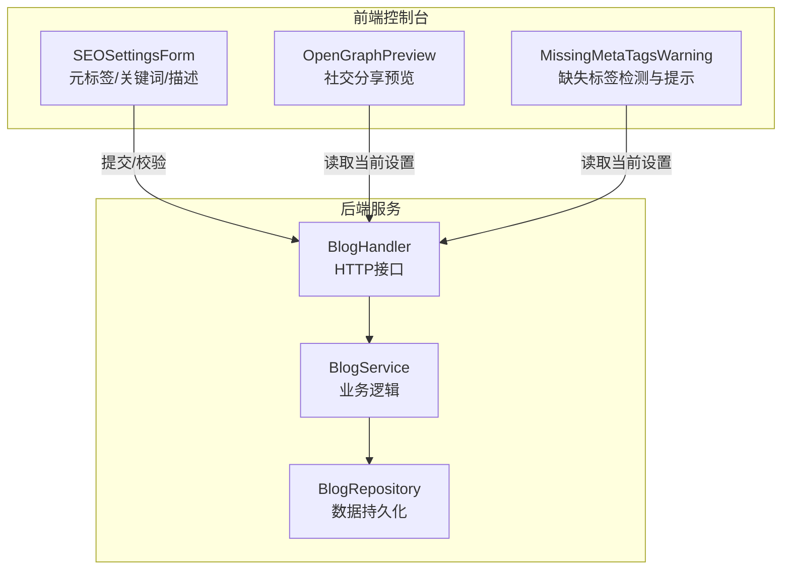
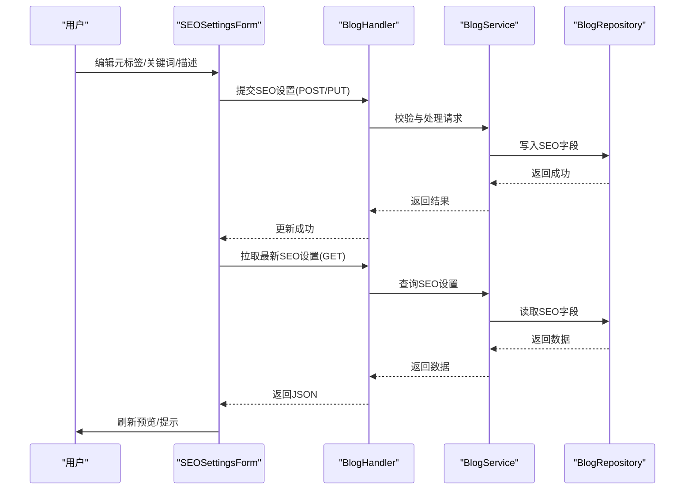
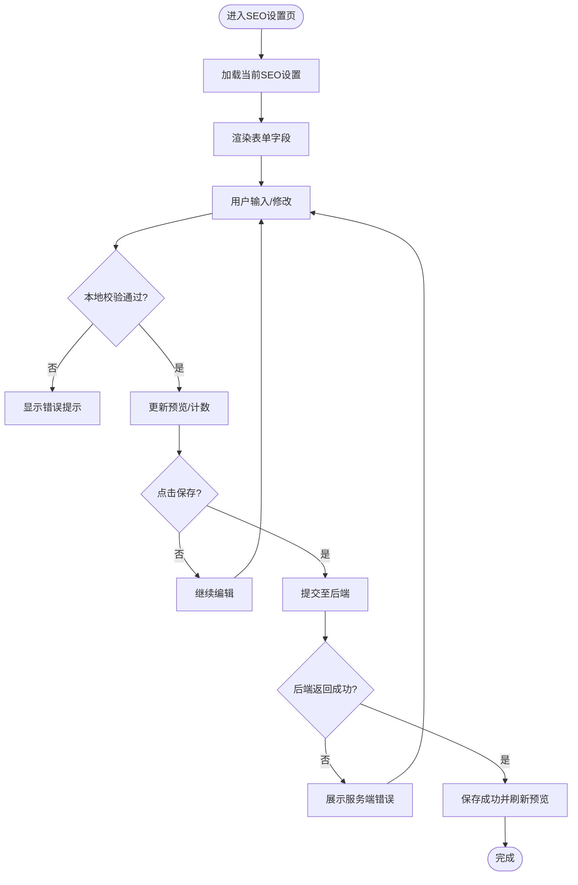
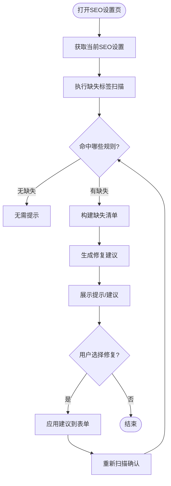
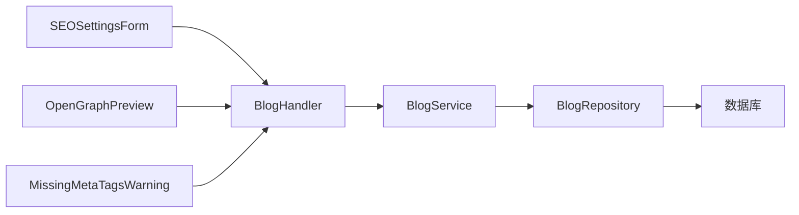

# SEO设置管理

<cite>
**本文引用的文件**   
- [console/src/components/blog/SEOSettingsForm.tsx](file://notifuse/console/src/components/blog/SEOSettingsForm.tsx)
- [console/src/components/blog/OpenGraphPreview.tsx](file://notifuse/console/src/components/blog/OpenGraphPreview.tsx)
- [console/src/components/blog/MissingMetaTagsWarning.tsx](file://notifuse/console/src/components/blog/MissingMetaTagsWarning.tsx)
- [notifuse/internal/domain/blog.go](file://notifuse/internal/domain/blog.go)
- [notifuse/internal/service/blog_service.go](file://notifuse/internal/service/blog_service.go)
- [notifuse/internal/http/blog_handler.go](file://notifuse/internal/http/blog_handler.go)
- [notifuse/internal/repository/blog_postgres.go](file://notifuse/internal/repository/blog_postgres.go)
</cite>

## 目录
1. [简介](#简介)
2. [项目结构](#项目结构)
3. [核心组件](#核心组件)
4. [架构总览](#架构总览)
5. [详细组件分析](#详细组件分析)
6. [依赖关系分析](#依赖关系分析)
7. [性能考虑](#性能考虑)
8. [故障排查指南](#故障排查指南)
9. [结论](#结论)
10. [附录](#附录)

## 简介
本文件面向博客SEO设置管理功能，聚焦以下目标：
- 深入解析SEOSettingsForm表单组件的实现，包括元标签编辑、关键词设置与描述优化。
- 详细说明OpenGraphPreview社交分享预览功能的实时渲染与响应式设计。
- 解释MissingMetaTagsWarning缺失标签检测算法与用户提示机制。
- 提供搜索引擎优化最佳实践、社交媒体分享配置与SEO分析指标建议。
- 给出SEO自动化检查与批量优化方案。

## 项目结构
该功能由前端控制台（React/TypeScript）与后端服务（Go）共同实现：
- 前端控制台位于 console/src/components/blog 下，包含SEO表单、OG预览与缺失标签警告等UI组件。
- 后端领域模型与服务逻辑位于 internal/domain 与 internal/service 层，HTTP处理器与数据库访问分别位于 internal/http 与 internal/repository。



图表来源
- [console/src/components/blog/SEOSettingsForm.tsx](file://notifuse/console/src/components/blog/SEOSettingsForm.tsx)
- [console/src/components/blog/OpenGraphPreview.tsx](file://notifuse/console/src/components/blog/OpenGraphPreview.tsx)
- [console/src/components/blog/MissingMetaTagsWarning.tsx](file://notifuse/console/src/components/blog/MissingMetaTagsWarning.tsx)
- [notifuse/internal/http/blog_handler.go](file://notifuse/internal/http/blog_handler.go)
- [notifuse/internal/service/blog_service.go](file://notifuse/internal/service/blog_service.go)
- [notifuse/internal/repository/blog_postgres.go](file://notifuse/internal/repository/blog_postgres.go)

章节来源
- [console/src/components/blog/SEOSettingsForm.tsx](file://notifuse/console/src/components/blog/SEOSettingsForm.tsx)
- [console/src/components/blog/OpenGraphPreview.tsx](file://notifuse/console/src/components/blog/OpenGraphPreview.tsx)
- [console/src/components/blog/MissingMetaTagsWarning.tsx](file://notifuse/console/src/components/blog/MissingMetaTagsWarning.tsx)
- [notifuse/internal/http/blog_handler.go](file://notifuse/internal/http/blog_handler.go)
- [notifuse/internal/service/blog_service.go](file://notifuse/internal/service/blog_service.go)
- [notifuse/internal/repository/blog_postgres.go](file://notifuse/internal/repository/blog_postgres.go)

## 核心组件
- SEOSettingsForm：负责元标签（title、description、canonical）、关键词（keywords）与描述优化的输入、校验与保存。
- OpenGraphPreview：根据当前SEO设置实时渲染社交平台分享卡片（如标题、描述、封面图），并适配不同屏幕尺寸。
- MissingMetaTagsWarning：对当前页面或文章的元标签进行扫描，识别缺失项并向用户发出提示。

章节来源
- [console/src/components/blog/SEOSettingsForm.tsx](file://notifuse/console/src/components/blog/SEOSettingsForm.tsx)
- [console/src/components/blog/OpenGraphPreview.tsx](file://notifuse/console/src/components/blog/OpenGraphPreview.tsx)
- [console/src/components/blog/MissingMetaTagsWarning.tsx](file://notifuse/console/src/components/blog/MissingMetaTagsWarning.tsx)

## 架构总览
前后端交互流程如下：
- 用户在SEOSettingsForm中编辑元标签、关键词与描述。
- 前端调用后端API更新博客SEO设置；后端通过BlogService执行业务规则，再由BlogRepository持久化到数据库。
- OpenGraphPreview从后端获取当前SEO设置，实时渲染预览。
- MissingMetaTagsWarning基于当前SEO设置与页面上下文，检测缺失的元标签并提示用户。



图表来源
- [notifuse/internal/http/blog_handler.go](file://notifuse/internal/http/blog_handler.go)
- [notifuse/internal/service/blog_service.go](file://notifuse/internal/service/blog_service.go)
- [notifuse/internal/repository/blog_postgres.go](file://notifuse/internal/repository/blog_postgres.go)

## 详细组件分析

### SEOSettingsForm 表单组件
职责与能力
- 元标签编辑：支持标题、描述、规范链接等字段的输入与校验。
- 关键词设置：提供关键词输入与格式校验。
- 描述优化：结合字符长度限制与可读性提示，辅助生成更友好的描述。
- 实时反馈：在输入过程中即时显示长度统计与建议。
- 保存与回滚：提交前进行本地校验，失败时保留已填内容并提示错误。

关键实现要点
- 状态管理：使用受控组件维护表单值，避免不必要的重渲染。
- 校验策略：必填项、长度范围、URL合法性等规则在前端快速反馈，同时后端再次校验确保一致性。
- 防抖与节流：对高频输入事件进行防抖，减少预览与校验开销。
- 国际化：文案与提示支持多语言切换。



图表来源
- [console/src/components/blog/SEOSettingsForm.tsx](file://notifuse/console/src/components/blog/SEOSettingsForm.tsx)

章节来源
- [console/src/components/blog/SEOSettingsForm.tsx](file://notifuse/console/src/components/blog/SEOSettingsForm.tsx)

### OpenGraphPreview 社交分享预览
职责与能力
- 实时渲染：根据当前SEO设置动态生成分享卡片（标题、描述、封面图）。
- 响应式布局：适配桌面与移动端预览窗口，保持信息层次清晰。
- 图片占位与容错：当缺少封面图时显示默认占位，避免布局崩坏。
- 平台差异提示：针对常见社交平台（如微信、微博、Facebook、Twitter）的差异给出提示。

关键实现要点
- 数据绑定：直接订阅SEO设置状态变化，触发重新渲染。
- 样式策略：使用弹性布局与媒体查询，保证在不同视口下的可读性。
- 资源加载：对图片进行懒加载与错误边界处理，提升体验与稳定性。

```mermaid
classDiagram
class OpenGraphPreview {
+props : { title, description, image }
+render() JSX
-handleImageError() void
-formatText(text) string
}
class SEOSettingsForm {
+state : { title, description, image }
+onSave() void
}
OpenGraphPreview <-- SEOSettingsForm : "接收SEO数据"
```

图表来源
- [console/src/components/blog/OpenGraphPreview.tsx](file://notifuse/console/src/components/blog/OpenGraphPreview.tsx)
- [console/src/components/blog/SEOSettingsForm.tsx](file://notifuse/console/src/components/blog/SEOSettingsForm.tsx)

章节来源
- [console/src/components/blog/OpenGraphPreview.tsx](file://notifuse/console/src/components/blog/OpenGraphPreview.tsx)

### MissingMetaTagsWarning 缺失标签检测与提示
职责与能力
- 检测算法：基于当前SEO设置与页面上下文，判断必要元标签是否缺失（如标题、描述、规范链接、OG标签等）。
- 用户提示：以非阻塞方式向用户展示缺失项清单与修复建议。
- 自动补全建议：对可推断的字段（如从标题生成简短描述）提供一键填充选项。

关键实现要点
- 规则引擎：将缺失检测规则抽象为可配置列表，便于扩展与维护。
- 低侵入提示：采用轻量级通知组件，避免打断用户操作流。
- 性能优化：仅在SEO设置变更时重新计算，避免频繁扫描。



图表来源
- [console/src/components/blog/MissingMetaTagsWarning.tsx](file://notifuse/console/src/components/blog/MissingMetaTagsWarning.tsx)

章节来源
- [console/src/components/blog/MissingMetaTagsWarning.tsx](file://notifuse/console/src/components/blog/MissingMetaTagsWarning.tsx)

## 依赖关系分析
- 前端组件依赖：
  - SEOSettingsForm 依赖 OpenGraphPreview 与 MissingMetaTagsWarning 的状态与提示能力。
  - OpenGraphPreview 依赖当前SEO设置数据源。
  - MissingMetaTagsWarning 依赖SEO设置与规则配置。
- 后端依赖链：
  - BlogHandler 暴露HTTP接口，委托给 BlogService。
  - BlogService 封装业务规则与校验，调用 BlogRepository 进行持久化。
  - BlogRepository 与数据库交互，读写博客SEO相关字段。



图表来源
- [notifuse/internal/http/blog_handler.go](file://notifuse/internal/http/blog_handler.go)
- [notifuse/internal/service/blog_service.go](file://notifuse/internal/service/blog_service.go)
- [notifuse/internal/repository/blog_postgres.go](file://notifuse/internal/repository/blog_postgres.go)

章节来源
- [notifuse/internal/domain/blog.go](file://notifuse/internal/domain/blog.go)
- [notifuse/internal/service/blog_service.go](file://notifuse/internal/service/blog_service.go)
- [notifuse/internal/http/blog_handler.go](file://notifuse/internal/http/blog_handler.go)
- [notifuse/internal/repository/blog_postgres.go](file://notifuse/internal/repository/blog_postgres.go)

## 性能考虑
- 前端
  - 使用受控组件与最小化状态更新，避免不必要的重渲染。
  - 对输入事件进行防抖，降低预览与校验的计算压力。
  - 图片懒加载与错误边界，防止大图或失效资源影响性能。
- 后端
  - 在BlogService中对SEO字段进行增量更新，减少冗余写入。
  - 对高频读取场景引入缓存（如最近一次SEO设置），降低数据库压力。
  - 校验逻辑尽量前置，尽早返回错误，避免深层处理。

[本节为通用性能指导，不直接分析具体文件]

## 故障排查指南
常见问题与定位步骤
- 保存失败
  - 检查前端本地校验是否通过，查看控制台错误信息。
  - 核对后端返回的错误码与消息，定位是否为必填项缺失或格式错误。
  - 查看后端日志，确认BlogService与BlogRepository的调用链路是否正常。
- 预览不更新
  - 确认SEO设置状态是否正确传递到OpenGraphPreview。
  - 检查图片资源是否可用，是否存在跨域或路径问题。
- 缺失标签提示不准确
  - 审查MissingMetaTagsWarning的规则配置，确认是否覆盖所有必要标签。
  - 验证SEO设置数据源是否与后端一致，必要时刷新页面后重试。

章节来源
- [notifuse/internal/http/blog_handler.go](file://notifuse/internal/http/blog_handler.go)
- [notifuse/internal/service/blog_service.go](file://notifuse/internal/service/blog_service.go)
- [notifuse/internal/repository/blog_postgres.go](file://notifuse/internal/repository/blog_postgres.go)

## 结论
本SEO设置管理功能通过清晰的组件分层与前后端协作，实现了元标签编辑、社交分享预览与缺失标签检测的核心能力。建议在后续迭代中：
- 完善SEO规则库与自动化建议，提高用户体验。
- 引入SEO评分与分析指标，帮助用户量化优化效果。
- 增加批量优化能力，支持全站或按分类批量调整SEO设置。

[本节为总结性内容，不直接分析具体文件]

## 附录

### 搜索引擎优化最佳实践
- 标题与描述
  - 标题控制在合理长度内，突出核心关键词。
  - 描述简洁明了，准确概括页面内容，提升点击率。
- 结构化与语义
  - 合理使用h1-h6层级，增强可读性与索引效率。
  - 添加规范链接，避免重复内容问题。
- 社交分享
  - 配置OpenGraph与Twitter Card，确保分享卡片信息完整。
  - 选择合适的封面图，尺寸与清晰度符合平台要求。
- 分析与监控
  - 关注搜索排名、点击率、跳出率等指标，持续优化。
  - 定期审计元标签完整性与质量，及时修复问题。

[本节为通用指导，不直接分析具体文件]

### 社交媒体分享配置
- Facebook
  - 配置og:title、og:description、og:image、og:url。
- Twitter
  - 配置twitter:card、twitter:title、twitter:description、twitter:image。
- 微信/微博
  - 遵循各自平台的分享协议，确保标题、描述与图片正确显示。

[本节为通用指导，不直接分析具体文件]

### SEO分析指标
- 曝光与点击
  - 展示量、点击率、平均排名位置。
- 内容质量
  - 页面停留时间、跳出率、转化率。
- 技术健康度
  - 元标签完整性、结构化数据有效性、移动端友好度。

[本节为通用指导，不直接分析具体文件]

### SEO自动化检查与批量优化方案
- 自动化检查
  - 建立定时任务，扫描全站页面的元标签与OG标签，生成报告。
  - 集成CI/CD流水线，在发布前进行SEO合规性检查。
- 批量优化
  - 提供批量导入/导出工具，支持CSV模板批量更新SEO设置。
  - 基于规则引擎自动生成缺失字段建议，一键应用到多个页面。
- 监控与告警
  - 对SEO异常（如大量缺失标签）进行告警，及时干预。
  - 记录变更历史，便于回溯与审计。

[本节为通用指导，不直接分析具体文件]