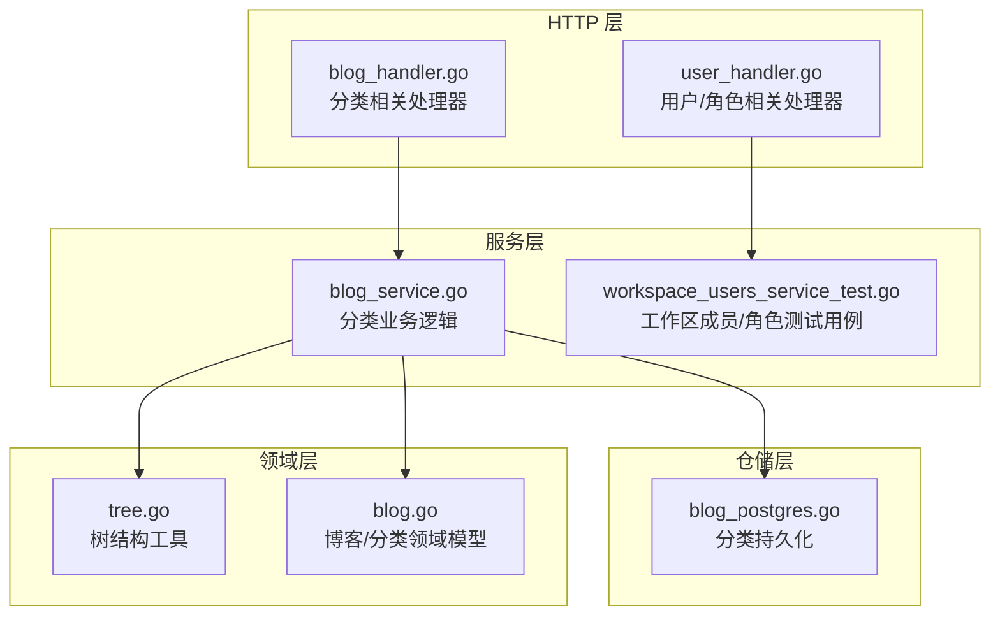
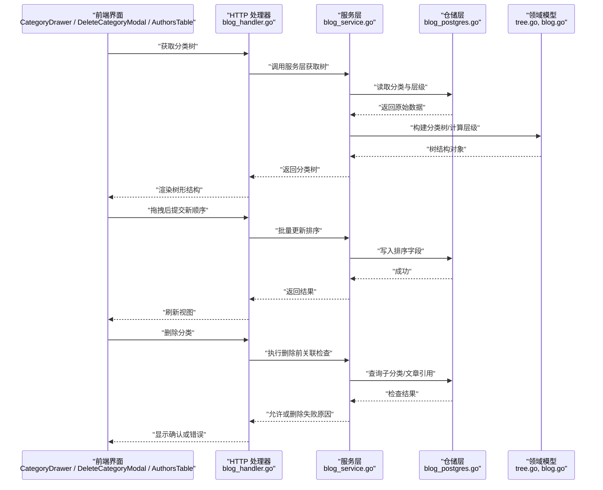
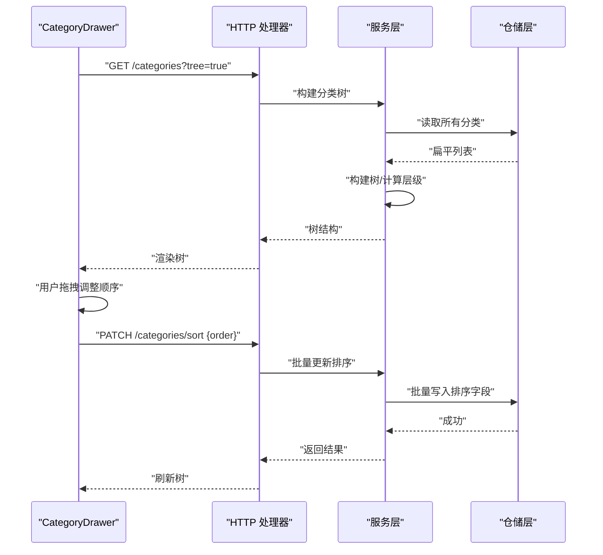
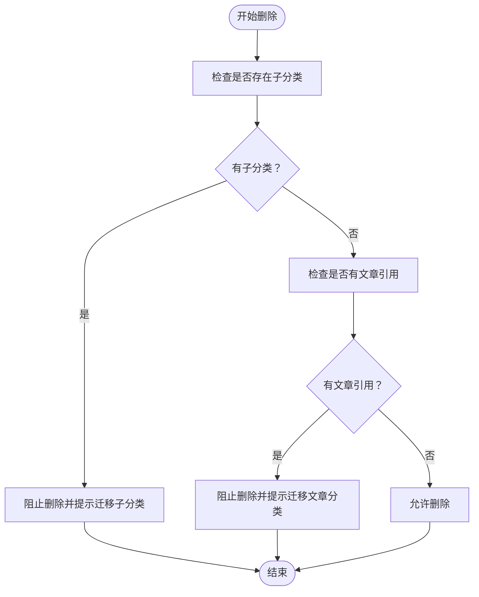
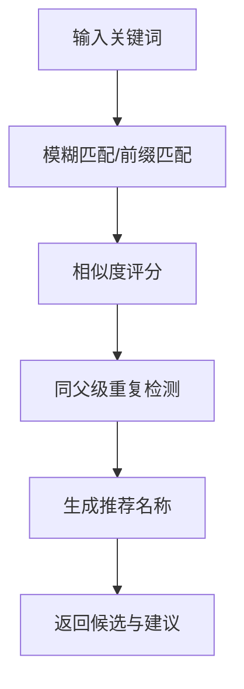
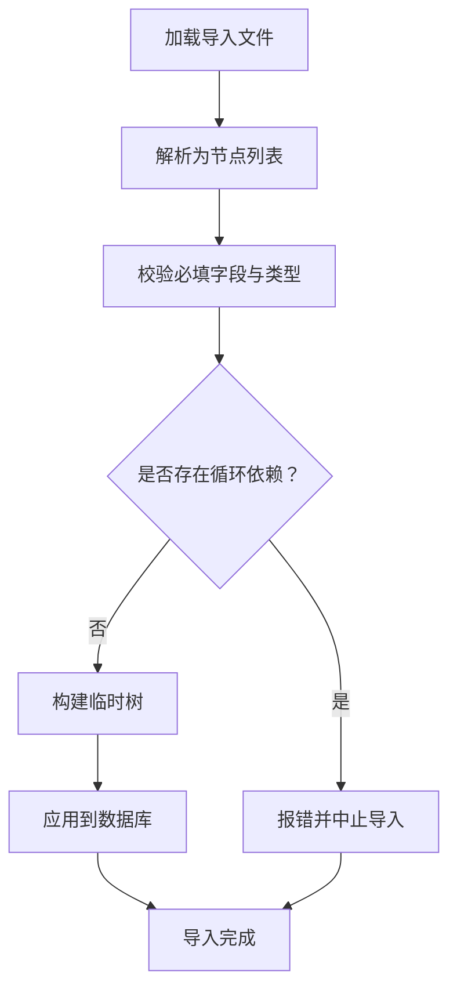
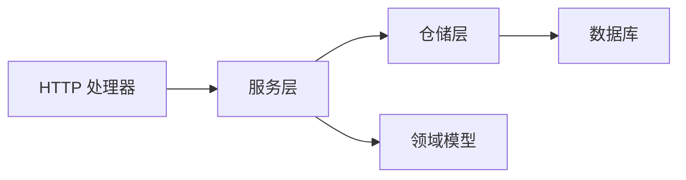

# 分类标签管理

<cite>
**本文引用的文件**   
- [blog_handler.go](file://notifuse/internal/http/blog_handler.go)
- [blog_service.go](file://notifuse/internal/service/blog_service.go)
- [blog_postgres.go](file://notifuse/internal/repository/blog_postgres.go)
- [tree.go](file://notifuse/internal/domain/tree.go)
- [blog.go](file://notifuse/internal/domain/blog.go)
- [workspace_users_service_test.go](file://notifuse/internal/service/workspace_users_service_test.go)
- [user_handler.go](file://notifuse/internal/http/user_handler.go)
</cite>

## 目录
1. [简介](#简介)
2. [项目结构](#项目结构)
3. [核心组件](#核心组件)
4. [架构总览](#架构总览)
5. [详细组件分析](#详细组件分析)
6. [依赖关系分析](#依赖关系分析)
7. [性能考虑](#性能考虑)
8. [故障排查指南](#故障排查指南)
9. [结论](#结论)
10. [附录](#附录)

## 简介
本文件围绕“博客分类标签管理”能力，系统性梳理后端实现与前端交互要点，重点覆盖：
- CategoryDrawer 分类编辑抽屉（树形结构、层级关系、拖拽排序）
- DeleteCategoryModal 删除确认机制与数据关联检查
- AuthorsTable 作者管理表格的权限控制与角色分配
- 分类标签的自动补全、重复检测与智能推荐
- 分类结构的导入导出与批量管理方案

说明：当前仓库未直接包含前端组件源码（如 CategoryDrawer、DeleteCategoryModal、AuthorsTable），本文基于后端 API、领域模型与服务层实现进行映射与指导，确保前后端协作一致。

## 项目结构
与分类标签相关的后端代码主要分布在以下层次：
- HTTP 层：路由与请求处理（分类相关接口）
- 服务层：业务编排、校验与事务边界
- 仓储层：数据库访问与持久化
- 领域层：数据结构与通用算法（如树结构）

图表来源
- [blog_handler.go](file://notifuse/internal/http/blog_handler.go)
- [blog_service.go](file://notifuse/internal/service/blog_service.go)
- [blog_postgres.go](file://notifuse/internal/repository/blog_postgres.go)
- [tree.go](file://notifuse/internal/domain/tree.go)
- [blog.go](file://notifuse/internal/domain/blog.go)
- [user_handler.go](file://notifuse/internal/http/user_handler.go)
- [workspace_users_service_test.go](file://notifuse/internal/service/workspace_users_service_test.go)

章节来源
- [blog_handler.go](file://notifuse/internal/http/blog_handler.go)
- [blog_service.go](file://notifuse/internal/service/blog_service.go)
- [blog_postgres.go](file://notifuse/internal/repository/blog_postgres.go)
- [tree.go](file://notifuse/internal/domain/tree.go)
- [blog.go](file://notifuse/internal/domain/blog.go)
- [user_handler.go](file://notifuse/internal/http/user_handler.go)
- [workspace_users_service_test.go](file://notifuse/internal/service/workspace_users_service_test.go)

## 核心组件
- 分类树与层级关系
  - 使用领域树结构工具维护父子关系与层级深度，支持展开/折叠、路径展示与排序索引更新。
- 分类 CRUD 与排序
  - 提供创建、更新、删除、查询列表与树形结构接口；支持通过拖拽后的新顺序批量更新排序字段。
- 删除保护与关联检查
  - 删除前检查是否存在子分类或文章引用，必要时阻止删除或提示迁移策略。
- 作者管理与权限
  - 通过工作区成员与角色体系控制对分类与文章的读写权限。
- 自动补全、重复检测与智能推荐
  - 基于名称模糊匹配与相似度计算，提供输入建议与去重提示。
- 导入导出与批量管理
  - 支持以结构化格式导出分类树，并允许按模板导入重建结构。

章节来源
- [tree.go](file://notifuse/internal/domain/tree.go)
- [blog.go](file://notifuse/internal/domain/blog.go)
- [blog_service.go](file://notifuse/internal/service/blog_service.go)
- [blog_postgres.go](file://notifuse/internal/repository/blog_postgres.go)
- [blog_handler.go](file://notifuse/internal/http/blog_handler.go)
- [user_handler.go](file://notifuse/internal/http/user_handler.go)
- [workspace_users_service_test.go](file://notifuse/internal/service/workspace_users_service_test.go)

## 架构总览
分类标签管理的端到端流程如下：

图表来源
- [blog_handler.go](file://notifuse/internal/http/blog_handler.go)
- [blog_service.go](file://notifuse/internal/service/blog_service.go)
- [blog_postgres.go](file://notifuse/internal/repository/blog_postgres.go)
- [tree.go](file://notifuse/internal/domain/tree.go)
- [blog.go](file://notifuse/internal/domain/blog.go)

## 详细组件分析

### CategoryDrawer 分类编辑抽屉
- 功能要点
  - 树形展示：根节点与多级子节点，显示层级缩进与路径。
  - 新增/编辑：支持设置父级、名称、描述、排序权重等。
  - 拖拽排序：在客户端维护新的顺序，提交后服务端批量更新排序字段。
  - 自动补全与重复检测：输入时根据已有名称模糊匹配，提示相似项与冲突。
  - 智能推荐：根据常用词根或历史使用频率给出候选名称。
- 关键实现映射
  - 树构建与层级计算：由领域树工具与服务层共同完成。
  - 拖拽排序：前端维护顺序数组，后端批量更新排序字段。
  - 自动补全/重复检测：在服务层进行名称查重与相似度计算。
- 交互时序

图表来源
- [blog_handler.go](file://notifuse/internal/http/blog_handler.go)
- [blog_service.go](file://notifuse/internal/service/blog_service.go)
- [blog_postgres.go](file://notifuse/internal/repository/blog_postgres.go)
- [tree.go](file://notifuse/internal/domain/tree.go)

章节来源
- [blog_handler.go](file://notifuse/internal/http/blog_handler.go)
- [blog_service.go](file://notifuse/internal/service/blog_service.go)
- [blog_postgres.go](file://notifuse/internal/repository/blog_postgres.go)
- [tree.go](file://notifuse/internal/domain/tree.go)

### DeleteCategoryModal 分类删除确认机制
- 删除保护规则
  - 若存在子分类，需先迁移或合并子节点后再删除。
  - 若有文章引用该分类，需提示迁移至其他分类或解除引用。
- 关联检查流程

图表来源
- [blog_service.go](file://notifuse/internal/service/blog_service.go)
- [blog_postgres.go](file://notifuse/internal/repository/blog_postgres.go)
- [blog.go](file://notifuse/internal/domain/blog.go)

章节来源
- [blog_service.go](file://notifuse/internal/service/blog_service.go)
- [blog_postgres.go](file://notifuse/internal/repository/blog_postgres.go)
- [blog.go](file://notifuse/internal/domain/blog.go)

### AuthorsTable 作者管理表格（权限控制与角色分配）
- 权限模型
  - 基于工作区成员与角色体系，控制对分类与文章的访问与编辑权限。
  - 管理员可分配/撤销角色，普通成员仅具备受限操作。
- 典型流程
  - 加载成员列表与角色信息
  - 修改成员角色并提交
  - 权限变更即时生效于后续的分类与文章操作
- 参考实现位置
  - 用户/角色相关处理器与工作区成员服务测试用例用于验证权限行为。

章节来源
- [user_handler.go](file://notifuse/internal/http/user_handler.go)
- [workspace_users_service_test.go](file://notifuse/internal/service/workspace_users_service_test.go)

### 分类标签的自动补全、重复检测与智能推荐
- 自动补全
  - 基于名称前缀或模糊匹配，返回候选列表供选择。
- 重复检测
  - 在同一父级下禁止同名分类；跨父级允许同名但提示风险。
- 智能推荐
  - 结合历史使用频率与常用词根生成建议名称，减少重复与提升一致性。
- 处理流程

图表来源
- [blog_service.go](file://notifuse/internal/service/blog_service.go)
- [blog_postgres.go](file://notifuse/internal/repository/blog_postgres.go)
- [blog.go](file://notifuse/internal/domain/blog.go)

章节来源
- [blog_service.go](file://notifuse/internal/service/blog_service.go)
- [blog_postgres.go](file://notifuse/internal/repository/blog_postgres.go)
- [blog.go](file://notifuse/internal/domain/blog.go)

### 分类结构的导入导出与批量管理
- 导出
  - 将分类树序列化为结构化格式（含 ID、父 ID、名称、排序等）。
- 导入
  - 解析导入文件，校验父子关系与循环依赖，重建分类树。
- 批量操作
  - 批量移动、批量设置父级、批量更新排序等。
- 导入校验流程

图表来源
- [blog_service.go](file://notifuse/internal/service/blog_service.go)
- [blog_postgres.go](file://notifuse/internal/repository/blog_postgres.go)
- [tree.go](file://notifuse/internal/domain/tree.go)

章节来源
- [blog_service.go](file://notifuse/internal/service/blog_service.go)
- [blog_postgres.go](file://notifuse/internal/repository/blog_postgres.go)
- [tree.go](file://notifuse/internal/domain/tree.go)

## 依赖关系分析
- 组件耦合
  - HTTP 处理器依赖服务层，服务层依赖仓储层与领域模型。
  - 树结构与分类模型被多处复用，保证一致性。
- 外部依赖
  - 数据库访问通过仓储层封装，便于替换与测试。
- 潜在循环依赖
  - 领域模型不依赖服务层与仓储层，避免循环。

图表来源
- [blog_handler.go](file://notifuse/internal/http/blog_handler.go)
- [blog_service.go](file://notifuse/internal/service/blog_service.go)
- [blog_postgres.go](file://notifuse/internal/repository/blog_postgres.go)
- [tree.go](file://notifuse/internal/domain/tree.go)
- [blog.go](file://notifuse/internal/domain/blog.go)

章节来源
- [blog_handler.go](file://notifuse/internal/http/blog_handler.go)
- [blog_service.go](file://notifuse/internal/service/blog_service.go)
- [blog_postgres.go](file://notifuse/internal/repository/blog_postgres.go)
- [tree.go](file://notifuse/internal/domain/tree.go)
- [blog.go](file://notifuse/internal/domain/blog.go)

## 性能考虑
- 树构建优化
  - 优先一次性拉取分类列表，在内存中构建树，避免多次往返。
- 排序更新
  - 使用批量更新减少数据库写放大。
- 自动补全
  - 对高频查询建立索引或使用缓存，降低延迟。
- 导入导出
  - 大文件分块处理，避免单次事务过大导致锁竞争。

[本节为通用性能建议，无需具体文件分析]

## 故障排查指南
- 删除失败
  - 检查是否存在子分类或文章引用，查看服务层返回的错误码与消息。
- 排序异常
  - 核对拖拽顺序数组长度与分类数量是否一致，检查批量更新事务是否回滚。
- 自动补全无结果
  - 确认搜索字段索引与模糊匹配策略配置是否正确。
- 导入失败
  - 检查循环依赖、缺失父节点、非法排序值等校验错误。

章节来源
- [blog_service.go](file://notifuse/internal/service/blog_service.go)
- [blog_postgres.go](file://notifuse/internal/repository/blog_postgres.go)

## 结论
通过将分类树、拖拽排序、删除保护、权限控制与导入导出等能力在后端集中实现，并与前端组件（CategoryDrawer、DeleteCategoryModal、AuthorsTable）形成清晰契约，可实现稳定、可扩展的博客分类标签管理体系。建议在后续迭代中持续完善自动补全与智能推荐的准确性，并通过监控与日志提升问题定位效率。

[本节为总结性内容，无需具体文件分析]

## 附录
- 术语
  - 分类树：以父子关系组织的分类集合。
  - 排序权重：决定同级分类显示顺序的数值字段。
  - 智能推荐：基于历史与语义生成的候选名称。
- 扩展建议
  - 增加分类别名与多语言支持。
  - 引入版本化与审计日志，便于回溯变更。

[本节为概念性内容，无需具体文件分析]