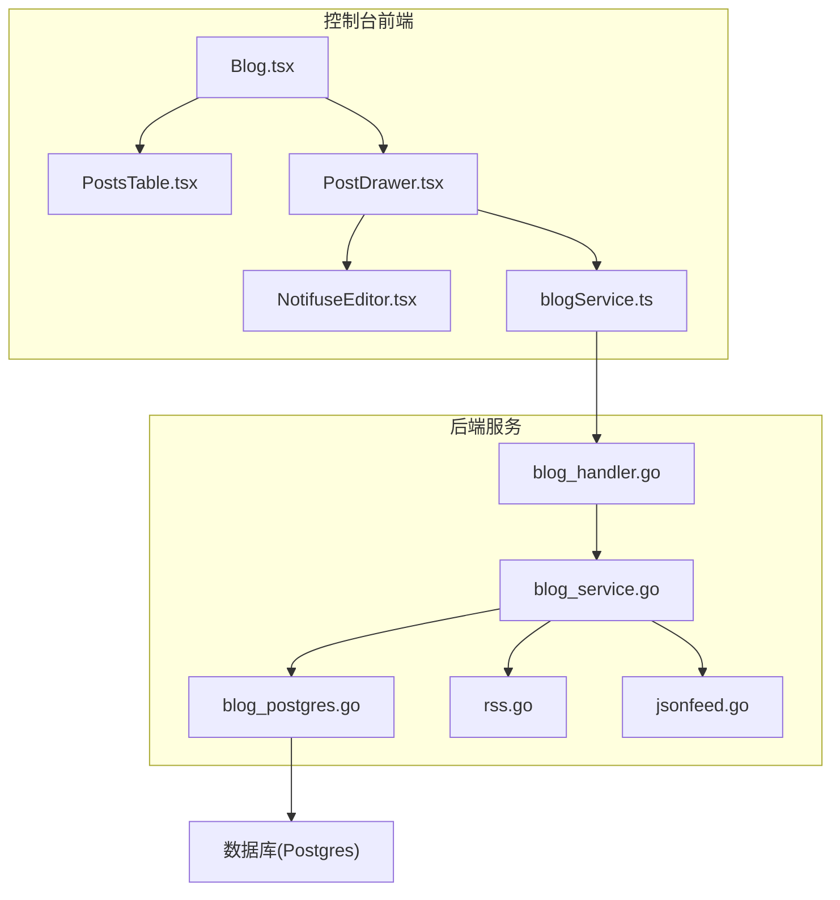
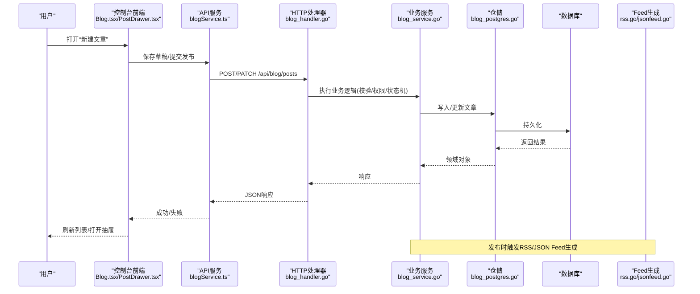
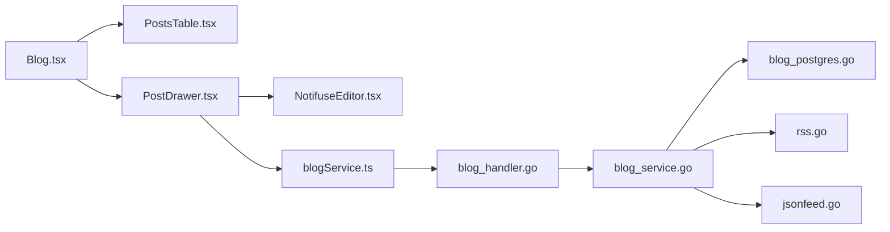

# 博客管理页面

<cite>
**本文引用的文件**   
- [console/src/pages/Blog.tsx](file://notifuse/console/src/pages/Blog.tsx)
- [console/src/components/blog/PostsTable.tsx](file://notifuse/console/src/components/blog/PostsTable.tsx)
- [console/src/components/blog/PostDrawer.tsx](file://notifuse/console/src/components/blog/PostDrawer.tsx)
- [console/src/components/blog/NotifuseEditor.tsx](file://notifuse/console/src/components/blog/NotifuseEditor.tsx)
- [console/src/services/api/blogService.ts](file://notifuse/console/src/services/api/blogService.ts)
- [internal/http/blog_handler.go](file://notifuse/internal/http/blog_handler.go)
- [internal/service/blog_service.go](file://notifuse/internal/service/blog_service.go)
- [internal/repository/blog_postgres.go](file://notifuse/internal/repository/blog_postgres.go)
- [internal/domain/blog.go](file://notifuse/internal/domain/blog.go)
- [internal/blogfeed/rss.go](file://notifuse/internal/blogfeed/rss.go)
- [internal/blogfeed/jsonfeed.go](file://notifuse/internal/blogfeed/jsonfeed.go)
</cite>

## 目录
1. [简介](#简介)
2. [项目结构](#项目结构)
3. [核心组件](#核心组件)
4. [架构总览](#架构总览)
5. [详细组件分析](#详细组件分析)
6. [依赖关系分析](#依赖关系分析)
7. [性能考虑](#性能考虑)
8. [故障排查指南](#故障排查指南)
9. [结论](#结论)
10. [附录](#附录)

## 简介
本文件面向 Notifuse 控制台的博客管理页面，系统性阐述文章创建、编辑、发布与管理的全流程能力。重点覆盖：
- 文章列表展示 PostsTable
- 文章编辑抽屉 PostDrawer
- 富文本编辑器 NotifuseEditor 的核心实现与扩展机制
- 分类与标签系统、SEO 设置、媒体资源管理
- 版本控制、草稿管理、定时发布与 RSS/JSON Feed 生成
- 编辑器性能优化与内容安全处理方案

## 项目结构
控制台前端位于 console 目录，后端服务位于 internal 目录。博客功能在前端通过 API 服务调用后端 HTTP 处理器，再由领域服务与仓储层持久化到数据库；同时提供 RSS/JSON Feed 的生成能力。

图表来源
- [console/src/pages/Blog.tsx](file://notifuse/console/src/pages/Blog.tsx)
- [console/src/components/blog/PostsTable.tsx](file://notifuse/console/src/components/blog/PostsTable.tsx)
- [console/src/components/blog/PostDrawer.tsx](file://notifuse/console/src/components/blog/PostDrawer.tsx)
- [console/src/components/blog/NotifuseEditor.tsx](file://notifuse/console/src/components/blog/NotifuseEditor.tsx)
- [console/src/services/api/blogService.ts](file://notifuse/console/src/services/api/blogService.ts)
- [internal/http/blog_handler.go](file://notifuse/internal/http/blog_handler.go)
- [internal/service/blog_service.go](file://notifuse/internal/service/blog_service.go)
- [internal/repository/blog_postgres.go](file://notifuse/internal/repository/blog_postgres.go)
- [internal/blogfeed/rss.go](file://notifuse/internal/blogfeed/rss.go)
- [internal/blogfeed/jsonfeed.go](file://notifuse/internal/blogfeed/jsonfeed.go)

章节来源
- [console/src/pages/Blog.tsx](file://notifuse/console/src/pages/Blog.tsx)
- [console/src/components/blog/PostsTable.tsx](file://notifuse/console/src/components/blog/PostsTable.tsx)
- [console/src/components/blog/PostDrawer.tsx](file://notifuse/console/src/components/blog/PostDrawer.tsx)
- [console/src/components/blog/NotifuseEditor.tsx](file://notifuse/console/src/components/blog/NotifuseEditor.tsx)
- [console/src/services/api/blogService.ts](file://notifuse/console/src/services/api/blogService.ts)
- [internal/http/blog_handler.go](file://notifuse/internal/http/blog_handler.go)
- [internal/service/blog_service.go](file://notifuse/internal/service/blog_service.go)
- [internal/repository/blog_postgres.go](file://notifuse/internal/repository/blog_postgres.go)
- [internal/blogfeed/rss.go](file://notifuse/internal/blogfeed/rss.go)
- [internal/blogfeed/jsonfeed.go](file://notifuse/internal/blogfeed/jsonfeed.go)

## 核心组件
- 文章列表 PostsTable：负责分页、筛选（状态、分类、标签）、排序与批量操作，点击行可打开编辑抽屉。
- 文章编辑抽屉 PostDrawer：承载新建/编辑表单，集成 SEO 字段、分类与标签选择、媒体上传、发布时间与定时发布等。
- 富文本编辑器 NotifuseEditor：基于块级结构的编辑器，支持自定义块、样式定制、实时协作与内容安全过滤。
- 前端 API 服务 blogService.ts：封装对后端的 CRUD、发布、草稿、定时发布与 Feed 获取等接口。
- 后端处理器 blog_handler.go：路由解析、鉴权、参数校验与响应格式化。
- 业务服务 blog_service.go：编排文章生命周期、Feed 生成、权限与一致性检查。
- 仓储 blog_postgres.go：数据访问与 SQL 构建。
- 领域模型 blog.go：文章、分类、标签、附件等数据结构定义。
- Feed 生成 rss.go / jsonfeed.go：将已发布文章转换为 RSS/JSON Feed。

章节来源
- [console/src/components/blog/PostsTable.tsx](file://notifuse/console/src/components/blog/PostsTable.tsx)
- [console/src/components/blog/PostDrawer.tsx](file://notifuse/console/src/components/blog/PostDrawer.tsx)
- [console/src/components/blog/NotifuseEditor.tsx](file://notifuse/console/src/components/blog/NotifuseEditor.tsx)
- [console/src/services/api/blogService.ts](file://notifuse/console/src/services/api/blogService.ts)
- [internal/http/blog_handler.go](file://notifuse/internal/http/blog_handler.go)
- [internal/service/blog_service.go](file://notifuse/internal/service/blog_service.go)
- [internal/repository/blog_postgres.go](file://notifuse/internal/repository/blog_postgres.go)
- [internal/domain/blog.go](file://notifuse/internal/domain/blog.go)
- [internal/blogfeed/rss.go](file://notifuse/internal/blogfeed/rss.go)
- [internal/blogfeed/jsonfeed.go](file://notifuse/internal/blogfeed/jsonfeed.go)

## 架构总览
前后端分层清晰：前端以 React 组件组织交互，通过 API 服务调用后端 REST 接口；后端由处理器→服务→仓储三层构成，并内置 Feed 生成模块。

图表来源
- [console/src/pages/Blog.tsx](file://notifuse/console/src/pages/Blog.tsx)
- [console/src/components/blog/PostDrawer.tsx](file://notifuse/console/src/components/blog/PostDrawer.tsx)
- [console/src/services/api/blogService.ts](file://notifuse/console/src/services/api/blogService.ts)
- [internal/http/blog_handler.go](file://notifuse/internal/http/blog_handler.go)
- [internal/service/blog_service.go](file://notifuse/internal/service/blog_service.go)
- [internal/repository/blog_postgres.go](file://notifuse/internal/repository/blog_postgres.go)
- [internal/blogfeed/rss.go](file://notifuse/internal/blogfeed/rss.go)
- [internal/blogfeed/jsonfeed.go](file://notifuse/internal/blogfeed/jsonfeed.go)

## 详细组件分析

### 文章列表 PostsTable
- 功能要点
  - 分页加载、搜索与多条件筛选（状态、分类、标签）
  - 列展示：标题、作者、状态、分类、标签、更新时间、操作
  - 行内快捷操作：预览、编辑、删除、切换可见性
  - 批量操作：批量删除、批量变更状态
- 交互流程
  - 进入页面触发首次加载
  - 筛选条件变化时重置页码并重新请求
  - 点击行打开 PostDrawer 进行编辑
- 性能策略
  - 虚拟滚动或分页加载避免大列表渲染开销
  - 防抖搜索输入，减少频繁请求
  - 缓存最近一次查询结果，提升回退体验

章节来源
- [console/src/components/blog/PostsTable.tsx](file://notifuse/console/src/components/blog/PostsTable.tsx)

### 文章编辑抽屉 PostDrawer
- 功能要点
  - 新建/编辑模式复用同一抽屉
  - 基础信息：标题、摘要、封面图、语言、可见性
  - 分类与标签：多选/新增，支持快速创建
  - SEO 设置：页面标题、描述、关键词、OG 图片、结构化数据
  - 发布时间：立即发布、定时发布（cron 表达式或时间选择器）
  - 媒体资源：上传、替换、外链插入、缩略图裁剪
  - 版本控制：自动保存草稿、历史版本对比与恢复
- 交互流程
  - 打开抽屉：根据上下文决定新建或加载已有文章
  - 保存草稿：仅持久化元信息与富文本快照
  - 发布：校验必填项、生成 slug、更新状态、触发 Feed 生成
  - 定时发布：写入调度任务，到期由后台作业执行发布
- 错误处理
  - 网络异常重试与友好提示
  - 校验失败高亮对应字段
  - 并发冲突提示并引导刷新

章节来源
- [console/src/components/blog/PostDrawer.tsx](file://notifuse/console/src/components/blog/PostDrawer.tsx)

### 富文本编辑器 NotifuseEditor
- 核心特性
  - 块级结构：段落、标题、引用、代码块、表格、媒体、分隔线等
  - 扩展机制：插件式注册新块类型、工具栏按钮、快捷键
  - 样式定制：主题变量、CSS 注入、打印样式
  - 实时协作：基于 CRDT/OT 的协同编辑（可选）
  - 内容安全：白名单过滤、XSS 防护、外链与脚本限制
- 数据流
  - 编辑器内部维护文档树
  - 变更事件节流上报至 PostDrawer
  - 自动保存：间隔触发草稿持久化
- 性能优化
  - 增量渲染与懒加载长文档
  - 图片/视频占位与按需加载
  - 撤销栈分片与内存回收
- 安全策略
  - 输入清洗与输出转义
  - 资源域名白名单
  - 敏感词与合规检测（可选）

章节来源
- [console/src/components/blog/NotifuseEditor.tsx](file://notifuse/console/src/components/blog/NotifuseEditor.tsx)

### 前端 API 服务 blogService.ts
- 职责
  - 封装文章 CRUD、草稿、发布、定时发布、Feed 读取等接口
  - 统一错误处理、重试与超时配置
  - 请求拦截：附加认证头、租户/工作空间标识
- 关键方法
  - list、get、create、update、delete
  - publish、schedulePublish、saveDraft
  - getFeed(type) 获取 RSS/JSON Feed

章节来源
- [console/src/services/api/blogService.ts](file://notifuse/console/src/services/api/blogService.ts)

### 后端处理器 blog_handler.go
- 职责
  - 路由映射与中间件（鉴权、限流、日志）
  - 请求体解析与参数校验
  - 调用业务服务并返回标准化响应
- 典型端点
  - GET /api/blog/posts 列表
  - POST /api/blog/posts 新建
  - PATCH /api/blog/posts/:id 更新
  - DELETE /api/blog/posts/:id 删除
  - POST /api/blog/posts/:id/publish 发布
  - POST /api/blog/posts/:id/schedule 定时发布
  - GET /api/blog/feed.{rss|json} 订阅

章节来源
- [internal/http/blog_handler.go](file://notifuse/internal/http/blog_handler.go)

### 业务服务 blog_service.go
- 职责
  - 编排文章生命周期：草稿→待审→已发布→归档
  - 校验与转换：slug 生成、SEO 字段规范化、分类/标签归一化
  - 触发 Feed 生成与索引更新
  - 权限与工作空间隔离
- 协作与并发
  - 乐观锁版本号控制
  - 事务边界与回滚策略

章节来源
- [internal/service/blog_service.go](file://notifuse/internal/service/blog_service.go)

### 仓储 blog_postgres.go
- 职责
  - 数据访问抽象与 SQL 构建
  - 分页、排序、过滤条件拼装
  - 批量操作与事务封装
- 性能
  - 索引建议：状态、更新时间、分类、标签
  - 查询优化：只选必要字段、延迟加载富文本

章节来源
- [internal/repository/blog_postgres.go](file://notifuse/internal/repository/blog_postgres.go)

### 领域模型 blog.go
- 实体
  - 文章：ID、标题、摘要、正文、状态、作者、工作空间、时间戳、版本等
  - 分类/标签：名称、别名、计数
  - 附件：URL、类型、大小、关联关系
- 约束
  - 唯一性：slug、标签名
  - 非空与长度限制
  - 枚举值：状态、可见性、语言

章节来源
- [internal/domain/blog.go](file://notifuse/internal/domain/blog.go)

### Feed 生成 rss.go / jsonfeed.go
- 职责
  - 从已发布文章集合生成 RSS 2.0 与 JSON Feed
  - 包含标题、链接、摘要、封面、更新时间、分类与标签
  - 支持分页与增量更新
- 使用场景
  - 站点订阅
  - 第三方聚合平台抓取
  - 邮件推送源

章节来源
- [internal/blogfeed/rss.go](file://notifuse/internal/blogfeed/rss.go)
- [internal/blogfeed/jsonfeed.go](file://notifuse/internal/blogfeed/jsonfeed.go)

## 依赖关系分析
- 组件耦合
  - Blog.tsx 组合 PostsTable 与 PostDrawer，低耦合高内聚
  - PostDrawer 依赖 NotifuseEditor 与 blogService
  - 前端 API 服务与后端处理器解耦，通过契约（OpenAPI/约定）对接
- 外部依赖
  - 数据库：Postgres
  - 存储：对象存储（用于媒体资源）
  - 任务调度：定时发布与 Feed 生成可由后台任务驱动

图表来源
- [console/src/pages/Blog.tsx](file://notifuse/console/src/pages/Blog.tsx)
- [console/src/components/blog/PostsTable.tsx](file://notifuse/console/src/components/blog/PostsTable.tsx)
- [console/src/components/blog/PostDrawer.tsx](file://notifuse/console/src/components/blog/PostDrawer.tsx)
- [console/src/components/blog/NotifuseEditor.tsx](file://notifuse/console/src/components/blog/NotifuseEditor.tsx)
- [console/src/services/api/blogService.ts](file://notifuse/console/src/services/api/blogService.ts)
- [internal/http/blog_handler.go](file://notifuse/internal/http/blog_handler.go)
- [internal/service/blog_service.go](file://notifuse/internal/service/blog_service.go)
- [internal/repository/blog_postgres.go](file://notifuse/internal/repository/blog_postgres.go)
- [internal/blogfeed/rss.go](file://notifuse/internal/blogfeed/rss.go)
- [internal/blogfeed/jsonfeed.go](file://notifuse/internal/blogfeed/jsonfeed.go)

## 性能考虑
- 前端
  - 列表虚拟化与分页加载
  - 搜索防抖与去重请求
  - 编辑器增量渲染与懒加载长文档
  - 图片/视频占位与按需加载
- 后端
  - 查询只选必要字段，避免大字段全量加载
  - 合理索引与分页游标
  - Feed 生成异步化与缓存
- 安全
  - 输入清洗与输出转义
  - 资源域名白名单与防盗链
  - 速率限制与审计日志

## 故障排查指南
- 常见问题
  - 富文本无法保存：检查自动保存节流与网络重试
  - 发布失败：确认必填字段、slug 唯一性与权限
  - 定时发布未生效：核对调度任务与时间区设置
  - Feed 无更新：检查发布事件是否触发与缓存失效
- 定位步骤
  - 前端：查看浏览器网络面板与错误日志
  - 后端：检查处理器日志与服务层异常堆栈
  - 数据库：核对受影响记录与索引命中情况
- 恢复策略
  - 使用草稿与版本历史恢复
  - 清理无效缓存并重试
  - 降级为只读模式保障可用性

## 结论
博客管理页面以清晰的组件分层与前后端解耦设计，提供了完整的文章创作与发布体验。通过可扩展的富文本编辑器、完善的分类标签与 SEO 能力、以及稳定的 Feed 生成机制，满足多场景的内容运营需求。建议在后续迭代中持续优化编辑器性能、增强协作能力与安全策略，完善监控与可观测性。

## 附录
- 术语
  - 草稿：未发布的临时版本
  - 定时发布：指定未来时间自动发布
  - Feed：RSS/JSON 订阅源
- 最佳实践
  - 保持 slug 稳定且可读
  - 合理使用分类与标签，避免过度细分
  - 为长文启用分页与锚点导航
  - 定期清理无用附件与旧版本