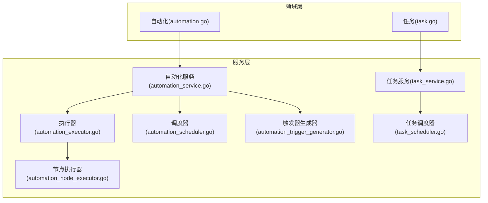
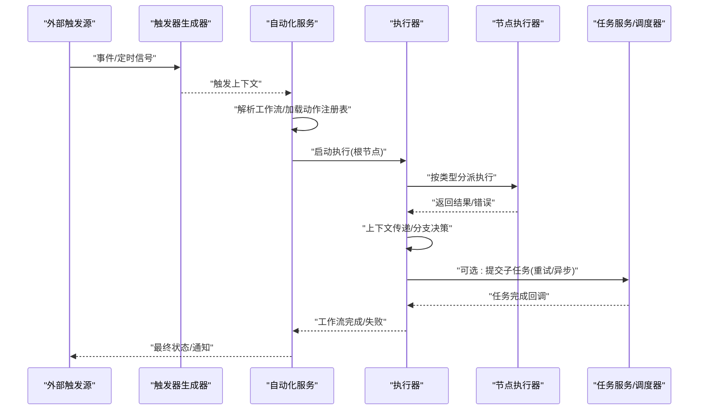
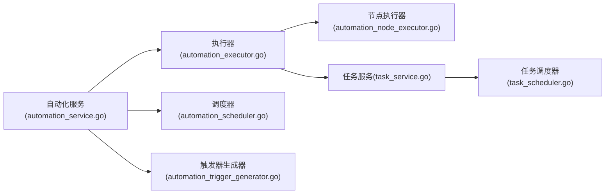

# 动作注册机制

<cite>
**本文引用的文件**   
- [automation_executor.go](file://notifuse/internal/service/automation_executor.go)
- [automation_node_executor.go](file://notifuse/internal/service/automation_node_executor.go)
- [automation_service.go](file://notifuse/internal/service/automation_service.go)
- [automation_scheduler.go](file://notifuse/internal/service/automation_scheduler.go)
- [automation_trigger_generator.go](file://notifuse/internal/service/automation_trigger_generator.go)
- [automation.go](file://notifuse/internal/domain/automation.go)
- [task.go](file://notifuse/internal/domain/task.go)
- [task_service.go](file://notifuse/internal/service/task_service.go)
- [task_scheduler.go](file://notifuse/internal/service/task_scheduler.go)
</cite>

## 目录
1. [简介](#简介)
2. [项目结构](#项目结构)
3. [核心组件](#核心组件)
4. [架构总览](#架构总览)
5. [详细组件分析](#详细组件分析)
6. [依赖关系分析](#依赖关系分析)
7. [性能考量](#性能考量)
8. [故障排查指南](#故障排查指南)
9. [结论](#结论)
10. [附录](#附录)

## 简介
本文件围绕“动作注册机制”展开，聚焦自动化系统中的动作（Action）定义、注册流程与调用机制。文档将系统阐述动作规格（ActionSpec）的结构与配置项、参数校验、执行上下文与返回值处理；解释动作生命周期管理、错误处理与重试策略；并给出动作组合模式、条件执行与异步处理的实践方案。最后提供自定义动作开发指南与性能优化建议，帮助读者在现有代码基础上扩展和定制动作能力。

## 项目结构
本项目采用分层组织：领域模型位于 internal/domain，服务层位于 internal/service，HTTP 处理器位于 internal/http，迁移与数据库访问位于 internal/migrations 与 internal/repository。与动作注册机制直接相关的核心实现集中在 service 与 domain 两个层次：
- 领域层定义了自动化工作流、任务与动作的抽象与数据结构。
- 服务层实现了动作调度、节点执行、触发器生成与任务编排等关键流程。

图表来源
- [automation.go](file://notifuse/internal/domain/automation.go)
- [task.go](file://notifuse/internal/domain/task.go)
- [automation_service.go](file://notifuse/internal/service/automation_service.go)
- [automation_executor.go](file://notifuse/internal/service/automation_executor.go)
- [automation_node_executor.go](file://notifuse/internal/service/automation_node_executor.go)
- [automation_scheduler.go](file://notifuse/internal/service/automation_scheduler.go)
- [automation_trigger_generator.go](file://notifuse/internal/service/automation_trigger_generator.go)
- [task_service.go](file://notifuse/internal/service/task_service.go)
- [task_scheduler.go](file://notifuse/internal/service/task_scheduler.go)

章节来源
- [automation.go](file://notifuse/internal/domain/automation.go)
- [task.go](file://notifuse/internal/domain/task.go)
- [automation_service.go](file://notifuse/internal/service/automation_service.go)
- [automation_executor.go](file://notifuse/internal/service/automation_executor.go)
- [automation_node_executor.go](file://notifuse/internal/service/automation_node_executor.go)
- [automation_scheduler.go](file://notifuse/internal/service/automation_scheduler.go)
- [automation_trigger_generator.go](file://notifuse/internal/service/automation_trigger_generator.go)
- [task_service.go](file://notifuse/internal/service/task_service.go)
- [task_scheduler.go](file://notifuse/internal/service/task_scheduler.go)

## 核心组件
- 自动化服务：负责加载、解析与编排自动化工作流，协调触发器与执行器，维护动作注册表与运行时状态。
- 执行器：根据工作流图驱动动作节点的执行，处理分支、合并与上下文传递。
- 节点执行器：针对具体动作类型进行分派与执行，封装参数校验、上下文注入与结果归一化。
- 调度器：基于时间或事件触发自动化运行，支持周期性与一次性任务。
- 触发器生成器：从外部事件或定时信号生成触发数据，驱动工作流启动。
- 任务服务与任务调度器：为长耗时或可重试的动作提供任务化执行与持久化保障。

章节来源
- [automation_service.go](file://notifuse/internal/service/automation_service.go)
- [automation_executor.go](file://notifuse/internal/service/automation_executor.go)
- [automation_node_executor.go](file://notifuse/internal/service/automation_node_executor.go)
- [automation_scheduler.go](file://notifuse/internal/service/automation_scheduler.go)
- [automation_trigger_generator.go](file://notifuse/internal/service/automation_trigger_generator.go)
- [task_service.go](file://notifuse/internal/service/task_service.go)
- [task_scheduler.go](file://notifuse/internal/service/task_scheduler.go)

## 架构总览
下图展示了动作注册与调度的整体流程：工作流定义包含多个动作节点，每个动作节点通过 ActionSpec 描述其类型、参数与约束；执行器按拓扑顺序调度节点，节点执行器依据类型分派到具体实现；调度器与触发器生成器负责启动执行；任务服务与调度器为需要重试与持久化的动作提供支撑。

图表来源
- [automation_trigger_generator.go](file://notifuse/internal/service/automation_trigger_generator.go)
- [automation_service.go](file://notifuse/internal/service/automation_service.go)
- [automation_executor.go](file://notifuse/internal/service/automation_executor.go)
- [automation_node_executor.go](file://notifuse/internal/service/automation_node_executor.go)
- [task_service.go](file://notifuse/internal/service/task_service.go)
- [task_scheduler.go](file://notifuse/internal/service/task_scheduler.go)

## 详细组件分析

### 动作规格（ActionSpec）与注册表
- 作用：描述一个动作的类型、输入参数、输出字段、校验规则、执行上下文键名、是否允许重试与超时等元信息。
- 注册流程：
  - 在应用启动阶段，由自动化服务扫描已实现的节点执行器，读取其 ActionSpec 并写入全局注册表。
  - 注册表提供按类型查找、校验与实例化能力，供执行器在运行时使用。
- 配置选项要点：
  - 参数验证：声明必填字段、类型约束、范围限制与自定义校验函数。
  - 执行上下文：指定上下文键名与默认值，确保上游节点输出能正确注入。
  - 返回值处理：定义输出映射与转换规则，便于下游节点消费。
  - 重试与超时：标记是否可重试、最大重试次数与退避策略。
- 扩展方式：新增动作时，实现对应节点执行器并在初始化中向注册表登记。

章节来源
- [automation_service.go](file://notifuse/internal/service/automation_service.go)
- [automation_node_executor.go](file://notifuse/internal/service/automation_node_executor.go)

### 执行器与工作流编排
- 职责：
  - 解析工作流图，确定节点拓扑与依赖关系。
  - 维护执行上下文，传递节点间数据。
  - 处理分支、循环与并行执行。
  - 捕获异常并转换为统一错误语义。
- 关键点：
  - 上下文隔离：每次执行拥有独立上下文，避免状态泄漏。
  - 短路策略：当某节点失败且未配置重试时，快速终止后续节点。
  - 结果聚合：对并行分支的结果进行合并与校验。

章节来源
- [automation_executor.go](file://notifuse/internal/service/automation_executor.go)

### 节点执行器与类型分派
- 职责：
  - 根据 ActionSpec 的类型字段，将请求路由到具体实现。
  - 执行参数校验、上下文注入、业务逻辑与返回值规范化。
- 设计要点：
  - 单一职责：每个节点执行器只关注一种动作类型。
  - 可测试性：通过接口与上下文解耦外部依赖。
  - 错误语义：区分可重试错误与不可恢复错误，便于上层策略处理。

章节来源
- [automation_node_executor.go](file://notifuse/internal/service/automation_node_executor.go)

### 调度器与触发器生成器
- 调度器：
  - 支持周期性任务与一次性任务，基于任务服务持久化状态。
  - 与执行器协作，按时机触发工作流执行。
- 触发器生成器：
  - 将外部事件（如 Webhook、消息队列）或内部信号转化为触发上下文。
  - 过滤与标准化触发数据，减少执行器负担。

章节来源
- [automation_scheduler.go](file://notifuse/internal/service/automation_scheduler.go)
- [automation_trigger_generator.go](file://notifuse/internal/service/automation_trigger_generator.go)

### 任务服务与任务调度器
- 任务服务：
  - 提供任务的创建、查询、更新与删除能力。
  - 封装任务状态机（待执行、执行中、成功、失败、重试中）。
- 任务调度器：
  - 拉取待执行任务，按优先级与资源可用性分配执行。
  - 实现重试与退避策略，记录失败原因与堆栈。

章节来源
- [task_service.go](file://notifuse/internal/service/task_service.go)
- [task_scheduler.go](file://notifuse/internal/service/task_scheduler.go)
- [task.go](file://notifuse/internal/domain/task.go)

### 动作生命周期管理
- 生命周期阶段：
  - 定义与注册：应用启动时完成动作类型的发现与注册。
  - 准备与校验：执行前对参数与上下文进行校验与补齐。
  - 执行与监控：实际执行业务逻辑，记录指标与日志。
  - 完成与清理：返回结果或错误，释放资源，更新上下文。
- 关键点：
  - 幂等性：对可重试动作保证多次执行结果一致。
  - 可观测性：埋点覆盖关键路径，便于定位问题。

章节来源
- [automation_service.go](file://notifuse/internal/service/automation_service.go)
- [automation_executor.go](file://notifuse/internal/service/automation_executor.go)
- [automation_node_executor.go](file://notifuse/internal/service/automation_node_executor.go)

### 错误处理与重试机制
- 错误分类：
  - 可重试错误：网络抖动、临时资源不可用等。
  - 不可恢复错误：参数非法、权限不足、业务规则不满足等。
- 重试策略：
  - 指数退避与抖动，避免雪崩。
  - 最大重试次数与熔断阈值，防止无限重试。
- 上下文传播：
  - 错误信息携带上下文快照，便于回溯。
  - 失败节点可触发补偿动作或告警。

章节来源
- [automation_executor.go](file://notifuse/internal/service/automation_executor.go)
- [automation_node_executor.go](file://notifuse/internal/service/automation_node_executor.go)
- [task_service.go](file://notifuse/internal/service/task_service.go)
- [task_scheduler.go](file://notifuse/internal/service/task_scheduler.go)

### 动作组合模式、条件执行与异步处理
- 组合模式：
  - 串行组合：按依赖顺序依次执行。
  - 并行组合：多分支同时执行，结果聚合后继续。
  - 条件组合：基于上下文布尔表达式选择分支。
- 条件执行：
  - 在节点级别设置条件表达式，动态决定是否执行。
  - 支持短路逻辑，提高执行效率。
- 异步处理：
  - 将耗时操作提交至任务服务，立即返回中间状态。
  - 通过回调或轮询获取最终结果。

章节来源
- [automation_executor.go](file://notifuse/internal/service/automation_executor.go)
- [automation_node_executor.go](file://notifuse/internal/service/automation_node_executor.go)
- [task_service.go](file://notifuse/internal/service/task_service.go)
- [task_scheduler.go](file://notifuse/internal/service/task_scheduler.go)

### 自定义动作开发指南
- 步骤概览：
  - 定义动作规格：明确类型、参数、上下文键与返回值结构。
  - 实现节点执行器：完成参数校验、业务逻辑与错误处理。
  - 注册动作：在初始化阶段向注册表登记新动作。
  - 编写测试：覆盖正常路径、边界条件与错误场景。
- 最佳实践：
  - 保持无副作用或可补偿的副作用。
  - 使用统一的错误类型与日志格式。
  - 对 I/O 操作进行超时与重试控制。
  - 提供清晰的文档与示例。

章节来源
- [automation_service.go](file://notifuse/internal/service/automation_service.go)
- [automation_node_executor.go](file://notifuse/internal/service/automation_node_executor.go)

### 性能优化建议
- 执行层面：
  - 合理拆分并行度，避免过度并发导致资源争用。
  - 缓存热点数据，减少重复计算与外部调用。
  - 使用连接池与批量操作降低开销。
- 调度层面：
  - 调整任务批大小与拉取频率，平衡吞吐与延迟。
  - 为高优先级动作设置独立队列与限流策略。
- 可观测性：
  - 采集关键指标（QPS、P99、错误率），建立告警阈值。
  - 使用分布式追踪串联跨节点调用链。

[本节为通用指导，不直接分析具体文件]

## 依赖关系分析
下图展示核心模块之间的依赖关系，突出动作注册与执行的关键链路。

图表来源
- [automation_service.go](file://notifuse/internal/service/automation_service.go)
- [automation_executor.go](file://notifuse/internal/service/automation_executor.go)
- [automation_node_executor.go](file://notifuse/internal/service/automation_node_executor.go)
- [automation_scheduler.go](file://notifuse/internal/service/automation_scheduler.go)
- [automation_trigger_generator.go](file://notifuse/internal/service/automation_trigger_generator.go)
- [task_service.go](file://notifuse/internal/service/task_service.go)
- [task_scheduler.go](file://notifuse/internal/service/task_scheduler.go)

章节来源
- [automation_service.go](file://notifuse/internal/service/automation_service.go)
- [automation_executor.go](file://notifuse/internal/service/automation_executor.go)
- [automation_node_executor.go](file://notifuse/internal/service/automation_node_executor.go)
- [automation_scheduler.go](file://notifuse/internal/service/automation_scheduler.go)
- [automation_trigger_generator.go](file://notifuse/internal/service/automation_trigger_generator.go)
- [task_service.go](file://notifuse/internal/service/task_service.go)
- [task_scheduler.go](file://notifuse/internal/service/task_scheduler.go)

## 性能考量
- 并发与背压：在高负载下，应限制并发度并引入背压机制，避免内存与 CPU 峰值过高。
- 资源复用：对外部服务的客户端连接、序列化器等对象进行复用，减少分配与 GC 压力。
- 批处理与合并：对写操作进行批量化，降低 I/O 次数。
- 降级与熔断：对不稳定依赖实施熔断与降级，保护主流程稳定性。
- 监控与容量规划：基于指标预测容量需求，提前扩容或优化算法。

[本节为通用指导，不直接分析具体文件]

## 故障排查指南
- 常见问题定位：
  - 动作未注册：检查初始化阶段是否遗漏登记，确认类型名称与注册表键一致。
  - 参数校验失败：核对 ActionSpec 中的约束与实际输入，查看错误详情。
  - 上下文缺失：确认上游节点是否正确输出所需键，必要时提供默认值。
  - 重试风暴：检查退避策略与最大重试次数，避免雪崩。
- 诊断手段：
  - 启用详细日志与追踪 ID，关联一次执行的完整链路。
  - 导出执行上下文快照，对比不同阶段的差异。
  - 使用单元测试与集成测试复现问题，逐步缩小范围。

章节来源
- [automation_service.go](file://notifuse/internal/service/automation_service.go)
- [automation_executor.go](file://notifuse/internal/service/automation_executor.go)
- [automation_node_executor.go](file://notifuse/internal/service/automation_node_executor.go)
- [task_service.go](file://notifuse/internal/service/task_service.go)
- [task_scheduler.go](file://notifuse/internal/service/task_scheduler.go)

## 结论
动作注册机制通过明确的 ActionSpec 与注册表，结合执行器与节点执行器的分派与编排，提供了可扩展、可观测、可重试的自动化执行框架。借助任务服务与调度器，系统能够可靠地处理长耗时与需重试的动作。遵循本文的开发指南与性能建议，可在保证稳定性的前提下持续提升吞吐与响应速度。

[本节为总结，不直接分析具体文件]

## 附录
- 术语说明：
  - 动作（Action）：工作流中的一个可执行单元，具有输入、输出与副作用。
  - 动作规格（ActionSpec）：描述动作元信息与执行约束的配置对象。
  - 执行上下文：在一次执行过程中贯穿各节点的数据载体。
  - 任务：可持久化、可重试的执行单元，常用于异步与长耗时操作。
- 参考文件：
  - 领域模型：[automation.go](file://notifuse/internal/domain/automation.go)、[task.go](file://notifuse/internal/domain/task.go)
  - 服务实现：[automation_service.go](file://notifuse/internal/service/automation_service.go)、[automation_executor.go](file://notifuse/internal/service/automation_executor.go)、[automation_node_executor.go](file://notifuse/internal/service/automation_node_executor.go)、[automation_scheduler.go](file://notifuse/internal/service/automation_scheduler.go)、[automation_trigger_generator.go](file://notifuse/internal/service/automation_trigger_generator.go)、[task_service.go](file://notifuse/internal/service/task_service.go)、[task_scheduler.go](file://notifuse/internal/service/task_scheduler.go)