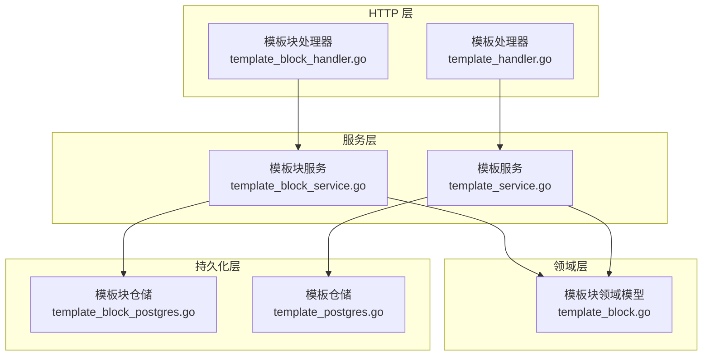
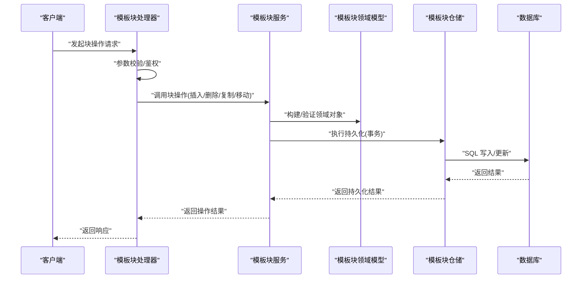
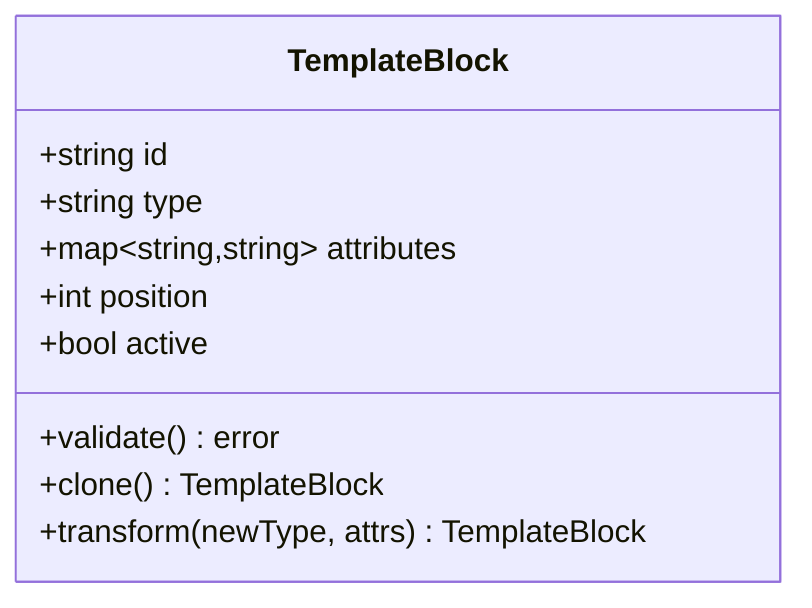
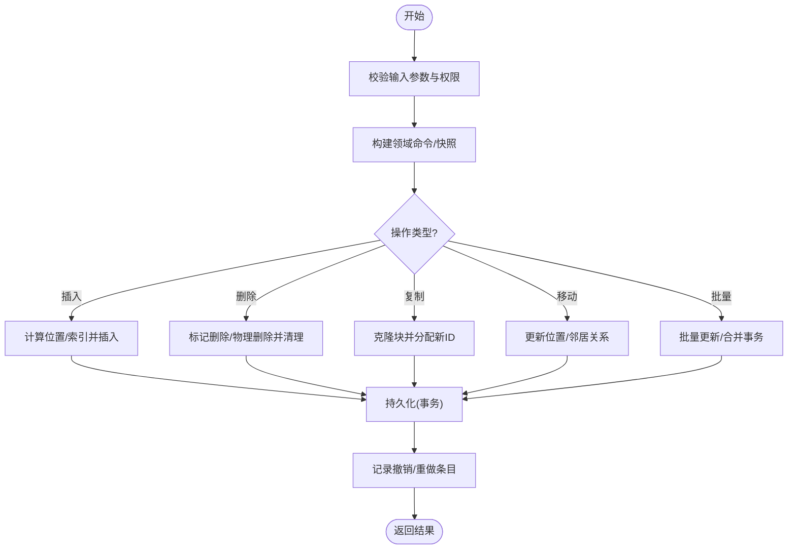
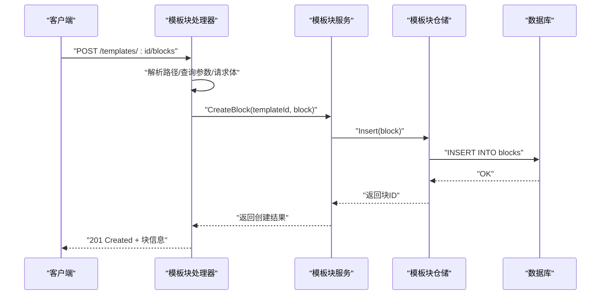
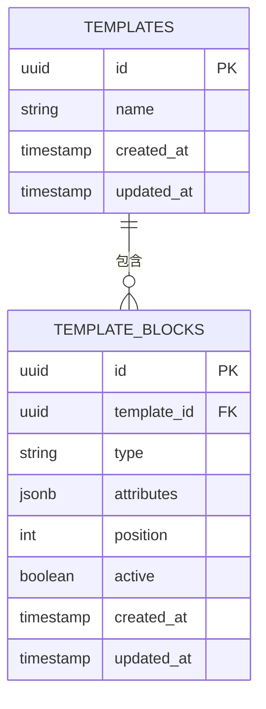
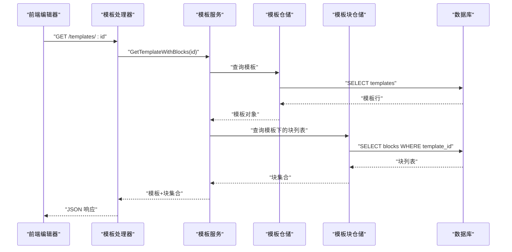
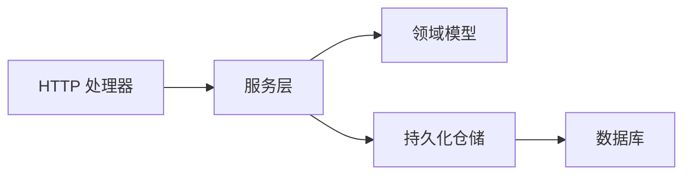

# 块级操作

<cite>
**本文引用的文件**   
- [template_block.go](file://notifuse/internal/domain/template_block.go)
- [template_block_test.go](file://notifuse/internal/domain/template_block_test.go)
- [template_block_service.go](file://notifuse/internal/service/template_block_service.go)
- [template_block_service_test.go](file://notifuse/internal/service/template_block_service_test.go)
- [template_block_handler.go](file://notifuse/internal/http/template_block_handler.go)
- [template_block_handler_test.go](file://notifuse/internal/http/template_block_handler_test.go)
- [template_block_postgres.go](file://notifuse/internal/repository/template_block_postgres.go)
- [template_block_postgres_test.go](file://notifuse/internal/repository/template_block_postgres_test.go)
- [template_service.go](file://notifuse/internal/service/template_service.go)
- [template_service_test.go](file://notifuse/internal/service/template_service_test.go)
- [template_handler.go](file://notifuse/internal/http/template_handler.go)
- [template_handler_test.go](file://notifuse/internal/http/template_handler_test.go)
- [template_postgres.go](file://notifuse/internal/repository/template_postgres.go)
- [template_postgres_test.go](file://notifuse/internal/repository/template_postgres_test.go)
</cite>

## 目录
1. [简介](#简介)
2. [项目结构](#项目结构)
3. [核心组件](#核心组件)
4. [架构总览](#架构总览)
5. [详细组件分析](#详细组件分析)
6. [依赖关系分析](#依赖关系分析)
7. [性能考虑](#性能考虑)
8. [故障排查指南](#故障排查指南)
9. [结论](#结论)
10. [附录](#附录)

## 简介
本文件围绕“块级操作”能力进行系统化文档化，聚焦于模板系统中的块（Block）概念与操作。内容覆盖：
- 块的插入、删除、复制与移动等基础操作机制
- 块操作菜单的实现要点（定位、分组、批量操作）
- 块变换系统（类型转换、格式化、样式应用）
- 撤销/重做机制、状态同步与性能优化策略
- 自定义块操作的开发指南与最佳实践

说明：由于仓库中未包含前端编辑器代码，本文对“块操作菜单”的实现以接口契约与服务层能力为依据，给出可落地的集成建议与流程设计。

## 项目结构
与块级操作相关的代码主要分布在领域模型、服务层、HTTP 处理器与持久化层四个层次，遵循清晰的分层职责：
- 领域模型：定义块的数据结构与不变式约束
- 服务层：编排业务逻辑，提供原子化的块操作能力
- HTTP 处理器：暴露 REST API，负责参数校验与响应封装
- 持久化层：实现数据库读写，保证事务性与一致性

**图示来源**
- [template_block_handler.go](file://notifuse/internal/http/template_block_handler.go)
- [template_handler.go](file://notifuse/internal/http/template_handler.go)
- [template_block_service.go](file://notifuse/internal/service/template_block_service.go)
- [template_service.go](file://notifuse/internal/service/template_service.go)
- [template_block.go](file://notifuse/internal/domain/template_block.go)
- [template_block_postgres.go](file://notifuse/internal/repository/template_block_postgres.go)
- [template_postgres.go](file://notifuse/internal/repository/template_postgres.go)

**章节来源**
- [template_block.go](file://notifuse/internal/domain/template_block.go)
- [template_block_service.go](file://notifuse/internal/service/template_block_service.go)
- [template_block_handler.go](file://notifuse/internal/http/template_block_handler.go)
- [template_block_postgres.go](file://notifuse/internal/repository/template_block_postgres.go)
- [template_service.go](file://notifuse/internal/service/template_service.go)
- [template_handler.go](file://notifuse/internal/http/template_handler.go)
- [template_postgres.go](file://notifuse/internal/repository/template_postgres.go)

## 核心组件
- 模板块领域模型：定义块的结构、类型、属性与校验规则，作为所有操作的不可变或受控可变数据载体。
- 模板块服务：对外暴露原子化的块操作能力，包括插入、删除、复制、移动、批量更新、类型转换与格式/样式应用等。
- 模板块处理器：将 HTTP 请求映射到服务调用，完成鉴权、参数校验、错误处理与结果序列化。
- 模板块仓储：负责块数据的持久化，确保在复杂操作中的事务一致性与并发安全。
- 模板服务与模板处理器：管理模板与块的关系，提供模板级视图与变更的聚合能力。

**章节来源**
- [template_block.go](file://notifuse/internal/domain/template_block.go)
- [template_block_service.go](file://notifuse/internal/service/template_block_service.go)
- [template_block_handler.go](file://notifuse/internal/http/template_block_handler.go)
- [template_block_postgres.go](file://notifuse/internal/repository/template_block_postgres.go)
- [template_service.go](file://notifuse/internal/service/template_service.go)
- [template_handler.go](file://notifuse/internal/http/template_handler.go)

## 架构总览
下图展示了从客户端到数据库的完整调用链，以及关键的状态流转与一致性保障点。

**图示来源**
- [template_block_handler.go](file://notifuse/internal/http/template_block_handler.go)
- [template_block_service.go](file://notifuse/internal/service/template_block_service.go)
- [template_block.go](file://notifuse/internal/domain/template_block.go)
- [template_block_postgres.go](file://notifuse/internal/repository/template_block_postgres.go)

## 详细组件分析

### 领域模型：模板块
- 职责：定义块类型、属性、位置信息与约束；提供构造与校验方法，确保领域不变式不被破坏。
- 关键点：
  - 类型枚举与扩展点：为后续类型转换与样式应用预留扩展空间
  - 位置与顺序：支持插入、移动等操作所需的索引/锚点信息
  - 属性与元数据：承载格式化与样式相关字段

**图示来源**
- [template_block.go](file://notifuse/internal/domain/template_block.go)

**章节来源**
- [template_block.go](file://notifuse/internal/domain/template_block.go)
- [template_block_test.go](file://notifuse/internal/domain/template_block_test.go)

### 服务层：模板块服务
- 职责：编排块操作的业务流程，保证原子性、幂等性与一致性；提供撤销/重做所需的状态快照与命令记录。
- 关键能力：
  - 插入：在指定位置插入新块，维护顺序与引用完整性
  - 删除：移除块并清理关联资源，必要时触发下游通知
  - 复制：基于现有块生成副本，分配新标识并重置状态
  - 移动：调整块位置，保持前后邻居关系正确
  - 批量操作：对多个块执行统一变更，减少往返开销
  - 类型转换与格式化：在领域层完成类型升级/降级与属性规范化
  - 撤销/重做：通过命令日志与快照机制恢复历史状态

**图示来源**
- [template_block_service.go](file://notifuse/internal/service/template_block_service.go)

**章节来源**
- [template_block_service.go](file://notifuse/internal/service/template_block_service.go)
- [template_block_service_test.go](file://notifuse/internal/service/template_block_service_test.go)

### HTTP 层：模板块处理器
- 职责：接收客户端请求，完成鉴权、参数校验、异常捕获与响应序列化；将请求路由至服务层。
- 关键点：
  - 统一错误码与消息体结构
  - 批量操作的限流与分页控制
  - 审计日志与追踪 ID 注入

**图示来源**
- [template_block_handler.go](file://notifuse/internal/http/template_block_handler.go)
- [template_block_service.go](file://notifuse/internal/service/template_block_service.go)
- [template_block_postgres.go](file://notifuse/internal/repository/template_block_postgres.go)

**章节来源**
- [template_block_handler.go](file://notifuse/internal/http/template_block_handler.go)
- [template_block_handler_test.go](file://notifuse/internal/http/template_block_handler_test.go)

### 持久化层：模板块仓储
- 职责：实现块数据的增删改查与批量更新，保证事务边界与并发安全。
- 关键点：
  - 使用事务包裹复杂操作（如移动、批量更新）
  - 乐观锁或版本号防止覆盖写
  - 索引优化：按模板ID、位置、类型建立高效查询

**图示来源**
- [template_block_postgres.go](file://notifuse/internal/repository/template_block_postgres.go)

**章节来源**
- [template_block_postgres.go](file://notifuse/internal/repository/template_block_postgres.go)
- [template_block_postgres_test.go](file://notifuse/internal/repository/template_block_postgres_test.go)

### 模板与块的关系：模板服务与处理器
- 模板服务：提供模板级视图与块集合的聚合操作，便于前端一次性加载与渲染。
- 模板处理器：提供模板 CRUD 与块集合的批量读取接口，支撑编辑器初始化与增量更新。

**图示来源**
- [template_handler.go](file://notifuse/internal/http/template_handler.go)
- [template_service.go](file://notifuse/internal/service/template_service.go)
- [template_postgres.go](file://notifuse/internal/repository/template_postgres.go)
- [template_block_postgres.go](file://notifuse/internal/repository/template_block_postgres.go)

**章节来源**
- [template_handler.go](file://notifuse/internal/http/template_handler.go)
- [template_handler_test.go](file://notifuse/internal/http/template_handler_test.go)
- [template_service.go](file://notifuse/internal/service/template_service.go)
- [template_service_test.go](file://notifuse/internal/service/template_service_test.go)
- [template_postgres.go](file://notifuse/internal/repository/template_postgres.go)
- [template_postgres_test.go](file://notifuse/internal/repository/template_postgres_test.go)

## 依赖关系分析
- 耦合度：
  - 处理器仅依赖服务层接口，避免直接访问仓储
  - 服务层组合领域模型与仓储，集中业务编排
  - 仓储与数据库强耦合，但通过接口隔离便于测试替换
- 内聚性：
  - 领域模型高内聚，封装块的核心不变式
  - 服务层按操作维度组织方法，职责单一
- 外部依赖：
  - 数据库驱动与 SQL 语句由仓储层统一管理
  - 可选缓存/消息队列可在服务层接入，不影响上层接口

**图示来源**
- [template_block_handler.go](file://notifuse/internal/http/template_block_handler.go)
- [template_block_service.go](file://notifuse/internal/service/template_block_service.go)
- [template_block.go](file://notifuse/internal/domain/template_block.go)
- [template_block_postgres.go](file://notifuse/internal/repository/template_block_postgres.go)

**章节来源**
- [template_block_handler.go](file://notifuse/internal/http/template_block_handler.go)
- [template_block_service.go](file://notifuse/internal/service/template_block_service.go)
- [template_block.go](file://notifuse/internal/domain/template_block.go)
- [template_block_postgres.go](file://notifuse/internal/repository/template_block_postgres.go)

## 性能考虑
- 批量操作：
  - 使用单次事务与批量 SQL 减少网络往返
  - 对大集合采用分页与分片处理，避免长事务
- 索引与查询：
  - 针对模板ID、位置、类型建立复合索引，提升排序与过滤效率
- 并发控制：
  - 引入版本号或时间戳进行乐观锁，避免覆盖写
- 缓存策略：
  - 对只读热点数据（模板+块集合）进行短期缓存，降低数据库压力
- 撤销/重做：
  - 采用增量命令日志与快照结合，平衡存储与恢复成本

[本节为通用性能建议，不直接分析具体文件]

## 故障排查指南
- 常见错误：
  - 参数校验失败：检查必填字段、类型与范围
  - 权限不足：确认用户具备模板编辑权限
  - 并发冲突：重试机制与版本号比对
  - 事务回滚：查看数据库日志与约束违反信息
- 调试建议：
  - 启用请求追踪 ID，串联日志链路
  - 在服务层增加关键步骤的审计日志
  - 对仓储层 SQL 开启慢查询日志

**章节来源**
- [template_block_handler.go](file://notifuse/internal/http/template_block_handler.go)
- [template_block_service.go](file://notifuse/internal/service/template_block_service.go)
- [template_block_postgres.go](file://notifuse/internal/repository/template_block_postgres.go)

## 结论
本方案通过分层架构与领域建模，实现了稳定、可扩展的块级操作能力。服务层提供原子化操作与撤销/重做支持，仓储层保证事务一致性与并发安全，HTTP 层提供清晰的 API 契约。在此基础上，可进一步扩展块类型、样式系统与批量操作能力，满足复杂编辑场景的需求。

[本节为总结性内容，不直接分析具体文件]

## 附录

### 块操作菜单实现指南（前端集成建议）
- 菜单定位：
  - 基于选中块的位置计算菜单位置，避免遮挡与溢出
  - 支持键盘导航与无障碍访问
- 选项分组：
  - 按操作语义分组（插入、删除、复制、移动、变换）
  - 根据上下文动态显示可用项
- 批量操作：
  - 多选后启用批量工具栏
  - 提供预览与确认对话框，降低误操作风险

[本节为概念性指导，不直接分析具体文件]

### 自定义块操作开发指南与最佳实践
- 新增块类型：
  - 在领域模型中扩展类型枚举与属性结构
  - 在服务层添加对应的转换与校验逻辑
- 新增操作：
  - 在服务层实现原子化方法，并在处理器中暴露 API
  - 编写单元测试覆盖正常与异常路径
- 撤销/重做：
  - 为每个操作定义命令结构，记录必要上下文
  - 使用快照减少命令膨胀，定期清理旧快照
- 性能与安全：
  - 批量操作使用事务与分批提交
  - 严格校验输入，防止越权与注入

[本节为通用开发建议，不直接分析具体文件]