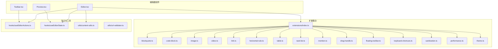
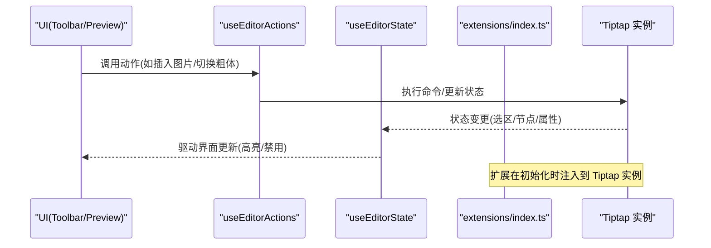
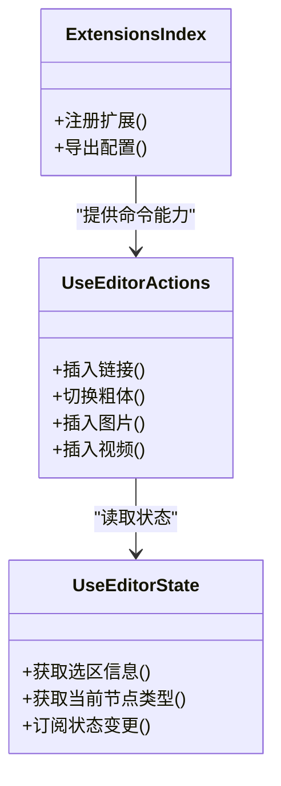
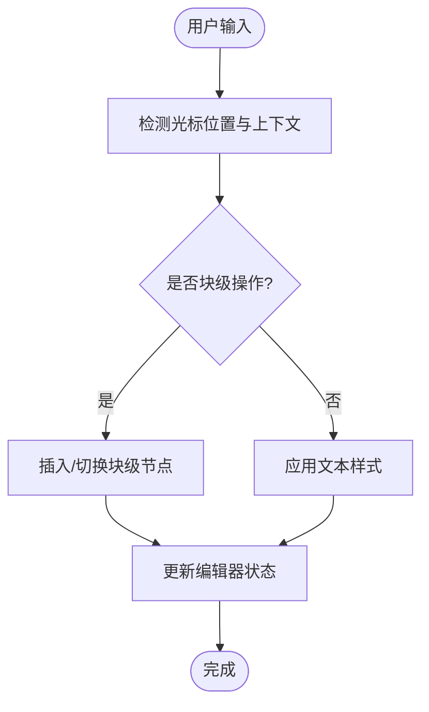
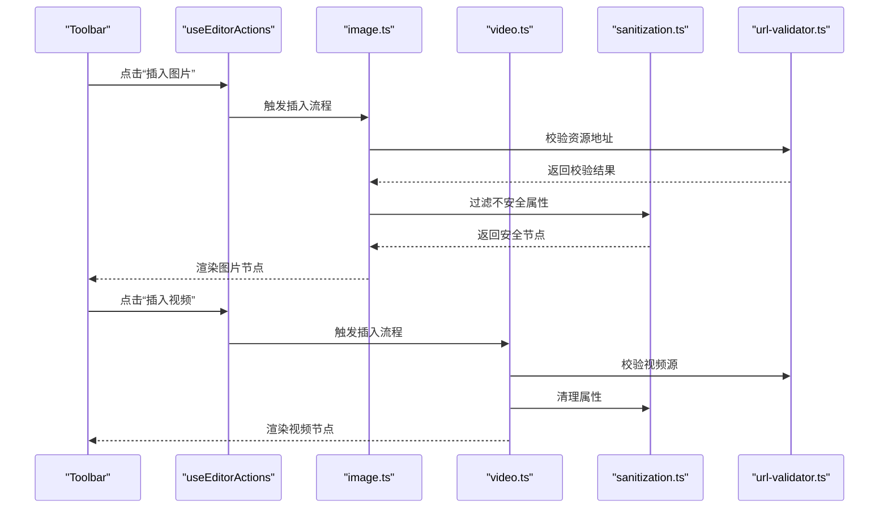
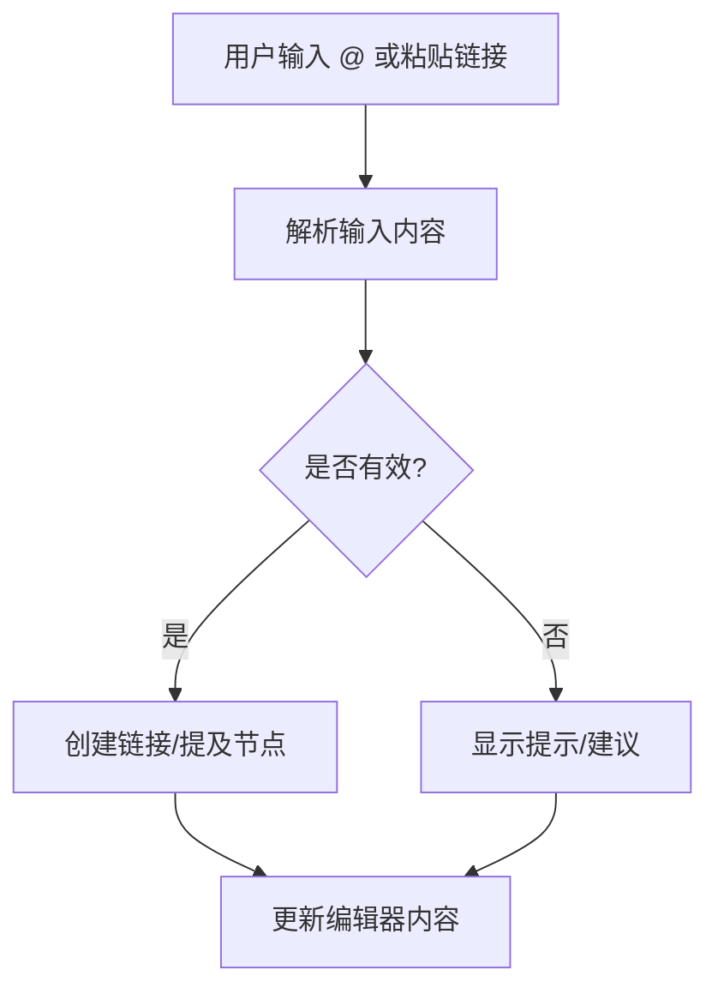
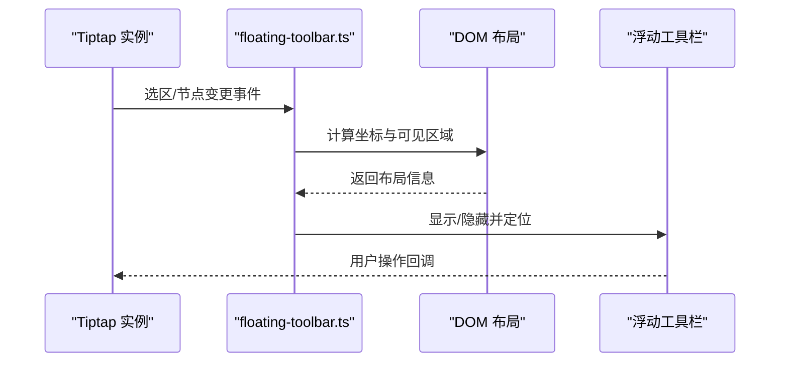
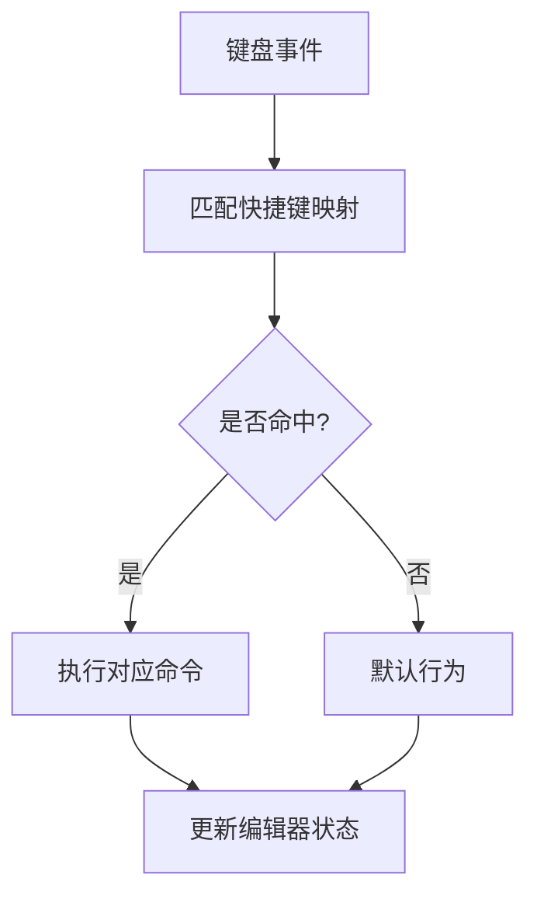
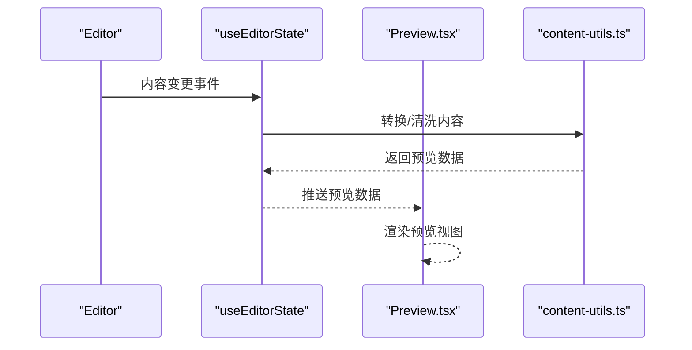
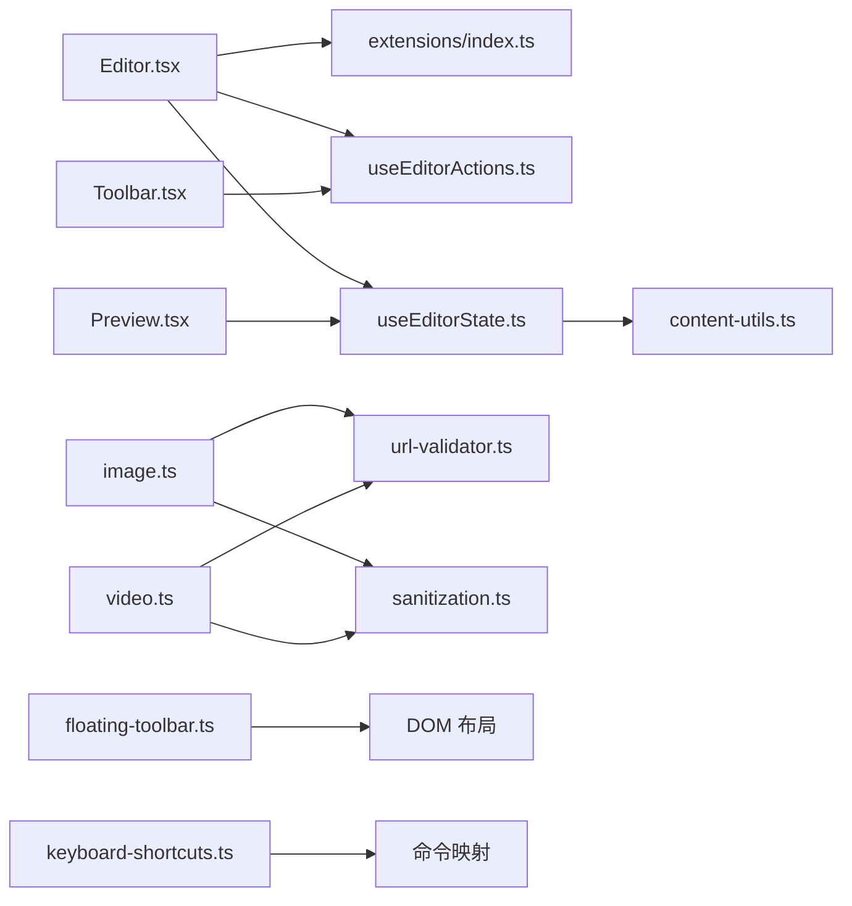

# 富文本编辑器

<cite>
**本文引用的文件**   
- [notifuse/console/src/components/editor/Editor.tsx](file://notifuse/console/src/components/editor/Editor.tsx)
- [notifuse/console/src/components/editor/extensions/index.ts](file://notifuse/console/src/components/editor/extensions/index.ts)
- [notifuse/console/src/components/editor/extensions/blockquote.ts](file://notifuse/console/src/components/editor/extensions/blockquote.ts)
- [notifuse/console/src/components/editor/extensions/code-block.ts](file://notifuse/console/src/components/editor/extensions/code-block.ts)
- [notifuse/console/src/components/editor/extensions/image.ts](file://notifuse/console/src/components/editor/extensions/image.ts)
- [notifuse/console/src/components/editor/extensions/video.ts](file://notifuse/console/src/components/editor/extensions/video.ts)
- [notifuse/console/src/components/editor/extensions/link.ts](file://notifuse/console/src/components/editor/extensions/link.ts)
- [notifuse/console/src/components/editor/extensions/horizontal-rule.ts](file://notifuse/console/src/components/editor/extensions/horizontal-rule.ts)
- [notifuse/console/src/components/editor/extensions/table.ts](file://notifuse/console/src/components/editor/extensions/table.ts)
- [notifuse/console/src/components/editor/extensions/task-list.ts](file://notifuse/console/src/components/editor/extensions/task-list.ts)
- [notifuse/console/src/components/editor/extensions/mention.ts](file://notifuse/console/src/components/editor/extensions/mention.ts)
- [notifuse/console/src/components/editor/extensions/drag-handle.ts](file://notifuse/console/src/components/editor/extensions/drag-handle.ts)
- [notifuse/console/src/components/editor/extensions/floating-toolbar.ts](file://notifuse/console/src/components/editor/extensions/floating-toolbar.ts)
- [notifuse/console/src/components/editor/extensions/keyboard-shortcuts.ts](file://notifuse/console/src/components/editor/extensions/keyboard-shortcuts.ts)
- [notifuse/console/src/components/editor/extensions/sanitization.ts](file://notifuse/console/src/components/editor/extensions/sanitization.ts)
- [notifuse/console/src/components/editor/extensions/performance.ts](file://notifuse/console/src/components/editor/extensions/performance.ts)
- [notifuse/console/src/components/editor/extensions/theme.ts](file://notifuse/console/src/components/editor/extensions/theme.ts)
- [notifuse/console/src/components/editor/Toolbar.tsx](file://notifuse/console/src/components/editor/Toolbar.tsx)
- [notifuse/console/src/components/editor/Preview.tsx](file://notifuse/console/src/components/editor/Preview.tsx)
- [notifuse/console/src/components/editor/hooks/useEditorActions.ts](file://notifuse/console/src/components/editor/hooks/useEditorActions.ts)
- [notifuse/console/src/components/editor/hooks/useEditorState.ts](file://notifuse/console/src/components/editor/hooks/useEditorState.ts)
- [notifuse/console/src/components/editor/utils/content-utils.ts](file://notifuse/console/src/components/editor/utils/content-utils.ts)
- [notifuse/console/src/components/editor/utils/url-validator.ts](file://notifuse/console/src/components/editor/utils/url-validator.ts)
</cite>

## 目录
1. [简介](#简介)
2. [项目结构](#项目结构)
3. [核心组件](#核心组件)
4. [架构总览](#架构总览)
5. [详细组件分析](#详细组件分析)
6. [依赖关系分析](#依赖关系分析)
7. [性能考虑](#性能考虑)
8. [故障排查指南](#故障排查指南)
9. [结论](#结论)
10. [附录](#附录)

## 简介
本文件为 Notifuse 富文本编辑器的技术文档，聚焦于基于 Tiptap 的编辑器架构与扩展体系。内容涵盖：
- 扩展系统与动作注册机制
- 工具栏定制与浮动工具栏实现
- 块级元素操作、文本样式处理、图片插入与视频嵌入
- 快捷键系统与实时预览机制
- 性能优化、内容安全与跨浏览器兼容方案
- 自定义扩展开发指南与主题定制方法

## 项目结构
编辑器位于 console 前端工程内，采用“组件 + 扩展 + 钩子 + 工具”的分层组织方式：
- 组件层：Editor、Toolbar、Preview
- 扩展层：按能力划分（块级、媒体、交互、体验等）
- 钩子层：封装编辑器状态与动作
- 工具层：内容处理、URL 校验等

图表来源
- [notifuse/console/src/components/editor/Editor.tsx](file://notifuse/console/src/components/editor/Editor.tsx)
- [notifuse/console/src/components/editor/extensions/index.ts](file://notifuse/console/src/components/editor/extensions/index.ts)
- [notifuse/console/src/components/editor/hooks/useEditorActions.ts](file://notifuse/console/src/components/editor/hooks/useEditorActions.ts)
- [notifuse/console/src/components/editor/hooks/useEditorState.ts](file://notifuse/console/src/components/editor/hooks/useEditorState.ts)
- [notifuse/console/src/components/editor/utils/content-utils.ts](file://notifuse/console/src/components/editor/utils/content-utils.ts)

章节来源
- [notifuse/console/src/components/editor/Editor.tsx](file://notifuse/console/src/components/editor/Editor.tsx)
- [notifuse/console/src/components/editor/extensions/index.ts](file://notifuse/console/src/components/editor/extensions/index.ts)

## 核心组件
- Editor：初始化 Tiptap 实例，挂载扩展、事件监听、内容同步与渲染容器。
- Toolbar：提供常用操作的快捷入口，通过动作钩子触发编辑器命令。
- Preview：将编辑器内容转换为可预览的静态视图，支持主题与样式隔离。

章节来源
- [notifuse/console/src/components/editor/Editor.tsx](file://notifuse/console/src/components/editor/Editor.tsx)
- [notifuse/console/src/components/editor/Toolbar.tsx](file://notifuse/console/src/components/editor/Toolbar.tsx)
- [notifuse/console/src/components/editor/Preview.tsx](file://notifuse/console/src/components/editor/Preview.tsx)

## 架构总览
编辑器以 Tiptap 为核心，通过扩展系统组合能力；上层组件通过钩子访问编辑器状态与动作；工具层负责通用逻辑与安全校验。

图表来源
- [notifuse/console/src/components/editor/hooks/useEditorActions.ts](file://notifuse/console/src/components/editor/hooks/useEditorActions.ts)
- [notifuse/console/src/components/editor/hooks/useEditorState.ts](file://notifuse/console/src/components/editor/hooks/useEditorState.ts)
- [notifuse/console/src/components/editor/extensions/index.ts](file://notifuse/console/src/components/editor/extensions/index.ts)

## 详细组件分析

### 扩展系统与动作注册机制
- 扩展聚合：index.ts 集中注册所有扩展，便于统一管理与按需启用。
- 动作注册：useEditorActions 暴露一组高层 API（如插入链接、切换列表），内部调用 Tiptap 命令或扩展提供的命令。
- 状态订阅：useEditorState 订阅编辑器状态变化，供 UI 控制按钮激活态、禁用态等。

图表来源
- [notifuse/console/src/components/editor/extensions/index.ts](file://notifuse/console/src/components/editor/extensions/index.ts)
- [notifuse/console/src/components/editor/hooks/useEditorActions.ts](file://notifuse/console/src/components/editor/hooks/useEditorActions.ts)
- [notifuse/console/src/components/editor/hooks/useEditorState.ts](file://notifuse/console/src/components/editor/hooks/useEditorState.ts)

章节来源
- [notifuse/console/src/components/editor/extensions/index.ts](file://notifuse/console/src/components/editor/extensions/index.ts)
- [notifuse/console/src/components/editor/hooks/useEditorActions.ts](file://notifuse/console/src/components/editor/hooks/useEditorActions.ts)
- [notifuse/console/src/components/editor/hooks/useEditorState.ts](file://notifuse/console/src/components/editor/hooks/useEditorState.ts)

### 块级元素操作与文本样式
- 块级元素：引用块、代码块、水平分割线、表格、任务列表等扩展提供结构化能力。
- 文本样式：通过基础样式扩展与自定义扩展组合，实现加粗、斜体、下划线、行内代码等。
- 拖拽与定位：拖拽手柄扩展增强块级元素的移动与排序体验。

图表来源
- [notifuse/console/src/components/editor/extensions/blockquote.ts](file://notifuse/console/src/components/editor/extensions/blockquote.ts)
- [notifuse/console/src/components/editor/extensions/code-block.ts](file://notifuse/console/src/components/editor/extensions/code-block.ts)
- [notifuse/console/src/components/editor/extensions/horizontal-rule.ts](file://notifuse/console/src/components/editor/extensions/horizontal-rule.ts)
- [notifuse/console/src/components/editor/extensions/table.ts](file://notifuse/console/src/components/editor/extensions/table.ts)
- [notifuse/console/src/components/editor/extensions/task-list.ts](file://notifuse/console/src/components/editor/extensions/task-list.ts)
- [notifuse/console/src/components/editor/extensions/drag-handle.ts](file://notifuse/console/src/components/editor/extensions/drag-handle.ts)

章节来源
- [notifuse/console/src/components/editor/extensions/blockquote.ts](file://notifuse/console/src/components/editor/extensions/blockquote.ts)
- [notifuse/console/src/components/editor/extensions/code-block.ts](file://notifuse/console/src/components/editor/extensions/code-block.ts)
- [notifuse/console/src/components/editor/extensions/horizontal-rule.ts](file://notifuse/console/src/components/editor/extensions/horizontal-rule.ts)
- [notifuse/console/src/components/editor/extensions/table.ts](file://notifuse/console/src/components/editor/extensions/table.ts)
- [notifuse/console/src/components/editor/extensions/task-list.ts](file://notifuse/console/src/components/editor/extensions/task-list.ts)
- [notifuse/console/src/components/editor/extensions/drag-handle.ts](file://notifuse/console/src/components/editor/extensions/drag-handle.ts)

### 图片插入与视频嵌入
- 图片扩展：支持本地上传、粘贴、拖拽插入，包含尺寸控制与占位图。
- 视频扩展：支持 URL 嵌入与本地文件上传，自动适配不同平台播放器。
- 安全校验：结合 URL 校验工具对资源地址进行白名单与协议检查。

图表来源
- [notifuse/console/src/components/editor/extensions/image.ts](file://notifuse/console/src/components/editor/extensions/image.ts)
- [notifuse/console/src/components/editor/extensions/video.ts](file://notifuse/console/src/components/editor/extensions/video.ts)
- [notifuse/console/src/components/editor/extensions/sanitization.ts](file://notifuse/console/src/components/editor/extensions/sanitization.ts)
- [notifuse/console/src/components/editor/utils/url-validator.ts](file://notifuse/console/src/components/editor/utils/url-validator.ts)
- [notifuse/console/src/components/editor/hooks/useEditorActions.ts](file://notifuse/console/src/components/editor/hooks/useEditorActions.ts)

章节来源
- [notifuse/console/src/components/editor/extensions/image.ts](file://notifuse/console/src/components/editor/extensions/image.ts)
- [notifuse/console/src/components/editor/extensions/video.ts](file://notifuse/console/src/components/editor/extensions/video.ts)
- [notifuse/console/src/components/editor/extensions/sanitization.ts](file://notifuse/console/src/components/editor/extensions/sanitization.ts)
- [notifuse/console/src/components/editor/utils/url-validator.ts](file://notifuse/console/src/components/editor/utils/url-validator.ts)

### 链接与提及
- 链接扩展：支持手动输入与自动识别 URL，提供跳转与编辑对话框。
- 提及扩展：在输入 @ 时触发候选列表，支持搜索与选择插入。

图表来源
- [notifuse/console/src/components/editor/extensions/link.ts](file://notifuse/console/src/components/editor/extensions/link.ts)
- [notifuse/console/src/components/editor/extensions/mention.ts](file://notifuse/console/src/components/editor/extensions/mention.ts)

章节来源
- [notifuse/console/src/components/editor/extensions/link.ts](file://notifuse/console/src/components/editor/extensions/link.ts)
- [notifuse/console/src/components/editor/extensions/mention.ts](file://notifuse/console/src/components/editor/extensions/mention.ts)

### 浮动工具栏实现原理
- 触发条件：选区变化、节点类型变化、滚动位置变化。
- 定位策略：计算光标/选区边界，避免溢出视口，支持吸附与层级管理。
- 行为绑定：根据上下文动态展示可用操作（如加粗、链接、对齐）。

图表来源
- [notifuse/console/src/components/editor/extensions/floating-toolbar.ts](file://notifuse/console/src/components/editor/extensions/floating-toolbar.ts)

章节来源
- [notifuse/console/src/components/editor/extensions/floating-toolbar.ts](file://notifuse/console/src/components/editor/extensions/floating-toolbar.ts)

### 快捷键系统
- 全局快捷键：Ctrl/Cmd+B/I/U 等文本样式，Enter/Shift+Enter 换行控制。
- 块级快捷键：Tab/Shift+Tab 缩进，数字键前缀转任务列表等。
- 自定义快捷键：通过键盘扩展注册命令映射，避免冲突。

图表来源
- [notifuse/console/src/components/editor/extensions/keyboard-shortcuts.ts](file://notifuse/console/src/components/editor/extensions/keyboard-shortcuts.ts)

章节来源
- [notifuse/console/src/components/editor/extensions/keyboard-shortcuts.ts](file://notifuse/console/src/components/editor/extensions/keyboard-shortcuts.ts)

### 实时预览机制
- 数据流：编辑器内容变更 -> 钩子订阅 -> 预览组件渲染。
- 转换策略：将编辑器 JSON/HTML 转换为预览模板，支持主题变量注入。
- 性能优化：防抖渲染、增量更新、虚拟滚动（长内容场景）。

图表来源
- [notifuse/console/src/components/editor/Preview.tsx](file://notifuse/console/src/components/editor/Preview.tsx)
- [notifuse/console/src/components/editor/hooks/useEditorState.ts](file://notifuse/console/src/components/editor/hooks/useEditorState.ts)
- [notifuse/console/src/components/editor/utils/content-utils.ts](file://notifuse/console/src/components/editor/utils/content-utils.ts)

章节来源
- [notifuse/console/src/components/editor/Preview.tsx](file://notifuse/console/src/components/editor/Preview.tsx)
- [notifuse/console/src/components/editor/hooks/useEditorState.ts](file://notifuse/console/src/components/editor/hooks/useEditorState.ts)
- [notifuse/console/src/components/editor/utils/content-utils.ts](file://notifuse/console/src/components/editor/utils/content-utils.ts)

### 工具栏定制
- 分组与顺序：按功能域分组（文本、块级、媒体、插入），支持拖拽排序。
- 条件显示：根据选区上下文动态显示/隐藏按钮。
- 主题联动：按钮图标与颜色跟随主题扩展。

章节来源
- [notifuse/console/src/components/editor/Toolbar.tsx](file://notifuse/console/src/components/editor/Toolbar.tsx)
- [notifuse/console/src/components/editor/extensions/theme.ts](file://notifuse/console/src/components/editor/extensions/theme.ts)

### 自定义扩展开发指南
- 步骤概览：
  - 定义扩展模块：实现节点/标记/命令/插件。
  - 注册扩展：在 index.ts 中导入并加入扩展列表。
  - 暴露动作：在 useEditorActions 中添加高层 API。
  - 适配 UI：在 Toolbar 添加按钮，在 Floating Toolbar 增加上下文操作。
  - 测试验证：覆盖正常路径与异常路径，确保跨浏览器一致。
- 最佳实践：
  - 保持单一职责，避免在扩展中耦合过多 UI 逻辑。
  - 使用工具函数处理内容与 URL 校验，保证安全性。
  - 遵循性能规范，避免频繁重排与重绘。

章节来源
- [notifuse/console/src/components/editor/extensions/index.ts](file://notifuse/console/src/components/editor/extensions/index.ts)
- [notifuse/console/src/components/editor/hooks/useEditorActions.ts](file://notifuse/console/src/components/editor/hooks/useEditorActions.ts)
- [notifuse/console/src/components/editor/extensions/floating-toolbar.ts](file://notifuse/console/src/components/editor/extensions/floating-toolbar.ts)
- [notifuse/console/src/components/editor/extensions/sanitization.ts](file://notifuse/console/src/components/editor/extensions/sanitization.ts)
- [notifuse/console/src/components/editor/extensions/performance.ts](file://notifuse/console/src/components/editor/extensions/performance.ts)

### 主题定制方法
- 主题扩展：提供 CSS 变量、组件样式与深色模式切换。
- 运行时切换：通过状态钩子切换主题类名，预览与编辑器同步。
- 品牌化：Logo、主色、字体、圆角等可配置项。

章节来源
- [notifuse/console/src/components/editor/extensions/theme.ts](file://notifuse/console/src/components/editor/extensions/theme.ts)
- [notifuse/console/src/components/editor/Preview.tsx](file://notifuse/console/src/components/editor/Preview.tsx)

## 依赖关系分析
- 组件依赖：Editor 依赖扩展集合与钩子；Toolbar 依赖动作钩子；Preview 依赖状态钩子与内容工具。
- 扩展依赖：媒体扩展依赖 URL 校验与安全清洗；浮动工具栏依赖选区与 DOM 布局；快捷键扩展依赖命令映射。
- 外部依赖：Tiptap 核心库、可选的第三方插件（如表格、任务列表）。

图表来源
- [notifuse/console/src/components/editor/Editor.tsx](file://notifuse/console/src/components/editor/Editor.tsx)
- [notifuse/console/src/components/editor/extensions/index.ts](file://notifuse/console/src/components/editor/extensions/index.ts)
- [notifuse/console/src/components/editor/hooks/useEditorActions.ts](file://notifuse/console/src/components/editor/hooks/useEditorActions.ts)
- [notifuse/console/src/components/editor/hooks/useEditorState.ts](file://notifuse/console/src/components/editor/hooks/useEditorState.ts)
- [notifuse/console/src/components/editor/utils/content-utils.ts](file://notifuse/console/src/components/editor/utils/content-utils.ts)
- [notifuse/console/src/components/editor/extensions/image.ts](file://notifuse/console/src/components/editor/extensions/image.ts)
- [notifuse/console/src/components/editor/extensions/video.ts](file://notifuse/console/src/components/editor/extensions/video.ts)
- [notifuse/console/src/components/editor/extensions/sanitization.ts](file://notifuse/console/src/components/editor/extensions/sanitization.ts)
- [notifuse/console/src/components/editor/extensions/floating-toolbar.ts](file://notifuse/console/src/components/editor/extensions/floating-toolbar.ts)
- [notifuse/console/src/components/editor/extensions/keyboard-shortcuts.ts](file://notifuse/console/src/components/editor/extensions/keyboard-shortcuts.ts)

章节来源
- [notifuse/console/src/components/editor/Editor.tsx](file://notifuse/console/src/components/editor/Editor.tsx)
- [notifuse/console/src/components/editor/extensions/index.ts](file://notifuse/console/src/components/editor/extensions/index.ts)
- [notifuse/console/src/components/editor/hooks/useEditorActions.ts](file://notifuse/console/src/components/editor/hooks/useEditorActions.ts)
- [notifuse/console/src/components/editor/hooks/useEditorState.ts](file://notifuse/console/src/components/editor/hooks/useEditorState.ts)
- [notifuse/console/src/components/editor/utils/content-utils.ts](file://notifuse/console/src/components/editor/utils/content-utils.ts)
- [notifuse/console/src/components/editor/extensions/image.ts](file://notifuse/console/src/components/editor/extensions/image.ts)
- [notifuse/console/src/components/editor/extensions/video.ts](file://notifuse/console/src/components/editor/extensions/video.ts)
- [notifuse/console/src/components/editor/extensions/sanitization.ts](file://notifuse/console/src/components/editor/extensions/sanitization.ts)
- [notifuse/console/src/components/editor/extensions/floating-toolbar.ts](file://notifuse/console/src/components/editor/extensions/floating-toolbar.ts)
- [notifuse/console/src/components/editor/extensions/keyboard-shortcuts.ts](file://notifuse/console/src/components/editor/extensions/keyboard-shortcuts.ts)

## 性能考虑
- 渲染优化：使用防抖/节流减少预览渲染频率；长内容采用虚拟滚动或分页加载。
- 内存管理：及时解绑事件监听器，释放大对象引用，避免闭包泄漏。
- 网络请求：图片/视频上传采用分片与断点续传，失败重试与进度反馈。
- 兼容性：针对 Safari/Firefox/Chrome 的差异做降级处理与特性检测。

[本节为通用指导，不直接分析具体文件]

## 故障排查指南
- 常见问题：
  - 图片无法显示：检查 URL 校验规则与 CSP 策略，确认资源可达。
  - 视频播放失败：确认协议与 MIME 类型，必要时提供多格式源。
  - 浮动工具栏错位：检查容器滚动与 transform 影响，调整定位策略。
  - 快捷键冲突：排查全局快捷键与扩展命令映射，避免重复绑定。
- 调试建议：
  - 打开控制台日志，关注扩展生命周期与错误堆栈。
  - 使用浏览器开发者工具检查 DOM 结构与样式覆盖。
  - 最小化复现：逐步禁用扩展定位问题范围。

章节来源
- [notifuse/console/src/components/editor/extensions/sanitization.ts](file://notifuse/console/src/components/editor/extensions/sanitization.ts)
- [notifuse/console/src/components/editor/extensions/floating-toolbar.ts](file://notifuse/console/src/components/editor/extensions/floating-toolbar.ts)
- [notifuse/console/src/components/editor/extensions/keyboard-shortcuts.ts](file://notifuse/console/src/components/editor/extensions/keyboard-shortcuts.ts)

## 结论
Notifuse 富文本编辑器以 Tiptap 为核心，通过模块化扩展体系实现丰富的编辑能力。借助钩子与工具层的抽象，组件间耦合度低、可维护性强。在性能、安全与兼容性方面提供了系统化方案，并通过主题扩展支持品牌化定制。建议在新功能开发中遵循扩展单一职责原则，完善测试与文档，持续提升用户体验。

[本节为总结性内容，不直接分析具体文件]

## 附录
- 术语表：
  - 扩展：对 Tiptap 能力的补充，包括节点、标记、命令与插件。
  - 动作：面向业务的高层 API，封装底层命令与状态操作。
  - 浮动工具栏：随选区变化的上下文操作面板。
- 参考路径：
  - 扩展聚合入口：[extensions/index.ts](file://notifuse/console/src/components/editor/extensions/index.ts)
  - 动作钩子：[hooks/useEditorActions.ts](file://notifuse/console/src/components/editor/hooks/useEditorActions.ts)
  - 状态钩子：[hooks/useEditorState.ts](file://notifuse/console/src/components/editor/hooks/useEditorState.ts)
  - 内容工具：[utils/content-utils.ts](file://notifuse/console/src/components/editor/utils/content-utils.ts)
  - URL 校验：[utils/url-validator.ts](file://notifuse/console/src/components/editor/utils/url-validator.ts)