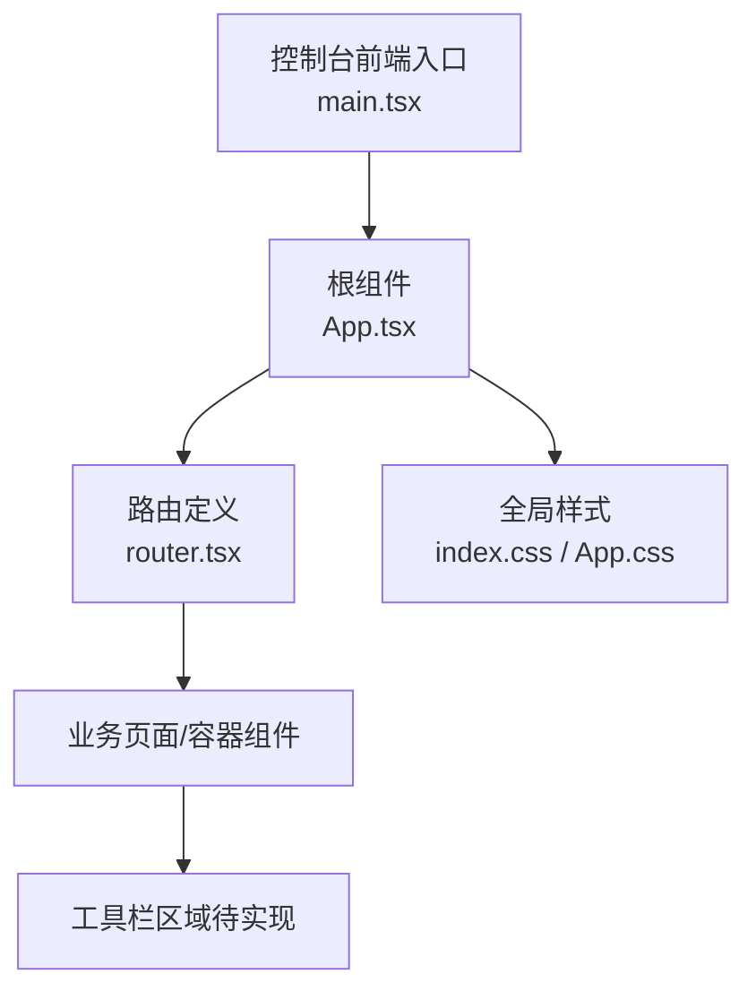
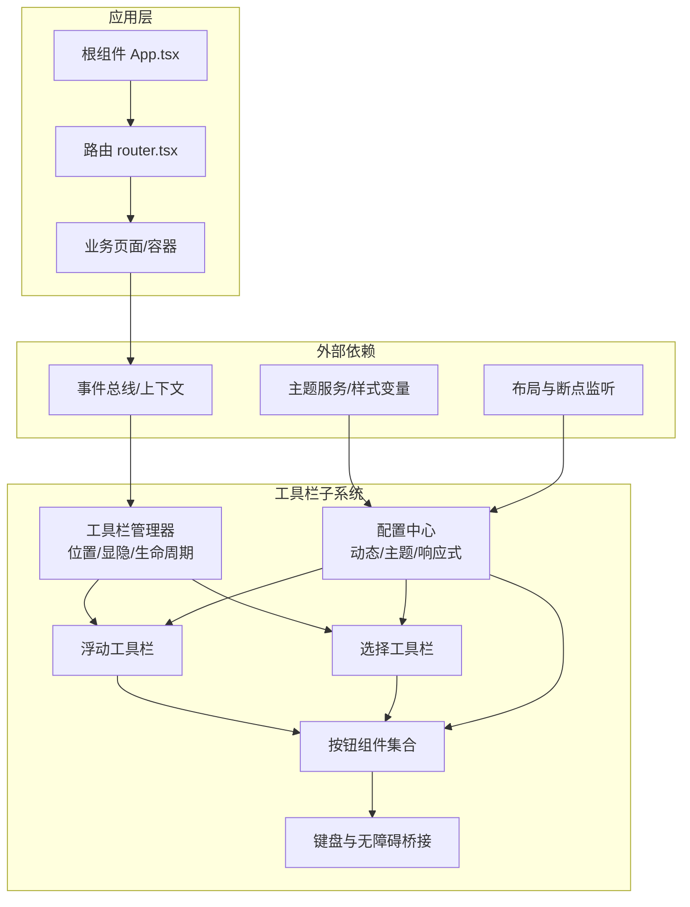
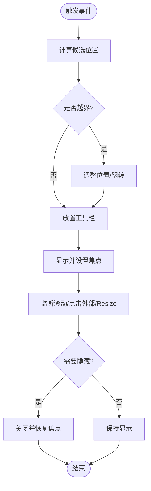
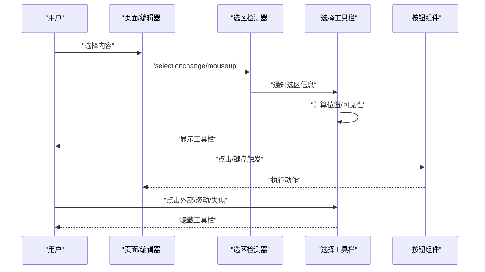
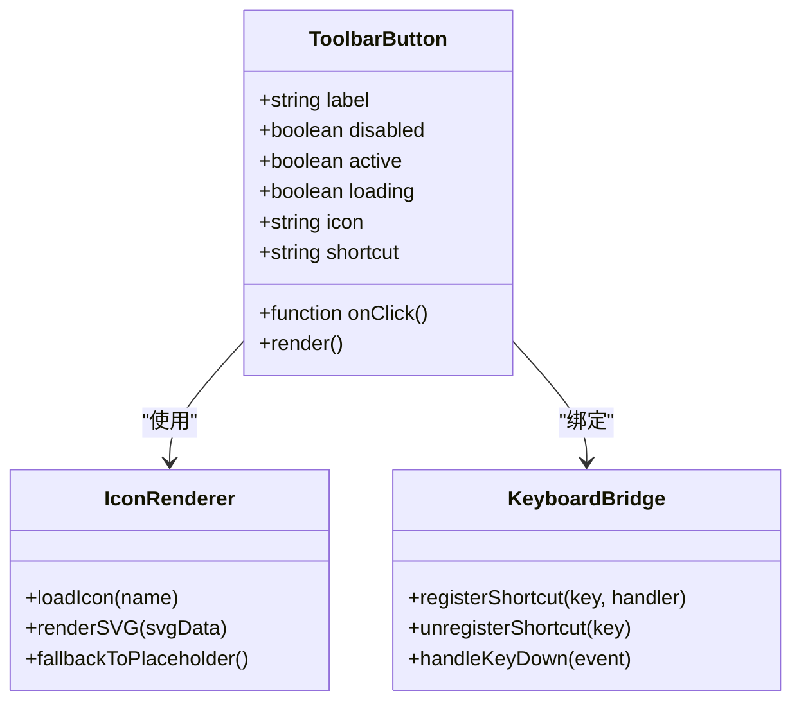
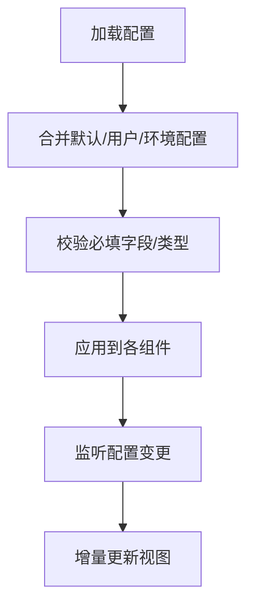
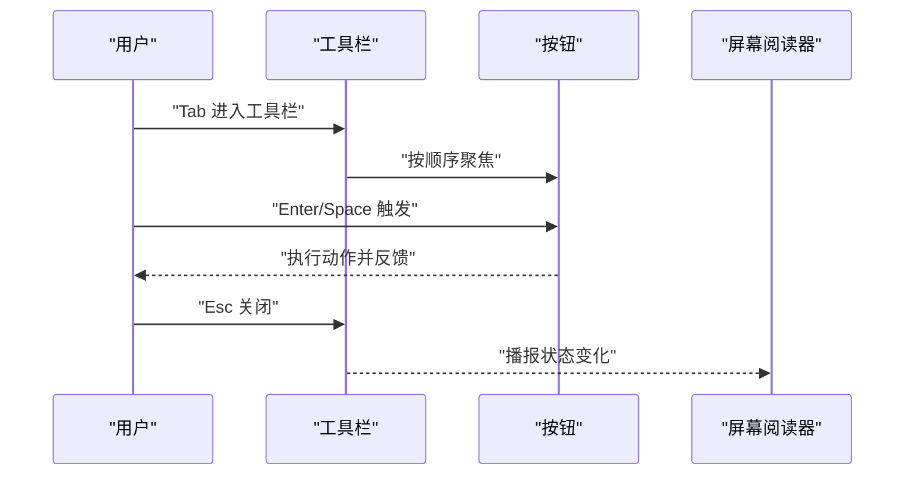
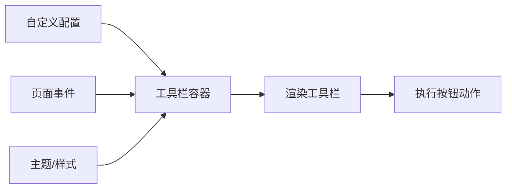
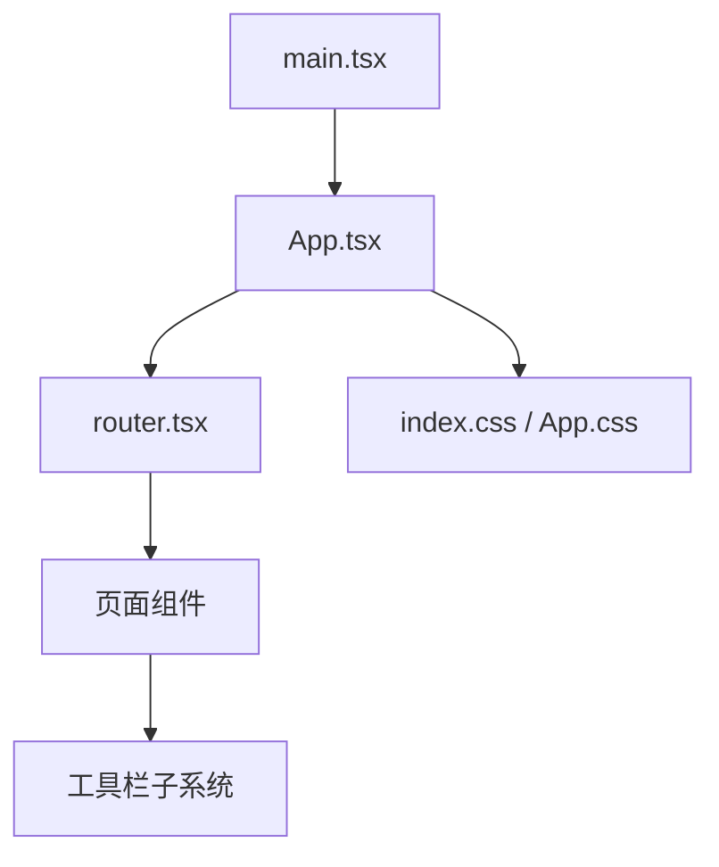

# 工具栏系统

<cite>
**本文引用的文件**   
- [App.tsx](file://notifuse/console/src/App.tsx)
- [router.tsx](file://notifuse/console/src/router.tsx)
- [main.tsx](file://notifuse/console/src/main.tsx)
- [index.css](file://notifuse/console/src/index.css)
- [App.css](file://notifuse/console/src/App.css)
</cite>

## 目录
1. [简介](#简介)
2. [项目结构](#项目结构)
3. [核心组件](#核心组件)
4. [架构总览](#架构总览)
5. [详细组件分析](#详细组件分析)
6. [依赖分析](#依赖分析)
7. [性能考虑](#性能考虑)
8. [故障排查指南](#故障排查指南)
9. [结论](#结论)
10. [附录](#附录)

## 简介
本文件围绕“工具栏系统”展开，聚焦浮动工具栏与选择工具栏的实现原理、按钮组件设计模式、配置系统与主题适配、响应式布局、性能优化、键盘导航与无障碍访问支持，以及自定义工具栏的开发与集成指南。由于当前仓库未包含专门的工具栏实现源码，本文基于前端工程入口与样式文件进行总体说明，并提供通用实践与可落地的架构图示，便于在现有工程中扩展与落地。

## 项目结构
该仓库为多模块工程，其中控制台前端位于 notifuse/console 目录。与工具栏系统相关的前端入口与样式如下：
- 应用入口与根组件挂载点
- 路由初始化与页面组织
- 全局样式与主题变量（如存在）

图示来源
- [main.tsx:1-200](file://notifuse/console/src/main.tsx#L1-L200)
- [App.tsx:1-200](file://notifuse/console/src/App.tsx#L1-L200)
- [router.tsx:1-200](file://notifuse/console/src/router.tsx#L1-L200)
- [index.css:1-200](file://notifuse/console/src/index.css#L1-L200)
- [App.css:1-200](file://notifuse/console/src/App.css#L1-L200)

章节来源
- [main.tsx:1-200](file://notifuse/console/src/main.tsx#L1-L200)
- [App.tsx:1-200](file://notifuse/console/src/App.tsx#L1-L200)
- [router.tsx:1-200](file://notifuse/console/src/router.tsx#L1-L200)
- [index.css:1-200](file://notifuse/console/src/index.css#L1-L200)
- [App.css:1-200](file://notifuse/console/src/App.css#L1-L200)

## 核心组件
本节概述工具栏系统的核心概念与职责划分，便于后续深入分析与落地实施。

- 浮动工具栏（Floating Toolbar）
  - 作用：跟随用户操作或上下文动态出现，提供常用快捷操作。
  - 关键能力：位置计算（相对视口/锚点）、显示隐藏逻辑、层级管理、拖拽与吸附、响应式适配。
- 选择工具栏（Selection Toolbar）
  - 作用：当用户选中内容（文本、图片、表格等）时出现，提供与选中内容相关的操作。
  - 关键能力：选区检测、边界碰撞检测、智能定位、滚动监听、焦点管理。
- 按钮组件（Toolbar Button）
  - 作用：承载具体动作的原子单元。
  - 关键能力：状态管理（启用/禁用/激活/加载）、图标渲染、快捷键绑定、可访问性标签、点击回调。
- 配置系统（Toolbar Config）
  - 作用：集中管理工具栏行为与外观。
  - 关键能力：动态配置（运行时更新）、主题适配（明暗色板、间距、圆角）、响应式布局（断点、折叠策略）。
- 交互与体验
  - 键盘导航（Tab/Shift+Tab、方向键、Enter/Space、Esc）、屏幕阅读器支持（aria-*）、焦点可见性、防抖与节流。

[本节为概念性说明，不直接分析具体文件]

## 架构总览
下图展示工具栏系统在控制台前端的整体架构与数据流。工具栏作为独立子系统，通过事件总线或上下文与页面组件通信，由配置驱动渲染与行为。

图示来源
- [App.tsx:1-200](file://notifuse/console/src/App.tsx#L1-L200)
- [router.tsx:1-200](file://notifuse/console/src/router.tsx#L1-L200)
- [index.css:1-200](file://notifuse/console/src/index.css#L1-L200)
- [App.css:1-200](file://notifuse/console/src/App.css#L1-L200)

## 详细组件分析

### 浮动工具栏（Floating Toolbar）
- 位置计算
  - 基于视口尺寸与目标元素坐标，计算候选位置（上/下/左/右），并进行边界碰撞检测，必要时翻转或吸附到边缘。
  - 使用 transform 与绝对定位减少重排，结合 requestAnimationFrame 提升滚动时的稳定性。
- 显示隐藏逻辑
  - 触发条件：鼠标悬停、点击、右键菜单、输入框聚焦等；隐藏条件：失焦、点击外部、滚动超出阈值、窗口尺寸变化。
  - 防抖与节流：对频繁事件（滚动、resize）做节流，避免过度渲染。
- 用户交互处理
  - 焦点管理：打开时聚焦首个可用按钮，关闭时恢复焦点至触发源。
  - 层级管理：确保工具栏始终处于合适 z-index，避免被模态遮挡。
  - 拖拽与吸附：可选拖拽移动，靠近边缘自动吸附。

章节来源
- [index.css:1-200](file://notifuse/console/src/index.css#L1-L200)
- [App.css:1-200](file://notifuse/console/src/App.css#L1-L200)

### 选择工具栏（Selection Toolbar）
- 选区检测
  - 监听 selectionchange、mouseup、input 等事件，获取选区范围与类型（文本/节点）。
  - 过滤无效选区（空选区、不可编辑区域）。
- 智能定位
  - 以选区包围盒为中心，优先向上显示，若空间不足则向下，左右同理。
  - 针对移动端优化：增大触控热区，避免遮挡光标。
- 交互与可达性
  - 键盘导航：方向键切换按钮，Enter/Space执行，Esc关闭。
  - 屏幕阅读器：为工具栏与按钮添加 aria-label、role、aria-pressed 等属性。

章节来源
- [index.css:1-200](file://notifuse/console/src/index.css#L1-L200)
- [App.css:1-200](file://notifuse/console/src/App.css#L1-L200)

### 按钮组件（Toolbar Button）
- 设计模式
  - 受控与非受控两种形态：可通过 props 控制状态，也可内部维护本地状态。
  - 组合优于继承：通过插槽/子节点注入图标与提示文案。
- 状态管理
  - 状态包括：默认、悬停、按下、禁用、激活、加载中。
  - 状态变更应幂等，避免重复触发副作用。
- 图标渲染
  - 统一图标接口：支持 SVG 内联、图标库引用、占位符降级。
  - 主题适配：颜色、尺寸、圆角、阴影随主题变量切换。
- 快捷键绑定
  - 全局快捷键注册与冲突检测，局部快捷键优先级更高。
  - 按键映射表与国际化提示文案。

章节来源
- [index.css:1-200](file://notifuse/console/src/index.css#L1-L200)
- [App.css:1-200](file://notifuse/console/src/App.css#L1-L200)

### 配置系统（Toolbar Config）
- 动态配置
  - 运行时更新按钮列表、可见性、排序、分组。
  - 配置变更触发增量渲染，避免全量重建。
- 主题适配
  - 通过 CSS 变量或主题对象统一管理颜色、字号、间距、圆角、阴影。
  - 支持明暗主题切换与用户偏好持久化。
- 响应式布局
  - 断点策略：在小屏折叠次要按钮，采用下拉或更多菜单。
  - 自适应宽度与对齐方式，保证在不同分辨率下的可用性。

章节来源
- [index.css:1-200](file://notifuse/console/src/index.css#L1-L200)
- [App.css:1-200](file://notifuse/console/src/App.css#L1-L200)

### 键盘导航与无障碍访问
- 键盘导航
  - Tab/Shift+Tab 在工具栏内循环聚焦。
  - 方向键在水平/垂直排列中切换按钮。
  - Enter/Space 触发按钮动作，Esc 关闭工具栏。
- 无障碍支持
  - role、aria-* 属性完善：aria-label、aria-pressed、aria-expanded、aria-controls。
  - 焦点可见性与对比度符合 WCAG 标准。
  - 屏幕阅读器友好：为图标按钮提供可读描述。

章节来源
- [index.css:1-200](file://notifuse/console/src/index.css#L1-L200)
- [App.css:1-200](file://notifuse/console/src/App.css#L1-L200)

### 自定义工具栏开发与集成指南
- 开发步骤
  - 定义配置：按钮列表、分组、快捷键、可见性规则。
  - 创建容器：在页面合适位置挂载工具栏容器。
  - 接入事件：将页面事件（选择、点击、滚动）转发给工具栏管理器。
  - 主题与样式：引入全局样式与主题变量，确保一致的外观。
- 集成要点
  - 与路由联动：不同路由显示不同工具栏。
  - 与状态管理集成：从全局状态读取上下文，决定按钮可用性与行为。
  - 测试覆盖：单元测试（按钮状态、快捷键）、视觉回归测试（主题与布局）、端到端测试（交互流程）。

章节来源
- [App.tsx:1-200](file://notifuse/console/src/App.tsx#L1-L200)
- [router.tsx:1-200](file://notifuse/console/src/router.tsx#L1-L200)
- [index.css:1-200](file://notifuse/console/src/index.css#L1-L200)
- [App.css:1-200](file://notifuse/console/src/App.css#L1-L200)

## 依赖分析
工具栏子系统与前端入口及样式文件的依赖关系如下：

图示来源
- [main.tsx:1-200](file://notifuse/console/src/main.tsx#L1-L200)
- [App.tsx:1-200](file://notifuse/console/src/App.tsx#L1-L200)
- [router.tsx:1-200](file://notifuse/console/src/router.tsx#L1-L200)
- [index.css:1-200](file://notifuse/console/src/index.css#L1-L200)
- [App.css:1-200](file://notifuse/console/src/App.css#L1-L200)

章节来源
- [main.tsx:1-200](file://notifuse/console/src/main.tsx#L1-L200)
- [App.tsx:1-200](file://notifuse/console/src/App.tsx#L1-L200)
- [router.tsx:1-200](file://notifuse/console/src/router.tsx#L1-L200)
- [index.css:1-200](file://notifuse/console/src/index.css#L1-L200)
- [App.css:1-200](file://notifuse/console/src/App.css#L1-L200)

## 性能考虑
- 渲染优化
  - 使用虚拟列表或按需渲染按钮，避免长列表导致的卡顿。
  - 对频繁更新的属性（位置、显隐）使用 memo 或 shouldComponentUpdate 类优化。
- 事件优化
  - 滚动与 resize 事件节流，避免高频重绘。
  - 选区检测去抖，减少不必要的工具栏重算。
- 资源加载
  - 图标懒加载与缓存，首屏只加载必要图标。
  - 主题与配置静态化，减少运行时解析开销。
- 内存管理
  - 及时移除事件监听与定时器，防止泄漏。
  - 工具栏销毁时清理 DOM 引用与订阅。

[本节为通用指导，不直接分析具体文件]

## 故障排查指南
- 常见问题
  - 工具栏位置异常：检查视口尺寸、父容器 overflow、z-index 层级。
  - 按钮无响应：确认事件绑定、快捷键冲突、禁用状态。
  - 主题不一致：核对 CSS 变量、主题切换时机、样式覆盖顺序。
  - 无障碍问题：验证 aria-* 属性、焦点顺序、屏幕阅读器播报。
- 调试建议
  - 开启浏览器开发者工具的 Accessibility 面板与 Performance 面板。
  - 打印工具栏状态与配置变更日志，定位渲染差异。
  - 编写最小复现用例，隔离第三方样式或脚本影响。

[本节为通用指导，不直接分析具体文件]

## 结论
本文件提供了工具栏系统的整体设计与实现思路，涵盖浮动与选择工具栏的位置与显隐逻辑、按钮组件的状态与交互、配置系统与主题适配、响应式布局、性能优化与无障碍支持，以及自定义工具栏的开发与集成路径。建议在现有控制台前端工程中逐步落地上述方案，并通过测试保障质量与可维护性。

[本节为总结性内容，不直接分析具体文件]

## 附录
- 术语
  - 浮动工具栏：跟随上下文出现的轻量操作面板。
  - 选择工具栏：基于选区内容的上下文操作面板。
  - 受控组件：由外部状态驱动的组件。
  - 非受控组件：内部维护自身状态的组件。
- 参考
  - 前端入口与路由文件用于理解应用结构与挂载点。
  - 全局样式文件用于主题与布局变量的统一管理与覆盖。

[本节为补充信息，不直接分析具体文件]