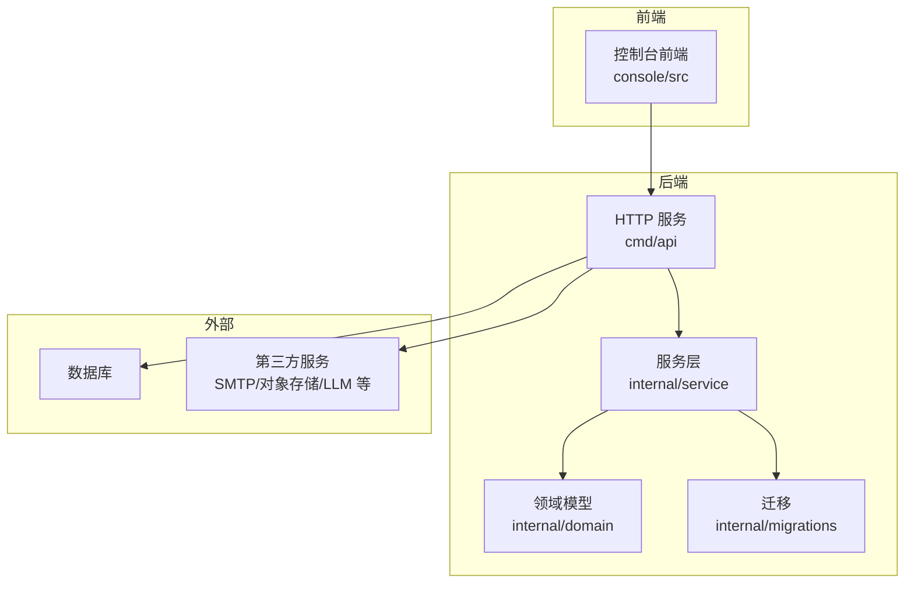
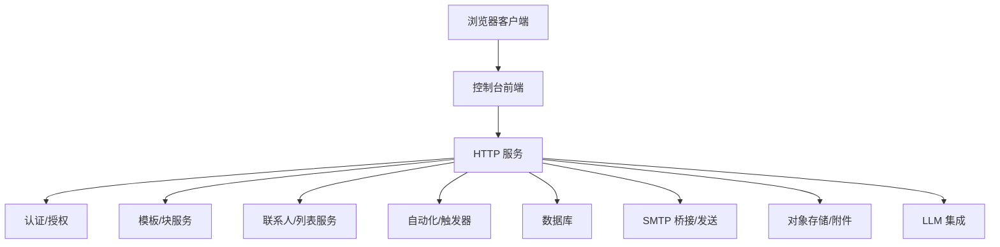
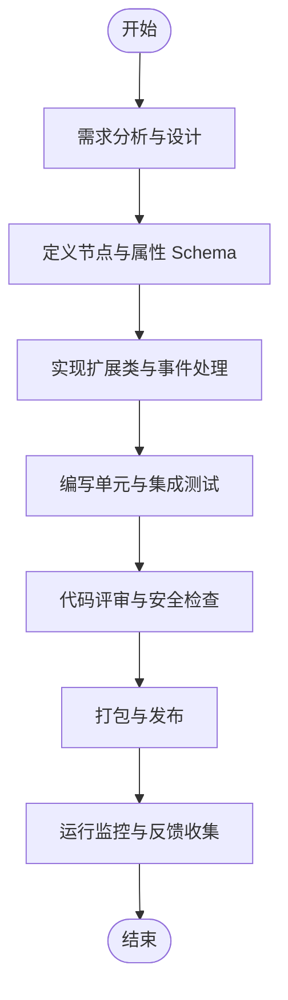
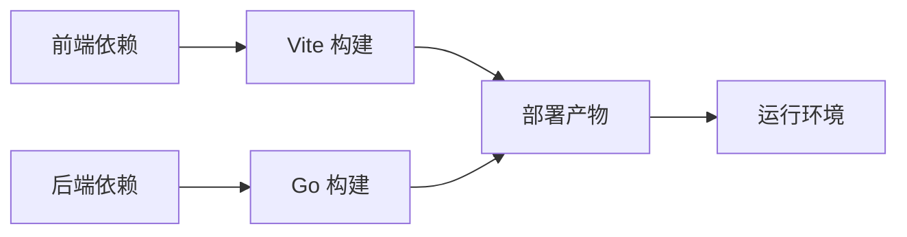

# 扩展系统

<cite>
**本文引用的文件**   
- [README.md](file://README.md)
- [Makefile](file://Makefile)
- [compose.yaml](file://compose.yaml)
- [env.example](file://env.example)
- [CLAUDE.md](file://CLAUDE.md)
</cite>

## 目录
1. [简介](#简介)
2. [项目结构](#项目结构)
3. [核心组件](#核心组件)
4. [架构总览](#架构总览)
5. [详细组件分析](#详细组件分析)
6. [依赖分析](#依赖分析)
7. [性能考虑](#性能考虑)
8. [故障排查指南](#故障排查指南)
9. [结论](#结论)
10. [附录](#附录)

## 简介
本仓库为通知中心与邮件自动化平台，包含控制台前端、Go 后端服务、数据库迁移、OpenAPI 文档、测试与脚本等。当前仓库未提供“编辑器扩展系统”的源代码或相关实现（如图片/YouTube/对齐/背景等扩展）。因此，本节仅对仓库整体目标与范围进行概述，后续章节将基于仓库现有内容给出通用建议与最佳实践，避免臆造不存在的功能细节。

## 项目结构
仓库采用多模块组织：
- 控制台前端（React/Vite）位于 console/src，负责管理界面与可视化能力
- Go 后端服务位于 cmd/api，提供 HTTP API、业务逻辑与集成
- 领域模型与服务层位于 internal/domain 与 internal/service
- 数据库迁移位于 internal/migrations
- OpenAPI 规范位于 openapi
- 测试与集成脚本位于 tests 与 scripts
- 构建与编排通过 Makefile 与 compose.yaml 管理

**图表来源**
- [README.md](file://README.md)
- [Makefile](file://Makefile)
- [compose.yaml](file://compose.yaml)

**章节来源**
- [README.md](file://README.md)
- [Makefile](file://Makefile)
- [compose.yaml](file://compose.yaml)

## 核心组件
- 控制台前端：提供用户交互与管理功能，使用 Vite 构建与 TypeScript
- HTTP 服务：暴露 RESTful API，承载认证、模板、联系人、工作区、自动化等能力
- 领域与服务层：封装业务规则、事件处理、任务调度与外部集成
- 迁移与版本：按版本演进数据库结构，保证可回滚与一致性
- OpenAPI：定义接口契约，便于前后端协作与工具生成
- 测试与脚本：单元测试、集成测试、端到端测试与本地开发辅助

[本节为总体概览，不直接分析具体源码文件]

## 架构总览
下图展示前后端与外部系统的交互关系，以及数据流向。该图为概念性示意，用于帮助理解整体架构，并非映射到特定源码文件。

[本图为概念图，无需图表来源]

## 详细组件分析
由于仓库中不包含“编辑器扩展系统”的实现，以下内容为通用指导与建议，不涉及具体源码文件。

### 自定义扩展开发方法（通用规范）
- 扩展类继承
  - 定义基础扩展抽象类，统一生命周期钩子（初始化、渲染、更新、销毁）
  - 子类继承并覆盖必要钩子，保持最小职责原则
- 节点定义
  - 明确节点类型标识、输入输出端口、默认属性与校验规则
  - 提供序列化/反序列化支持，确保跨进程/持久化一致
- 属性配置
  - 使用声明式 schema 描述属性类型、默认值、可选/必填、枚举值与范围
  - 在 UI 侧根据 schema 动态生成表单控件
- 事件处理
  - 定义事件总线或消息通道，支持发布/订阅模式
  - 事件命名遵循领域语义，携带幂等键与时间戳
- 错误处理
  - 区分可恢复与不可恢复错误，记录结构化日志
  - 提供重试与降级策略
- 安全与权限
  - 对扩展加载进行白名单与签名校验
  - 限制资源访问范围，避免越权操作

[本节为通用指导，不引用具体源码文件]

### 内置扩展功能特性说明（概念性）
- 图片扩展
  - 上传：支持拖拽/选择，校验格式与大小，异步上传并返回 URL
  - 缩放：提供比例缩放与自适应容器尺寸
  - 替换：支持就地替换并保持样式与布局不变
- YouTube 扩展
  - 嵌入：解析视频 ID，生成 iframe 嵌入代码
  - 尺寸控制：响应式宽高比，移动端适配
  - 播放设置：自动播放、静音、循环、字幕等参数
- 对齐扩展
  - 文本对齐：左/中/右/两端对齐
  - 段落布局：行高、段间距、首行缩进
- 背景扩展
  - 背景色：纯色/渐变/透明度
  - 样式应用：全局/局部作用域，优先级与冲突解决

[本节为概念性说明，不引用具体源码文件]

### 扩展开发流程（示例步骤）

[本图为概念流程图，无需图表来源]

## 依赖分析
- 前端依赖：Vite、TypeScript、UI 组件库（由 package.json 管理）
- 后端依赖：Go 标准库与第三方包（由 go.mod 管理）
- 运行时依赖：PostgreSQL、SMTP 服务、对象存储、LLM 提供商等
- 构建与编排：Makefile 命令、Docker Compose 编排

[本图为概念图，无需图表来源]

**章节来源**
- [Makefile](file://Makefile)
- [compose.yaml](file://compose.yaml)

## 性能考虑
- 前端
  - 按需加载与懒加载扩展，减少首屏体积
  - 缓存静态资源与 CDN 加速
- 后端
  - 连接池与超时控制，避免阻塞
  - 批量写入与分页查询，降低数据库压力
  - 异步任务与队列，削峰填谷
- 扩展
  - 避免在主线程执行耗时计算，使用 Web Worker 或后台任务
  - 合理设置重试退避与熔断策略

[本节为通用指导，不引用具体源码文件]

## 故障排查指南
- 常见问题定位
  - 检查环境变量与配置文件是否生效
  - 查看服务日志与错误堆栈，关注最近变更
  - 验证第三方服务连通性与鉴权
- 调试技巧
  - 启用详细日志与追踪 ID
  - 使用断点与交互式调试
  - 构造最小复现用例
- 回滚与恢复
  - 保留历史版本与快照
  - 灰度发布与快速回滚机制

[本节为通用指导，不引用具体源码文件]

## 结论
当前仓库未包含“编辑器扩展系统”的具体实现。上述文档提供了通用的扩展开发规范、架构建议与排障思路，可作为未来引入扩展系统时的参考。若需针对本项目定制扩展方案，建议在现有前后端分层基础上，新增扩展注册中心、Schema 驱动 UI 与事件总线，并与现有服务层与迁移体系保持一致。

[本节为总结，不引用具体源码文件]

## 附录
- 本地开发与测试
  - 使用 Makefile 提供的命令进行构建与测试
  - 使用 compose.yaml 启动依赖服务
  - 参考 env.example 配置必要的环境变量
- 文档与规范
  - CLAUDE.md 包含项目约定与提示，有助于统一开发风格

**章节来源**
- [Makefile](file://Makefile)
- [compose.yaml](file://compose.yaml)
- [env.example](file://env.example)
- [CLAUDE.md](file://CLAUDE.md)