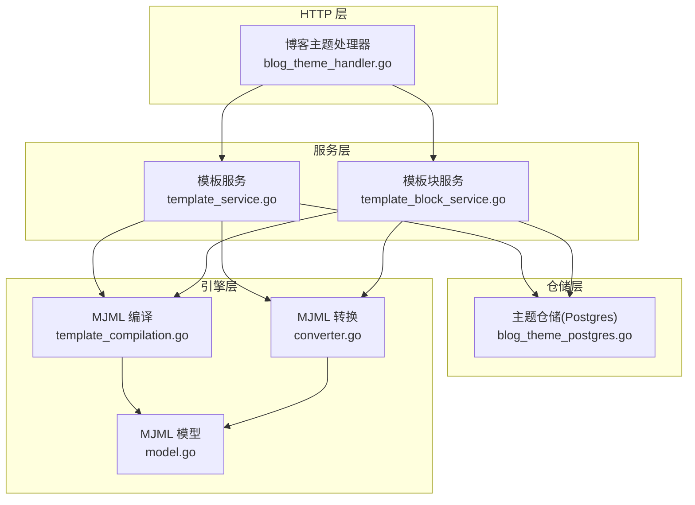
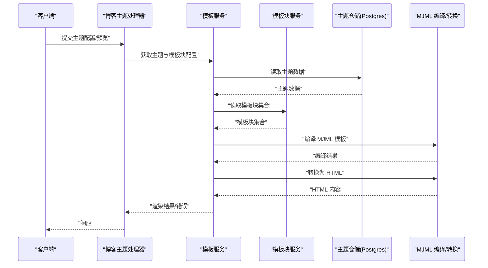
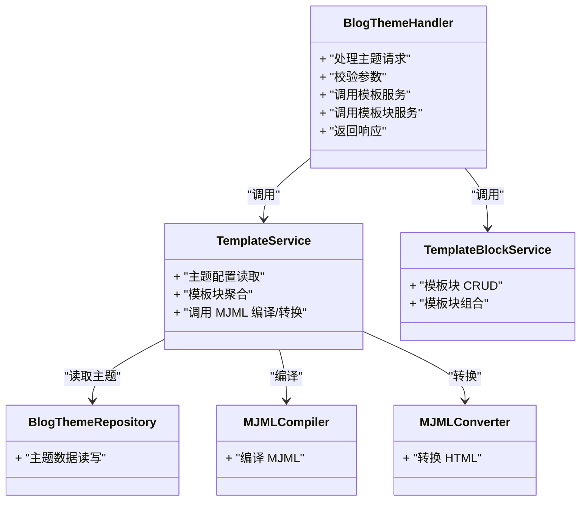
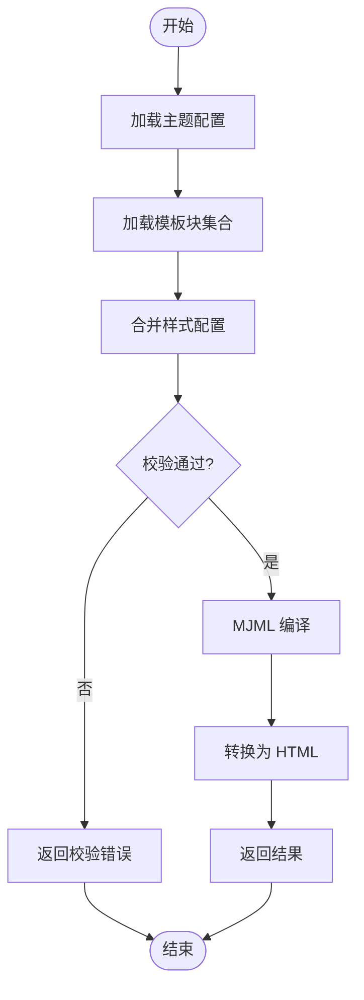
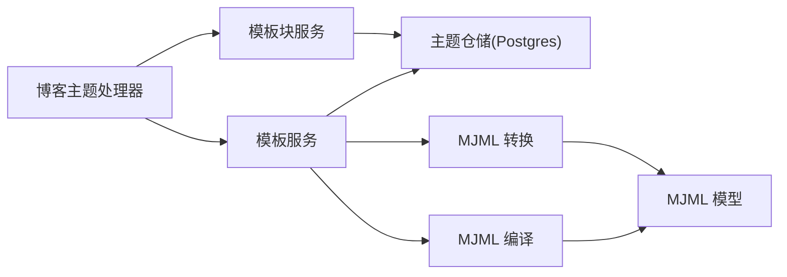

# 样式管理系统

<cite>
**本文引用的文件**   
- [blog_theme_handler.go](file://notifuse/internal/http/blog_theme_handler.go)
- [blog_theme_postgres.go](file://notifuse/internal/repository/blog_theme_postgres.go)
- [template_service.go](file://notifuse/internal/service/template_service.go)
- [template_block_service.go](file://notifuse/internal/service/template_block_service.go)
- [template_compilation.go](file://notifuse/pkg/notifuse_mjml/template_compilation.go)
- [model.go](file://notifuse/pkg/notifuse_mjml/model.go)
- [converter.go](file://notifuse/pkg/notifuse_mjml/converter.go)
</cite>

## 目录
1. [简介](#简介)
2. [项目结构](#项目结构)
3. [核心组件](#核心组件)
4. [架构总览](#架构总览)
5. [详细组件分析](#详细组件分析)
6. [依赖关系分析](#依赖关系分析)
7. [性能考虑](#性能考虑)
8. [故障排查指南](#故障排查指南)
9. [结论](#结论)
10. [附录](#附录)

## 简介
本文件围绕“样式管理系统”展开，聚焦编辑器样式的配置、主题预设与动态应用。系统以博客主题为核心载体，提供主题的创建、更新、查询与删除能力；通过 MJML 模板编译与转换链路，将主题配置渲染为最终可预览/发送的 HTML 样式；同时提供模板块服务，支撑模块化样式复用与组合。文档涵盖：
- 样式配置系统与主题预设管理
- 动态样式应用（MJML 编译与转换）
- 样式工具函数（合并、验证、转换）
- 类型定义与结构规范
- 自定义样式开发与主题定制方法

## 项目结构
样式相关代码主要分布在以下模块：
- HTTP 层：主题接口处理
- 仓储层：主题持久化
- 服务层：模板与模板块业务编排
- 引擎层：MJML 模板编译与转换

图表来源
- [blog_theme_handler.go](file://notifuse/internal/http/blog_theme_handler.go)
- [template_service.go](file://notifuse/internal/service/template_service.go)
- [template_block_service.go](file://notifuse/internal/service/template_block_service.go)
- [blog_theme_postgres.go](file://notifuse/internal/repository/blog_theme_postgres.go)
- [model.go](file://notifuse/pkg/notifuse_mjml/model.go)
- [template_compilation.go](file://notifuse/pkg/notifuse_mjml/template_compilation.go)
- [converter.go](file://notifuse/pkg/notifuse_mjml/converter.go)

章节来源
- [blog_theme_handler.go](file://notifuse/internal/http/blog_theme_handler.go)
- [template_service.go](file://notifuse/internal/service/template_service.go)
- [template_block_service.go](file://notifuse/internal/service/template_block_service.go)
- [blog_theme_postgres.go](file://notifuse/internal/repository/blog_theme_postgres.go)
- [model.go](file://notifuse/pkg/notifuse_mjml/model.go)
- [template_compilation.go](file://notifuse/pkg/notifuse_mjml/template_compilation.go)
- [converter.go](file://notifuse/pkg/notifuse_mjml/converter.go)

## 核心组件
- 博客主题处理器：暴露主题 CRUD 接口，负责请求校验、参数绑定与响应封装。
- 模板服务：编排模板相关的业务逻辑，包括模板与主题的配置读取、合并与渲染准备。
- 模板块服务：管理可复用的样式片段（模板块），支持按模块组合生成完整样式。
- 主题仓储（Postgres）：实现主题数据的持久化读写。
- MJML 引擎：提供模型定义、模板编译与 HTML 转换能力，是样式落地的关键路径。

章节来源
- [blog_theme_handler.go](file://notifuse/internal/http/blog_theme_handler.go)
- [template_service.go](file://notifuse/internal/service/template_service.go)
- [template_block_service.go](file://notifuse/internal/service/template_block_service.go)
- [blog_theme_postgres.go](file://notifuse/internal/repository/blog_theme_postgres.go)
- [model.go](file://notifuse/pkg/notifuse_mjml/model.go)
- [template_compilation.go](file://notifuse/pkg/notifuse_mjml/template_compilation.go)
- [converter.go](file://notifuse/pkg/notifuse_mjml/converter.go)

## 架构总览
样式管理的端到端流程如下：
- 客户端发起主题配置变更或预览请求
- HTTP 处理器接收并校验请求，调用模板服务/模板块服务
- 服务层从仓储加载主题与模板块数据，进行配置合并与校验
- 通过 MJML 编译与转换，产出最终 HTML 样式
- 返回结果给客户端，用于预览或发送

图表来源
- [blog_theme_handler.go](file://notifuse/internal/http/blog_theme_handler.go)
- [template_service.go](file://notifuse/internal/service/template_service.go)
- [template_block_service.go](file://notifuse/internal/service/template_block_service.go)
- [blog_theme_postgres.go](file://notifuse/internal/repository/blog_theme_postgres.go)
- [template_compilation.go](file://notifuse/pkg/notifuse_mjml/template_compilation.go)
- [converter.go](file://notifuse/pkg/notifuse_mjml/converter.go)

## 详细组件分析

### 博客主题处理器（HTTP 层）
职责
- 接收主题相关 API 请求（创建、更新、查询、删除、预览等）
- 校验请求参数，组装上下文，调用服务层
- 统一错误码与响应格式

交互
- 依赖模板服务与模板块服务完成业务编排
- 依赖主题仓储完成数据持久化

图表来源
- [blog_theme_handler.go](file://notifuse/internal/http/blog_theme_handler.go)
- [template_service.go](file://notifuse/internal/service/template_service.go)
- [template_block_service.go](file://notifuse/internal/service/template_block_service.go)
- [blog_theme_postgres.go](file://notifuse/internal/repository/blog_theme_postgres.go)
- [template_compilation.go](file://notifuse/pkg/notifuse_mjml/template_compilation.go)
- [converter.go](file://notifuse/pkg/notifuse_mjml/converter.go)

章节来源
- [blog_theme_handler.go](file://notifuse/internal/http/blog_theme_handler.go)

### 模板服务（服务层）
职责
- 聚合主题与模板块配置
- 执行样式合并、校验与转换
- 协调 MJML 编译与 HTML 转换

关键点
- 样式合并策略：基础主题 + 用户覆盖 + 模板块组合
- 校验规则：必填字段、颜色值合法性、布局约束
- 转换流程：MJML 编译 -> HTML 输出

图表来源
- [template_service.go](file://notifuse/internal/service/template_service.go)
- [template_block_service.go](file://notifuse/internal/service/template_block_service.go)
- [template_compilation.go](file://notifuse/pkg/notifuse_mjml/template_compilation.go)
- [converter.go](file://notifuse/pkg/notifuse_mjml/converter.go)

章节来源
- [template_service.go](file://notifuse/internal/service/template_service.go)
- [template_block_service.go](file://notifuse/internal/service/template_block_service.go)

### 模板块服务（服务层）
职责
- 管理可复用的样式片段（模板块）
- 提供模板块的增删改查与组合能力
- 与模板服务协作，参与最终样式生成

章节来源
- [template_block_service.go](file://notifuse/internal/service/template_block_service.go)

### 主题仓储（Postgres）
职责
- 实现主题数据的持久化存储与检索
- 提供事务性操作，确保主题配置一致性

章节来源
- [blog_theme_postgres.go](file://notifuse/internal/repository/blog_theme_postgres.go)

### MJML 引擎（模型/编译/转换）
- 模型定义：描述 MJML 数据结构与字段约束
- 模板编译：将 MJML 源转换为中间表示或可直接渲染的结构
- 转换：将中间表示转换为最终 HTML

章节来源
- [model.go](file://notifuse/pkg/notifuse_mjml/model.go)
- [template_compilation.go](file://notifuse/pkg/notifuse_mjml/template_compilation.go)
- [converter.go](file://notifuse/pkg/notifuse_mjml/converter.go)

## 依赖关系分析
- HTTP 层对服务层存在强依赖，服务层对仓储与 MJML 引擎存在依赖
- 服务层内部耦合度较低，通过明确接口分离主题与模板块职责
- MJML 引擎作为独立子系统，提供稳定的编译与转换能力

图表来源
- [blog_theme_handler.go](file://notifuse/internal/http/blog_theme_handler.go)
- [template_service.go](file://notifuse/internal/service/template_service.go)
- [template_block_service.go](file://notifuse/internal/service/template_block_service.go)
- [blog_theme_postgres.go](file://notifuse/internal/repository/blog_theme_postgres.go)
- [template_compilation.go](file://notifuse/pkg/notifuse_mjml/template_compilation.go)
- [converter.go](file://notifuse/pkg/notifuse_mjml/converter.go)
- [model.go](file://notifuse/pkg/notifuse_mjml/model.go)

章节来源
- [blog_theme_handler.go](file://notifuse/internal/http/blog_theme_handler.go)
- [template_service.go](file://notifuse/internal/service/template_service.go)
- [template_block_service.go](file://notifuse/internal/service/template_block_service.go)
- [blog_theme_postgres.go](file://notifuse/internal/repository/blog_theme_postgres.go)
- [template_compilation.go](file://notifuse/pkg/notifuse_mjml/template_compilation.go)
- [converter.go](file://notifuse/pkg/notifuse_mjml/converter.go)
- [model.go](file://notifuse/pkg/notifuse_mjml/model.go)

## 性能考虑
- 缓存策略：对频繁访问的主题与模板块数据进行缓存，减少数据库压力
- 批量操作：在合并与转换阶段尽量使用批处理，降低 I/O 次数
- 异步渲染：对于非实时预览场景，采用异步任务队列进行 MJML 编译与转换
- 资源限制：对 MJML 编译与转换设置超时与内存上限，防止异常占用

[本节为通用指导，不直接分析具体文件]

## 故障排查指南
常见问题与定位建议：
- 主题配置缺失或非法：检查模板服务中的校验逻辑与错误返回
- MJML 编译失败：确认模型字段完整性与语法正确性
- HTML 转换异常：核查转换器输入结构与边界条件
- 数据库读写错误：查看仓储层错误码与重试策略

章节来源
- [template_service.go](file://notifuse/internal/service/template_service.go)
- [template_compilation.go](file://notifuse/pkg/notifuse_mjml/template_compilation.go)
- [converter.go](file://notifuse/pkg/notifuse_mjml/converter.go)
- [blog_theme_postgres.go](file://notifuse/internal/repository/blog_theme_postgres.go)

## 结论
样式管理系统以主题为核心，结合模板块与 MJML 引擎，实现了从配置到渲染的完整链路。通过清晰的分层与职责划分，系统在可扩展性与可维护性方面具备良好基础。建议在后续迭代中完善缓存、监控与错误恢复机制，进一步提升稳定性与性能。

[本节为总结性内容，不直接分析具体文件]

## 附录
- 自定义样式开发指南
  - 基于现有主题结构扩展新字段，并在模板服务中增加合并与校验逻辑
  - 新增模板块时，遵循模板块服务的约定接口，确保可被模板服务正确聚合
- 主题定制方法
  - 通过覆盖基础主题字段实现差异化样式
  - 利用模板块组合快速构建复杂页面布局
- 最佳实践
  - 保持主题配置最小必要字段，避免冗余
  - 对颜色、字体等视觉属性建立命名规范与取值范围
  - 在预览前进行本地校验，减少线上错误

[本节为概念性内容，不直接分析具体文件]