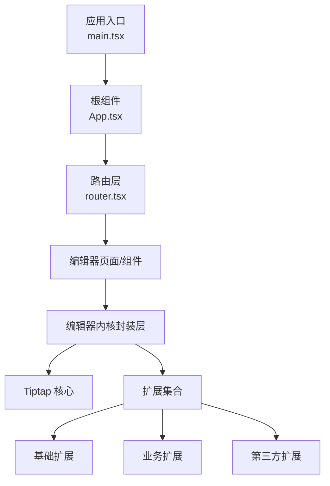
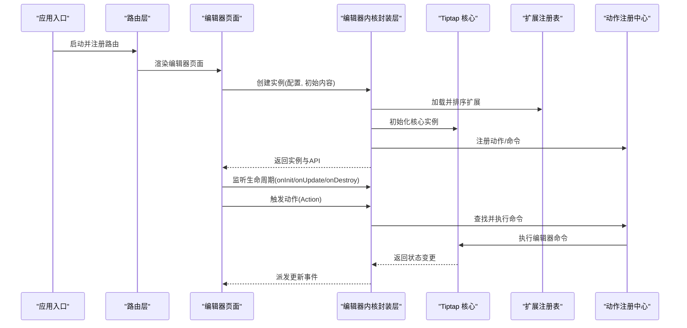
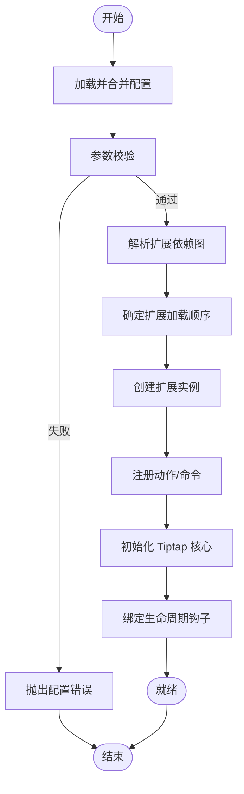
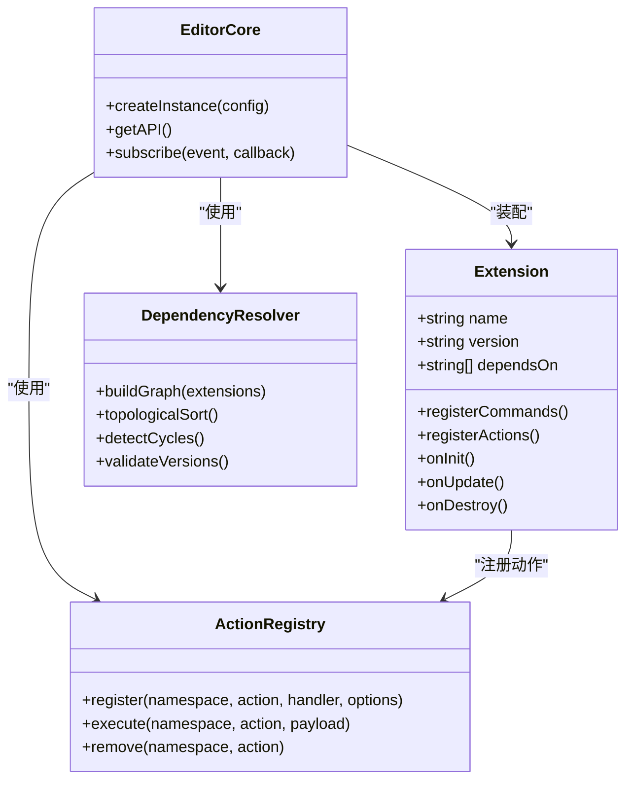
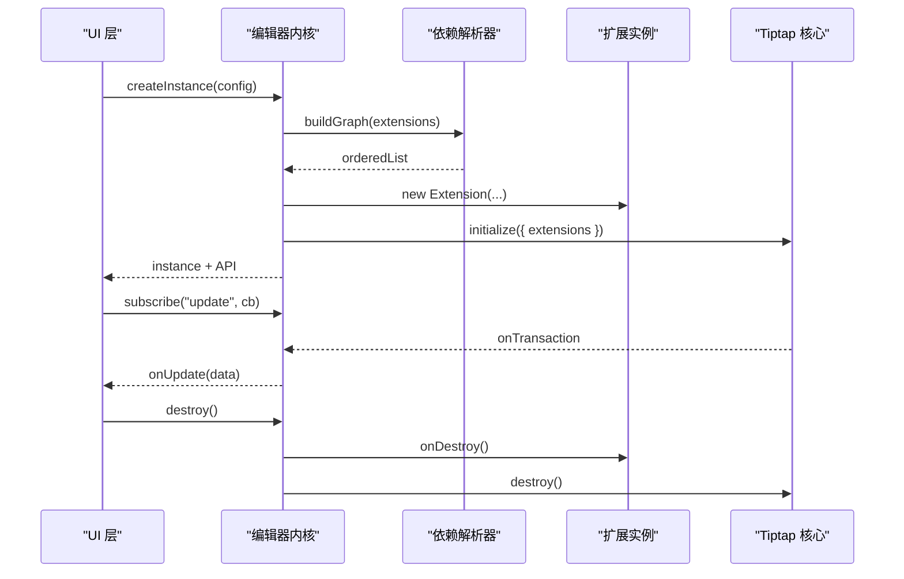
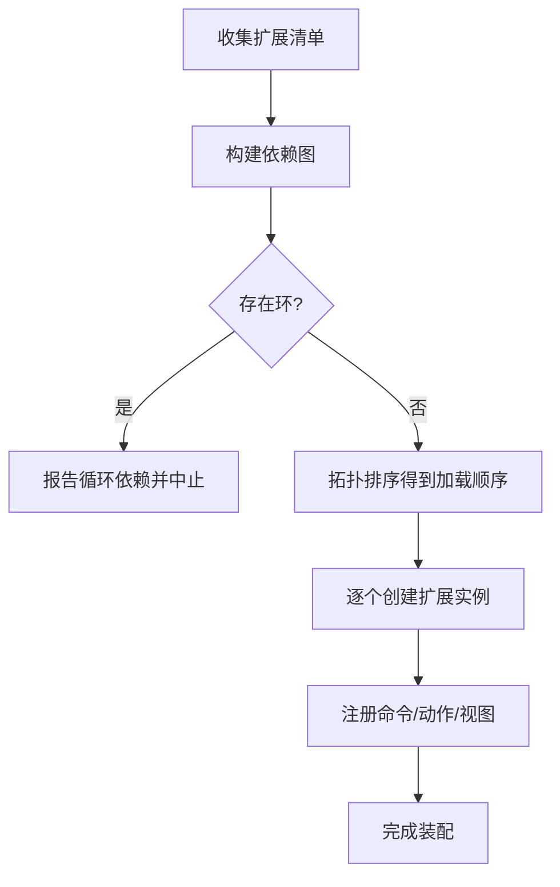
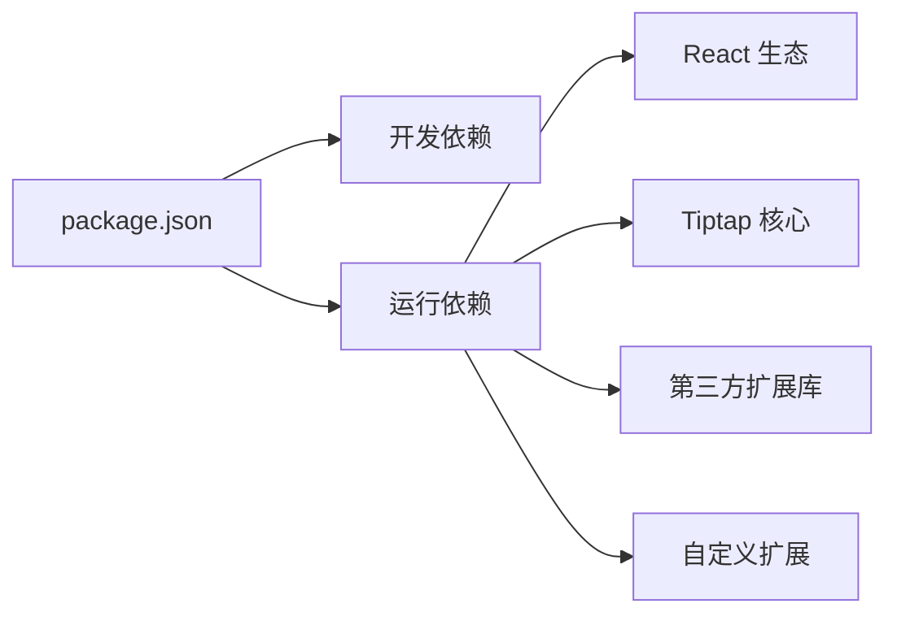

# 编辑器架构设计

<cite>
**本文引用的文件**   
- [package.json](file://notifuse/console/package.json)
- [App.tsx](file://notifuse/console/src/App.tsx)
- [main.tsx](file://notifuse/console/src/main.tsx)
- [router.tsx](file://notifuse/console/src/router.tsx)
</cite>

## 目录
1. [简介](#简介)
2. [项目结构](#项目结构)
3. [核心组件](#核心组件)
4. [架构总览](#架构总览)
5. [详细组件分析](#详细组件分析)
6. [依赖分析](#依赖分析)
7. [性能考虑](#性能考虑)
8. [故障排查指南](#故障排查指南)
9. [结论](#结论)
10. [附录](#附录)

## 简介
本文件面向“基于 Tiptap 的富文本编辑器”的架构设计与实现，聚焦以下目标：
- 扩展系统的设计原理与动作注册机制
- 编辑器的初始化流程、状态管理与生命周期钩子
- 扩展加载顺序、依赖管理与冲突解决策略
- 性能优化方案、内存管理与渲染优化技术
- 架构扩展指南与最佳实践

说明：当前仓库未包含具体的编辑器源码。本文档以通用工程结构与约定为基础，给出可落地的架构蓝图与实践建议，便于在现有前端工程中集成与演进。

## 项目结构
为支撑可扩展的富文本编辑器，推荐在前端控制台项目中采用如下组织方式（概念性）：
- 应用入口与路由层负责挂载编辑器容器与页面级上下文
- 编辑器内核封装层统一处理初始化、配置合并、扩展装配与事件总线
- 扩展目录按功能域划分，每个扩展提供声明式元数据、依赖描述与可选的动作/命令
- 工具与类型定义集中管理，确保跨扩展一致的数据契约

[此图为概念性结构示意，不直接映射具体源文件]

## 核心组件
- 编辑器内核封装层
  - 职责：统一初始化、配置合并、扩展装配、事件分发、状态同步、生命周期钩子编排
  - 关键能力：扩展注册表、依赖解析器、动作/命令注册中心、撤销栈与事务边界、渲染节流与增量更新策略
- 扩展系统
  - 职责：提供声明式扩展接口，支持元数据、依赖声明、动作/命令注册、样式与资源注入
  - 关键能力：版本兼容、冲突检测、按需加载、作用域隔离
- 动作注册机制
  - 职责：将用户交互或外部事件映射到编辑器命令，支持参数校验、副作用执行与结果回写
  - 关键能力：命名空间、优先级、幂等性、错误上报
- 状态管理与生命周期
  - 职责：维护编辑器文档状态、选区状态、扩展私有状态；暴露 onInit/onUpdate/onDestroy 等钩子
  - 关键能力：受控与非受控模式、快照与恢复、变更订阅与去抖

[本节为概念性概述，不直接分析具体文件]

## 架构总览
下图展示从应用入口到编辑器内核与扩展的调用关系与数据流向。

[此图为概念性流程图，不直接映射具体源文件]

## 详细组件分析

### 编辑器内核封装层
- 初始化流程
  - 接收配置项（主题、语言、插件开关、默认扩展列表）
  - 合并默认配置与用户配置，进行参数校验
  - 解析扩展依赖图，生成加载顺序
  - 依次创建扩展实例，收集元数据与动作/命令
  - 初始化 Tiptap 核心，注入扩展与中间件
  - 建立事件总线与状态订阅，暴露 API
- 状态管理
  - 文档状态：JSON 文档树、选区、光标位置
  - 扩展状态：各扩展私有状态，支持序列化/反序列化
  - 全局状态：主题、国际化、权限、只读/编辑模式
  - 变更流：使用不可变更新与增量 diff，避免全量重渲染
- 生命周期钩子
  - onInit：完成扩展装配后执行，适合注册全局快捷键与监听
  - onUpdate：文档变化回调，用于持久化、统计、协同同步
  - onDestroy：清理定时器、事件监听、释放 DOM 引用
- 错误处理
  - 扩展加载失败降级、动作执行异常捕获与上报
  - 提供诊断信息（扩展版本、依赖冲突、命令重复注册）

[此图为概念性流程图，不直接映射具体源文件]

### 扩展系统与动作注册机制
- 扩展声明
  - 元数据：名称、版本、作者、描述、许可证
  - 依赖：其他扩展名与最低版本
  - 资源：样式、字体、图标、脚本
  - 能力：提供的命令、节点、标记、视图、插件
- 依赖管理与冲突解决
  - 构建有向无环图（DAG），拓扑排序得到加载顺序
  - 循环依赖检测与提示
  - 版本范围匹配与兼容性检查
  - 同名扩展覆盖策略：白名单、强制卸载、命名空间隔离
- 动作注册
  - 命名空间：按模块/页面划分，避免全局污染
  - 优先级：相同动作的多处理器按优先级执行
  - 幂等与重试：对副作用操作提供幂等键与重试上限
  - 审计与追踪：记录动作来源、参数、耗时与错误码

[此图为概念性类图，不直接映射具体源文件]

### 初始化流程与生命周期钩子
- 初始化阶段
  - 准备 DOM 容器与样式
  - 解析配置与扩展清单
  - 构建依赖图并排序
  - 创建扩展实例并收集能力
  - 初始化 Tiptap 核心并注入扩展
  - 绑定事件与状态订阅
- 生命周期
  - onInit：扩展可用，注册全局行为
  - onUpdate：文档变更，触发持久化/协同/统计
  - onDestroy：释放资源，移除监听，清空引用

[此图为概念性序列图，不直接映射具体源文件]

### 扩展加载顺序、依赖管理与冲突解决策略
- 加载顺序
  - 基于依赖图的拓扑排序，保证被依赖者优先加载
  - 同层级扩展按字母序或显式权重排序
- 依赖管理
  - 声明式依赖：name@versionRange
  - 运行时校验：缺失依赖时降级或报错
  - 条件依赖：根据配置或环境启用/禁用
- 冲突解决
  - 命名空间隔离：不同模块的同名扩展互不影响
  - 覆盖策略：白名单允许覆盖，否则拒绝
  - 版本兼容：语义化版本比较，提示升级路径

[此图为概念性流程图，不直接映射具体源文件]

### 性能优化方案、内存管理与渲染优化技术
- 渲染优化
  - 增量更新：仅重绘变更节点，避免整树重建
  - 虚拟滚动：长文档分页/懒加载渲染
  - 防抖与节流：输入高频事件合并处理
  - 离屏渲染：复杂预览在隐藏容器中计算
- 内存管理
  - 对象池：复用频繁创建的临时对象
  - 弱引用：缓存中存储弱引用，避免泄漏
  - 及时释放：销毁时清理 DOM 引用、定时器与事件监听
- 性能监控
  - 指标采集：首帧时间、输入延迟、GC 次数
  - 采样与上报：生产环境低开销采样
  - 基线与回归：对比历史数据定位退化

[本节为通用指导，不直接分析具体文件]

### 架构扩展指南与最佳实践
- 扩展开发
  - 单一职责：每个扩展聚焦一个领域能力
  - 声明式配置：通过元数据表达依赖与能力
  - 幂等动作：确保多次执行结果一致
  - 错误上报：结构化错误信息与上下文
- 代码组织
  - 分层清晰：内核、扩展、页面解耦
  - 类型先行：TS 类型定义驱动一致性
  - 测试完备：单元、集成与端到端用例
- 发布与治理
  - 版本策略：语义化版本与变更日志
  - 兼容性矩阵：浏览器与 Tiptap 版本
  - 灰度与回滚：渐进式上线与快速回退

[本节为通用指导，不直接分析具体文件]

## 依赖分析
- 前端工程依赖
  - 包管理：通过 package.json 声明依赖与脚本
  - 构建工具：Vite 等现代构建链
  - 运行时：React 生态与 Tiptap 核心库
- 编辑器相关依赖
  - Tiptap 核心与官方扩展
  - 第三方扩展（如协作、导出、语法高亮）
  - 自定义扩展（业务逻辑与 UI 组件）

**图表来源**
- [package.json](file://notifuse/console/package.json)

**章节来源**
- [package.json](file://notifuse/console/package.json)

## 性能考虑
- 输入响应
  - 使用 requestIdleCallback 或微任务批处理
  - 输入法与 IME 事件特殊处理
- 大数据量
  - 分块渲染与虚拟列表
  - 文档分片与懒加载
- 协同与持久化
  - 本地优先与离线队列
  - 冲突合并策略（OT/Yjs）
- 监控与诊断
  - 性能埋点与可视化面板
  - 崩溃与错误聚合

[本节为通用指导，不直接分析具体文件]

## 故障排查指南
- 常见问题
  - 扩展未加载：检查依赖声明与版本范围
  - 动作未生效：确认命名空间与优先级
  - 内存泄漏：排查未释放的事件监听与 DOM 引用
  - 渲染卡顿：定位高频事件与重排重绘热点
- 诊断手段
  - 启用调试模式，输出扩展装配日志
  - 使用性能面板采集火焰图与 GC 轨迹
  - 最小复现：剥离无关扩展与组件

[本节为通用指导，不直接分析具体文件]

## 结论
通过统一的内核封装与声明式扩展系统，可在现有前端工程中高效集成基于 Tiptap 的富文本编辑器。合理的依赖管理、动作注册与生命周期编排，配合完善的性能优化与监控体系，能够保障编辑器在高负载场景下的稳定性与用户体验。建议在迭代中持续完善类型定义、测试覆盖与发布治理，形成可持续演进的架构。

## 附录
- 术语
  - 扩展：可插拔的功能模块，提供命令、节点、标记或视图
  - 动作：由外部触发的命令调用，带命名空间与参数
  - 生命周期：编辑器实例的关键阶段回调
- 参考
  - Tiptap 官方文档与示例
  - 前端性能优化最佳实践
  - 协作编辑协议（Yjs/OT）

[本节为补充信息，不直接分析具体文件]